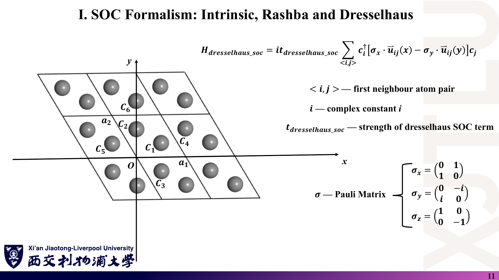
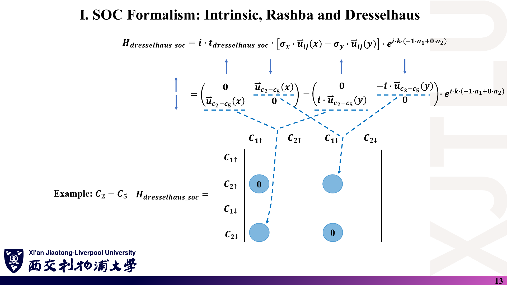
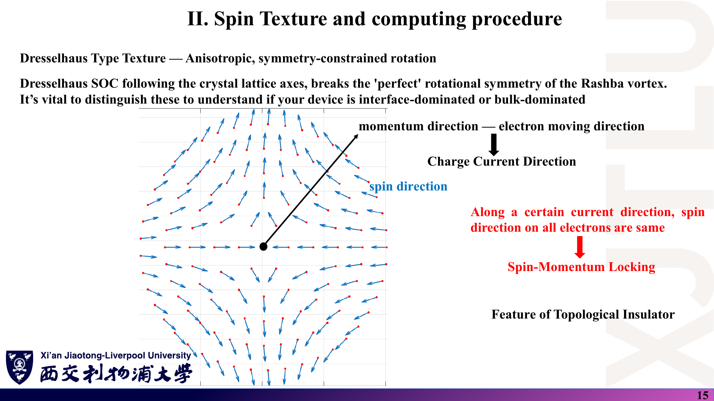
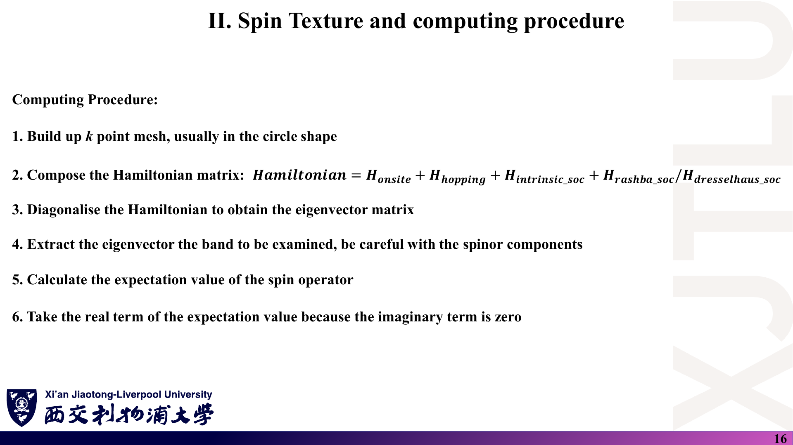
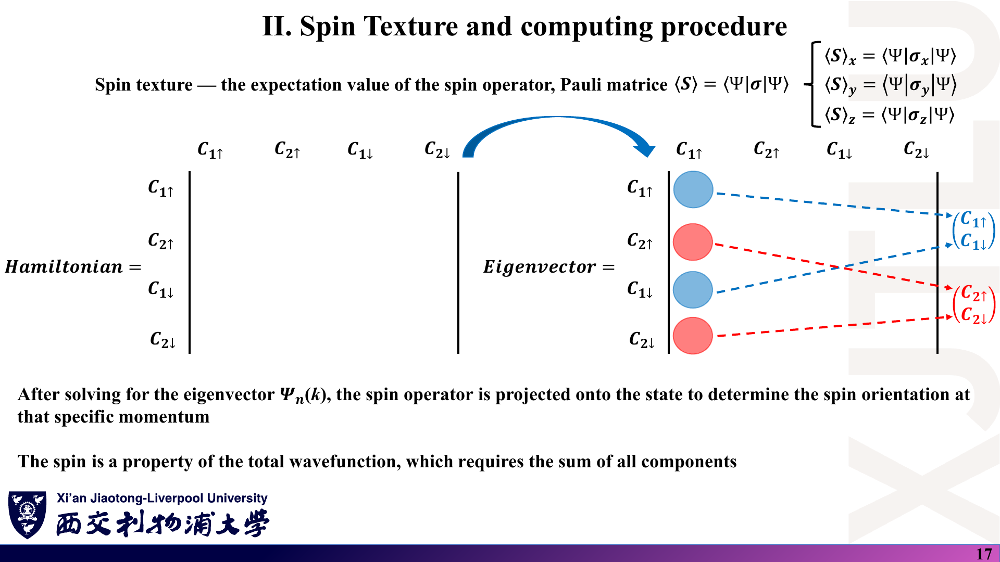
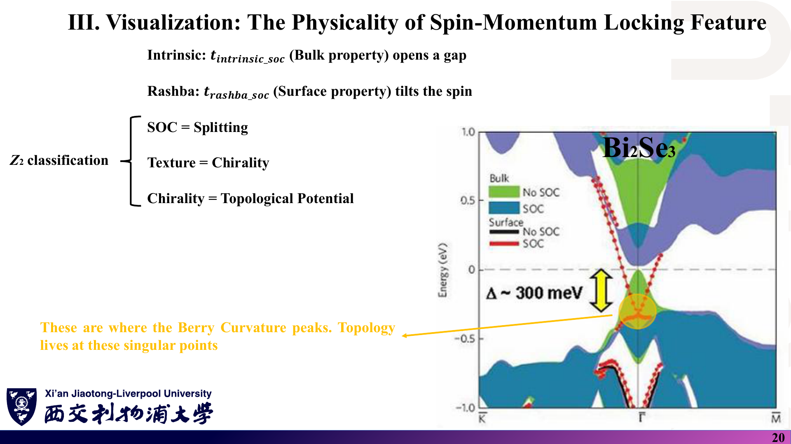

# 01 · 自旋轨道耦合：本征、Rashba、Dresselhaus 与自旋纹理

来源：[Lecture_Seventeen.pdf](../Lecture_Seventeen.pdf)，21 页。

[返回目录](README.md)

## 1. 这一讲要解决什么问题？〔p. 2〕

### 课件截图

### 中文解释

第一周只在单个原子的 p 壳层里讨论 SOC。这一讲把 SOC 写进**石墨烯的紧束缚哈密顿量**，分三部分：

1. 三种 SOC 的格点写法：本征（intrinsic）、Rashba、Dresselhaus；
2. 自旋纹理（spin texture）：在 k 空间每一点算自旋期望值；
3. 可视化：自旋—动量锁定，以及它与拓扑绝缘体的联系。

### 原理深入

全讲使用同一个 4×4 Bloch 基底（讲义第 7、10、13、17 页一致）：

$$
\Psi=\big(C_{1\uparrow},\;C_{2\uparrow},\;C_{1\downarrow},\;C_{2\downarrow}\big)^T .
$$

其中 1、2 是原胞内两个碳原子（A、B 子晶格），↑↓ 是 $\sigma_z$ 本征态。总哈密顿量为（讲义第 16 页）

$$
H(\mathbf k)=H_{onsite}+H_{hopping}+H_{intrinsic\_soc}+\big(H_{rashba\_soc}\ \text{或}\ H_{dresselhaus\_soc}\big).
$$

各项占据的矩阵块是本讲最需要记清的结构：

| 项 | 连接 | 自旋结构 | 填入的块 |
|---|---|---|---|
| 近邻跃迁 | 1↔2 | $\mathbb 1$（不翻转） | ↑↑、↓↓ 块的非对角元 |
| 本征 SOC | 1↔1、2↔2（次近邻） | $\sigma_z$（不翻转，↑↓ 反号） | ↑↑、↓↓ 块的对角元 |
| Rashba / Dresselhaus | 1↔2（近邻） | $\sigma_x,\sigma_y$（翻转） | ↑↓、↓↑ 块 |

### Ref

- **原课件**：[Lecture Seventeen，PDF 第 2 页](../Lecture_Seventeen.pdf#page=2)、[第 16 页](../Lecture_Seventeen.pdf#page=16)。
- **配套**：[代码导读：哈密顿量组装](08_代码导读.md)。

## 2. 原子 SOC 为什么会“翻转自旋”？〔p. 3〕

### 课件截图

### 中文解释

这一页回顾第一周：在 $|m_l,m_s\rangle$ 基底下写出 p 壳层的 $\mathbf L\cdot\mathbf S$ 矩阵，对角化后得到四重简并的 $j=3/2$（$E=1/2$）和二重简并的 $j=1/2$（$E=-1$）。讲义的结论是：SOC 让自旋与轨道角动量耦合并产生能量差，“物理上它会翻转自旋方向”。

### 原理深入

取 $\hbar=1$，

$$
\mathbf L\cdot\mathbf S=L_zS_z+\tfrac12\big(L_+S_-+L_-S_+\big).
$$

- **对角元** $m_lm_s$：$|1,\uparrow\rangle$ 与 $|-1,\downarrow\rangle$ 为 $1/2$；$|1,\downarrow\rangle$ 与 $|-1,\uparrow\rangle$ 为 $-1/2$；$m_l=0$ 的两个态为 0。
- **非对角元**：$\langle1,\downarrow|\mathbf L\cdot\mathbf S|0,\uparrow\rangle=\tfrac12\sqrt2\cdot1=1/\sqrt2$，$\langle0,\downarrow|\mathbf L\cdot\mathbf S|-1,\uparrow\rangle=1/\sqrt2$。

“翻转自旋”只来自 $L_\pm S_\mp$ 部分：它让自旋翻转的同时让 $m_l$ 反向变化 1，所以**守恒的是 $m_j=m_l+m_s$**。$L_zS_z$ 部分不翻转自旋。石墨烯的本征 SOC 正是 $\sigma_z$ 型（不翻转），Rashba / Dresselhaus 才是翻转型。因此“SOC 必然翻转自旋”不能一概而论。

用 $\mathbf J=\mathbf L+\mathbf S$ 验证本征值：

$$
\mathbf L\cdot\mathbf S=\tfrac12\big[j(j+1)-l(l+1)-s(s+1)\big]
=\begin{cases}\tfrac12, & j=3/2\\[2pt]-1, & j=1/2\end{cases}
$$

简并度分别为 $2j+1=4$ 与 $2$，与讲义一致。

### Ref

- **原课件**：[Lecture Seventeen，PDF 第 3 页](../Lecture_Seventeen.pdf#page=3)。
- **前置**：第一周 [04 · 周期势、微扰与 SOC](../../Week_One/学习笔记/04_周期势_微扰与SOC.md)。
- **延伸**：[BER](README.md#ref-ber)。

## 3. 石墨烯的近邻与次近邻怎样编号？〔pp. 4–5〕

### 课件截图

*第 5 页把单位键矢量写成 $\vec u_{ik}=\vec u_{ik}/|\vec u_{ik}|$，左右用了同一符号；行列式也少了一行单位矢量，见 07 第 1 节。*

### 中文解释

石墨烯每个原胞有两个碳原子（C1、C2）。

- **近邻**（first neighbour，记 ⟨i,j⟩）：异种子晶格之间，距离 $a/\sqrt3\approx1.42$ Å，每个原子 3 个。
- **次近邻**（second neighbour，记 ⟨⟨i,j⟩⟩）：同种子晶格之间，距离 $a=2.46$ Å，每个原子 6 个。

本征 SOC 的每一条次近邻路径 $i\to j$ 都经过唯一的中间原子 $k$，讲义用两段单位键矢量的叉积 $\hat{\mathbf u}_{ik}\times\hat{\mathbf u}_{kj}$ 标记这条路径是“左拐”还是“右拐”。

### 原理深入

取 $\mathbf a_1=a(1,0)$、$\mathbf a_2=a(-\tfrac12,\tfrac{\sqrt3}{2})$，两原子分数坐标为 $(2/3,1/3)$ 和 $(1/3,2/3)$（与 `Graphene.vasp` 一致）。

在 xy 平面中，$\hat{\mathbf u}_{ik}\times\hat{\mathbf u}_{kj}$ 只有 z 分量：

$$
(\hat{\mathbf u}_{ik}\times\hat{\mathbf u}_{kj})_z=\pm\sin60^\circ=\pm\frac{\sqrt3}{2}.
$$

（第一段键与第二段键的夹角是 60°：先沿一条键前进，再沿另一子晶格的键前进，两者方向相差 60°。）

Kane–Mele 原文把这个符号写成

$$
\boxed{\nu_{ij}=\frac{2}{\sqrt3}\,(\hat{\mathbf d}_1\times\hat{\mathbf d}_2)_z=\pm1}.
$$

**约定提醒**：讲义公式若按字面计算会多出一个 $\sqrt3/2$ 因子；`Codes/` 程序只取叉积的**符号**（`chirality = ±1`），与 Kane–Mele 的 $\nu_{ij}$ 一致。比较不同来源的临界值时，必须先统一这一点。

### Ref

- **原课件**：[Lecture Seventeen，PDF 第 4–5 页](../Lecture_Seventeen.pdf#page=4)。
- **代码对应**：[08 第 3 节：近邻搜索与手性](08_代码导读.md)；勘误 [07 第 1 节](07_讲义勘误与易错点.md)。
- **延伸**：[KM1](README.md#ref-km1)。

## 4. 本征 SOC：为什么是次近邻、为什么有 i 和 σ_z？〔pp. 6–7〕

### 课件截图

*第 7 页第一个等号右边漏写了 $i\,t_{intrinsic\_soc}$，且叉积应取 z 分量；见 07 第 2 节。*

### 中文解释

讲义的本征 SOC 为

$$
H_{intrinsic\_soc}=i\,t_{intrinsic\_soc}\sum_{\langle\langle i,j\rangle\rangle}c_i^\dagger\,(\hat{\mathbf u}_{ik}\times\hat{\mathbf u}_{kj})\,\sigma_z\,c_j .
$$

第 7 页以 C2–C11 为例：因为是 $\sigma_z$，自旋向上块填 $+(\ldots)$，自旋向下块填 $-(\ldots)$，自旋翻转块为 0；同时乘上相位因子 $e^{i\mathbf k\cdot(-\mathbf a_1-\mathbf a_2)}$，因为 C11 位于相邻原胞。

### 原理深入

#### 4.1 为什么一定要有 i？

记 $\nu_{ij}=\pm1$。一条次近邻键反向走时手性反号：$\nu_{ji}=-\nu_{ij}$。厄米性要求系数满足 $h_{ji}=h_{ij}^*$：

$$
h_{ij}=i\,t_I\,\nu_{ij}\sigma_z\ \Rightarrow\ h_{ij}^*=-i\,t_I\,\nu_{ij}\sigma_z=i\,t_I\,\nu_{ji}\sigma_z=h_{ji}.
$$

**只有“$i$ × 反对称符号”的组合才厄米**；若去掉 $i$，这一项就变成反厄米。

#### 4.2 动量空间的样子

同一子晶格的 6 条次近邻成对出现（$\pm\mathbf r$，手性相反），相位求和后

$$
\sum_{6}i\,t_I\,\nu\,e^{i\mathbf k\cdot\mathbf r}=-2t_I\sum_{3}\nu\,\sin(\mathbf k\cdot\mathbf r),
$$

是**实数**，只出现在 ↑↑、↓↓ 块的对角元上，并且对子晶格 A、B 和两个自旋都反号。

在 K 点，这个实数的大小是 $3\sqrt3\,t_I$。它给 Dirac 点加上“质量”，带隙为

$$
\boxed{E_g=6\sqrt3\,t_I}
$$

〔补充；与 [KM1](README.md#ref-km1) 一致。本笔记用复刻程序数值验证：$t_I=0.005$ eV 时带隙为 51.96 meV，见 08〕。

#### 4.3 易错点

- 本征 SOC 是 **K 与 K′ 质量反号、自旋 ↑ 与 ↓ 质量反号**的项：每个自旋分量各自像一个 Haldane 模型，Chern 数为 $\pm1$。这就是第十八讲“单个自旋分量可以非平庸”的来源。
- 它保持时间反演对称性和空间反演对称性，所以只加本征 SOC 时能带处处**二重简并**。

### Ref

- **原课件**：[Lecture Seventeen，PDF 第 6–7 页](../Lecture_Seventeen.pdf#page=6)。
- **代码对应**：`TIGHTBINDINGFORGRAPHENE.f90` 第 401–411 行，见 [08 第 4 节](08_代码导读.md)。
- **延伸**：[KM1](README.md#ref-km1)、[BER](README.md#ref-ber)。

## 5. Rashba SOC：结构反演破缺怎样写进紧束缚？〔pp. 8–10〕

### 课件截图

*第 10 页第一个等号右边漏写了 $i\,t_{rashba\_soc}$。*

### 中文解释

讲义的 Rashba 项为

$$
H_{rashba\_soc}=i\,t_{rashba\_soc}\sum_{\langle i,j\rangle}c_i^\dagger\,\boldsymbol\sigma\cdot(\hat{\mathbf u}_{ij}\times\hat{\mathbf n}_e)\,c_j ,
\qquad \hat{\mathbf n}_e=\hat z .
$$

它作用在**近邻**键上，代表结构不对称（例如衬底或垂直电场），破坏 $z\to-z$ 镜面对称。第 10 页显示它只填 C1↑–C2↓、C2↑–C1↓ 等**自旋翻转块**。

### 原理深入

#### 5.1 展开

$\hat{\mathbf u}\times\hat z=(u_y,-u_x,0)$，因此

$$
\boldsymbol\sigma\cdot(\hat{\mathbf u}\times\hat z)=\sigma_xu_y-\sigma_yu_x
=\begin{pmatrix}0&u_y+iu_x\\ u_y-iu_x&0\end{pmatrix}.
$$

对角元为 0，所以 **Rashba 项必然翻转自旋**，与第 10 页的填块方式一致。这正是 Kane–Mele 写法 $i\lambda_R(\mathbf s\times\hat{\mathbf d}_{ij})_z$。

#### 5.2 为什么破坏 $z\to-z$ 镜面？

镜面 $M_z$ 下，自旋是赝矢量：$(\sigma_x,\sigma_y,\sigma_z)\to(-\sigma_x,-\sigma_y,\sigma_z)$，而面内键矢量不变。于是 $\sigma_xu_y-\sigma_yu_x$ 变号，Rashba 项不能在 $M_z$ 下保持不变。本征项只含 $\sigma_z$，因此保持 $M_z$。

#### 5.3 时间反演

时间反演 $\mathcal T$ 把 $i\to-i$、$\boldsymbol\sigma\to-\boldsymbol\sigma$，因此 $i\,t\,\boldsymbol\sigma$ 型的项**保持** $\mathcal T$。三种 SOC 都不破坏时间反演；它们破坏的是空间反演或镜面。这一点决定了第十八、十九讲的 Z₂ 分析可以使用。

#### 5.4 与本征 SOC 的竞争〔补充，本笔记数值复核〕

在 `Codes/` 程序的约定下（$\nu=\pm1$、单位键矢量），K 点带隙为

$$
E_g=6\sqrt3\,t_I-3\,t_R ,
$$

在 $t_R=2\sqrt3\,t_I$ 时闭合，此后体系保持无隙。这与 Kane–Mele 原文的 QSH 条件 $\lambda_R<2\sqrt3\lambda_{SO}$ 一致。第二十讲写的 $3\sqrt3$ 与此不同，详见 [04 第 3 节](04_代码演示_石墨烯Rashba与Dresselhaus.md) 与 [07 第 13 节](07_讲义勘误与易错点.md)。

### Ref

- **原课件**：[Lecture Seventeen，PDF 第 8–10 页](../Lecture_Seventeen.pdf#page=8)。
- **代码对应**：第 412–428 行，见 [08 第 4 节](08_代码导读.md)。
- **延伸**：[KM1](README.md#ref-km1)、[SOC](README.md#ref-soc)。

## 6. Dresselhaus SOC 与 Rashba 有何不同？〔pp. 11–13〕

### 课件截图

### 中文解释

讲义的 Dresselhaus 项为

$$
H_{dresselhaus\_soc}=i\,t_{dresselhaus\_soc}\sum_{\langle i,j\rangle}c_i^\dagger\big[\sigma_x u_{ij}(x)-\sigma_y u_{ij}(y)\big]c_j .
$$

第 12 页总结了它的意义：源于体反演不对称（BIA）；与 Rashba 一样在无磁场下劈裂自旋；纹理绑定晶轴、呈各向异性；当 $t_R=t_D$ 时可形成持久自旋螺旋（PSH）；其系数可作为结构不对称的探针。

### 原理深入

#### 6.1 与 Rashba 只差“配对方式”

$$
\text{Rashba: }\sigma_xu_y-\sigma_yu_x,\qquad
\text{Dresselhaus: }\sigma_xu_x-\sigma_yu_y .
$$

$$
\sigma_xu_x-\sigma_yu_y=\begin{pmatrix}0&u_x+iu_y\ u_x-iu_y&0\end{pmatrix}.
$$

两者都只有自旋翻转块，都保持时间反演对称性。

#### 6.2 为什么一个是“涡旋”、一个是“各向异性”？〔补充〕

令 $\sigma_\pm=\sigma_x\pm i\sigma_y$、$u_\pm=u_x\pm iu_y$：

$$
\sigma_xu_y-\sigma_yu_x=\tfrac{i}{2}\big(\sigma_+u_--\sigma_-u_+\big),\qquad
\sigma_xu_x-\sigma_yu_y=\tfrac12\big(\sigma_+u_++\sigma_-u_-\big).
$$

在同时转动自旋与键矢量时，Rashba 组合的“角动量指标”相互抵消（+1−1=0），在任意面内转动下不变，因此纹理是各向同性的涡旋。Dresselhaus 组合的指标为 ±2，在 C₃ 转动下多出相位 $e^{\pm i4\pi/3}$。所以它不具有石墨烯的三重旋转对称性，纹理只保留镜面型的对称，呈各向异性。

#### 6.3 第 12 页的措辞需要更正

“它破坏时间反演保护的自旋简并”不准确。Dresselhaus 与 Rashba 都**保持**时间反演对称性。Kramers 定理 $E_\uparrow(\mathbf k)=E_\downarrow(-\mathbf k)$ 依然成立，TRIM 处的二重简并也不会被打破。被打破的是“同一 $\mathbf k$ 处的自旋简并”，它要靠**时间反演 + 空间反演**两者同时存在来保证。见 [07 第 3 节](07_讲义勘误与易错点.md)。

#### 6.4 PSH 的适用范围

“$t_R=t_D$ 时自旋轨道有效场在特定方向抵消”是 [001] 量子阱二维电子气中线性 Rashba + Dresselhaus 模型的结论（见 [SOC](README.md#ref-soc)）。讲义把它作为背景介绍，本周石墨烯模型没有计算 PSH，不宜直接套用。

### Ref

- **原课件**：[Lecture Seventeen，PDF 第 11–13 页](../Lecture_Seventeen.pdf#page=11)。
- **代码对应**：第 429–445 行，见 [08 第 4 节](08_代码导读.md)。
- **延伸**：[SOC](README.md#ref-soc)。

## 7. 自旋纹理长什么样？〔pp. 14–15〕

### 课件截图

### 中文解释

在 K 点周围画同心圆，在每个 k 点画出该能带的面内自旋 $(\langle\sigma_x\rangle,\langle\sigma_y\rangle)$：

- **Rashba**：自旋沿圆周切向，形成涡旋（vortex / helical）。
- **Dresselhaus**：自旋方向随晶轴变化，水平线上指向中心、竖直线上背离中心，是各向异性的图样。

讲义强调“沿某一电流方向，所有电子自旋相同”，即**自旋—动量锁定**（spin-momentum locking）。区分这两种纹理，可以判断器件是界面主导（Rashba）还是体材料主导（Dresselhaus）。

### 原理深入

- 纹理是**某一条能带**的性质。同一 $\mathbf k$ 处 Rashba 劈裂出的两条带纹理方向相反，把它们的贡献相加会抵消。
- “自旋—动量锁定”本身**不等于**拓扑绝缘体：普通 Rashba 二维电子气也有锁定，但它有两个手性相反的费米圆，背散射不受拓扑保护。讲义把它标为 “Feature of Topological Insulator”，应理解为“拓扑表面态具有这种特征”，反过来不成立。见 [07 第 4 节](07_讲义勘误与易错点.md)。
- 这两页的图坐标单位是 Å⁻¹，圆心是 K 点的笛卡尔坐标 $(0.851,1.475)$，$|\mathbf K|=4\pi/(3a)\approx1.703$ Å⁻¹。

### Ref

- **原课件**：[Lecture Seventeen，PDF 第 14–15 页](../Lecture_Seventeen.pdf#page=14)。
- **代码结果图**：[08 第 8 节](08_代码导读.md)。
- **延伸**：[HK](README.md#ref-hk)。

## 8. 怎样从本征向量算出自旋纹理？〔pp. 16–18〕

### 课件截图

### 中文解释

六步流程：建圆形 k 网格 → 组装哈密顿量 → 对角化 → 取出某条能带的本征矢（注意旋量分量）→ 算 Pauli 矩阵期望值 → 取实部。

关键是第 17–18 页的“重排”：本征矢四个分量按原子分组为 $(C_{1\uparrow},C_{1\downarrow})$ 与 $(C_{2\uparrow},C_{2\downarrow})$ 两个旋量，每个旋量各算一次 $\chi^\dagger\sigma_\alpha\chi$，**再对原子求和**。

### 原理深入

对归一化本征矢 $\Psi_n(\mathbf k)$：

$$
\langle\sigma_\alpha\rangle_n(\mathbf k)=\sum_{s=1,2}
\begin{pmatrix}C_{s\uparrow}^*&C_{s\downarrow}^*\end{pmatrix}
\sigma_\alpha
\begin{pmatrix}C_{s\uparrow}\ C_{s\downarrow}\end{pmatrix}.
$$

展开得到便于手算的形式：

$$
\langle\sigma_x\rangle=2\,\mathrm{Re}\sum_s C_{s\uparrow}^*C_{s\downarrow},\quad
\langle\sigma_y\rangle=2\,\mathrm{Im}\sum_s C_{s\uparrow}^*C_{s\downarrow},\quad
\langle\sigma_z\rangle=\sum_s\big(|C_{s\uparrow}|^2-|C_{s\downarrow}|^2\big).
$$

注意事项：

1. **为什么取实部？** $\sigma_\alpha$ 厄米，期望值在数学上就是实数；数值上虚部只是 $10^{-17}$ 量级的舍入误差。取实部只是去掉噪声，不是物理近似。
2. **单位**：讲义写 $\langle S\rangle=\langle\Psi|\sigma|\Psi\rangle$，省略了 $\hbar/2$。严格说算的是 $\langle\boldsymbol\sigma\rangle$，自旋为 $\langle\mathbf S\rangle=\frac\hbar2\langle\boldsymbol\sigma\rangle$。
3. **系数的共轭**：第 18 页把行向量写成 $C^\dagger$；对单个复系数应写 $C^*$，含义相同。
4. **简并陷阱**：若只有本征 SOC（无 Rashba / Dresselhaus），能带处处二重简并，“第 1 带”的本征矢只确定到简并子空间内的一个任意幺正变换，单带纹理没有意义。必须有破坏反演的项劈裂能带，或者只讨论简并子空间的规范不变量。

### Ref

- **原课件**：[Lecture Seventeen，PDF 第 16–18 页](../Lecture_Seventeen.pdf#page=16)。
- **代码对应**：第 448–481 行，见 [08 第 5 节](08_代码导读.md)；练习 [06 第 3 题](06_复习题与参考答案.md)。

## 9. 自旋—动量锁定与拓扑有什么关系？〔pp. 19–20〕

### 课件截图

### 中文解释

讲义的要点：

- 拓扑绝缘体（如 Bi₂Se₃、Bi₂Te₃、Sb₂Te₃）体内绝缘、表面导电；表面态自旋锁定于动量，因此非磁杂质不能使其背散射。
- “自旋随电子穿越布里渊区而转动，是拓扑的第一个线索；若自旋缠绕非零，这个缠绕数就是拓扑不变量。”
- 本征 SOC（体性质）打开带隙；Rashba（表面性质）使自旋倾斜。
- “Z₂ 分类：SOC = 劈裂，纹理 = 手性，手性 = 拓扑潜力”；Berry 曲率在能带交叉附近达到峰值。

### 原理深入

这两页是**直观口号**，不是定义。准确的说法是：

1. Z₂ 是**全部占据带在整个布里渊区**上的整体性质（第十八、十九讲），不能由某个 k 点附近的局部自旋纹理决定。
2. 局部自旋纹理的缠绕数不是拓扑不变量。Rashba 二维电子气的自旋也缠绕，但它是平庸的。
3. “本征 SOC 开隙”是对的：它打开 $6\sqrt3\,t_I$ 的 QSH 带隙。“Rashba 只倾斜自旋”不完整：Rashba 同时**减小**这个带隙（$-3t_R$），足够大时会让带隙闭合。
4. Berry 曲率集中在带隙最小的地方（这里是 K、K′ 附近），但仅凭“曲率大”不能判断是否拓扑，要看积分后的整数。

讲义所用 Bi₂Se₃ 图为文献图片。本笔记未独立核对其来源与数据。

### Ref

- **原课件**：[Lecture Seventeen，PDF 第 19–20 页](../Lecture_Seventeen.pdf#page=19)。
- **衔接**：[02 · Berry 相位与 Z₂](02_Berry相位与Z2拓扑.md)；勘误 [07 第 4 节](07_讲义勘误与易错点.md)。
- **延伸**：[HK](README.md#ref-hk)、[KM1](README.md#ref-km1)。
