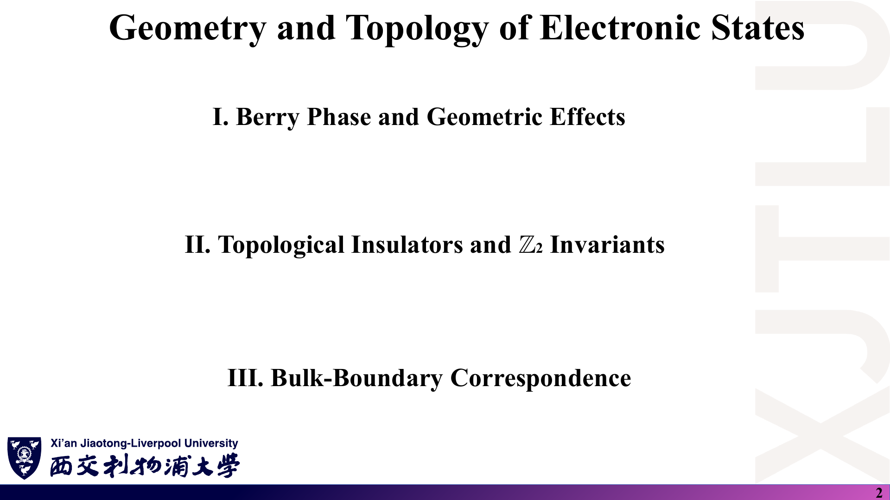
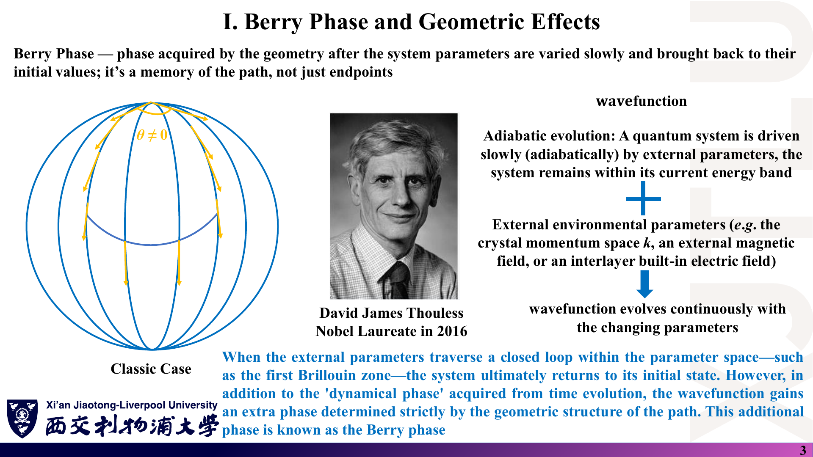
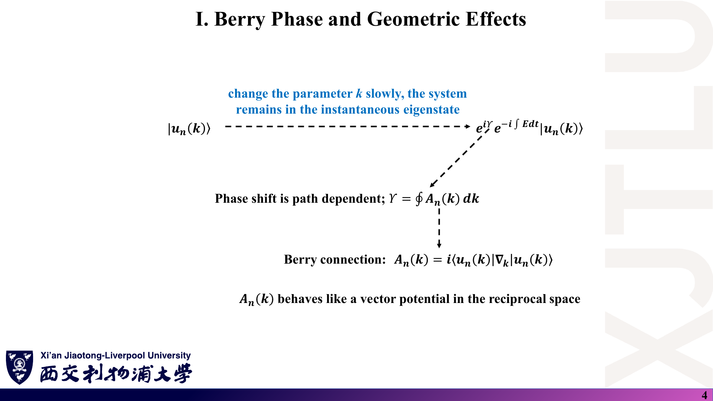
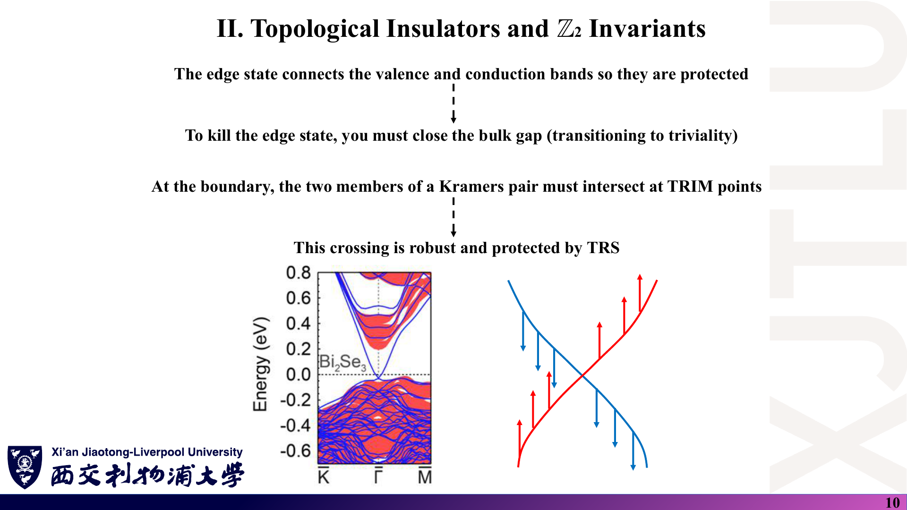
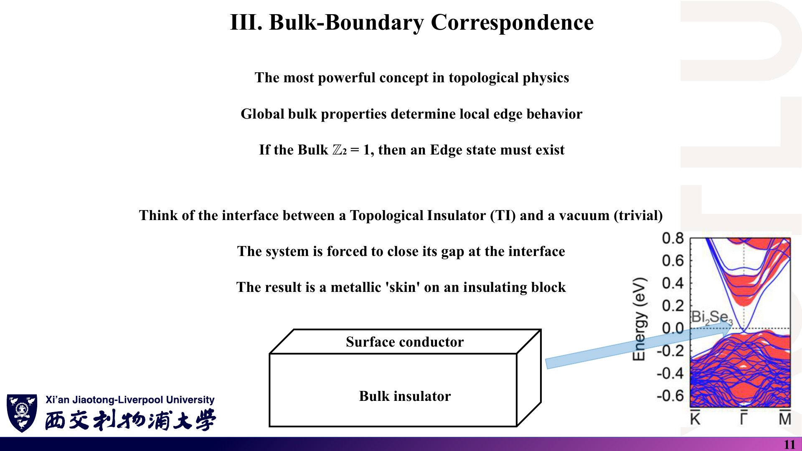

# 02 · 电子态的几何与拓扑：Berry 相位、Chern 数与 Z₂

来源：[Lecture_Eighteen.pdf](../Lecture_Eighteen.pdf)，15 页。

[返回目录](README.md)

## 1. 这一讲要解决什么问题？〔p. 2〕

### 课件截图

### 中文解释

第十七讲看的是单个 k 点上的自旋。本讲转向**整个布里渊区上波函数的几何**：

1. Berry 相位与几何效应：联络、曲率、Chern 数；
2. 拓扑绝缘体与 Z₂ 不变量：时间反演对称性下的新分类；
3. 体—边对应：体内的整体不变量决定边界是否必有导电态。

### 原理深入

三个层次的对象要分清：

| 对象 | 是否依赖规范 | 是否局部 | 性质 |
|---|---|---|---|
| Berry 联络 $\mathbf A_n(\mathbf k)$ | 依赖 | 局部 | 类似矢势，本身不可观测 |
| Berry 曲率 $\Omega_n(\mathbf k)$ | 不依赖 | 局部 | 类似磁场，可影响输运 |
| Chern 数 $C$、Z₂ 指标 $\nu$ | 不依赖 | 整体 | 整数，只有带隙闭合才能改变 |

### Ref

- **原课件**：[Lecture Eighteen，PDF 第 2 页](../Lecture_Eighteen.pdf#page=2)。
- **延伸**：[XCN](README.md#ref-xcn)、[VAN](README.md#ref-van)。

## 2. Berry 相位是什么？〔p. 3〕

### 课件截图

### 中文解释

当外参数（晶体动量 $\mathbf k$、外磁场、层间内建电场等）**缓慢**变化并沿闭合路径回到起点时，系统停留在原来的能带上，最终回到原来的态。除了随时间积累的**动力学相位**外，波函数还多出一个只由路径几何决定的相位，这就是 **Berry 相位**。讲义的比喻是：“它记住的是路径，而不只是端点。”

左图是经典类比：在球面上沿闭合路径平行移动一个矢量，回到起点时矢量转过一个角度 $\theta\neq0$，转角由路径围住的曲面决定。

### 原理深入

- **绝热条件**：参数变化要比带隙对应的时间尺度慢得多。在能带语境中，$\mathbf k$ 是参数，“沿 BZ 走一圈”是数学构造，不一定是真实的时间演化；Berry 相位在这里是能带本征态的几何性质。
- **为什么闭合路径才有意义**：开路径上的相位可以靠重新选取每点的相位（规范）任意改变；闭合路径的相位只能改变 $2\pi$ 的整数倍，因此 $e^{i\gamma}$ 是规范不变的。
- 讲义提到的 Thouless 因“拓扑相变和物质拓扑相”的理论工作与 Haldane、Kosterlitz 分享 2016 年诺贝尔物理学奖。

### Ref

- **原课件**：[Lecture Eighteen，PDF 第 3 页](../Lecture_Eighteen.pdf#page=3)。
- **延伸**：[BERRY](README.md#ref-berry)、[XCN](README.md#ref-xcn)。

## 3. Berry 联络与 Berry 相位怎样定义？〔p. 4〕

### 课件截图

### 中文解释

缓慢改变 $\mathbf k$，态 $|u_n(\mathbf k)\rangle$ 演化为

$$
e^{i\gamma}\,e^{-i\int E\,dt}\,|u_n(\mathbf k)\rangle ,
$$

其中几何相位为

$$
\gamma=\oint\mathbf A_n(\mathbf k)\cdot d\mathbf k,\qquad
\mathbf A_n(\mathbf k)=i\langle u_n(\mathbf k)|\nabla_{\mathbf k}|u_n(\mathbf k)\rangle .
$$

$\mathbf A_n$ 称为 **Berry 联络**，在倒空间中的作用类似矢势。

### 原理深入

#### 3.1 为什么 $\mathbf A_n$ 是实数？

对归一化态求导，$\nabla\langle u|u\rangle=0$，即 $\langle u|\nabla u\rangle+\langle\nabla u|u\rangle=0$。所以 $\langle u|\nabla u\rangle$ 是纯虚数，乘以 $i$ 后得到实数。

#### 3.2 规范变换

令 $|u\rangle\to e^{i\chi(\mathbf k)}|u\rangle$（$\chi$ 是实标量函数）：

$$
\mathbf A\to\mathbf A+i\cdot i\nabla\chi=\boxed{\mathbf A-\nabla\chi}.
$$

闭合路径上 $\oint\nabla\chi\cdot d\mathbf k=2\pi m$（$e^{i\chi}$ 必须单值），所以 $\gamma$ 只在 **mod $2\pi$** 意义下有定义。这正是第十九讲 WCC 只定义到“模 1”的根源。

#### 3.3 为什么是 $u$ 而不是 $\psi$？

Bloch 函数 $\psi_{n\mathbf k}=e^{i\mathbf k\cdot\mathbf r}u_{n\mathbf k}$。对 $\mathbf k$ 求导时，平面波因子的导数给出位置算符；用周期部分 $u$ 才得到与晶格周期兼容的联络。第十九讲的重叠矩阵也用 $u$。

### Ref

- **原课件**：[Lecture Eighteen，PDF 第 4 页](../Lecture_Eighteen.pdf#page=4)。
- **练习**：[06 第 5 题](06_复习题与参考答案.md)。
- **延伸**：[XCN](README.md#ref-xcn)、[VAN](README.md#ref-van)。

## 4. 为什么 Berry 曲率是规范不变的？〔p. 5〕

### 课件截图

*此页把规范变换写成 $\mathbf A_n-\nabla u_n(\mathbf k)$，应为 $\mathbf A_n-\nabla\chi(\mathbf k)$，见 07 第 6 节。*

### 中文解释

定义 **Berry 曲率** $\Omega_n(\mathbf k)=\nabla\times\mathbf A_n(\mathbf k)$。因为“标量函数梯度的旋度为零”，规范变换给 $\mathbf A$ 增加的梯度项不改变曲率，所以曲率是规范不变的“场强”。它刻画能带的局部几何，可看作通量的源或汇。

下半页的例子（文献图）：在拓扑绝缘体 Bi₂Se₃ 中掺入磁性 Fe，表面 Dirac 点打开带隙，能带几何随之改变。

### 原理深入

在二维中曲率只有 z 分量：

$$
\Omega_n(\mathbf k)=\partial_{k_x}A_{n,y}-\partial_{k_y}A_{n,x}
=i\big(\langle\partial_xu_n|\partial_yu_n\rangle-\langle\partial_yu_n|\partial_xu_n\rangle\big).
$$

规范不变性：

$$
\nabla\times(\mathbf A-\nabla\chi)=\nabla\times\mathbf A-\underbrace{\nabla\times\nabla\chi}_{0}=\Omega .
$$

**为什么讲义写法不对？** $u_n(\mathbf k)$ 是一个态矢量（或波函数），不是实标量。“$\nabla\times\nabla u_n$”与 $\mathbf A$ 的量纲和类型都不一致。被减去的必须是相位 $\chi$ 的梯度。

**磁掺杂的物理**〔补充〕：磁性杂质破坏时间反演对称性，Kramers 简并不再受保护，表面 Dirac 点可以打开带隙。第 13 页“非磁掺杂”的情形与此相对。

### Ref

- **原课件**：[Lecture Eighteen，PDF 第 5 页](../Lecture_Eighteen.pdf#page=5)。文献图引自 J. Kim & S.-H. Jhi, *Phys. Rev. B* **92**, 104405 (2015)（按课件引注，未独立核读）。
- **勘误**：[07 第 6 节](07_讲义勘误与易错点.md)。
- **延伸**：[XCN](README.md#ref-xcn)。

## 5. Chern 数为什么是整数？〔pp. 6–7〕

### 课件截图

*第 7 页“若 Ω_n(k) 非零，能带就不能在不闭合带隙的情况下解开”混淆了局部曲率与整体不变量，见 07 第 7 节。*

### 中文解释

把曲率对整个布里渊区积分，得到总通量：

$$
C=\frac{1}{2\pi}\int_{BZ}\Omega_n(\mathbf k)\,dk_x\,dk_y ,
$$

对二维绝缘体它是整数，称为 **Chern 数**，是拓扑不变量。类比：曲率像 k 空间里一个磁单极子发出的磁通；$C$ 数的是矢量场绕球面包裹了几圈。第 7 页说明二维布里渊区是周期的环面，拓扑按“洞的个数”区分不同流形（甜甜圈 = 咖啡杯）。

### 原理深入

#### 5.1 为什么是整数？

布里渊区是闭合曲面（环面），没有边界。若能在整个 BZ 上取光滑且周期的规范，由 Stokes 定理，积分等于边界上的环路积分，而边界不存在，所以 $C=0$。如果 $C\neq0$，就说明**不存在**全局光滑的周期规范：只能分片取规范，两片接缝处的相位差绕一圈必须是 $2\pi$ 的整数倍。于是 $2\pi C\in2\pi\mathbb Z$。

#### 5.2 成立条件

- 必须**有带隙**（或至少被积的那组能带与其余能带处处分开）；带隙闭合处曲率可以发散，$C$ 才可能改变。
- 有多条占据带时，应对占据带求和：$C=\sum_{n\in occ}C_n$。

#### 5.3 局部与整体

“曲率不为零”不能推出“拓扑非平庸”。例如石墨烯加交错子晶格势时，K 与 K′ 处曲率很大但符号相反，积分为 $C=0$。能否“解开”看的是整数 $C$（或 Z₂ 指标 $\nu$），不是局部的 $\Omega$。

### Ref

- **原课件**：[Lecture Eighteen，PDF 第 6–7 页](../Lecture_Eighteen.pdf#page=6)。
- **数值方法**：[FHS](README.md#ref-fhs)；勘误 [07 第 7 节](07_讲义勘误与易错点.md)。
- **延伸**：[BER](README.md#ref-ber)、[VAN](README.md#ref-van)。

## 6. 时间反演对称性怎样引出 Z₂？〔pp. 8–9〕

### 课件截图

### 中文解释

时间反演对称（TRS）意味着 $TH(\mathbf k)T^{-1}=H(-\mathbf k)$，这迫使总 Chern 数严格为 0。电子是费米子，满足 $T^2=-1$，于是有 **Kramers 对**：在时间反演不变动量（TRIM）上，每个态至少二重简并。总 Chern 数为零时，单个自旋分量仍可能非平庸。由此定义 **Z₂ 指标** $`\nu\in\{0,1\}`$：$\nu=0$ 可以连续形变为真空（平庸），$\nu=1$ 拓扑上不同（非平庸）。第 9 页强调：Z₂ 是二元的（“要么缠绕，要么不缠绕”），对任何保持 TRS 的微扰都稳健。

### 原理深入

#### 6.1 TRS ⇒ $C=0$

TRS 把 $\mathbf k$ 处的态映射到 $-\mathbf k$，同时对 $\mathbf A$ 和 $\Omega$ 取共轭关系，给出

$$
\Omega(-\mathbf k)=-\Omega(\mathbf k)\ \Rightarrow\ \int_{BZ}\Omega=0 .
$$

（对 Kramers 对求和后成立。）

#### 6.2 Kramers 简并

对 $T^2=-1$ 的反幺正算符，$|\psi\rangle$ 与 $T|\psi\rangle$ 必定正交：

$$
\langle\psi|T\psi\rangle=\langle T^2\psi|T\psi\rangle=-\langle\psi|T\psi\rangle\ \Rightarrow\ \langle\psi|T\psi\rangle=0 .
$$

在 TRIM（$\mathbf k\equiv-\mathbf k$ mod $\mathbf G$）处，两者能量相同，所以至少二重简并。

#### 6.3 “单个自旋分量非平庸”的前提

当 $S_z$ 守恒（只有本征 SOC，没有 Rashba）时，↑ 与 ↓ 两个分量可以分别计算 Chern 数，得到 $C_\uparrow=-C_\downarrow=\pm1$。此时自旋 Chern 数满足 $\nu=\tfrac12(C_\uparrow-C_\downarrow)\bmod2$。加入 Rashba 后 $S_z$ 不再守恒，“分自旋计算”失去定义，但只要**带隙不闭合**，$\nu$ 不变。这正是 Kane–Mele 引入 Z₂ 的原因。

#### 6.4 “稳健”的完整条件

Z₂ 不变的条件是两条同时成立：**保持 TRS**，并且**体带隙不闭合**。保持 TRS 但足够强、使带隙闭合的微扰（例如很大的 Rashba 项）可以改变 $\nu$，或使体系变成无隙。见 [07 第 8 节](07_讲义勘误与易错点.md)。

### Ref

- **原课件**：[Lecture Eighteen，PDF 第 8–9 页](../Lecture_Eighteen.pdf#page=8)。
- **延伸**：[KM2](README.md#ref-km2)、[FK](README.md#ref-fk)、[BER](README.md#ref-ber)。

## 7. 边缘态为什么受保护？〔p. 10〕

### 课件截图

### 中文解释

非平庸体系的边缘态把价带和导带连接起来；要消灭它们，只能先闭合体带隙（相变为平庸）。在边界上，Kramers 对的两个成员必须在 TRIM 处相交，这个交叉受 TRS 保护，十分稳健。右图是一对自旋相反、色散相反的边缘态在中点交叉。

### 原理深入

把边缘布里渊区从一个 TRIM（如 $k=0$）走到另一个（$k=\pi$），观察带隙中的边缘态：

- 两端 TRIM 处必有 Kramers 简并；
- **奇数**次穿过费米能级 ⇒ 边缘态不能整体推出带隙 ⇒ $\nu=1$；
- **偶数**次 ⇒ 可以成对推出带隙 ⇒ $\nu=0$。

这与第十九讲 WCC 的“交叉计数”是同一个数学结构：WCC 谱与边缘态谱在拓扑上等价。

### Ref

- **原课件**：[Lecture Eighteen，PDF 第 10 页](../Lecture_Eighteen.pdf#page=10)。
- **衔接**：[03 第 6 节：交叉计数](03_Wilson环与WCC数值判据.md)。
- **延伸**：[HK](README.md#ref-hk)。

## 8. 体—边对应：ν=1 为什么必有边缘态？〔pp. 11–12〕

### 课件截图

### 中文解释

体—边对应是拓扑物理中最有力的概念：全局的体性质决定局部的边界行为。若体 Z₂ = 1，则边缘态必然存在。把拓扑绝缘体（TI）与真空（平庸）拼接，两边的不变量不同，界面处带隙被迫闭合，于是得到“绝缘体块外面包着一层金属皮”。第 12 页说明这些边缘态是自旋极化的：“自旋向上向右走，自旋向下向左走”，从而阻止非磁杂质导致的背散射。

### 原理深入

#### 8.1 为什么界面带隙必须闭合？

不变量只能在带隙闭合处改变。从 TI 内部（$\nu=1$）沿垂直界面方向走到真空（$\nu=0$），等效地相当于参数连续变化跨越了相变，所以界面附近必须出现带隙中的态。

#### 8.2 二维与三维要区分

- **二维 QSH**（Kane–Mele 石墨烯模型）：一维边缘上有一对**螺旋边缘态**，“↑ 向右、↓ 向左”这句话适用于此。
- **三维 TI**（Bi₂Se₃）：二维表面上是单个 Dirac 锥，自旋位于面内并垂直于动量，即第 12 页右图的圆形纹理，不是简单的“↑ 右 ↓ 左”。

讲义把两者混在同一页，阅读时应分别理解。

### Ref

- **原课件**：[Lecture Eighteen，PDF 第 11–12 页](../Lecture_Eighteen.pdf#page=11)。文献图引自 J. Zhang *et al.*, *Phys. Rev. B* **94**, 014435 (2016)（按课件引注，未独立核读）。
- **延伸**：[HK](README.md#ref-hk)、[KM1](README.md#ref-km1)。

## 9. 为什么非磁杂质不能造成背散射？〔pp. 13–14〕

### 课件截图

### 中文解释

背散射需要自旋翻转；没有磁性杂质时，TRS 禁止自旋翻转。平庸（$\nu=0$）：没有边缘态，处处有隙；非平庸（$\nu=1$）：边缘无隙，体内有隙。边缘模式不能单独存在而没有伙伴，伙伴关系由 Kramers 定理保证，从而保证边缘无隙。

### 原理深入

#### 9.1 精确表述

对螺旋边缘态，$|k,\uparrow\rangle$ 的背散射末态正是它的 Kramers 伙伴 $T|k,\uparrow\rangle$。若杂质势 $V$ 保持 TRS（$[V,T]=0$），利用 $\langle Tx|Ty\rangle=\langle y|x\rangle$：

$$
\langle T\psi|V|\psi\rangle=\langle TV\psi|T^2\psi\rangle=-\langle VT\psi|\psi\rangle=-\langle T\psi|V|\psi\rangle
\ \Rightarrow\ \boxed{\langle T\psi|V|\psi\rangle=0}.
$$

所以被禁止的是“到 Kramers 伙伴的一阶背散射矩阵元”，不是笼统的“一切自旋翻转”。多体相互作用、非弹性过程等仍可能带来有限电阻。

#### 9.2 “平庸 = 没有边缘态”不严谨

平庸体系**可以**有边缘态（例如悬挂键态），只是它们成对出现，可以在不闭合体带隙的情况下被推出带隙，因而**不受保护**。准确的说法是：“平庸时，没有受拓扑保护的无隙边缘态”。

### Ref

- **原课件**：[Lecture Eighteen，PDF 第 13–14 页](../Lecture_Eighteen.pdf#page=13)。
- **勘误**：[07 第 9 节](07_讲义勘误与易错点.md)；练习 [06 第 7 题](06_复习题与参考答案.md)。
- **延伸**：[HK](README.md#ref-hk)、[FK](README.md#ref-fk)。
