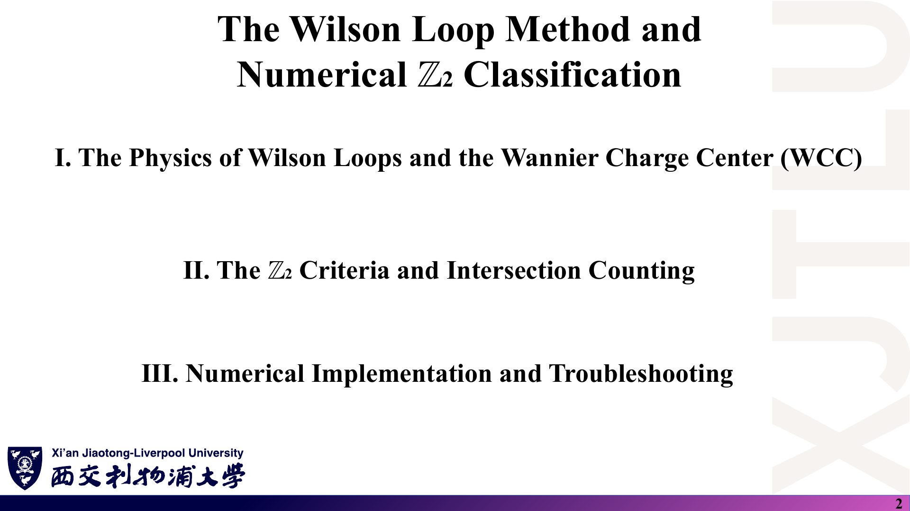
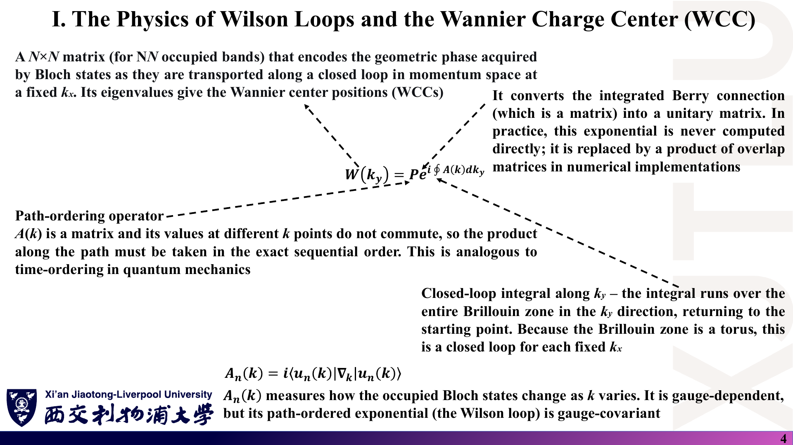
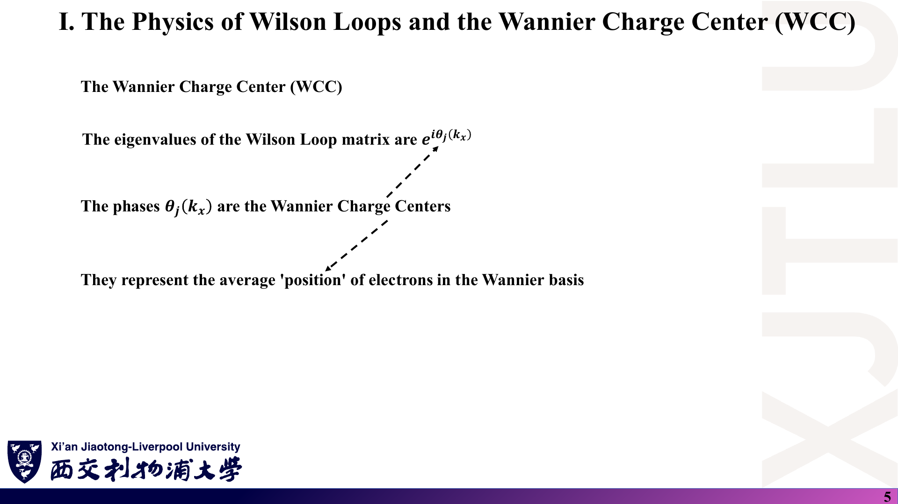
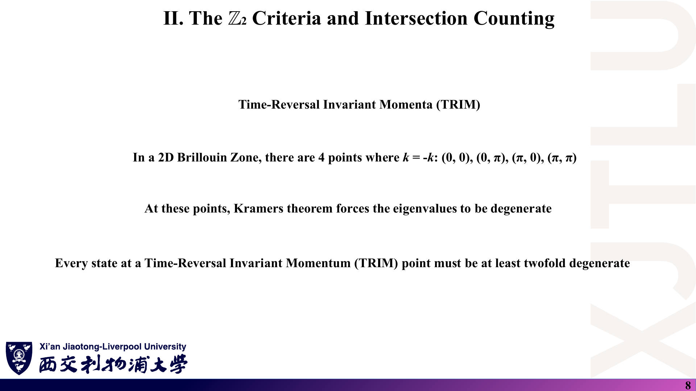
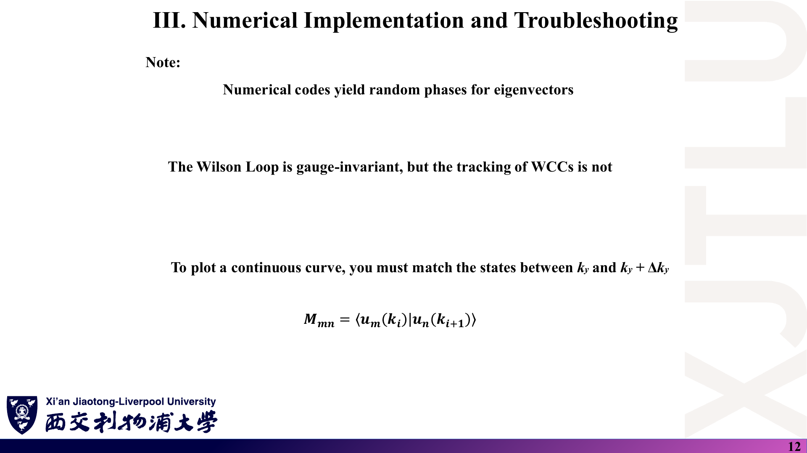
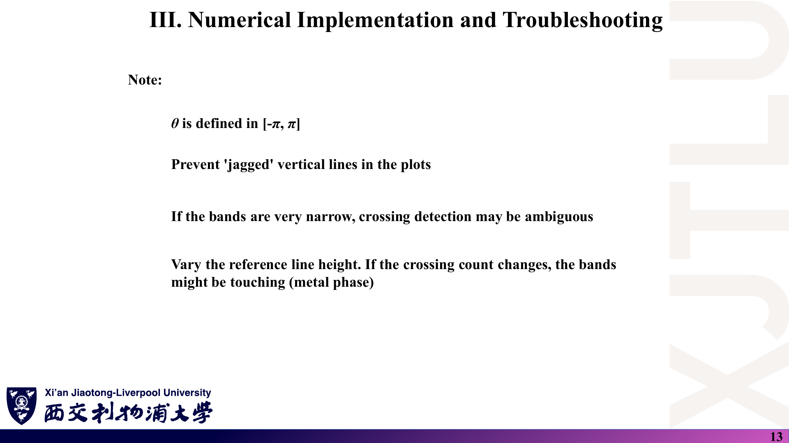

# 03 · Wilson 环方法与 Z₂ 的数值判定

来源：[Lecture_Nineteen.pdf](../Lecture_Nineteen.pdf)，14 页。

[返回目录](README.md)

## 1. 这一讲要解决什么问题？〔p. 2〕

### 课件截图

### 中文解释

第十八讲给出了 Z₂ 的概念，但没有给出算法。本讲回答“**拿到一个 $H(\mathbf k)$，怎样用程序判断 $\nu=0$ 还是 1**”：

1. Wilson 环与 Wannier 电荷中心（WCC）的物理；
2. Z₂ 判据：交叉计数；
3. 数值实现步骤与常见问题。

### 原理深入

**为什么不能直接积分 Berry 曲率？** 有 TRS 时总 Chern 数恒为 0，积分曲率得不到 Z₂ 信息。Wilson 环方法把二维问题拆成“沿 $k_2$ 的一维 Berry 相位，随 $k_1$ 演化”。看这些相位怎样随 $k_1$ 移动，就能读出 Z₂（[FK](README.md#ref-fk)、[SV](README.md#ref-sv)、[YU](README.md#ref-yu)）。

**记号说明**：讲义用 $k_x$ 表示“被扫描的参数”，用 $k_y$ 表示“闭合环路方向”。在六角晶格程序里，它们实际是沿 $\mathbf b_1$、$\mathbf b_2$ 的分数坐标 $k_1,k_2$，两者夹角 60°，并不是笛卡尔 x、y。下文写作“$k_1$（讲义 $k_x$）”。

### Ref

- **原课件**：[Lecture Nineteen，PDF 第 2 页](../Lecture_Nineteen.pdf#page=2)。
- **延伸**：[SV](README.md#ref-sv)、[VAN](README.md#ref-van)。

## 2. 为什么 Z₂ 需要 Wilson 环？〔p. 3〕

### 课件截图

*此页写 $W(k_y)=Pe^{i\oint A(k)dk_x}$，而第 4 页写 $dk_y$、且“固定 $k_x$”；标签前后不一致，见 07 第 10 节。*

### 中文解释

Chern 数适用于二维量子霍尔类绝缘体；带 TRS 的 Z₂ 体系需要更细致的方法。Wilson 环给出体能带的“Wannier 表示”。在数值上，它是相邻 k 点之间重叠矩阵的乘积；在物理上，它是占据态沿倒空间闭合环路的平行移动。

### 原理深入

一致的写法应为：固定 $k_1$，沿 $k_2$ 走一圈：

$$
\boxed{W(k_1)=\mathcal P\exp\!\Big(i\oint A_{2}(k_1,k_2)\,dk_2\Big)},\qquad
\big[A_2\big]_{mn}=i\langle u_m|\partial_{k_2}u_n\rangle ,
$$

$m,n$ 取遍所有占据带。$W$ 是 $N_{occ}\times N_{occ}$ 的幺正矩阵，它的本征值 $e^{i\theta_j(k_1)}$ 依赖被固定的 $k_1$。

**为什么必须是“多带”的？** 存在 Kramers 简并时，单条能带在 TRIM 处与伙伴相碰，单带 Berry 相位没有良好定义。必须把**整组占据带**一起平行移动，这就是“非阿贝尔”联络。

### Ref

- **原课件**：[Lecture Nineteen，PDF 第 3 页](../Lecture_Nineteen.pdf#page=3)。
- **延伸**：[YU](README.md#ref-yu)、[VAN](README.md#ref-van)。

## 3. Wilson 环公式的每个符号是什么意思？〔p. 4〕

### 课件截图

### 中文解释

讲义逐项解释：

- **$N\times N$ 矩阵**（$N$ 为占据带数）：记录 Bloch 态在固定 $k_x$ 下沿闭合环路移动时获得的几何相位，其本征值给出 WCC。
- **指数**：把积分后的（矩阵）Berry 联络变成幺正矩阵；实际计算从不直接求指数，而用重叠矩阵乘积代替。
- **路径排序算符 $\mathcal P$**：不同 k 点的 $A(\mathbf k)$ 是互不对易的矩阵，乘积必须按路径顺序进行，类似量子力学中的时间排序。
- **闭合环路**：沿 $k_y$ 跑遍整个布里渊区并回到起点；布里渊区是环面，所以对每个固定的 $k_x$ 都构成闭环。
- **$A_n(\mathbf k)$**：度量占据态随 $\mathbf k$ 的变化。它依赖规范，但路径排序指数（Wilson 环）是规范协变的。

### 原理深入

#### 3.1 “规范协变”是什么意思？

在每个 $\mathbf k$ 处对占据子空间做幺正变换 $|u_n\rangle\to\sum_m|u_m\rangle U_{mn}(\mathbf k)$。若起点与终点使用同一个 $U(\mathbf k_0)$，则

$$
W\to U(\mathbf k_0)^\dagger\,W\,U(\mathbf k_0).
$$

这是相似变换，**本征值不变**，所以 WCC 是规范不变的；$W$ 的矩阵元则不是。

#### 3.2 为什么乘积能代替指数？

单带情形下，$\langle u(k)|u(k+\delta k)\rangle\approx1+\delta k\langle u|\partial u\rangle=1-iA\,\delta k\approx e^{-iA\delta k}$。

因此重叠矩阵的乘积 $\approx\mathcal P e^{-i\oint A\,dk}$。注意符号：它与讲义的 $\mathcal Pe^{+i\oint A}$ 互为复共轭，求出的 WCC 差一个负号。交叉次数的奇偶性不受影响，但比较不同程序的图时要统一约定（[07 第 12 节](07_讲义勘误与易错点.md)）。

#### 3.3 闭合条件（周期规范）

环路的最后一步要回到起点：第 $N$ 个点就是 $\mathbf k_0+\mathbf G$。所用的态必须与起点的态一致：

- 若 $H(\mathbf k)$ 只用原胞相位 $e^{i\mathbf k\cdot\mathbf R}$（约定 I），则 $H(\mathbf k+\mathbf G)=H(\mathbf k)$，可取 $u(\mathbf k_0+\mathbf G)=u(\mathbf k_0)$；
- 若用原子位置相位 $e^{i\mathbf k\cdot(\mathbf R+\boldsymbol\tau_i-\boldsymbol\tau_j)}$（约定 II，本周程序即是），则 $u(\mathbf k_0+\mathbf G)=V(\mathbf G)\,u(\mathbf k_0)$，$V=\mathrm{diag}(e^{i\mathbf G\cdot\boldsymbol\tau_i})$。

本周程序采用约定 II，却用 $u(\mathbf k_0)$ 闭合环路。本笔记数值复核发现，在本模型中这只会让所有 WCC 整体平移 1/2，Z₂ 不变（见 [08 第 9 节](08_代码导读.md)）。

### Ref

- **原课件**：[Lecture Nineteen，PDF 第 4 页](../Lecture_Nineteen.pdf#page=4)。
- **延伸**：[VAN](README.md#ref-van)（紧束缚约定与周期规范）、[YU](README.md#ref-yu)。

## 4. WCC 是什么，怎样看 WCC 图？〔pp. 5–7〕

### 课件截图

*第 6 页的“台阶”示意图与“拓扑时 WCC 被推到原胞边界”的说法容易误导，见 07 第 11 节。*

### 中文解释

Wilson 环矩阵的本征值为 $e^{i\theta_j(k_x)}$，相位 $\theta_j$ 就是 **Wannier 电荷中心**，代表 Wannier 基中电子的平均“位置”，即电荷集中在原胞的什么地方。讲义说：平庸绝缘体中 WCC 局域且平坦；拓扑绝缘体中 WCC 被“推”到原胞边界。随着 $k_x$ 变化，WCC 在 $(\theta,k_x)$ 平面上画出轨迹，这就是 **Wilson 环谱**（第 7 页）。

### 原理深入

#### 4.1 相位与位置的换算

$$
\bar x_j(k_1)=\frac{\theta_j(k_1)}{2\pi}\quad(\text{以 }\mathbf a_2\text{ 方向的晶格常数为单位}),
$$

只在**模 1** 的意义下有定义，通常取 $[-0.5,0.5)$。讲义纵轴标 “$\theta$ WCC”、刻度却是 ±0.5，实际画的是 $\bar x=\theta/2\pi$。

#### 4.2 平庸与非平庸的真正区别

区别不在于“平不平”或“在不在边界”，而在于**连接方式**：

- **平庸**：在 $k_1=0$ 处简并的 Kramers 对，走到 $k_1=1/2$ 时与**原来的伙伴**重新简并。曲线可以弯曲起伏，但整体不绕圈。
- **非平庸**：走到 $k_1=1/2$ 时与**另一对的成员**简并（伙伴交换），一条曲线向上、一条向下，各自扫过半个原胞。

所以非平庸的 WCC 一般不是“停在 ±0.5”，而是**连续地**移动并缠绕。对于带隙打开的绝缘体，WCC 曲线是 $k_1$ 的连续函数（模 1）。图中出现垂直跳变，要么说明 Berry 曲率极度集中（带隙很小、网格太粗），要么说明带隙已经闭合。

### Ref

- **原课件**：[Lecture Nineteen，PDF 第 5–7 页](../Lecture_Nineteen.pdf#page=5)。
- **延伸**：[SV](README.md#ref-sv)、[FK](README.md#ref-fk)。

## 5. TRIM 在哪里，为什么 WCC 在那里成对？〔p. 8〕

### 课件截图

### 中文解释

二维布里渊区中满足 $\mathbf k=-\mathbf k$（模倒格矢）的点有 4 个：$(0,0),(0,\pi),(\pi,0),(\pi,\pi)$。在这些点上，Kramers 定理迫使本征值简并，每个态至少二重简并。

### 原理深入

- 讲义的 $(0,\pi)$ 等写法以 $\mathbf k\cdot\mathbf a_i$ 为坐标，即分数坐标 $`(k_1,k_2)\in\{0,\tfrac12\}^2`$。在六角晶格中，这 4 点是 Γ 和 3 个 M 点，**不包括 K、K′**（K 不是 TRIM，$-\mathbf K$ 等价于 K′）。
- 对 Wilson 环而言，关键是：当被扫描参数 $k_1=0$ 或 $1/2$ 时，整条环路在 TRS 下映射到自身。于是 $W(k_1)$ 的本征相位**成对简并**，这就是 WCC 图在 $k_1=0$ 与 $k_1=1/2$ 两端“钉成对”的原因。
- TRS 还给出 $`\{\theta_j(-k_1)\}=\{\theta_j(k_1)\}`$，所以只需看半个区间 $k_1\in[0,1/2]$，另一半是镜像。

### Ref

- **原课件**：[Lecture Nineteen，PDF 第 8 页](../Lecture_Nineteen.pdf#page=8)。
- **延伸**：[FK](README.md#ref-fk)。

## 6. 参考线交叉计数如何判 Z₂？〔pp. 9–10〕

### 课件截图

*第 9 页写“在 $k_y=0$ 与 $k_y=\pi$ 处成对钉住”，按讲义自己的作图应为被扫描的 $k_x$；参考线写成 “$\theta=\pi$”，图中却画在 0.25。见 07 第 10 节。*

### 中文解释

讲义的判据：

1. WCC 谱在两个 TRIM 处严格成对；
2. 若一条曲线从 $\theta$ 出发、到 $\theta+\pi$ 结束，它必然穿过中间的间隙；
3. 任取一条参考线（讲义取 0.25，或间隙中任意值），数 WCC 曲线穿过它的次数：**奇数 ⇒ Z₂ = 1（非平庸），偶数 ⇒ Z₂ = 0（平庸）**；
4. 拓扑相变表现为 WCC 曲线的“伙伴交换”，这是能带连接方式的整体改变；交叉受 TRS 保护，小微扰不能消除。

### 原理深入

#### 6.1 判据的完整版本

1. **先确认体带隙打开**：占据带与空带在整个 BZ 上处处分开。否则 Wilson 环在带隙闭合处没有定义，计数毫无意义。
2. **只数半个 BZ**：$k_1\in[0,1/2]$。
3. **参考线必须是“任意”的**：换一条水平线，奇偶性必须不变。若奇偶性随参考线改变，说明计数方法或数据有问题（讲义第 13 页也提到这一点）。
4. **稳健做法**（[SV](README.md#ref-sv)）：在每个 $k_1$ 处找 WCC 之间**最大间隙的中点**，把这些中点连成一条“参考曲线”，数 WCC 跳过它的次数。这样可以避免固定参考线恰好压在 WCC 上的情形。本笔记的数值复核用的正是这种方法。

#### 6.2 为什么讲义的单个台阶图会误导？

第 9、10 页的示意图是一条从 0 垂直跳到 0.5 的台阶。真实的伙伴交换是**一对**曲线：一条向上走、一条向下走，在 $k_1=1/2$ 处于 $\bar x+1/2$ 重新相遇。若两条曲线都“跳”到 ±0.5，而 ±0.5 在模 1 下是**同一个点**，那么“它们穿过 0.25 几次”取决于相位分支怎样选，而不是取决于拓扑。第二十讲的输出图正好落在这种情形，见 [04 第 5–6 节](04_代码演示_石墨烯Rashba与Dresselhaus.md)。

### Ref

- **原课件**：[Lecture Nineteen，PDF 第 9–10 页](../Lecture_Nineteen.pdf#page=9)。
- **勘误**：[07 第 10–11 节](07_讲义勘误与易错点.md)；练习 [06 第 9–10 题](06_复习题与参考答案.md)。
- **延伸**：[SV](README.md#ref-sv)、[YU](README.md#ref-yu)。

## 7. 数值实现分哪四步？〔p. 11〕

### 课件截图

*最后一行写 $\theta_j=\mathrm{ARCTAN}(b/a)$，应使用 $\mathrm{atan2}(b,a)$，见 07 第 12 节。*

### 中文解释

1. 在每个 k 点对角化 $H(\mathbf k)$；
2. 计算相邻 $k_y$ 点之间的重叠矩阵 $M_{mn}=\langle u_m(k_i)|u_n(k_{i+1})\rangle$；
3. 构造乘积矩阵 $D(k_y)=\prod M_{i,i+1}$；
4. 对 $D$ 做本征分解，本征值 $a+ib$ 的相位 $\theta_j$ 即 WCC。

### 原理深入

写成可直接编程的形式（固定 $k_1$，环路方向分 $N$ 段，$k_2^{(i)}=i/N$）：

$$
M^{(i)}_{mn}=\langle u_m(k_2^{(i)})|u_n(k_2^{(i+1)})\rangle,\qquad
D=M^{(0)}M^{(1)}\cdots M^{(N-1)},\qquad
\bar x_j=\frac{\mathrm{atan2}(\mathrm{Im}\lambda_j,\mathrm{Re}\lambda_j)}{2\pi},
$$

其中 $u(k_2^{(N)})$ 由闭合条件给出（见本文第 3.3 小节）。

- **为什么必须用 atan2？** $\arctan(b/a)$ 的值域只有 $(-\pi/2,\pi/2)$，无法区分 $a+ib$ 与 $-a-ib$，WCC 会被折叠到 $(-1/4,1/4)$，而判据恰恰要看 ±0.5 附近。第 13 页说“θ 定义在 $[-\pi,\pi]$”，也只有 atan2 才能做到。
- **网格是否够密？** 离散乘积中的每个 $M^{(i)}$ 应接近幺正，可检查奇异值是否接近 1。若带隙小、Berry 曲率集中（例如 K 点附近），需要加密 $k_2$ 网格。
- **$D$ 不严格幺正**：离散近似使 $|\lambda_j|<1$，但只取相位，影响很小。

### Ref

- **原课件**：[Lecture Nineteen，PDF 第 11 页](../Lecture_Nineteen.pdf#page=11)。
- **代码对应**：`TIGHTBINDINGFORGRAPHENE.f90` 第 591–611 行，见 [08 第 6 节](08_代码导读.md)。
- **延伸**：[VAN](README.md#ref-van)。

## 8. 规范、相位缠绕与排错要注意什么？〔pp. 12–13〕

### 课件截图

### 中文解释

第 12 页：数值程序给出的本征矢带有随机相位；Wilson 环规范不变，但 WCC 的“追踪”不是；要画出连续曲线，必须匹配 $k_y$ 与 $k_y+\Delta k_y$ 之间的态。第 13 页：θ 定义在 $[-\pi,\pi]$；要避免图中出现锯齿状的竖线；能带很窄时交叉检测可能模糊；改变参考线高度，若交叉数改变，说明能带可能相接（金属相）。

### 原理深入

需要区分两类“随机性”：

| 问题 | 来源 | 是否影响 WCC 数值 | 处理 |
|---|---|---|---|
| 本征矢整体相位 / 简并子空间内的旋转 | 对角化程序 | 不影响（重叠乘积自动抵消） | 无需处理，只要闭合条件正确 |
| WCC 的排列顺序 | `ZGEEV` 等返回的本征值顺序任意 | 影响“第 1 列、第 2 列”是否连续 | 每个 $k_1$ 处排序，或按最近邻匹配 |
| ±0.5 处的分支切割 | 相位只定义到模 1 | 影响曲线是否出现竖线 | 在圆周上处理距离；或用最大间隙法，不做 unwrap |

**`unwrap` 的风险**：MATLAB 的 `unwrap` 按“相邻两点相位差超过 π 就加减 2π”来修正，它默认每一列是同一条连续曲线。若各列顺序随 $k_1$ 随机变化，或者 WCC 恰好跳动 0.5（即 π），`unwrap` 的结果就取决于舍入误差的符号。本周 MATLAB 脚本正是对未排序的两列直接 `unwrap`，详见 [08 第 7 节](08_代码导读.md)。

**交叉数随参考线改变时**：第一步应直接计算体带隙 $\min_{\mathbf k}(E_{N_{occ}+1}-E_{N_{occ}})$。若带隙为零，就不是“交叉难以判断”，而是该参数下 Z₂ 根本没有定义。

### Ref

- **原课件**：[Lecture Nineteen，PDF 第 12–13 页](../Lecture_Nineteen.pdf#page=12)。
- **配套**：[08 第 7、9 节](08_代码导读.md)；练习 [06 第 11 题](06_复习题与参考答案.md)。
- **延伸**：[SV](README.md#ref-sv)、[VAN](README.md#ref-van)。
