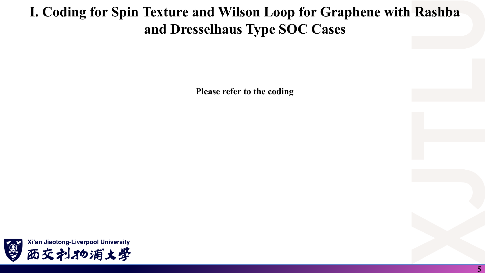
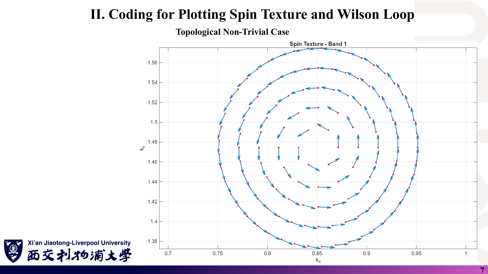
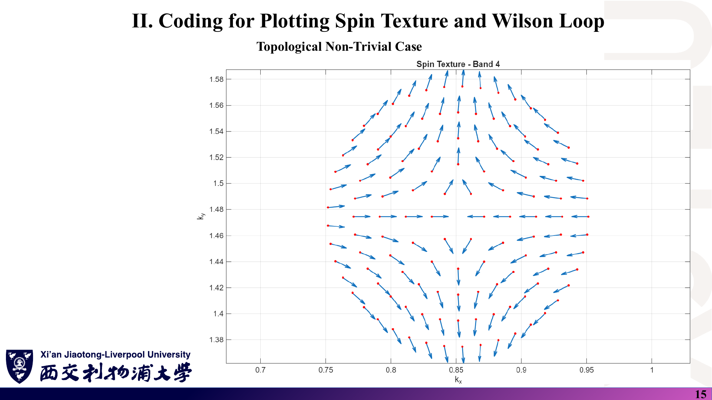
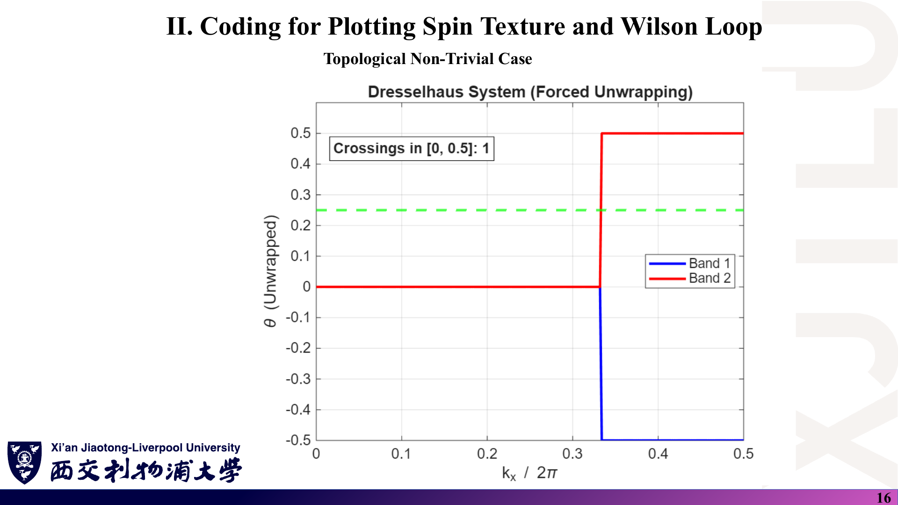
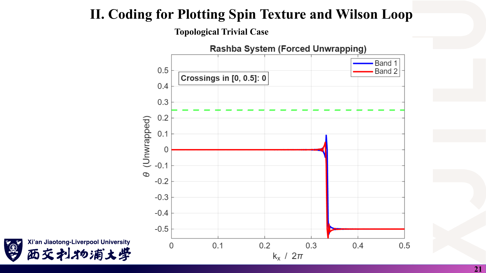
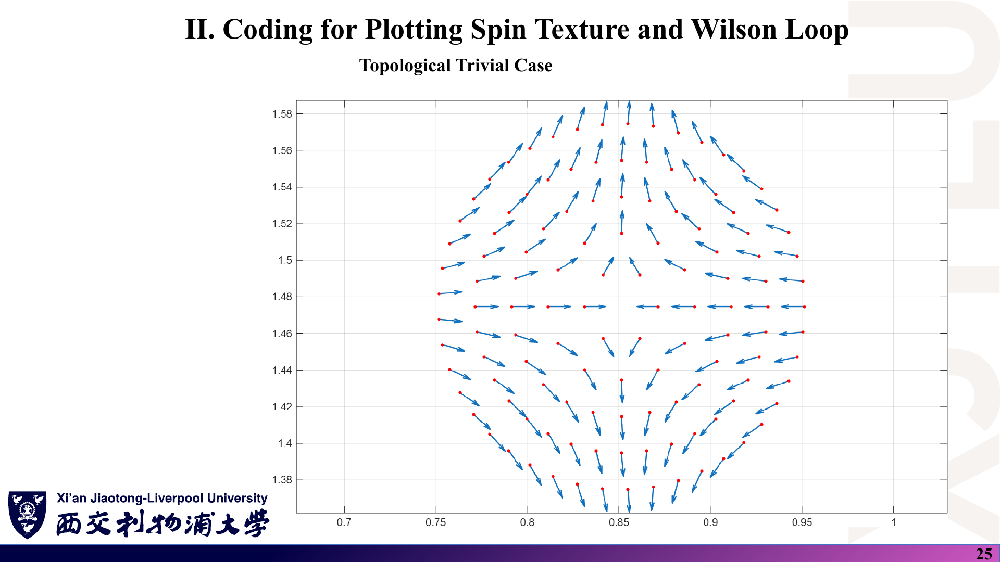

# 04 · 代码演示：石墨烯 Rashba / Dresselhaus 体系的自旋纹理与 Wilson 环

来源：[Lecture_Twenty.pdf](../Lecture_Twenty.pdf)，27 页。

[返回目录](README.md)

> 本讲以截图为主，讲义正文只有输入文件与判据，第 5–6 页写“Please refer to the coding”。本文前 6 节整理讲义展示的内容；第 7 节是**本笔记的数值复核**，不是讲义原文。代码细节见 [08_代码导读.md](08_代码导读.md)。

## 1. 这一讲做什么？〔pp. 2, 5–6〕

### 课件截图




### 中文解释

第二十讲把前三讲落到程序上，分两部分：

1. 用 Fortran 程序 `TIGHTBINDINGFORGRAPHENE.f90` 计算石墨烯在 Rashba 型、Dresselhaus 型 SOC 下的自旋纹理与 Wilson 环；
2. 用 MATLAB 脚本 `plot_spin_texture.m`、`wilson_loop.m` 画图并统计交叉次数。

两组参数分别放在 `Codes/Topological_Nontrivial/` 与 `Codes/Topological_Trivial/` 中。

### 原理深入

完整流程：

```text
Graphene.vasp（参数） → TIGHTBINDINGFORGRAPHENE（Fortran + LAPACK）
   ├─ RASHBA_Spin_Texture.dat / DRESSELHAUS_Spin_Texture.dat  → plot_spin_texture.m → *_Band_n_Spin_Texture.png
   └─ Wilsonloop_Rashba_System.dat / Wilsonloop_Dresselhaus_System.dat → wilson_loop.m → *_wilsonloop.png
```

每个体系的哈密顿量为 $H=H_{onsite}+H_{hopping}+H_{intrinsic}+H_{R}$，或把最后一项换成 $H_D$。Rashba 与 Dresselhaus **不同时**加入，而是分别算两套（对应第十七讲第 16 页的“$H_{rashba}/H_{dresselhaus}$”）。

### Ref

- **原课件**：[Lecture Twenty，PDF 第 2 页](../Lecture_Twenty.pdf#page=2)、[第 5–6 页](../Lecture_Twenty.pdf#page=5)。
- **代码**：[Codes 目录](../Codes/)；导读 [08 第 1 节](08_代码导读.md)。

## 2. 输入文件每一行是什么意思？〔pp. 3–4〕

### 课件截图


### 中文解释

两份输入文件除 SOC 强度外完全相同（本笔记用 `diff` 核对过）：

| 行 | 含义 | 非平庸 | 平庸 |
|---|---|---|---|
| `2.46` / 三行晶格矢量 | 晶格常数 Å 与 $\mathbf a_1,\mathbf a_2,\mathbf a_3$（以 $a$ 为单位） | 同 | 同 |
| `C` / `2` / `Direct` / 两行坐标 | 两个碳原子，分数坐标 $(2/3,1/3)$、$(1/3,2/3)$ | 同 | 同 |
| `onsite` | 两子晶格在位能 | 0 0 | 0 0 |
| DOS 四行 | k 网格、能量范围、能量点数、展宽 | 同 | 同 |
| `Centre of k circle mesh` | 自旋纹理圆心（分数坐标），即 K 点 | (1/3,1/3) | 同 |
| `Number / Delta radius / Delta angle` | 5 个圆，半径步长 0.02 Å⁻¹，角步长 60°…8° | 同 | 同 |
| `Intrinsic SOC` | $t_I$（eV） | 0.005 | 0.005 |
| `Rashba` / `Dresselhaus` | $t_R$ / $t_D$（eV） | 0.004 / 0.006 | 0.04 / 0.04 |
| `k point mesh for wilson loop` | Wilson 环网格 | 500 500 | 500 500 |

### 原理深入

**程序实际读了哪些行？**〔本笔记核对代码〕程序只解析带冒号的关键字行：`onsite`、圆形网格四行、三个 SOC 强度和 Wilson 网格。晶格常数、晶格矢量、原子坐标在程序第 275–291 行**写死**（与文件数值相同）；近邻跳跃 $t=-2.7$ eV 与占据带数 2 也写死；**DOS 四行被忽略**，程序不计算 DOS。改动这些行不会改变结果。

圆形网格点数：$360/60+360/30+360/15+360/10+360/8=6+12+24+36+45=123$。每个 `*_Spin_Texture.dat` 有 4 条带 × (123 行 + 1 空行) = 496 行，与文件行数一致。

### Ref

- **原课件**：[Lecture Twenty，PDF 第 3–4 页](../Lecture_Twenty.pdf#page=3)。
- **代码**：[Graphene.vasp](../Codes/Graphene.vasp)；解析逻辑见 [08 第 2 节](08_代码导读.md)。

## 3. 判据 $t_{R/D}<3\sqrt3\,t_I$ 从哪里来、对不对？〔pp. 3–4〕

### 课件截图


### 中文解释

讲义给出：

$$
\text{非平庸：}t_{R}<3\sqrt3\,t_I,\ t_{D}<3\sqrt3\,t_I;\qquad
\text{平庸：}t_{R}\ge3\sqrt3\,t_I,\ t_{D}\ge3\sqrt3\,t_I .
$$

取 $t_I=0.005$ eV，阈值 $3\sqrt3\times0.005\approx0.026$ eV。非平庸算例 0.004、0.006 在阈值以下；平庸算例 0.04 在阈值以上。

### 原理深入

#### 3.1 与 Kane–Mele 原文对照

Kane–Mele 模型 [KM1](README.md#ref-km1)、[KM2](README.md#ref-km2) 有三个参数：本征 SOC $\lambda_{SO}$、Rashba $\lambda_R$、交错子晶格势 $\lambda_v$。原文的两个关键数字是：

- $\lambda_R=0$ 时，QSH 与平庸绝缘体的分界在 $\lambda_v=3\sqrt3\,\lambda_{SO}$；
- $\lambda_v=0$ 时，QSH 带隙在 $\lambda_R<2\sqrt3\,\lambda_{SO}$ 范围内保持打开。

所以“$3\sqrt3$”在原文中是**交错势 $\lambda_v$** 的临界值；Rashba 的临界值是 $2\sqrt3$。

#### 3.2 约定会不会造成差别？

只有先确认 $t_I$ 与 $\lambda_{SO}$ 的换算，才能判断讲义的系数对不对。本笔记的核对如下：

1. 程序用 `chirality = ±1`（只取叉积符号），等同于 Kane–Mele 的 $\nu_{ij}$；Rashba 项 $\boldsymbol\sigma\cdot(\hat{\mathbf u}\times\hat z)$ 等同于 Kane–Mele 的 $(\mathbf s\times\hat{\mathbf d})_z$。所以按程序的写法，$t_I=\lambda_{SO}$，$t_R=\lambda_R$。
2. 数值验证：修正程序的次近邻距离后，用复刻程序计算，$t_R=0$ 时带隙为 51.96 meV $=6\sqrt3\,t_I$，与 Kane–Mele 一致。
3. 扫描 $t_R$：K 点带隙 $=6\sqrt3\,t_I-3t_R$，在 $t_R\approx0.0173=2\sqrt3\,t_I$ 处闭合，并在 0.0175–0.04 范围内一直为零。Dresselhaus 型给出同样的数值。
4. 扫描交错势：$t_R=0$、在位能 $\pm\lambda_v$ 时，带隙在 $\lambda_v=0.026=3\sqrt3\,t_I$ 处闭合后重新打开；取 $\lambda_v=0.04$ 并加 $t_R=0.004$ 时，Z₂ = 0。

结论（本笔记复核，非官方）：**在程序自身的约定下，Rashba / Dresselhaus 的临界值是 $2\sqrt3\,t_I\approx0.0173$ eV，不是 $3\sqrt3\,t_I$。** 讲义的 $3\sqrt3$ 很可能来自 Kane–Mele 的 $\lambda_v$ 判据（这是推测）。若改用讲义公式字面上的 $|\hat{\mathbf u}\times\hat{\mathbf u}|=\sqrt3/2$，有效 $\lambda_{SO}=\tfrac{\sqrt3}{2}t_I$，阈值变为 $3t_I$，也不是 $3\sqrt3\,t_I$。

#### 3.3 对两组算例的影响

- 两个判据对这两组算例给出**相同的分类**：0.004、0.006 低于 0.0173；0.04 高于 0.026。
- 但超过阈值后，体系是**无隙**的（半金属），而不是“平庸绝缘体”。Z₂ 只对有隙体系有定义，所以“平庸算例”并不是一个平庸绝缘体的例子。
- 若想得到真正的平庸绝缘体，可以利用输入文件已有的 `onsite` 行加交错势，例如 `onsite: 0.04 -0.04`（> $3\sqrt3\,t_I$）。本笔记数值验证了此时有隙且 Z₂ = 0（需同时修正第 7 节所述的程序问题）。

### Ref

- **原课件**：[Lecture Twenty，PDF 第 3–4 页](../Lecture_Twenty.pdf#page=3)。
- **复核细节**：[07 第 13 节](07_讲义勘误与易错点.md)；方法见 [08 第 9 节](08_代码导读.md)。
- **延伸**：[KM1](README.md#ref-km1)、[KM2](README.md#ref-km2)。

## 4. 非平庸算例的自旋纹理长什么样？〔pp. 7–15〕

### 课件截图





*按页序，第 7–10 页为 Rashba 体系第 1–4 带，第 12–15 页为 Dresselhaus 体系第 1–4 带；本笔记逐页查看了第 7、15 页，其余页按标题与页序推断。*

### 中文解释

坐标轴是笛卡尔 $(k_x,k_y)$，单位 Å⁻¹，圆心在 K 点 $(0.851,1.475)$。红点是 k 点，蓝箭头是 $(\langle\sigma_x\rangle,\langle\sigma_y\rangle)$。

- Rashba 第 1 带：自旋沿圆周切向，构成涡旋，与第十七讲第 14 页一致。
- Dresselhaus 第 4 带：水平线上自旋指向圆心、竖直线上背离圆心，呈各向异性，与第十七讲第 15 页一致。

### 原理深入

- 自旋纹理反映的是**破坏反演对称性的项**（$H_R$ 或 $H_D$）的形式，不能单凭它判断 Z₂。复核数据可以看到，平庸算例与非平庸算例的纹理图样几乎相同（比较第 15 页与第 25 页）。
- 输出文件中 $\langle\sigma_z\rangle$ 在每个文件的全部 492 个数据点上**恰好为 0**。这不是程序错误：二维模型具有 $C_{2z}\mathcal T$ 对称性（绕 z 轴转 180° 再时间反演），它保持 $\mathbf k$ 不变、把 $\sigma_z$ 变号，因此非简并能带的 $\langle\sigma_z\rangle$ 必为 0。本笔记数值验证，即使本征 SOC 正确生效，$\langle\sigma_z\rangle$ 也处处为 0。所以 $S_z=0$ **不能**用来判断 $t_I$ 是否生效；判断依据见第 7 节。

### Ref

- **原课件**：[Lecture Twenty，PDF 第 7–15 页](../Lecture_Twenty.pdf#page=7)。
- **原 PNG**：[Codes/Topological_Nontrivial/](../Codes/Topological_Nontrivial/)；解读见 [08 第 8 节](08_代码导读.md)。

## 5. 非平庸算例的 Wilson 环图说明了什么？〔pp. 11, 16〕

### 课件截图




### 中文解释

横轴是 $k_x/2\pi\in[0,0.5]$（实为沿 $\mathbf b_1$ 的分数坐标 $k_1$），纵轴是经过 `unwrap` 的 WCC，绿色虚线是参考线 0.25。两图都是：两条曲线在 $k_1<1/3$ 时重合于 0，在 $k_1\approx1/3$ 处一条跳到 +0.5、一条跳到 −0.5，并标注 “Crossings in [0, 0.5]: 1”。讲义据此判为非平庸。

### 原理深入

- 按 [03 第 6 节](03_Wilson环与WCC数值判据.md)，+0.5 与 −0.5 在模 1 下是**同一个位置**。原始数据中，两个 WCC 在 $k_1<1/3$ 时都等于 0，在 $1/3<k_1\le1/2$ 时都等于 ±0.5，**任何 $k_1$ 处两者都重合**。“1 次交叉”来自 `unwrap` 把一列送到 +0.5、另一列送到 −0.5。
- 跳变发生在 $k_1=1/3$，正是 K 点 $(1/3,1/3)$ 所在的环路。若体带隙有限，WCC 应连续变化。这里出现精确的阶跃，说明这条环路穿过了无隙的 Dirac 点。
- 第 7 节说明了原因：随附数据对应的是**没有本征 SOC** 的模型。

### Ref

- **原课件**：[Lecture Twenty，PDF 第 11 页](../Lecture_Twenty.pdf#page=11)、[第 16 页](../Lecture_Twenty.pdf#page=16)。
- **数据**：[Wilsonloop_Rashba_System.dat](../Codes/Topological_Nontrivial/Wilsonloop_Rashba_System.dat)。

## 6. 平庸算例的图与非平庸有何不同？〔pp. 17–26〕

### 课件截图






### 中文解释

平庸算例中，Rashba 体系的两条 WCC 曲线在 $k_1\approx1/3$ 附近振荡后一起落到 −0.5，标注 0 次交叉；Dresselhaus 体系一起升到 +0.5，标注 2 次交叉。0 与 2 都是偶数，讲义据此判为平庸。

### 原理深入

把四张图放在一起比较：

| 图 | $k_1<1/3$ | $1/3<k_1\le1/2$ | 标注交叉 |
|---|---|---|---|
| 非平庸 Rashba（p. 11） | 两条都在 0 | 一条 +0.5，一条 −0.5 | 1 |
| 非平庸 Dresselhaus（p. 16） | 两条都在 0 | 一条 +0.5，一条 −0.5 | 1 |
| 平庸 Rashba（p. 21） | 两条都在 0 | 两条都在 −0.5 | 0 |
| 平庸 Dresselhaus（p. 26） | 两条都在 0 | 两条都在 +0.5 | 2 |

模 1 来看，**四张图的连接方式完全相同**：一对 WCC 从 0 整体移到 1/2。差别只在 `unwrap` 选了哪个分支。同为“平庸”的 Rashba 与 Dresselhaus 一个标 0、一个标 2，本身就说明计数受分支选择影响。本笔记还试过把原始数据两列的顺序隔点交换：平庸 Rashba 变为 2 次，平庸 Dresselhaus 变为 0 次。

平庸算例的振荡集中在 K 点所在的环路 $k_1=1/3$ 附近（本笔记未进一步分析其细节）；非平庸算例的 WCC 则精确等于 0 或 ±0.5。

### Ref

- **原课件**：[Lecture Twenty，PDF 第 17–26 页](../Lecture_Twenty.pdf#page=17)。
- **原 PNG**：[Codes/Topological_Trivial/](../Codes/Topological_Trivial/)。

## 7. 本讲结论与本笔记复核有哪些差异？〔复核〕

### 课件截图


### 中文解释

本笔记用 Python 独立复刻了 Fortran 程序的哈密顿量与 Wilson 环（方法见 [08 第 9 节](08_代码导读.md)），得到三条结论：

1. **随附结果没有本征 SOC。** 程序第 283 行把 $\cos(120^\circ)$ 写成了 $\cos(\pi/3)$，次近邻距离算成 1.42 Å，“次近邻表”实际是近邻表。手性字段从未被赋值（未初始化，由数据反推其运行值为 0），本征 SOC 项实际为零。四个 `.dat` 文件都能被 $t_I=0$ 的模型复现：WCC 偏差 $<10^{-8}$，自旋纹理在 8 位小数上逐位一致。若 $t_I=0.005$ 真正生效，自旋纹理面内分量与文件相差可达 0.04–0.09。
2. **随附结果对应的体系无隙。** $t_I=0$ 时，石墨烯加 Rashba 或 Dresselhaus 在 K 点无隙，Z₂ 没有定义。图中的 1 / 0 / 2 次交叉不构成拓扑判据。
3. **修正后的结论**：修正第 283 行后，非平庸参数（$t_R=0.004$ 或 $t_D=0.006$）的带隙分别为 40.0 meV、34.0 meV，用最大间隙法算得 Z₂ = 1，讲义的分类是对的；“平庸”参数（0.04）的带隙为零，是半金属而非平庸绝缘体。

### 原理深入

这三条结论的意义：

- **讲义的物理意图是对的**：小 Rashba 下保持 QSH，大 Rashba 下失去 QSH 带隙。
- **讲义展示的图不能作为证据**：它们来自一个本征 SOC 失效的程序；即使程序正确，`unwrap` 加固定参考线的计数也不稳健。
- **学习时应该怎么做**：先算体带隙；再用排序后的 WCC 与最大间隙法计数；最后换参考线、加密网格，检查奇偶性是否稳定。

本节是学习核对记录，不是教师发布的勘误；建议向任课教师确认后再修改程序。

### Ref

- **证据与推导**：[07 第 13–14 节](07_讲义勘误与易错点.md)、[08 第 9–10 节](08_代码导读.md)。
- **延伸**：[KM1](README.md#ref-km1)、[SV](README.md#ref-sv)。
