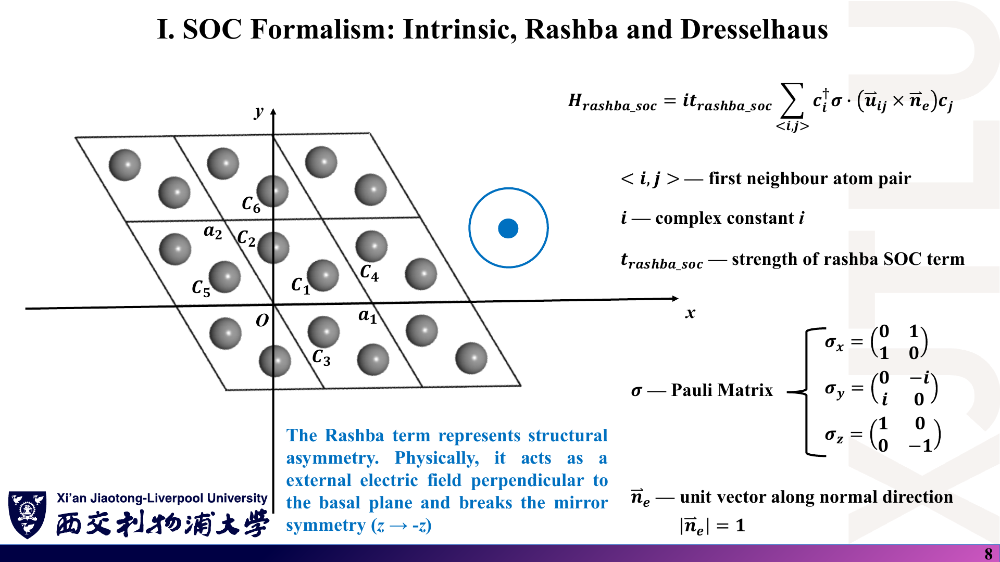
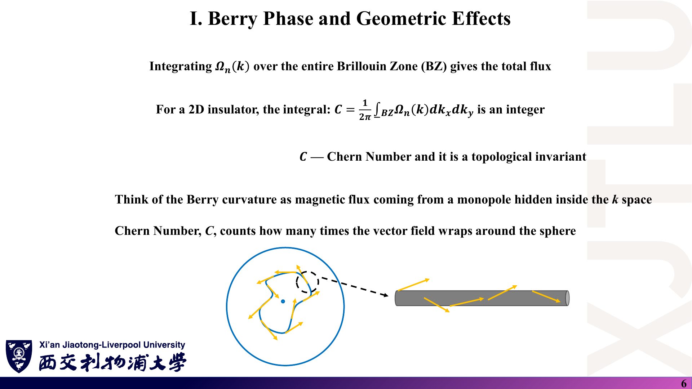

# 05 · 公式与中英文术语速查

来源：[Lecture_Seventeen.pdf](../Lecture_Seventeen.pdf)、[Lecture_Eighteen.pdf](../Lecture_Eighteen.pdf)、[Lecture_Nineteen.pdf](../Lecture_Nineteen.pdf)、[Lecture_Twenty.pdf](../Lecture_Twenty.pdf)，共 77 页。

[返回目录](README.md) · [第十七讲](01_自旋轨道耦合与自旋纹理.md) · [第十八讲](02_Berry相位与Z2拓扑.md) · [第十九讲](03_Wilson环与WCC数值判据.md) · [第二十讲](04_代码演示_石墨烯Rashba与Dresselhaus.md) · [代码导读](08_代码导读.md)

> 默认 $\hbar=1$，态已归一化，$\hat{\mathbf u}$ 为单位键矢量，$t_I,t_R,t_D$ 为讲义的 $t_{intrinsic\_soc},t_{rashba\_soc},t_{dresselhaus\_soc}$。本页已改正讲义中的笔误（见 07），并标出补充内容；它不替代推导与适用条件。

## 1. 4×4 基底与三种 SOC

### 课件截图

### 中文解释

石墨烯两原子 × 两自旋 = 4 维基底。三种 SOC 的区别在于：连接哪种邻居、用哪种 Pauli 矩阵、破坏什么对称性。

### 原理深入

$$
\Psi=(C_{1\uparrow},C_{2\uparrow},C_{1\downarrow},C_{2\downarrow})^T,\qquad
\sigma_x=\begin{pmatrix}0&1\\1&0\end{pmatrix},\ 
\sigma_y=\begin{pmatrix}0&-i\\i&0\end{pmatrix},\ 
\sigma_z=\begin{pmatrix}1&0\\0&-1\end{pmatrix}.
$$

$$
H_I=i\,t_I\sum_{\langle\langle ij\rangle\rangle}\nu_{ij}\,c_i^\dagger\sigma_zc_j,\qquad
\nu_{ij}=\tfrac{2}{\sqrt3}(\hat{\mathbf u}_{ik}\times\hat{\mathbf u}_{kj})_z=\pm1 .
$$

$$
H_R=i\,t_R\sum_{\langle ij\rangle}c_i^\dagger(\sigma_xu_y-\sigma_yu_x)c_j,\qquad
H_D=i\,t_D\sum_{\langle ij\rangle}c_i^\dagger(\sigma_xu_x-\sigma_yu_y)c_j .
$$

| 项 | 邻居 | 自旋 | 保持 | 破坏 |
|---|---|---|---|---|
| $H_I$ | 次近邻（同子晶格） | $\sigma_z$，不翻转 | $\mathcal T$、空间反演、$M_z$ | — |
| $H_R$ | 近邻 | $\sigma_{x,y}$，翻转 | $\mathcal T$、$C_3$ | $M_z$、空间反演 |
| $H_D$ | 近邻 | $\sigma_{x,y}$，翻转 | $\mathcal T$ | 空间反演、$C_3$〔补充〕 |

**易错**：讲义公式按字面计算时，$|\hat{\mathbf u}\times\hat{\mathbf u}|=\sqrt3/2$；代码只取符号 $\pm1$。

### Ref

- **原课件**：[Lecture Seventeen，PDF 第 4–13 页](../Lecture_Seventeen.pdf#page=4)。
- **推导**：[01 第 3–6 节](01_自旋轨道耦合与自旋纹理.md)；延伸 [KM1](README.md#ref-km1)。

## 2. 自旋纹理

### 课件截图

### 中文解释

自旋纹理是每条能带在每个 k 点上的 Pauli 矩阵期望值，对两个原子的旋量求和。

### 原理深入

$$
\langle\sigma_x\rangle=2\,\mathrm{Re}\sum_sC_{s\uparrow}^*C_{s\downarrow},\quad
\langle\sigma_y\rangle=2\,\mathrm{Im}\sum_sC_{s\uparrow}^*C_{s\downarrow},\quad
\langle\sigma_z\rangle=\sum_s\big(|C_{s\uparrow}|^2-|C_{s\downarrow}|^2\big),
$$

$$
\langle\mathbf S\rangle=\tfrac{\hbar}{2}\langle\boldsymbol\sigma\rangle .
$$

- 期望值必为实数；“取实部”只是去掉数值噪声。
- 本模型有 $C_{2z}\mathcal T$ 对称性，非简并能带的 $\langle\sigma_z\rangle=0$〔本笔记数值验证〕。
- 能带简并时，单带纹理依赖规范，没有意义。

### Ref

- **原课件**：[Lecture Seventeen，PDF 第 16–18 页](../Lecture_Seventeen.pdf#page=16)。
- **推导**：[01 第 8 节](01_自旋轨道耦合与自旋纹理.md)；代码 [08 第 5 节](08_代码导读.md)。

## 3. Berry 联络、曲率与 Chern 数

### 课件截图

### 中文解释

联络依赖规范，曲率不依赖规范，Chern 数是曲率在整个布里渊区上的整数积分。

### 原理深入

$$
\mathbf A_n=i\langle u_n|\nabla_{\mathbf k}u_n\rangle\in\mathbb R,\qquad
\gamma_n=\oint\mathbf A_n\cdot d\mathbf k\pmod{2\pi}.
$$

$$
|u\rangle\to e^{i\chi}|u\rangle:\quad \mathbf A\to\mathbf A-\nabla\chi,\qquad \Omega\to\Omega .
$$

$$
\Omega_n=\partial_{k_x}A_{n,y}-\partial_{k_y}A_{n,x},\qquad
C=\frac1{2\pi}\int_{BZ}\sum_{n\in occ}\Omega_n\,d^2k\in\mathbb Z .
$$

**条件**：占据带与空带处处有隙。“$\Omega\ne0$”不代表“$C\ne0$”。

### Ref

- **原课件**：[Lecture Eighteen，PDF 第 4–7 页](../Lecture_Eighteen.pdf#page=4)。
- **推导**：[02 第 3–5 节](02_Berry相位与Z2拓扑.md)；延伸 [XCN](README.md#ref-xcn)。

## 4. 时间反演、Kramers 与 Z₂

### 课件截图

### 中文解释

有 TRS 时总 Chern 数为零，但可以用二元的 Z₂ 指标区分平庸与 QSH。

### 原理深入

$$
TH(\mathbf k)T^{-1}=H(-\mathbf k),\qquad T^2=-1\ \Rightarrow\ \langle\psi|T\psi\rangle=0,
$$

$$
\Omega(-\mathbf k)=-\Omega(\mathbf k)\Rightarrow C=0;\qquad
S_z\text{ 守恒时}\ \nu=\tfrac12(C_\uparrow-C_\downarrow)\bmod2 .
$$

$$
\text{TRS 杂质：}\ \langle T\psi|V|\psi\rangle=0\quad(\text{禁止到 Kramers 伙伴的背散射}).
$$

二维 TRIM：分数坐标 $\{0,\tfrac12\}^2$；六角晶格中是 Γ 与 3 个 M 点，不含 K、K′。

**$\nu$ 保持不变的条件**：保持 TRS，**且**体带隙不闭合。

### Ref

- **原课件**：[Lecture Eighteen，PDF 第 8–14 页](../Lecture_Eighteen.pdf#page=8)。
- **推导**：[02 第 6–9 节](02_Berry相位与Z2拓扑.md)；延伸 [KM2](README.md#ref-km2)、[FK](README.md#ref-fk)。

## 5. Wilson 环与 WCC

### 课件截图

### 中文解释

固定 $k_1$，沿 $k_2$ 闭合环路做占据态的平行移动，本征相位就是 WCC；看 WCC 随 $k_1$ 的连接方式判断 Z₂。

### 原理深入

$$
W(k_1)=\mathcal P\exp\Big(i\oint A_2\,dk_2\Big),\qquad [A_2]_{mn}=i\langle u_m|\partial_{k_2}u_n\rangle .
$$

$$
M^{(i)}_{mn}=\langle u_m(k_2^{(i)})|u_n(k_2^{(i+1)})\rangle,\quad
D=\prod_{i=0}^{N-1}M^{(i)}\approx\mathcal Pe^{-i\oint A_2dk_2},\quad
\bar x_j=\frac{\operatorname{atan2}(\operatorname{Im}\lambda_j,\operatorname{Re}\lambda_j)}{2\pi}\pmod 1 .
$$

- 闭合：约定 I 用 $u(\mathbf k_0)$；约定 II（原子位置相位）用 $V(\mathbf G)u(\mathbf k_0)$，$V=\mathrm{diag}(e^{i\mathbf G\cdot\boldsymbol\tau})$。
- 判据：在 $k_1\in[0,\tfrac12]$ 上数 WCC 跳过“最大间隙中点”的次数，奇数为 $\nu=1$。前提是体带隙打开。
- 规范：$W\to U^\dagger WU$，本征值不变。

### Ref

- **原课件**：[Lecture Nineteen，PDF 第 3–13 页](../Lecture_Nineteen.pdf#page=3)。
- **推导**：[03](03_Wilson环与WCC数值判据.md)；延伸 [SV](README.md#ref-sv)、[YU](README.md#ref-yu)。

## 6. 代码参数与 Kane–Mele 阈值

### 课件截图

### 中文解释

记住算例参数，并用 Kane–Mele 的带隙公式检查它们落在相图的哪一区。

### 原理深入

| 量 | 值 |
|---|---|
| 晶格常数 / 近邻 / 次近邻距离 | 2.46 Å / 1.42 Å / 2.46 Å |
| $\mathbf a_1,\mathbf a_2$ | $a(1,0)$，$a(-\tfrac12,\tfrac{\sqrt3}2)$；原子 $(2/3,1/3)$、$(1/3,2/3)$ |
| K 点 | 分数 $(1/3,1/3)$；笛卡尔 $(0.851,1.475)$ Å⁻¹，模长 $4\pi/3a=1.703$ Å⁻¹ |
| 跳跃 $t$ | −2.7 eV（写死） |
| $t_I$ | 0.005 eV（两组） |
| $t_R$ / $t_D$ | 非平庸 0.004 / 0.006；平庸 0.04 / 0.04 |
| 网格 | 自旋纹理 5 圈共 123 点；Wilson 500×500 |

Kane–Mele 型结果（程序约定 $t_I=\lambda_{SO}$；本笔记数值验证）：

$$
E_g(t_R{=}0)=6\sqrt3\,t_I,\qquad
E_g=6\sqrt3\,t_I-3t_{R}\ \Rightarrow\ \text{在 }t_R=2\sqrt3\,t_I\approx0.0173\text{ 闭合},
$$

$$
\text{交错势：}\ \lambda_v=3\sqrt3\,t_I\approx0.026\ \text{为 QSH / 平庸绝缘体的分界}.
$$

讲义的 “$t_{R/D}<3\sqrt3\,t_I$” 与此不符，见 [07 第 13 节](07_讲义勘误与易错点.md)。

### Ref

- **原课件**：[Lecture Twenty，PDF 第 3–4 页](../Lecture_Twenty.pdf#page=3)。
- **复核**：[04 第 3 节](04_代码演示_石墨烯Rashba与Dresselhaus.md)、[08 第 9 节](08_代码导读.md)；延伸 [KM1](README.md#ref-km1)、[KM2](README.md#ref-km2)。

## 7. 中英文术语表

### 课件截图

### 中文解释

按出现顺序整理本周术语，阅读英文文献时可对照。

### 原理深入

| 英文 | 中文 | 一句话说明 |
|---|---|---|
| Spin–orbit coupling (SOC) | 自旋轨道耦合 | 自旋与轨道运动的相对论耦合 |
| Intrinsic SOC | 本征 SOC | 次近邻、$\sigma_z$ 型，打开 QSH 带隙 |
| Rashba SOC | Rashba 自旋轨道耦合 | 结构反演不对称（界面、垂直电场）引起 |
| Dresselhaus SOC | Dresselhaus 自旋轨道耦合 | 体反演不对称（BIA）引起，绑定晶轴 |
| Bulk inversion asymmetry (BIA) | 体反演不对称 | 晶体本身缺少反演中心 |
| Persistent spin helix (PSH) | 持久自旋螺旋 | $t_R=t_D$ 时自旋弛豫被抑制的态 |
| Spin texture | 自旋纹理 | $\langle\boldsymbol\sigma\rangle$ 在 k 空间的分布 |
| Spin–momentum locking | 自旋—动量锁定 | 自旋方向由动量方向决定 |
| Chirality | 手性 | 次近邻路径的左右拐符号 $\nu_{ij}$ |
| Berry phase / connection / curvature | Berry 相位 / 联络 / 曲率 | 几何相位、类矢势、类磁场 |
| Gauge (in)variance | 规范（不）变性 | 对本征矢相位选择是否敏感 |
| Chern number | Chern 数 | 曲率的整数积分 |
| Time-reversal symmetry (TRS) | 时间反演对称性 | $T^2=-1$ 的反幺正对称 |
| Kramers pair / degeneracy | Kramers 对 / 简并 | TRS 保证的二重简并 |
| TRIM | 时间反演不变动量 | $\mathbf k\equiv-\mathbf k$ 的点 |
| Z₂ invariant | Z₂ 不变量 | 取值 0 / 1 的拓扑指标 |
| Quantum spin Hall (QSH) | 量子自旋霍尔 | 二维 Z₂ 非平庸绝缘相 |
| Helical edge state | 螺旋边缘态 | 自旋相反、传播方向相反的一对边缘态 |
| Bulk–boundary correspondence | 体—边对应 | 体不变量决定边界态 |
| Backscattering | 背散射 | $k\to-k$ 的散射 |
| Wilson loop | Wilson 环 | 占据态沿闭合环路的平行移动矩阵 |
| Path ordering $\mathcal P$ | 路径排序 | 非对易矩阵按路径顺序相乘 |
| Overlap matrix | 重叠矩阵 | 相邻 k 点占据态的内积矩阵 |
| Wannier charge center (WCC) | Wannier 电荷中心 | Wilson 环本征相位 / $2\pi$ |
| Partner switching | 伙伴交换 | 非平庸时 WCC 的连接方式 |
| Phase unwrapping | 相位展开 | 消去 $2\pi$ 跳变；对无序数据有风险 |
| Semimetal / gapless | 半金属 / 无隙 | 带隙闭合，Z₂ 无定义 |
| Staggered sublattice potential | 交错子晶格势 | 两子晶格在位能 $\pm\lambda_v$ |

### Ref

- **原课件**：[Lecture Nineteen，PDF 第 2 页](../Lecture_Nineteen.pdf#page=2)；各讲目录页。
- **延伸**：[BER](README.md#ref-ber)、[HK](README.md#ref-hk)。
