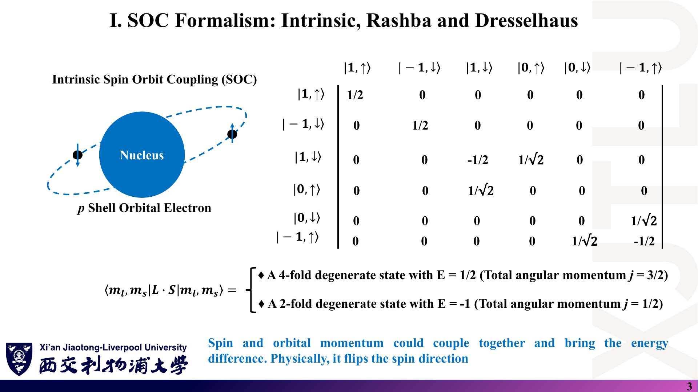
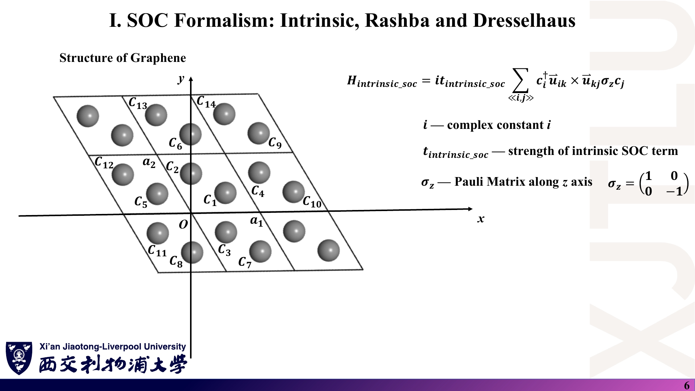
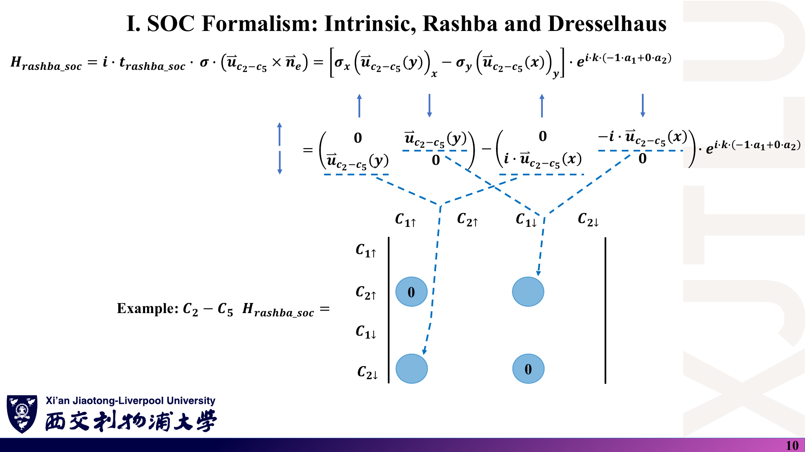
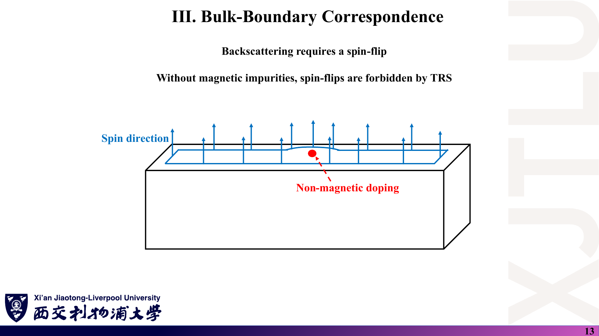
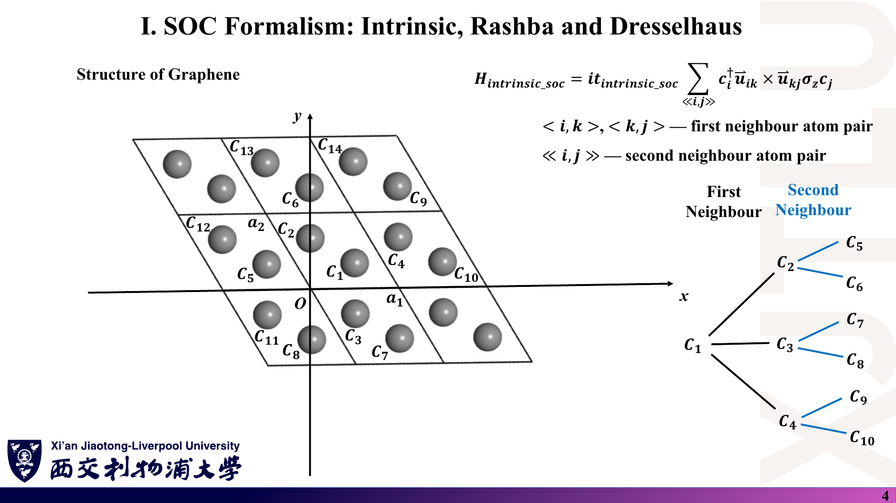

# 06 · 图文复习题与参考答案

来源：[Lecture_Seventeen.pdf](../Lecture_Seventeen.pdf)、[Lecture_Eighteen.pdf](../Lecture_Eighteen.pdf)、[Lecture_Nineteen.pdf](../Lecture_Nineteen.pdf)、[Lecture_Twenty.pdf](../Lecture_Twenty.pdf) 与 [Codes](../Codes/)。

[返回目录](README.md)

> 14 题均为根据讲义自编的练习，**不是课件原题或官方作业**。每题依次列出“课件截图 → 中文解释（题意）→ 原理深入（解析）→ Ref（来源）”。建议先遮住解析独立作答。截图保留原稿，正确公式以下方解析为准。

## 1. p 壳层 SOC 的矩阵元与守恒量

### 课件截图



### 中文解释

**题意**：用 $\mathbf L\cdot\mathbf S=L_zS_z+\tfrac12(L_+S_-+L_-S_+)$（$\hbar=1$）计算 $\langle1,\downarrow|\mathbf L\cdot\mathbf S|0,\uparrow\rangle$。说明矩阵中哪些态之间会耦合，以及 SOC 是否“总是翻转自旋”。

### 原理深入

**解析**：$L_+S_-|0,\uparrow\rangle=\sqrt{2}\cdot1\,|1,\downarrow\rangle$（$L_+|1,0\rangle=\sqrt{l(l+1)-m(m+1)}=\sqrt2$，$S_-|\uparrow\rangle=|\downarrow\rangle$），所以矩阵元为 $\tfrac12\sqrt2=1/\sqrt2$，与讲义一致。

只有 $m_j=m_l+m_s$ 相同的态之间才有非零矩阵元：$|1,\downarrow\rangle\leftrightarrow|0,\uparrow\rangle$（$m_j=1/2$），$|0,\downarrow\rangle\leftrightarrow|-1,\uparrow\rangle$（$m_j=-1/2$）。$|1,\uparrow\rangle$、$|-1,\downarrow\rangle$ 单独成块。

SOC **不总是**翻转自旋：$L_zS_z$ 部分只给对角能量。石墨烯的本征 SOC 就是这种 $\sigma_z$ 型，Rashba / Dresselhaus 才翻转自旋。

### Ref

- **来源**：[Lecture Seventeen，PDF 第 3 页](../Lecture_Seventeen.pdf#page=3)；[01 第 2 节](01_自旋轨道耦合与自旋纹理.md)。

## 2. 本征 SOC 为什么需要 i

### 课件截图



### 中文解释

**题意**：(a) 已知 $\nu_{ji}=-\nu_{ij}$，证明 $h_{ij}=i\,t_I\nu_{ij}\sigma_z$ 满足厄米条件，而去掉 $i$ 后不满足。(b) 说明为什么在 k 空间中这一项是实数、只出现在对角元上。(c) 写出 $t_I=0.005$ eV 时 Kane–Mele 带隙的数值。

### 原理深入

**解析**：

(a) $h_{ij}^\dagger=-i\,t_I\nu_{ij}\sigma_z=i\,t_I\nu_{ji}\sigma_z=h_{ji}$，成立。若 $h_{ij}=t_I\nu_{ij}\sigma_z$，则 $h_{ij}^\dagger=t_I\nu_{ij}\sigma_z=-h_{ji}$，是反厄米的。

(b) 次近邻连接同一子晶格，所以落在对角块；$\pm\mathbf r$ 成对、手性相反：$i t_I\nu(e^{i\mathbf k\cdot\mathbf r}-e^{-i\mathbf k\cdot\mathbf r})=-2t_I\nu\sin(\mathbf k\cdot\mathbf r)$，为实数。

(c) $E_g=6\sqrt3\times0.005\approx0.0520$ eV $=51.96$ meV。

### Ref

- **来源**：[Lecture Seventeen，PDF 第 6–7 页](../Lecture_Seventeen.pdf#page=6)；[01 第 4 节](01_自旋轨道耦合与自旋纹理.md)；[KM1](README.md#ref-km1)。

## 3. 手算自旋纹理

### 课件截图


### 中文解释

**题意**：某能带在某 k 点的归一化本征矢为

$$
\Psi=\tfrac12\,(1,\ i,\ i,\ -1)^T\quad\text{（顺序 }C_{1\uparrow},C_{2\uparrow},C_{1\downarrow},C_{2\downarrow}\text{）}.
$$

求 $\langle\sigma_x\rangle,\langle\sigma_y\rangle,\langle\sigma_z\rangle$。如果有人把四个分量当成一个整体、直接与 2×2 Pauli 矩阵相乘，会出现什么问题？

### 原理深入

**解析**：原子 1 的旋量为 $(C_{1\uparrow},C_{1\downarrow})=(\tfrac12,\tfrac i2)$，原子 2 为 $(\tfrac i2,-\tfrac12)$。

$$
\sum_sC_{s\uparrow}^*C_{s\downarrow}=\tfrac12\cdot\tfrac i2+\big(-\tfrac i2\big)\big(-\tfrac12\big)=\tfrac i2 .
$$

所以 $\langle\sigma_x\rangle=2\,\mathrm{Re}(\tfrac i2)=0$，$\langle\sigma_y\rangle=2\,\mathrm{Im}(\tfrac i2)=1$，$\langle\sigma_z\rangle=(\tfrac14+\tfrac14)-(\tfrac14+\tfrac14)=0$。自旋沿 +y。

四维矢量与 2×2 矩阵维度不匹配；即使误用“前两个分量 / 后两个分量”配对，也会把 $C_{1\uparrow}$ 与 $C_{2\uparrow}$ 当成同一原子的上下自旋。这正是讲义第 16 页“注意旋量分量”的含义。

### Ref

- **来源**：[Lecture Seventeen，PDF 第 16–18 页](../Lecture_Seventeen.pdf#page=17)；[01 第 8 节](01_自旋轨道耦合与自旋纹理.md)；代码 [08 第 5 节](08_代码导读.md)。

## 4. Rashba 块的具体矩阵

### 课件截图



### 中文解释

**题意**：一条近邻键的单位矢量为 $\hat{\mathbf u}=\hat x$，忽略相位因子。写出 Rashba 项贡献的 2×2 自旋块 $i\,t_R\,\boldsymbol\sigma\cdot(\hat{\mathbf u}\times\hat z)$，并说明它填在 4×4 矩阵的哪些位置（设键从原子 1 指向原子 2）。若换成 Dresselhaus 项，结果是什么？

### 原理深入

**解析**：$\hat x\times\hat z=-\hat y$，所以 $\boldsymbol\sigma\cdot(\hat{\mathbf u}\times\hat z)=-\sigma_y=\begin{pmatrix}0&i\\-i&0\end{pmatrix}$，

$$
i\,t_R(-\sigma_y)=t_R\begin{pmatrix}0&-1\\1&0\end{pmatrix}.
$$

它连接原子 1 与原子 2，并且只在自旋翻转位置：$(C_{1\uparrow},C_{2\downarrow})$ 元为 $-t_R$，$(C_{1\downarrow},C_{2\uparrow})$ 元为 $+t_R$，其余由厄米共轭给出。

Dresselhaus：$\sigma_xu_x-\sigma_yu_y=\sigma_x$，$i\,t_D\sigma_x=\begin{pmatrix}0&it_D\\it_D&0\end{pmatrix}$，也只在自旋翻转位置。

### Ref

- **来源**：[Lecture Seventeen，PDF 第 8–13 页](../Lecture_Seventeen.pdf#page=8)；[01 第 5–6 节](01_自旋轨道耦合与自旋纹理.md)。

## 5. Berry 联络的规范变换

### 课件截图


### 中文解释

**题意**：令 $|u'\rangle=e^{i\chi(\mathbf k)}|u\rangle$，从 $\mathbf A=i\langle u|\nabla u\rangle$ 推出 $\mathbf A'$。据此指出讲义第 5 页公式的问题，并说明 Berry 相位为什么只定义到模 $2\pi$。

### 原理深入

**解析**：

$$
\mathbf A'=i\langle u|e^{-i\chi}\nabla\big(e^{i\chi}|u\rangle\big)=i\langle u|\nabla u\rangle+i\cdot i\nabla\chi=\mathbf A-\nabla\chi .
$$

讲义写成 $\mathbf A_n-\nabla u_n(\mathbf k)$，被减去的应是**实标量相位** $\chi$ 的梯度，而不是态 $u_n$ 的梯度。旋度时 $\nabla\times\nabla\chi=0$，所以 $\Omega$ 不变。

闭合路径上 $e^{i\chi}$ 必须单值，故 $\oint\nabla\chi\cdot d\mathbf k=2\pi m$，$\gamma$ 只能确定到 $2\pi$ 的整数倍。

### Ref

- **来源**：[Lecture Eighteen，PDF 第 4–5 页](../Lecture_Eighteen.pdf#page=4)；[02 第 3–4 节](02_Berry相位与Z2拓扑.md)；勘误 [07 第 6 节](07_讲义勘误与易错点.md)。

## 6. TRS 下 Chern 数与 Kramers 简并

### 课件截图


### 中文解释

**题意**：(a) 用 $\Omega(-\mathbf k)=-\Omega(\mathbf k)$ 说明为什么 TRS 体系的总 Chern 数为 0。(b) 证明 $T^2=-1$ 时 $|\psi\rangle$ 与 $T|\psi\rangle$ 正交。(c) 在六角晶格中，K 点是 TRIM 吗？

### 原理深入

**解析**：

(a) 布里渊区关于原点对称，奇函数积分为 0。

(b) 利用 $\langle Tx|Ty\rangle=\langle y|x\rangle$：$\langle\psi|T\psi\rangle=\langle T^2\psi|T\psi\rangle=-\langle\psi|T\psi\rangle$，故为 0。

(c) 不是。$-\mathbf K$ 等价于 K′，而不是 K 本身。TRIM 是 Γ 与 3 个 M 点（分数坐标 $\{0,\tfrac12\}^2$）。所以石墨烯 K 点的简并不受 Kramers 定理保护，本征 SOC 可以在那里打开带隙。

### Ref

- **来源**：[Lecture Eighteen，PDF 第 8 页](../Lecture_Eighteen.pdf#page=8)；[Lecture Nineteen，PDF 第 8 页](../Lecture_Nineteen.pdf#page=8)；[02 第 6 节](02_Berry相位与Z2拓扑.md)。

## 7. 非磁杂质与背散射

### 课件截图



### 中文解释

**题意**：螺旋边缘态 $|k,\uparrow\rangle$ 的背散射末态是 $T|k,\uparrow\rangle$。证明保持 TRS 的杂质势 $V$ 在两者之间的矩阵元为零。若掺入磁性杂质，结论为什么失效？讲义说“平庸体系没有边缘态”，应如何修正？

### 原理深入

**解析**：$\langle T\psi|V\psi\rangle=\langle TV\psi|T^2\psi\rangle=-\langle VT\psi|\psi\rangle=-\langle T\psi|V\psi\rangle=0$（用到 $[V,T]=0$ 与 $V$ 厄米）。

磁性杂质（如 $\mathbf m\cdot\boldsymbol\sigma$）在 $T$ 下变号，$[V,T]\neq0$，上述推导不成立，可以耦合 Kramers 伙伴并打开带隙（对照第 5 页 Fe 掺杂）。

修正：平庸体系可以有边缘态，但它们不受保护，可以在不闭合体带隙的情况下被推出带隙。

### Ref

- **来源**：[Lecture Eighteen，PDF 第 12–14 页](../Lecture_Eighteen.pdf#page=12)；[02 第 9 节](02_Berry相位与Z2拓扑.md)；勘误 [07 第 9 节](07_讲义勘误与易错点.md)。

## 8. Wilson 环的规范协变

### 课件截图


### 中文解释

**题意**：在每个 k 点对占据态做幺正变换 $|u_n(\mathbf k)\rangle\to\sum_m|u_m(\mathbf k)\rangle U_{mn}(\mathbf k)$。证明离散 Wilson 环 $D=\prod_iM^{(i)}$ 变为 $U(\mathbf k_0)^\dagger D\,U(\mathbf k_0)$，并说明哪些量是规范不变的。若闭合点用了与起点不同的规范，会怎样？

### 原理深入

**解析**：$M^{(i)}\to U(\mathbf k_i)^\dagger M^{(i)}U(\mathbf k_{i+1})$。连乘时中间的 $U(\mathbf k_{i+1})U(\mathbf k_{i+1})^\dagger=\mathbb 1$ 逐一抵消，只剩两端：$D\to U(\mathbf k_0)^\dagger D\,U(\mathbf k_N)$。若 $\mathbf k_N$ 处的态与 $\mathbf k_0$ 相同（闭合正确），则 $U(\mathbf k_N)=U(\mathbf k_0)$，$D$ 只做相似变换，**本征值（WCC）规范不变**，矩阵元不是。

若闭合点规范不一致（例如约定 II 的哈密顿量却直接用 $u(\mathbf k_0)$ 闭合），末端多出一个不是单位阵的因子，本征值会被系统性地改变。本周程序中这一效应使 WCC 整体平移 1/2。

### Ref

- **来源**：[Lecture Nineteen，PDF 第 4 页](../Lecture_Nineteen.pdf#page=4)、[第 12 页](../Lecture_Nineteen.pdf#page=12)；[03 第 3 节](03_Wilson环与WCC数值判据.md)；[08 第 6 节](08_代码导读.md)。

## 9. 交叉计数为什么只看半个 BZ

### 课件截图


### 中文解释

**题意**：(a) 为什么只需在 $k_1\in[0,\tfrac12]$ 上数交叉？(b) 在 $k_1=0$ 与 $k_1=\tfrac12$ 处 WCC 有什么约束？(c) 一组两条 WCC：$k_1=0$ 时都在 0；$k_1=\tfrac12$ 时都在 0。中间一条升到 0.3 再回落，另一条降到 −0.3 再回升。参考线取 0.25，交叉几次？Z₂ 是多少？

### 原理深入

**解析**：

(a) TRS 使 $\{\theta_j(-k_1)\}=\{\theta_j(k_1)\}$，另一半是镜像，不含新信息。

(b) 这两条线上环路在 TRS 下映射到自身，WCC 成 Kramers 对简并。

(c) 升到 0.3 的那条穿过 0.25 两次，另一条不穿过，共 2 次，偶数，Z₂ = 0。两条在 $k_1=\tfrac12$ 时与原伙伴重新相遇，没有伙伴交换，确实平庸。换参考线为 0.35 时交叉 0 次，奇偶性不变，计数可信。

### Ref

- **来源**：[Lecture Nineteen，PDF 第 8–10 页](../Lecture_Nineteen.pdf#page=8)；[03 第 5–6 节](03_Wilson环与WCC数值判据.md)。

## 10. arctan 与 atan2

### 课件截图


### 中文解释

**题意**：Wilson 环某本征值为 $\lambda=-0.6-0.8i$。分别用 $\arctan(b/a)$ 与 $\operatorname{atan2}(b,a)$ 求 $\theta$ 和 $\bar x=\theta/2\pi$。哪一个正确？对 Z₂ 判断有什么影响？

### 原理深入

**解析**：

- $\arctan(-0.8/-0.6)=\arctan(1.333)=0.927$ rad，$\bar x=0.148$。
- $\operatorname{atan2}(-0.8,-0.6)=-\pi+0.927=-2.214$ rad，$\bar x=-0.352$。

$\lambda$ 在第三象限，正确答案是 $-0.352$。$\arctan(b/a)$ 无法区分 $\lambda$ 与 $-\lambda$，把 WCC 折叠进 $(-\tfrac14,\tfrac14)$。判据恰好关心 WCC 是否越过 ±0.5 附近、是否交换伙伴，折叠会直接破坏判断。本周 Fortran 程序用的是 `ATAN2`，是正确的。

### Ref

- **来源**：[Lecture Nineteen，PDF 第 11、13 页](../Lecture_Nineteen.pdf#page=11)；[03 第 7 节](03_Wilson环与WCC数值判据.md)；勘误 [07 第 12 节](07_讲义勘误与易错点.md)。

## 11. 交叉数随参考线改变时怎么办

### 课件截图


### 中文解释

**题意**：某次计算中，参考线取 0.25 时交叉 1 次，取 0.1 时交叉 2 次。列出排查步骤，并说明哪一步应该放在最前面。

### 原理深入

**解析**：

1. **先算体带隙** $\min_{\mathbf k}(E_{N_{occ}+1}-E_{N_{occ}})$，在 K、K′ 等可疑点附近加密。若为 0，Z₂ 无定义，停止解读。
2. 检查 WCC 是否按行排序、是否在圆周（模 1）上比较，而不是对无序列做 `unwrap`。
3. 加密环路方向网格，检查重叠矩阵的奇异值是否接近 1。
4. 改用最大间隙法计数，确认奇偶性不依赖参考线。
5. 检查闭合条件（约定 I / II）。

第 1 步最优先，因为后面所有步骤都以“有隙”为前提。

### Ref

- **来源**：[Lecture Nineteen，PDF 第 12–13 页](../Lecture_Nineteen.pdf#page=12)；[03 第 8 节](03_Wilson环与WCC数值判据.md)；[08 第 7、10 节](08_代码导读.md)。

## 12. 从输入文件算 k 网格

### 课件截图


### 中文解释

**题意**：由输入文件求：(a) 圆心 $(1/3,1/3)$ 的笛卡尔坐标与模长；(b) 自旋纹理一共有多少个 k 点，最外圈半径多大；(c) 每个 `*_Spin_Texture.dat` 应有多少行。

### 原理深入

**解析**：

(a) $\mathbf b_1=\frac{2\pi}{a}(1,\tfrac1{\sqrt3})$，$\mathbf b_2=\frac{2\pi}{a}(0,\tfrac2{\sqrt3})$，$\mathbf K=\tfrac13(\mathbf b_1+\mathbf b_2)=\frac{2\pi}{3a}(1,\sqrt3)=(0.851,1.475)$ Å⁻¹，$|\mathbf K|=\frac{4\pi}{3a}=1.703$ Å⁻¹。

(b) $6+12+24+36+45=123$ 个点；最外圈半径 $5\times0.02=0.10$ Å⁻¹。

(c) 4 条带 × (123 + 1 空行) = 496 行，与文件一致。

### Ref

- **来源**：[Lecture Twenty，PDF 第 3 页](../Lecture_Twenty.pdf#page=3)；[04 第 2 节](04_代码演示_石墨烯Rashba与Dresselhaus.md)；[08 第 2 节](08_代码导读.md)。

## 13. 用 Kane–Mele 判据给参数分类

### 课件截图


### 中文解释

**题意**：取 $t_I=0.005$ eV、无交错势。按程序的约定（$\nu=\pm1$、单位键矢量），带隙 $E_g=6\sqrt3\,t_I-3t_R$。判断 $t_R=0.004$、$0.02$、$0.04$ 三种情形各属于什么相，并与讲义判据 $t_R<3\sqrt3\,t_I$ 比较。若想得到平庸**绝缘体**，应怎样改参数？

### 原理深入

**解析**：临界值 $2\sqrt3\times0.005=0.0173$ eV。

| $t_R$ | $E_g$ | 本笔记判断 | 讲义判据（阈值 0.026） |
|---|---|---|---|
| 0.004 | 39.96 meV | QSH，Z₂ = 1 | 非平庸 ✓ |
| 0.02 | 0（已闭合） | 无隙，Z₂ 无定义 | 判为非平庸 ✗ |
| 0.04 | 0 | 无隙，Z₂ 无定义 | 判为“平庸”，但不是绝缘体 |

$t_R=0.02$ 正好区分两种判据；讲义所给的两组算例恰好都没落在 0.0173–0.026 之间。

要得到平庸绝缘体：加交错势 $\pm\lambda_v$，且 $\lambda_v>3\sqrt3\,t_I\approx0.026$，同时保持 $t_R<2\sqrt3\,t_I$。例如 `onsite: 0.04 -0.04`、$t_R=0.004$，本笔记数值验证此时 Z₂ = 0、带隙约 30 meV。

### Ref

- **来源**：[Lecture Twenty，PDF 第 3–4 页](../Lecture_Twenty.pdf#page=3)；[04 第 3 节](04_代码演示_石墨烯Rashba与Dresselhaus.md)；[07 第 13 节](07_讲义勘误与易错点.md)；[KM1](README.md#ref-km1)、[KM2](README.md#ref-km2)。

## 14. 代码排错：一行余弦定理

### 课件截图



### 中文解释

**题意**：程序第 283 行为

```fortran
secondneighbour = DSQRT(d**2+d**2-2*d*d*DCOS(1.2d2/3.6d2*pi))   ! d = 1.42
```

(a) 计算 `secondneighbour` 的数值，并给出正确值。(b) 推断它对次近邻搜索、手性赋值和本征 SOC 的影响。(c) 如果只有输出 `.dat` 文件而无法重新编译，怎样用数据验证你的推断？

### 原理深入

**解析**：

(a) $\tfrac{120}{360}\pi=\pi/3$，$\cos(\pi/3)=0.5$，结果 $=\sqrt{2d^2-d^2}=d=1.42$ Å。正确的 120° 应为 $\tfrac{120}{180}\pi$，结果 $\sqrt3\,d=2.46$ Å。

(b) “次近邻”搜索按 1.42 Å 进行，找到的是 6 条近邻键；寻找“近邻 + 近邻 = 1.42 Å”的中间路径必然失败，`chirality` 不被赋值；未初始化的手性在实际运行中为 0，本征 SOC 项为零。

(c) 写一个复刻程序，分别用 $t_I=0$ 与 $t_I=0.005$ 计算自旋纹理和 WCC，与 `.dat` 比较：哪个能逐位复现，哪个就是实际运行的参数。本笔记的结果是 $t_I=0$ 完全复现，$t_I=0.005$ 偏差可达 0.09（见 08 第 9 节）。注意：$\langle\sigma_z\rangle=0$ 由对称性保证，不能作为证据。

### Ref

- **来源**：[TIGHTBINDINGFORGRAPHENE.f90 第 283 行](../Codes/TIGHTBINDINGFORGRAPHENE.f90#L283)；[08 第 3、9 节](08_代码导读.md)；[07 第 14 节](07_讲义勘误与易错点.md)。
