# 07 · 图文勘误、符号约定与易错点

来源：[Lecture_Seventeen.pdf](../Lecture_Seventeen.pdf)、[Lecture_Eighteen.pdf](../Lecture_Eighteen.pdf)、[Lecture_Nineteen.pdf](../Lecture_Nineteen.pdf)、[Lecture_Twenty.pdf](../Lecture_Twenty.pdf) 与 [Codes](../Codes/)。

[返回目录](README.md)

> 本文是**学习核对记录，不是教师发布的官方勘误**。截图忠实保留原稿。每节在“中文解释”中写**问题**，在“原理深入”中写**正确写法**与**核验理由**。只收录经过推导或数值验证的条目，并区分三类：明确的笔误、没有说清的约定、不应泛化的物理结论。页码均为包含封面的 PDF 物理页码。

## 1. 单位键矢量与叉积的写法〔L17 pp. 5, 9〕

### 课件截图

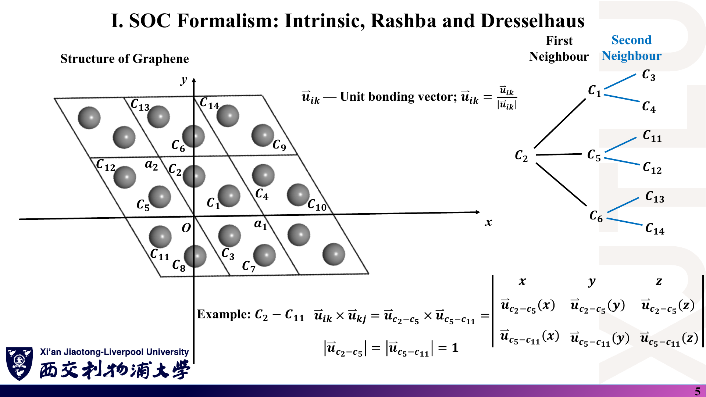

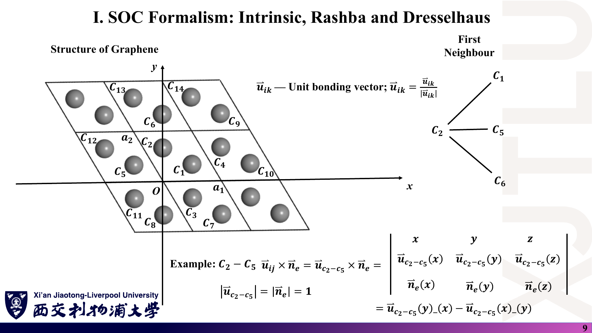

### 中文解释

**问题**（笔误 + 约定）：

1. “$\vec u_{ik}=\vec u_{ik}/|\vec u_{ik}|$”左右用同一符号，等于什么都没定义。
2. 叉积行列式只写了两行分量，表头的 $x,y,z$ 代替了单位矢量行；第 9 页展开结果写成 “$u(y)\_(x)-u(x)\_(y)$”，下标含义不清。
3. 两个单位矢量叉积的大小是 $\sqrt3/2$，不是 1；讲义没有说明本征 SOC 中只取符号。

### 原理深入

**正确写法**：

$$
\hat{\mathbf u}_{ik}=\frac{\mathbf r_k-\mathbf r_i}{|\mathbf r_k-\mathbf r_i|},\qquad
\hat{\mathbf u}_{ik}\times\hat{\mathbf u}_{kj}=\begin{vmatrix}\hat x&\hat y&\hat z\\u_{ik,x}&u_{ik,y}&0\\u_{kj,x}&u_{kj,y}&0\end{vmatrix}
=(u_{ik,x}u_{kj,y}-u_{ik,y}u_{kj,x})\,\hat z ,
$$

$$
\hat{\mathbf u}\times\hat z=u_y\,\hat x-u_x\,\hat y,\qquad
\nu_{ij}=\tfrac{2}{\sqrt3}(\hat{\mathbf u}_{ik}\times\hat{\mathbf u}_{kj})_z=\pm1 .
$$

**核验理由**：两段近邻键的方向夹角为 60°，$\sin60^\circ=\sqrt3/2$。Kane–Mele 原文用 $\nu_{ij}=\pm1$；`Codes/` 程序也只取叉积 z 分量的符号（`chirality = ±1`，第 154–159 行）。若按讲义字面带入 $\sqrt3/2$，本征 SOC 强度和所有临界值都会差这个因子。

### Ref

- **原课件**：[Lecture Seventeen，PDF 第 5 页](../Lecture_Seventeen.pdf#page=5)、[第 9 页](../Lecture_Seventeen.pdf#page=9)。
- **配套**：[01 第 3 节](01_自旋轨道耦合与自旋纹理.md)；延伸 [KM1](README.md#ref-km1)。

## 2. 填块示例中漏写系数〔L17 pp. 7, 10〕

### 课件截图

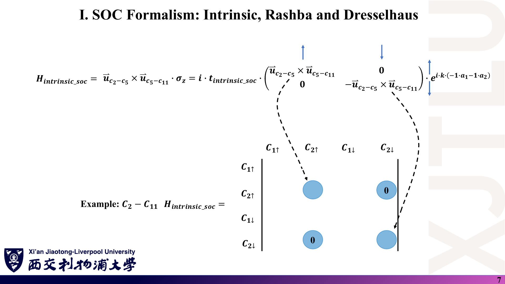

![Lecture Seventeen 第10页：H = i t σ·(u×n) = [σx(...) − σy(...)] 的等号链](课件截图/Lecture_Seventeen/page-10.png)

### 中文解释

**问题**（笔误）：

- 第 7 页：$H_{intrinsic\_soc}=\vec u\times\vec u\cdot\sigma_z=i\cdot t\cdot(\ldots)$，第一个等号右边漏了 $i\,t_{intrinsic\_soc}$，而且把矢量（叉积）直接乘 $\sigma_z$。
- 第 10 页：$i\,t_R\,\boldsymbol\sigma\cdot(\hat{\mathbf u}\times\hat{\mathbf n})=[\sigma_x(\ldots)-\sigma_y(\ldots)]\cdot e^{\ldots}$，第二个等号右边漏了 $i\,t_R$。第 13 页 Dresselhaus 的写法是完整的，可作对照。

### 原理深入

**正确写法**（以 C2–C11、C2–C5 为例）：

$$
h^{I}_{C_2C_{11}}=i\,t_I\,(\hat{\mathbf u}_{C_2C_5}\times\hat{\mathbf u}_{C_5C_{11}})_z\,\sigma_z\,e^{i\mathbf k\cdot(-\mathbf a_1-\mathbf a_2)},
$$

$$
h^{R}_{C_2C_5}=i\,t_R\big[\sigma_x\,u_y-\sigma_y\,u_x\big]_{C_2C_5}\,e^{i\mathbf k\cdot(-\mathbf a_1)} .
$$

**核验理由**：等号两边必须是同一种对象。没有 $i\,t$ 时左边是能量、右边是无量纲矩阵；而且缺少 $i$ 时这一项不厄米（见 [06 第 2 题](06_复习题与参考答案.md)）。

### Ref

- **原课件**：[Lecture Seventeen，PDF 第 7 页](../Lecture_Seventeen.pdf#page=7)、[第 10 页](../Lecture_Seventeen.pdf#page=10)、[第 13 页](../Lecture_Seventeen.pdf#page=13)。
- **配套**：[01 第 4–5 节](01_自旋轨道耦合与自旋纹理.md)。

## 3. “破坏时间反演保护的自旋简并”〔L17 p. 12〕

### 课件截图

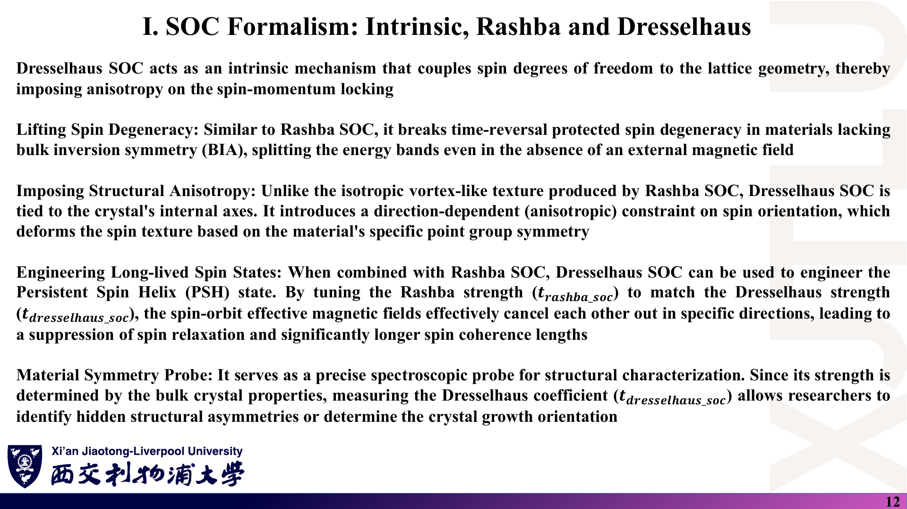

### 中文解释

**问题**（不准确的物理表述）：原文说 Dresselhaus SOC “与 Rashba 类似，breaks time-reversal protected spin degeneracy”。容易被理解为 SOC 破坏了时间反演对称性，或打破了 Kramers 简并。

### 原理深入

**正确写法**：Rashba 与 Dresselhaus SOC **保持**时间反演对称性。它们在缺少反演中心的体系中，劈裂**同一 $\mathbf k$ 处**的自旋简并；Kramers 关系 $E_{\uparrow}(\mathbf k)=E_{\downarrow}(-\mathbf k)$ 与 TRIM 处的二重简并依然保留。

**核验理由**：

- 时间反演 $\mathcal T$：$i\to-i$，$\boldsymbol\sigma\to-\boldsymbol\sigma$，$\mathbf k\to-\mathbf k$，所以 $i\,t\,\boldsymbol\sigma\cdot(\ldots)$ 型的项不变。
- “每个 $\mathbf k$ 处都二重简并”需要 $\mathcal T$ 与空间反演 $\mathcal P$ **同时**存在（$\mathcal{PT}$ 保证）；破坏 $\mathcal P$ 就足以解除它，无需破坏 $\mathcal T$。
- 第十八讲第 8 页正是用 TRS 来保证 TRIM 简并的，与本页的说法矛盾。

### Ref

- **原课件**：[Lecture Seventeen，PDF 第 12 页](../Lecture_Seventeen.pdf#page=12)；[Lecture Eighteen，PDF 第 8 页](../Lecture_Eighteen.pdf#page=8)。
- **配套**：[01 第 6 节](01_自旋轨道耦合与自旋纹理.md)。

## 4. 自旋—动量锁定 ≠ 拓扑绝缘体〔L17 pp. 14, 15, 19, 20〕

### 课件截图

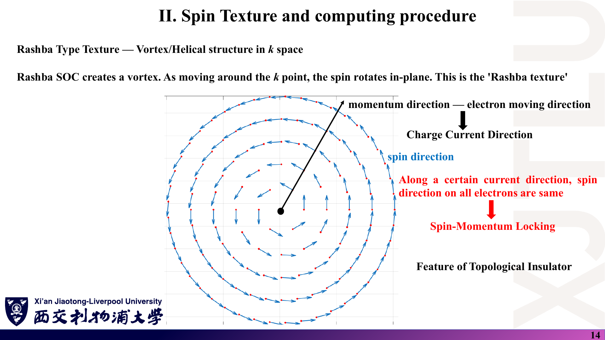

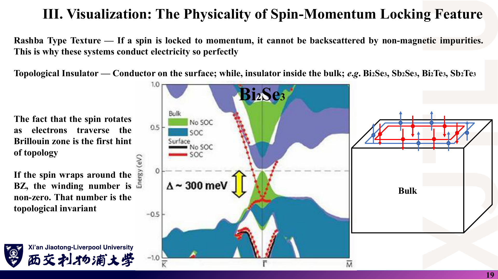

### 中文解释

**问题**（不应泛化的结论）：

1. 第 14、15 页把自旋—动量锁定标为“拓扑绝缘体的特征”，第 15 页的 Dresselhaus 纹理也标了同样的字样。
2. 第 19 页说“Rashba 型纹理：自旋锁定于动量，就不能被非磁杂质背散射，所以这些体系导电如此完美”；又说“若自旋绕 BZ 缠绕，缠绕数非零，这个数就是拓扑不变量”。
3. 第 20 页“纹理 = 手性 = 拓扑潜力”是口号，不是判据。

### 原理深入

**正确写法**：拓扑绝缘体的表面 / 边缘态**具有**自旋—动量锁定；但具有自旋—动量锁定的体系不一定拓扑。Z₂ 由占据带在整个 BZ 上的整体性质决定（Wilson 环、Pfaffian 等），不是某个 k 点附近局部纹理的缠绕数。

**核验理由**：

- 普通 Rashba 二维电子气同时有两个费米圆，螺旋性相反。$k\to-k$ 的背散射可以在两个圆之间发生，只是被部分抑制，不受拓扑保护。拓扑表面态只有**单个**螺旋费米圆（奇数个 Dirac 锥），背散射到 Kramers 伙伴的矩阵元严格为零（[02 第 9 节](02_Berry相位与Z2拓扑.md)）。
- 本周数值也给出反例：同一 Rashba 涡旋纹理既出现在 QSH 参数下，也出现在 $t_R>2\sqrt3t_I$ 的无隙参数下（[04 第 4、6 节](04_代码演示_石墨烯Rashba与Dresselhaus.md)）。

### Ref

- **原课件**：[Lecture Seventeen，PDF 第 14–15 页](../Lecture_Seventeen.pdf#page=14)、[第 19–20 页](../Lecture_Seventeen.pdf#page=19)。
- **延伸**：[HK](README.md#ref-hk)。

## 5. 自旋期望值的单位与共轭〔L17 pp. 17–18〕

### 课件截图

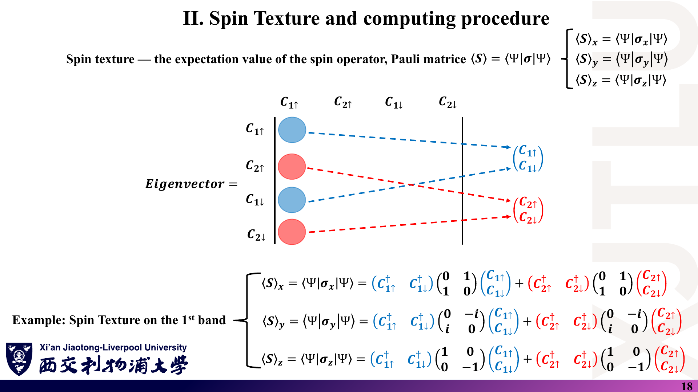

### 中文解释

**问题**（约定没说清）：讲义写“自旋纹理 = 自旋算符的期望值 $\langle S\rangle=\langle\Psi|\sigma|\Psi\rangle$”，把自旋算符与 Pauli 矩阵等同；行向量写成 $(C_{1\uparrow}^\dagger\ C_{1\downarrow}^\dagger)$。

### 原理深入

**正确写法**：

$$
\mathbf S=\tfrac\hbar2\boldsymbol\sigma,\qquad
\langle\boldsymbol\sigma\rangle_n=\sum_s\chi_s^\dagger\boldsymbol\sigma\chi_s,\quad \chi_s=\begin{pmatrix}C_{s\uparrow}\\C_{s\downarrow}\end{pmatrix},\quad \chi_s^\dagger=(C_{s\uparrow}^*\ \ C_{s\downarrow}^*).
$$

**核验理由**：对单个复数，$\dagger$ 与 $*$ 相同，但写 $*$ 更不易与算符混淆（第一周 [07 第 1 节](../../Week_One/学习笔记/07_讲义勘误与易错点.md) 同类问题）。程序输出的是 $\langle\boldsymbol\sigma\rangle$，取值范围 $[-1,1]$，不是以 $\hbar$ 为单位的自旋。

### Ref

- **原课件**：[Lecture Seventeen，PDF 第 17–18 页](../Lecture_Seventeen.pdf#page=17)。
- **配套**：[01 第 8 节](01_自旋轨道耦合与自旋纹理.md)。

## 6. Berry 曲率规范不变性的推导〔L18 p. 5〕

### 课件截图

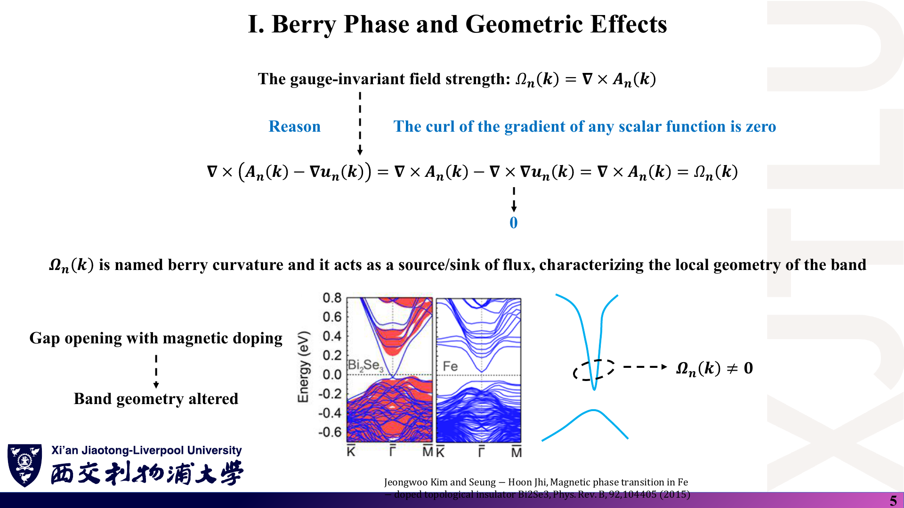

### 中文解释

**问题**（明确的笔误）：讲义写

$$
\nabla\times\big(\mathbf A_n(\mathbf k)-\nabla u_n(\mathbf k)\big)=\nabla\times\mathbf A_n-\nabla\times\nabla u_n=\Omega_n .
$$

被减去的是“态 $u_n$ 的梯度”，但规范变换改变的是**相位**，不是态本身。

### 原理深入

**正确写法**：令 $|u_n\rangle\to e^{i\chi(\mathbf k)}|u_n\rangle$，$\chi$ 为实标量，

$$
\mathbf A_n\to\mathbf A_n-\nabla\chi,\qquad
\nabla\times(\mathbf A_n-\nabla\chi)=\nabla\times\mathbf A_n=\Omega_n .
$$

**核验理由**：直接代入 $\mathbf A=i\langle u|\nabla u\rangle$ 即可推出（[06 第 5 题](06_复习题与参考答案.md)）。$u_n$ 是复矢量（或复函数），$\nabla u_n$ 与实矢量 $\mathbf A_n$ 类型不同，不能相减。讲义旁注“标量函数梯度的旋度为零”说明本意就是标量 $\chi$。

### Ref

- **原课件**：[Lecture Eighteen，PDF 第 5 页](../Lecture_Eighteen.pdf#page=5)。
- **延伸**：[XCN](README.md#ref-xcn)。

## 7. “Ω 非零就不能解开”〔L18 p. 7〕

### 课件截图

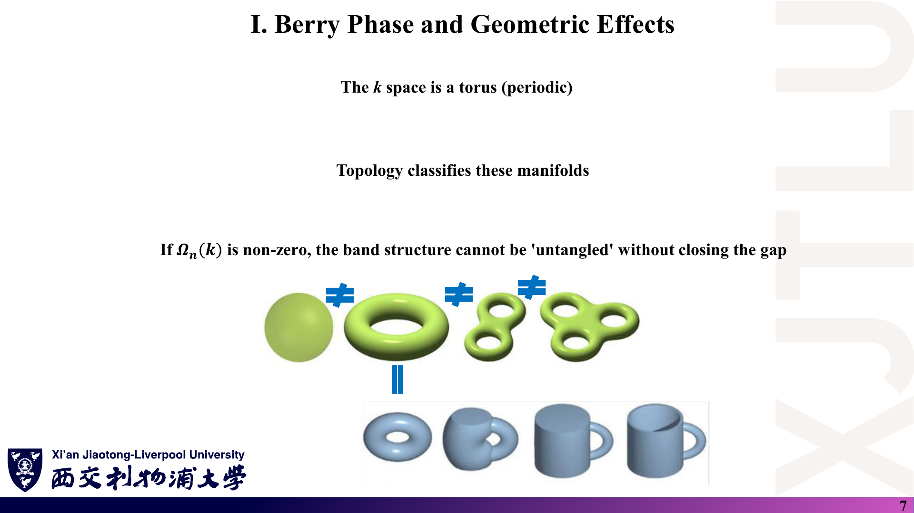

### 中文解释

**问题**（不应泛化的结论）：局部 Berry 曲率不为零，并不意味着能带拓扑非平庸。

### 原理深入

**正确写法**：若 **Chern 数** $C=\frac1{2\pi}\int\Omega\ne0$（或 TRS 体系的 $\nu=1$），则不闭合带隙就不能把能带形变为平庸。

**核验理由**：反例是石墨烯加交错子晶格势（或本周 [04 第 3 节](04_代码演示_石墨烯Rashba与Dresselhaus.md) 中 $\lambda_v>3\sqrt3t_I$ 的情形）。K 与 K′ 附近曲率很大但符号相反，积分为 0，是平庸绝缘体。几乎所有破坏 $\mathcal{PT}$ 的有隙体系都有非零局部曲率。

### Ref

- **原课件**：[Lecture Eighteen，PDF 第 6–7 页](../Lecture_Eighteen.pdf#page=6)。
- **配套**：[02 第 5 节](02_Berry相位与Z2拓扑.md)。

## 8. Z₂ 的稳健性条件与“自旋分量”〔L18 pp. 8–9〕

### 课件截图

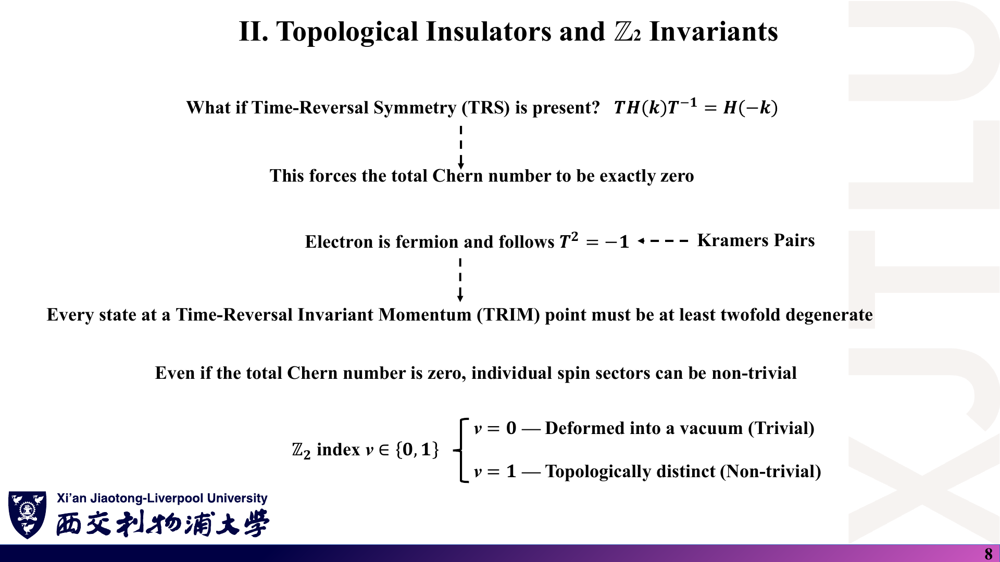

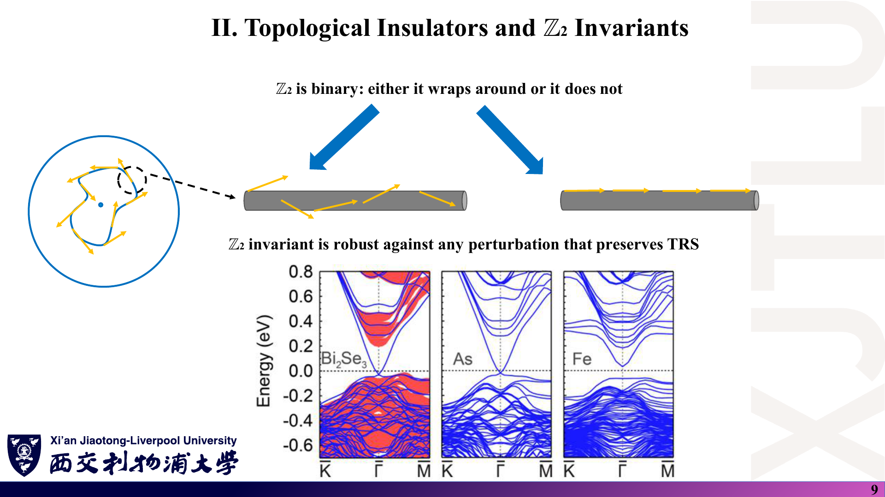

### 中文解释

**问题**（条件不完整）：

1. 第 9 页“Z₂ 对任何保持 TRS 的微扰都稳健”漏了“不闭合体带隙”。
2. 第 8 页“即使总 Chern 数为零，单个自旋分量也可以非平庸”只在 $S_z$ 守恒时才有严格意义。

### 原理深入

**正确写法**：只要 (i) 保持 TRS，且 (ii) 体带隙不闭合，$\nu$ 就不变。当 $S_z$ 守恒时，$\nu=\tfrac12(C_\uparrow-C_\downarrow)\bmod2$；有 Rashba 项时 $S_z$ 不守恒，应直接用 Z₂ 定义。

**核验理由**：Rashba 项保持 TRS，但本笔记数值复核显示，$t_R>2\sqrt3t_I$ 时带隙闭合（[08 第 9 节](08_代码导读.md)），QSH 相随之消失。这就是“保持 TRS 却改变拓扑”的直接例子，说明条件 (ii) 不可省略。

### Ref

- **原课件**：[Lecture Eighteen，PDF 第 8–9 页](../Lecture_Eighteen.pdf#page=8)。
- **延伸**：[KM2](README.md#ref-km2)。

## 9. 边缘态图像中的混用与省略〔L18 pp. 12–14〕

### 课件截图

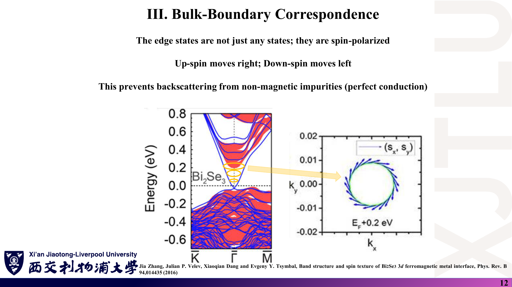

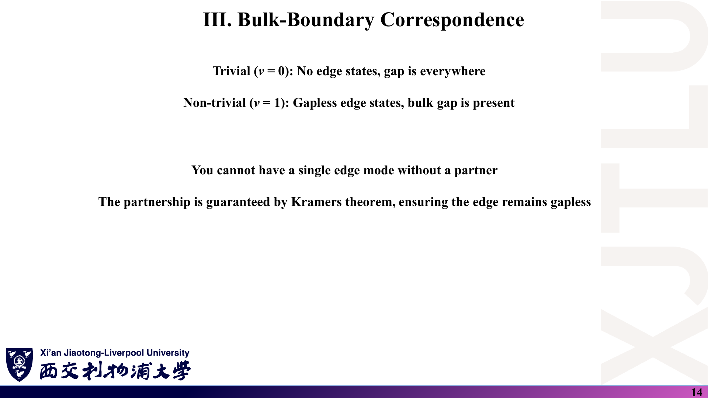

### 中文解释

**问题**：

1. 第 12 页把二维 QSH 的螺旋边缘态描述（“↑ 向右、↓ 向左”）与三维 TI Bi₂Se₃ 的表面 Dirac 锥图放在一起；后者的自旋在面内、垂直于动量。
2. 第 13 页“没有磁性杂质时，TRS 禁止自旋翻转”过于笼统。
3. 第 14 页“平庸：没有边缘态”不准确。

### 原理深入

**正确写法**：

1. 二维 QSH：一维边缘上一对螺旋态（$S_z$ 近似守恒时可说“↑ 右、↓ 左”）；三维强 TI：表面单个 Dirac 锥，自旋—动量锁定为面内切向纹理。
2. TRS 不变的杂质势在 Kramers 伙伴之间的矩阵元为零：$\langle T\psi|V|\psi\rangle=0$。被禁止的是一阶弹性背散射，不是一切自旋翻转过程。
3. 平庸时可以有边缘态，但它们成对出现，可在不闭合体带隙的情况下被移出带隙，不受保护。

**核验理由**：第 2 条的证明见 [02 第 9 节](02_Berry相位与Z2拓扑.md)；第 3 条是体—边对应的逆命题不成立（$\nu=0$ 只说明“不必有”，不说明“必没有”）。

### Ref

- **原课件**：[Lecture Eighteen，PDF 第 12–14 页](../Lecture_Eighteen.pdf#page=12)。
- **延伸**：[HK](README.md#ref-hk)、[FK](README.md#ref-fk)。

## 10. Wilson 环的 $k_x$ / $k_y$ 标签与 θ 的单位〔L19 pp. 3–5, 9〕

### 课件截图

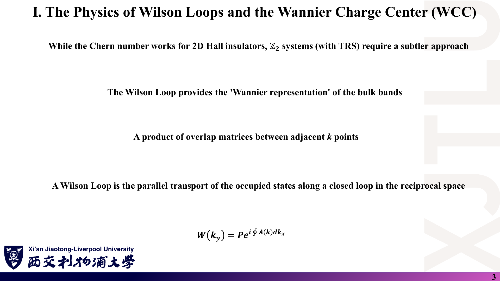

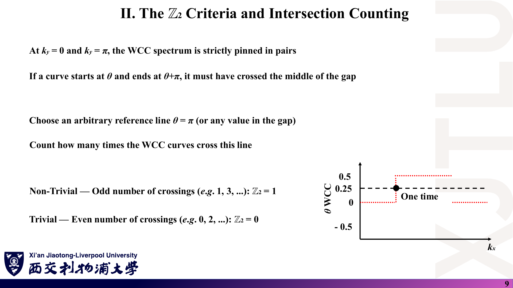

### 中文解释

**问题**（记号前后不一致）：

1. 第 3 页 $W(k_y)=\mathcal Pe^{i\oint A\,dk_x}$；第 4 页 $W(k_y)=\mathcal Pe^{i\oint A\,dk_y}$ 且“固定 $k_x$”；第 5 页本征值写作 $e^{i\theta_j(k_x)}$。
2. 第 9 页“WCC 在 $k_y=0$ 与 $k_y=\pi$ 处成对钉住”，但图的横轴是 $k_x$。
3. 第 9 页参考线写 “$\theta=\pi$”，图中画在 0.25；纵轴标 “θ WCC”，刻度为 ±0.5。

### 原理深入

**正确写法**（统一为：沿 $k_2$ 闭合，随 $k_1$ 演化）：

$$
W(k_1)=\mathcal P\exp\Big(i\oint A_2\,dk_2\Big),\quad \lambda_j=e^{i\theta_j(k_1)},\quad \bar x_j(k_1)=\frac{\theta_j(k_1)}{2\pi}\in[-\tfrac12,\tfrac12),
$$

WCC 在 $k_1=0$ 与 $k_1=\tfrac12$（即 $k_1a=0,\pi$）处成对简并；参考线可取 $\bar x=0.25$（即 $\theta=\pi/2$），或任意间隙内的值。

**核验理由**：

- 第 11 页的流程图（沿 $k_y$ 方向取点、每条线对应一个 $k_x$）与程序第 523–634 行都是“固定 $k_1$、沿 $k_2$ 求乘积、输出随 $k_1$ 变化的 WCC”，所以被扫描的是 $k_x$。
- 讲义自己的图以 ±0.5 为界，纵轴是 $\theta/2\pi$。$\theta=\pi$ 对应 $\bar x=0.5$，是分支切割处，不适合作参考线。

### Ref

- **原课件**：[Lecture Nineteen，PDF 第 3–5 页](../Lecture_Nineteen.pdf#page=3)、[第 9 页](../Lecture_Nineteen.pdf#page=9)、[第 11 页](../Lecture_Nineteen.pdf#page=11)。
- **配套**：[03 第 2–6 节](03_Wilson环与WCC数值判据.md)。

## 11. WCC 台阶示意图与“被推到边界”〔L19 pp. 6, 9–10〕

### 课件截图

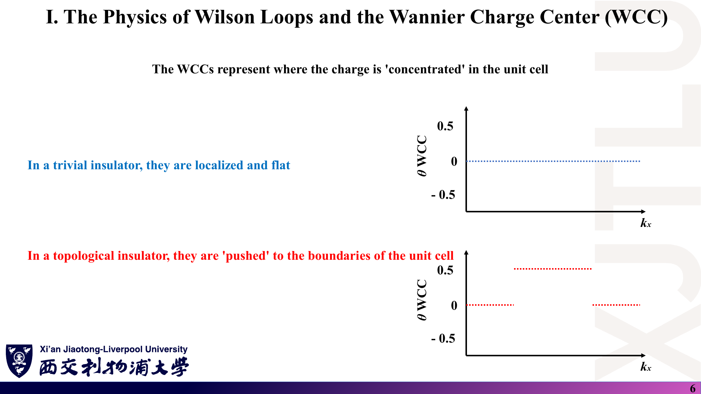

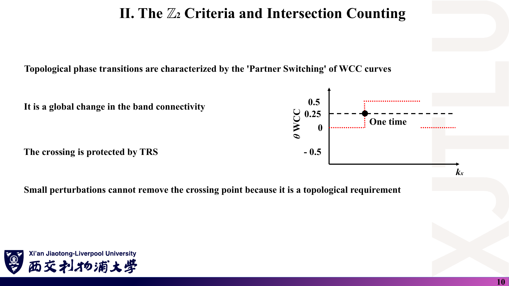

### 中文解释

**问题**（示意图误导）：

1. 第 6 页说平庸时 WCC “局域且平坦”，拓扑时“被推到原胞边界”，并画了从 0 跳到 0.5 再跳回的分段水平线。
2. 第 9–10 页只画了**一条**从 0 垂直跳到 0.5 的曲线，标注交叉 1 次。

### 原理深入

**正确写法**：区别在**连接方式**。平庸时，Kramers 对在 $k_1=\tfrac12$ 与原伙伴重新相遇；非平庸时与另一对的成员相遇（伙伴交换），一条曲线上行、一条下行。对有隙绝缘体，WCC 是 $k_1$ 的连续函数（模 1），曲线可以弯曲，不必平坦。

**核验理由**：

- WCC 平移整数个晶格常数是同一位置，“在 0.5”与“在 −0.5”无法区分。只有一对曲线的相对运动才有拓扑意义（[FK](README.md#ref-fk)、[SV](README.md#ref-sv)）。
- 若两条曲线都垂直跳到 ±0.5，交叉次数取决于分支选择。第二十讲的输出图正是这种情形（第 14 节）。
- 垂直跳变意味着 Berry 曲率在单条线上集中，或带隙闭合；应先检查带隙。

### Ref

- **原课件**：[Lecture Nineteen，PDF 第 6 页](../Lecture_Nineteen.pdf#page=6)、[第 9–10 页](../Lecture_Nineteen.pdf#page=9)。
- **配套**：[03 第 4、6 节](03_Wilson环与WCC数值判据.md)。

## 12. arctan 与 Wilson 环符号约定〔L19 pp. 4, 11, 13〕

### 课件截图

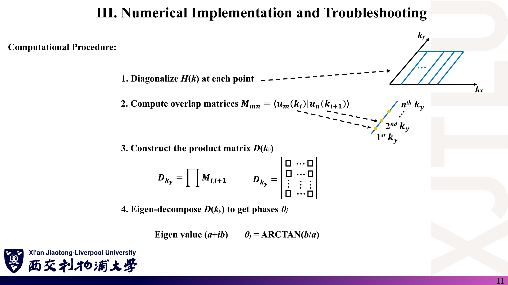

### 中文解释

**问题**：

1. 笔误：$\theta_j=\mathrm{ARCTAN}(b/a)$ 的值域只有 $(-\pi/2,\pi/2)$，与第 13 页“θ 定义在 $[-\pi,\pi]$”矛盾。
2. 约定没说清：第 4 页 $W=\mathcal Pe^{+i\oint A}$，而第 11 页的重叠矩阵乘积对应 $\mathcal Pe^{-i\oint A}$。

### 原理深入

**正确写法**：

$$
\theta_j=\operatorname{atan2}(b,a)\in(-\pi,\pi],\qquad
\prod_iM^{(i)}\approx\mathcal P\exp\Big(-i\oint A\,dk\Big)\ \ (\mathbf A=i\langle u|\nabla u\rangle).
$$

**核验理由**：

- 反例：$\lambda=-0.6-0.8i$，arctan 给出 $\bar x=0.148$，atan2 给出 $-0.352$（[06 第 10 题](06_复习题与参考答案.md)）。程序第 609 行用的是 `ATAN2`，是正确的。
- 单带时 $\langle u_k|u_{k+\delta}\rangle\approx1+\delta\langle u|\partial u\rangle=1-iA\delta$，所以乘积是 $e^{-i\oint A}$。两种约定的 WCC 互为相反数，交叉奇偶性不变；比较不同程序的图时需注意。

### Ref

- **原课件**：[Lecture Nineteen，PDF 第 4 页](../Lecture_Nineteen.pdf#page=4)、[第 11 页](../Lecture_Nineteen.pdf#page=11)、[第 13 页](../Lecture_Nineteen.pdf#page=13)。
- **配套**：[03 第 3、7 节](03_Wilson环与WCC数值判据.md)。

## 13. 判据 $t_{R/D}<3\sqrt3\,t_I$〔L20 pp. 3–4〕

### 课件截图

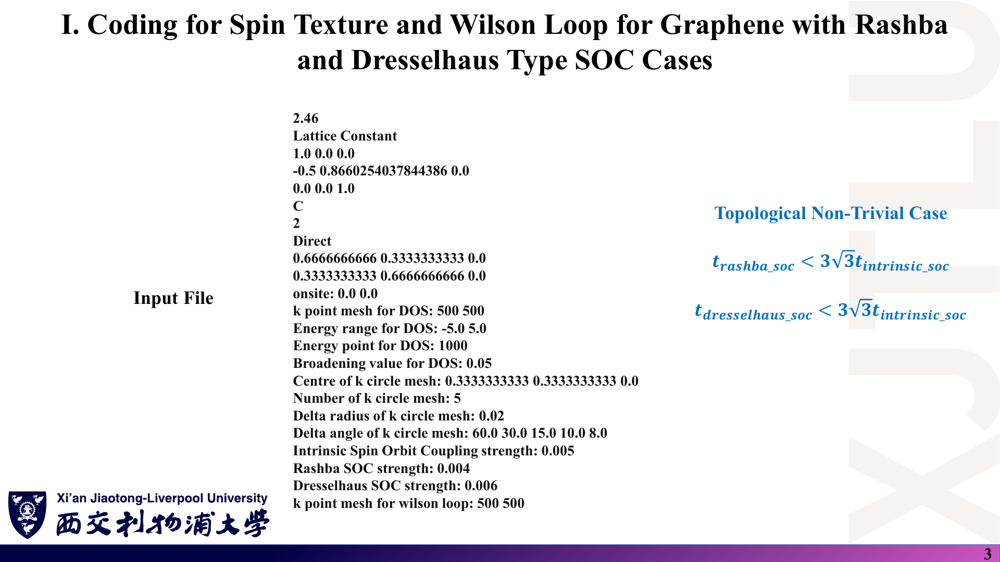

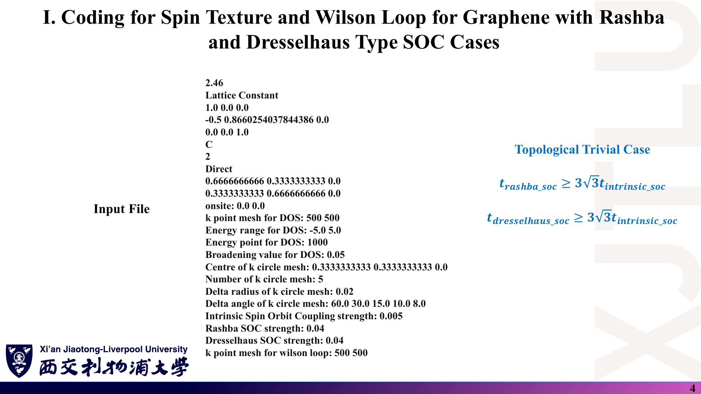

### 中文解释

**问题**（经数值核验的系数问题，并附约定讨论）：讲义以 $3\sqrt3\,t_I$ 作为 Rashba / Dresselhaus 强度的拓扑相变阈值，并称超过阈值为“平庸”。

### 原理深入

**正确写法**（在 `Codes/` 程序自身的约定下）：

$$
E_g=6\sqrt3\,t_I-3\,t_{R/D}\ \Rightarrow\ \text{QSH（Z}_2=1\text{）当 }t_{R/D}<2\sqrt3\,t_I\approx0.0173\text{ eV};
$$

超过此值体系**无隙**，Z₂ 无定义，并不是平庸绝缘体。$3\sqrt3\,t_I$ 是交错子晶格势 $\lambda_v$ 的临界值：$\lambda_v>3\sqrt3\,t_I$ 时为平庸绝缘体。

**核验理由**：

1. **约定对齐**：程序用 $\nu=\pm1$ 与单位键矢量，与 Kane–Mele 的 $\lambda_{SO}$、$\lambda_R$ 定义相同；数值上 $t_R=0$ 时带隙恰为 $6\sqrt3\,t_I=51.96$ meV，确认 $t_I=\lambda_{SO}$。
2. **Kane–Mele 原文**（[KM1](README.md#ref-km1)、[KM2](README.md#ref-km2)）：$\lambda_v=0$ 时 QSH 带隙在 $\lambda_R<2\sqrt3\lambda_{SO}$ 范围内存在；$\lambda_R=0$ 时 QSH / 平庸分界在 $\lambda_v=3\sqrt3\lambda_{SO}$。
3. **数值扫描**（修正第 283 行后的复刻程序）：$t_R=0.017$ 时带隙 0.96 meV，0.0172 时 0.36 meV，≥0.0175 时为 0，直到 0.04 仍为 0；Dresselhaus 结果相同。交错势在 0.026 处闭合后重开；$\lambda_v=0.04$、$t_R=0.004$ 时 Z₂ = 0。
4. **其他约定也得不到 $3\sqrt3$**：若按讲义字面用 $|\hat{\mathbf u}\times\hat{\mathbf u}|=\sqrt3/2$，阈值为 $3t_I$。“$3\sqrt3$ 来自 $\lambda_v$ 判据”是本笔记的推测，未经教师确认。
5. **对讲义算例的影响**：0.004 / 0.006 低于两个阈值，0.04 高于两个阈值，分类结论不变；只有落在 0.0173–0.026 之间的参数才会被判错。但“平庸”算例实际是无隙体系。

### Ref

- **原课件**：[Lecture Twenty，PDF 第 3–4 页](../Lecture_Twenty.pdf#page=3)。
- **配套**：[04 第 3 节](04_代码演示_石墨烯Rashba与Dresselhaus.md)、[08 第 9 节](08_代码导读.md)、[06 第 13 题](06_复习题与参考答案.md)。

## 14. 代码第 283 行与随附结果〔L20 pp. 7–26；Codes〕

### 课件截图

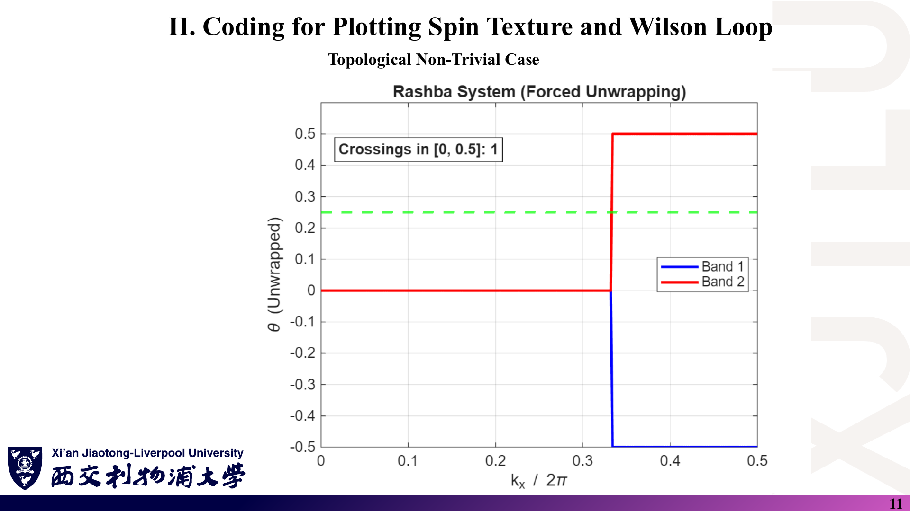

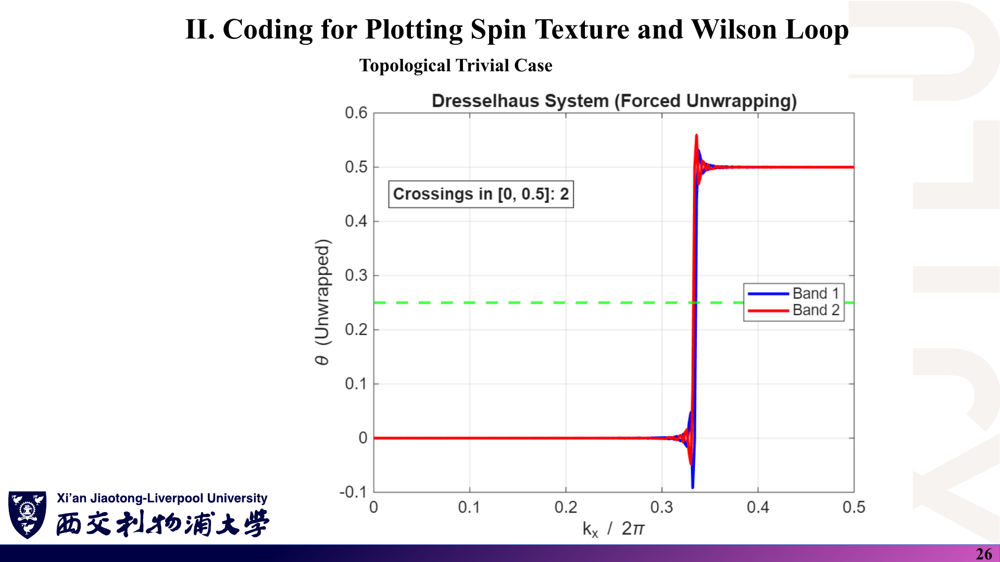

### 中文解释

**问题**（经数值核验的程序错误及其后果）：

1. `TIGHTBINDINGFORGRAPHENE.f90` 第 283 行用 `DCOS(1.2d2/3.6d2*pi)`（即 cos 60°）计算次近邻距离，得到 1.42 Å 而非 2.46 Å。
2. 因此“次近邻”就是近邻，`chirality` 从未赋值，**本征 SOC 没有进入计算**；第二十讲第 7–26 页的全部图都来自 $t_I$ 实际为 0 的模型。
3. 该模型在 K 点无隙，WCC 在 $k_1=1/3$ 处阶跃；1 / 1 / 0 / 2 次交叉由 `unwrap` 的分支选择决定，不构成 Z₂ 判据。

### 原理深入

**正确写法**：`secondneighbour = DSQRT(3.0d0)*firstneighbour`（或 `DCOS(1.2d2/1.8d2*pi)`），并初始化 `chirality = 0`、只在平面内搜索（完整建议见 [08 第 10 节](08_代码导读.md)）。

**核验理由**（数值记录见 [08 第 9 节](08_代码导读.md)）：

- 复刻程序按原样计算：“次近邻”6 条、手性 0 条被赋值。
- 用 $t_I=0$ 的复刻程序，4 个自旋纹理文件逐位复现，WCC 在 20 个抽样 $k_1$ 上偏差 $\le5\times10^{-9}$；若让 $t_I=0.005$ 生效，自旋纹理偏差达 0.04–0.09。
- $t_I=0$ 时两组参数带隙均为 0。
- 四张 WCC 图的连接方式（模 1）完全相同：一对 WCC 从 0 整体移到 1/2；隔点交换数据列顺序后，平庸算例的计数在 0 与 2 之间互换。
- 修正后：非平庸参数带隙 40.0 / 34.0 meV，Z₂ = 1（讲义的物理结论成立）；“平庸”参数仍无隙。

**说明**：本机未重新编译 Fortran 原程序；“实际运行中手性为 0”是由数据反推得出的（未初始化变量的值依赖编译器与运行环境）。

### Ref

- **原课件**：[Lecture Twenty，PDF 第 7–26 页](../Lecture_Twenty.pdf#page=7)。
- **代码**：[TIGHTBINDINGFORGRAPHENE.f90 第 283 行](../Codes/TIGHTBINDINGFORGRAPHENE.f90#L283)、[wilson_loop.m](../Codes/Topological_Nontrivial/wilson_loop.m)。
- **配套**：[04 第 5–7 节](04_代码演示_石墨烯Rashba与Dresselhaus.md)、[08 第 3、7、9 节](08_代码导读.md)。

## 汇总表

| 位置 | 类型 | 要点 |
|---|---|---|
| L17 pp. 5, 9 | 笔误 + 约定 | 单位矢量符号复用；叉积大小 $\sqrt3/2$，程序取 ±1 |
| L17 pp. 7, 10 | 笔误 | 等号链漏 $i\,t$ |
| L17 p. 12 | 物理表述 | SOC 保持 TRS，劈裂的是 $\mathcal{PT}$ 保证的简并 |
| L17 pp. 14–20 | 过度泛化 | 自旋—动量锁定 ≠ 拓扑；局部缠绕 ≠ Z₂ |
| L17 pp. 17–18 | 约定 | $\mathbf S=\tfrac\hbar2\boldsymbol\sigma$；系数用 $C^*$ |
| L18 p. 5 | 笔误 | $\nabla u_n\to\nabla\chi$ |
| L18 p. 7 | 过度泛化 | 看整数 $C$，不看局部 $\Omega$ |
| L18 pp. 8–9 | 条件缺失 | TRS **且**带隙不闭合；分自旋需 $S_z$ 守恒 |
| L18 pp. 12–14 | 混用 / 不严谨 | 2D 边缘与 3D 表面；只禁 Kramers 伙伴背散射；平庸可有边缘态 |
| L19 pp. 3–5, 9 | 记号不一致 | 扫描 $k_x$、沿 $k_y$ 闭合；$\bar x=\theta/2\pi$；参考线 0.25 |
| L19 pp. 6, 9–10 | 示意图误导 | 看伙伴交换，不看“台阶”或“边界” |
| L19 pp. 4, 11 | 笔误 + 约定 | atan2；乘积对应 $e^{-i\oint A}$ |
| L20 pp. 3–4 | 系数（数值核验） | Rashba 阈值 $2\sqrt3t_I$；$3\sqrt3$ 属于 $\lambda_v$；超过后无隙 |
| Codes 第 283 行 / L20 pp. 7–26 | 程序错误（数值核验） | 本征 SOC 失效；WCC 图不能判 Z₂ |

讲义所引文献（Bi₂Se₃ 能带、Fe 掺杂、表面纹理）仅按课件引注保留，本笔记未独立核读或复现其结果。

## 核对优先级

1. **先问有没有带隙**：任何 Z₂、Chern 数结论都以体带隙打开为前提。
2. **规范与模 1**：凡是相位，先确认它在什么规范下、模多少有定义。
3. **记号与约定**：$k_x/k_y$ 与 $k_1/k_2$、$\nu=\pm1$ 与 $\sqrt3/2$、约定 I / II、$e^{\pm i\oint A}$，都要与所比较的文献统一。
4. **用数据反推参数**：结果是否真由所声称的参数产生，最可靠的检验是独立复刻并逐位比对。
