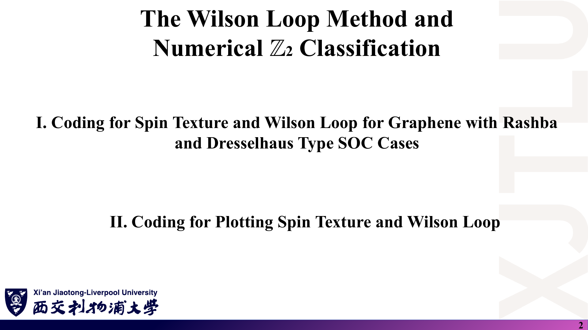
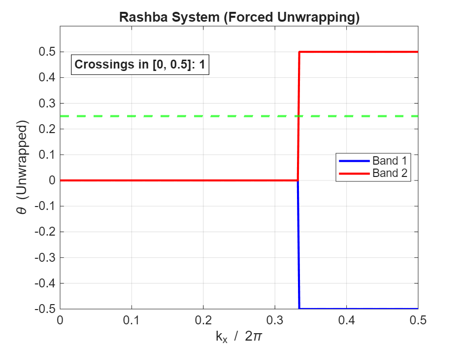
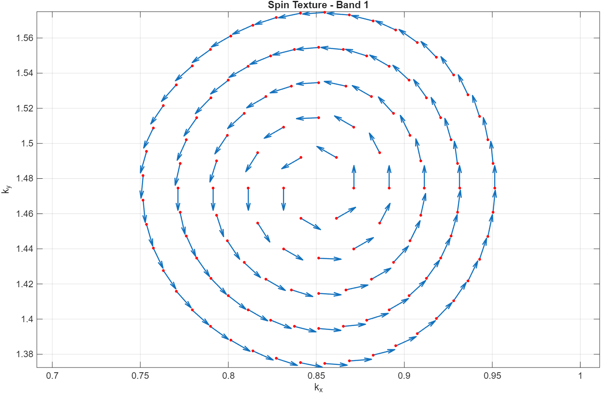
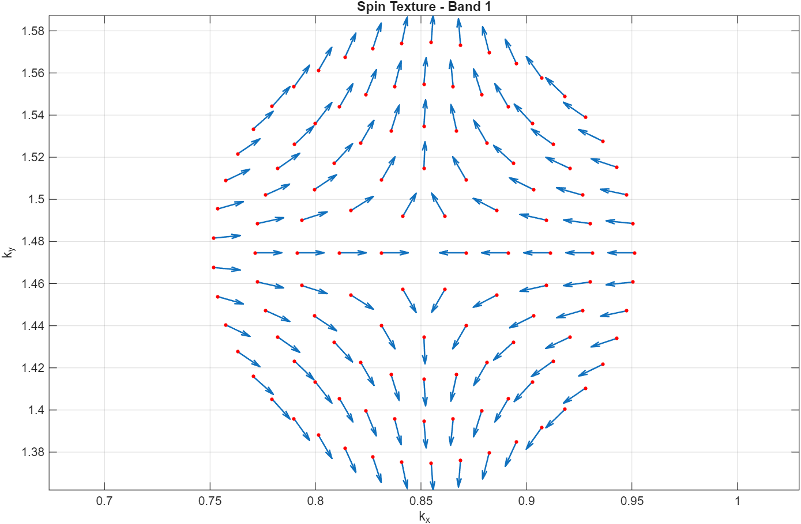
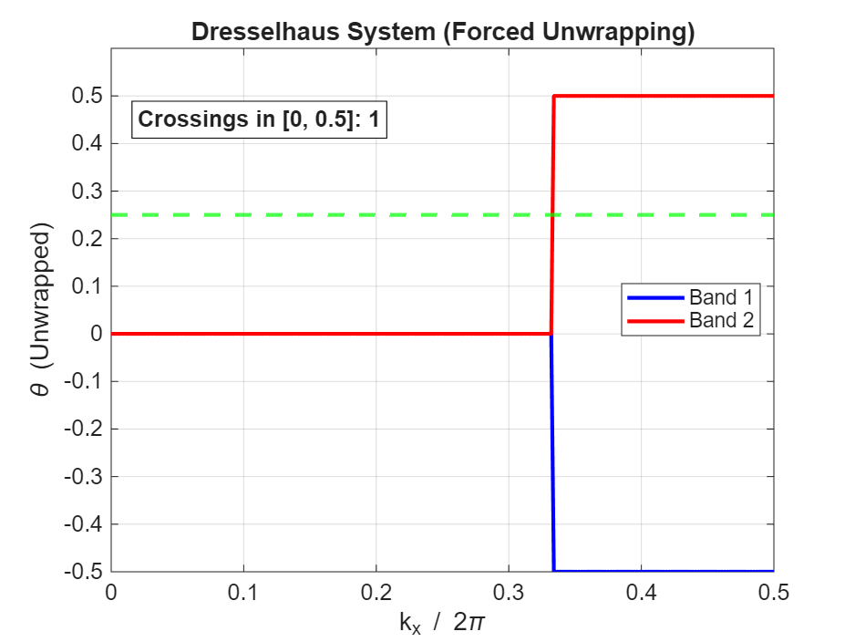
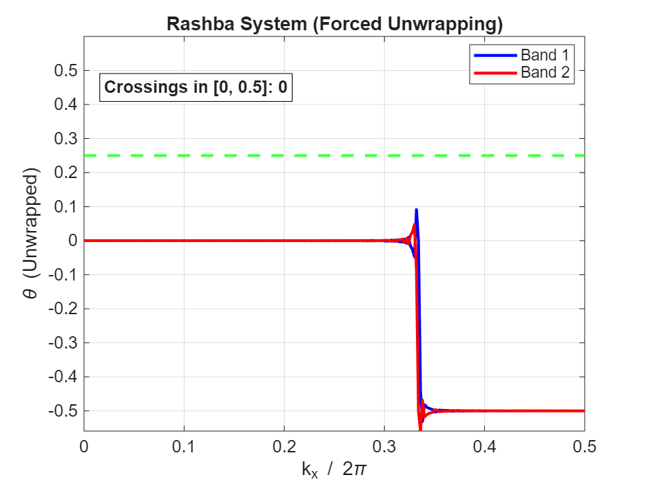
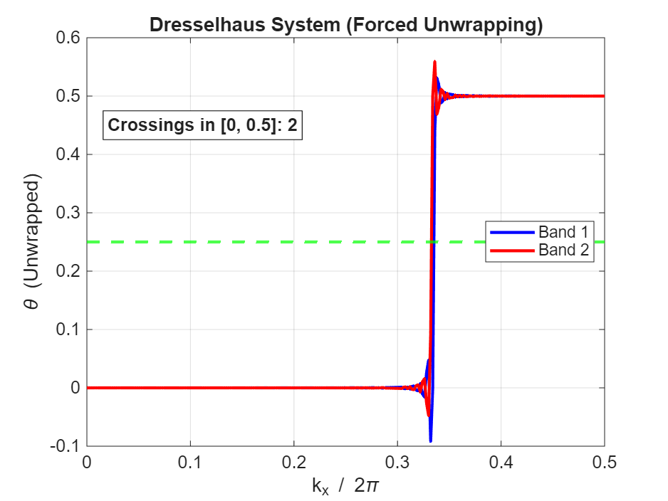

# 08 · 代码导读：`Week_Five/Codes/`

来源：[Codes 目录](../Codes/)（Fortran 程序 670 行、2 个 Shell 脚本、2 个 MATLAB 脚本、两组输入与输出）；对应 [Lecture_Twenty.pdf](../Lecture_Twenty.pdf)。

[返回目录](README.md)

> 本文逐段解释代码，并记录本笔记的数值复核。原代码与输出均**未修改**；文中的“建议修改”只是学习建议，未经教师确认。行号指 [TIGHTBINDINGFORGRAPHENE.f90](../Codes/TIGHTBINDINGFORGRAPHENE.f90)。复核方法：用 Python/NumPy 逐行复刻程序的近邻搜索、矩阵组装与 Wilson 环，再与随附 `.dat` 比对。本机没有 LAPACK 环境，**未重新编译运行 Fortran 原程序**。

## 1. 有哪些文件，怎样运行？〔Lecture Twenty pp. 2–6〕

### 课件截图



### 中文解释

| 文件 | 作用 |
|---|---|
| `TIGHTBINDINGFORGRAPHENE.f90` | 主程序：近邻搜索、4×4 哈密顿量、自旋纹理、Wilson 环 |
| `Graphene.vasp` | 输入参数（顶层一份，与非平庸算例相同） |
| `compile.sh` | SLURM 作业：加载 `netlib-lapack`，用 `gfortran … -llapack -lblas` 编译，删除 `*.mod` |
| `run.sh` | SLURM 作业：`srun ./TIGHTBINDINGFORGRAPHENE`，单线程 |
| `Topological_Nontrivial/`、`Topological_Trivial/` | 各一份 `Graphene.vasp`、4 个 `.dat` 输出、10 张 PNG、2 个 `.m` 脚本 |

本笔记用 `diff` 核对：两个子目录的 `Graphene.vasp` 只有 Rashba / Dresselhaus 两行不同（0.004 / 0.006 对 0.04 / 0.04）；两份 `wilson_loop.m`、两份 `plot_spin_texture.m` 完全相同；顶层 `Graphene.vasp` 与非平庸算例相同。

### 原理深入

运行步骤（在有 LAPACK 的 Linux 集群上）：

```bash
sbatch compile.sh          # 生成可执行文件 TIGHTBINDINGFORGRAPHENE
cd Topological_Nontrivial  # 输入文件必须叫 Graphene.vasp，且在当前目录
sbatch ../run.sh           # 或直接 ../TIGHTBINDINGFORGRAPHENE
# 然后在 MATLAB 中于同一目录运行 wilson_loop 与 plot_spin_texture
```

注意事项：

- `run.sh` 直接执行 `./TIGHTBINDINGFORGRAPHENE`，可执行文件、`Graphene.vasp` 和输出都在**当前目录**。
- `compile.sh` 中的 LAPACK 路径和 `#SBATCH` 分区、邮箱是教师集群专用的，换机器要改。
- 程序打开 `Graphene.vasp` 时用了 `IOSTAT=k`，文件不存在时不会给出明确的错误提示，读入循环直接跳过，后续会使用未定义的参数，可能崩溃，也可能输出无意义的结果。运行前务必确认输入文件在场。

### Ref

- **代码**：[compile.sh](../Codes/compile.sh)、[run.sh](../Codes/run.sh)、[TIGHTBINDINGFORGRAPHENE.f90 第 296–300 行](../Codes/TIGHTBINDINGFORGRAPHENE.f90#L296)。
- **讲义**：[Lecture Twenty，PDF 第 2–6 页](../Lecture_Twenty.pdf#page=2)。

## 2. 输入文件里哪些行真正被读取？〔第 275–369 行〕

### 课件截图


### 中文解释

程序逐行读 `Graphene.vasp`，找到冒号后按冒号前的关键字分派（`SELECT CASE`）。被识别的关键字只有：

`onsite`、`Centre of k circle mesh`、`Number of k circle mesh`、`Delta radius of k circle mesh`、`Delta angle of k circle mesh`、`Intrinsic Spin Orbit Coupling strength`、`Rashba SOC strength`、`Dresselhaus SOC strength`、`k point mesh for wilson loop`。

### 原理深入

**被忽略或写死的内容**（第 275–293 行）：

| 量 | 程序中的值 | 输入文件 |
|---|---|---|
| 晶格常数、晶格矢量 | 写死：$a=2.46$ Å，$\mathbf a_1=a(1,0,0)$，$\mathbf a_2=a(\cos120^\circ,\sin120^\circ,0)$，$\mathbf a_3=a(0,0,1)$ | 前 5 行被忽略 |
| 原子坐标 | 写死 $(2/3,1/3)$、$(1/3,2/3)$ | 坐标行被忽略 |
| 近邻距离 | `firstneighbour = 1.42` | 无 |
| 跳跃积分 | `hopping = -2.7`（eV） | 无 |
| 占据带数 | `numoccupy = 2`（半满） | 无 |
| DOS 参数 | 不读取，程序不算 DOS | 4 行被忽略 |

**圆形 k 网格**（第 346–369 行）：第 $i$ 个圆半径 $i\times0.02$ Å⁻¹，点数 $\mathrm{INT}(360/\Delta\theta_i)$，角度从 $\Delta\theta_i$ 开始取（0° 点排在每圈末尾）。圆心由分数坐标换成笛卡尔坐标：$\mathbf k_c=\sum_jc_j\mathbf b_j$。K 点 $(1/3,1/3)$ 对应 $(0.851,1.475)$ Å⁻¹。

**注意**：`numk` 数组身兼两职，第 1–2 个元素是 Wilson 网格，第 3–4 个元素被临时用作圆网格计数器。两者互不覆盖，但阅读时容易混淆。

### Ref

- **代码**：[第 275–293 行](../Codes/TIGHTBINDINGFORGRAPHENE.f90#L275)、[第 319–369 行](../Codes/TIGHTBINDINGFORGRAPHENE.f90#L319)。
- **讲义**：[Lecture Twenty，PDF 第 3 页](../Lecture_Twenty.pdf#page=3)。

## 3. 近邻搜索与手性：第 283 行出了什么问题？〔第 70–185、281–313 行〕

### 课件截图


### 中文解释

子程序 `NEIGHBOURHAMILTONIAN` 在 $3\times3\times3$ 个相邻原胞中找原子对：

- 距离 ≈ `distance1`（容差 0.1 Å）的记入近邻表，保存 `rvector`、单位矢量 `uvector`；
- `order = 2` 时，再找距离 ≈ `distance2` 的原子对作为次近邻；对每条次近邻，找一条经过中间原子的两段近邻路径，用叉积的 z 分量符号给出 `chirality = ±1`。

主程序第 283 行计算次近邻距离：

```fortran
secondneighbour = DSQRT(firstneighbour**2+firstneighbour**2 &
                  -2*firstneighbour*firstneighbour*DCOS(1.2d2/3.6d2*pi))
```

### 原理深入

#### 3.1 余弦定理的角度写错了

由余弦定理，夹角 120° 的两条 1.42 Å 键的端点距离为 $\sqrt{2d^2-2d^2\cos120^\circ}=\sqrt3\,d=2.46$ Å。但 `1.2d2/3.6d2*pi` $=\tfrac{120}{360}\pi=\pi/3=60^\circ$。

$$
\sqrt{2d^2-2d^2\cos60^\circ}=d=1.42\text{ Å}.
$$

于是 `secondneighbour = 1.42`，与近邻距离**相同**。本笔记复刻确认：程序得到的“次近邻表”正好是 6 条近邻键。

#### 3.2 连锁后果：手性从未被赋值

对这些“次近邻”（实为近邻）键，程序寻找“$|\mathbf r_{sec}-\mathbf r_{1st}|\approx1.42$”的中间路径，但两条近邻键之差只能是 0 或 2.46 Å，**永远找不到**。`chirality` 字段保持未初始化（`ALLOCATE` 后没有赋初值）。随附数据显示它在实际运行中为 0（见第 9 节），所以 `hsoc` 恒为零，**本征 SOC 没有进入任何计算**。

#### 3.3 另外两个隐患

1. **层间“次近邻”**：$\mathbf a_3=(0,0,2.46)$ Å，恰好等于正确的次近邻距离。修正 3.1 后，搜索会额外收进 4 条沿 z 的键（同一原子与上下层的自身像），它们没有中间路径，手性同样未初始化。这些键的相位 $e^{i\mathbf k\cdot\mathbf a_3}=1$（$k_z=0$），只会贡献纯虚的对角元。按 LAPACK 的实现，`ZHEEV` 只使用对角元的实部（本笔记未单独测试此点）。稳妥的做法是把 `n3` 固定为 0，或把 $|\mathbf a_3|$ 设成远大于 2.46 Å。
2. **键矢量方向**：类型注释写“Vector pointing from atom i to atom j”，但第 109 行算的是 $\boldsymbol\tau_i-\boldsymbol\tau_j+\mathbf R$，方向是**从 j 指向 i**。它与第 395 行的相位约定 $e^{i\mathbf k\cdot\mathbf r}$ 一起使用，整体只改变 Rashba / Dresselhaus 项的符号约定，不影响能隙和 Z₂；但与讲义的 $\hat{\mathbf u}_{ij}$ 逐项对照时要注意。

### Ref

- **代码**：[第 97–116 行](../Codes/TIGHTBINDINGFORGRAPHENE.f90#L97)、[第 134–169 行](../Codes/TIGHTBINDINGFORGRAPHENE.f90#L134)、[第 283 行](../Codes/TIGHTBINDINGFORGRAPHENE.f90#L283)。
- **讲义**：[Lecture Seventeen，PDF 第 4–7 页](../Lecture_Seventeen.pdf#page=4)。
- **勘误汇总**：[07 第 14 节](07_讲义勘误与易错点.md)。

## 4. 4×4 哈密顿量是怎样组装的？〔第 373–447 行〕

### 课件截图


### 中文解释

基底顺序是 $[C_{1\uparrow},C_{2\uparrow},C_{1\downarrow},C_{2\downarrow}]$，下标 `i`（自旋↑）与 `i+natom`（自旋↓）。对每个 k 点：

| 矩阵 | 循环 | 每条键加入的 2×2 自旋块 |
|---|---|---|
| `honsite` | 原子 | `onsite(i)` × 单位阵 |
| `hhopping` | 近邻键，只取 `atomi ≤ atomj` | $t\,e^{i\mathbf k\cdot\mathbf r}$ × 单位阵 |
| `hsoc` | “次近邻”键 | $i\,t_I\,\nu\,\sigma_z\,e^{i\mathbf k\cdot\mathbf r}$ |
| `hrashba` | 全部近邻键 | $i\,t_R\,\boldsymbol\sigma\cdot(\hat{\mathbf u}\times\hat z)\,e^{i\mathbf k\cdot\mathbf r}$ |
| `hdresselhaus` | 全部近邻键 | $i\,t_D(\sigma_xu_x-\sigma_yu_y)\,e^{i\mathbf k\cdot\mathbf r}$ |

然后 `hamiltonian = honsite + hhopping + hsoc + hrashba`（或 `+ hdresselhaus`），调用 `ZHEEV('V','U',…)` 求本征值（升序）和本征矢（按列存放）。

### 原理深入

#### 4.1 为什么只填一半也对？

`ZHEEV` 的第二个参数 `'U'` 表示**只读取上三角**（含对角元），下三角视为上三角的共轭。

- `hhopping` 只对 `atomi ≤ atomj` 的键赋值，只填 $(1,2)$、$(3,4)$ 位置，正好在上三角。
- `hrashba`、`hdresselhaus` 对全部键（含 $2\to1$）赋值，会写到上、下三角。读取上三角时，$(C_{1\uparrow},C_{2\downarrow})$ 来自 $1\to2$ 的键，$(C_{2\uparrow},C_{1\downarrow})$ 来自 $2\to1$ 的键。由于这些项对正反两个方向求和后本身是厄米的，下三角的内容恰好是上三角的共轭，所以结果正确。

**教训**：若改用要求完整矩阵的求解器（如 NumPy 的 `eigh` 默认读下三角），必须先把矩阵补全成厄米矩阵，否则 `hhopping` 的下三角为零会导致错误。本笔记的复刻程序正是“取上三角 + 共轭补全 + 对角取实部”来模拟 `ZHEEV('U')`。

#### 4.2 相位约定 II

相位用 $e^{i\mathbf k\cdot(\boldsymbol\tau_i-\boldsymbol\tau_j+\mathbf R)}$，包含原子在原胞内的位置（“约定 II”）。因此 $H(\mathbf k+\mathbf G)=V H(\mathbf k)V^\dagger$，其中 $V=\mathrm{diag}(e^{i\mathbf G\cdot\boldsymbol\tau_i})$。哈密顿量本身**不是**倒格矢周期的。这影响 Wilson 环的闭合（第 6 节）。

#### 4.3 本征 SOC 若正确生效会是什么样？

修正第 283 行后，每个原子 6 条次近邻成对出现，`hsoc` 只有实数对角元 $\mp2t_I\sum_3\nu\sin(\mathbf k\cdot\mathbf r)$。本笔记复刻得到 $t_R=0$ 时带隙 51.96 meV $=6\sqrt3\,t_I$，与 Kane–Mele 一致，说明 `chirality = ±1` 的约定等同于 $\nu_{ij}$。

### Ref

- **代码**：[第 391–447 行](../Codes/TIGHTBINDINGFORGRAPHENE.f90#L391)。
- **讲义**：[Lecture Seventeen，PDF 第 7、10、13 页](../Lecture_Seventeen.pdf#page=7)。
- **延伸**：[LAPACK](README.md#ref-lapack)、[VAN](README.md#ref-van)（约定 I / II）。

## 5. 自旋纹理怎样计算和输出？〔第 448–499 行〕

### 课件截图


### 中文解释

对每条能带 `j` 和每个原子 `k`，取旋量 $(\psi_{k\uparrow},\psi_{k\downarrow})=$ `(hamiltonian(k,j), hamiltonian(k+natom,j))`，计算 $\chi^\dagger\sigma_\alpha\chi$ 并对原子累加，存入 `spintexture(1:3,…)`（Rashba）和 `spintexture(4:6,…)`（Dresselhaus）。输出时写 `kx ky kz Sx Sy Sz`，只写实部；每条带之后空一行。

### 原理深入

- 程序逐项展开 $\chi^\dagger\sigma\chi=\sum_{ab}\chi_a^*\sigma_{ab}\chi_b$，与讲义第 18 页完全对应；`DCONJG` 保证了共轭。
- `ZHEEV` 返回的本征矢已归一化，不需要再除以范数。
- 输出顺序：`RASHBA_Spin_Texture.dat` 中依次是第 1、2、3、4 带（按能量升序），每带 123 个点。
- 每个文件的 $S_z$ 列全为 0，这由 $C_{2z}\mathcal T$ 对称性保证（见 [04 第 4 节](04_代码演示_石墨烯Rashba与Dresselhaus.md)），与本征 SOC 是否生效无关。

### Ref

- **代码**：[第 448–499 行](../Codes/TIGHTBINDINGFORGRAPHENE.f90#L448)。
- **讲义**：[Lecture Seventeen，PDF 第 16–18 页](../Lecture_Seventeen.pdf#page=16)。

## 6. Wilson 环是怎样循环出来的？〔第 501–634 行〕

### 课件截图


### 中文解释

1. **网格**：$\mathbf k=\frac{i}{N_1}\mathbf b_1+\frac{j}{N_2}\mathbf b_2$，$i=0..N_1-1$，$j=0..N_2$（$N_1=N_2=500$）。
2. **占据态**：对每条 $k_1$ 线上的 501 个点，分别对 Rashba、Dresselhaus 哈密顿量对角化，保存最低两条带的本征矢 `occrashbastate(:,1:2,j)`。
3. **闭合**：把第 $N_2+1$ 个点的态直接**替换**为第 1 个点的态（第 588–589 行）。
4. **乘积**：$W\leftarrow W\cdot M^{(j)}$，$M^{(j)}_{kl}=$ `DOT_PRODUCT(occ(:,k,j), occ(:,l,j+1))`（Fortran 的复数 `DOT_PRODUCT` 会自动共轭第一个参数）。
5. **本征值**：`ZGEEV('N','N',…)` 只求本征值，`wanphase = ATAN2(Im, Re)/(2π)`，写入 `kx_fractional  WCC1  WCC2`，共 500 行。

### 原理深入

#### 6.1 与讲义第十九讲逐项对应

$M_{mn}=\langle u_m(k_i)|u_n(k_{i+1})\rangle$、$D=\prod M$、$\theta=\mathrm{atan2}$。程序用的是 atan2，比讲义写的 `ARCTAN(b/a)` 更正确。

#### 6.2 闭合条件

由第 4.2 节，约定 II 下正确的闭合态是 $V(\mathbf b_2)\,u(\mathbf k_0)$，而程序用了 $u(\mathbf k_0)$。本笔记对修正后的模型分别用两种闭合计算：所有 WCC 整体相差 1/2，Z₂ 相同（都为 1）。所以这一点**影响 WCC 的绝对位置，不影响本例的拓扑结论**，但换到别的模型时不能保证无害。

#### 6.3 其他细节

- `ZGEEV` 返回的两个本征值**没有固定顺序**，所以 `.dat` 的第 2、3 列不是“两条连续的曲线”，只是两个数的无序集合。
- 横坐标 `kx_fractional` 是沿 $\mathbf b_1$ 的分数坐标 $k_1$，MATLAB 图上标的 “$k_x/2\pi$” 并不准确。
- 第 607 行注释写“$[-0.5,0.5)$”，atan2 的值域实际是 $(-\pi,\pi]$，即 $(-0.5,0.5]$。
- 环路方向的步长是 $|\mathbf b_2|/500\approx0.0059$ Å⁻¹。正确的本征 SOC 带隙下，Berry 曲率集中在 K 点附近约 0.007 Å⁻¹ 的尺度内，500 点只是勉强够用；本笔记复核时用了 1500 点。

### Ref

- **代码**：[第 503–510 行](../Codes/TIGHTBINDINGFORGRAPHENE.f90#L503)、[第 523–634 行](../Codes/TIGHTBINDINGFORGRAPHENE.f90#L523)。
- **讲义**：[Lecture Nineteen，PDF 第 11–13 页](../Lecture_Nineteen.pdf#page=11)。
- **延伸**：[SV](README.md#ref-sv)、[VAN](README.md#ref-van)。

## 7. 两个 MATLAB 脚本做了什么？〔wilson_loop.m、plot_spin_texture.m〕

### 课件截图



### 中文解释

**`wilson_loop.m`**（入口函数名为 `analyze_wilson_topology_unwrapped`；MATLAB 按文件名 `wilson_loop` 调用并执行文件中的第一个函数）：

1. `readmatrix` 读 `.dat`，第 1 列为 $k_1$，第 2–3 列为两个 WCC；
2. `unwrap(raw_wcc*2π)/(2π)`：对两列**分别**做相位展开；
3. 只保留 $k_1\in[0,0.5]$；
4. 画两条曲线和 0.25 参考线；
5. 统计每列 `sign(wcc-0.25)` 的变号次数，两列相加，标注 “Crossings in [0, 0.5]”。

**`plot_spin_texture.m`**（入口 `plot_all_textures_only`）：按空行把数据切成 4 条带。若 $k_z$ 与 $S_z$ 全为 0，用 `quiver(kx,ky,sx,sy,0.5)` 画二维箭头，并用红点标出 k 点；否则画三维 `quiver3`。

### 原理深入

#### 7.1 `unwrap` 计数的问题

- `unwrap` 假设每一列都是一条连续曲线，但 `ZGEEV` 的输出顺序是任意的（第 6.3 节）。
- 原始数据中，两个 WCC 在每个 $k_1$ 处都**重合**（均为 0，或均为 ±0.5），跳变量恰好是 0.5（即 π），正好落在 `unwrap` 的判断阈值上。
- 本笔记用 NumPy 的等价 `unwrap` 复现了图上的计数（非平庸 1、1；平庸 0、2）。把原始数据的两列隔点交换顺序后，平庸 Rashba 变为 2、平庸 Dresselhaus 变为 0。计数依赖列顺序与分支选择。

**更稳健的写法**：每行先 `sort(mod(wcc,1))`；按 [SV](README.md#ref-sv) 的最大间隙法，追踪“WCC 间最大间隙的中点”，数 WCC 跳过它的次数（mod 2）。不要对未排序的列做 `unwrap`。

#### 7.2 文件名大小写

Fortran 写出的文件名是 `RASHBA_Spin_Texture.dat`（第 297 行），而 `plot_spin_texture.m` 读的是 `'Rashba_Spin_Texture.dat'`。在 Windows / macOS 默认的不区分大小写的文件系统上没问题；在 Linux 上 `exist` 返回 0，函数**静默跳过** Rashba 体系，不报错。Dresselhaus 文件名两边一致（`DRESSELHAUS_…`）。

#### 7.3 二维 / 三维分支

由于 $S_z$ 处处为 0（$C_{2z}\mathcal T$ 对称性），脚本总是走二维分支。`quiver` 的缩放因子 0.5 只影响箭头长度，不代表自旋大小的绝对值。

### Ref

- **代码**：[wilson_loop.m](../Codes/Topological_Nontrivial/wilson_loop.m)、[plot_spin_texture.m](../Codes/Topological_Nontrivial/plot_spin_texture.m)。
- **讲义**：[Lecture Nineteen，PDF 第 12–13 页](../Lecture_Nineteen.pdf#page=12)。

## 8. 随附的结果图怎么读？〔Codes/*/*.png〕

### 课件截图











### 中文解释

每个子目录有 8 张自旋纹理图（Rashba / Dresselhaus × 第 1–4 带）和 2 张 WCC 图，与第二十讲第 7–26 页相同。

- **自旋纹理**：Rashba 为切向涡旋，Dresselhaus 为各向异性图样；由数据核对，第 1、2 带方向相反，第 3、4 带方向相反，第 1 与第 4 带、第 2 与第 3 带方向相同（面内自旋单位矢量的点积约为 ±1）。
- **WCC 图**：四张图的标注分别为 1、1、0、2 次交叉。

### 原理深入

- 这些图都来自本征 SOC 失效的运行（第 3、9 节），对应的体系在 K 点无隙。
- WCC 的阶跃位置 $k_1=1/3$ 正是穿过 K 点 $(1/3,1/3)$ 的环路，阶跃是无隙 Dirac 点的特征，不是有隙拓扑相的连续缠绕。
- 自旋纹理的**图样**对 $t_I$ 不太敏感：本征 SOC 生效后，面内分量最多变化约 0.04–0.09，但图样大体相同。所以这些自旋纹理图仍可用来理解 Rashba / Dresselhaus 的形式；WCC 图则不能用来判断拓扑。

### Ref

- **原图**：[Topological_Nontrivial/](../Codes/Topological_Nontrivial/)、[Topological_Trivial/](../Codes/Topological_Trivial/)。
- **讲义**：[Lecture Twenty，PDF 第 7–26 页](../Lecture_Twenty.pdf#page=7)；解读见 [04 第 4–6 节](04_代码演示_石墨烯Rashba与Dresselhaus.md)。

## 9. 本笔记做了哪些数值复核？〔复核记录〕

### 课件截图


### 中文解释

复刻方法：用 NumPy 按原程序第 97–169 行做近邻搜索（同样的 3×3×3 原胞、0.1 Å 容差、手性算法），按第 391–445 行组装矩阵并模拟 `ZHEEV('U')`，按第 503–633 行做 Wilson 环。先用“原样”参数（含第 283 行的写法）检验能否复现随附数据，再修正第 283 行，计算“预期”的物理结果。脚本放在仓库外的临时目录，未提交。

### 原理深入

| 检查 | 结果 |
|---|---|
| 第 283 行求得的次近邻距离 | 1.42 Å（应为 2.4595 Å） |
| 原样搜索得到的“次近邻”数 / 被赋值的手性 | 6 条（即近邻键）/ 0 条 |
| 修正后的次近邻数 | 16 条 = 12 条面内 + 4 条沿 $\mathbf a_3$ 的层间键（手性未赋值） |
| 自旋纹理：复刻（$t_I=0$）vs 文件 | 4 个文件全部逐位一致（偏差 0.0） |
| 自旋纹理：复刻（$t_I=0.005$ 生效）vs 文件 | 最大偏差 0.036 / 0.041 / 0.086 / 0.086，不符 |
| WCC：复刻（原样）vs 文件，20 个 $k_1$ 抽样 | 偏差 $5.6\times10^{-16}$、$3.3\times10^{-15}$、$4.95\times10^{-9}$ ×2 |
| 原样模型（$t_I$ 失效）的带隙 | 两组参数均为 0（K 点无隙） |
| 修正后、$t_R=t_D=0$ 的带隙 | 51.96 meV $=6\sqrt3\,t_I$ |
| 修正后、非平庸参数的带隙 | Rashba 0.004：39.96 meV；Dresselhaus 0.006：33.96 meV（$=6\sqrt3t_I-3t$） |
| 修正后扫描 $t_R$（或 $t_D$） | 0.0170：0.96 meV；0.0172：0.36 meV；≥0.0175 直到 0.04：0 |
| 修正后扫描交错势 $\pm\lambda_v$（$t_R=0$） | 0.025：1.96 meV；0.026：0.04 meV；0.027：2.04 meV（在 $3\sqrt3t_I=0.0260$ 闭合后重开） |
| Z₂（最大间隙法，$N_2=1500$） | 非平庸 Rashba / Dresselhaus：1（两种闭合方式相同）；$\lambda_v=0.04$、$t_R=0.004$：0；$\lambda_v=0.2$：0（方法自检） |
| 闭合方式的影响 | $u(\mathbf k_0)$ 与 $V u(\mathbf k_0)$ 两种闭合下，WCC 整体相差 1/2 |
| `unwrap` 计数敏感性 | 隔点交换列顺序后：平庸 Rashba 0→2，平庸 Dresselhaus 2→0；非平庸保持 1 |
| $\langle\sigma_z\rangle$（本征 SOC 生效时） | 仍处处为 0（$C_{2z}\mathcal T$） |

结论见 [04 第 7 节](04_代码演示_石墨烯Rashba与Dresselhaus.md) 与 [07 第 13–14 节](07_讲义勘误与易错点.md)。

### Ref

- **代码**：[TIGHTBINDINGFORGRAPHENE.f90](../Codes/TIGHTBINDINGFORGRAPHENE.f90)；数据：两个子目录下的 `.dat`。
- **方法依据**：[SV](README.md#ref-sv)（最大间隙法）、[KM1](README.md#ref-km1)（带隙公式）。

## 10. 想自己修正并重跑，应该改哪里？〔建议，未改动原文件〕

### 课件截图


### 中文解释

以下修改都只是学习建议，应先征得教师同意，并在自己的副本上进行。

### 原理深入

1. **第 283 行**：改为 120° 的弧度。

   ```fortran
   secondneighbour = DSQRT(3.0d0)*firstneighbour      ! 或 DCOS(1.2d2/1.8d2*pi)
   ```

2. **手性初始化**：在第 147 行之后加 `secbondlist(bondindex)%chirality = 0`，没有找到中间路径的键就明确为 0。
3. **只搜索平面内**：把第 101、138 行的 `n3` 循环改为只取 0，或把 $|\mathbf a_3|$ 设成例如 20 Å，避免层间“次近邻”。
4. **Wilson 环闭合（可选）**：第 588–589 行改为乘上 $V(\mathbf b_2)=\mathrm{diag}(e^{i\mathbf b_2\cdot\boldsymbol\tau_1},e^{i\mathbf b_2\cdot\boldsymbol\tau_2},e^{i\mathbf b_2\cdot\boldsymbol\tau_1},e^{i\mathbf b_2\cdot\boldsymbol\tau_2})$；本例中只会让 WCC 整体平移 1/2。
5. **先算带隙**：增加一段在全 BZ（尤其 K、K′ 附近加密）求 $\min(E_3-E_2)$ 的代码；带隙为 0 时不要解读 WCC。
6. **MATLAB 计数**：去掉 `unwrap`，每行排序取模 1，改用最大间隙法；把 `'Rashba_Spin_Texture.dat'` 改成 `'RASHBA_Spin_Texture.dat'`。
7. **真正的平庸绝缘体**：在 `Graphene.vasp` 中设 `onsite: 0.04 -0.04`（交错势 $>3\sqrt3\,t_I$），并保持 $t_R<2\sqrt3\,t_I$。

**自测清单**：

- [ ] $t_R=t_D=0$ 时带隙是否为 $6\sqrt3\,t_I$？
- [ ] $t_R$ 越过 $2\sqrt3\,t_I$ 时带隙是否闭合？
- [ ] 在 $k_1=0$ 与 $k_1=1/2$ 处 WCC 是否成对简并？
- [ ] 换参考线、加密网格后，交叉次数的奇偶性是否不变？

### Ref

- **代码**：[第 283 行](../Codes/TIGHTBINDINGFORGRAPHENE.f90#L283)、[第 588–589 行](../Codes/TIGHTBINDINGFORGRAPHENE.f90#L588)。
- **讲义**：[Lecture Nineteen，PDF 第 13 页](../Lecture_Nineteen.pdf#page=13)。
- **延伸**：[KM2](README.md#ref-km2)、[SV](README.md#ref-sv)。
