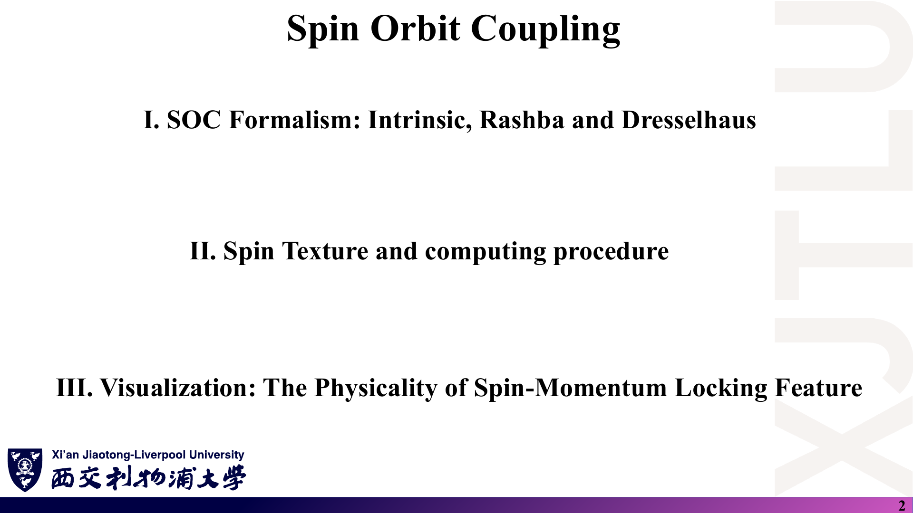

# MES306TC · 第五周图文学习笔记

课程：**Atomic-Level Materials Simulation（原子级材料模拟）** · 教师：Kenan Song

原始资料：4 份 PDF，共 **77 页**（Lecture Seventeen 21 页、Eighteen 15 页、Nineteen 14 页、Twenty 27 页），外加 `Codes/` 中的 Fortran 程序、输入文件、输出数据与 MATLAB 绘图脚本。以下 9 份 Markdown 采用「课件截图 → 中文解释 → 原理深入 → Ref」结构。

> **截图是原讲义整页渲染，不是重新制作的幻灯片。** 原图中的笔误保留，正文单独解释正确写法。所有页码均为含封面的 PDF 物理页码。中文解释是整理，原理深入含补充推导与数值复核，不能把二者都当作教师原话。凡标注〔补充〕或〔本笔记复核〕的内容都不是讲义原文。

## 1. 怎样使用这套笔记？

### 课件截图



*第五周从 SOC 的三种紧束缚写法出发，经 Berry 相位与 Z₂，落到 Wilson 环数值判据和石墨烯代码演示。图片宽 1920 像素，公式较小时可打开原 PNG 放大。*

### 中文解释

第五周的主线是：**往石墨烯哈密顿量里加入自旋轨道耦合（SOC），再用几何相位判断能带是否拓扑非平庸。**

| 顺序 | 文件 | 内容 |
|---|---|---|
| 0 | 本页 README | 阅读方法、课程地图、参考书目和学习记录 |
| 1 | [01_自旋轨道耦合与自旋纹理.md](01_自旋轨道耦合与自旋纹理.md) | Lecture Seventeen：本征 / Rashba / Dresselhaus SOC，自旋纹理计算 |
| 2 | [02_Berry相位与Z2拓扑.md](02_Berry相位与Z2拓扑.md) | Lecture Eighteen：Berry 联络与曲率、Chern 数、Z₂、体—边对应 |
| 3 | [03_Wilson环与WCC数值判据.md](03_Wilson环与WCC数值判据.md) | Lecture Nineteen：Wilson 环、Wannier 电荷中心、交叉计数与排错 |
| 4 | [04_代码演示_石墨烯Rashba与Dresselhaus.md](04_代码演示_石墨烯Rashba与Dresselhaus.md) | Lecture Twenty：输入参数、判据、两组算例的自旋纹理与 Wilson 环图 |
| 5 | [05_公式与术语速查.md](05_公式与术语速查.md) | 对照原图记公式、条件及英文术语 |
| 6 | [06_复习题与参考答案.md](06_复习题与参考答案.md) | 14 道自编题，每题配原图、题意、解析与来源 |
| 7 | [07_讲义勘误与易错点.md](07_讲义勘误与易错点.md) | 原图证据、问题、正确写法与核验理由 |
| 8 | [08_代码导读.md](08_代码导读.md) | `Codes/` 逐段导读、结果图与数值复核 |

### 原理深入

本周四讲可以串成一条计算链：

```text
石墨烯 p_z 轨道 × 自旋 → 4×4 Bloch 哈密顿量 H(k)
  ↓ 加入 SOC：本征（次近邻，σ_z）+ Rashba 或 Dresselhaus（近邻，自旋翻转）
对角化 H(k) → 本征能量 E_n(k)、本征矢 |u_n(k)⟩
  ├─ 自旋纹理：⟨σ_α⟩ = ⟨u_n|σ_α|u_n⟩，在 K 点周围画箭头
  └─ 几何：相邻 k 点重叠 ⟨u_m(k_i)|u_n(k_{i+1})⟩ → Wilson 环 → WCC → Z₂
```

**本周最重要的提醒（本笔记复核结论，详见 [07 第 13–14 节](07_讲义勘误与易错点.md) 与 [08](08_代码导读.md)）：**

1. 在 `Codes/` 程序自己的哈密顿量约定下，带隙是 $6\sqrt3\,t_I-3t_{R/D}$，在 $t_{R/D}=2\sqrt3\,t_I$ 处闭合。讲义第二十讲写的 $3\sqrt3\,t_I$ 是 Kane–Mele 模型中**交错子晶格势** $\lambda_v$ 的临界值，不是 Rashba 的临界值。
2. 程序第 283 行把次近邻距离算成 1.42 Å，本征 SOC 实际没有进入计算。随附的 `.dat` 数据与 $t_I=0$ 的模型逐位吻合，所以图中的“1 次 / 0 次 / 2 次交叉”不能作为 Z₂ 判据。

这些结论是用独立的 Python 复刻程序核对得出的（方法见 08），**不是教师发布的勘误**。

阅读每个模块建议做四件事：

1. **看截图**：找到标题、公式、基底顺序和坐标轴。
2. **读中文解释**：回答“这页在解决什么问题？”
3. **读原理深入**：回答“为什么成立？如何推导？什么时候失效？”
4. **查 Ref**：回到指定 PDF 页；需要更系统理解时查延伸书目。

### Ref

- **原课件**：Kenan Song，[Lecture Seventeen，PDF 第 2 页](../Lecture_Seventeen.pdf#page=2)、[Lecture Eighteen 第 2 页](../Lecture_Eighteen.pdf#page=2)、[Lecture Nineteen 第 2 页](../Lecture_Nineteen.pdf#page=2)、[Lecture Twenty 第 2 页](../Lecture_Twenty.pdf#page=2)。
- **原始文件**：[Lecture Seventeen](../Lecture_Seventeen.pdf) · [Lecture Eighteen](../Lecture_Eighteen.pdf) · [Lecture Nineteen](../Lecture_Nineteen.pdf) · [Lecture Twenty](../Lecture_Twenty.pdf) · [Codes 目录](../Codes/)。原 PDF 与代码均未修改。
- **来源记录**：[截图来源索引](课件截图/来源索引.json)，记录源 PDF 的 SHA-256、总页数及截图页码。

## 2. 学习顺序与完成标准

### 课件截图


### 中文解释

第五周的落脚点是第二十讲的代码演示：读入 `Graphene.vasp`，计算 Rashba 与 Dresselhaus 两种体系的自旋纹理和 Wilson 环，再用 MATLAB 画图、数交叉次数。

建议学习顺序：SOC 形式与自旋纹理 → Berry 相位与 Z₂ → Wilson 环数值方法 → 代码演示 → 代码导读 → 复习题 → 勘误复核。以下自学时间仅供安排：第十七讲约 90 分钟，第十八讲约 60 分钟，第十九讲约 75 分钟，第二十讲加代码导读约 120 分钟，主动复习约 60 分钟。

### 原理深入

把“学会”定义成可以亲手完成，而不是觉得公式眼熟：

- [ ] 在 4×4 基底 $[C_{1\uparrow},C_{2\uparrow},C_{1\downarrow},C_{2\downarrow}]$ 中，说出三种 SOC 各自填在哪些矩阵块。
- [ ] 证明本征 SOC 项对 $\pm\mathbf R$ 两条次近邻求和后是实数、且保持厄米。
- [ ] 由 $\boldsymbol\sigma\cdot(\hat{\mathbf u}\times\hat z)$ 展开得到 $\sigma_xu_y-\sigma_yu_x$。
- [ ] 由一个四分量本征矢手算 $\langle\sigma_x\rangle,\langle\sigma_y\rangle,\langle\sigma_z\rangle$。
- [ ] 推出 Berry 联络在 $|u\rangle\to e^{i\chi}|u\rangle$ 下的变换，并说明 Berry 曲率为何不变。
- [ ] 解释为什么时间反演对称性使总 Chern 数为零，却仍允许 Z₂ 非平庸。
- [ ] 由重叠矩阵乘积构造离散 Wilson 环，并用 `atan2` 得到 WCC。
- [ ] 解释为什么交叉计数只看半个布里渊区，以及为什么必须先确认体带隙打开。
- [ ] 读懂 Fortran 程序的近邻搜索、矩阵组装与 Wilson 环循环，并能指出第 283 行的问题。
- [ ] 用 Kane–Mele 的带隙公式判断给定 $t_I,t_R$ 下体系是 QSH、平庸绝缘体还是无隙。

| 日期 | 已完成模块 | 能否独立推导 | 疑问与下一步 |
|---|---|---|---|
|  |  |  |  |
|  |  |  |  |
|  |  |  |  |

### Ref

- **原课件**：[Lecture Twenty，PDF 第 3–4 页](../Lecture_Twenty.pdf#page=3)；[Lecture Seventeen，第 16 页](../Lecture_Seventeen.pdf#page=16)（计算流程）；[Lecture Nineteen，第 11 页](../Lecture_Nineteen.pdf#page=11)（Wilson 环流程）。
- **配套练习**：[14 道复习题](06_复习题与参考答案.md)。这些题目为学习整理自编，不是官方作业。

## 3. 如何核对公式与使用 Ref？

### 课件截图


*示例：此页把规范变换写成减去 $\nabla u_n(\mathbf k)$，应为减去标量相位的梯度 $\nabla\chi(\mathbf k)$。截图忠实保留原文，不表示原式已经通过核验。*

### 中文解释

笔记的 Ref 区分三种来源：

- **原课件**：直接定位本知识点在本地 PDF 中的位置。
- **推导依据 / 配套笔记**：指向正确公式、例题或核验步骤。
- **延伸阅读**：推荐教材、论文或文档，帮助进一步学习；不是声称已逐页读完这些外部资料。

记号约定：$\hbar=1$；$*$ 表示复共轭，$\dagger$ 表示共轭转置；$t_I,t_R,t_D$ 分别是讲义中的 $t_{intrinsic\_soc}$、$t_{rashba\_soc}$、$t_{dresselhaus\_soc}$，单位 eV；$\hat{\mathbf u}_{ij}$ 是单位键矢量；$(k_1,k_2)$ 表示沿倒格矢 $\mathbf b_1,\mathbf b_2$ 的分数坐标。讲义与代码图中的“$k_x$”“$k_y$”多数时候其实指 $k_1,k_2$，阅读时注意区分。

### 原理深入

最简单的核验通常比背结论可靠：

- **规范**：凡是“规范不变”的量，在 $|u\rangle\to e^{i\chi(\mathbf k)}|u\rangle$ 后必须不变；不变的量才可能是可观测量或拓扑不变量。
- **厄米性**：每一项加入哈密顿量前都应检查 $H=H^\dagger$；本征 SOC 中的 $i$ 必须与 $\nu_{ij}=-\nu_{ji}$ 配合。
- **极限**：$t_R=0$ 应退回 Kane–Mele 的带隙 $6\sqrt3\,t_I$；$t_I=0$ 时，石墨烯加 Rashba 在 K 点仍然无隙。
- **数据反推参数**：如果输出数据只用 $t_I=0$ 就能逐位复现，那么无论输入文件写了多少 $t_I$，它都没有进入计算。

截图覆盖四份讲义除封面与结束页外的 **69 页**，保存在 `课件截图/Lecture_*/page-XX.png`；各笔记按主题选图，不要求重复展示每一页。复制或分享笔记时请连同 `课件截图/` 一起保留；08 中的结果图直接引用 `../Codes/` 下的原 PNG。PDF 的 `#page=` 跳转是否生效取决于阅读器，但 Ref 中也写出了页码。

### Ref

- **原课件**：[Lecture Eighteen，PDF 第 5 页](../Lecture_Eighteen.pdf#page=5)。
- **核对记录**：[讲义勘误与易错点](07_讲义勘误与易错点.md)。它是学习记录，不是教师官方勘误。
- **外部资料使用说明**：下列教材与论文为延伸书目，未逐章核读，也未据此虚构页码。讲义引用的研究案例（Bi₂Se₃ 能带、Fe 掺杂）只按课件归纳，未独立复现。

#### 延伸参考书目与文档索引

<a id="ref-km1"></a>
**[KM1]** C. L. Kane & E. J. Mele, “Quantum Spin Hall Effect in Graphene”, *Phys. Rev. Lett.* **95**, 226801 (2005)。检索主题：石墨烯本征 SOC、Rashba 项、带隙 $6\sqrt3\lambda_{SO}$ 与相图。

<a id="ref-km2"></a>
**[KM2]** C. L. Kane & E. J. Mele, “Z₂ Topological Order and the Quantum Spin Hall Effect”, *Phys. Rev. Lett.* **95**, 146802 (2005)。检索主题：Z₂ 不变量的定义、$\lambda_v$–$\lambda_R$ 相图、边缘态。

<a id="ref-fk"></a>
**[FK]** L. Fu & C. L. Kane, “Time reversal polarization and a Z₂ adiabatic spin pump”, *Phys. Rev. B* **74**, 195312 (2006)。检索主题：时间反演极化、Kramers 对与“伙伴交换”图像。

<a id="ref-sv"></a>
**[SV]** A. A. Soluyanov & D. Vanderbilt, “Computing topological invariants without inversion symmetry”, *Phys. Rev. B* **83**, 235401 (2011)。检索主题：混合 Wannier 中心演化、最大间隙法计数。

<a id="ref-yu"></a>
**[YU]** R. Yu, X.-L. Qi, A. Bernevig, Z. Fang & X. Dai, “Equivalent expression of Z₂ topological invariant for band insulators using the non-Abelian Berry connection”, *Phys. Rev. B* **84**, 075119 (2011)。检索主题：Wilson 环本征相位与 Z₂。

<a id="ref-van"></a>
**[VAN]** David Vanderbilt, *Berry Phases in Electronic Structure Theory: Electric Polarization, Orbital Magnetization and Topological Insulators*, Cambridge University Press, 2018。检索主题：离散 Berry 相位、Wilson 环、紧束缚约定与周期规范。

<a id="ref-ber"></a>
**[BER]** B. Andrei Bernevig with Taylor L. Hughes, *Topological Insulators and Topological Superconductors*, Princeton University Press, 2013。检索主题：Berry 相位、Chern 绝缘体、时间反演与 Z₂。

<a id="ref-hk"></a>
**[HK]** M. Z. Hasan & C. L. Kane, “Colloquium: Topological insulators”, *Rev. Mod. Phys.* **82**, 3045 (2010)。检索主题：体—边对应、螺旋边缘态、Bi₂Se₃ 类材料。

<a id="ref-xcn"></a>
**[XCN]** D. Xiao, M.-C. Chang & Q. Niu, “Berry phase effects on electronic properties”, *Rev. Mod. Phys.* **82**, 1959 (2010)。检索主题：Berry 联络、曲率与规范变换。

<a id="ref-berry"></a>
**[BERRY]** M. V. Berry, “Quantal phase factors accompanying adiabatic changes”, *Proc. R. Soc. Lond. A* **392**, 45 (1984)。检索主题：绝热演化与几何相位的原始论文。

<a id="ref-fhs"></a>
**[FHS]** T. Fukui, Y. Hatsugai & H. Suzuki, “Chern Numbers in Discretized Brillouin Zone”, *J. Phys. Soc. Jpn.* **74**, 1674 (2005)。检索主题：用链变量在离散网格上稳定计算 Chern 数。

<a id="ref-soc"></a>
**[SOC]** Yu. A. Bychkov & E. I. Rashba, *JETP Lett.* **39**, 78 (1984)；G. Dresselhaus, *Phys. Rev.* **100**, 580 (1955)；B. A. Bernevig, J. Orenstein & S.-C. Zhang, *Phys. Rev. Lett.* **97**, 236601 (2006)。检索主题：Rashba 项、Dresselhaus 项与持久自旋螺旋（PSH）。

<a id="ref-lapack"></a>
**[LAPACK]** E. Anderson *et al.*, *LAPACK Users' Guide*, 3rd ed., SIAM, 1999。用于核对 `ZHEEV`（厄米本征问题，只读取指定三角）和 `ZGEEV`（一般复矩阵本征值）的调用约定。
