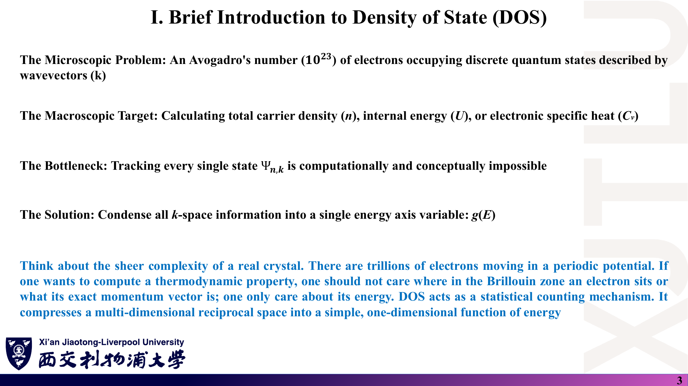
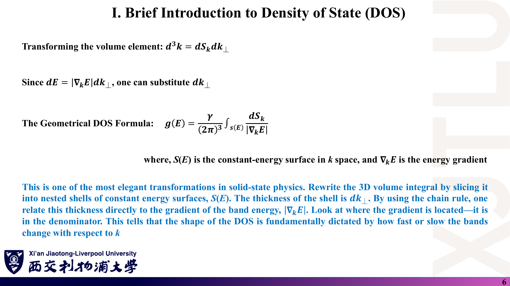
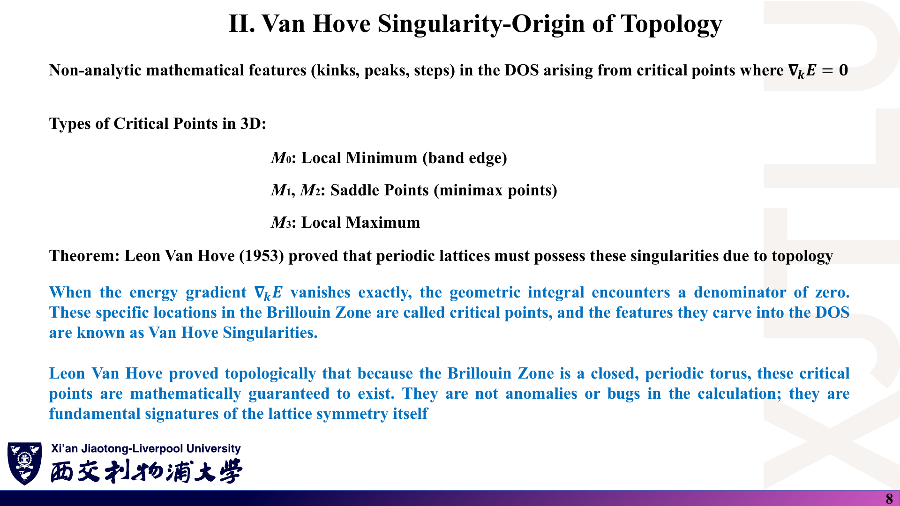
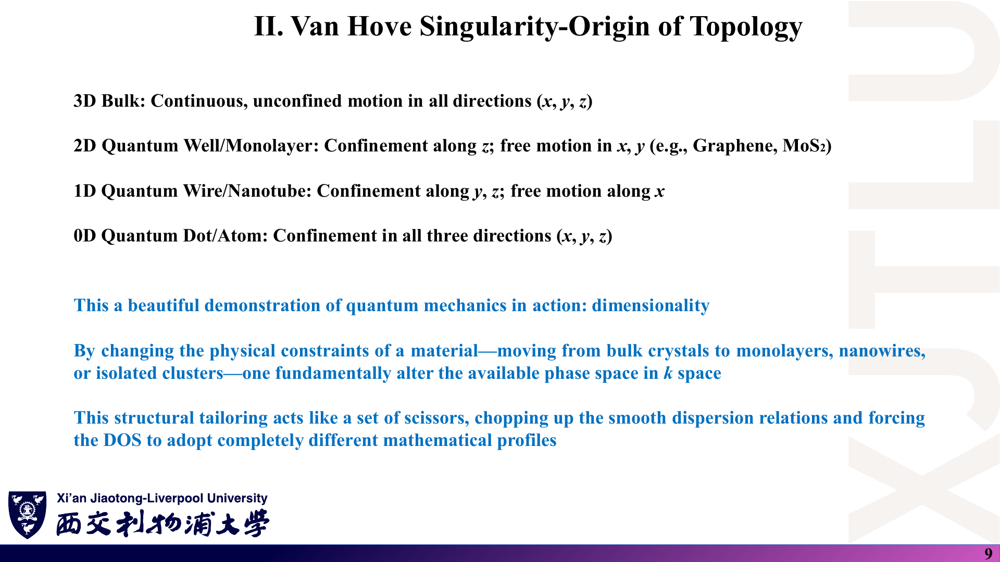
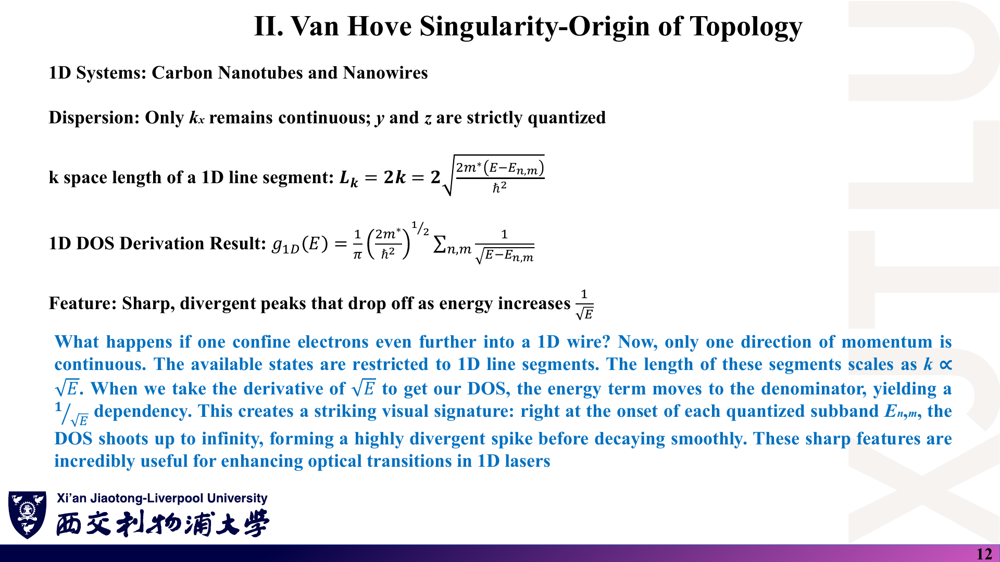
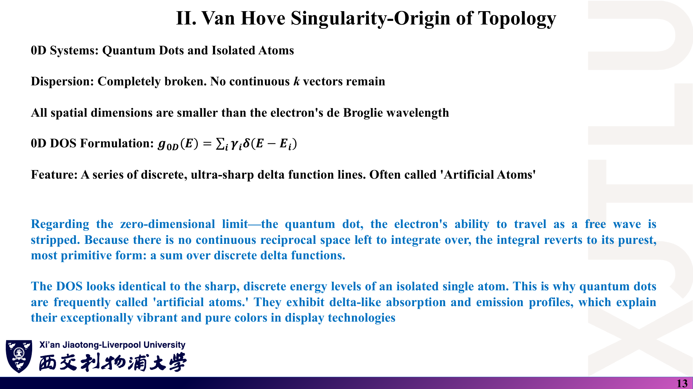
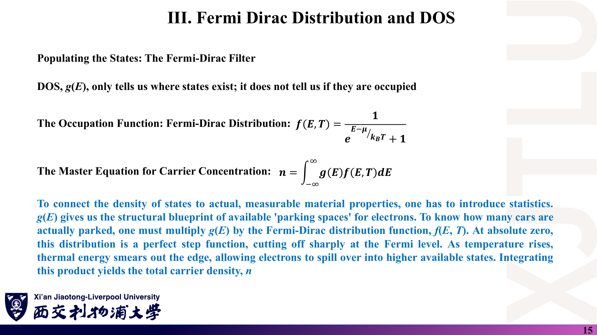
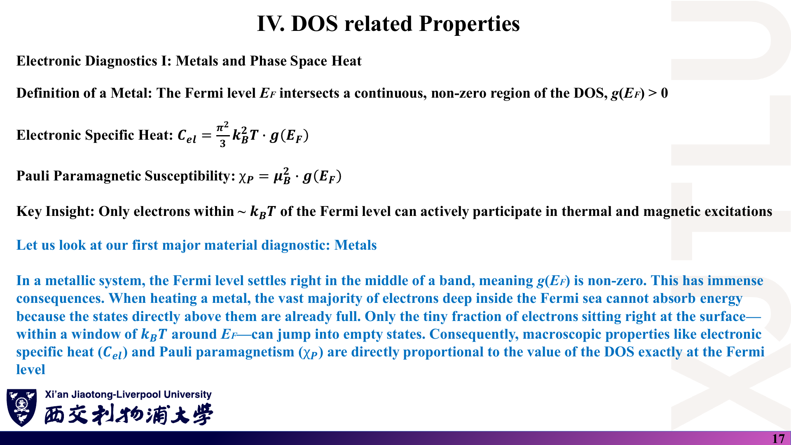
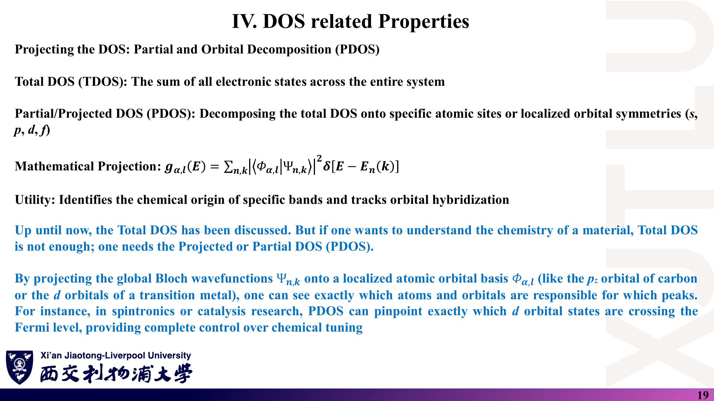

# 01 · 态密度基础、Van Hove 奇点与 DOS 相关性质

来源：[Lecture_Thirteen.pdf](../Lecture_Thirteen.pdf)，21 页。

[返回目录](README.md)

## 1. 为什么需要态密度？〔pp. 2–3〕

### 课件截图

### 中文解释

晶体里电子数量达 $10^{23}$ 量级，每个电子态由能带指标 $n$ 和波矢 $\mathbf k$ 标记。计算载流子浓度 $n$、内能 $U$、电子比热 $C_v$ 这类宏观量时，我们通常不关心电子在布里渊区（BZ）的哪个位置，只关心它的**能量**。DOS 就是一种“按能量计数”的统计工具：把多维 $\mathbf k$ 空间压缩成一个只依赖能量的一维函数 $g(E)$。

### 原理深入

许多热力学量都可以写成“对所有态求和”的形式：

$$
\sum_{n,\mathbf k}F\big(E_n(\mathbf k)\big)=\int dE\,F(E)\sum_{n,\mathbf k}\delta\big[E-E_n(\mathbf k)\big].
$$

只要被求和的量 $F$ **只通过能量依赖于态**（例如占据数 $f(E)$、能量 $E f(E)$），就可以先把 $\sum\delta$ 算好，以后对任何 $F$ 只做一维积分。这就是 DOS 的价值。

**适用条件〔补充〕**：若被求和量还依赖 $\mathbf k$ 的方向或速度（例如电导率中的 $v_x^2$），只靠 $g(E)$ 不够，需要“带权 DOS”（如输运分布函数）。这也是第一周提到的“能带/DOS 与电导率不是同一个计算结果”。

### Ref

- **原课件**：[Lecture Thirteen，PDF 第 2–3 页](../Lecture_Thirteen.pdf#page=3)。
- **延伸**：[SS1：能级密度](README.md#ref-ss1)。

## 2. DOS 的严格定义是什么？〔p. 4〕

### 课件截图

*原图把“∞ / 0”的分段式标为 Discrete case，容易与 Kronecker δ 混淆，见下方说明。*

### 中文解释

DOS 是**单位能量间隔、单位晶体体积内可用量子态的数目**。δ 函数像一个“筛子”：扫描所有能带与所有允许的 $\mathbf k$，凡是 $E_n(\mathbf k)$ 恰好等于探测能量 $E$ 就记一次，最后除以体积。讲义强调：这一写法本身就假设态是离散的，恰好对应数值计算中有限 k 网格在展宽之前的情形。

### 原理深入

$$
\boxed{g(E)=\frac1V\sum_{n,\mathbf k}\delta\big[E-E_n(\mathbf k)\big]}
$$

- $V$：晶体体积；$n$：能带指标；$\mathbf k$：第一 BZ 内满足周期边界条件的允许波矢。
- 3D 单位：states/(eV·cm³)。2D 材料常用 states/(eV·cm²) 或“每原胞”的 states/eV（第 16 讲的图即为后者）。

**δ 函数的正确理解〔补充〕**：Dirac δ 不是普通函数，“$x=a$ 处为 ∞、其余为 0”只是直观描述；它的定义性质是

$$
\int_{-\infty}^{\infty}\delta(x-a)\,\phi(x)\,dx=\phi(a),\qquad\int\delta(x)\,dx=1.
$$

正是“面积为 1”这一条保证了 $\int g(E)\,dE$ 等于（单位体积的）态数。离散指标上的 Kronecker δ 取值是 **1/0**，不是 ∞/0；原页把 ∞/0 写在 “Discrete case” 下，应理解为“态离散时出现的 Dirac δ 尖峰”。

**积分检查**：

$$
\int_{-\infty}^{\infty}g(E)\,dE=\frac{1}{V}\times(\text{态的总数}).
$$

### Ref

- **原课件**：[Lecture Thirteen，PDF 第 4 页](../Lecture_Thirteen.pdf#page=4)。
- **勘误**：[07 第 2 节：δ 函数与“离散情形”](07_讲义勘误与易错点.md)。

## 3. 求和如何变成 BZ 积分？自旋因子 γ 放在哪里？〔p. 5〕

### 课件截图

### 中文解释

宏观晶体中允许的 $\mathbf k$ 点非常密，每个 $\mathbf k$ 在倒空间占据体积 $(2\pi)^3/V$，于是求和可换成积分。讲义特别提醒：**不要忘记自旋简并因子 $\gamma$**——非磁体系 $\gamma=2$；自旋极化或自旋电子学问题中，自旋向上与向下的 DOS 要分开处理。

### 原理深入

周期边界条件下，$d$ 维晶体的允许 $\mathbf k$ 在倒空间均匀分布，每个占体积 $(2\pi)^d/V$，所以

$$
\sum_{\mathbf k}(\cdots)\;\longrightarrow\;\frac{V}{(2\pi)^d}\int_{\rm BZ}d^d k\,(\cdots).
$$

代入第 2 节定义，并补上自旋：

$$
\boxed{g(E)=\frac{\gamma}{(2\pi)^3}\sum_n\int_{\rm BZ}\delta\big[E-E_n(\mathbf k)\big]\,d^3k}
$$

注意原页的式子**省略了 $\sum_n$**，应理解为对每条能带求和（或给出单带贡献）。

**本周最重要的约定问题**：

| 约定 | DOS 积分（全能量） | 出现位置 |
|---|---|---|
| 含自旋，$\gamma=2$ | $2\times N_{\rm atom}\times N_{\rm orb}$ | 本讲第 5 页、第 10–12 页的 3D/2D/1D 公式 |
| 不含自旋（每个轨道 1 个态） | $N_{\rm atom}\times N_{\rm orb}$ | Lecture Fourteen 第 13 页“石墨烯必须等于 2.0” |

两种都正确，但报告中必须**声明所用约定**。教师示例代码中三种方法用了不同约定，见 [08 代码导读](08_代码导读.md) 与 [07 第 1 节](07_讲义勘误与易错点.md)。

### Ref

- **原课件**：[Lecture Thirteen，PDF 第 5 页](../Lecture_Thirteen.pdf#page=5)；对照 [Lecture Fourteen，PDF 第 13 页](../Lecture_Fourteen.pdf#page=13)。
- **延伸**：[SS1：周期边界条件与 k 空间态密度](README.md#ref-ss1)。

## 4. 为什么 DOS 由能带斜率决定？〔pp. 6–7〕

### 课件截图

### 中文解释

把 BZ 体积切成一层层等能面壳层：壳层面积是 $dS_k$，厚度是 $dk_\perp$。能带越陡，同样的能量间隔 $dE$ 对应的壳层越薄，装下的态越少；能带越平，壳层越厚，态堆积越多。由于 $\frac1\hbar\nabla_{\mathbf k}E$ 正是群速度，**DOS 与电子速度成反比**：色散强的能带 DOS 低，平带（d/f 轨道、莫尔超晶格、重费米子）产生巨大的 DOS 峰。

### 原理深入

**推导〔补充展开〕**：在等能面附近把体积元分解为 $d^3k=dS_k\,dk_\perp$，而 $dE=|\nabla_{\mathbf k}E|\,dk_\perp$。于是对固定能带

$$
\int\delta[E-E_n(\mathbf k)]\,d^3k
=\int dS_k\int\delta(E-E')\frac{dE'}{|\nabla_{\mathbf k}E'|}
=\oint_{S_n(E)}\frac{dS_k}{|\nabla_{\mathbf k}E_n|}.
$$

$$
\boxed{g(E)=\frac{\gamma}{(2\pi)^3}\sum_n\oint_{S_n(E)}\frac{dS_k}{|\nabla_{\mathbf k}E_n(\mathbf k)|}},\qquad
\mathbf v_g=\frac1\hbar\nabla_{\mathbf k}E.
$$

- 2D 中“等能面”是等能线，$dS_k$ 换成线元 $dl_k$，前因子为 $\gamma/(2\pi)^2$。
- 公式在 $\nabla_{\mathbf k}E=0$ 处分母为零，这正是下一节 Van Hove 奇点的来源。
- **注意〔补充〕**：“平带 → DOS 大”说的是**单位能量**内态多，并不等于这些态都参与导电；平带速度小，对电导的贡献可能反而很小。

### Ref

- **原课件**：[Lecture Thirteen，PDF 第 6–7 页](../Lecture_Thirteen.pdf#page=6)。
- **延伸**：[SS1：能级密度的面积分表示](README.md#ref-ss1)。

## 5. 什么是 Van Hove 奇点？〔p. 8〕

### 课件截图

### 中文解释

在 $\nabla_{\mathbf k}E=0$ 的**临界点**，几何公式的分母为零，DOS 曲线出现扭折、尖峰或台阶，称为 Van Hove 奇点。3D 中临界点分四类：$M_0$ 局部极小（带边）、$M_1,M_2$ 鞍点、$M_3$ 局部极大。Van Hove（1953）证明：由于 BZ 是闭合的周期“环面”，这些临界点**必然存在**；它们不是计算错误，而是晶格周期性的固有标志。

### 原理深入

**分类依据〔补充〕**：在临界点 $\mathbf k_0$ 附近把能量展开到二阶，

$$
E(\mathbf k)\approx E_0+\sum_{i=1}^{d}\alpha_i\,(k_i-k_{0i})^2 .
$$

$M_j$ 的下标 $j$ 等于系数 $\alpha_i$ 中**负号的个数**。3D 中，$M_0$、$M_3$ 处 DOS 呈 $\sqrt{|E-E_0|}$ 起伏（斜率发散），$M_1$、$M_2$ 处出现一侧为常数、一侧为 $\sqrt{\cdot}$ 的扭折；DOS 本身有限。

**2D 的情形（与石墨烯直接相关）**：极小/极大点给出 DOS 的台阶跳变，鞍点给出**对数发散** $g(E)\propto-\ln|E-E_0|$。石墨烯 π 能带在 BZ 的 M 点是鞍点，能量为 $\pm|t|$；讲义第 16 讲的 DOS 图在 $\pm2.7$ eV 处的尖峰正是这一对数奇点（程序中 $t=-2.7$ eV）。

**“拓扑”一词的含义〔补充〕**：这里指 Morse 理论——光滑周期函数在环面上必须有一定数量的各类临界点（3D 至少 1 个 $M_0$、3 个 $M_1$、3 个 $M_2$、1 个 $M_3$）。它与“拓扑绝缘体”的拓扑不是同一概念，不要混用。

### Ref

- **原课件**：[Lecture Thirteen，PDF 第 8 页](../Lecture_Thirteen.pdf#page=8)；石墨烯结果见 [Lecture Sixteen，PDF 第 5 页](../Lecture_Sixteen.pdf#page=5)。
- **原始论文**：[VH53](README.md#ref-vh)；石墨烯 [GR09](README.md#ref-gr09)。

## 6. 维度如何改变 DOS 的形状？〔pp. 9–14〕

### 课件截图

*第 10 页 $\Omega_k$ 的指数应为 3/2；第 11 页色散式漏写了子带能 $E_n$。*

### 中文解释

改变材料的维度（体材料 → 单层 → 纳米线 → 量子点）就改变了 k 空间可用的“相空间”。3D 等能面是球面，DOS $\propto\sqrt E$ 平滑上升；2D 等能线是圆，面积 $\propto E$，DOS 在每个子带内是常数，呈台阶；1D 只剩线段，DOS $\propto1/\sqrt{E-E_n}$，在子带起点发散；0D 完全离散，DOS 是一系列 δ 线，因此量子点被称为“人造原子”。

### 原理深入

统一方法〔补充〕：先求能量低于 $E$ 的态数 $N(E)$，再求导 $g=dN/dE$。设有效质量抛物带，自旋因子 $\gamma$（讲义结果对应 $\gamma=2$）。

**3D**：$E=\hbar^2k^2/2m^*$，$k=\sqrt{2m^*E}/\hbar$。

$$
\frac{N}{V}=\gamma\frac{\frac43\pi k^3}{(2\pi)^3}=\frac{\gamma}{6\pi^2}\Big(\frac{2m^*E}{\hbar^2}\Big)^{3/2}
\;\Rightarrow\;
g_{3D}=\frac{\gamma}{4\pi^2}\Big(\frac{2m^*}{\hbar^2}\Big)^{3/2}\sqrt E
\xrightarrow{\gamma=2}\boxed{\frac{1}{2\pi^2}\Big(\frac{2m^*}{\hbar^2}\Big)^{3/2}\sqrt E}.
$$

原页写 $\Omega_k=\frac43\pi\big(\frac{2m^*E}{\hbar^2}\big)^{3}$，指数应为 $3/2$（因为 $k^3=(k^2)^{3/2}$）；最终 $g_{3D}$ 正确。

**2D**（第 $n$ 个子带，$E=E_n+\hbar^2k^2/2m^*$）：

$$
\frac{N_n}{A}=\gamma\frac{\pi k^2}{(2\pi)^2}=\frac{\gamma m^*(E-E_n)}{2\pi\hbar^2}
\;\Rightarrow\;
g_{2D}=\frac{\gamma m^*}{2\pi\hbar^2}\sum_n\theta(E-E_n)\xrightarrow{\gamma=2}\boxed{\frac{m^*}{\pi\hbar^2}\sum_n\theta(E-E_n)}.
$$

原页色散写成 $E=\hbar^2(k_x^2+k_y^2)/2m^*$，与下一行面积公式中的 $(E-E_n)$ 不一致，应补上 $E_n$。注意 2D 结果虽未写 $\gamma$，但已经**包含**自旋因子 2。

**1D**（子带 $E_{n,m}$）：长度 $L_k=2k$（$\pm k$ 两段），

$$
\frac{N}{L}=\gamma\frac{2k}{2\pi}\;\Rightarrow\;
g_{1D}=\frac{\gamma}{2\pi}\Big(\frac{2m^*}{\hbar^2}\Big)^{1/2}\sum_{n,m}\frac{\theta(E-E_{n,m})}{\sqrt{E-E_{n,m}}}
\xrightarrow{\gamma=2}\boxed{\frac1\pi\Big(\frac{2m^*}{\hbar^2}\Big)^{1/2}\sum_{n,m}\frac{\theta(E-E_{n,m})}{\sqrt{E-E_{n,m}}}}.
$$

（原页省略了 $\theta$ 函数；$E<E_{n,m}$ 时该子带不贡献。）

**0D**：$g_{0D}(E)=\sum_i\gamma_i\,\delta(E-E_i)$，$\gamma_i$ 为能级 $i$ 的简并度。

**对照表的精确写法**：第 14 页表中 $\sqrt E$、$1/\sqrt E$、$\delta(E)$ 应理解为相对带边或子带边，即 $\sqrt{E-E_c}$、$1/\sqrt{E-E_n}$、$\delta(E-E_i)$。

**石墨烯不是“2D 常数 DOS”〔补充〕**：上面 2D 台阶来自抛物带。石墨烯在 Dirac 点附近色散线性 $E=\pm\hbar v_F|\mathbf q|$，等能线周长 $\propto|E|$，所以 $g(E)\propto|E|$，呈 V 形（第 16 讲图中 $E=0$ 附近）。“维度决定 DOS 形状”必须连同色散关系一起说。

### Ref

- **原课件**：[Lecture Thirteen，PDF 第 9–14 页](../Lecture_Thirteen.pdf#page=10)。
- **勘误**：[07 第 3 节：维度 DOS 推导中的笔误](07_讲义勘误与易错点.md)。
- **延伸**：[SS2：自由电子气](README.md#ref-ss2)；石墨烯线性 DOS 见 [GR09](README.md#ref-gr09)。

## 7. DOS 与占据：载流子浓度怎么算？〔pp. 15–16〕

### 课件截图

*第 16 页曲线在 $E<E_F$ 处取 0、$E>E_F$ 处取 1，与旁边公式相反，见下方与 07 勘误。*

### 中文解释

DOS 只告诉我们“哪里有座位（停车位）”，不告诉我们座位是否有人。占据概率由 Fermi–Dirac 分布给出；两者相乘再积分，得到总电子（载流子）浓度。$T=0$ 时 $f$ 是在 Fermi 能级处突然截止的台阶；温度升高，台阶两侧在约 $k_BT$ 宽度内被抹平，部分电子跃迁到更高的空态。

### 原理深入

$$
f(E,T)=\frac{1}{e^{(E-\mu)/k_BT}+1},\qquad
\boxed{n=\int_{-\infty}^{\infty}g(E)\,f(E,T)\,dE}.
$$

**极限检查**：$E\ll\mu$ 时指数 $\to0$，$f\to1$（占满）；$E\gg\mu$ 时 $f\to0$（空）。所以 $T=0$ 的正确图像是 **$E<E_F$ 为 1、$E>E_F$ 为 0**；任何温度下 $f(\mu)=1/2$，曲线关于 $(\mu,1/2)$ 中心对称：$f(\mu+x)=1-f(\mu-x)$。原第 16 页把台阶画成 $1-f$ 的形状（那是“空穴占据”的形状）。

**补充说明**：

- 讲义中 $\mu$ 与 $E_F$ 混用。严格说 $\mu$ 是化学势，$E_F$ 常指 $T=0$ 时的 $\mu$。
- 对半导体，常把 $n$（电子）只对导带积分、$p$（空穴）对价带用 $1-f$ 积分，再结合电中性确定 $\mu$。
- 在 DOS 程序中，若想由电子数确定 $E_F$，就要解 $\int g f\,dE=N_e$；石墨烯半满且电子–空穴对称时 $E_F=0$（onsite 能均为 0），这是第 16 讲横轴直接写 $E-E_F$ 的原因。

### Ref

- **原课件**：[Lecture Thirteen，PDF 第 15–16 页](../Lecture_Thirteen.pdf#page=15)。
- **勘误**：[07 第 4 节：Fermi–Dirac 曲线方向](07_讲义勘误与易错点.md)。
- **延伸**：[SS1：Fermi–Dirac 分布](README.md#ref-ss1)。

## 8. 金属：为什么只有 $E_F$ 附近的电子“有用”？〔p. 17〕

### 课件截图

### 中文解释

金属的 Fermi 能级落在某条能带中间，$g(E_F)>0$。加热时，Fermi 海深处的电子上方的态都已被占，无法吸收小能量；只有 $E_F$ 附近约 $k_BT$ 窗口内的电子能跃迁到空态。因此电子比热和 Pauli 顺磁磁化率都**正比于 $g(E_F)$**。

### 原理深入

$$
C_{el}=\frac{\pi^2}{3}k_B^2T\,g(E_F),\qquad
\chi_P=\mu_B^2\,g(E_F)\quad(\text{SI 中再乘 }\mu_0).
$$

- 两式中的 $g$ 都是**含两种自旋的总 DOS**（单位体积）。若使用每自旋 DOS，需要相应改写系数，这又是自旋约定的一个陷阱。
- $C_{el}$ 来自 Sommerfeld 展开，要求 $k_BT\ll E_F$ 且 $g(E)$ 在 $E_F$ 附近约 $k_BT$ 范围内变化平缓〔补充〕。
- 例如本征石墨烯 $g(E_F=0)=0$，上式的线性 $T$ 律不适用；它是零带隙半金属，不能直接套用“金属”公式。

### Ref

- **原课件**：[Lecture Thirteen，PDF 第 17 页](../Lecture_Thirteen.pdf#page=17)。
- **延伸**：[SS1：Sommerfeld 展开与 Pauli 顺磁](README.md#ref-ss1)；[SS2](README.md#ref-ss2)。

## 9. 半导体与绝缘体在 DOS 上如何区分？〔p. 18〕

### 课件截图

### 中文解释

非金属的 DOS 图在一段有限能量范围内 $g(E)=0$，这一段就是带隙 $E_g$。其下方是 $T=0$ 时被填满的价带，上方是空的导带。讲义以 3 eV 为界：小于 3 eV 称半导体（室温可热激发少量载流子，如 Si、GaAs），大于 3 eV 称绝缘体。

### 原理深入

- “3 eV”只是常用的经验分界，不是物理定律〔补充〕。GaN（约 3.4 eV）、4H-SiC（约 3.2 eV）、金刚石（约 5.5 eV）通常被称为**宽禁带半导体**，因为可以掺杂导电。分类更依赖可掺杂性与应用场景。
- 本征载流子浓度大致按 $\exp(-E_g/2k_BT)$ 变化；室温 $k_BT\approx0.0259$ eV，所以 $E_g$ 增加 1 eV 会使本征浓度下降约 $e^{-1/0.0518}\sim10^{-8.4}$ 倍。
- **数值 DOS 的陷阱**：展宽会让带隙内出现“尾巴”（非零 DOS），使带隙看起来变小（见 [03 第 3 节](03_展宽方法与四面体法.md)）。判断带隙应以能带本征值（$\min E_c-\max E_v$）为准，而不是展宽 DOS 的“零点”。

### Ref

- **原课件**：[Lecture Thirteen，PDF 第 18 页](../Lecture_Thirteen.pdf#page=18)。
- **延伸**：[SS2：半导体能隙与本征载流子](README.md#ref-ss2)。

## 10. PDOS：哪些原子、哪些轨道在贡献？〔p. 19〕

### 课件截图

### 中文解释

总 DOS（TDOS）把所有贡献混在一起。把 Bloch 波函数投影到某个原子 $\alpha$ 的某个轨道 $l$（如碳的 $p_z$、过渡金属的 $d$）上，用投影权重 $|\langle\Phi_{\alpha,l}|\Psi_{n\mathbf k}\rangle|^2$ 代替“记 1 个态”，就得到 PDOS，可以看出哪些原子、哪些轨道主导某个峰，例如哪些 $d$ 态跨过 Fermi 能级。

### 原理深入

$$
g_{\alpha,l}(E)=\sum_{n,\mathbf k}\big|\langle\Phi_{\alpha,l}|\Psi_{n\mathbf k}\rangle\big|^2\,\delta\big[E-E_n(\mathbf k)\big]\quad(\text{再按约定除以 }V\text{ 或 }N_k).
$$

**求和规则**：若轨道集合**正交归一且完备**，则 $\sum_{\alpha,l}|\langle\Phi_{\alpha,l}|\Psi\rangle|^2=1$，所以 $\sum_{\alpha,l}g_{\alpha,l}=g$。紧束缚模型（正交基）里直接用本征矢分量 $|c_{\alpha l,n}(\mathbf k)|^2$ 即可，详见 [02 第 6 节](02_k点采样与TB-DOS四步流程.md)。

**非正交基〔补充〕**：DFT 局域轨道一般非正交（第一周 $Hc=ESc$），此时 $\sum|c|^2\neq1$，需要 Mulliken 或 Löwdin 等分配方案，结果依赖方案，不唯一。

### Ref

- **原课件**：[Lecture Thirteen，PDF 第 19 页](../Lecture_Thirteen.pdf#page=19)。
- **衔接**：[Lecture Fourteen，PDF 第 15–19 页](../Lecture_Fourteen.pdf#page=16)。

## 11. 为什么数值 DOS 必须“展宽”？〔p. 20〕

### 课件截图

### 中文解释

计算机只能取有限个 k 点，δ 函数定义下的 DOS 是一堆无限尖的谱线，而不是光滑曲线。解决办法是用有限宽度的光滑函数（Gaussian 或 Lorentz）替代 δ。宽度参数（$\sigma$ 或 $\Gamma$）需要平衡：太小，曲线充满人为噪声；太大，会抹掉真实的 Van Hove 特征。

### 原理深入

$$
\delta(x)\approx\frac{1}{\sigma\sqrt\pi}e^{-(x/\sigma)^2},\qquad
\delta(x)\approx\frac1\pi\frac{\Gamma}{x^2+\Gamma^2}.
$$

两者面积都为 1，且 $\sigma,\Gamma\to0$ 时趋于 δ。参数的物理含义（$\sigma$ 不是标准差，$\Gamma$ 是半高半宽）在 [03 第 3 节](03_展宽方法与四面体法.md) 详细讨论。

**原页一处易误解的表述**：蓝字说“使用三角形或四面体积分方案编写 DOS 代码时”也会得到尖刺、需要展宽。实际上四面体（三角形）法的出发点正是**不需要展宽参数**（Lecture Fifteen 第 13 页）；需要展宽的是“直接对离散本征值做 δ 求和/直方图”的做法。应把这句理解为“与四面体法相对的另一条路线”。

### Ref

- **原课件**：[Lecture Thirteen，PDF 第 20 页](../Lecture_Thirteen.pdf#page=20)；对照 [Lecture Fifteen，PDF 第 13 页](../Lecture_Fifteen.pdf#page=13)。
- **后续**：[03 展宽方法与四面体法](03_展宽方法与四面体法.md)。

本讲一句话：**DOS = 按能量对 BZ 中所有态计数；形状由 $|\nabla_{\mathbf k}E|$ 和维度决定，临界点给出 Van Hove 奇点；乘上占据函数才得到物理量，而数值上必须处理 δ 函数。**
