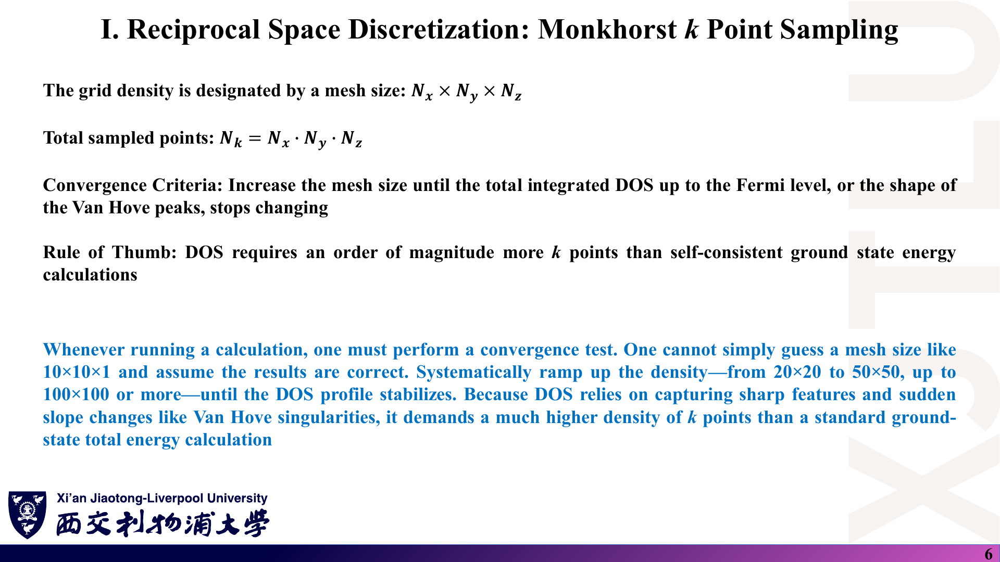
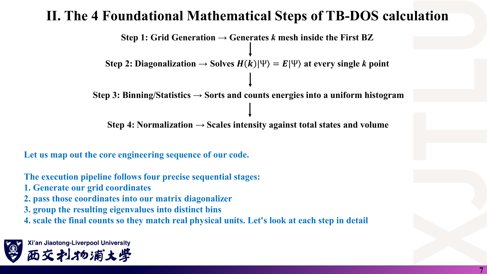
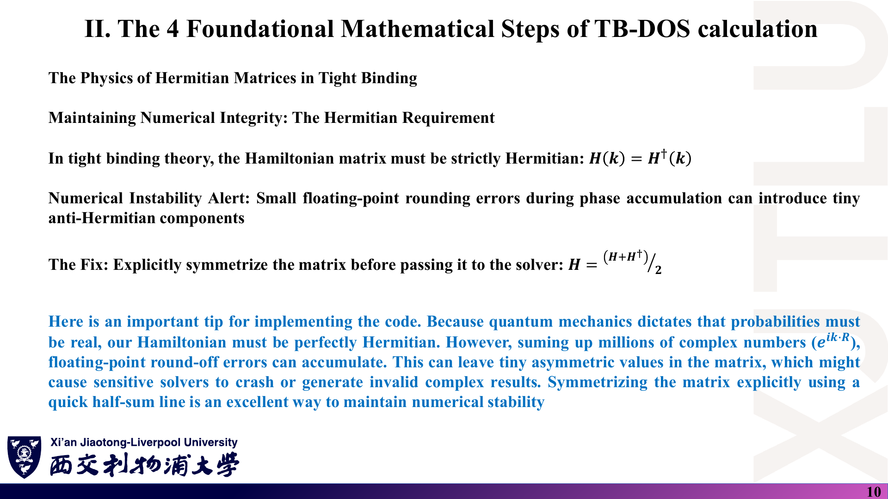
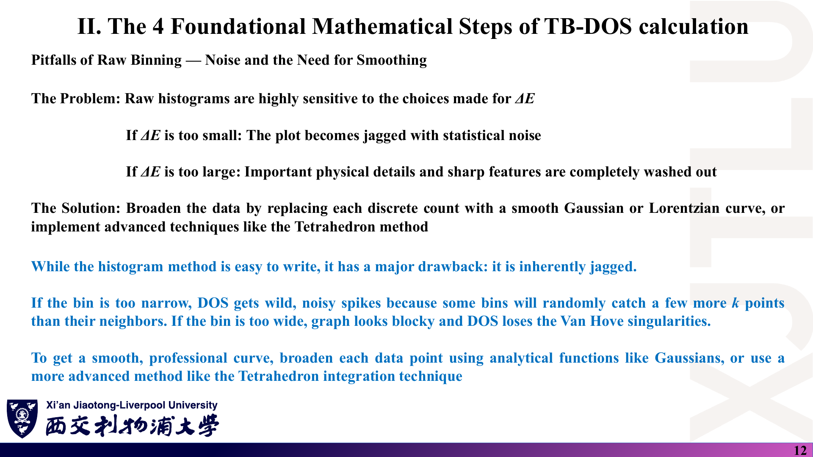
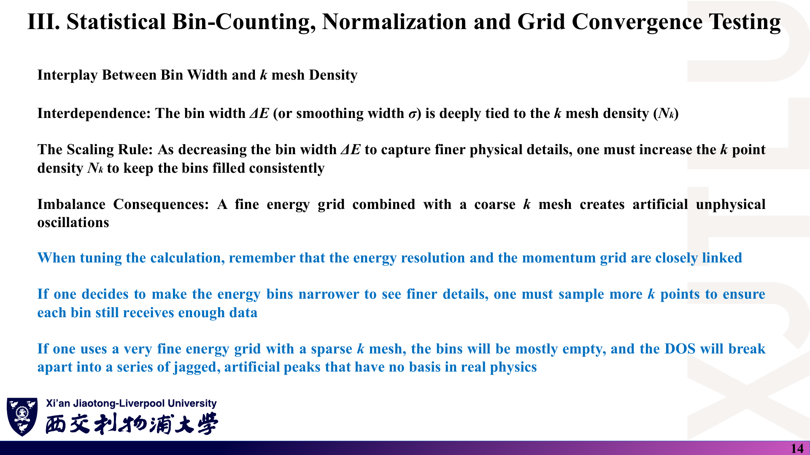
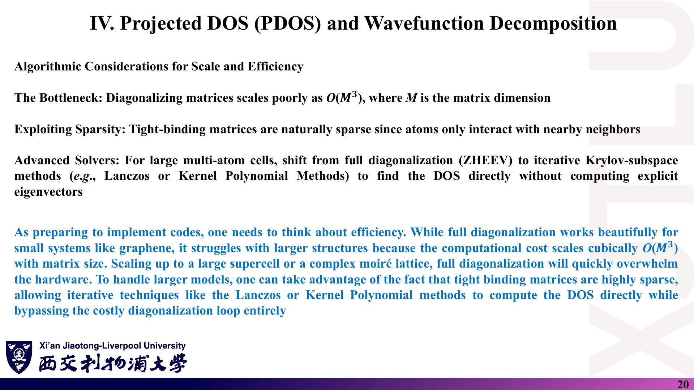

# 02 · k 点采样与紧束缚 DOS 的四步流程

来源：[Lecture_Fourteen.pdf](../Lecture_Fourteen.pdf)，21 页。

[返回目录](README.md)

## 1. 计算 DOS 前要准备什么？〔pp. 2–3〕

### 课件截图

### 中文解释

先由实空间晶格矢量 $\mathbf a_1,\mathbf a_2,\mathbf a_3$ 得到倒格矢 $\mathbf b_1,\mathbf b_2,\mathbf b_3$。对倒空间中每个 $\mathbf k$，把实空间跃迁参数 $t_{ij}(\mathbf R)$ 乘上相位 $e^{i\mathbf k\cdot\mathbf R}$ 求和，得到复厄米矩阵 $H(\mathbf k)$。因为不可能对无穷多个 $\mathbf k$ 计算，必须把连续的 BZ 离散成有限而有代表性的网格。

### 原理深入

倒格矢定义〔补充〕：

$$
\mathbf b_1=2\pi\frac{\mathbf a_2\times\mathbf a_3}{\mathbf a_1\cdot(\mathbf a_2\times\mathbf a_3)},\quad
\mathbf b_2=2\pi\frac{\mathbf a_3\times\mathbf a_1}{\cdots},\quad
\mathbf b_3=2\pi\frac{\mathbf a_1\times\mathbf a_2}{\cdots},\qquad
\mathbf a_i\cdot\mathbf b_j=2\pi\delta_{ij}.
$$

示例代码的 `KSPACE` 子程序就是逐字实现此式（见 [08](08_代码导读.md)）。

$$
H_{ij}(\mathbf k)=\sum_{\mathbf R}t_{ij}(\mathbf R)\,e^{i\mathbf k\cdot\mathbf R}.
$$

原页左边写成 $H_{ij}(K)$，大写 $K$ 应为 $\mathbf k$（石墨烯中 $K$ 常指 Dirac 点，容易混淆）。

**两种相位约定〔补充〕**：相位可只用晶格矢 $\mathbf R$（“约定 I”），也可用原子间实际位移 $\mathbf R+\boldsymbol\tau_j-\boldsymbol\tau_i$（“约定 II”）。两者的 $H(\mathbf k)$ 只差一个对角幺正变换，**本征值完全相同**；本征矢的相位不同，计算 Berry 相位等量时要小心。示例代码用的是约定 II。

### Ref

- **原课件**：[Lecture Fourteen，PDF 第 2–3 页](../Lecture_Fourteen.pdf#page=3)。
- **延伸**：[SS1：倒格子与紧束缚](README.md#ref-ss1)。

## 2. 为什么 DOS 不能沿高对称路径取点？〔p. 4〕

### 课件截图

### 中文解释

画能带图时，沿 $\Gamma\to K\to M\to\Gamma$ 这样的高对称一维路径计算 $H(\mathbf k)$，便于看带隙和 Dirac 锥。但这条线在 2D/3D 空间中体积为零，完全漏掉 BZ 内部的大量态。DOS 是对整个 BZ 的统计量，必须**均匀地**撒满整个 BZ，让每一块相空间都有相同的被计数机会。

### 原理深入

DOS 的 BZ 积分本质上是 $\frac{1}{V_{\rm BZ}}\int_{\rm BZ}d^dk\,\delta[E-E_n(\mathbf k)]$。均匀网格等价于对该积分做**等权**数值积分：每个 k 点权重 $1/N_k$。

- 用高对称路径上的点做直方图，等于给一维线赋予了整片区域的权重，结果既不正确也不收敛。
- 可以用对称性把全 BZ 约化到不可约楔（IBZ），但每个 k 点必须带上**正确的权重**（其星的大小）。示例代码与本课程都用全 BZ 网格，最简单也最不易出错。

### Ref

- **原课件**：[Lecture Fourteen，PDF 第 4 页](../Lecture_Fourteen.pdf#page=4)。
- **延伸**：[ES1：布里渊区积分](README.md#ref-es1)。

## 3. Monkhorst–Pack 网格怎么写？要多密？〔pp. 5–6〕

### 课件截图

### 中文解释

MP 方案在倒格矢方向上生成均匀网格，分数坐标相对整点平移半个间距，使点相对原点对称分布。网格规模记为 $N_x\times N_y\times N_z$，总点数 $N_k=N_xN_yN_z$。收敛判据：不断加密网格，直到 $E_F$ 以下积分态数或 Van Hove 峰形不再变化。经验规则：DOS 需要的 k 点比自洽基态能量计算多一个数量级；从 20×20、50×50 到 100×100 甚至更密逐步测试。

### 原理深入

$$
\mathbf k_{p,q,r}=u_p\mathbf b_1+v_q\mathbf b_2+w_r\mathbf b_3,\qquad
\boxed{u_p=\frac{2p-N_x-1}{2N_x}},\quad p=1,\ldots,N_x.
$$

**例**：$N_x=4$ 时 $u_p=-\tfrac38,-\tfrac18,\tfrac18,\tfrac38$，不含 $\Gamma$；$N_x=3$ 时 $u_p=-\tfrac13,0,\tfrac13$，含 $\Gamma$。所以“平移半格”只对偶数 $N$ 成立，奇数 $N$ 的 MP 网格以 $\Gamma$ 为中心〔补充〕。

**与示例代码的区别**：代码用 $u=(i-1)/N$，是**以 $\Gamma$ 为起点**的均匀网格，覆盖 $[0,1)$ 而非 $(-\tfrac12,\tfrac12)$。由于周期性，二者都是对整个 BZ 的等权采样；但 Dirac 点 $K$ 的分数坐标为 $(\tfrac13,\tfrac23)$ 一类，只有 $N$ 被 3 整除时才恰好落在网格上。代码默认 500×500（500 不被 3 整除），因此不会精确取到 $K$ 点，这对 $E=0$ 附近 DOS 影响很小（DOS 本身在此线性趋零）。

**为什么 DOS 比总能量更难收敛〔补充〕**：总能量是对 $E<E_F$ 所有态的积分，误差相互平均；DOS 是“对能量求导”的量，需要分辨每个能量窗口内的态数，对网格离散更敏感，尤其在 Van Hove 尖峰处。

### Ref

- **原课件**：[Lecture Fourteen，PDF 第 5–6 页](../Lecture_Fourteen.pdf#page=5)。
- **原始论文**：[MP76](README.md#ref-mp76)。
- **代码对照**：[08 第 3 节：k 网格](08_代码导读.md)。

## 4. 生成网格与对角化：第 1、2 步〔pp. 7–10〕

### 课件截图

### 中文解释

四步流程：① 生成 BZ 内的 k 网格；② 每个 k 点求解 $H(\mathbf k)|\Psi\rangle=E|\Psi\rangle$；③ 把本征值装入能量直方图；④ 按总态数与体积归一化。

第 1 步：循环网格指标，把每个 k 点的笛卡尔分量存入形状为 $(3,N_k)$ 的数组，供后续计算相位点积。第 2 步最耗 CPU：对每个 k 构造 $H(\mathbf k)$（石墨烯每胞 2 原子各 1 个轨道，是 2×2 矩阵），调用 LAPACK 的 `ZHEEV`（或分治版 `ZHEEVD`）得到升序实本征值，存入 `energystate(N_band, N_k)`。

讲义提示：$H(\mathbf k)$ 必须严格厄米；相位累加的浮点舍入可能引入微小反厄米分量，传给求解器前可显式对称化 $H\leftarrow(H+H^\dagger)/2$。

### 原理深入

$$
\boxed{H(\mathbf k)=H^\dagger(\mathbf k)},\qquad
H\leftarrow\frac{H+H^\dagger}{2}.
$$

- 厄米性保证本征值为实数（讲义蓝字写“概率必须为实数”，更准确的理由是**能量本征值为实数、本征矢正交**）。
- **与 LAPACK 的关系〔补充〕**：`ZHEEV(JOBZ, UPLO, ...)` 只读取 `UPLO='U'` 或 `'L'` 指定的那一半三角，另一半不被引用。所以对 `ZHEEV` 而言，“微小反厄米分量”不会导致崩溃；对称化真正有用的场合是：自己写的求解器、使用通用（非厄米）求解器、或者矩阵两半都被别的步骤读取。示例代码只填上三角并用 `'U'`，没有做对称化，这是合法做法。
- `JOBZ='N'` 只算本征值，更快；需要 PDOS 时才用 `'V'` 求本征矢。示例代码用 `'V'` 但没有使用本征矢。
- 应检查返回的 `INFO=0`，否则对角化失败而数组未被正确赋值〔补充〕。

**石墨烯最近邻模型〔补充，供核对〕**：取两子格 A、B，onsite 能 $\varepsilon_A,\varepsilon_B$，跃迁 $t$：

$$
H(\mathbf k)=\begin{pmatrix}\varepsilon_A& t\,f(\mathbf k)\\ t\,f^*(\mathbf k)&\varepsilon_B\end{pmatrix},\qquad
f(\mathbf k)=\sum_{j=1}^{3}e^{i\mathbf k\cdot\boldsymbol\delta_j},
$$

$$
E_\pm(\mathbf k)=\frac{\varepsilon_A+\varepsilon_B}{2}\pm\sqrt{\Big(\frac{\varepsilon_A-\varepsilon_B}{2}\Big)^2+t^2|f(\mathbf k)|^2}.
$$

$|f|$ 在 $\Gamma$ 为 3、在 M 为 1、在 K 为 0，所以 $\varepsilon_A=\varepsilon_B=0$、$|t|=2.7$ eV 时能带范围 $\pm8.1$ eV，M 点 $\pm2.7$ eV，K 点简并于 0（对照 Lecture Sixteen 第 6 页能带图）。$\varepsilon_A\neq\varepsilon_B$ 时 K 点打开 $|\varepsilon_A-\varepsilon_B|$ 的能隙。

### Ref

- **原课件**：[Lecture Fourteen，PDF 第 7–10 页](../Lecture_Fourteen.pdf#page=7)。
- **文档**：[LAPACK：ZHEEV 的 UPLO 约定](README.md#ref-lapack)。
- **延伸**：[GR09：石墨烯紧束缚](README.md#ref-gr09)。

## 5. 直方图统计与归一化：第 3、4 步〔pp. 11–14〕

### 课件截图

### 中文解释

第 3 步把能量轴从 $E_{\min}$ 到 $E_{\max}$ 等分为宽 $\Delta E$ 的 bin，对每个本征值用截断公式算出 bin 编号并计数。直方图很容易写，但天生锯齿化：bin 太窄 → 随机涨落噪声；bin 太宽 → 块状、丢失 Van Hove 细节。解决办法是用 Gaussian/Lorentz 平滑或改用四面体法。

第 4 步：原始计数正比于 $N_k$，必须除以 $N_k$ 与 $\Delta E$。检查方法：对最终 DOS 在全能量范围积分，应等于原胞内活跃轨道总数；石墨烯 2 原子各 1 轨道，积分“必须等于 2.0”，否则有归一化 bug。

bin 宽与 k 网格要一起调：缩小 $\Delta E$ 必须相应加密 k 网格，否则大量 bin 为空，DOS 碎成非物理的尖峰。

### 原理深入

$$
N_E=\frac{E_{\max}-E_{\min}}{\Delta E},\qquad
\text{Index}=\Big\lfloor\frac{E_n(\mathbf k)-E_{\min}}{\Delta E}\Big\rfloor+1,
$$

$$
\boxed{\mathrm{DOS}(E_i)=\frac{\text{counts}_i}{N_k\,\Delta E}},\qquad
\int\mathrm{DOS}\,dE=\sum_i\mathrm{DOS}_i\,\Delta E=\frac{\text{总计数}}{N_k}=N_{\rm band}.
$$

- 原页写 $N_E=(E_{\min}-E_{\max})/\Delta E$，为负数，分子顺序应交换。
- **边界〔补充〕**：$E=E_{\max}$ 时 Index $=N_E+1$ 会越界；$E<E_{\min}$ 时 Fortran 的 `INT` 向零截断，$(-0.5)\to0$，Index $=1$，把窗口外的态错算进第一个 bin。应先判断 $E_{\min}\le E<E_{\max}$，或用 `FLOOR`。
- **“必须等于 2.0”的前提**：(i) 不计自旋；(ii) 能量窗口覆盖全部能带。石墨烯 $|t|=2.7$ eV 时能带延伸到 $\pm8.1$ eV；第 16 讲取 $[-5,5]$ eV，只包含约 64.5% 的态，所以示例数据的积分不会是 2.0（实测见 [08](08_代码导读.md)）。若含自旋，正确值是 4.0。
- 原页称“3D Normalization Factor”，其实 $\text{counts}/(N_k\Delta E)$ 给出的是**每原胞**的 DOS，与维度无关；若要每体积（面积）再除以原胞体积（面积）。
- **噪声估计〔补充〕**：每个 bin 的计数近似服从泊松涨落，相对噪声 $\sim1/\sqrt{\text{counts}}$。要让 bin 宽减半而噪声不变，需要 k 点数加倍（2D 时每个方向 $\times\sqrt2$）。

### Ref

- **原课件**：[Lecture Fourteen，PDF 第 11–14 页](../Lecture_Fourteen.pdf#page=11)。
- **勘误**：[07 第 1 节（自旋约定）与第 5 节（分箱公式）](07_讲义勘误与易错点.md)。

## 6. 如何用本征矢分解出 PDOS？〔pp. 15–19〕

### 课件截图

*第 18 页更像示意图：σ（$p_x,p_y$）曲线在 $E_F$ 附近仍有显著数值，与石墨烯 σ 带在 $E_F$ 附近存在数 eV 能隙的事实不符，不宜当作定量结果。*

### 中文解释

TDOS 告诉我们何处有态，却隐藏了“谁在贡献”。对角化同时给出本征矢 $c_{i\alpha,n}(\mathbf k)$，它是电子处在原子 $i$ 轨道 $\alpha$ 上的概率幅；归一化保证 $\sum|c|^2=1$。统计时用 $|c|^2$ 代替“加 1”，就得到 PDOS。

石墨烯案例：$s,p_x,p_y$ 形成 $sp^2$ 杂化 σ 键，构成平面骨架；未杂化的 $p_z$ 形成 π 键。$E_F$ 附近的 V 形 DOS 完全来自 $p_z$，$sp^2$ 态位于离 $E_F$ 更远的能量。讲义还给出经验解读：两个原子的 PDOS 峰在 $E_F$ 以下对齐 → 成键态；在 $E_F$ 以上对齐 → 反键态；只在一个原子上出现 → 非键态（孤对电子）。

### 原理深入

$$
|\Psi_n(\mathbf k)\rangle=\sum_{i,\alpha}c_{i\alpha,n}(\mathbf k)\,|\Phi_{i\alpha}(\mathbf k)\rangle,\qquad
\sum_{i,\alpha}|c_{i\alpha,n}(\mathbf k)|^2=1,
$$

$$
\boxed{\mathrm{PDOS}_{i\alpha}(E)=\frac1{N_k}\sum_{n,\mathbf k}|c_{i\alpha,n}(\mathbf k)|^2\,\delta[E-E_n(\mathbf k)]},\qquad
\sum_{i\alpha}\mathrm{PDOS}_{i\alpha}=\mathrm{DOS}.
$$

- 这里 $|\Phi_{i\alpha}(\mathbf k)\rangle$ 应理解为原子轨道的 **Bloch 和**，且假定**正交归一**；非正交基需 Mulliken/Löwdin 分配〔补充〕。
- 在本课程的石墨烯 $p_z$ 单轨道模型中，基组里**只有** $p_z$，PDOS 只能分出 A、B 两个子格；要得到第 18 页的 $s,p_x,p_y$ 曲线必须用更大的基组（如 DFT 或 $sp^3$ 紧束缚）。
- 本征石墨烯（$\varepsilon_A=\varepsilon_B$）中 $|c_A|^2=|c_B|^2=\tfrac12$，两子格 PDOS 完全相同；加入 $\varepsilon_A\neq\varepsilon_B$ 后，价带顶与导带底分别偏向低能量子格与高能量子格，可用于在报告中讨论带隙的来源〔补充〕。
- **“$E_F$ 以下=成键”只是经验法则〔补充〕**：成键/反键由轨道间相位（波函数是否在键中心增强）决定，与是否被占据无关；严格分析常用 COHP 等方法。

### Ref

- **原课件**：[Lecture Fourteen，PDF 第 15–19 页](../Lecture_Fourteen.pdf#page=16)。
- **勘误**：[07 第 6 节：PDOS 的适用条件与示意图](07_讲义勘误与易错点.md)。

## 7. 体系变大时该用什么算法？〔p. 20〕

### 课件截图

### 中文解释

全对角化的代价按 $O(M^3)$ 增长（$M$ 为矩阵维数）。石墨烯 2×2 毫无压力，但超胞或莫尔晶格会迅速压垮硬件。紧束缚矩阵天然稀疏（只连接近邻），可改用 Krylov 子空间迭代法（Lanczos）或核多项式方法（KPM），不显式求本征矢就直接算 DOS。

### 原理深入

- 总成本 $\approx N_k\times O(M^3)$。对石墨烯，$N_k=250000$、$M=2$，瓶颈反而在 DOS 累加：$N_E\times N_k\times N_{\rm band}=1000\times250000\times2=5\times10^8$ 次核函数求值〔补充，按示例输入估算〕。
- **KPM 思路〔补充〕**：把 $H$ 缩放到 $[-1,1]$，用 Chebyshev 多项式展开 $\delta(E-H)$，只需稀疏矩阵–向量乘法和随机向量估计迹；展开截断阶数起到“展宽”的作用，常配 Jackson 核抑制 Gibbs 振荡。
- 本课程作业是小矩阵，直接 `ZHEEV` 即可；这一页属于拓展视野。

### Ref

- **原课件**：[Lecture Fourteen，PDF 第 20 页](../Lecture_Fourteen.pdf#page=20)。
- **延伸**：[KPM](README.md#ref-kpm)。

本讲一句话：**均匀撒满全 BZ → 每点对角化 → 计数 → 除以 $N_k\Delta E$，并用积分检查归一化（先说清是否含自旋、窗口是否覆盖全部能带）。**
