# 03 · 展宽（Smearing）方法与四面体法

来源：[Lecture_Fifteen.pdf](../Lecture_Fifteen.pdf)，23 页。

[返回目录](README.md)

## 1. δ 函数在计算机上为什么是难题？〔pp. 2–4〕

### 课件截图

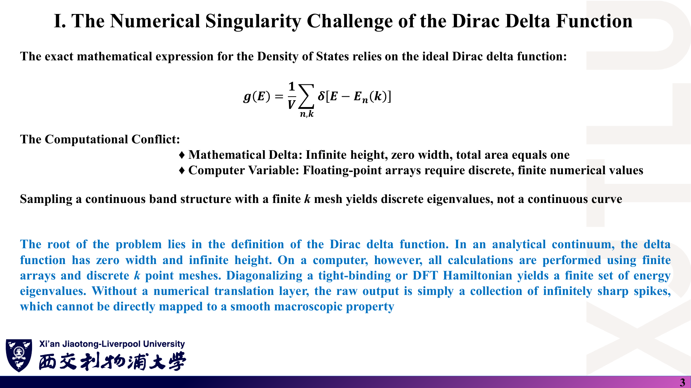

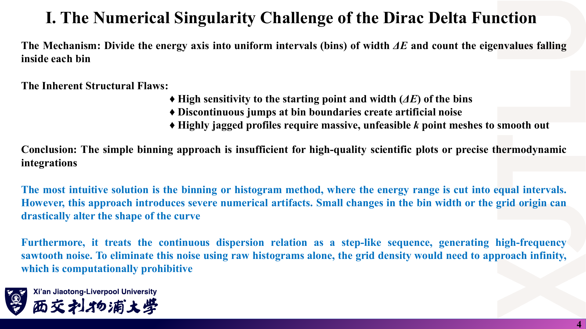

### 中文解释

数学上的 δ 函数高度无穷、宽度为零、面积为 1；计算机里的数组只能存有限值。有限 k 网格对角化得到的是一组离散本征值，直接画出来只是一排无限尖的谱线。最直观的补救是直方图（分箱计数），但它对 bin 的起点和宽度都很敏感、在 bin 边界处跳变产生锯齿噪声，要消除噪声得把网格加密到不现实的程度。所以简单分箱不足以给出高质量的图或精确的热力学积分。

### 原理深入

直方图等价于用**矩形核** $\delta(x)\approx\frac{1}{\Delta E}\,\mathbb 1_{[0,\Delta E)}(x-\text{bin 起点})$ 代替 δ。矩形核面积为 1，但不连续、且与 bin 的位置绑定，所以：

- 把所有 bin 整体平移半个宽度，结果可能明显改变（“起点敏感”）；
- 它不随本征值连续变化：一个本征值穿过 bin 边界时，DOS 突然从一个 bin 跳到另一个。

后面的 Gaussian、Lorentz 核是**以每个本征值为中心**的光滑函数，消除了这两个问题；四面体法则从根本上改为对线性插值的能带做解析积分。

### Ref

- **原课件**：[Lecture Fifteen，PDF 第 2–4 页](../Lecture_Fifteen.pdf#page=3)。
- **前情**：[02 第 5 节：直方图与归一化](02_k点采样与TB-DOS四步流程.md)。

## 2. 解析展宽的总体框架是什么？〔p. 5〕

### 课件截图

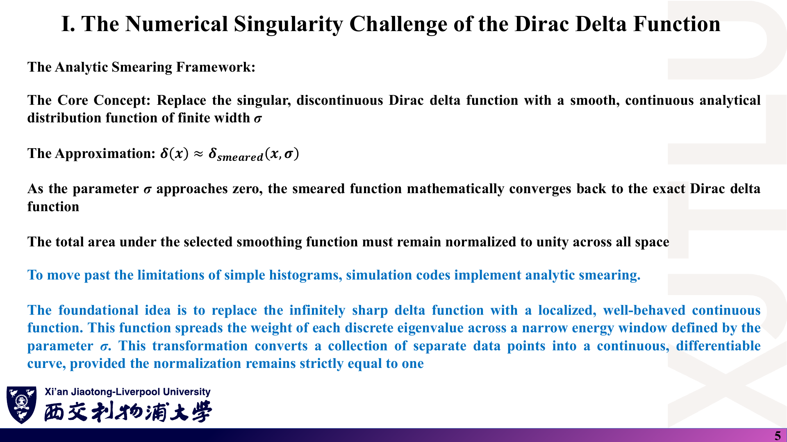

### 中文解释

核心思想：用宽度为 $\sigma$ 的光滑、连续解析函数代替奇异的 δ 函数，把每个离散本征值的权重摊到一个窄能量窗口里，从而把一堆离散点变成连续可微的曲线。两个要求：$\sigma\to0$ 时回到 δ；函数在全空间的总面积严格为 1。

### 原理深入

$$
g_\sigma(E)=\frac{\gamma}{N_k}\sum_{n,\mathbf k}\tilde\delta_\sigma\big(E-E_n(\mathbf k)\big),\qquad
\int_{-\infty}^{\infty}\tilde\delta_\sigma(x)\,dx=1.
$$

**为什么面积必须为 1**：这样 $\int g_\sigma\,dE=\gamma N_{\rm band}$ 与 $\sigma$ 无关，态数守恒。

**展宽 = 卷积〔补充〕**：上式正是 $g_\sigma=g*\tilde\delta_\sigma$，即“真实 DOS 与核函数的卷积”。所以展宽 DOS 不是更精确的 DOS，而是**真实 DOS 被一个已知窗口模糊后的版本**；比较不同计算时必须使用相同的核与宽度。

### Ref

- **原课件**：[Lecture Fifteen，PDF 第 5 页](../Lecture_Fifteen.pdf#page=5)。

## 3. Gaussian 与 Lorentz 的宽度参数到底是什么？〔p. 6〕

### 课件截图

### 中文解释

Gaussian 衰减极快，一个本征值只影响邻近能量，是标准电子结构计算的首选。Lorentz 拖着很长的尾巴，虽然不利于干净的基态积分，却能模拟真实的寿命展宽与散射过程，常用于拟合光电子能谱等实验数据。

### 原理深入

$$
\delta_G(x,\sigma)=\frac{1}{\sigma\sqrt\pi}e^{-x^2/\sigma^2},\qquad
\delta_L(x,\Gamma)=\frac1\pi\frac{\Gamma}{x^2+\Gamma^2}.
$$

**面积验证〔补充〕**：$\int e^{-x^2/\sigma^2}dx=\sigma\sqrt\pi$；$\int\frac{\Gamma\,dx}{x^2+\Gamma^2}=\big[\arctan(x/\Gamma)\big]_{-\infty}^{\infty}=\pi$。两者面积都为 1。

**宽度参数的含义（极易混淆）**：

| 量 | Gaussian（本页写法） | Lorentz（本页写法） |
|---|---|---|
| 峰值 | $1/(\sigma\sqrt\pi)\approx0.564/\sigma$ | $1/(\pi\Gamma)\approx0.318/\Gamma$ |
| 标准差 | $\sigma/\sqrt2$（**$\sigma$ 不是标准差**） | 不存在（二阶矩发散） |
| 半高半宽 HWHM | $\sigma\sqrt{\ln2}\approx0.833\sigma$ | $\Gamma$ |
| 全高全宽 FWHM | $2\sigma\sqrt{\ln2}\approx1.665\sigma$ | $2\Gamma$ |
| $\vert x\vert=3\times$宽度处的值 / 峰值 | $e^{-9}\approx1.2\times10^{-4}$ | $1/10$ |

- 不同软件对“$\sigma$”的定义不同（有的以标准差为参数，有的以本页的 $e^{-x^2/\sigma^2}$ 为参数），**同一个数字含义不同**。
- 同一个参数值（如 0.05 eV）下，Lorentz 尾巴远比 Gaussian 长，所以带隙中的“漏态”更严重、尖峰更钝。
- **示例代码的 Lorentz 写法不同**：代码中 Lorentz 的参数 $b$ 实际是 **FWHM**（HWHM $=b/2$），而不是本页的 $\Gamma$。见 [08 第 5 节](08_代码导读.md) 与 [07 第 9 节](07_讲义勘误与易错点.md)。

### Ref

- **原课件**：[Lecture Fifteen，PDF 第 6 页](../Lecture_Fifteen.pdf#page=6)；同式见 [Lecture Thirteen，PDF 第 20 页](../Lecture_Thirteen.pdf#page=20)、[Lecture Sixteen，PDF 第 5 页](../Lecture_Sixteen.pdf#page=5)。

## 4. 展宽参数 σ 应该怎样选？〔pp. 7–9〕

### 课件截图

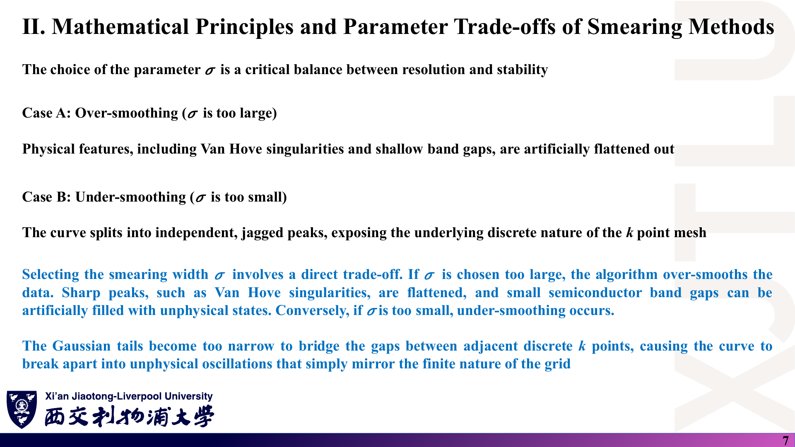

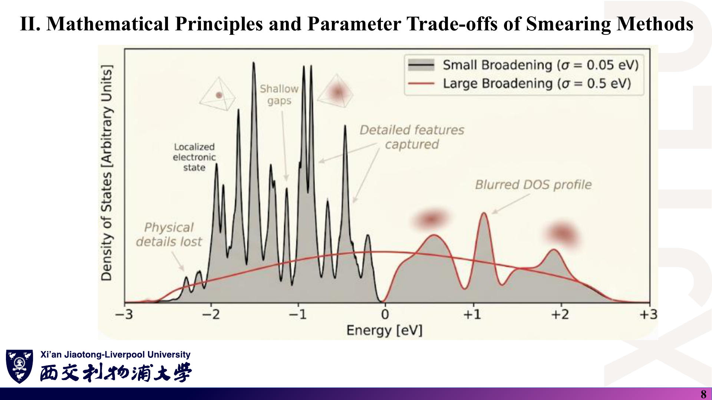

### 中文解释

$\sigma$ 在分辨率与稳定性之间权衡。过大（Case A）：Van Hove 尖峰被压平，浅带隙被人为填满。过小（Case B）：相邻 k 点之间的能量差无法被核函数“桥接”，曲线碎成孤立尖峰，暴露 k 网格的离散性。$\sigma$ 不能脱离网格间距单独决定：要提高能量分辨率（减小 $\sigma$），必须同比加密 k 网格。

### 原理深入

讲义给出的经验关系：

$$
\boxed{\sigma\ \ge\ \alpha\left|\frac{\partial E}{\partial k}\right|\Delta k}
$$

**含义〔补充〕**：相邻两个 k 点的本征值相差约 $|\partial E/\partial k|\,\Delta k$。若核宽度小于这个间隔，相邻本征值的核不重叠，DOS 出现“梳齿”。$\alpha$ 是 $O(1)$ 的安全系数（讲义未给定值）。

**用示例参数估算〔补充〕**：石墨烯 Dirac 锥附近 $\hbar v_F=\tfrac32|t|a_{cc}\approx\tfrac32\times2.7\times1.42\approx5.75$ eV·Å。500×500 网格中 $|\mathbf b_i|=4\pi/(\sqrt3a)\approx2.95$ Å$^{-1}$，$\Delta k\approx2.95/500\approx5.9\times10^{-3}$ Å$^{-1}$，于是 $|\partial E/\partial k|\Delta k\approx0.034$ eV。示例取 $\sigma=0.05$ eV，对应 $\alpha\approx1.5$，属于“刚好足够”的选择。若把网格减到 100×100 而 $\sigma$ 不变，就会出现锯齿。

**实际流程**：固定 $\sigma$ 加密网格直到曲线不变；再减小 $\sigma$ 并重复。报告中应写出最终的 $\sigma$、网格与核的定义。

第 8 页插图是示意图（其中带有四面体图标等装饰元素），用来说明趋势，不对应某个具体材料的计算。

### Ref

- **原课件**：[Lecture Fifteen，PDF 第 7–9 页](../Lecture_Fifteen.pdf#page=7)。
- **延伸**：[ES1：k 点采样与展宽](README.md#ref-es1)。

## 5. 金属为何需要 Methfessel–Paxton 展宽？〔pp. 10–12〕

### 课件截图

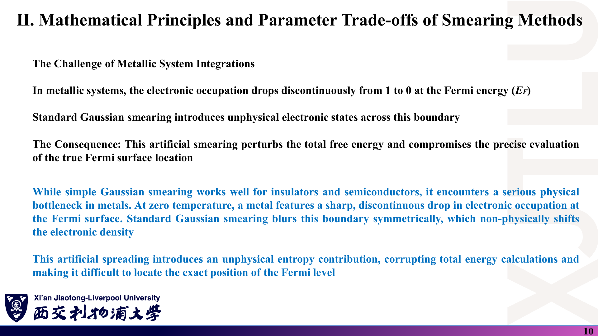

*第 11 页求和上限写作 “A”，与系数 $A_m$ 同名，应为展开阶数 $N$。第 12 页为示意图，标注有拼写错误（“inicis”）。*

### 中文解释

金属在 $T=0$ 时占据数在 $E_F$ 处从 1 突降到 0。Gaussian 展宽把这个台阶对称地抹开，引入非物理的“熵”贡献，使总能量依赖 $\sigma$，也让 Fermi 能级位置难以精确确定。Methfessel–Paxton（MP）方法用偶数阶 Hermite 多项式展开 δ 函数，引入局部的负值修正，抵消 $E_F$ 附近的低阶误差，使总能量对 $\sigma$ 很不敏感，中等网格也能得到精确的金属积分。

### 原理深入

$$
\delta_N(x,\sigma)=\frac{1}{\sigma\sqrt\pi}\,e^{-x^2/\sigma^2}\sum_{m=0}^{N}A_m\,H_{2m}\!\Big(\frac x\sigma\Big),\qquad
A_m=\frac{(-1)^m}{m!\,4^m}\quad(\text{在此前因子写法下}).
$$

- $N=0$ 时 $A_0=1$、$H_0=1$，回到普通 Gaussian。
- $N=1$：$H_2(y)=4y^2-2$，$\delta_1=\frac{1}{\sigma\sqrt\pi}e^{-y^2}\big(\tfrac32-y^2\big)$，$y=x/\sigma$。在 $|y|>\sqrt{3/2}$ 处为**负**——这就是讲义说的“补偿性负值”。
- 系数 $A_m$ 的取法使 $\delta_N$ 对多项式的积分精确到更高阶，所以用它算总能量等光滑量时误差随 $\sigma$ 下降得更快〔补充，见 MP89〕。
- **代价〔补充〕**：$\delta_N$ 可为负，所以 MP 展宽的 **DOS 曲线可能出现负值**、对应的占据数可能略大于 1 或小于 0。它适合“积分量”（总能量、力），**不适合画 DOS 图**，也不建议用于有带隙的体系。第 12 页“Zero Unphysical Entropy”属于夸张表述：MP 让熵项影响变小，而不是严格为零。

### Ref

- **原课件**：[Lecture Fifteen，PDF 第 10–12 页](../Lecture_Fifteen.pdf#page=11)。
- **原始论文**：[MP89](README.md#ref-mp89)。
- **勘误**：[07 第 7 节](07_讲义勘误与易错点.md)。

## 6. 四面体法的几何思想是什么？〔pp. 13–15〕

### 课件截图

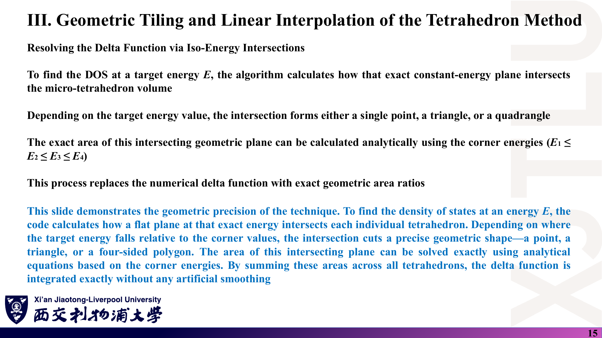

### 中文解释

四面体法不在计算后“抹平”离散点，而是从一开始就改变 BZ 的解析方式：把 BZ 切成许多小几何单元——3D 为四面体，2D 为三角形。在每个单元内用角点能量做线性插值，把能带近似为平面，因而 $\nabla_{\mathbf k}E$ 在单元内是常矢量。要求能量 $E$ 处的 DOS，就计算等能面与每个四面体的截面（可能是一个点、三角形或四边形），其面积可由排序后的角点能量 $E_1\le E_2\le E_3\le E_4$ 解析求出。把所有单元的贡献相加，δ 函数被“精确地”积分，无需任何人为展宽参数。

### 原理深入

在单元内 $E(\mathbf k)$ 线性，几何 DOS 公式（[01 第 4 节](01_态密度基础与VanHove奇点.md)）中的 $|\nabla_{\mathbf k}E|$ 为常数，于是

$$
g_{\rm cell}(E)=\frac{\gamma}{(2\pi)^d}\frac{\text{截面面积（2D 为截线长度）}}{|\nabla_{\mathbf k}E|}.
$$

**补充说明**：

- 原页说“每四个相邻网格点构成一个四面体”。更准确的做法（Blöchl 等）是：把每个网格平行六面体沿一条体对角线切成 **6 个**体积相等的四面体，通常选最短对角线以减小插值误差。2D 中每个平行四边形沿一条对角线切成 **2 个**三角形——示例代码正是如此（见 [08 第 6 节](08_代码导读.md)）。
- “精确”是指**对线性插值后的能带**精确；插值本身仍有误差，结果仍需随 k 网格收敛。
- 能带交叉处按“排序后第 $n$ 个本征值”插值会把交叉误当成避免交叉，可能带来小误差（石墨烯 Dirac 点即为一例，但影响仅限极小区域）〔补充〕。

### Ref

- **原课件**：[Lecture Fifteen，PDF 第 13–15 页](../Lecture_Fifteen.pdf#page=14)。
- **原始论文**：[BL94](README.md#ref-bl94)。

## 7. 单个四面体／三角形的 DOS 公式如何推导？〔p. 16〕

### 课件截图

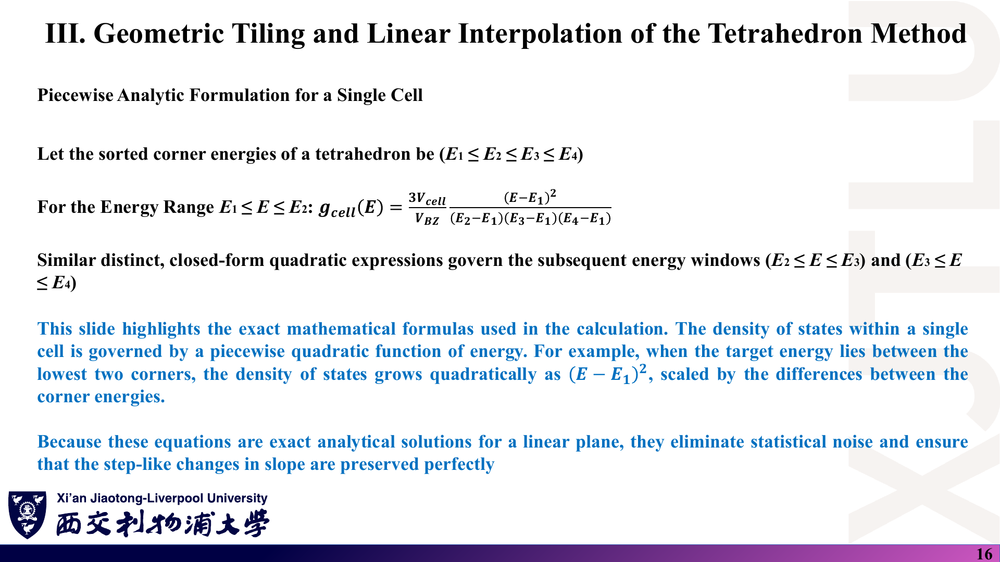

*讲义只给出 3D 第一区间公式，后两个区间只说“有类似的二次表达式”；2D 只说“切成三角形”，没有给公式。下面的补充可直接对照示例代码。*

### 中文解释

在 $E_1\le E\le E_2$ 区间，单个四面体的 DOS 随 $(E-E_1)^2$ 增长，系数由角点能量差决定。由于这些公式是线性平面的精确解析解，它们没有统计噪声，并能完整保留斜率的台阶式变化。

### 原理深入

**3D（讲义给出的第一区间）**：$V_T$ 为单个四面体体积，$V_{\rm BZ}$ 为 BZ 体积，$E_{ij}\equiv E_i-E_j$：

$$
g_T(E)=\frac{3V_T}{V_{\rm BZ}}\frac{(E-E_1)^2}{E_{21}E_{31}E_{41}},\qquad E_1\le E\le E_2.
$$

**3D 另外两段〔补充，见 BL94 附录；已检验在 $E_2$、$E_3$ 处与相邻段连续〕**：

$$
g_T(E)=\frac{V_T}{V_{\rm BZ}}\frac{1}{E_{31}E_{41}}\Big[3E_{21}+6(E-E_2)-\frac{3(E_{31}+E_{42})(E-E_2)^2}{E_{32}E_{42}}\Big],\quad E_2\le E\le E_3,
$$

$$
g_T(E)=\frac{3V_T}{V_{\rm BZ}}\frac{(E_4-E)^2}{E_{41}E_{42}E_{43}},\quad E_3\le E\le E_4 .
$$

**2D 三角形〔补充推导〕**：设三角形面积 $A_T$，角点能量 $E_1\le E_2\le E_3$。在 $E_1\le E\le E_2$ 时，能量低于 $E$ 的部分是一个与原三角形共享顶点 1 的小三角形，两条边分别按 $(E-E_1)/E_{21}$ 和 $(E-E_1)/E_{31}$ 缩放：

$$
A_{<}(E)=A_T\frac{(E-E_1)^2}{E_{21}E_{31}}
\;\Rightarrow\;
\frac{dA_<}{dE}=2A_T\frac{E-E_1}{E_{21}E_{31}}.
$$

同理，$E_2\le E\le E_3$ 时能量**高于** $E$ 的部分是共享顶点 3 的小三角形，

$$
A_{>}(E)=A_T\frac{(E_3-E)^2}{E_{31}E_{32}}
\;\Rightarrow\;
\frac{dA_<}{dE}=-\frac{dA_>}{dE}=2A_T\frac{E_3-E}{E_{31}E_{32}}.
$$

除以 BZ 面积得到“每能带 1 个态”归一化的贡献：

$$
\boxed{g_T(E)=\frac{2A_T}{A_{\rm BZ}}\times
\begin{cases}
\dfrac{E-E_1}{E_{21}E_{31}}, & E_1\le E\le E_2\\[2ex]
\dfrac{E_3-E}{E_{31}E_{32}}, & E_2\le E\le E_3
\end{cases}}
$$

两式在 $E=E_2$ 处都等于 $1/E_{31}$，曲线连续；每个三角形贡献的面积 $\int g_T\,dE=A_T/A_{\rm BZ}$。对 $N_1\times N_2$ 网格切成 $2N_k$ 个三角形，$A_T/A_{\rm BZ}=1/(2N_k)$，于是前因子 $2A_T/A_{\rm BZ}=1/N_k$。若再乘自旋因子 2，就变成示例代码中的 `factor = 2/N_k`。

**特殊情形**：$E_{21}=0$ 或 $E_{32}=0$ 时分母为零，但对应区间长度也为零，可直接跳过（示例代码用阈值 $10^{-8}$ 判断）；三个角点能量相同（平带）时贡献是一个 δ 峰，线性四面体法无法表示，需特殊处理。

### Ref

- **原课件**：[Lecture Fifteen，PDF 第 16 页](../Lecture_Fifteen.pdf#page=16)。
- **原始论文**：[BL94](README.md#ref-bl94)。
- **代码对照**：[08 第 6 节：2D 三角形法](08_代码导读.md)。

## 8. 四面体法的优点、在金属中的局限与 Blöchl 修正〔pp. 17–20〕

### 课件截图

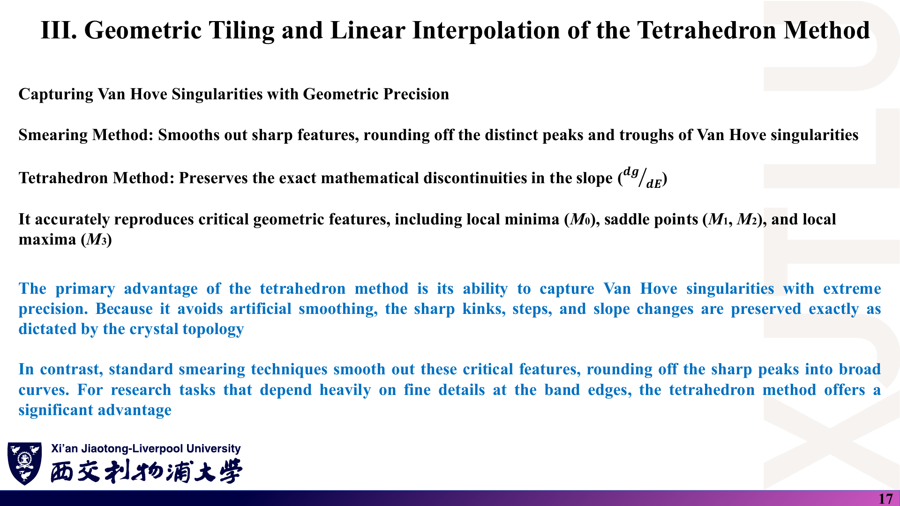

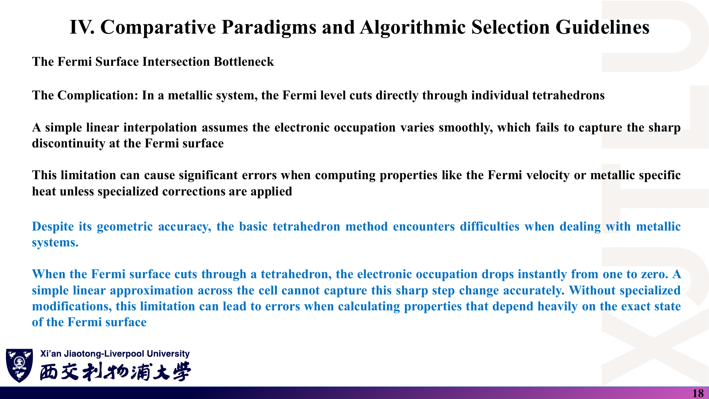

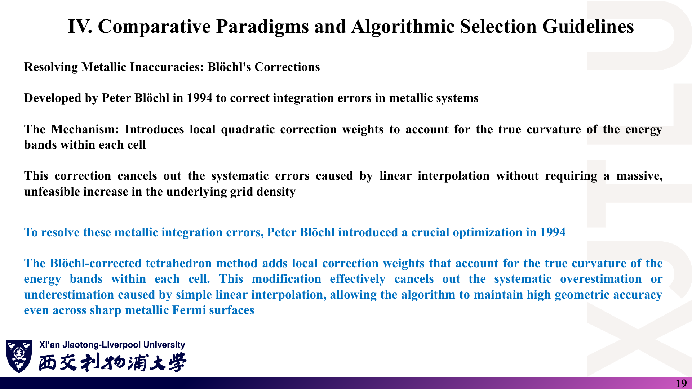

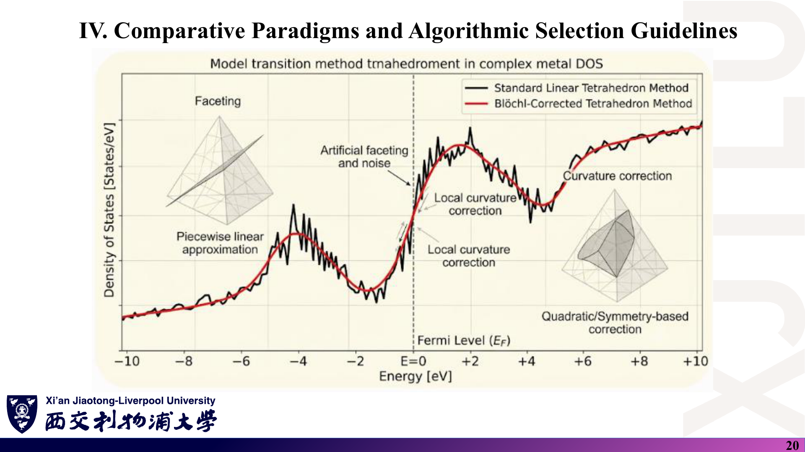

*第 20 页标题含拼写错误（“tmahedroment”），曲线为示意图。*

### 中文解释

展宽会把 Van Hove 尖峰圆滑掉；四面体法则保留斜率 $dg/dE$ 的精确不连续性，准确再现 $M_0$、$M_1$、$M_2$、$M_3$ 等临界点特征，适合关心带边细节的研究。但在金属中，Fermi 面直接切过四面体，线性插值无法捕捉占据数的突变，计算 Fermi 速度、电子比热等量会产生明显误差。Blöchl（1994）提出的修正在每个单元引入局部二次修正权重，考虑能带的真实曲率，抵消线性插值的系统误差，而不需要大幅加密网格。

### 原理深入

- 线性插值能带总是在真实能带的“弦”上：对上凸/下凸能带系统地高估或低估占据体积，误差约 $O(\Delta k^2)$。Blöchl 修正利用相邻四面体的信息估计曲率，把**积分权重**（例如求电子数、总能量时的占据权重）的主导误差项去掉〔补充，见 BL94〕。
- Blöchl 修正主要针对**占据积分**（总能量、电荷密度），而不是专门用于画 DOS 曲线；许多程序画 DOS 时仍使用未修正的线性四面体〔补充〕。
- 第 20 页把线性四面体画成充满噪声的曲线，这是示意性的夸张：线性四面体本身不产生统计噪声，网格偏粗时出现的是“折线化”（faceting）而不是随机噪声。

### Ref

- **原课件**：[Lecture Fifteen，PDF 第 17–20 页](../Lecture_Fifteen.pdf#page=17)。
- **原始论文**：[BL94](README.md#ref-bl94)。

## 9. 两类方法如何比较与选择？〔pp. 21–22〕

### 课件截图

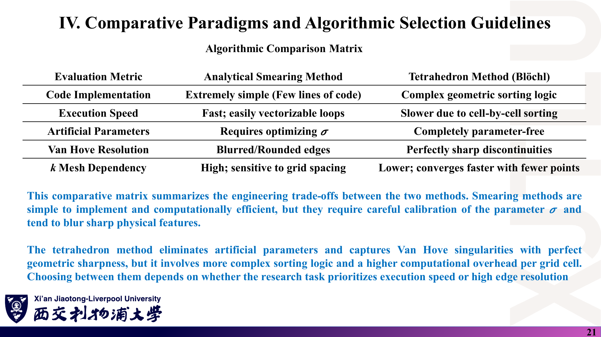

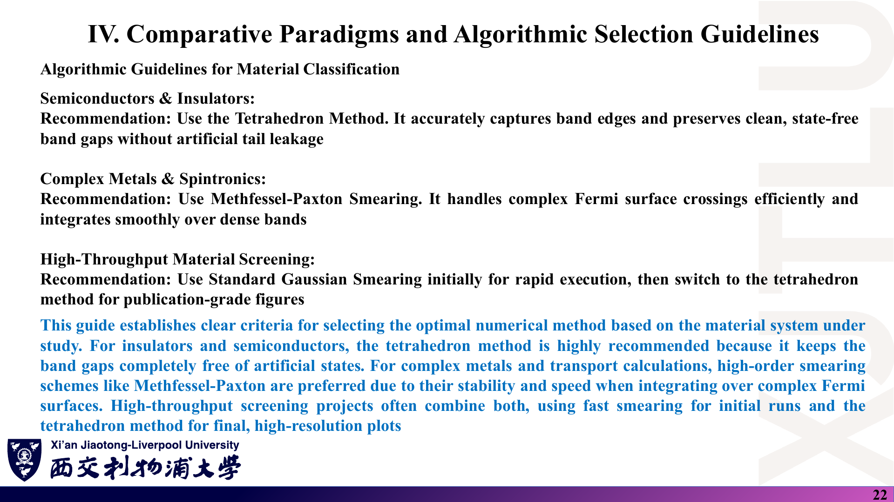

### 中文解释

| 指标 | 解析展宽 | 四面体法（Blöchl） |
|---|---|---|
| 实现难度 | 极简单，几行代码 | 需要几何排序逻辑 |
| 速度 | 快，易向量化 | 逐单元排序，较慢 |
| 人为参数 | 需优化 $\sigma$ | 无展宽参数 |
| Van Hove 分辨 | 边缘模糊、圆滑 | 不连续性清晰 |
| k 网格依赖 | 高，对网格间距敏感 | 较低，较少点即可收敛 |

讲义的选择建议：**半导体/绝缘体**用四面体法（带边准确、带隙干净无漏态）；**复杂金属与自旋电子学**用 Methfessel–Paxton 展宽（高效处理复杂 Fermi 面）；**高通量筛选**先用 Gaussian 快速计算，出版级图再改用四面体法。

### 原理深入

- “无参数”需要限定：四面体法没有**展宽**参数，但结果仍依赖 k 网格密度，需要做收敛测试〔补充〕。
- 对石墨烯（零带隙半金属）三种方法都可用：四面体法能给出 $E=0$ 处精确为零的 DOS 和最尖锐的 M 点对数峰；Gaussian/Lorentz 在 $E=0$ 处会被“抬高”一点（核的尾巴），峰高受 $\sigma$ 限制。第 16 讲的结果图正好体现了这一点（见 [04 第 3 节](04_石墨烯DOS编程与课程作业.md)）。
- 讨论“展宽参数的影响”（作业要求之一）时，可以比较不同 $\sigma$ 下峰高、峰宽、$E=0$ 处的残余 DOS，以及带隙体系中隙内“漏态”的多少〔补充建议〕。

### Ref

- **原课件**：[Lecture Fifteen，PDF 第 21–22 页](../Lecture_Fifteen.pdf#page=21)。
- **延伸**：[MP89](README.md#ref-mp89)、[BL94](README.md#ref-bl94)、[ES1](README.md#ref-es1)。

本讲一句话：**展宽 = 用面积为 1 的核与真实 DOS 卷积（简单但引入 σ）；四面体 = 对线性插值的能带做精确几何积分（无 σ、保留 Van Hove 特征，但实现更复杂）。**
