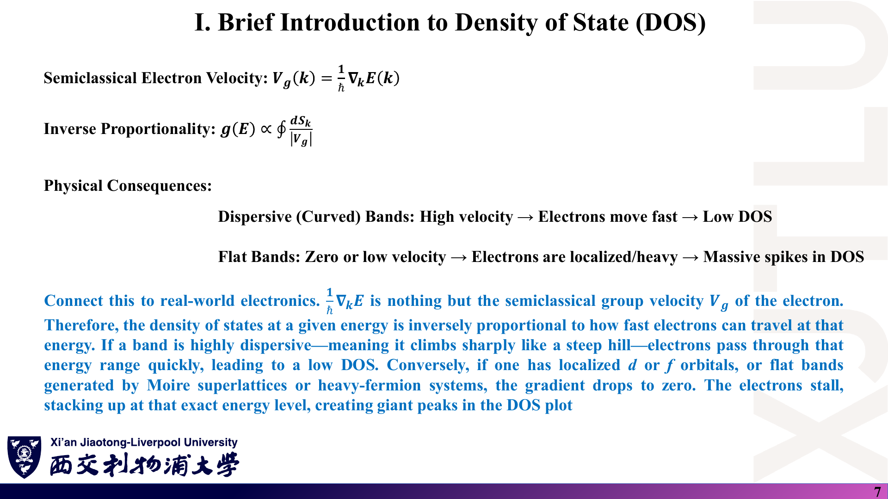
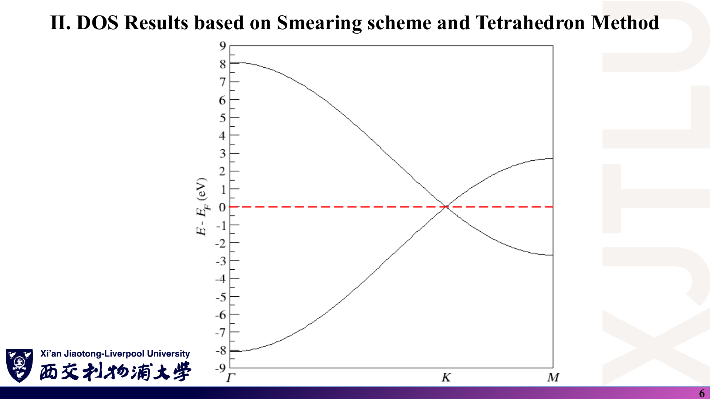
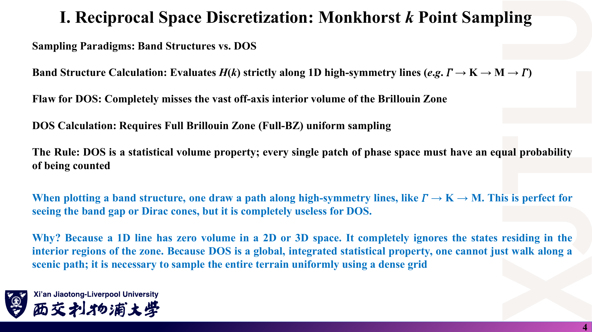
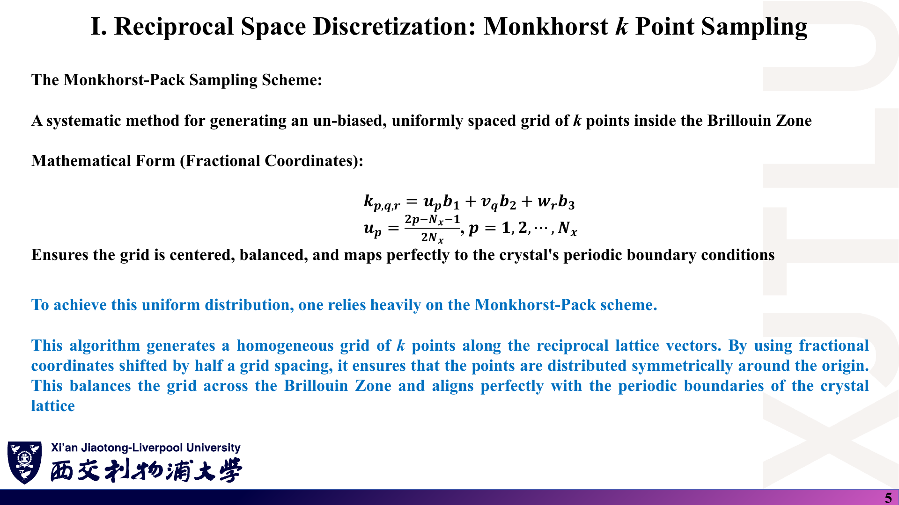
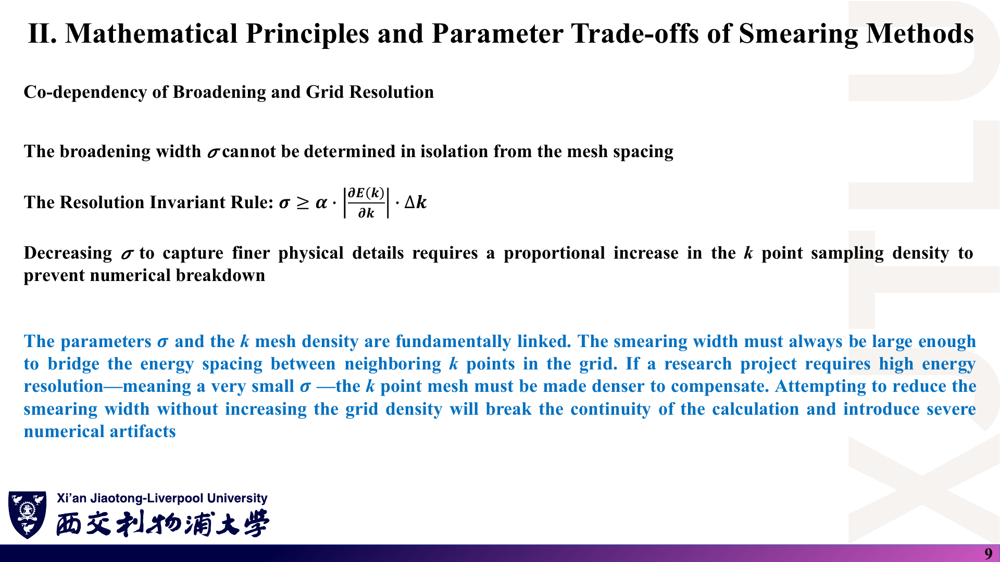
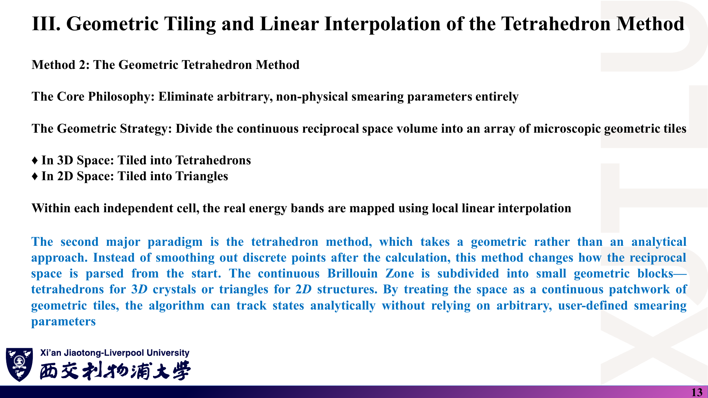

# 06 · 图文复习题与参考答案

[返回目录](README.md)

> 15 题均为根据讲义自编的练习，**不是课件原题或官方作业**，也不是 CW1 的解答。每题依次列出“课件截图 → 中文解释（题目）→ 原理深入（解析）→ Ref”。建议先遮住解析独立作答。截图保留原稿，正确公式以下方解析为准。

## 1. DOS 的定义与积分检查

### 课件截图

### 中文解释

**题目**：写出 DOS 的 δ 函数定义。若一个体积为 $V$ 的体系共有 $N_s$ 个单电子态，$\int_{-\infty}^{\infty}g(E)\,dE$ 等于多少？为什么用来近似 δ 的展宽函数必须面积为 1？

### 原理深入

$g(E)=\frac1V\sum_{n,\mathbf k}\delta[E-E_n(\mathbf k)]$。由 $\int\delta(x)dx=1$，每个态贡献 1，所以 $\int g\,dE=N_s/V$。若展宽核面积不为 1，每个态被计为非整数个，积分不再等于态数，载流子浓度等结果会系统偏差。

### Ref

- [Lecture Thirteen，PDF 第 4 页](../Lecture_Thirteen.pdf#page=4)；[01 第 2 节](01_态密度基础与VanHove奇点.md)。

## 2. 石墨烯 DOS 的积分是 2 还是 4？

### 课件截图

### 中文解释

**题目**：Lecture Thirteen 第 5 页说不要忘记 $\gamma=2$，Lecture Fourteen 第 13 页说 2 原子、每原子 1 轨道的石墨烯模型 DOS 积分必须为 2.0。两者矛盾吗？如果你的程序在 $[-10,10]$ eV 内积分得到 4.0，说明什么？

### 原理深入

不矛盾，是两种约定：不含自旋时每个轨道 1 个态，积分 $=N_{\rm atom}N_{\rm orb}=2$；含自旋 $\gamma=2$ 时积分为 4。$[-10,10]$ eV 已覆盖 $\pm8.1$ eV 的全部能带，得到 4.0 说明程序**包含了自旋因子**，本身不是 bug，但报告必须写明。真正的 bug 是同一程序里不同方法约定不一致（示例代码即如此，见第 14 题）。

### Ref

- [Lecture Thirteen，PDF 第 5 页](../Lecture_Thirteen.pdf#page=5)；[Lecture Fourteen，PDF 第 13 页](../Lecture_Fourteen.pdf#page=13)；[07 第 1 节](07_讲义勘误与易错点.md)。

## 3. 为什么平带对应 DOS 尖峰？

### 课件截图

### 中文解释

**题目**：用几何公式解释“色散强的能带 DOS 低、平带 DOS 高”。平带 DOS 大是否意味着电导率一定大？

### 原理深入

$g(E)=\frac{\gamma}{(2\pi)^3}\oint\frac{dS_k}{|\nabla_{\mathbf k}E|}$：分母是群速度的 $\hbar$ 倍。能带越平，$|\nabla E|$ 越小，相同 $dE$ 对应的 k 壳层越厚，态越多。电导率还依赖速度（大致 $\propto g(E_F)v_F^2\tau$），平带速度小，DOS 大不保证导电好；DOS 只是“座位数”。

### Ref

- [Lecture Thirteen，PDF 第 6–7 页](../Lecture_Thirteen.pdf#page=6)；[01 第 4 节](01_态密度基础与VanHove奇点.md)。

## 4. 推导 3D 自由电子 DOS

### 课件截图

### 中文解释

**题目**：从 $E=\hbar^2k^2/2m^*$ 出发推导 $g_{3D}(E)$（含自旋）。指出原页 $\Omega_k$ 表达式的错误。

### 原理深入

$N/V=2\cdot\frac{4\pi k^3/3}{(2\pi)^3}=\frac{k^3}{3\pi^2}=\frac{1}{3\pi^2}\big(\frac{2m^*E}{\hbar^2}\big)^{3/2}$，求导得 $g_{3D}=\frac{1}{2\pi^2}\big(\frac{2m^*}{\hbar^2}\big)^{3/2}\sqrt E$。原页 $\Omega_k=\frac43\pi\big(\frac{2m^*E}{\hbar^2}\big)^3$ 指数应为 $3/2$：若指数是 3，$\Omega_k\propto E^3$，求导得 $E^2$，与最终 $\sqrt E$ 矛盾。

### Ref

- [Lecture Thirteen，PDF 第 10 页](../Lecture_Thirteen.pdf#page=10)；[01 第 6 节](01_态密度基础与VanHove奇点.md)；[07 第 3 节](07_讲义勘误与易错点.md)。

## 5. 2D 常数 DOS 与石墨烯的 V 形 DOS

### 课件截图

### 中文解释

**题目**：讲义说 2D DOS 在每个子带内为常数。石墨烯也是 2D 材料，为什么它在 $E=0$ 附近 DOS 是 V 形而非常数？

### 原理深入

常数来自**抛物色散**：等能圆面积 $\pi k^2\propto E$，求导为常数。石墨烯 Dirac 点附近色散**线性** $E=\hbar v_F q$，面积 $\pi q^2\propto E^2$，求导 $\propto|E|$，所以 V 形，$g(0)=0$。DOS 形状由维度与色散共同决定。

### Ref

- [Lecture Thirteen，PDF 第 11 页](../Lecture_Thirteen.pdf#page=11)；[Lecture Sixteen，PDF 第 5 页](../Lecture_Sixteen.pdf#page=5)；[01 第 6 节](01_态密度基础与VanHove奇点.md)。

## 6. 石墨烯 ±2.7 eV 尖峰从何而来？

### 课件截图

### 中文解释

**题目**：结合能带图，说明石墨烯 DOS 在 $\pm2.7$ eV 处尖峰对应 BZ 中哪个点、哪类临界点，以及该奇点在 2D 中的函数形式。为什么能带图上 M 点看起来只是“端点”？

### 原理深入

对应 M 点，能量 $\pm|t|=\pm2.7$ eV。M 点是鞍点（$M_1$ 型：沿 Γ–M 方向与沿 M–K 方向曲率相反），2D 鞍点给出对数发散 $g\propto-\ln|E\mp|t||$。能带图只画一维路径，在 Γ–K–M 路径的 M 端看到的是沿该方向的极值；垂直方向的反向曲率在路径图上看不到，必须看全 BZ。

### Ref

- [Lecture Thirteen，PDF 第 8 页](../Lecture_Thirteen.pdf#page=8)；[Lecture Sixteen，PDF 第 5–6 页](../Lecture_Sixteen.pdf#page=6)；[04 第 4 节](04_石墨烯DOS编程与课程作业.md)。

## 7. Fermi–Dirac 分布的极限

### 课件截图

### 中文解释

**题目**：求 $f(E,T)$ 在 $E\to-\infty$、$E=\mu$、$E\to+\infty$ 的值，并判断原图 $T_1=0$ K 的蓝色台阶是否正确。$T=300$ K 时，$E-\mu=0.1$ eV 处 $f$ 约为多少？

### 原理深入

$f(-\infty)=1$，$f(\mu)=1/2$，$f(+\infty)=0$。$T=0$ 时应在 $E<\mu$ 取 1、$E>\mu$ 取 0；原图画成低能为 0、高能为 1，方向反了（那是 $1-f$）。$k_BT\approx0.02585$ eV，$0.1/0.02585\approx3.87$，$f\approx1/(e^{3.87}+1)\approx1/48.9\approx0.020$。

### Ref

- [Lecture Thirteen，PDF 第 15–16 页](../Lecture_Thirteen.pdf#page=16)；[07 第 4 节](07_讲义勘误与易错点.md)。

## 8. 为什么不能用能带路径上的 k 点算 DOS？

### 课件截图

### 中文解释

**题目**：某同学把能带图用的 300 个 Γ–K–M–Γ 路径点直接做直方图得到“DOS”。指出问题，并说明正确采样方式和每个 k 点的权重。

### 原理深入

一维路径在 2D BZ 中面积为零，样本严重偏向高对称线，统计结果不代表整个 BZ，也不会随加密收敛到真实 DOS。应使用全 BZ 均匀网格（如 MP），每点权重 $1/N_k$；若用对称性约化到 IBZ，则每点权重按其等价点数加权。

### Ref

- [Lecture Fourteen，PDF 第 4 页](../Lecture_Fourteen.pdf#page=4)；[02 第 2 节](02_k点采样与TB-DOS四步流程.md)。

## 9. 写出 MP 网格

### 课件截图

### 中文解释

**题目**：用 $u_p=\frac{2p-N-1}{2N}$ 写出 $N=3$ 与 $N=4$ 的分数坐标。哪个包含 Γ？示例代码的 $(i-1)/N$ 网格在 $N=4$ 时是哪些点？

### 原理深入

$N=3$：$-\tfrac13,0,\tfrac13$（含 Γ）。$N=4$：$-\tfrac38,-\tfrac18,\tfrac18,\tfrac38$（不含 Γ）。示例代码 $N=4$：$0,\tfrac14,\tfrac12,\tfrac34$，含 Γ，相当于 Γ 为起点的网格，与 $N=4$ MP 网格相差半格平移。两者都是等权全 BZ 采样，但取到的具体点不同。

### Ref

- [Lecture Fourteen，PDF 第 5 页](../Lecture_Fourteen.pdf#page=5)；[02 第 3 节](02_k点采样与TB-DOS四步流程.md)；[08 第 3 节](08_代码导读.md)。

## 10. 分箱指标与归一化计算

### 课件截图

### 中文解释

**题目**：能量窗口 $[-5,5]$ eV，$\Delta E=0.01$ eV。(a) 求 $N_E$；(b) 本征值 $E=-2.7$ eV 落入第几个 bin？(c) 500×500 网格中某 bin 计数 300，DOS 为多少（每原胞、不含自旋）？(d) $E=5.0$ eV 会出什么问题？

### 原理深入

(a) $N_E=(5-(-5))/0.01=1000$（原页把分子写反成负数）。(b) $\lfloor2.3/0.01\rfloor+1=231$（浮点运算中 $2.3/0.01$ 可能得到 229.999…，边界附近要注意舍入）。(c) $300/(250000\times0.01)=0.12$ states/eV。(d) Index $=1001$ 越界；应对 $E\ge E_{\max}$ 或 $E<E_{\min}$ 的值单独判断。

### Ref

- [Lecture Fourteen，PDF 第 11–13 页](../Lecture_Fourteen.pdf#page=11)；[02 第 5 节](02_k点采样与TB-DOS四步流程.md)；[07 第 5 节](07_讲义勘误与易错点.md)。

## 11. 展宽参数的换算

### 课件截图

### 中文解释

**题目**：按讲义的写法取 Gaussian $\sigma=0.05$ eV。求其标准差、FWHM 和峰高（单个态）。若要 Lorentz 与它 FWHM 相同，$\Gamma$ 取多少？示例代码中 Lorentz 的输入 0.05 对应的 $\Gamma$ 是多少？

### 原理深入

标准差 $\sigma/\sqrt2\approx0.0354$ eV；FWHM $=2\sqrt{\ln2}\sigma\approx0.0833$ eV；峰高 $1/(\sigma\sqrt\pi)\approx11.28$ eV$^{-1}$。同 FWHM 的 Lorentz：$\Gamma=0.0833/2\approx0.0416$ eV。示例代码的 Lorentz 输入 $b=0.05$ 是 FWHM，对应 $\Gamma=0.025$ eV。

### Ref

- [Lecture Fifteen，PDF 第 6 页](../Lecture_Fifteen.pdf#page=6)；[03 第 3 节](03_展宽方法与四面体法.md)；[08 第 5 节](08_代码导读.md)。

## 12. 由网格估计展宽下限

### 课件截图

### 中文解释

**题目**：石墨烯 Dirac 锥 $\hbar v_F\approx5.75$ eV·Å，倒格矢长度约 2.95 Å$^{-1}$。用 100×100 网格时，相邻 k 点能量差约多少？取 $\alpha=1.5$，$\sigma$ 至少多大？若坚持 $\sigma=0.05$ eV，网格至少要多密？

### 原理深入

$\Delta k\approx2.95/100=0.0295$ Å$^{-1}$，能量差 $\approx5.75\times0.0295\approx0.17$ eV；$\sigma\gtrsim1.5\times0.17\approx0.25$ eV。若 $\sigma=0.05$ eV，需 $\Delta k\le0.05/(1.5\times5.75)\approx0.0058$ Å$^{-1}$，即每方向约 $2.95/0.0058\approx510$ 个点——与示例的 500×500 相当。（$\alpha$ 为假设值，讲义未给定。）

### Ref

- [Lecture Fifteen，PDF 第 7–9 页](../Lecture_Fifteen.pdf#page=9)；[03 第 4 节](03_展宽方法与四面体法.md)。

## 13. 手算一个三角形的 DOS 贡献

### 课件截图

### 中文解释

**题目**：某三角形面积 $A_T$，三个角点能量为 0、1、3 eV。按“每能带 1 个态”归一化，求 $E=0.5$ eV 与 $E=2.5$ eV 处该三角形的 DOS 贡献（用 $A_T/A_{\rm BZ}$ 表示），并验证它对能量积分等于 $A_T/A_{\rm BZ}$。

### 原理深入

$E_1=0,E_2=1,E_3=3$。$E=0.5$：$\frac{2A_T}{A_{\rm BZ}}\cdot\frac{0.5}{1\cdot3}=\frac{A_T}{3A_{\rm BZ}}$。$E=2.5$：$\frac{2A_T}{A_{\rm BZ}}\cdot\frac{0.5}{3\cdot2}=\frac{A_T}{6A_{\rm BZ}}$。积分：$\int_0^1\frac{E}{3}dE=\frac16$，$\int_1^3\frac{3-E}{6}dE=\frac13$，和为 $\frac12$，乘 $\frac{2A_T}{A_{\rm BZ}}$ 得 $\frac{A_T}{A_{\rm BZ}}$ ✓。在 $E_2=1$ 处两段都等于 $\frac{2A_T}{A_{\rm BZ}}\cdot\frac13$，连续。

### Ref

- [Lecture Fifteen，PDF 第 13–16 页](../Lecture_Fifteen.pdf#page=13)；[03 第 7 节](03_展宽方法与四面体法.md)。

## 14. 读图：三种方法的纵轴为何差两倍？

### 课件截图

### 中文解释

**题目**：Lecture Sixteen 第 5 页三张图峰高约为 0.72（Gaussian）、0.34（Lorentz）、0.95（四面体）。$\pm5$ eV 处 Gaussian 与四面体约 0.26，Lorentz 约 0.13。仅凭“Lorentz 尾巴更长”能解释远离峰的 ±5 eV 处也差两倍吗？应如何检查？

### 原理深入

不能。在远离尖峰、DOS 平缓的区域，任何面积为 1 的窄核都应给出几乎相同的值；差两倍说明**归一化约定不同**。检查方法：对各方法的 DOS 在同一窗口积分并比较（本笔记实测 Gaussian 2.579、四面体 2.573、Lorentz 1.285），或读源码中的前因子（Gaussian、三角形法含因子 2，Lorentz 不含）。峰高的剩余差别才来自核函数形状与宽度。

### Ref

- [Lecture Sixteen，PDF 第 5 页](../Lecture_Sixteen.pdf#page=5)；[04 第 3 节](04_石墨烯DOS编程与课程作业.md)；[08 第 8 节](08_代码导读.md)。

## 15. 作业要求以哪份为准？

### 课件截图

### 中文解释

**题目**：列出第 16 讲幻灯片作业说明与 CW1 正式文件的三处主要差异，并说明你会怎样安排自己的作业范围。

### 原理深入

(1) 语言：幻灯片允许 Matlab/Python/Julia 等，CW1 只允许 Fortran、C、C++；(2) 范围：幻灯片只要求本征石墨烯 DOS，CW1 要求本征与带隙两种情形的能带和三种方法 DOS；(3) 报告：CW1 要求写出紧束缚哈密顿量、比较两种情形、讨论真实材料中如何实现带隙，并给出 5×20% 评分。合理安排：按更严格的 CW1 完成，代码自己原创；有疑问尽早向教师确认。

### Ref

- [Lecture Sixteen，PDF 第 7–8 页](../Lecture_Sixteen.pdf#page=7)；[04 第 5 节](04_石墨烯DOS编程与课程作业.md)。
