# 07 · 图文勘误、符号约定与易错点

[返回目录](README.md)

> 本文是**学习核对记录，不是教师发布的官方勘误**。截图（原图证据）忠实保留原稿；中文解释说明问题，原理深入给出正确写法和可复核的核验理由。区分明确的笔误、没有说清的约定，以及不应泛化的表述。页码均为包含封面的 PDF 物理页码。只收录经推导或数值检验确认的条目。

## 1. 自旋因子 γ 与 DOS 归一化约定不一致

### 课件截图

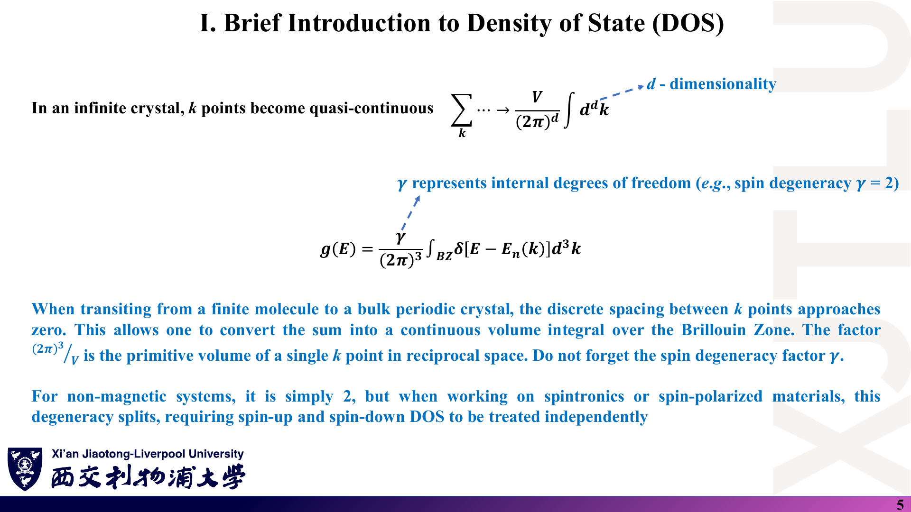

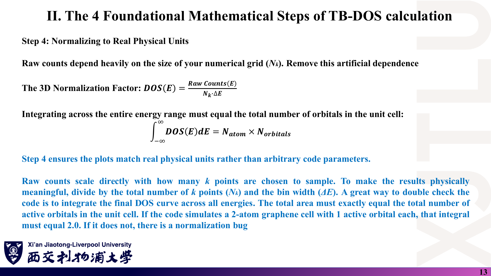

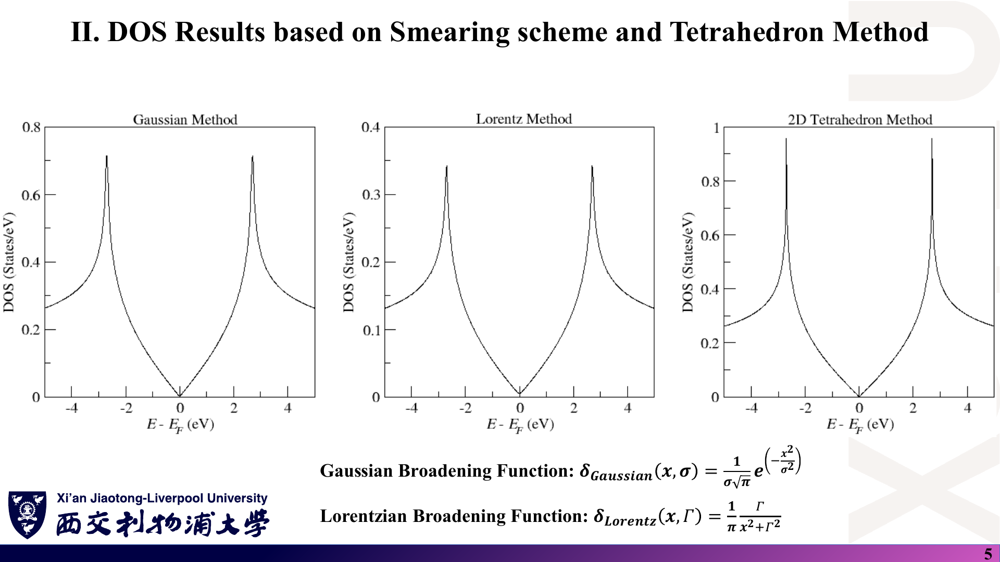

### 中文解释

**问题**：三处使用了不同的自旋约定且未说明：Lecture Thirteen 第 5 页要求乘 $\gamma=2$；Lecture Fourteen 第 13 页按“每轨道 1 个态”说石墨烯积分必须为 2.0；Lecture Sixteen 第 5 页的三张图来自同一程序，但 Gaussian 与四面体含因子 2、Lorentz 不含，导致纵轴差约两倍。

### 原理深入

**正确写法**：

$$
\int_{-\infty}^{\infty}g_{\rm cell}(E)\,dE=\gamma\,N_{\rm atom}N_{\rm orb}
=\begin{cases}2,&\gamma=1\ (\text{不含自旋})\\4,&\gamma=2\ (\text{含自旋})\end{cases}\quad(\text{石墨烯 }p_z\text{ 模型}).
$$

同一份报告、同一程序中三种方法必须用同一 $\gamma$，并在图注中写明。

**核验理由**：

- 对 `Codes/` 中三个数据文件在 $[-5,5]$ eV 做梯形积分：Gaussian 2.579、四面体 2.573、Lorentz 1.285。
- 独立计算 $E_\pm=\pm2.7|f(\mathbf k)|$ 在 1000×1000 网格上的分布，得到每条能带在 $|E|<5$ eV 内的占比约 0.645，故 $\gamma=1$ 时期望 $\approx1.29$，$\gamma=2$ 时 $\approx2.58$。
- 源码前因子（[08 第 5–7 节](08_代码导读.md)）：Lorentz 化简后每态 $1/N_k$，Gaussian 与三角形法每态 $2/N_k$。
- 另外，$[-5,5]$ eV 窗口只含约 64.5% 的态（能带延伸到 ±8.1 eV），用它不能验证“积分=2.0”。

### Ref

- **原课件**：[Lecture Thirteen，PDF 第 5 页](../Lecture_Thirteen.pdf#page=5)、[Lecture Fourteen，PDF 第 13 页](../Lecture_Fourteen.pdf#page=13)、[Lecture Sixteen，PDF 第 5 页](../Lecture_Sixteen.pdf#page=5)。
- **配套**：[01 第 3 节](01_态密度基础与VanHove奇点.md)、[08 第 8 节](08_代码导读.md)、[复习题第 2、14 题](06_复习题与参考答案.md)。

## 2. δ 函数的“离散情形”与漏写的能带求和

### 课件截图

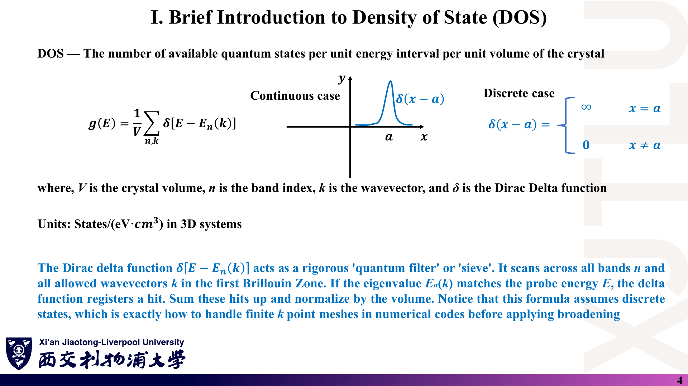

### 中文解释

**问题**：(1) 第 4 页把“$x=a$ 为 ∞、其余为 0”标为 Discrete case，但离散指标上的 Kronecker δ 取值为 1/0；这里描述的仍是 Dirac δ 的直观图像。(2) 第 5 页 $g(E)=\frac{\gamma}{(2\pi)^3}\int_{BZ}\delta[E-E_n(\mathbf k)]d^3k$ 漏写了 $\sum_n$。

### 原理深入

**正确写法**：Dirac δ 由 $\int\delta(x-a)\phi(x)dx=\phi(a)$ 定义；“∞/0”只是示意，且必须附带“面积为 1”。离散的 $\delta_{ij}$ 为 1（$i=j$）或 0。BZ 积分形式应为

$$
g(E)=\frac{\gamma}{(2\pi)^3}\sum_n\int_{\rm BZ}\delta[E-E_n(\mathbf k)]\,d^3k .
$$

**核验理由**：若 δ 仅为“∞/0”而不规定面积，$\int g\,dE$ 无法给出态数；第 4 页公式本身含 $\sum_{n,\mathbf k}$，第 5 页由它变换而来，$\sum_n$ 不应消失。

### Ref

- **原课件**：[Lecture Thirteen，PDF 第 4–5 页](../Lecture_Thirteen.pdf#page=4)。
- **配套**：[01 第 2–3 节](01_态密度基础与VanHove奇点.md)。

## 3. 维度 DOS 推导中的笔误

### 课件截图

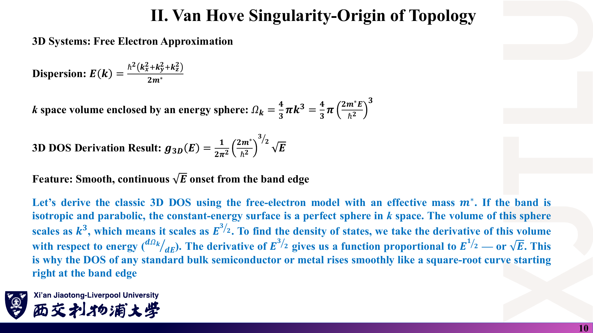

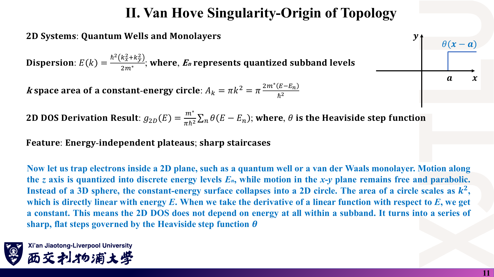

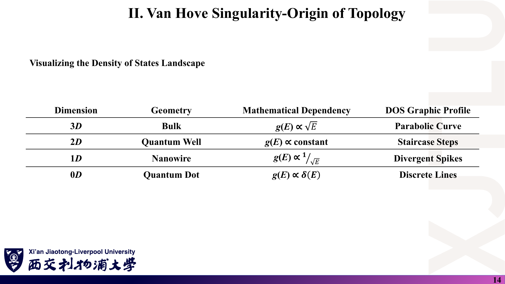

### 中文解释

**问题**：

1. 第 10 页 $\Omega_k=\frac43\pi\big(\frac{2m^*E}{\hbar^2}\big)^3$，指数应为 $3/2$。
2. 第 11 页色散写成 $E=\hbar^2(k_x^2+k_y^2)/2m^*$，下一行却用 $E-E_n$；应写 $E=E_n+\hbar^2(k_x^2+k_y^2)/2m^*$。
3. 第 12 页 1D 结果省略 $\theta(E-E_{n,m})$；第 14 页表格中 $\sqrt E$、$1/\sqrt E$、$\delta(E)$ 省略了参考能量。
4. 3D/2D/1D 公式都已含自旋因子 2，但页面没有写出 $\gamma$，与第 5 页“不要忘记 $\gamma$”的提醒不对应。

### 原理深入

**正确写法**：

$$
\Omega_k=\tfrac43\pi\Big(\frac{2m^*E}{\hbar^2}\Big)^{3/2},\qquad
g_{2D}=\frac{m^*}{\pi\hbar^2}\sum_n\theta(E-E_n),\qquad
g_{1D}=\frac1\pi\Big(\frac{2m^*}{\hbar^2}\Big)^{1/2}\sum_{n,m}\frac{\theta(E-E_{n,m})}{\sqrt{E-E_{n,m}}}\quad(\gamma=2).
$$

表格应写 $\sqrt{E-E_c}$、$1/\sqrt{E-E_n}$、$\delta(E-E_i)$。

**核验理由**：$k^3=(k^2)^{3/2}$，且由正确的 $\Omega_k$ 求导得到讲义自己给出的 $g_{3D}\propto\sqrt E$；若指数为 3 则得 $E^2$。2D/1D 用 $\gamma=1$ 重新推导得到讲义结果的一半，说明讲义结果含 $\gamma=2$（完整推导见 [01 第 6 节](01_态密度基础与VanHove奇点.md)）。

### Ref

- **原课件**：[Lecture Thirteen，PDF 第 10–14 页](../Lecture_Thirteen.pdf#page=10)。
- **配套**：[复习题第 4 题](06_复习题与参考答案.md)。

## 4. Fermi–Dirac 曲线方向画反

### 课件截图

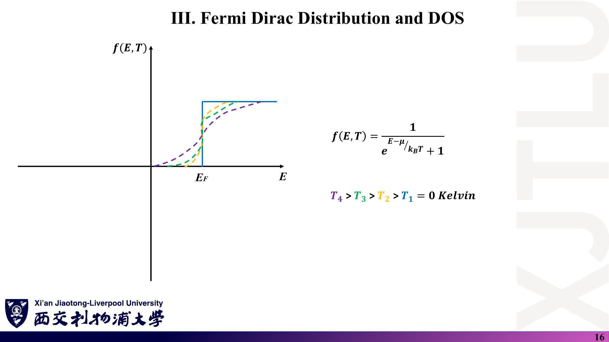

### 中文解释

**问题**：图中蓝色 $T_1=0$ K 曲线在 $E<E_F$ 时为 0、$E>E_F$ 时为 1；各温度虚线也从 0 上升到 1。这与图旁公式 $f=1/(e^{(E-\mu)/k_BT}+1)$ 以及第 15 页“绝对零度时在 Fermi 能级处截止”的描述矛盾。

### 原理深入

**正确写法**：$f(E\ll\mu)=1$、$f(\mu)=1/2$、$f(E\gg\mu)=0$；$T=0$ 时 $f=\theta(\mu-E)$；升温后曲线在 $\mu$ 附近约 $k_BT$ 范围内由 1 平滑降到 0，且关于 $(\mu,1/2)$ 中心对称。原图形状对应的是 $1-f$（空穴占据概率）。

**核验理由**：直接代入极限：$E\to-\infty$ 时 $e^{-\infty}=0$，$f=1$。

### Ref

- **原课件**：[Lecture Thirteen，PDF 第 15–16 页](../Lecture_Thirteen.pdf#page=16)。
- **配套**：[01 第 7 节](01_态密度基础与VanHove奇点.md)、[复习题第 7 题](06_复习题与参考答案.md)。

## 5. 分箱公式的符号与边界

### 课件截图

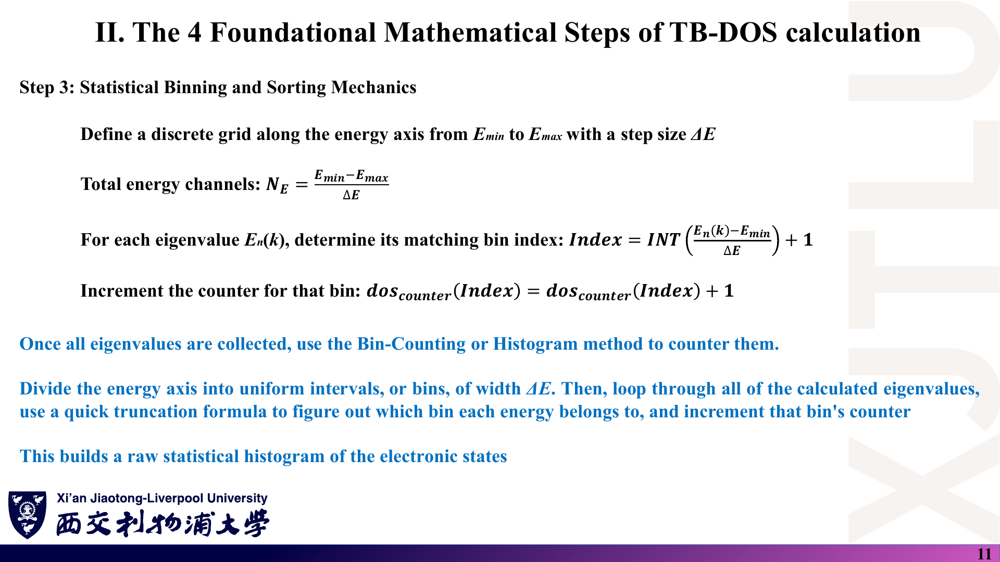

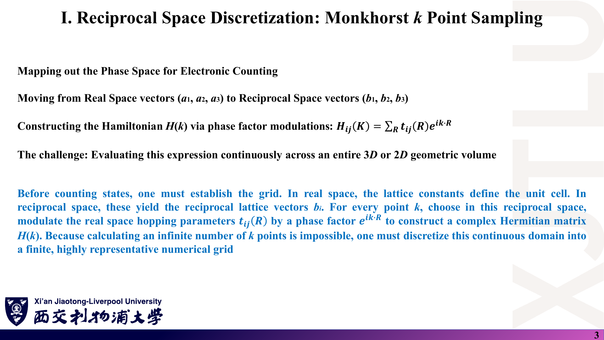

### 中文解释

**问题**：(1) 第 11 页 $N_E=(E_{\min}-E_{\max})/\Delta E$ 为负数。(2) Index 公式未说明越界处理。(3) 第 3 页左边 $H_{ij}(K)$ 与右边 $e^{i\mathbf k\cdot\mathbf R}$ 大小写不一致；石墨烯中 $K$ 通常指 Dirac 点，易混淆。

### 原理深入

**正确写法**：

$$
N_E=\frac{E_{\max}-E_{\min}}{\Delta E},\qquad
\text{Index}=\Big\lfloor\frac{E-E_{\min}}{\Delta E}\Big\rfloor+1\quad(\text{仅当 }E_{\min}\le E<E_{\max}),\qquad
H_{ij}(\mathbf k)=\sum_{\mathbf R}t_{ij}(\mathbf R)e^{i\mathbf k\cdot\mathbf R}.
$$

**核验理由**：bin 数必须为正；$E=E_{\max}$ 时 Index $=N_E+1$ 越界；Fortran `INT` 向零截断，$E$ 略小于 $E_{\min}$ 时会被错误计入第 1 个 bin，应先判断范围或用 `FLOOR`。

### Ref

- **原课件**：[Lecture Fourteen，PDF 第 3 页](../Lecture_Fourteen.pdf#page=3)、[第 11 页](../Lecture_Fourteen.pdf#page=11)。
- **配套**：[02 第 5 节](02_k点采样与TB-DOS四步流程.md)、[复习题第 10 题](06_复习题与参考答案.md)。

## 6. PDOS 的适用条件、示意图与成键判据

### 课件截图

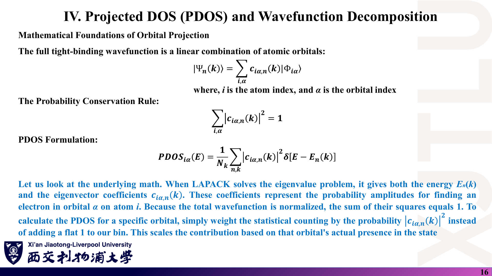

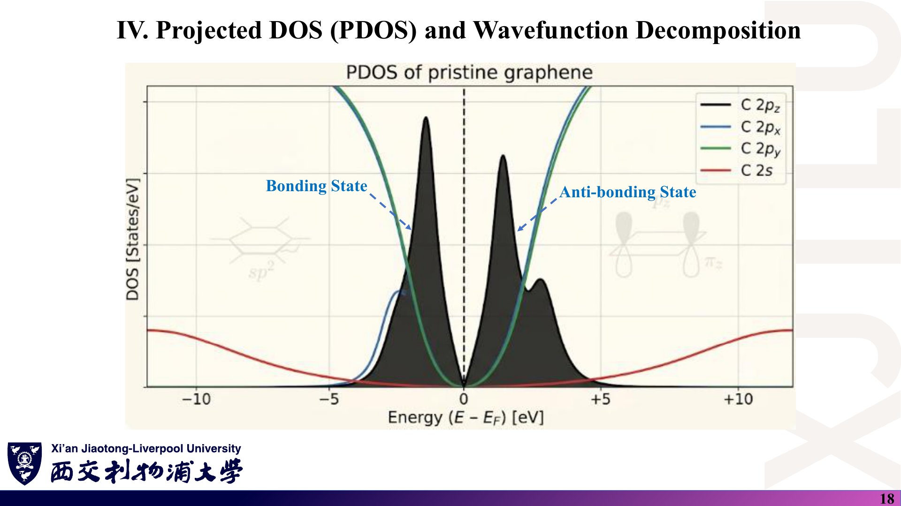

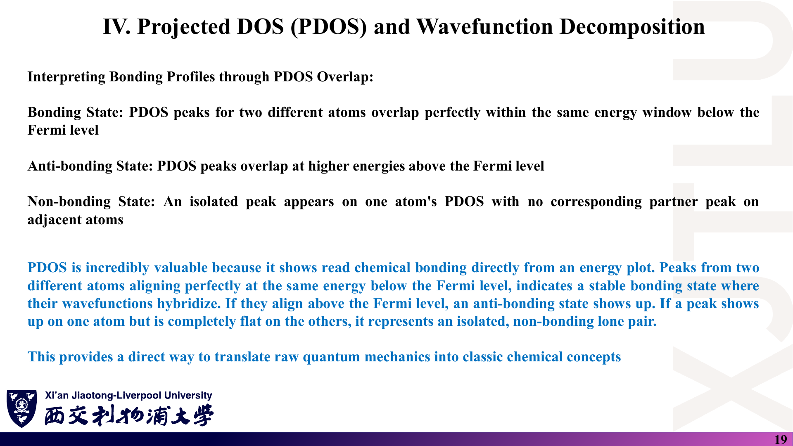

### 中文解释

**问题**：(1) $\sum_{i\alpha}|c_{i\alpha,n}|^2=1$ 与 PDOS 加和等于 TDOS 只在**正交归一**基下成立，页面没有说明。(2) 第 18 页 $p_x,p_y$ 曲线在 $E_F$ 附近仍明显非零并向两侧单调增大，与石墨烯 σ/σ* 带在 $E_F$ 附近有数 eV 能隙的已知能带结构不符，应视为示意图。(3) 第 19 页以“$E_F$ 以下/以上”判断成键/反键，只是经验法则。

### 原理深入

**正确写法**：

- 正交基：$\mathrm{PDOS}_{i\alpha}=\frac1{N_k}\sum|c_{i\alpha,n}|^2\delta(E-E_n)$，$\sum_{i\alpha}\mathrm{PDOS}=\mathrm{DOS}$。非正交基：$c^\dagger Sc=1$，需 Mulliken/Löwdin 等分配。
- 本课程 $p_z$ 单轨道模型只能分解为 A、B 两个子格的 PDOS，无法得到 $s,p_x,p_y$ 曲线。
- 成键/反键由波函数在原子间的相对相位决定（如 COHP 符号），与是否位于 $E_F$ 以下无必然关系；反键态也可被占据。

**核验理由**：非正交基下归一化条件为 $c^\dagger Sc=1$（第一周 $Hc=ESc$），一般 $c^\dagger c\neq1$。石墨烯 σ 带隙见 [GR09](README.md#ref-gr09) 等综述的能带图。

### Ref

- **原课件**：[Lecture Fourteen，PDF 第 15–19 页](../Lecture_Fourteen.pdf#page=16)。
- **配套**：[02 第 6 节](02_k点采样与TB-DOS四步流程.md)。

## 7. Methfessel–Paxton 公式与示意图

### 课件截图

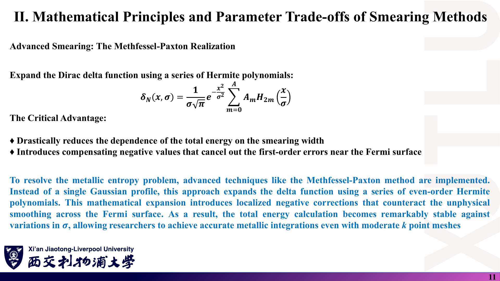

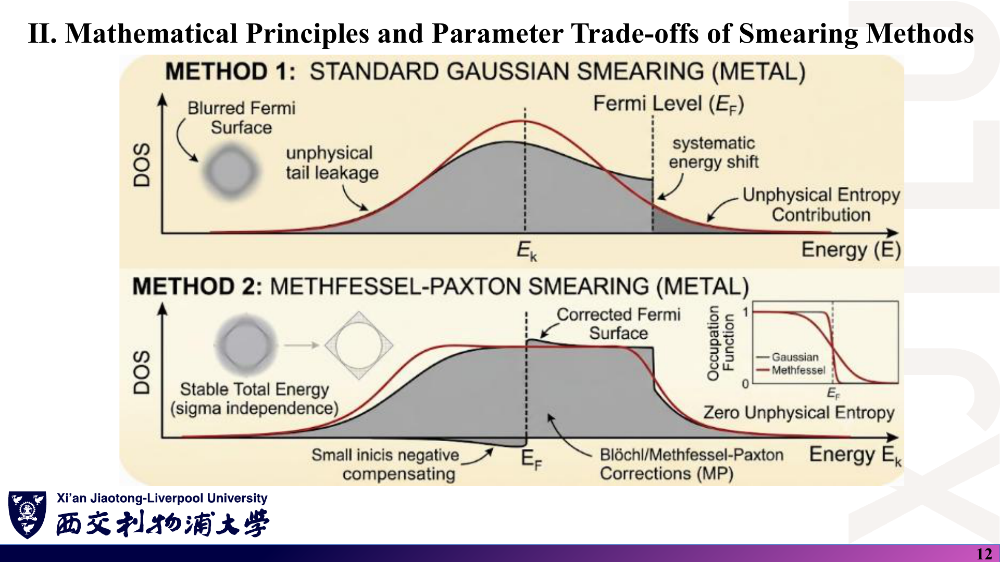

### 中文解释

**问题**：(1) 第 11 页 $\sum_{m=0}^{A}A_mH_{2m}$ 的上限 “A” 与系数同名，应为阶数 $N$，且未给出 $A_m$。(2) 第 12 页称 MP 展宽“Zero Unphysical Entropy”，并有拼写错误（“inicis”）。

### 原理深入

**正确写法**：

$$
\delta_N(x,\sigma)=\frac{1}{\sigma\sqrt\pi}e^{-x^2/\sigma^2}\sum_{m=0}^{N}A_mH_{2m}(x/\sigma),\qquad A_m=\frac{(-1)^m}{m!\,4^m}.
$$

MP 展宽减小（而非消除）总能量对 $\sigma$ 的依赖；$\delta_N$ 可为负，因此 DOS 与占据数可能出现负值或超过 1，MP 适用于金属的积分量，不适合画 DOS 或用于有带隙的体系。

**核验理由**：$N=0$ 时退化为 Gaussian（$A_0=1$）；$N=1$ 时 $\delta_1\propto e^{-y^2}(3/2-y^2)$，在 $|y|>\sqrt{3/2}$ 为负，可直接验证；系数与 MP89 原文一致。

### Ref

- **原课件**：[Lecture Fifteen，PDF 第 10–12 页](../Lecture_Fifteen.pdf#page=11)。
- **原始论文**：[MP89](README.md#ref-mp89)；配套 [03 第 5 节](03_展宽方法与四面体法.md)。

## 8. 需要加限定的表述

### 课件截图

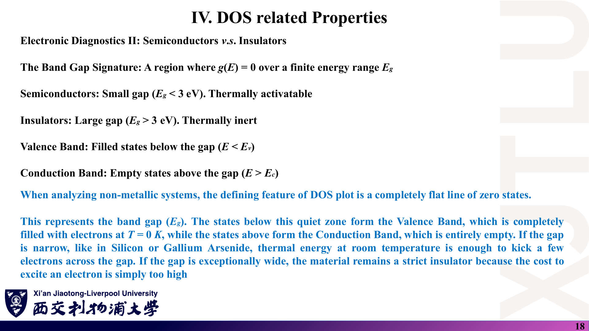

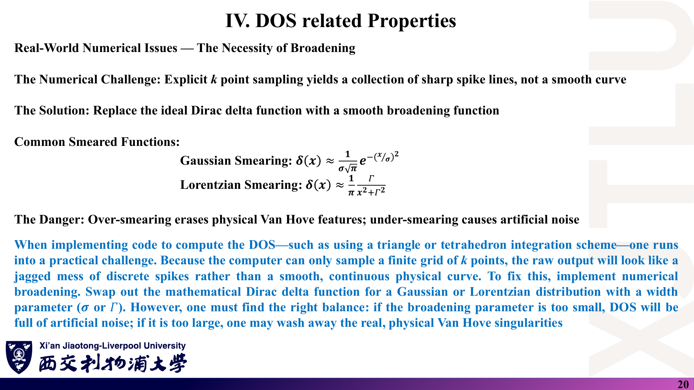

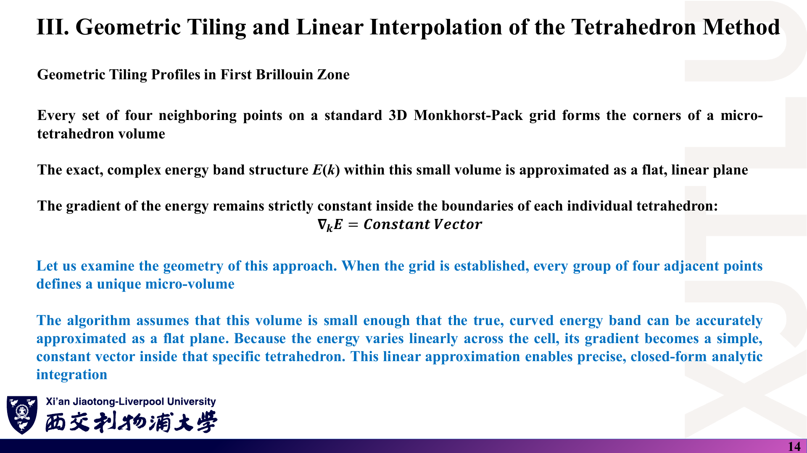

### 中文解释

以下不是明确的错误，但若不加限定会被记成错误规则：

| 原页 | 原表述 | 应加的限定 |
|---|---|---|
| Thirteen 18 | $E_g<3$ eV 为半导体、$>3$ eV 为绝缘体 | 仅为经验分界；GaN、SiC、金刚石等常称宽禁带半导体 |
| Thirteen 20 | 用三角形/四面体积分编写代码时得到尖刺，需要展宽 | 需要展宽的是直接 δ 求和/直方图；四面体法本身不需要展宽参数（Fifteen 13） |
| Fourteen 10 | 微小反厄米分量可能使求解器崩溃，应对称化 | `ZHEEV` 只读取一半三角；对称化是良好习惯，但不是 `ZHEEV` 的必要条件 |
| Fourteen 13 | “3D Normalization Factor” | $\text{counts}/(N_k\Delta E)$ 是每原胞 DOS，与维度无关 |
| Fifteen 14 | 每四个相邻网格点构成一个四面体 | 标准做法是每个网格平行六面体切成 6 个四面体；2D 每个平行四边形切成 2 个三角形 |
| Fifteen 20 | 线性四面体曲线充满噪声 | 示意性夸张；线性四面体无统计噪声，粗网格表现为折线化 |
| Fifteen 21 | 四面体法“完全无参数” | 无展宽参数，但仍需 k 网格收敛 |

### 原理深入

**核验理由**：宽禁带材料的带隙数值见常用固体物理教材（[SS2](README.md#ref-ss2)）；`ZHEEV` 的 `UPLO` 约定见 [LAPACK](README.md#ref-lapack)；四面体切分方式见 [BL94](README.md#ref-bl94)；示例代码的三角形切分见 [08 第 7 节](08_代码导读.md)。

### Ref

- **原课件**：[Lecture Thirteen，PDF 第 18、20 页](../Lecture_Thirteen.pdf#page=18)；[Lecture Fourteen，PDF 第 10、13 页](../Lecture_Fourteen.pdf#page=10)；[Lecture Fifteen，PDF 第 14、20–21 页](../Lecture_Fifteen.pdf#page=14)。

## 9. 示例代码与讲义约定的差异

### 课件截图

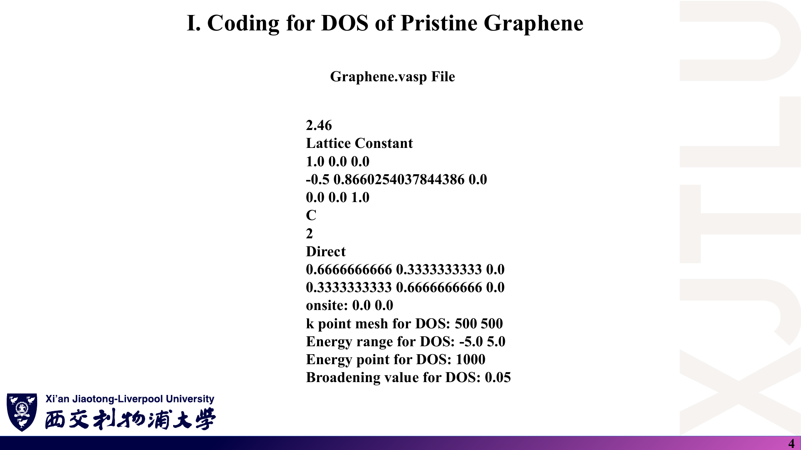

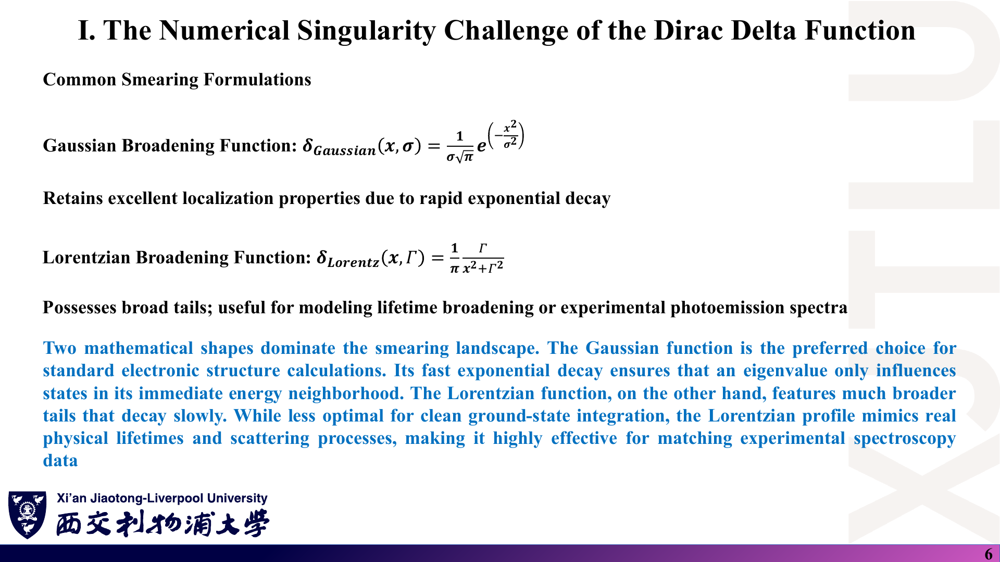

### 中文解释

**问题**（均来自阅读 `TIGHTBINDINGFORGRAPHENE.f90`）：

1. Lorentz 分支用 $\frac{b}{4x^2+b^2}\cdot\frac{2}{N_k\pi}$，等价于 $\Gamma=b/2$：输入的 0.05 是 **FWHM**，而讲义 $\Gamma$ 是 HWHM。
2. Gaussian（$\frac{2}{N_kb\sqrt\pi}$）与三角形法（`factor=2/N_k`）含因子 2，Lorentz 不含（见第 1 节）。
3. `Graphene.vasp` 中晶格常数、晶格矢量、原子坐标不被读取；程序只解析 5 个带冒号的关键词，几何写死在源码第 167–182 行。
4. 三角形法循环只到 `kmesh-1`，最后一行/列平行四边形未计入，约少 $2/N\approx0.4\%$ 的权重。
5. k 网格为 $(i-1)/N$（Γ 起点），不是讲义的 MP 对称网格；$N=500$ 不被 3 整除，K 点不在网格上。

### 原理深入

**正确理解**：这些都不影响曲线的**形状**（峰位 ±2.7 eV、$E=0$ 的 V 形），但影响**数值**比较：同一张图或报告中比较三种方法时，应统一 $\gamma$ 与宽度定义；归一化检查应在覆盖全部能带的窗口上进行。

**核验理由**：

- 化简 $\frac{2}{N_k\pi}\frac{b}{4x^2+b^2}=\frac1{N_k}\frac1\pi\frac{b/2}{x^2+(b/2)^2}$。
- 2D 三角形面积 $A_T=A_{\rm BZ}/(2N_k)$，每能带 1 个态时前因子应为 $2A_T/A_{\rm BZ}=1/N_k$。
- 数值积分结果（Gaussian 2.579、四面体 2.573、Lorentz 1.285）与上述前因子一致；四面体略低于 Gaussian 与漏算边界单元一致。
- 源码第 202–220 行的 `SELECT CASE` 只有 5 个分支。

### Ref

- **代码**：[`TIGHTBINDINGFORGRAPHENE.f90`](../Codes/TIGHTBINDINGFORGRAPHENE.f90)；详解 [08](08_代码导读.md)。
- **原课件**：[Lecture Sixteen，PDF 第 4–5 页](../Lecture_Sixteen.pdf#page=4)；[Lecture Fifteen，PDF 第 6 页](../Lecture_Fifteen.pdf#page=6)。

## 10. 作业说明与 CW1 正式文件不一致

### 课件截图

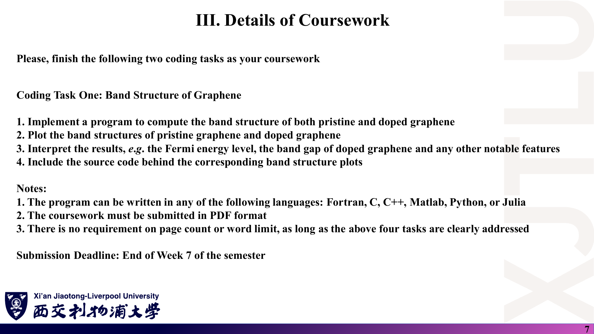

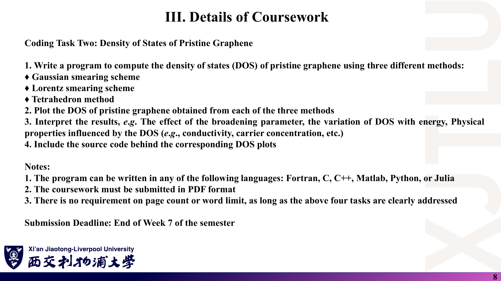

### 中文解释

**问题**：幻灯片允许 Fortran、C、C++、Matlab、Python、Julia，DOS 只要求本征石墨烯；CW1 正式文件要求全部计算用 Fortran、C 或 C++，并要求本征与带隙石墨烯的能带及三种方法 DOS，评分为 5 项各 20%。

### 原理深入

**建议做法**：以更严格的 CW1 文件为准完成，并尽早向任课教师确认差异；截止时间幻灯片写第 7 周末，CW1 文件未写，以教学平台公告为准。

**核验理由**：逐条对照本地 `CW1/Coursework for the Module MES306TC.pdf`（2 页）与 Lecture Sixteen 第 7–8 页，对照表见 [04 第 5 节](04_石墨烯DOS编程与课程作业.md)。

### Ref

- **原课件**：[Lecture Sixteen，PDF 第 7–8 页](../Lecture_Sixteen.pdf#page=7)。

## 核对优先级

1. **自旋与归一化**：先确认 $\gamma$、每原胞还是每体积、能量窗口是否覆盖全部能带。
2. **宽度定义**：$\sigma$、标准差、FWHM、HWHM 不能混用；跨软件比较时尤其注意。
3. **极限与量纲**：用 $E\to\pm\infty$、$\sigma\to0$、$k^3\propto E^{3/2}$ 等快速检验公式。
4. **示意图与计算图**：PDOS、MP、Blöchl 修正等插图多为示意，不作定量依据。
5. **作业要求**：以官方 CW1 文件为准，并与教师确认。
