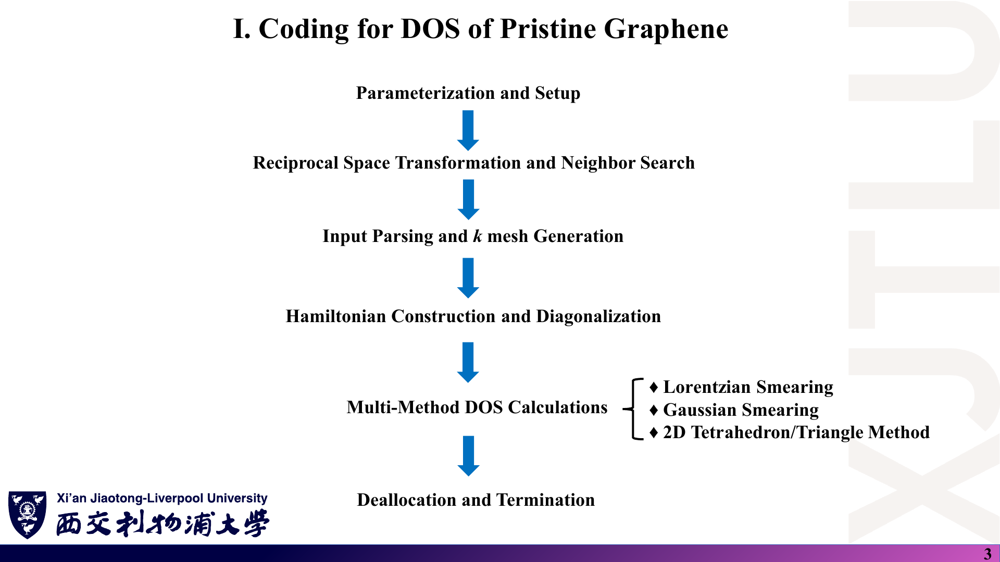
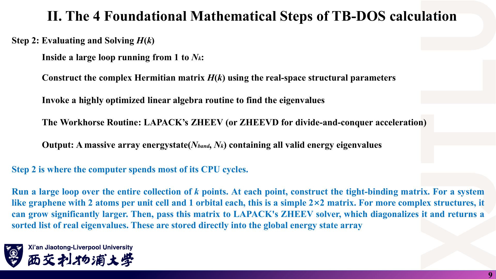
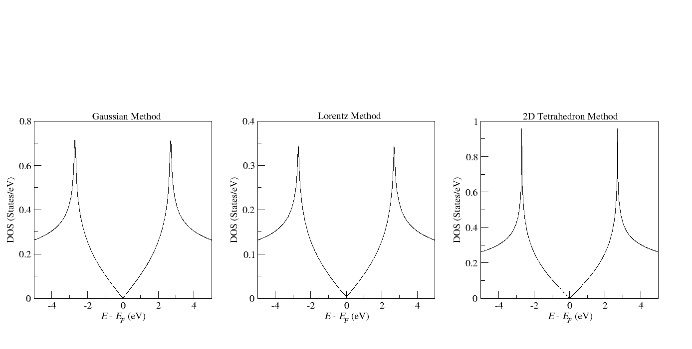

# 08 · 代码导读：TIGHTBINDINGFORGRAPHENE.f90

来源：[`Codes/`](../Codes/) 目录（教师提供，未修改）；对应 [Lecture_Sixteen.pdf](../Lecture_Sixteen.pdf) 第 3–5 页。

[返回目录](README.md)

> 本文逐段解释教师示例程序并报告本笔记作者的数值核验。行号指 `TIGHTBINDINGFORGRAPHENE.f90` 的源码行。标注〔核验〕的结论来自阅读源码与对 `DOS_*.dat` 的数值积分；它们不是教师的说明。本文**不提供**课程作业的解答代码。

## 1. Codes 目录里有哪些文件？

### 课件截图



### 中文解释

| 文件 | 作用 |
|---|---|
| `TIGHTBINDINGFORGRAPHENE.f90` | 主程序（399 行）：石墨烯 $p_z$ 最近邻紧束缚 + 三种 DOS 方法 |
| `Graphene.vasp` | 输入文件（仿 POSCAR，末尾 5 行 DOS 参数） |
| `compile.sh` | SLURM 作业脚本：在 HPC 上加载 LAPACK 模块并用 `gfortran` 编译 |
| `run.sh` | SLURM 作业脚本：单进程运行可执行文件 |
| `DOS_Lorentz_Method.dat` / `DOS_Gaussian_Method.dat` / `DOS_2D_Tetrahedron_Method.dat` | 程序输出：两列（能量 eV，DOS states/eV），各 1000 行 |
| `DOS.agr` | xmgrace（Grace）工程文件，三个子图分别标注 Gaussian / Lorentz / 2D Tetrahedron Method |
| `DOS.png` | 教师绘制的结果图（与 Lecture Sixteen 第 5 页的三张图相同） |

### 原理深入

程序结构：两个外部子程序 `DOTPRODUCT`、`CROSSPRODUCT`（第 1–25 行）；`KSPACE` 求倒格矢（第 27–52 行）；模块 `GEOMETRY` 定义近邻对类型 `neighbour` 和近邻搜索 `NEIGHBOURHAMILTONIAN`（第 54–121 行）；主程序（第 123–398 行）。

### Ref

- **原课件**：[Lecture Sixteen，PDF 第 3 页](../Lecture_Sixteen.pdf#page=3)。
- **源码**：[`TIGHTBINDINGFORGRAPHENE.f90`](../Codes/TIGHTBINDINGFORGRAPHENE.f90)。

## 2. 晶格、倒格矢与最近邻是怎样得到的？（第 1–121、165–196 行）

### 课件截图


### 中文解释

主程序开头写死了几何：$a=2.46$ Å；$\mathbf a_1=a(1,0,0)$，$\mathbf a_2=a(\cos120°,\sin120°,0)$，$\mathbf a_3=a(0,0,1)$；两个 C 原子在分数坐标 $(\tfrac23,\tfrac13,0)$ 与 $(\tfrac13,\tfrac23,0)$；跃迁 `hopping = -2.7` eV；近邻距离 1.42 Å，容差 `delta = 0.1` Å。`KSPACE` 用叉积公式求 $\mathbf b_i=2\pi(\mathbf a_j\times\mathbf a_k)/[\mathbf a_1\cdot(\mathbf a_2\times\mathbf a_3)]$。`NEIGHBOURHAMILTONIAN` 遍历原子对 $(i,j)$ 和相邻晶胞 $n_1,n_2,n_3\in\{-1,0,1\}$，凡距离落在 $1.42\pm0.1$ Å 内就记录一条键：原子编号、距离和矢量 $\mathbf r=\boldsymbol\tau_i-\boldsymbol\tau_j+\mathbf R$。

### 原理深入

- 每个 C 有 3 个最近邻，2 个原子共找到 6 条有向键（A→B 三条、B→A 三条）。第二近邻距离 $a=2.46$ Å，远在容差之外，所以模型只含最近邻。
- `bondlist` 先按上限 $9N_{\rm atom}^2$ 分配，再用 `MOVE_ALLOC` 截断到实际键数（第 111–116 行）。
- $\mathbf a_3$ 只是为了构造 3D 倒格矢；k 点第 3 分量始终为 0，层间方向不参与计算。
- 〔核验〕`Graphene.vasp` 中的晶格与坐标行不会被读取（见第 3 节），几何完全由第 167–182 行决定。

### Ref

- **原课件**：[Lecture Fourteen，PDF 第 3 页](../Lecture_Fourteen.pdf#page=3)；[Lecture Sixteen，PDF 第 4 页](../Lecture_Sixteen.pdf#page=4)。
- **推导**：[02 第 1 节：倒格矢与相位约定](02_k点采样与TB-DOS四步流程.md)。

## 3. 输入如何解析？k 网格怎样生成？（第 186–228 行）

### 课件截图


### 中文解释

程序逐行读 `Graphene.vasp`，用 `INDEX(str,':')` 找冒号；冒号前的文字与 5 个关键词逐字匹配，冒号后的内容用表控格式读入：

| 关键词（须逐字一致，含大小写和空格） | 变量 | 示例值 |
|---|---|---|
| `onsite` | `onsite(2)` | `0.0 0.0` |
| `k point mesh for DOS` | `kmesh(2)` | `500 500` |
| `Energy range for DOS` | `energyrange(2)` | `-5.0 5.0` |
| `Energy point for DOS` | `numenergypoint` | `1000` |
| `Broadening value for DOS` | `broadening` | `0.05` |

k 点：$\mathbf k_{ij}=\frac{i-1}{N_1}\mathbf b_1+\frac{j-1}{N_2}\mathbf b_2$，$i=1..N_1$、$j=1..N_2$，一维编号 `(i-1)*kmesh(2)+j`。

### 原理深入

- 〔核验〕这是**以 $\Gamma$ 为起点**的均匀网格，而不是 Lecture Fourteen 第 5 页的对称 MP 网格；两者都是全 BZ 等权采样。$N=500$ 不被 3 整除，Dirac 点 $K$ 不在网格上。
- **易踩的坑〔核验〕**：
  - 第 186 行 `OPEN` 的 `IOSTAT` 存在变量 `k` 中，第 202 行 `DO WHILE (k == 0)` 依赖它。若文件不存在，循环直接跳过，`kmesh` 等变量未初始化，程序后续行为不可预期——运行前务必确认输入文件在工作目录下。
  - 关键词拼写稍有不同（如多一个空格）就会被静默忽略。
  - `Lattice Constant` 等行没有冒号，不会被解析。

### Ref

- **原课件**：[Lecture Sixteen，PDF 第 4 页](../Lecture_Sixteen.pdf#page=4)；[Lecture Fourteen，PDF 第 5、8 页](../Lecture_Fourteen.pdf#page=5)。
- **对照**：[02 第 3 节：MP 网格](02_k点采样与TB-DOS四步流程.md)。

## 4. 哈密顿量如何构造并对角化？（第 231–255 行）

### 课件截图



### 中文解释

onsite 矩阵 `honsite` 为对角阵 $\mathrm{diag}(\varepsilon_1,\varepsilon_2)$。对每个 k 点，遍历键表，只保留 `atomi <= atomj` 的键（第 247 行），计算相位 $\phi=\mathbf k\cdot\mathbf r$，把 $t\,e^{i\phi}$ 累加到 `hhopping(atomi,atomj)`，即只填**上三角**。然后 `hamiltonian = honsite + hhopping`，调用 `ZHEEV('V','U',...)`，升序本征值存入 `energystate(:,i)`。

### 原理深入

- 上三角元 $H_{12}(\mathbf k)=t\sum_{j=1}^3e^{i\mathbf k\cdot\mathbf r_j}$，与 [02 第 4 节](02_k点采样与TB-DOS四步流程.md) 的 $t f(\mathbf k)$ 一致（相位符号约定不同不影响本征值）。
- `'U'` 让 LAPACK 只读上三角，下三角（此处为 0）被忽略，相当于隐式取 $H_{21}=H_{12}^*$。所以代码虽未做 Lecture Fourteen 第 10 页的 $(H+H^\dagger)/2$，仍是正确的厄米问题。
- 工作数组按 LAPACK 最小要求分配：`lwork = max(1, 3N-1)`，`rwork` 长度 `max(1, 3N-2)`。
- 〔核验〕可改进之处：只需本征值时用 `JOBZ='N'` 更快；程序没有检查 `info`；如果以后加入第二近邻或 onsite 内的同原子项，`atomi <= atomj` 的筛选会把 $i=j$ 的项计入对角元，需要确认是否重复计数。

### Ref

- **原课件**：[Lecture Fourteen，PDF 第 9–10 页](../Lecture_Fourteen.pdf#page=9)。
- **文档**：[LAPACK](README.md#ref-lapack)。

## 5. Lorentz 分支的归一化是什么？（第 258–271 行）

### 课件截图


### 中文解释

对每个能量点 $E$，累加所有 k 点和两条能带的 $\dfrac{b}{4(E-\varepsilon)^2+b^2}$（$b$ = `broadening`），最后整体乘 $\dfrac{2}{N_k\pi}$。

### 原理深入

〔核验〕化简单个态的贡献：

$$
\frac{2}{N_k\pi}\cdot\frac{b}{4x^2+b^2}
=\frac{1}{N_k}\cdot\frac1\pi\frac{b/2}{x^2+(b/2)^2},\qquad x=E-\varepsilon .
$$

- 这是 HWHM 为 $b/2$ 的标准 Lorentz 核，面积为 1，乘 $1/N_k$ 后**每个态贡献 1/N_k**——不含自旋因子。
- 与讲义 $\frac1\pi\frac{\Gamma}{x^2+\Gamma^2}$ 对比：代码相当于取 $\Gamma=b/2$，即**输入的 0.05 是 FWHM**，而讲义中的 $\Gamma$ 是 HWHM。

### Ref

- **原课件**：[Lecture Fifteen，PDF 第 6 页](../Lecture_Fifteen.pdf#page=6)。
- **勘误**：[07 第 9 节](07_讲义勘误与易错点.md)。

## 6. Gaussian 分支的归一化是什么？（第 274–287 行）

### 课件截图


### 中文解释

累加 $\exp[-((E-\varepsilon)/b)^2]$，最后乘 $\dfrac{2}{N_k\,b\sqrt\pi}$。

### 原理深入

〔核验〕单个态贡献为

$$
\frac{2}{N_k}\cdot\frac{1}{b\sqrt\pi}e^{-x^2/b^2},
$$

核函数与讲义完全相同（$\sigma=b$），面积为 1；前面多出的 **2** 使每个态贡献 $2/N_k$，相当于**含自旋因子 $\gamma=2$**。这与 Lorentz 分支相差 2 倍。

### Ref

- **原课件**：[Lecture Thirteen，PDF 第 20 页](../Lecture_Thirteen.pdf#page=20)；[Lecture Fifteen，PDF 第 6 页](../Lecture_Fifteen.pdf#page=6)。

## 7. 2D 三角形（“2D Tetrahedron”）分支怎样实现？（第 290–377 行）

### 课件截图


### 中文解释

对每个网格小平行四边形 $(i,j)$，沿对角线切成两个三角形：

- 左下三角形：$(i,j)$、$(i+1,j)$、$(i,j+1)$；
- 右上三角形：$(i+1,j)$、$(i+1,j+1)$、$(i,j+1)$。

每个三角形对每条能带：取三个角点能量，用三次比较交换排成 $E_1\le E_2\le E_3$（`inter(2..4)`），然后对每个能量点 $E$（`inter(1)`）：

- $E_1\le E\le E_2$：加 `factor` $\times\dfrac{E-E_1}{(E_2-E_1)(E_3-E_1)}$；
- $E_2<E\le E_3$：加 `factor` $\times\dfrac{E_3-E}{(E_3-E_1)(E_3-E_2)}$；

分母差值小于 $10^{-8}$ 时跳过。`factor = 2/N_k`。

### 原理深入

- 公式形状与 [03 第 7 节](03_展宽方法与四面体法.md) 推导的结果一致；按“每能带 1 个态”归一化，每个三角形的正确前因子是 $2A_T/A_{\rm BZ}=1/N_k$。〔核验〕代码用 $2/N_k$，所以该分支也**含因子 2**，与 Gaussian 一致、与 Lorentz 不一致。
- 〔核验〕外层循环 `i = 1..kmesh(1)-1`、`j = 1..kmesh(2)-1`，没有利用周期性把第 $N$ 行/列与第 1 行/列连接，最后一行和一列平行四边形未被计入。漏掉的比例为 $1-(N-1)^2/N^2\approx2/N=0.4\%$（$N=500$），对应实测积分略低（见第 8 节）。
- 该方法每个能量点都要遍历所有三角形，复杂度 $O(N_E\cdot2N_k\cdot N_{\rm band})$，与展宽法同级；更高效的写法是只对 $[E_1,E_3]$ 范围内的能量点循环〔补充〕。

### Ref

- **原课件**：[Lecture Fifteen，PDF 第 13–16 页](../Lecture_Fifteen.pdf#page=13)。
- **推导**：[03 第 7 节](03_展宽方法与四面体法.md)；[BL94](README.md#ref-bl94)。

## 8. 输出文件说明了什么？——数值核验

### 课件截图




*第二张不是课件截图，而是 `Codes/DOS.png` 原图，与课件第 5 页一致。`DOS.agr` 是同一图的 xmgrace 工程文件，可用 `xmgrace DOS.agr` 打开修改。*

### 中文解释

本笔记作者对三个 `.dat` 文件做了以下核验（梯形积分，能量窗口 $[-5,5]$ eV）：

| 文件 | $\int\mathrm{DOS}\,dE$ | 峰值（位置） | $E\approx0$ 处 DOS | $E\approx1.0$ eV 处 DOS |
|---|---|---|---|---|
| `DOS_Gaussian_Method.dat` | 2.579 | 0.715（−2.698 eV） | 0.0029 | 0.105 |
| `DOS_Lorentz_Method.dat` | 1.285 | 0.343（−2.698 eV） | 0.0047 | 0.054 |
| `DOS_2D_Tetrahedron_Method.dat` | 2.573 | 0.957（−2.698 eV） | 0.0000 | 0.105 |

### 原理深入

- 用独立的小脚本在 1000×1000 网格上计算 $E_\pm=\pm2.7|f(\mathbf k)|$，得到每条能带落在 $|E|<5$ eV 的比例约 0.645，最大能量 8.10 eV。所以：
  - “每能带 1 个态”约定下，窗口内积分应 ≈ $2\times0.645=1.29$——**Lorentz 1.285 吻合**；
  - 含自旋时应 ≈ 2.58——**Gaussian 2.579 吻合，四面体 2.573 略低**（与第 7 节漏算约 0.4% 的边界单元一致，Gaussian/Lorentz 也受核尾超出窗口的影响，量级更小）。
- **结论**：示例程序三种方法的归一化**不统一**（Gaussian、四面体含因子 2，Lorentz 不含），Lecture Sixteen 第 5 页三图纵轴量级不同的主要原因就在这里，而不只是核函数差别。同时，代码的 Lorentz 宽度参数是 FWHM。
- 讲义 Lecture Fourteen 第 13 页的“积分必须等于 2.0”针对**全能带、不含自旋**；本例窗口只到 ±5 eV，三者都不会等于 2.0。
- **自己编程时的建议**：选定一种约定（例如“每原胞、含自旋”，全窗口积分应为 4），三种方法使用同一约定；在报告中写明；并用 $[-8.5,8.5]$ eV 以上的窗口做一次积分检查。

### Ref

- **原课件**：[Lecture Sixteen，PDF 第 5 页](../Lecture_Sixteen.pdf#page=5)；[Lecture Fourteen，PDF 第 13 页](../Lecture_Fourteen.pdf#page=13)。
- **数据**：[`DOS_Gaussian_Method.dat`](../Codes/DOS_Gaussian_Method.dat) · [`DOS_Lorentz_Method.dat`](../Codes/DOS_Lorentz_Method.dat) · [`DOS_2D_Tetrahedron_Method.dat`](../Codes/DOS_2D_Tetrahedron_Method.dat) · [`DOS.agr`](../Codes/DOS.agr)。
- **勘误汇总**：[07 第 1、9 节](07_讲义勘误与易错点.md)。

## 9. 如何在 HPC 上编译与运行？

### 课件截图


### 中文解释

两个脚本都是 SLURM 作业脚本（含 `#SBATCH` 指令：分区 `cpu8358`、1 节点 1 任务、QOS `300cores`，输出写入 `作业号.out` / `作业号.error`）。

```bash
# 在 Codes/ 目录（含 .f90 与 Graphene.vasp）中
sbatch compile.sh   # module load netlib-lapack，gfortran 链接 -llapack -lblas，生成可执行文件
sbatch run.sh       # export OMP_NUM_THREADS=1；srun ./TIGHTBINDINGFORGRAPHENE
```

运行后在当前目录生成三个 `DOS_*.dat`；再用 xmgrace、gnuplot、Matplotlib 等绘图。

### 原理深入

- `compile.sh` 中的 LAPACK 库路径（`/gpfs/spack/...`）和模块名针对学校集群，换机器要改成本机的 LAPACK/BLAS（如 `-llapack -lblas` 或 OpenBLAS）。
- `compile.sh` 包含 `--mail-user` 为教师邮箱，自用时应删除或改为自己的邮箱，避免给教师发送作业通知〔建议〕。
- 编译完执行 `rm *.mod`（删除模块 `GEOMETRY` 生成的 `geometry.mod`）。
- 本地调试可把网格降到 100×100 快速验证，再在 HPC 上用 500×500；计算量主要在 DOS 累加（约 $5\times10^8$ 次核函数求值）。
- 运行目录必须有 `Graphene.vasp`（见第 3 节的 `IOSTAT` 陷阱）。

### Ref

- **脚本**：[`compile.sh`](../Codes/compile.sh) · [`run.sh`](../Codes/run.sh)。
- **文档**：[LAPACK](README.md#ref-lapack)。

## 10. 读完代码应记住的要点

### 课件截图


### 中文解释

示例程序完整演示了“全 BZ 网格 → 2×2 厄米矩阵对角化 → 三种 DOS”的链条，结构清晰，适合对照学习；但它是教学示例，有几处约定需要自己统一。

### 原理深入

| 项目 | 示例代码的做法 | 学习时应注意 |
|---|---|---|
| 几何参数 | 写死在源码 | 输入文件中的晶格行不起作用 |
| k 网格 | $\Gamma$ 起点 $(i-1)/N$ | 与 MP 对称网格不同，但都是等权全 BZ 采样 |
| 厄米性 | 只填上三角 + `'U'` | 合法；未做显式对称化 |
| Lorentz | 参数为 FWHM；不含自旋 | 与讲义 $\Gamma$（HWHM）不同 |
| Gaussian | 与讲义一致；含因子 2 | 与 Lorentz 相差 2 倍 |
| 三角形法 | `factor=2/N_k`（含因子 2）；漏掉边界一行一列 | 用周期边界可补全；统一约定 |
| 能量窗口 | $[-5,5]$ eV | 只含约 64.5% 的态，不能验证总积分 |
| 错误检查 | 不检查 `IOSTAT`/`info` | 自己的代码应加检查 |

### Ref

- **原课件**：[Lecture Fourteen，PDF 第 13 页](../Lecture_Fourteen.pdf#page=13)。
- **配套**：[04 石墨烯 DOS 编程与课程作业](04_石墨烯DOS编程与课程作业.md)。
