# 01 · 课程导论：为什么进行原子级材料模拟？

来源：[Lecture_One.pdf](../Lecture_One.pdf)，32 页。

[返回目录](README.md)

## 1. 课程研究什么？〔pp. 3–5〕

### 课件截图

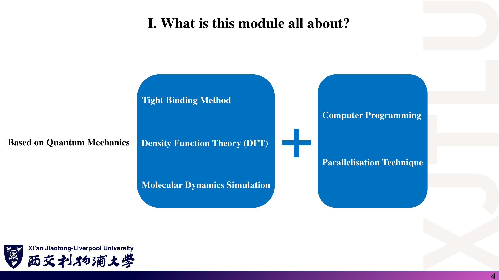

### 中文解释

这页给出了课程的方法工具箱：用微观模型描述材料，再由计算解释实验、调控性质或提出预测。TB、DFT、MD 面向的问题不同，不能把它们当成同一种算法。

### 原理深入

从模型层次看，TB 通常把物理压缩为轨道能量和耦合参数；DFT 在选定泛函等近似下求电子结构；MD 推进原子运动。模型越精细不等于对任何问题都更合适，还必须考虑研究尺度、精度和计算成本。

课程从量子力学出发，在原子与电子层次上研究材料，并辅助电子器件的设计与制造。

可以把任务分成三类：

1. **解释（Explain）**：实验已经观察到某种变化，找出微观机制。
2. **调控（Modify / Engineer）**：改变结构、成分或外场，使材料表现出目标性质。
3. **预测（Predict）**：计算尚待实验验证的结构或物性，帮助缩小实验搜索范围。

#### 主要方法

| 方法 | 中文 | 本课程中的定位 |
|---|---|---|
| Tight Binding，TB | 紧束缚方法 | 用轨道之间的耦合建立电子结构模型 |
| Density Functional Theory，DFT | 密度泛函理论 | 从电子密度框架计算电子结构与材料性质 |
| Molecular Dynamics，MD | 分子动力学 | 研究原子的运动与结构演化 |
| Programming / Parallelisation | 编程与并行化 | 实现模型，并提高数值计算效率 |

**补充辨析**：MD 不一定是量子力学计算；经典 MD 常用经验势，第一性原理 MD 则可由电子结构计算提供原子受力。讲义总览提到 MD，但所列逐周安排主要集中于 TB、DFT 与输运。

### Ref

- **原课件**：[Lecture One，PDF 第 3–5 页](../Lecture_One.pdf#page=4)。
- **延伸**：[SS1：电子结构与紧束缚](README.md#ref-ss1)；[OMX：实际电子结构计算](README.md#ref-openmx)。

## 2. 用什么思路阅读材料案例？

### 课件截图

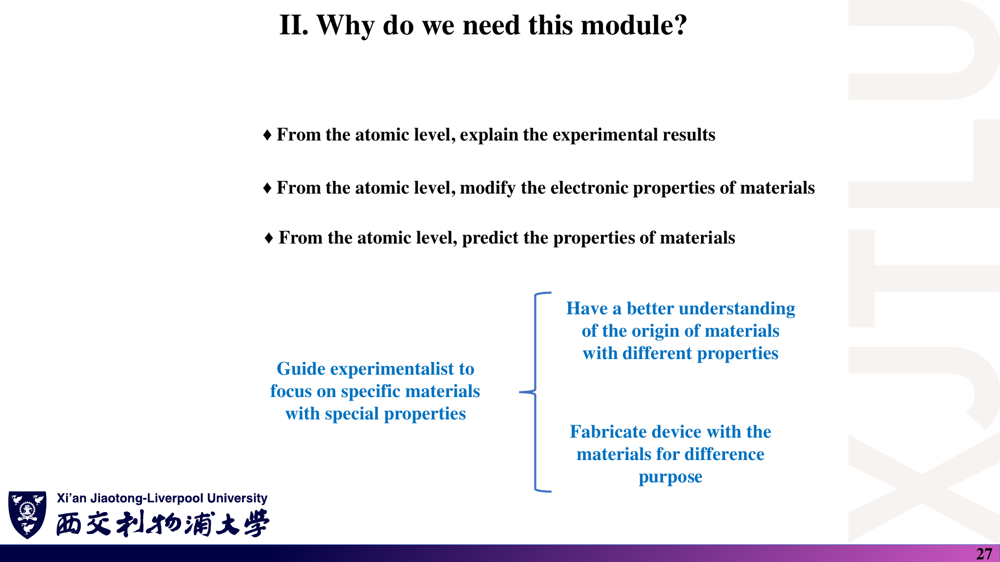

### 中文解释

不要只记材料名称和“性能变好”。需要追问：改了什么结构？影响哪种相互作用？计算的是哪个可观测量？实验和模型是否比较了相同条件？

### 原理深入

可以将结构、掺杂和外场统一记为参数 $\lambda$，构造 $H(\lambda)$，求 $E_n(\lambda)$ 与 $|n(\lambda)\rangle$，再计算观测量。仅发现两条曲线同时变化只能说明相关性；解释机制还需要控制变量、分析轨道成分，并排除其他变化。

建议对每个案例都回答四个问题：

```text
改了什么？ → 哪个微观量变了？ → 哪个可观测性质变了？ → 有什么应用？
```

例如：掺杂 → 轨道能量与杂化改变 → 能带/吸收改变 → 光电器件。

以下是**讲义展示的案例及其解释主线**，不是对所有同类材料都成立的定律。

### Ref

- **原课件**：[Lecture One，PDF 第 27 页](../Lecture_One.pdf#page=27)。
- **方法衔接**：[哈密顿量与本征问题](03_哈密顿量与基组.md)，说明如何从模型走向可检验的量。

## 3. 第一类：解释实验结果〔pp. 6–13〕

### 课件截图

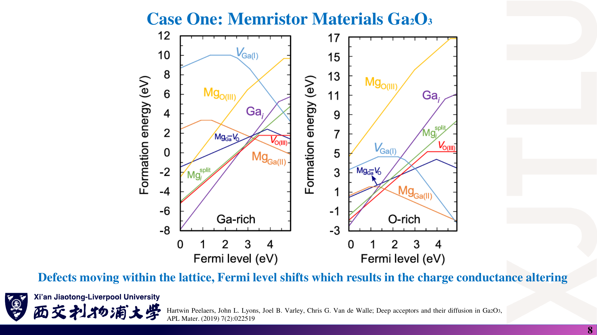

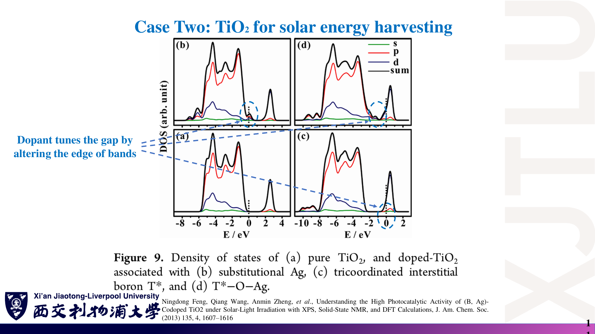

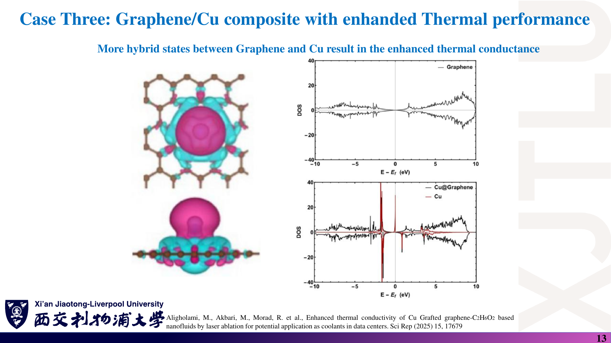

### 中文解释

三组图分别把宏观的电阻切换、光吸收和热输运，与缺陷、能带及界面耦合联系起来。读图时先辨认各曲线代表的构型，再确认横纵轴的物理量，不要把电子 DOS 图直接读成热导率。

### 原理深入

缺陷可能改变载流子数、局域能级和迁移势垒；掺杂也可能引入新的光学跃迁通道。但“带隙变小”并不单独决定光吸收强度，因为跃迁矩阵元、占据和选择定则同样重要。界面热输运还涉及声子谱与散射，因此电子杂化只是可能的机制线索之一。

| 案例 | 讲义关注的现象 | 微观解释主线 | 页码 |
|---|---|---|---|
| Ga₂O₃ 忆阻材料 | 电场作用下电阻或电导发生切换 | 带电缺陷迁移与重排，改变电子结构及费米能级相关状态，影响导电 | 6–8 |
| Ag 掺杂 TiO₂ | 与未掺杂样品相比，太阳能吸收改善 | 掺杂或共掺杂改变带边与带隙相关电子结构 | 9–11 |
| 石墨烯 / Cu 复合系统 | 热传导性能改善 | 讲义用界面杂化与耦合解释热输运变化 | 12–13 |

理解重点：

- 缺陷并不总是“坏东西”，也可能是功能来源。
- 掺杂不仅是增加一种元素，还会改变局域势、载流子和电子态。
- 电子结构能帮助解释输运，但**不能只凭一张能带图就算出完整的热导率**。
- TiO₂ 案例中的实验引用涉及 Ag 掺杂，而理论引用涉及 B/Ag 共掺杂；比较时不要视为完全相同的模型。

### Ref

- **原课件**：[Lecture One，PDF 第 6–8 页](../Lecture_One.pdf#page=8)、[第 9–11 页](../Lecture_One.pdf#page=11)、[第 12–13 页](../Lecture_One.pdf#page=13)。
- **课件所引研究**：Peelaers et al., *Deep acceptors and their diffusion in Ga₂O₃*, APL Materials 7, 022519 (2019)；Feng et al., *Understanding the High Photocatalytic Activity of (B, Ag)-Codoped TiO₂…*, JACS 135, 1607–1616 (2013)。书目信息来自截图，未独立核读全文。

## 4. 第二类：主动调控材料性质〔pp. 14–21〕

### 课件截图

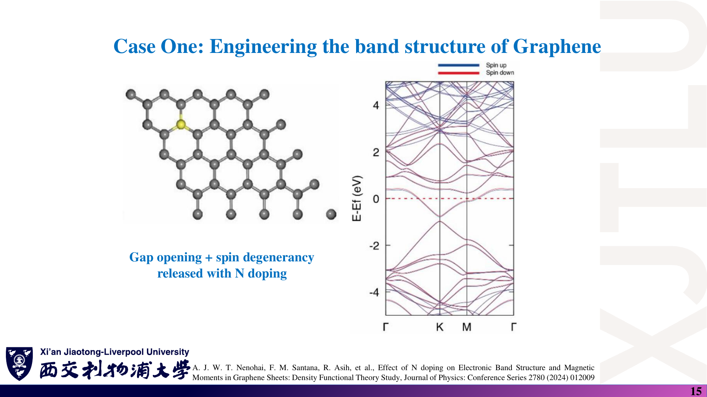

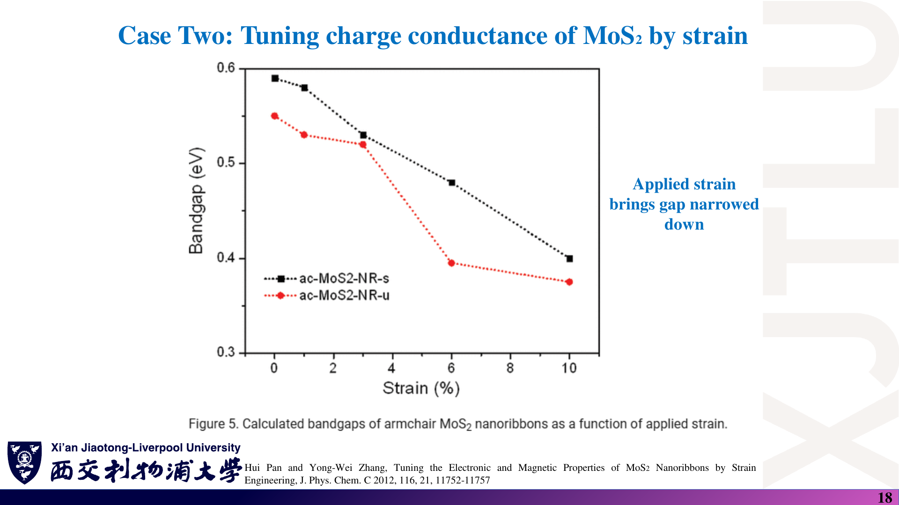

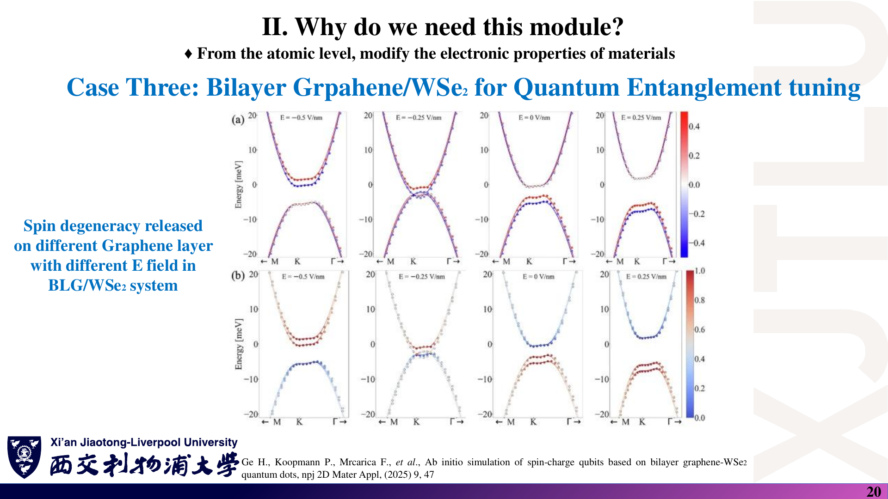

### 中文解释

掺杂、应变和电场都是调节哈密顿量的“旋钮”。截图给出的是各自指定模型的响应，重点是比较改变条件前后，带隙、能级或自旋分量如何变化。

### 原理深入

应变改变键长与轨道重叠，从而改变跃迁参数；掺杂改变局域势、电子数，并可能破坏对称性。是否开隙取决于相关态是否被允许耦合，不能仅从“加入杂质”推断。自旋简并的变化还要考虑时间反演、反演对称性、磁性与 SOC，而非只看元素名称。

| 调控手段 | 系统 | 讲义展示的变化 | 页码 |
|---|---|---|---|
| N 掺杂 | 石墨烯 | 所示模型中出现开隙、自旋简并解除，并比较掺杂比例与带隙 | 14–16 |
| 应变工程 | MoS₂ 纳米带 | 所示应变条件下带隙变窄，出现影响低能输运的电子态 | 17–19 |
| 电场与异质结构 | 双层石墨烯 / WSe₂ | 调控层相关自旋性质，用于自旋—电荷量子比特研究 | 20–21 |

**概念补充**：

- **Band gap，带隙**：价带顶与导带底之间的能量间隔。
- **Degeneracy，简并**：不同独立量子态具有相同本征值。
- **Hybridisation，杂化**：原本不同轨道或不同组分的态发生混合。
- **Strain，应变**：结构的相对形变，能改变键长、对称性和轨道耦合。

> 不要记成“N 掺杂必然让所有石墨烯开隙”或“任何应变都会提高电导”。结果依赖构型、浓度、边缘、对称性、费米能级与散射机制。

### Ref

- **原课件**：[Lecture One，PDF 第 14–16 页](../Lecture_One.pdf#page=15)、[第 17–19 页](../Lecture_One.pdf#page=18)、[第 20–21 页](../Lecture_One.pdf#page=20)。
- **课件所引研究**：Pan & Zhang, *Tuning the Electronic and Magnetic Properties of MoS₂ Nanoribbons by Strain Engineering*, J. Phys. Chem. C 116, 11752–11757 (2012)；Ge et al., *Ab initio simulation of spin-charge qubits based on bilayer graphene-WSe₂ quantum dots*, npj 2D Materials and Applications 9, 47 (2025)。
- **理论衔接**：[微扰、能级排斥与 SOC](04_周期势_微扰与SOC.md)。

## 5. 第三类：预测与器件设计〔pp. 22–26〕

### 课件截图

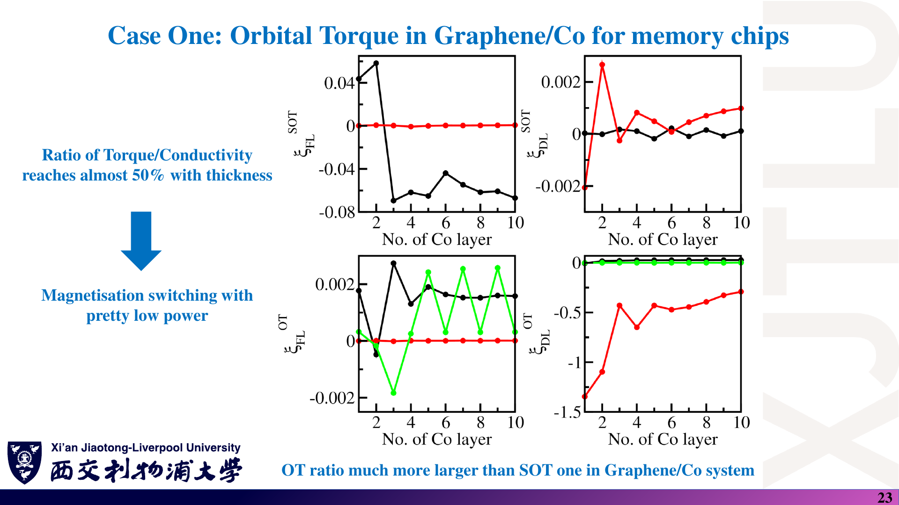

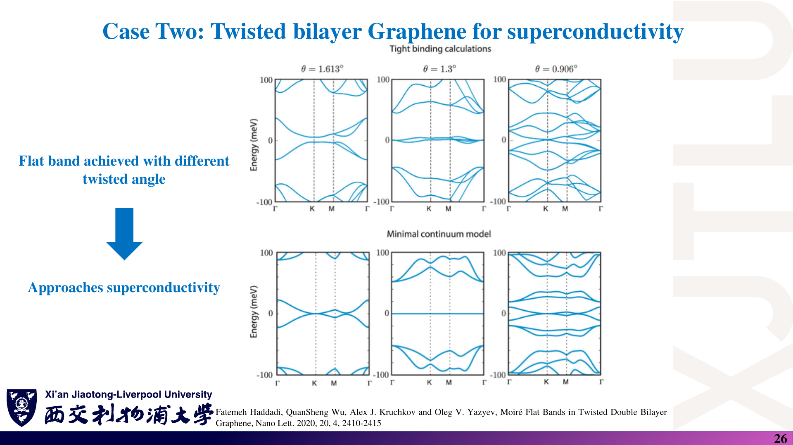

### 中文解释

第一张图讨论磁化操控效率，第二张讨论扭角改变能带。它们共同说明：计算可以筛选值得实验探索的材料或结构，但计算发现某个特征，不等于已经验证了整套器件性能。

### 原理深入

对孤立能带，波包群速度与色散斜率相关：$\mathbf v_n=\hbar^{-1}\nabla_{\mathbf k}E_n$。平带的低色散使相互作用相对动能可能更重要，但超导还需要配对与相干性等条件。力矩效率则是响应问题，通常还涉及占据、矩阵元和耗散，不能只由能带形状直接推出。

#### 5.1 石墨烯 / Co 中的轨道力矩

讲义展示能带与力矩相关结果，并讨论低功耗磁化翻转和存储器应用。

需要区分：

- **Orbital Torque，OT**：轨道角动量相关的力矩机制。
- **Spin-Orbit Torque，SOT**：自旋轨道力矩。
- **Charge conductivity**：电导率，不是磁化翻转速度。

原讲义给出的比值、时间等案例数值没有在这里当作普适指标；使用时应回到 pp. 22–24 确认定义、单位和适用体系。

#### 5.2 扭转石墨烯体系与平带

讲义借助不同扭角/堆垛下的电子结构，说明结构设计可形成平带，进而探索关联电子行为与超导相关问题。

**重要限定**：

- 平带意味着 $E(\mathbf k)$ 对波矢的变化较小，但**平带不等于已经证明超导**。
- 讲义标题使用 twisted bilayer graphene，所引论文题目为 *Moiré Flat Bands in Twisted Double Bilayer Graphene*，实际阅读时要区分扭转双层与扭转双双层体系。

### Ref

- **原课件**：[Lecture One，PDF 第 22–24 页](../Lecture_One.pdf#page=23)、[第 25–26 页](../Lecture_One.pdf#page=26)。
- **课件所引研究**：Haddadi et al., *Moiré Flat Bands in Twisted Double Bilayer Graphene*, Nano Letters 20, 2410–2415 (2020)。注意题目是 twisted **double** bilayer。
- **延伸**：[SS1：能带与半经典电子动力学](README.md#ref-ss1)。

## 6. 怎样授课与考核？〔pp. 28–31〕

### 课件截图

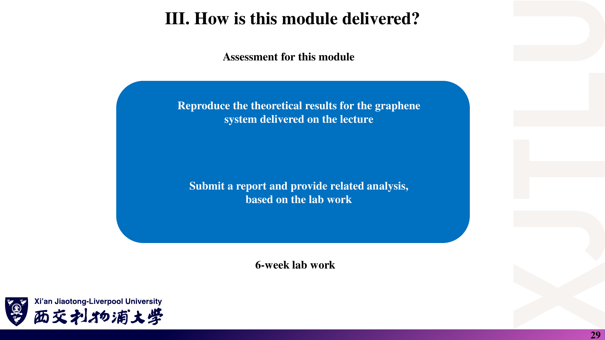


### 中文解释

课程要求不仅是画出结果，还要根据实验计算提交分析报告。目前这组课件只给出总体方向，没有完整评分细则。

### 原理深入

复现应区分三个层次：模型一致、数值结果一致、物理解读一致。例如 DOS 是对整个布里渊区的态计数，不能只拿一条高对称 k 路径上的能量当作完整 DOS；电导率还要引入相应输运表达式。

#### 教学安排

- 理论课：每周 4 小时 × 13 周，合计 **52 小时**。
- 实验：每周 4 小时 × 6 周，合计 **24 小时**。
- 实验时间段：第 8–13 周。

#### 讲义列出的实验与考核方向

围绕**本征石墨烯（pristine graphene）**复现理论结果：

1. 能带结构（Band structure）。
2. 态密度（Density of States，DOS）。
3. 电导率（Charge conductivity）。
4. 根据实验计算提交报告，并分析结果。

讲义说明可以使用 Python、Matlab 或其他编程语言。未给出分项权重、截止日期、代码框架或完整评分细则，需等待正式实验要求。

### Ref

- **原课件**：[Lecture One，PDF 第 28–31 页](../Lecture_One.pdf#page=29)。
- **范围说明**：本节的复现层次与 DOS 提醒是学习补充，不是官方评分标准。

## 7. 13 周路线图〔p. 30〕

### 课件截图


### 中文解释

课程先讲量子力学与晶体结构，再用 TB 练习能带和响应，最后过渡到 DFT、OpenMX 与更实际的自旋力矩问题。

### 原理深入

这条顺序有依赖关系：不懂基底与矩阵，很难解释 TB；不懂倒空间，很难区分 k 点采样与实空间网格；不懂态和占据，也难以理解 DOS 与输运。后续软件操作应建立在这些概念上，而不是替代它们。

| 周次 | 内容 |
|---|---|
| 1 | 量子力学简要介绍 |
| 2 | 实空间与倒空间中的晶体结构 |
| 3 | TB 与能带计算 |
| 4 | TB 与态密度计算 |
| 5 | TB 与自旋纹理 |
| 6 | TB 与电导率 |
| 7 | Kubo–Greenwood 与 NEGF 输运方法 |
| 8 | Fortran 编程与并行化 |
| 9 | DFT |
| 10 | OpenMX 软件介绍 |
| 11 | 使用 OpenMX 计算能带与 DOS |
| 12 | 从 OpenMX 获取哈密顿量与重叠矩阵 |
| 13 | OpenMX + 数值编程：石墨烯 / Co 中的 SOT 案例 |

### Ref

- **原课件**：[Lecture One，PDF 第 30 页](../Lecture_One.pdf#page=30)。
- **实践文档**：[OMX：OpenMX 用户手册](README.md#ref-openmx)。

## 8. 给后续实验的准备建议〔补充〕

### 课件截图

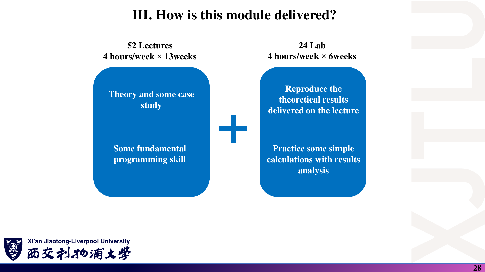

### 中文解释

截图中的实验承担“把理论做出来”的任务。下列建议把这个目标转成日常检查习惯，并不是老师额外布置的要求。

### 原理深入

数值收敛回答“给定模型是否算准”，模型验证回答“所选模型是否适合这个材料”，两者不能混同。一个残差很小的本征解，仍然可能来自错误的参数或不恰当的边界条件。

第一周就应该养成三个习惯：

1. **写清基底顺序**：矩阵每一行、每一列对应哪个轨道或自旋。
2. **写清单位和参数**：能量、长度、耦合常数和波矢不能混用单位。
3. **检查结果而不是只画图**：验证厄米性、归一化、本征方程残差，以及网格/采样的收敛性。

建议报告结构：物理问题 → 模型与假设 → 计算方法 → 参数与收敛 → 结果 → 物理解释 → 局限性。此结构为学习建议，不是官方模板。

### Ref

- **原课件**：[Lecture One，PDF 第 28–31 页](../Lecture_One.pdf#page=28)。
- **计算检查**：[第三讲：数值结果检查](03_哈密顿量与基组.md)；[NUM：厄米本征求解器](README.md#ref-num)。

## 本讲自测

- [ ] 能各举一个“解释、调控、预测”的案例。
- [ ] 能区分 TB、DFT 与 MD 的主要用途。
- [ ] 能说出后续石墨烯实验需要计算的三个核心量。
- [ ] 能说明“某篇论文的结果”为什么不等于“所有材料的普遍规律”。
