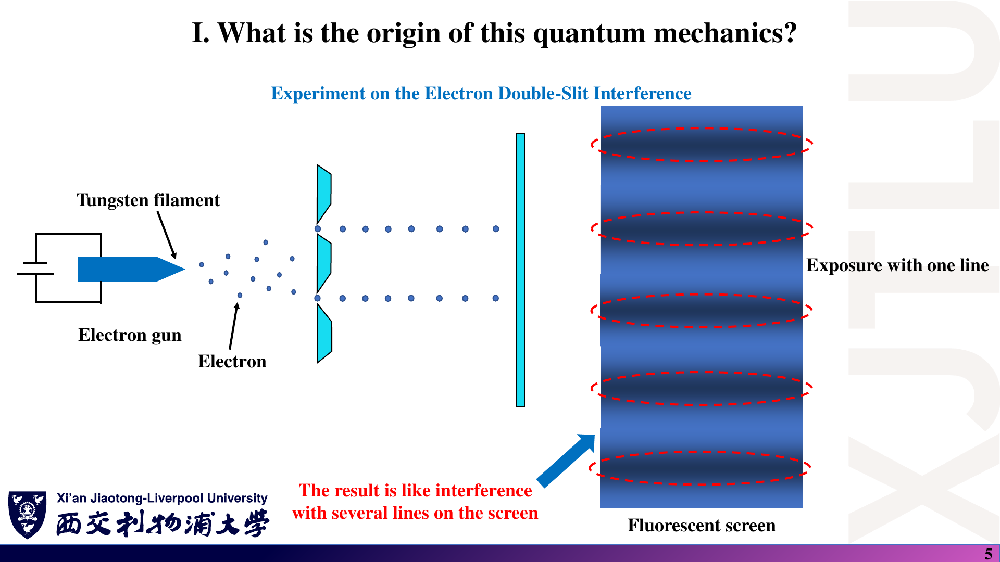
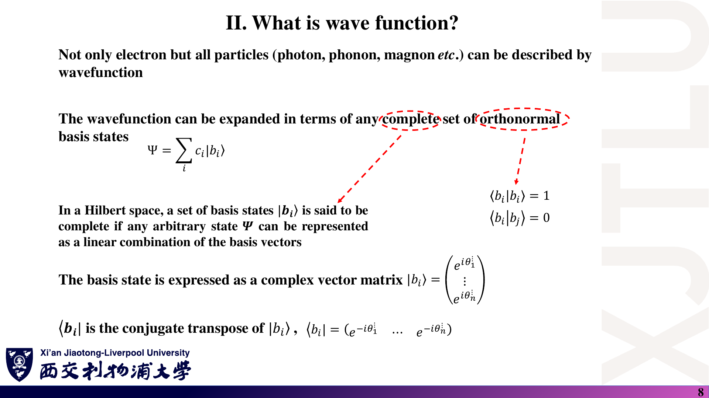
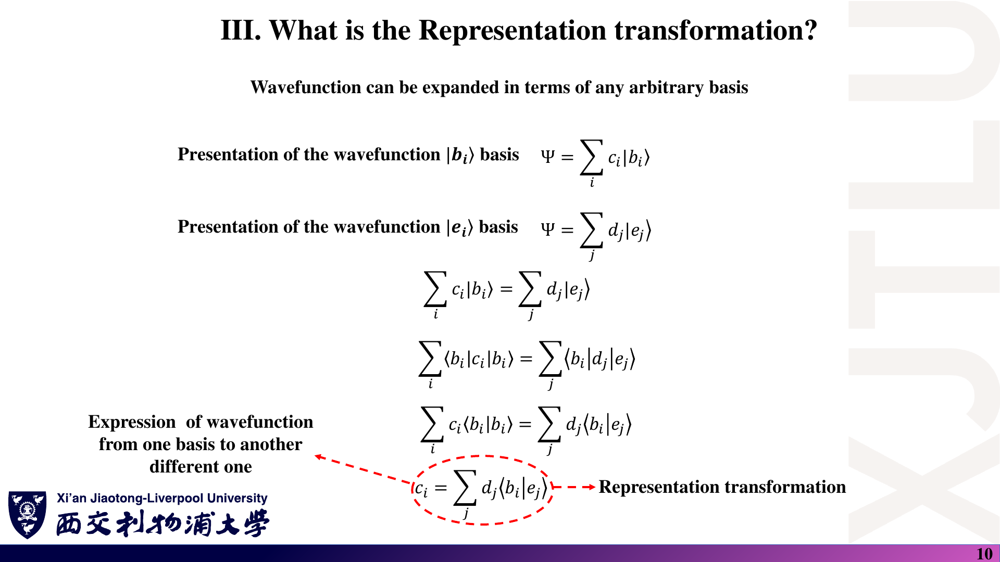
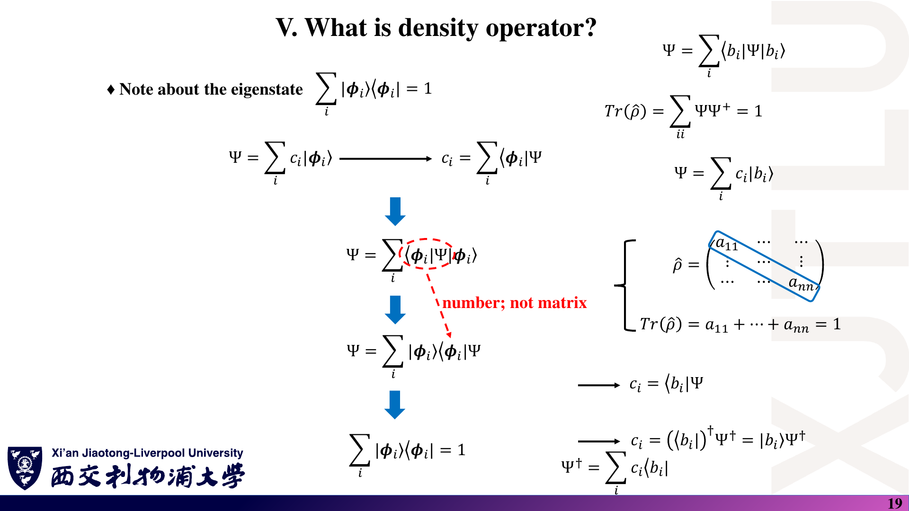

# 02 · 波函数、表象变换、期望值与密度算符

来源：[Lecture_Two.pdf](../Lecture_Two.pdf)，21 页。

[返回目录](README.md)

## 1. 从电子双缝实验理解概率幅〔pp. 3–7〕

### 课件截图

### 中文解释

单个电子在屏幕上留下一个局域探测点；许多次同样制备的实验才显现条纹。波函数不是电子物质被涂抹在空间中的图像，而是用于计算测量概率的复概率幅。

### 原理深入

双缝实验中，单次电子探测表现为一个局域事件；在保持两路径相干、未获得路径信息时，大量事件形成干涉条纹。

重点不是“电子被切成两半”，而是：**两条路径对应的概率幅相加，再取模平方得到概率密度。**

**补充展开**：设两条路径的贡献为 $\psi_1$ 和 $\psi_2$，则

$$
\psi=\psi_1+\psi_2,
$$

$$
|\psi|^2=|\psi_1|^2+|\psi_2|^2
+2\operatorname{Re}(\psi_1^*\psi_2).
$$

最后一项是干涉项。若两路径失去相干性，统计平均下该项可能消失。

#### 概率幅、概率密度与概率

- $\psi(\mathbf r,t)$：位置表象下的波函数，即概率幅，通常为复数。
- $|\psi(\mathbf r,t)|^2$：概率密度。
- 区域 $\Omega$ 内找到粒子的概率：

$$
P(\Omega,t)=\int_\Omega|\psi(\mathbf r,t)|^2\,d^3r.
$$

- 对可归一化单粒子态：

$$
\int_{\mathbb R^3}|\psi(\mathbf r,t)|^2\,d^3r=1.
$$

在三维位置表象下，$|\psi|^2$ 的量纲是长度的负三次方，不能把它直接当成无量纲概率。连续空间中“恰好某一点”的概率与该点概率密度也不是同一个概念。

**进一步理解相位**：若 $\psi_1=Ae^{i\theta_1}$、$\psi_2=Be^{i\theta_2}$，干涉项为 $2AB\cos(\theta_2-\theta_1)$。可观测的是相对相位；给整个态乘同一个 $e^{i\chi}$ 不改变任何概率。

### Ref

- **原课件**：[Lecture Two，PDF 第 3–7 页](../Lecture_Two.pdf#page=5)。截图分别为第 5、7 页。
- **延伸**：[QM1：统计解释与概率流相关主题](README.md#ref-qm1)。

## 2. 态、基底与 Dirac 符号〔pp. 8–9〕

### 课件截图

*原图的基向量分量和多列态表示是易错点；下面使用一般复向量的规范写法。*

### 中文解释

基底相当于“描述量子态用的坐标轴”。$|\psi\rangle$ 是抽象态，$c_i$ 是选定基底下的坐标；换一组基底，坐标会变，物理态不因此改变。

### 原理深入

#### 2.1 抽象态与坐标表示

抽象量子态记为 $|\psi\rangle$；位置波函数是

$$
\psi(\mathbf r)=\langle\mathbf r|\psi\rangle.
$$

在离散正交归一基 $\{|b_i\rangle\}$ 中：

$$
|\psi\rangle=\sum_i c_i|b_i\rangle,
\qquad c_i=\langle b_i|\psi\rangle.
$$

在该基底下，一个态表示为**列向量**：

$$
c=\begin{pmatrix}c_1\\c_2\\\vdots\\c_N\end{pmatrix}.
$$

将多个不同态并排放置才会形成多列矩阵。不要把“单个态的展开”误记成任意 $N\times N$ 矩阵。

#### 2.2 四种常用对象

| 对象 | 记号 | 有限维矩阵形状 | 含义 |
|---|---|---|---|
| ket | $\lvert\psi\rangle$ | $N\times1$ | 态向量 |
| bra | $\langle\psi\rvert$ | $1\times N$ | ket 的共轭转置 |
| 内积 | $\langle\phi\vert\psi\rangle$ | $1\times1$ | 复数，衡量态之间的重叠 |
| 外积 | $\lvert\psi\rangle\langle\phi\rvert$ | $N\times N$ | 算符 |

特别注意：

$$
\langle\psi|=(|\psi\rangle)^\dagger
=\sum_i c_i^*\langle b_i|.
$$

复共轭不能漏掉。

#### 2.3 正交归一性与完备性

$$
\langle b_i|b_j\rangle=\delta_{ij},
\qquad
\sum_i|b_i\rangle\langle b_i|=I.
$$

因此

$$
\langle\psi|\psi\rangle=\sum_i|c_i|^2=1.
$$

- **正交**：不同基向量内积为零。
- **归一**：每个基向量范数为一。
- **完备**：其线性组合能够表示所考虑空间中的任意态。

实际计算会截断基组；截断空间中的“完备”不代表已经精确覆盖完整物理问题。

**为什么展开系数是内积？** 左乘 $\langle b_j|$，有 $\langle b_j|\psi\rangle=\sum_i c_i\delta_{ji}=c_j$。若基底不正交，这一步就不能直接把其余项消掉，后面会出现重叠矩阵。

### Ref

- **原课件**：[Lecture Two，PDF 第 8–9 页](../Lecture_Two.pdf#page=8)。
- **延伸**：[QM2：复向量空间与 Dirac 记号](README.md#ref-qm2)。
- **图文核对**：[勘误：态向量形状与复共轭](07_讲义勘误与易错点.md)。

## 3. 表象变换：换坐标，不换物理态〔pp. 10–12〕

### 课件截图

### 中文解释

截图中的重叠 $\langle b_i|e_j\rangle$ 就是新基向量在旧基中的第 i 个分量。它组成换基矩阵。重点不是记住一个固定乘法方向，而是先确认矩阵的定义。

### 原理深入

同一个态可以写成

$$
|\psi\rangle=\sum_i c_i|b_i\rangle
=\sum_j d_j|e_j\rangle.
$$

左乘 $\langle b_i|$：

$$
c_i=\sum_j\langle b_i|e_j\rangle d_j.
$$

定义

$$
U_{ij}=\langle b_i|e_j\rangle,
$$

得到

$$
\boxed{c=Ud},\qquad d=U^\dagger c.
$$

两套基均为同一空间的正交归一完备基时，$U$ 是酉矩阵：

$$
U^\dagger U=UU^\dagger=I.
$$

**补充：算符也要一起换基。** 若 $A_b$、$A_e$ 分别表示两套基中的同一算符，则

$$
A_e=U^\dagger A_bU,
$$

所以

$$
c^\dagger A_bc=d^\dagger A_ed.
$$

换基会改变坐标和矩阵元素，但不改变预测的期望值。

**酉性从哪里来？** 插入旧基的完备性：$(U^\dagger U)_{jk}=\sum_i\langle e_j|b_i\rangle\langle b_i|e_k\rangle=\langle e_j|e_k\rangle=\delta_{jk}$。因此换基既保留内积，也保留归一化与测量概率。

### Ref

- **原课件**：[Lecture Two，PDF 第 10–12 页](../Lecture_Two.pdf#page=10)。
- **延伸**：[QM2：表象变换与酉变换](README.md#ref-qm2)。
- **手算检验**：[复习题第 5 题](06_复习题与参考答案.md)。

## 4. 连续表象：位置与动量的 Fourier 变换〔pp. 13–14〕

### 课件截图

### 中文解释

动量确定的态，在位置空间表现为平面波。因此把一个位置波函数分解成不同动量的成分，数学上就是做 Fourier 变换。

### 原理深入

离散求和变为连续积分：

$$
I=\int|x\rangle\langle x|\,dx
=\int|p\rangle\langle p|\,dp.
$$

采用一维约定

$$
\langle x|p\rangle=\frac{1}{\sqrt{2\pi\hbar}}e^{ipx/\hbar},
$$

则

$$
\boxed{\phi(p)=\frac{1}{\sqrt{2\pi\hbar}}
\int_{-\infty}^{\infty}e^{-ipx/\hbar}\psi(x)\,dx},
$$

$$
\boxed{\psi(x)=\frac{1}{\sqrt{2\pi\hbar}}
\int_{-\infty}^{\infty}e^{ipx/\hbar}\phi(p)\,dp}.
$$

**记忆方法**：$\langle p|x\rangle=\langle x|p\rangle^*$，因此正反变换的指数符号相反。

严格来说，位置和动量本征态采用 Dirac delta 归一化，不是普通平方可积的归一化向量；实际波包可以归一化。

**为何平面波对应动量本征态？** 解 $-i\hbar\,d f_p(x)/dx=p f_p(x)$，得到 $f_p(x)=C e^{ipx/\hbar}$。在 $\langle p|p'\rangle=\delta(p-p')$ 的约定下选 $C=(2\pi\hbar)^{-1/2}$，便得到课件中的变换核。归一化因子与指数符号必须成套使用。

### Ref

- **原课件**：[Lecture Two，PDF 第 13–14 页](../Lecture_Two.pdf#page=14)。
- **延伸**：[QM1：动量表象](README.md#ref-qm1)；[QM2：连续基与 Fourier 变换](README.md#ref-qm2)。

## 5. 可观测量与期望值〔pp. 15–17〕

### 课件截图

*第 15 页把简化公式与“本征态”联系得过紧；第 17 页的“所有算符”需限定为可观测量相关算符。*

### 中文解释

期望值是重复测量的平均，不是一次实验必然得到的数值。归一化与本征态是两个独立概念：任意归一化态都能使用 $c^\dagger Ac$，只有处于相应本征态时测量结果才确定。

### 原理深入

#### 5.1 期望值不是一次测量必然得到的值

对同样制备的量子态重复测量，结果的统计平均为

$$
\boxed{\langle A\rangle
=\frac{\langle\psi|\hat A|\psi\rangle}
{\langle\psi|\psi\rangle}}.
$$

只要态已归一化，就可写成

$$
\langle A\rangle=\langle\psi|\hat A|\psi\rangle=c^\dagger Ac.
$$

**不要求这个态是本征态。**

若 $\hat A|a_n\rangle=a_n|a_n\rangle$，且

$$
|\psi\rangle=\sum_n\alpha_n|a_n\rangle,
$$

在离散正交本征基中

$$
\langle A\rangle=\sum_n|\alpha_n|^2a_n.
$$

单次测量得到某个本征值；平均值可能不是任何本征值。存在简并时，应将对应本征子空间内的概率相加。

#### 5.2 为什么使用厄米算符？

有限维中，可观测量由厄米矩阵表示：

$$
A=A^\dagger.
$$

从而

$$
(c^\dagger Ac)^*=c^\dagger A^\dagger c=c^\dagger Ac,
$$

保证期望值为实数，也保证本征值为实数。

注意：**并不是量子力学中的所有算符都必须厄米**。升降算符通常不是；无限维可观测量更严格地涉及自伴性和定义域。

#### 5.3 动量算符

位置表象下，单粒子的正则动量为

$$
\hat{\mathbf p}=-i\hbar\nabla,
\qquad \hat p_x=-i\hbar\frac{\partial}{\partial x}.
$$

一维期望值为

$$
\langle p_x\rangle=
\int\psi^*(x)\left(-i\hbar\frac{d}{dx}\right)\psi(x)\,dx.
$$

三维动量是三个分量组成的矢量算符，不是脱离基底后就能通用地写成一个 $3\times3$ 数值矩阵。

**如何量化结果是否确定？** 对厄米 $A$，方差为

$$
(\Delta A)^2=\langle A^2\rangle-\langle A\rangle^2
=\|(A-\langle A\rangle)|\psi\rangle\|^2\ge0.
$$

方差为零意味着 $(A-\langle A\rangle)|\psi\rangle=0$，即态位于相应本征子空间。它比“期望值是实数”更强，后者本身并不意味着测量结果确定。

### Ref

- **原课件**：[Lecture Two，PDF 第 15–17 页](../Lecture_Two.pdf#page=15)。
- **延伸**：[QM1：可观测量、测量与方差](README.md#ref-qm1)。方差推导为补充。

## 6. 密度算符与迹〔pp. 18–20〕

### 课件截图

*第 18 页展开系数一般应为 $c_i c_j^*$；原截图保留了漏写共轭的原式。*

### 中文解释

密度算符把态的信息写成外积矩阵，使期望值可以统一写成迹。它不仅描述一个纯态，也能描述“以不同概率制备不同态”的统计混合。

### 原理深入

#### 6.1 纯态密度算符

对已归一化纯态：

$$
\boxed{\hat\rho=|\psi\rangle\langle\psi|},
$$

$$
\hat\rho=\sum_{ij}c_ic_j^*|b_i\rangle\langle b_j|,
\qquad \rho_{ij}=c_ic_j^*.
$$

- 对角元：该基底中的占据概率。
- 非对角元：该基底中的相干信息。
- 概率密度 $|\psi(x)|^2$ 与密度算符不是同一个对象；前者可写为 $\langle x|\rho|x\rangle$。

性质：

$$
\rho^\dagger=\rho,\qquad
\operatorname{Tr}\rho=1,\qquad
\rho^2=\rho.
$$

此外 $v^\dagger\rho v\ge0$，即半正定。

#### 6.2 用密度矩阵计算期望值

$$
\boxed{\langle A\rangle=\operatorname{Tr}(\rho A)
=\operatorname{Tr}(A\rho)}.
$$

有限维证明：

$$
\begin{aligned}
\operatorname{Tr}(A\rho)
&=\sum_i\langle b_i|A|\psi\rangle\langle\psi|b_i\rangle\\
&=\langle\psi|\left(\sum_i|b_i\rangle\langle b_i|\right)A|\psi\rangle\\
&=\langle\psi|A|\psi\rangle.
\end{aligned}
$$

这里交换的是复数因子，不是任意交换两个算符。$\operatorname{Tr}(A\rho)=\operatorname{Tr}(\rho A)$ **不代表** $A\rho=\rho A$。

#### 6.3 补充：混态为何也需要密度矩阵？

若系统以经典概率 $w_\alpha$ 制备为 $|\psi_\alpha\rangle$，则

$$
\rho=\sum_\alpha w_\alpha|\psi_\alpha\rangle\langle\psi_\alpha|,
\quad w_\alpha\ge0,\quad\sum_\alpha w_\alpha=1.
$$

仍满足厄米、半正定、迹为 1，但真正的混态有

$$
\operatorname{Tr}(\rho^2)<1.
$$

不能把“相干叠加”与“统计混合”混为一谈。

**纯态为何满足 $\rho^2=\rho$？** 外积相乘得到 $|\psi\rangle\langle\psi|\psi\rangle\langle\psi|=|\psi\rangle\langle\psi|$，中间内积因归一化等于 1。因此纯态密度算符就是对该一维子空间的投影。整体相位在外积中抵消，相对相位则可能保留在非对角元中。

### Ref

- **原课件**：[Lecture Two，PDF 第 18–20 页](../Lecture_Two.pdf#page=18)。
- **延伸**：[QC1：密度算符与统计混合](README.md#ref-qc1)。
- **核验**：[勘误：bra 和密度矩阵的复共轭](07_讲义勘误与易错点.md)。

## 7. 手算例题〔补充〕

### 课件截图

### 中文解释

下面的复数二分量例题是自编练习，不是截图中的原题。它用最小矩阵同时检验归一化、复共轭、密度矩阵和期望值，避免只会照抄实数例子。

### 原理深入

给定

$$
c=\frac1{\sqrt2}\begin{pmatrix}1\\i\end{pmatrix},
\qquad
A=\begin{pmatrix}1&0\\0&-1\end{pmatrix}.
$$

**第一步：共轭转置与归一化**

$$
c^\dagger=\frac1{\sqrt2}(1,-i),\qquad c^\dagger c=1.
$$

**第二步：密度矩阵**

$$
\rho=cc^\dagger=\frac12\begin{pmatrix}1&-i\\i&1\end{pmatrix}.
$$

**第三步：期望值**

$$
\langle A\rangle=c^\dagger Ac=0
=\operatorname{Tr}(\rho A).
$$

测量结果仍然只能是 $+1$ 或 $-1$，各有 $1/2$ 概率，**不是测得 0**。

若换成各以 $1/2$ 概率处于两个基态的混态，则 $\rho_{\rm mix}=I/2$。它们对这个 $A$ 的期望值相同，但密度矩阵和相干性不同。

### Ref

- **原课件公式依据**：[Lecture Two，PDF 第 15 页](../Lecture_Two.pdf#page=15)、[第 18–20 页](../Lecture_Two.pdf#page=19)。
- **延伸**：[QC1：纯态与混态](README.md#ref-qc1)。
- **进一步练习**：[复习题第 3–4 题](06_复习题与参考答案.md)，用另一个可观测量区分纯态与混态。

## 本讲最小必会清单

1. $\langle\psi|=\sum_i c_i^*\langle b_i|$。
2. $c_i=\langle b_i|\psi\rangle$，$\sum_i|c_i|^2=1$。
3. $U_{ij}=\langle b_i|e_j\rangle$，$c=Ud$。
4. $\langle A\rangle=c^\dagger Ac$。
5. $\rho=cc^\dagger$，$\langle A\rangle=\operatorname{Tr}(\rho A)$。

对照提醒：原讲义中共轭、态向量形状与期望值适用条件的几处问题见[勘误表](07_讲义勘误与易错点.md)。
