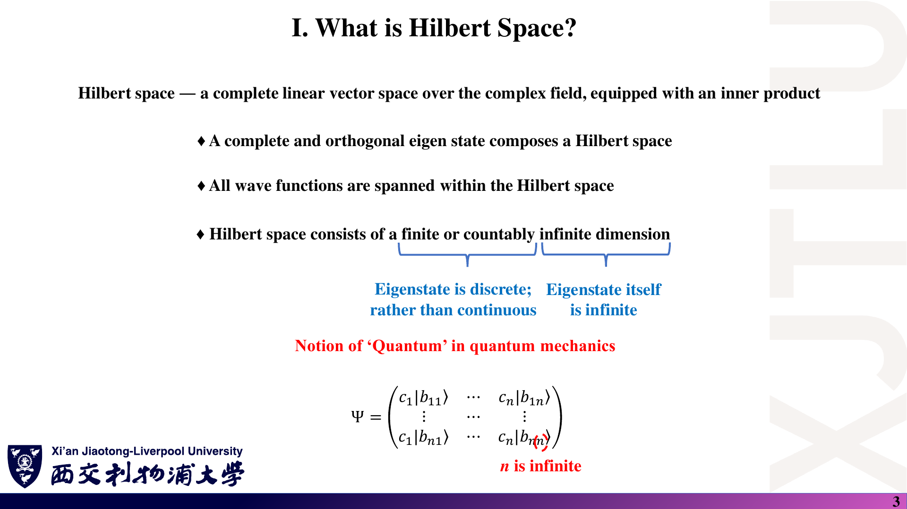
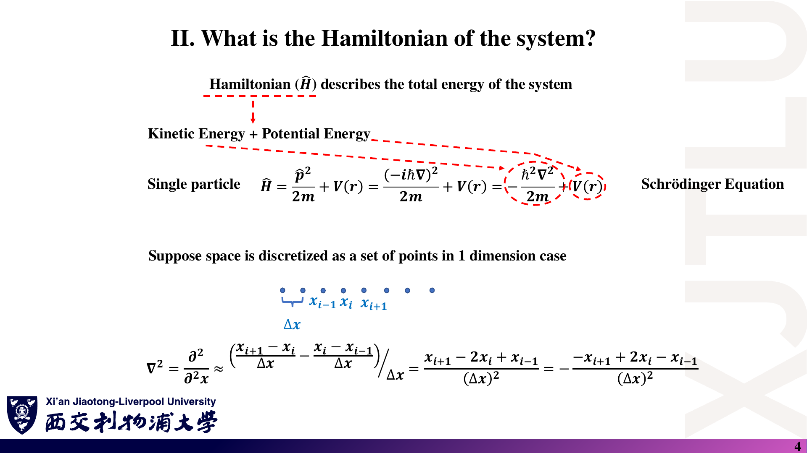
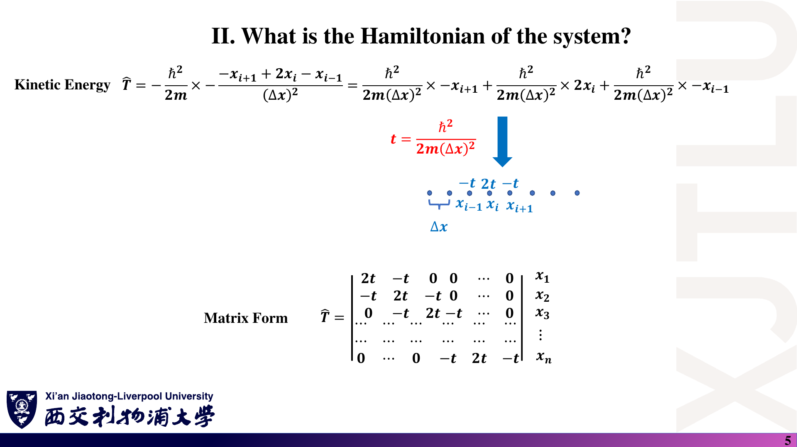
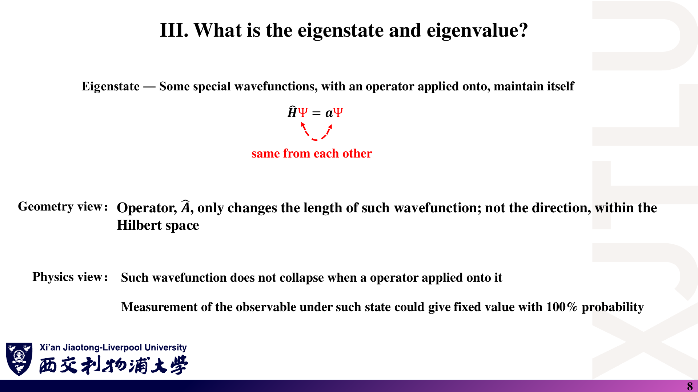
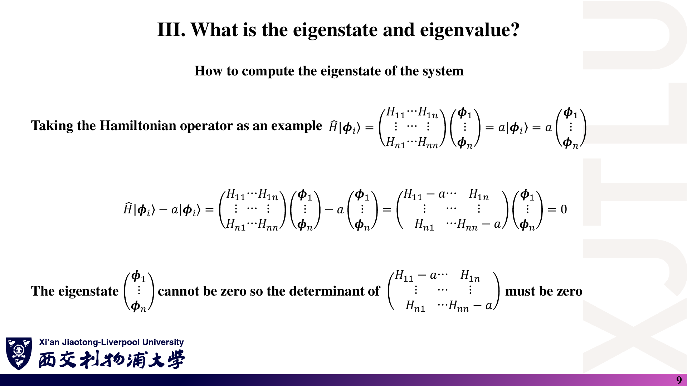
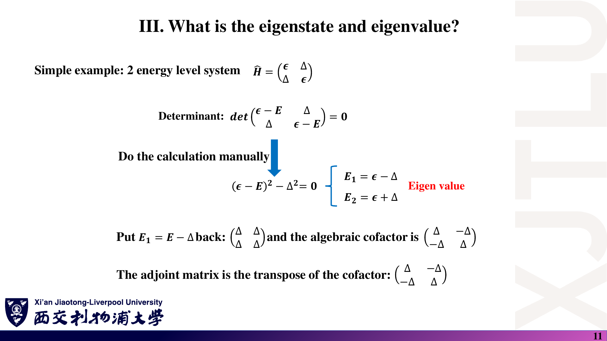
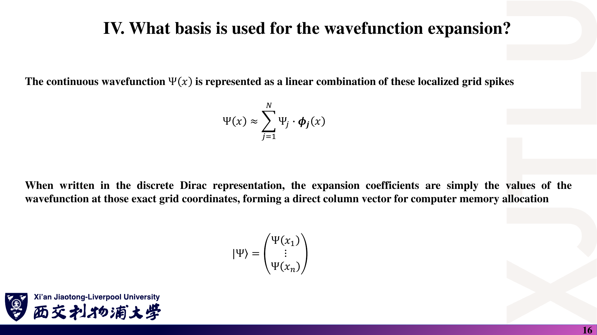
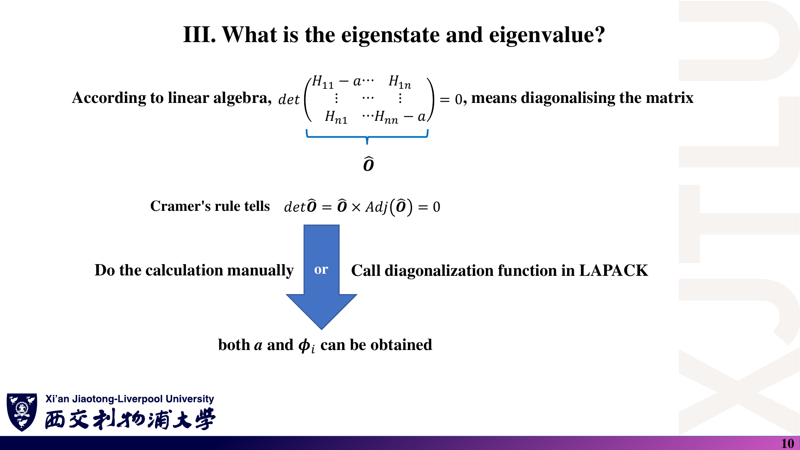

# 03 · Hilbert 空间、哈密顿量、本征问题与基组

来源：[Lecture_Three.pdf](../Lecture_Three.pdf)，17 页。

[返回目录](README.md)

## 1. Hilbert 空间是什么？〔p. 3〕

### 课件截图



*原图把可数维数与离散本征谱联系起来，这一推断需要纠正；看下面的区分。*

### 中文解释

Hilbert 空间是量子态所在的数学空间。内积让我们谈论概率、归一化和正交性；完备性则保证适当的极限过程不会把态带到这个空间之外。

### 原理深入

Hilbert 空间是**带有内积、且对内积诱导的范数完备的复线性空间**。

- 线性：态可以线性组合。
- 内积：可定义长度、正交性与重叠。
- 完备：空间中的 Cauchy 序列在该空间内有极限。

这里“空间完备”和“某组基底完备”相关但不是同一个定义。

#### 需要避免的误解

1. **量子态不必是某个指定算符的本征态**；一般态可以是其本征态的叠加。
2. 常见可分 Hilbert 空间可具有有限或可数无限的正交基，但**不能因此推断每个可观测量都只有离散谱**。
3. 束缚态常出现离散能级，自由粒子的动量/能量则可以具有连续谱。
4. 实际计算通常选择有限维子空间；维数由基组截断决定，不是“所有计算中的维数都无穷大”。

**区分“空间”与“算符的谱”**：平方可积波函数构成的空间可拥有可数正交基，但位置算符在其中仍具有连续谱。某组方便的展开基，与正在测量的算符的本征态集合，不必是同一组对象。有限矩阵计算得到离散本征值，也可能只是连续物理问题的离散近似。

### Ref

- **原课件**：[Lecture Three，PDF 第 3 页](../Lecture_Three.pdf#page=3)。
- **延伸**：[QM2：内积空间与量子态](README.md#ref-qm2)。
- **核验记录**：[Hilbert 空间相关易错点](07_讲义勘误与易错点.md)。

## 2. 哈密顿量描述什么？〔p. 4〕

### 课件截图



### 中文解释

哈密顿量是“这个模型总能量如何作用于波函数”的规则。它不仅用来求能量，还决定态随时间如何变化；写出哈密顿量只是开始，还需要边界条件和求解方程。

### 原理深入

哈密顿量 $\hat H$ 是总能量算符。

对无磁矢势、非相对论、质量为 $m$ 的单粒子模型：

$$
\boxed{\hat H=\frac{\hat{\mathbf p}^{\,2}}{2m}+V(\mathbf r)
=-\frac{\hbar^2}{2m}\nabla^2+V(\mathbf r)}.
$$

**补充：区分“算符定义”与“薛定谔方程”。**

- 定态方程：

$$
\hat H\phi_n(\mathbf r)=E_n\phi_n(\mathbf r).
$$

- 含时方程：

$$
i\hbar\frac{\partial\psi}{\partial t}=\hat H\psi.
$$

$\hat H=-\hbar^2\nabla^2/(2m)+V$ 本身只是算符表达式，还不是完整的薛定谔方程。

**定态方程从哪里来？** 若 $H$ 不显含时间，令 $\psi(\mathbf r,t)=\phi(\mathbf r)T(t)$，代入含时方程并分离变量，得到 $H\phi=E\phi$ 与 $T(t)=e^{-iEt/\hbar}$。单一能量本征态的时间变化是整体相位，因此其位置概率密度不随时间改变。

### Ref

- **原课件**：[Lecture Three，PDF 第 4 页](../Lecture_Three.pdf#page=4)。
- **延伸**：[QM1：薛定谔方程与定态](README.md#ref-qm1)。分离变量过程为补充推导。

## 3. 如何将微分算符变成矩阵？〔pp. 4–6〕

### 课件截图




*原截图末行与索引有排版问题；不要逐格照抄，应该从差分作用重新构造矩阵。*

### 中文解释

把连续波函数存为网格上的数值后，导数可由邻点差值近似。二阶导数只用相邻三个点，因而产生三对角矩阵：对角元包含 $2t+V_i$，相邻耦合为 $-t$。

### 原理深入

**从 Taylor 展开得到差分〔补充〕**：设 $h=\Delta x$，在足够光滑的区域，

$$
\psi(x_i\pm h)=\psi_i\pm h\psi_i'+\frac{h^2}{2}\psi_i''
\pm\frac{h^3}{6}\psi_i'''+\frac{h^4}{24}\psi_i^{(4)}+\cdots.
$$

相加后奇次项抵消，故

$$
\frac{\psi_{i+1}-2\psi_i+\psi_{i-1}}{h^2}
=\psi_i''+\frac{h^2}{12}\psi_i^{(4)}+O(h^4).
$$

所以二阶中心差分对二阶导数的局部截断误差为 $O(h^2)$。网格变细通常提高精度，但边界、势的光滑性和求解器误差也会影响最终结果。

#### 3.1 一维均匀网格

设网格点为 $x_i$，相邻间距为 $\Delta x$，波函数采样值为

$$
\psi_i=\psi(x_i).
$$

二阶中心差分：

$$
\frac{d^2\psi}{dx^2}\bigg|_{x_i}
\approx\frac{\psi_{i+1}-2\psi_i+\psi_{i-1}}{(\Delta x)^2}.
$$

**差分作用于波函数值 $\psi_i$，不是把坐标值 $x_i$ 当成波函数。**

定义能量尺度

$$
t=\frac{\hbar^2}{2m(\Delta x)^2}>0,
$$

得到

$$
(\hat T\psi)_i=-t\psi_{i-1}+2t\psi_i-t\psi_{i+1},
$$

$$
(\hat H\psi)_i=-t\psi_{i-1}+(2t+V_i)\psi_i-t\psi_{i+1},
\qquad V_i=V(x_i).
$$

#### 3.2 哈密顿量矩阵

若保留 $N$ 个内点，并在两端外侧施加零值边界条件 $\psi_0=\psi_{N+1}=0$，则

$$
H=
\begin{pmatrix}
2t+V_1&-t&0&\cdots&0\\
-t&2t+V_2&-t&\ddots&\vdots\\
0&-t&2t+V_3&\ddots&0\\
\vdots&\ddots&\ddots&\ddots&-t\\
0&\cdots&0&-t&2t+V_N
\end{pmatrix}.
$$

记住三类矩阵元：

$$
\boxed{H_{ii}=2t+V_i},\qquad
\boxed{H_{i,i\pm1}=-t},\qquad
H_{ij}=0\quad(|i-j|>1).
$$

势能在这种实空间表示中是对角的；动能连接相邻网格点。

#### 3.3 边界条件与归一化〔补充〕

- **零值边界（Dirichlet）**：不连接首尾网格点。
- **周期边界**：首尾相连；普通 $N\ge3$ 最近邻环形网格在角上增加 $H_{1N}=H_{N1}=-t$。
- 其他边界条件也会改变矩阵边缘行，不能先写矩阵、最后才考虑边界。

连续归一化近似为

$$
\sum_i|\psi_i|^2\Delta x\approx1.
$$

线性代数库通常返回 $\sum_i|c_i|^2=1$ 的向量。均匀网格下可以令

$$
c_i=\sqrt{\Delta x}\,\psi_i.
$$

绘制物理概率密度时，要注意这种缩放。讲义里用网格 delta 函数描述基底可作为直观图像，离散 Kronecker delta 与连续 Dirac delta 的归一化并不相同。

### Ref

- **原课件**：[Lecture Three，PDF 第 4–6 页](../Lecture_Three.pdf#page=5)、[第 15–16 页](../Lecture_Three.pdf#page=16)。
- **推导依据**：上面的 Taylor 展开直接给出差分系数与误差阶；边界和网格归一化为学习补充。
- **实操**：[复习题第 6 题](06_复习题与参考答案.md)；[NUM：厄米矩阵本征求解](README.md#ref-num)。

## 4. 本征态与本征值〔pp. 7–10〕

### 课件截图





### 中文解释

本征态在算符作用后仍与原向量成比例，这个比例就是本征值。求能量就是找哈密顿量的这些特殊方向，而不是先指定一个波函数再取任意平均。

### 原理深入

对一般态，$A|\psi\rangle$ 不一定与 $|\psi\rangle$ 成比例。

若非零态满足

$$
\boxed{A|a_n\rangle=a_n|a_n\rangle},
$$

则 $|a_n\rangle$ 是 $A$ 的本征态，$a_n$ 是对应本征值。

- 几何理解：作用结果仍在同一条一维子空间上，可能带有缩放或符号。
- 测量理解：处于这个本征态时，理想测量 $A$ 会确定地得到 $a_n$。
- **算符作用 $A|\psi\rangle$ 不等同于真实测量或测量坍缩。**

#### 4.1 从线性方程到特征方程

$$
Hc=Ec\quad\Rightarrow\quad(H-EI)c=0.
$$

要求 $c\ne0$，必须有

$$
\boxed{\det(H-EI)=0}.
$$

手算路线：求本征值 → 代回求零空间 → 归一化 → 检查。

#### 4.2 对角化

有限维厄米矩阵可写为

$$
U^\dagger HU=\mathrm{diag}(E_1,\ldots,E_N),
$$

其中 $U$ 的列是正交归一的本征向量。

**数值实践补充**：大矩阵通常不显式展开特征多项式。使用 LAPACK 或对应高级语言的厄米本征求解器，例如 NumPy 的 `eigh`；大型稀疏矩阵可只计算需要的少量本征对。

#### 4.3 伴随矩阵方法的适用范围

令 $O=H-EI$，正确恒等式为

$$
O\,\mathrm{adj}(O)=\det(O)I.
$$

若 $\det(O)=0$，且 $\mathrm{adj}(O)$ 中存在非零列，该列就在 $O$ 的零空间中，可作为本征向量。

但若零空间维数较大，伴随矩阵可能整体为零，因此此方法**不是处理所有简并情形的通用数值办法**。

不要混淆：$\mathrm{adj}(O)$ 是代数余子式构成的伴随矩阵，$O^\dagger$ 是共轭转置。

**不同本征值为何对应正交态？** 若 $H$ 厄米，$H|n\rangle=E_n|n\rangle$，则 $\langle m|H|n\rangle$ 可分别写成 $E_n\langle m|n\rangle$ 与 $E_m\langle m|n\rangle$。因此 $(E_n-E_m)\langle m|n\rangle=0$；当能量不同，内积只能为零。简并子空间内则需要主动选择正交基。

### Ref

- **原课件**：[Lecture Three，PDF 第 7–10 页](../Lecture_Three.pdf#page=9)。
- **延伸**：[QM2：厄米算符与谱分解](README.md#ref-qm2)；[NUM：`eigh` 返回的本征值与列向量](README.md#ref-num)。

## 5. 必会例题：二能级耦合〔pp. 11–12；纠正原页符号〕

### 课件截图




### 中文解释

两个未耦合时能量相同的基态，通过非对角项 $\Delta$ 混合，得到对称和反对称组合。第二张原图误把相差整体负号的向量列为两个不同态，必须用本征方程重新检验。

### 原理深入

设实参数 $\epsilon,\Delta$ 构成

$$
H=\begin{pmatrix}\epsilon&\Delta\\\Delta&\epsilon\end{pmatrix}.
$$

#### 第一步：求能量

$$
\det(H-EI)=(\epsilon-E)^2-\Delta^2=0.
$$

因此

$$
E_-=\epsilon-\Delta,\qquad E_+=\epsilon+\Delta.
$$

若 $\Delta>0$，$E_-$ 是较低能量；若 $\Delta<0$，顺序相反。实际能级间距为 $2|\Delta|$。

#### 第二步：求归一化本征向量

$$
|\phi_-\rangle=\frac1{\sqrt2}\begin{pmatrix}1\\-1\end{pmatrix},
\qquad
|\phi_+\rangle=\frac1{\sqrt2}\begin{pmatrix}1\\1\end{pmatrix}.
$$

直接验证：

$$
H\begin{pmatrix}1\\-1\end{pmatrix}
=(\epsilon-\Delta)\begin{pmatrix}1\\-1\end{pmatrix},
$$

$$
H\begin{pmatrix}1\\1\end{pmatrix}
=(\epsilon+\Delta)\begin{pmatrix}1\\1\end{pmatrix}.
$$

两态满足归一化、相互正交。$\Delta=0$ 时完全简并，可以选择任意正交归一基。

**原讲义 p. 12 把第二个向量写成第一个的负数；那不是另一个独立本征态。**

#### 物理含义

两个原本同能的态通过非对角耦合 $\Delta$ 混合，形成对称与反对称组合，能级分裂。这是理解轨道杂化、紧束缚与后续能级排斥的最小模型。

**相对符号为何影响能量？** 在实参数模型中，能量期望值包含耦合项 $\Delta(c_1^*c_2+c_2^*c_1)=2\Delta\mathrm{Re}(c_1^*c_2)$。当 $\Delta>0$ 时，反相组合降低能量，同相组合升高能量。若耦合符号相反，能量排序也相反，所以不能脱离哈密顿量符号约定就说“对称态必然最低”。

### Ref

- **原课件**：[Lecture Three，PDF 第 11–12 页](../Lecture_Three.pdf#page=11)。
- **核验**：[讲义勘误：二能级向量](07_讲义勘误与易错点.md)；[复习题第 7 题](06_复习题与参考答案.md)。
- **延伸**：[SS1：紧束缚与轨道耦合](README.md#ref-ss1)。

## 6. 三类常见基组或数值表示〔pp. 13–16〕

### 课件截图




### 中文解释

同一个物理问题可以用原子轨道、平面波或网格值来表示。选择基组就是选择压缩和计算波函数信息的方式；每种方式有自己的精度控制量，不能只比较矩阵维数。

### 原理深入

#### 6.1 局域原子轨道：LCAO

$$
\psi(\mathbf r)=\sum_{i\mu}c_{i\mu}\phi_\mu(\mathbf r-\mathbf R_i).
$$

- $i$：原子索引。
- $\mu$：轨道索引，例如 s、p、d。
- $\mathbf R_i$：原子位置。

常见形式：

$$
\phi_{\rm STO}=Nr^{n-1}e^{-\zeta r}Y_l^m(\theta,\varphi),
$$

$$
\phi_{\rm GTO}=Nx^ay^bz^ce^{-\alpha r^2}.
$$

**补充比较**：STO 的衰减形式接近原子轨道；GTO 便于许多积分的解析计算。局域轨道通常具有较直观的化学意义，但需检查轨道集合是否充分。

**重要补充：局域轨道不一定正交。** 定义

$$
S_{\mu\nu}=\langle\phi_\mu|\phi_\nu\rangle,
$$

则可能需要解广义本征问题

$$
\boxed{Hc=ESc},\qquad c^\dagger Sc=1.
$$

这与课程后面从 OpenMX 提取重叠矩阵相衔接。

#### 6.2 平面波基组

对给定晶体波矢 $\mathbf k$：

$$
\psi_{n\mathbf k}(\mathbf r)=\sum_{\mathbf G}c_{n\mathbf k,\mathbf G}
\frac{e^{i(\mathbf k+\mathbf G)\cdot\mathbf r}}{\sqrt\Omega}.
$$

- $\mathbf G$ 是倒格矢，满足 $e^{i\mathbf G\cdot\mathbf R}=1$。
- $\Omega$ 是所选归一化周期胞体积；晶胞归一与整个有限晶体归一要保持一致。
- $\mathbf k$ 的单位为长度的倒数，晶体动量通常写为 $\hbar\mathbf k$。

使用动能截断使基组有限：

$$
\frac{\hbar^2|\mathbf k+\mathbf G|^2}{2m}\le E_{\rm cut}.
$$

提高 $E_{\rm cut}$ 会增加平面波数量和计算成本，应测试结果是否收敛。

#### 6.3 实空间网格

用网格值 $\psi(x_i)$ 直接表示波函数，并以有限差分近似导数。

优点是势能与空间分布直观；精度和成本受网格间距、计算区域及差分阶数影响。

#### 一张表记住差异〔归纳〕

| 表示 | 基本对象 | 主要精度控制量 | 注意事项 |
|---|---|---|---|
| LCAO | 原子中心局域轨道 | 轨道数量、径向函数与范围 | 可能有非正交重叠矩阵 |
| 平面波 | $e^{i(\mathbf k+\mathbf G)\cdot\mathbf r}$ | 动能截断、k 点采样 | 周期边界与归一化约定 |
| 实空间网格 | 离散位置上的波函数值 | 网格间距、区域大小、差分阶数 | 边界条件与积分权重 |

**广义本征方程的来源〔补充〕**：将 $|\psi\rangle=\sum_jc_j|\phi_j\rangle$ 代入 $H|\psi\rangle=E|\psi\rangle$，左乘 $\langle\phi_i|$，得到 $\sum_jH_{ij}c_j=E\sum_jS_{ij}c_j$。因此重叠矩阵不是软件附加的修正项，而是非正交坐标本身带来的度量。

### Ref

- **原课件**：[Lecture Three，PDF 第 13–16 页](../Lecture_Three.pdf#page=13)。
- **延伸**：[SS1：晶体电子态与基底](README.md#ref-ss1)；[OMX：局域轨道基与计算设置](README.md#ref-openmx)。
- **推导说明**：$Hc=ESc$ 为衔接后续课程的补充推导，第一周课件未完整展开。

## 7. 数值结果的最低检查标准〔补充〕

### 课件截图



*原图伴随矩阵恒等式省略了单位矩阵；正确表达见第 4 节。*

### 中文解释

“程序跑完”只说明求解器返回了结果。要判断是否可信，需要分别检查数学残差、数值收敛和物理设置。

### 原理深入

可计算相对残差 $r_n=\|Hc_n-E_nc_n\|/[(\|H\|+|E_n|)\|c_n\|]$（分母非零时）。它检验给定矩阵是否求解准确，却不能证明基组已经收敛。还要增加截断或减小网格间距，观察目标能量、带隙等是否稳定。

```text
1. H 是否厄米：H† ≈ H？
2. 本征值是否为实数？
3. 本征向量是否归一化、相互正交？
4. 残差 ‖Hcₙ − Eₙcₙ‖ 是否足够小？
5. 改变网格、截断或计算区域，目标结果是否稳定？
6. 非正交基下是否改用 Hc = ESc 与 c†Sc = 1？
```

本讲一句话：**选择表示与边界条件，把算符离散化成矩阵，再求本征问题并检查数值结果。**

### Ref

- **原课件**：[Lecture Three，PDF 第 10 页](../Lecture_Three.pdf#page=10)。
- **数值文档**：[NUM：NumPy `eigh`](README.md#ref-num)。残差与收敛检查是本笔记的实践补充。
- **配套验证**：[三点网格与二能级练习](06_复习题与参考答案.md)。
