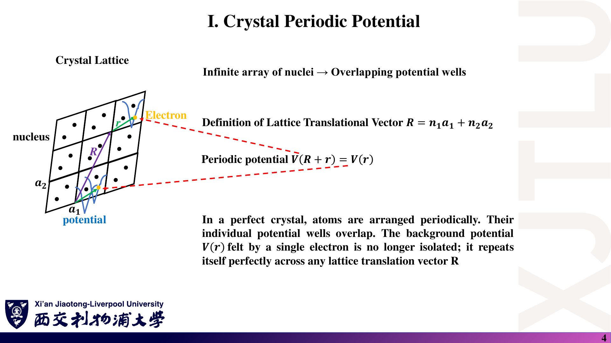
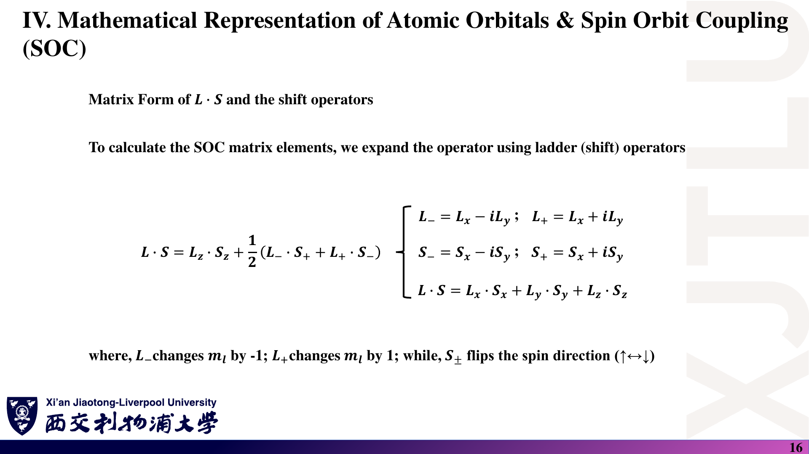
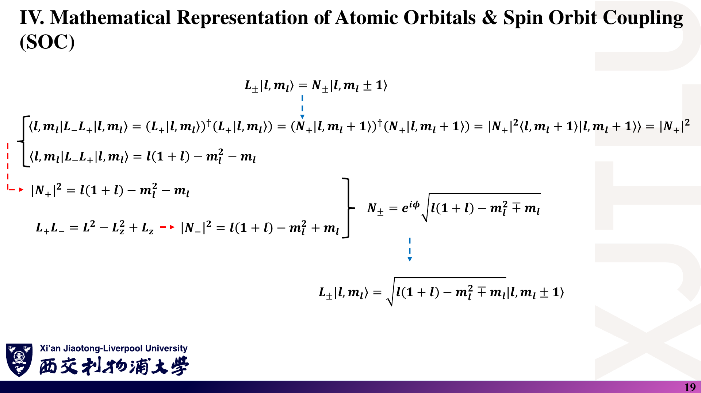

# 04 · 晶体周期势、Bloch 定理、微扰理论与 SOC

来源：[Lecture_Four.pdf](../Lecture_Four.pdf)，22 页。

[返回目录](README.md)

## 1. 从孤立原子到晶体〔pp. 3–4〕

### 课件截图

### 中文解释

孤立原子里的电子面对一个核中心；在理想晶体中，相同局域环境周期重复。电子态可以跨越多个晶胞，原来孤立的原子能级因此与相邻轨道耦合，形成能带。

### 原理深入

#### 孤立原子

孤立原子的束缚态具有离散能级，可用 1s、2s、2p 等标记。束缚态波函数远离原子时衰减。

用 SI 单位写类氢原子的电子—核势能：

$$
V(r)=-\frac{Ze^2}{4\pi\varepsilon_0r}.
$$

讲义采用了省略常数的简写。**离散的是束缚态谱，不是说原子不存在电离后的连续谱。**

#### 周期晶体

三维晶格平移矢量为

$$
\mathbf R=n_1\mathbf a_1+n_2\mathbf a_2+n_3\mathbf a_3,
\qquad n_i\in\mathbb Z.
$$

理想周期势满足

$$
\boxed{V(\mathbf r+\mathbf R)=V(\mathbf r)}.
$$

**补充直觉**：许多原子的轨道相互耦合，原来的原子能级形成大量彼此接近的能级；宏观极限下形成能带。有限晶体中的 k 点与能量仍可离散，只是非常密集。

**从两个原子推广到 N 个原子〔补充〕**：每个原子贡献一个轨道时，空间轨道模型有 N 个基态。零耦合时 N 个能量重合；加入耦合后出现 N 个本征态。N 很大时能级间隔很密集，这就是“离散原子能级展宽成带”的简单理解，而不是一个原子突然拥有连续无穷多个新轨道。

### Ref

- **原课件**：[Lecture Four，PDF 第 3–4 页](../Lecture_Four.pdf#page=3)。
- **延伸**：[QM1：类氢原子束缚态](README.md#ref-qm1)；[SS1：紧束缚与能带](README.md#ref-ss1)。

## 2. Kronig–Penney 模型：带隙为什么出现？〔pp. 5–6〕

### 课件截图

*第 6 页解释文字误写了方程右边的变量；应为 $\cos(ka)$。*

### 中文解释

这个模型把晶体简化成重复的势阱和势垒。每段内的波函数不难求，困难是让所有边界同时匹配，并且满足晶体的周期相位条件。这些约束只允许某些能量传播，于是出现带隙。

### 原理深入

#### 2.1 一维周期方势模型

设每周期由宽度 $a$ 的势阱与宽度 $b$ 的势垒组成，周期为 $a+b$。

在 $0<E<V_0$ 情况下：

- 阱内 $V=0$：

$$
\psi(x)=Ae^{i\alpha x}+Be^{-i\alpha x},
\qquad \alpha=\frac{\sqrt{2mE}}{\hbar}.
$$

- 垒内 $V=V_0$：

$$
\psi(x)=Ce^{\beta x}+De^{-\beta x},
\qquad \beta=\frac{\sqrt{2m(V_0-E)}}{\hbar}.
$$

势垒内可以存在衰减波与量子隧穿，不能理解成“电子的波函数绝对为零”。

#### 2.2 窄高势垒极限

取 $b\to0$、$V_0\to\infty$，固定

$$
U=V_0b,
$$

其中 $U$ 的单位是能量 × 长度。定义无量纲势垒强度

$$
P=\frac{mUa}{\hbar^2}.
$$

此时周期趋于 $a$，匹配边界条件得到

$$
\boxed{F(E)\equiv\cos(\alpha a)+P\frac{\sin(\alpha a)}{\alpha a}
=\cos(ka)}.
$$

#### 2.3 允许带与禁带的判断

因为实数 $k$ 满足 $-1\le\cos(ka)\le1$，所以

$$
\boxed{|F(E)|\le1\ \Rightarrow\ \text{存在实波矢 Bloch 解}},
$$

$$
\boxed{|F(E)|>1\ \Rightarrow\ \text{该能量处于禁带}}.
$$

这里的禁带是理想无限周期体系中没有相应传播型体态；不是“电子被踢出晶体”。有限结构仍可出现衰减波、隧穿或边界态。

#### 2.4 两个极限

- $P\to0$：趋向自由电子，$E=\hbar^2q^2/(2m)$。若将波矢折叠到第一 Brillouin 区，会看到折叠的自由电子分支。
- $P\to\infty$：各势阱趋于隔离，允许带越来越窄，趋近独立无限深势阱的离散能级。

不要把一般有限宽势垒模型直接与窄高势垒极限混用；后者才使用上面的简化 $F(E)$。

**更深入：传递矩阵为何给出余弦判据？〔补充〕** 对实势、恒定质量的一维定态问题，可用一周期传递矩阵 $\mathcal T$ 推进 $(\psi,\psi')^T$，且 $\det\mathcal T=1$。其 Bloch 本征值为 $e^{\pm ika}$，所以 $\mathrm{Tr}\mathcal T=2\cos(ka)$。直接匹配窄高势垒可得到 $\mathrm{Tr}\mathcal T/2=F(E)$。当 $|F|>1$，两个本征值不再位于单位圆上，出现增长/衰减解，而不是实 k 的传播态。

### Ref

- **原课件**：[Lecture Four，PDF 第 5–6 页](../Lecture_Four.pdf#page=5)。
- **延伸**：[SS1：周期势中的电子](README.md#ref-ss1)。传递矩阵解释为补充，不是课件逐字翻译。
- **判断练习**：[复习题第 10 题](06_复习题与参考答案.md)。

## 3. Bloch 定理与平移对称性〔pp. 7–8〕

### 课件截图

### 中文解释

Bloch 波函数不是简单复制每个晶胞：移动一个晶格矢量后，它可以乘上一个相位。这个相位不改变概率密度。有限晶体的周期边界再把允许的 k 限制为离散点。

### 原理深入

#### 3.1 两种等价写法

对理想周期哈密顿量，可以选择具有 Bloch 形式的本征态：

$$
\boxed{\psi_{n\mathbf k}(\mathbf r)
=e^{i\mathbf k\cdot\mathbf r}u_{n\mathbf k}(\mathbf r)},
$$

$$
u_{n\mathbf k}(\mathbf r+\mathbf R)=u_{n\mathbf k}(\mathbf r).
$$

因此

$$
\boxed{\psi_{n\mathbf k}(\mathbf r+\mathbf R)
=e^{i\mathbf k\cdot\mathbf R}\psi_{n\mathbf k}(\mathbf r)}.
$$

- $n$：能带编号。
- $\mathbf k$：晶体波矢。
- $u_{n\mathbf k}$：晶胞周期函数。

严格说，存在简并时，应选择同时适合平移对称性的本征基；任意简并态的叠加不一定具有单一 k 标签。

#### 3.2 波函数不严格周期，但密度周期

$$
|\psi_{n\mathbf k}(\mathbf r+\mathbf R)|^2
=|\psi_{n\mathbf k}(\mathbf r)|^2.
$$

原因是相位因子模为 1。

注意这一结论针对单个 Bloch 态；不同 k 态组成的波包不必具有晶胞周期的概率密度。

#### 3.3 Born–von Karman 周期边界

一维长度 $L=Na$，要求

$$
\psi(x+Na)=\psi(x).
$$

结合 Bloch 形式：

$$
e^{ikNa}=1\quad\Rightarrow\quad
\boxed{k=\frac{2\pi m}{Na}},\qquad m\in\mathbb Z.
$$

在一个 Brillouin 区内有 $N$ 个不同的 k 点（对每条能带、每种独立自旋标签而言）。

**补充：三维一般晶格**。若 $\mathbf a_i\cdot\mathbf b_j=2\pi\delta_{ij}$，则

$$
\mathbf k=\sum_i\frac{m_i}{N_i}\mathbf b_i,
$$

避免把适用于正交方向的分量公式机械套到斜晶格上。

#### 3.4 为什么这对计算重要？〔归纳〕

周期性把巨大的晶体问题组织成各 k 点上的矩阵问题：

$$
H(\mathbf k)c_{n\mathbf k}=E_n(\mathbf k)c_{n\mathbf k}.
$$

沿选定 k 路径计算 $E_n(\mathbf k)$ 就得到能带图。

**从对称性推导 Bloch 相位〔补充〕**：定义 $T_{\mathbf R}\psi(\mathbf r)=\psi(\mathbf r+\mathbf R)$。周期势使 $[H,T_{\mathbf R}]=0$，可选择共同本征态。平移保持范数，因此其本征值模为 1；又因 $T_{\mathbf R}T_{\mathbf R'}=T_{\mathbf R+\mathbf R'}$，可用 $e^{i\mathbf k\cdot\mathbf R}$ 标记本征值。再定义 $u=e^{-i\mathbf k\cdot\mathbf r}\psi$，就得到晶胞周期函数。

### Ref

- **原课件**：[Lecture Four，PDF 第 7–8 页](../Lecture_Four.pdf#page=7)。
- **延伸**：[SS1：Bloch 定理与晶体动量](README.md#ref-ss1)；[QM2：对称性与共同本征态](README.md#ref-qm2)。
- **练习**：[复习题第 9 题](06_复习题与参考答案.md)。

## 4. 微扰理论：从已知模型近似求新模型〔pp. 9–13〕

### 课件截图

*第 10 页二阶态修正的求和下标有误；第 12–13 页中的一般复数耦合应使用模平方。以下统一采用规范写法。*

### 中文解释

如果新问题只比一个已解问题多出较弱的相互作用，可以按它的强度逐阶修正能量和波函数。真正决定展开是否可靠的是耦合与相关能级间距的比值；接近简并时必须重新组织基底。

### 原理深入

设

$$
H=H_0+\lambda H',\qquad
H_0|n^{(0)}\rangle=E_n^{(0)}|n^{(0)}\rangle.
$$

$\lambda$ 是追踪阶数的参数，通常最终取 1。展开

$$
E_n=E_n^{(0)}+\lambda E_n^{(1)}+\lambda^2E_n^{(2)}+\cdots,
$$

$$
|n\rangle=|n^{(0)}\rangle+\lambda|n^{(1)}\rangle
+\lambda^2|n^{(2)}\rangle+\cdots.
$$

#### 4.1 非简并微扰：三个核心公式

**一阶能量修正**：

$$
\boxed{E_n^{(1)}=\langle n^{(0)}|H'|n^{(0)}\rangle}.
$$

物理含义：未扰动态中微扰的期望值。

**一阶态修正**，取 $\langle n^{(0)}|n^{(1)}\rangle=0$：

$$
\boxed{|n^{(1)}\rangle=\sum_{m\ne n}
\frac{\langle m^{(0)}|H'|n^{(0)}\rangle}
{E_n^{(0)}-E_m^{(0)}}|m^{(0)}\rangle}.
$$

物理含义：非对角耦合把其他未扰动态混入当前态。

**二阶能量修正**：

$$
\boxed{E_n^{(2)}=\sum_{m\ne n}
\frac{|\langle m^{(0)}|H'|n^{(0)}\rangle|^2}
{E_n^{(0)}-E_m^{(0)}}}.
$$

判断是否可靠的常用尺度为

$$
\left|\frac{\lambda H'_{mn}}{E_n^{(0)}-E_m^{(0)}}\right|\ll1
$$

对相关耦合态成立，并检查累积修正大小。“微扰的数值小”不够，必须与能级间距比较。

#### 4.2 二阶态修正〔进阶整理，对应 p. 10〕

若暂记 $V_{mn}=\langle m^{(0)}|H'|n^{(0)}\rangle$，$D_{nm}=E_n^{(0)}-E_m^{(0)}$，采用逐阶归一化、固定相位的约定：

$$
\begin{aligned}
|n^{(2)}\rangle={}&\sum_{m\ne n}\sum_{k\ne n}
\frac{V_{mk}V_{kn}}{D_{nm}D_{nk}}|m^{(0)}\rangle\\
&-\sum_{m\ne n}\frac{V_{nn}V_{mn}}{D_{nm}^2}|m^{(0)}\rangle\\
&-\frac12\sum_{m\ne n}\frac{|V_{mn}|^2}{D_{nm}^2}|n^{(0)}\rangle.
\end{aligned}
$$

最后一项补偿归一化。不同归一化约定会改变沿原态方向的写法；第一重求和条件应为 $m\ne n$，不是排除 $m=k$。

初学时优先熟悉上一节三个核心公式。

#### 4.3 简并微扰

若多个态共享能量 $E_0$，非简并公式会出现零分母。

正确步骤：

1. 找到简并子空间 $\mathcal D$。
2. 在其中建立微扰矩阵

$$
W_{ij}=\langle i^{(0)}|H'|j^{(0)}\rangle.
$$

3. 对角化 $W$：其本征值为一阶能量修正，本征向量给出合适的零阶线性组合 $|\alpha_k^{(0)}\rangle$。
4. 再考虑子空间之外状态的混入：

$$
|\alpha_k^{(1)}\rangle_{\rm outside}
=\sum_{m\notin\mathcal D}
\frac{\langle m^{(0)}|H'|\alpha_k^{(0)}\rangle}
{E_0-E_m^{(0)}}|m^{(0)}\rangle.
$$

这个式子只表示子空间外部分；若一阶后仍有简并，或需要更高阶态修正，还要继续处理子空间内的有效耦合。

#### 4.4 能级排斥：二能级模型最直观〔pp. 12–13；补充精确解〕

考虑厄米矩阵

$$
H=\begin{pmatrix}a&V\\V^*&b\end{pmatrix},\qquad a,b\in\mathbb R.
$$

精确本征值：

$$
\boxed{E_\pm=\frac{a+b}{2}
\pm\sqrt{\left(\frac{a-b}{2}\right)^2+|V|^2}}.
$$

若 $a>b$ 且 $|V|\ll a-b$：

$$
E_+\approx a+\frac{|V|^2}{a-b},\qquad
E_-\approx b-\frac{|V|^2}{a-b}.
$$

所以耦合把高能级推高、低能级压低。若 $a=b$，两能级分裂为 $a\pm|V|$，间距为 $2|V|$。

**适用边界**：只有相关态之间存在允许的非零耦合，才有这种避免交叉。晶体里局部开隙不自动意味着整个能谱有全局带隙。

**三个核心公式怎样连起来？〔补充推导〕** 取本征方程的一阶项：

$$
(H_0-E_n^{(0)})|n^{(1)}\rangle
=-(H'-E_n^{(1)})|n^{(0)}\rangle.
$$

左乘 $\langle n^{(0)}|$ 得到一阶能量；左乘 $\langle m^{(0)}|$（$m\ne n$）得到态混合系数中的能量分母。再将一阶态代入 $E_n^{(2)}=\langle n^{(0)}|H'|n^{(1)}\rangle$，利用厄米性 $H'_{nm}=(H'_{mn})^*$，便得到二阶能量的模平方。这也说明简并时出现零分母不是代数小问题，而是所用展开基底需要调整。

### Ref

- **原课件**：[Lecture Four，PDF 第 9–13 页](../Lecture_Four.pdf#page=10)。
- **延伸**：[QM1：定态非简并与简并微扰理论](README.md#ref-qm1)。
- **检验**：[复习题第 11–12 题](06_复习题与参考答案.md)；[微扰公式勘误](07_讲义勘误与易错点.md)。

## 5. 原子轨道的数学表示〔p. 14〕

### 课件截图

*图中 $p_x,p_y$ 不能直接分别等同于单个复球谐函数 $Y_1^1,Y_1^{-1}$。*

### 中文解释

中心势让空间波函数分成径向部分和角向部分。常见的 s、p、d 轨道形状来自角向结构；实 p 轨道与磁量子数确定的复球谐基是两套相关但不同的基底。

### 原理深入

类氢原子空间波函数写为

$$
\phi_{nlm}(r,\theta,\varphi)=R_{nl}(r)Y_l^m(\theta,\varphi).
$$

- 径向部分 $R_{nl}$：描述径向分布与衰减。
- 球谐函数 $Y_l^m$：描述角向结构。
- $l=0,1,2$ 分别对应 s、p、d。
- $m=-l,-l+1,\ldots,l$。

p 轨道有 $l=1$，三个球谐函数为

$$
Y_1^0=\sqrt{\frac{3}{4\pi}}\cos\theta,
$$

$$
Y_1^{\pm1}=\mp\sqrt{\frac{3}{8\pi}}\sin\theta\,e^{\pm i\varphi}.
$$

#### 实 p 轨道与复球谐基不要混淆〔规范化说明〕

通常教材画出的实轨道，其角向部分是线性组合：

$$
p_x:\ \frac{Y_1^{-1}-Y_1^1}{\sqrt2},\qquad
p_y:\ \frac{i(Y_1^{-1}+Y_1^1)}{\sqrt2},\qquad
p_z:\ Y_1^0.
$$

因此 $p_x$ 不直接等于 $Y_1^1$，$p_y$ 也不直接等于 $Y_1^{-1}$。整体相位可以另选，但轨道基变换及矩阵必须前后一致。

**为何实轨道需要线性组合？** $Y_1^{\pm1}$ 含 $e^{\pm i\varphi}=\cos\varphi\pm i\sin\varphi$。对二者求和/差可分离出正弦与余弦，因此 $p_x\propto\sin\theta\cos\varphi=x/r$、$p_y\propto\sin\theta\sin\varphi=y/r$。它们有直观方向性，却一般不是 $L_z$ 的本征态；$Y_l^m$ 才对应确定的 $m$。

### Ref

- **原课件**：[Lecture Four，PDF 第 14 页](../Lecture_Four.pdf#page=14)。
- **公式核对**：[DLMF：球谐函数的定义与归一化](README.md#ref-dlmf)。
- **延伸**：[QM1：中心势与角动量](README.md#ref-qm1)。

## 6. 加入自旋：为什么 p 壳层是六维？〔p. 15〕

### 课件截图

*原页上下两处文字的自旋标签相反；下文统一以上分量为 spin-up 的约定。*

### 中文解释

电子除了空间轨道，还具有自旋自由度。固定 p 壳层中，每个轨道都能配自旋上或下，因而维数相乘得到六维。一般态需要对这六种组合叠加。

### 原理深入

采用统一约定

$$
|\uparrow\rangle=\begin{pmatrix}1\\0\end{pmatrix},\qquad
|\downarrow\rangle=\begin{pmatrix}0\\1\end{pmatrix},
$$

$$
S_z|\uparrow\rangle=\frac\hbar2|\uparrow\rangle,
\qquad
S_z|\downarrow\rangle=-\frac\hbar2|\downarrow\rangle.
$$

轨道态与自旋态的乘积基为

$$
|l,m_l\rangle\otimes|s,m_s\rangle.
$$

对固定 p 壳层，轨道有 3 个，自旋有 2 个，因此维数为 $3\times2=6$。

一般态是这些乘积态的线性组合，加入 SOC 后未必还能分离成“一个空间函数 × 一个固定自旋矢量”。

**“直积”与普通三维叉积不同〔补充〕**：这里使用的是张量积。若轨道空间维数为 3、自旋空间维数为 2，组合空间就是 $\mathbb C^3\otimes\mathbb C^2$。例如 $a|0,\uparrow\rangle+b|1,\downarrow\rangle$ 在 $a,b$ 均非零时一般不能分离成单一轨道态与单一自旋态的乘积，这正是 SOC 混合态可能具有的结构。

### Ref

- **原课件**：[Lecture Four，PDF 第 15 页](../Lecture_Four.pdf#page=15)。
- **延伸**：[QM2：自旋与张量积空间](README.md#ref-qm2)；[QC1：复合系统与不可分离态](README.md#ref-qc1)。
- **标签核验**：[自旋约定勘误](07_讲义勘误与易错点.md)。

## 7. 升降算符与自旋轨道耦合〔pp. 16–20〕

### 课件截图

### 中文解释

$L_zS_z$ 保持轨道和自旋标签不变，产生对角能量项；$L_+S_-$ 和 $L_-S_+$ 一升一降，混合不同轨道与相反自旋，同时保持总磁量子数不变。

### 原理深入

#### 7.1 保留 $\hbar$ 的角动量公式

$$
L_z|l,m\rangle=\hbar m|l,m\rangle,
\qquad L^2|l,m\rangle=\hbar^2l(l+1)|l,m\rangle,
$$

$$
\boxed{L_\pm|l,m\rangle
=\hbar\sqrt{l(l+1)-m(m\pm1)}\,|l,m\pm1\rangle}.
$$

例如 $l=1$：

$$
L_+|1,0\rangle=\hbar\sqrt2|1,1\rangle,\qquad
L_+|1,1\rangle=0.
$$

对 $s=1/2$：

$$
S_-|\uparrow\rangle=\hbar|\downarrow\rangle,\qquad
S_+|\downarrow\rangle=\hbar|\uparrow\rangle.
$$

升降系数可通过计算范数得到，例如

$$
\|L_+|l,m\rangle\|^2
=\langle l,m|L_-L_+|l,m\rangle
=\hbar^2[l(l+1)-m^2-m].
$$

原讲义 pp. 18–21 采用省略 $\hbar$ 的写法，学习时应明确是无量纲算符还是设定 $\hbar=1$。

#### 7.2 SOC 的对角与非对角部分

$$
\boxed{\mathbf L\cdot\mathbf S
=L_zS_z+\frac12(L_+S_-+L_-S_+)}.
$$

- $L_zS_z$ 给出对角元 $\hbar^2m_lm_s$。
- $L_+S_-$ 与 $L_-S_+$ 同时改变轨道磁量子数与自旋，给出非对角耦合。
- 这些耦合保持 $m_j=m_l+m_s$ 不变。

例如

$$
\left\langle 1,\downarrow\left|
\frac{\mathbf L\cdot\mathbf S}{\hbar^2}
\right|0,\uparrow\right\rangle
=\frac12\sqrt2\times1=\frac1{\sqrt2}.
$$

这里 ket 中只列 $m_l$ 与自旋，已固定 $l=1$。

**选择定则怎样帮助写矩阵？** $L_+S_-$ 使 $m_l\to m_l+1$、$m_s\to m_s-1$，所以 $m_j$ 不变。两个态若具有不同 $m_j$，本模型的 SOC 矩阵元必为零。这比逐个计算 36 个内积更有效，也能检查基底顺序是否写错。

### Ref

- **原课件**：[Lecture Four，PDF 第 16–20 页](../Lecture_Four.pdf#page=16)。
- **延伸**：[QM2：角动量代数、升降算符和角动量耦合](README.md#ref-qm2)。
- **例题**：[复习题第 14 题](06_复习题与参考答案.md)。

## 8. p 轨道的 $6\times6$ SOC 矩阵与能级〔pp. 20–21〕

### 课件截图

### 中文解释

前面两个态没有同 $m_j$ 的伙伴可被混合，另外四个态组成两个二阶块。对角化后得到 $j=3/2$ 与 $j=1/2$ 两组，而不是六个互不相关的能量。

### 原理深入

为了与讲义矩阵对应，固定基底顺序为

$$
\mathcal B=(|1,\uparrow\rangle,|-1,\downarrow\rangle,
|1,\downarrow\rangle,|0,\uparrow\rangle,
|0,\downarrow\rangle,|-1,\uparrow\rangle).
$$

定义无量纲矩阵 $M=(\mathbf L\cdot\mathbf S)/\hbar^2$：

$$
\boxed{
M=\begin{pmatrix}
\frac12&0&0&0&0&0\\
0&\frac12&0&0&0&0\\
0&0&-\frac12&\frac1{\sqrt2}&0&0\\
0&0&\frac1{\sqrt2}&0&0&0\\
0&0&0&0&0&\frac1{\sqrt2}\\
0&0&0&0&\frac1{\sqrt2}&-\frac12
\end{pmatrix}}.
$$

它由两个 $1\times1$ 块和两个 $2\times2$ 块组成，不需要暴力手算六阶行列式。

每个 $2\times2$ 块满足

$$
\eta^2+\frac12\eta-\frac12=0,
$$

因此 $\eta=1/2$ 或 $-1$。加上前两个独立态：

- $M=1/2$：四重简并。
- $M=-1$：二重简并。

#### 总角动量法交叉验证〔补充〕

令 $\mathbf J=\mathbf L+\mathbf S$，有

$$
\frac{\mathbf L\cdot\mathbf S}{\hbar^2}
=\frac12[j(j+1)-l(l+1)-s(s+1)].
$$

对 $l=1,s=1/2$：

| $j$ | $M$ 的本征值 | 简并度 $2j+1$ |
|---|---|---|
| $3/2$ | $1/2$ | 4 |
| $1/2$ | $-1$ | 2 |

若有效 SOC 哈密顿量采用

$$
H_{\rm SOC}=\xi\frac{\mathbf L\cdot\mathbf S}{\hbar^2},
$$

则 $\xi$ 具有能量单位，SOC 能量移动为 $\xi/2$ 和 $-\xi$，两组间距为 $3|\xi|/2$。

**限定**：这是固定 p 壳层、原子型各向同性 $\mathbf L\cdot\mathbf S$ 模型的结果。晶体场、磁场等额外作用可能进一步改变简并；$1/2$ 与 $-1$ 本身不是没有单位约定的实际能量。

**看一个具体混合态〔补充〕**：在 $(|1,\downarrow\rangle,|0,\uparrow\rangle)$ 子块中，$M$ 本征值 $1/2$ 的归一化向量为 $(1,\sqrt2)^T/\sqrt3$，即

$$
|j=3/2,m_j=1/2\rangle
=\frac1{\sqrt3}|1,\downarrow\rangle
+\sqrt{\frac23}|0,\uparrow\rangle.
$$

将此向量代回二阶块即可核验。它展示了为什么 SOC 本征态未必具有单独确定的 $m_l$ 和 $m_s$，但仍有确定的 $j,m_j$。

### Ref

- **原课件**：[Lecture Four，PDF 第 20–21 页](../Lecture_Four.pdf#page=20)。
- **延伸**：[QM2：总角动量与角动量合成](README.md#ref-qm2)；[QM1：自旋轨道耦合](README.md#ref-qm1)。
- **数值核验**：[NUM：厄米矩阵对角化](README.md#ref-num)。需先按图中顺序构造基底，不能直接混用实 p 轨道基。

## 本讲复习顺序

1. 会用 $|F(E)|\le1$ 判断允许能带。
2. 会从 Bloch 相位推导密度周期性和离散 k 点。
3. 会解释一阶对角修正与二阶非对角修正。
4. 遇到零分母，想到先在简并子空间对角化。
5. 能计算 SOC 的 $m_lm_s$ 对角元和 $1/\sqrt2$ 非对角元。
6. 能解释 p 壳层 SOC 为什么分成四重与二重两组。
