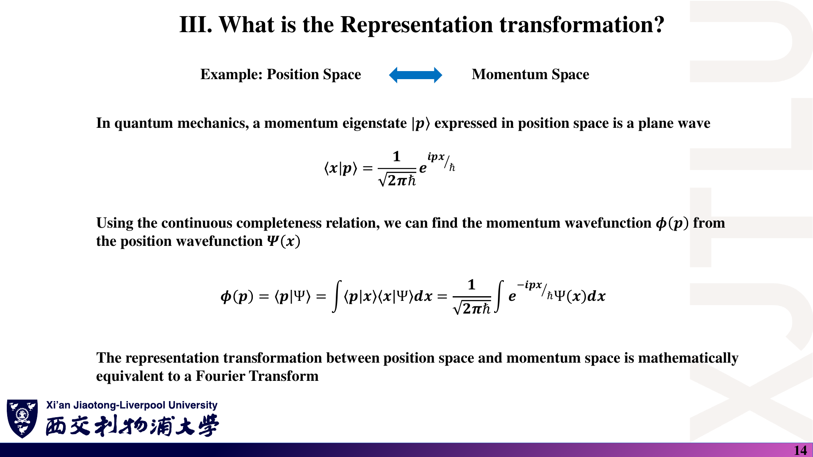
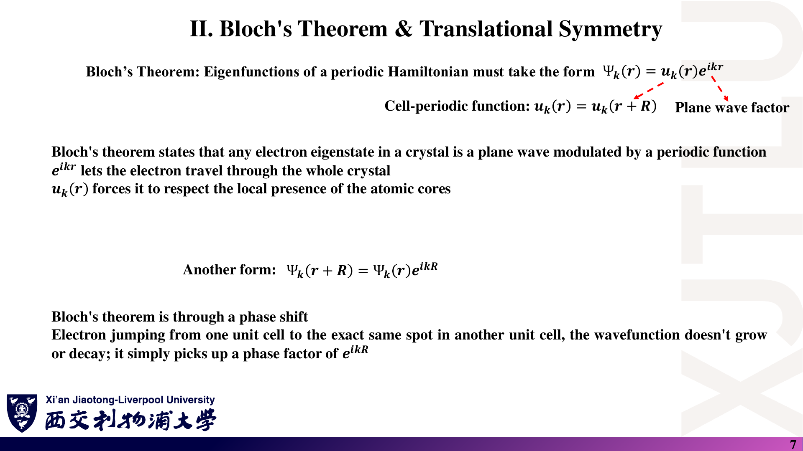
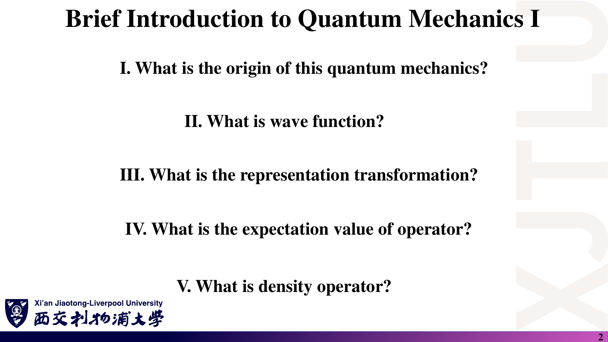
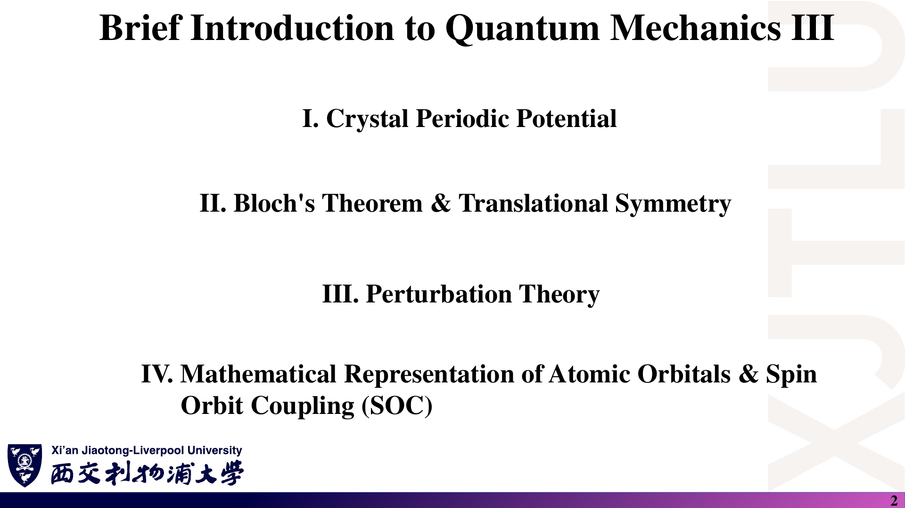

# 05 · 公式与中英文术语速查

[返回目录](README.md) · [概念与推导：第二讲](02_波函数与密度算符.md) · [第三讲](03_哈密顿量与基组.md) · [第四讲](04_周期势_微扰与SOC.md)

> 默认离散正交归一基、归一化态；网格积分、连续谱和非正交基需要额外处理。此页包含正文已标明的必要补充，不替代推导与适用条件。

## 1. 量子态与线性代数

### 课件截图

### 中文解释

本模块把“态—系数—基底”三者分开。量子态是对象，基底决定坐标，换基矩阵连接两套坐标。以下公式默认两套基都是同一空间的正交归一基。

### 原理深入

$$
|\psi\rangle=\sum_i c_i|b_i\rangle,
\quad c_i=\langle b_i|\psi\rangle,
\quad\langle\psi|=\sum_i c_i^*\langle b_i|.
$$

$$
\langle b_i|b_j\rangle=\delta_{ij},
\quad\sum_i|b_i\rangle\langle b_i|=I,
\quad\sum_i|c_i|^2=1.
$$

$$
U_{ij}=\langle b_i|e_j\rangle:
\quad c=Ud,\quad d=U^\dagger c,
\quad A_e=U^\dagger A_bU.
$$

**形状检查**：ket 为 $N\times1$，bra 为 $1\times N$；内积是标量，外积是矩阵。

**快速核验**：从 $c=Ud$ 出发，归一化给出 $c^\dagger c=d^\dagger U^\dagger Ud=d^\dagger d$；因此矩阵方向和酉性必须配套。不要在未定义 $U$ 时背“总是左乘 $U^\dagger$”。

### Ref

- **原课件**：[Lecture Two，PDF 第 8–12 页](../Lecture_Two.pdf#page=11)。
- **完整推导**：[第二讲：Dirac 记号与表象变换](02_波函数与密度算符.md)。
- **延伸**：[QM2](README.md#ref-qm2)。

## 2. 概率、期望值与密度矩阵

### 课件截图

### 中文解释

概率幅取模平方后还需要结合求和或积分，才得到概率。密度矩阵保存计算测量统计所需的信息，既能用于纯态，也能用于混态。

### 原理深入

$$
P(\Omega)=\int_\Omega|\psi(\mathbf r)|^2d^3r.
$$

$$
\langle A\rangle=
\frac{\langle\psi|A|\psi\rangle}{\langle\psi|\psi\rangle}
\xrightarrow{\text{已归一化}}c^\dagger Ac.
$$

$$
A=A^\dagger\quad\Rightarrow\quad\langle A\rangle\in\mathbb R.
$$

$$
\rho=|\psi\rangle\langle\psi|=cc^\dagger,
\quad\rho_{ij}=c_ic_j^*,
\quad\langle A\rangle=\operatorname{Tr}(\rho A).
$$

$$
\rho^\dagger=\rho,\quad \rho\succeq0,\quad\operatorname{Tr}\rho=1.
$$

纯态：$\rho^2=\rho$、$\operatorname{Tr}\rho^2=1$；真正混态：$\operatorname{Tr}\rho^2<1$。

**快速核验**：$\operatorname{Tr}\rho=1$ 检查总概率；$\rho^2=\rho$ 检查是否为纯态投影。非对角元依赖所选基底，不能把“在某个基底下对角”直接等同于“混态”。

### Ref

- **原课件**：[Lecture Two，PDF 第 7 页](../Lecture_Two.pdf#page=7)、[第 15–20 页](../Lecture_Two.pdf#page=20)。
- **完整解释**：[第二讲：期望值和密度算符](02_波函数与密度算符.md)。
- **延伸**：[QC1：密度算符](README.md#ref-qc1)。

## 3. 动量与 Fourier 变换

### 课件截图

### 中文解释

位置波函数和动量波函数表示同一个态。由于动量本征态在位置空间是平面波，表象变换就是把波函数分解成平面波分量。

### 原理深入

$$
\hat{\mathbf p}=-i\hbar\nabla,
\qquad\langle x|p\rangle=\frac{e^{ipx/\hbar}}{\sqrt{2\pi\hbar}}.
$$

$$
\phi(p)=\frac1{\sqrt{2\pi\hbar}}\int e^{-ipx/\hbar}\psi(x)\,dx,
\quad
\psi(x)=\frac1{\sqrt{2\pi\hbar}}\int e^{ipx/\hbar}\phi(p)\,dp.
$$

**快速核验**：对变换核作用 $-i\hbar\partial_x$，应得到本征值 $p$ 乘原函数。这个检查可同时发现指数的符号错误和漏写 $\hbar$。

### Ref

- **原课件**：[Lecture Two，PDF 第 13–14 页](../Lecture_Two.pdf#page=14)。
- **推导与条件**：[第二讲：连续表象](02_波函数与密度算符.md)。
- **延伸**：[QM1](README.md#ref-qm1)。

## 4. 哈密顿量与离散化

### 课件截图

### 中文解释

动能给出相邻网格点之间的连接，局域势能加在对角线上。实际使用时要先确定边界条件；非正交轨道基则必须额外保留重叠矩阵。

### 原理深入

$$
H=-\frac{\hbar^2}{2m}\nabla^2+V,
\qquad Hc=Ec,
\qquad\det(H-EI)=0.
$$

$$
\psi''(x_i)\approx\frac{\psi_{i+1}-2\psi_i+\psi_{i-1}}{(\Delta x)^2},
\qquad t=\frac{\hbar^2}{2m(\Delta x)^2}.
$$

$$
H_{ii}=2t+V_i,\qquad H_{i,i\pm1}=-t.
$$

网格归一化：$\sum_i|\psi_i|^2\Delta x\approx1$。

非正交基：$S_{ij}=\langle\phi_i|\phi_j\rangle$，$Hc=ESc$，$c^\dagger Sc=1$。

二能级实耦合：

$$
H=\begin{pmatrix}\epsilon&\Delta\\\Delta&\epsilon\end{pmatrix}
\Rightarrow
\begin{cases}
E_-=\epsilon-\Delta,&c_-=(1,-1)^T/\sqrt2,\\
E_+=\epsilon+\Delta,&c_+=(1,1)^T/\sqrt2.
\end{cases}
$$

**快速核验**：这里 $t$ 的单位是能量，$H$ 必须厄米。对于二能级模型，能级间距是 $2|\Delta|$；若两候选本征向量仅差整体符号，它们不是一组完整基。

### Ref

- **原课件**：[Lecture Three，PDF 第 4–6 页](../Lecture_Three.pdf#page=6)、[第 11–16 页](../Lecture_Three.pdf#page=11)。
- **完整推导**：[第三讲：差分、本征问题和基组](03_哈密顿量与基组.md)。
- **计算文档**：[NUM](README.md#ref-num)、[OMX](README.md#ref-openmx)。

## 5. 晶体周期性与能带

### 课件截图

### 中文解释

Bloch 定理限制波函数的平移形式，Kronig–Penney 方程则展示这种限制如何产生允许带和禁带。波函数有相位变化，但单个 Bloch 态的概率密度周期重复。

### 原理深入

$$
V(\mathbf r+\mathbf R)=V(\mathbf r),
\quad\psi_{n\mathbf k}=e^{i\mathbf k\cdot\mathbf r}u_{n\mathbf k},
\quad u_{n\mathbf k}(\mathbf r+\mathbf R)=u_{n\mathbf k}(\mathbf r).
$$

$$
\psi_{n\mathbf k}(\mathbf r+\mathbf R)
=e^{i\mathbf k\cdot\mathbf R}\psi_{n\mathbf k}(\mathbf r),
\quad |\psi_{n\mathbf k}(\mathbf r+\mathbf R)|^2=|\psi_{n\mathbf k}(\mathbf r)|^2.
$$

$$
k=\frac{2\pi m}{Na}\quad\text{（一维 BVK 边界）}.
$$

Kronig–Penney 窄高势垒极限：

$$
F(E)=\cos(\alpha a)+P\frac{\sin(\alpha a)}{\alpha a}=\cos(ka),
\quad \alpha=\sqrt{2mE}/\hbar,
\quad P=m(V_0b)a/\hbar^2.
$$

$|F(E)|\le1$ 为允许带；$|F(E)|>1$ 为禁带。

平面波截断：$\hbar^2|\mathbf k+\mathbf G|^2/(2m)\le E_{\rm cut}$。

**快速核验**：一维周期边界必须满足 $kNa=2\pi m$。Kronig–Penney 简化式要求窄高势垒极限，不适合不加修改地代入一般有限宽势垒。

### Ref

- **原课件**：[Lecture Four，PDF 第 5–8 页](../Lecture_Four.pdf#page=7)；平面波截断见 [Lecture Three，第 14 页](../Lecture_Three.pdf#page=14)。
- **完整推导**：[第四讲：周期势与 Bloch 定理](04_周期势_微扰与SOC.md)。
- **延伸**：[SS1](README.md#ref-ss1)。

## 6. 微扰公式

### 课件截图

### 中文解释

一阶能量是微扰在原态中的平均；一阶态是其他态混入的幅度；二阶能量是这些耦合反馈到能量后的结果。出现零分母时，不能继续机械代数运算。

### 原理深入

设 $H=H_0+\lambda H'$，$V_{mn}=\langle m^{(0)}|H'|n^{(0)}\rangle$。

$$
E_n^{(1)}=V_{nn},
\qquad E_n^{(2)}=\sum_{m\ne n}\frac{|V_{mn}|^2}{E_n^{(0)}-E_m^{(0)}}.
$$

$$
|n^{(1)}\rangle=\sum_{m\ne n}
\frac{V_{mn}}{E_n^{(0)}-E_m^{(0)}}|m^{(0)}\rangle.
$$

适用检查：相关的 $|\lambda V_{mn}/(E_n^{(0)}-E_m^{(0)})|\ll1$。

简并情形：先在简并子空间对角化 $W_{ij}=\langle i^{(0)}|H'|j^{(0)}\rangle$。

二能级精确解：

$$
\begin{pmatrix}a&V\\V^*&b\end{pmatrix}
\Rightarrow E_\pm=\frac{a+b}{2}
\pm\sqrt{\frac{(a-b)^2}{4}+|V|^2}.
$$

**快速核验**：二阶能量分子的单位为能量平方，除以能量差后才是能量。耦合为复数时必须用模平方。若相关间距变小，需要考虑简并、近简并子空间处理或直接对角化。

### Ref

- **原课件**：[Lecture Four，PDF 第 9–13 页](../Lecture_Four.pdf#page=10)。
- **完整推导与适用条件**：[第四讲：微扰理论](04_周期势_微扰与SOC.md)。
- **延伸**：[QM1：定态微扰](README.md#ref-qm1)。

## 7. 自旋与 SOC

### 课件截图

### 中文解释

按图中的基底顺序写矩阵。$L_zS_z$ 产生对角元，升降项只连接具有相同 $m_j$ 的态。这里把角动量的 $\hbar^2$ 除去，实际能量由 $\xi$ 恢复。

### 原理深入

$$
|\uparrow\rangle=(1,0)^T,\qquad|\downarrow\rangle=(0,1)^T.
$$

$$
L_\pm|l,m\rangle
=\hbar\sqrt{l(l+1)-m(m\pm1)}|l,m\pm1\rangle.
$$

$$
\mathbf L\cdot\mathbf S=L_zS_z+\frac12(L_+S_-+L_-S_+).
$$

$$
H_{\rm SOC}=\xi\frac{\mathbf L\cdot\mathbf S}{\hbar^2},
\quad E_j^{\rm SOC}=\frac\xi2[j(j+1)-l(l+1)-s(s+1)].
$$

固定 p 壳层、各向同性原子 SOC：

- $l=1$、$s=1/2$，共有 6 个基态。
- $j=3/2$：$\xi/2$，四重简并。
- $j=1/2$：$-\xi$，二重简并。

**快速核验**：无量纲 p 壳层矩阵应有四个 $1/2$、两个 $-1$，所以迹为 0、平方的迹为 3。这是检查基底排序、漏项或错误系数的简便方法，不能替代本征方程残差检查。

### Ref

- **原课件**：[Lecture Four，PDF 第 14–21 页](../Lecture_Four.pdf#page=20)。
- **逐项推导**：[第四讲：角动量与 SOC](04_周期势_微扰与SOC.md)。
- **延伸**：[QM2](README.md#ref-qm2)、[DLMF：球谐函数](README.md#ref-dlmf)。

## 8. 中英文术语

### 课件截图

### 中文解释

两张目录页给出本周最常遇到的英文词。以下表格不仅给译名，还指出做题时应该识别的数学对象或物理含义。

### 原理深入

| English | 中文 | 抓住什么 |
|---|---|---|
| Wavefunction | 波函数 | 某表象下的概率幅 |
| Probability amplitude | 概率幅 | 先相加，再取模平方 |
| Probability density | 概率密度 | 在区域上积分才是概率 |
| Hilbert space | 希尔伯特空间 | 量子态所在的内积完备空间 |
| Orthonormal basis | 正交归一基 | $\langle b_i\vert b_j\rangle=\delta_{ij}$ |
| Completeness relation | 完备性关系 | 基投影算符求和为单位算符 |
| Representation transformation | 表象变换 | 同一物理态换坐标 |
| Hermitian / Self-adjoint | 厄米 / 自伴 | 有限维厄米保证实本征值 |
| Expectation value | 期望值 | 同样制备条件下重复测量的平均 |
| Density operator / matrix | 密度算符 / 矩阵 | 描述纯态与统计混态 |
| Trace | 迹 | 对角元之和，换基不变 |
| Hamiltonian | 哈密顿量 | 总能量算符 |
| Eigenstate / Eigenvalue | 本征态 / 本征值 | 算符作用后态仍成比例 |
| Diagonalisation | 对角化 | 在本征基下表示算符 |
| Adjugate matrix | 伴随矩阵 | 余子式矩阵的转置，不是 $A^\dagger$ |
| Finite difference | 有限差分 | 用邻点值近似导数 |
| LCAO | 原子轨道线性组合 | 局域轨道展开 |
| STO / GTO | Slater 型 / Gaussian 型轨道 | 不同径向函数形式 |
| Overlap matrix | 重叠矩阵 | 非正交基之间的内积 |
| Plane-wave basis | 平面波基 | 以波矢标记的周期体系表示 |
| Reciprocal lattice | 倒格子 | 晶体周期性的波矢空间结构 |
| Brillouin zone，BZ | 布里渊区 | 倒空间的基本区域 |
| Bloch theorem | 布洛赫定理 | 平面波相位 × 晶胞周期函数 |
| Band structure / Band gap | 能带结构 / 带隙 | $E_n(\mathbf k)$ 及其禁止能量区间 |
| Density of States，DOS | 态密度 | 单位能量区间可用态的数量 |
| Perturbation theory | 微扰理论 | 从可解模型逐阶求修正 |
| Degeneracy | 简并 | 多个独立态具有相同本征值 |
| Level repulsion | 能级排斥 | 非零耦合使相关能级避免交叉 |
| Spherical harmonics | 球谐函数 | 轨道角向部分 |
| Spinor | 旋量 | 描述自旋自由度的多分量对象 |
| Ladder operators | 升降算符 | 改变磁量子数 |
| Spin-Orbit Coupling，SOC | 自旋轨道耦合 | 轨道与自旋自由度耦合 |
| Tight Binding，TB | 紧束缚 | 用轨道间耦合构建电子结构模型 |
| Density Functional Theory，DFT | 密度泛函理论 | 以电子密度为核心的电子结构框架 |

**关联记忆**：把词组成操作链：basis → representation → Hamiltonian → diagonalisation → eigenstate/eigenvalue → expectation value。把术语放到计算步骤里，比孤立背译名更容易判断自己到底在计算什么。

### Ref

- **主题来源**：[Lecture Two，PDF 第 2 页](../Lecture_Two.pdf#page=2)、[Lecture Three，第 2 页](../Lecture_Three.pdf#page=2)、[Lecture Four，第 2 页](../Lecture_Four.pdf#page=2)。
- **定义依据**：本周四讲相关正文；延伸参考 [QM1](README.md#ref-qm1)、[QM2](README.md#ref-qm2)、[SS1](README.md#ref-ss1)、[QC1](README.md#ref-qc1)。术语表是学习归纳，不是截图的逐字翻译。

## 最后一分钟检查

**共轭有没有漏？态是否归一？基底顺序是否一致？边界条件是什么？能量分母是否接近零？单位里是否漏了 $\hbar$？**
