# 06 · 图文复习题与参考答案

[返回目录](README.md)

> 15 题均为根据讲义自编的练习，**不是课件原题或官方作业**。每题依次列出“课件截图 → 中文解释（题目）→ 原理深入（解析）→ Ref”。建议先遮住解析独立作答。截图保留原稿，正确公式以下方解析为准。

## 1. 课程目标

### 课件截图

### 中文解释

**题目**：原子级模拟的三个主要用途是什么？后续石墨烯实验需要复现哪三个核心计算量？为什么只画能带图不能算完成全部目标？

### 原理深入

三个用途：**解释实验、调控性质、预测材料行为**。实验核心量：本征石墨烯的**能带、DOS 与电导率**。

它们有不同的信息需求：能带给出 $E_n(\mathbf k)$；DOS 需要统计布里渊区中的可用态；电导率还涉及占据、速度或电流矩阵元，以及所选输运模型中的散射或接触条件。相似的能带外观不保证相同的电导率。

### Ref

- **原课件**：[Lecture One，PDF 第 27 页](../Lecture_One.pdf#page=27)、[第 29–31 页](../Lecture_One.pdf#page=31)。
- **配套解释**：[课程导论](01_课程导论.md)；延伸 [SS1](README.md#ref-ss1)。

## 2. 概率与归一化

### 课件截图

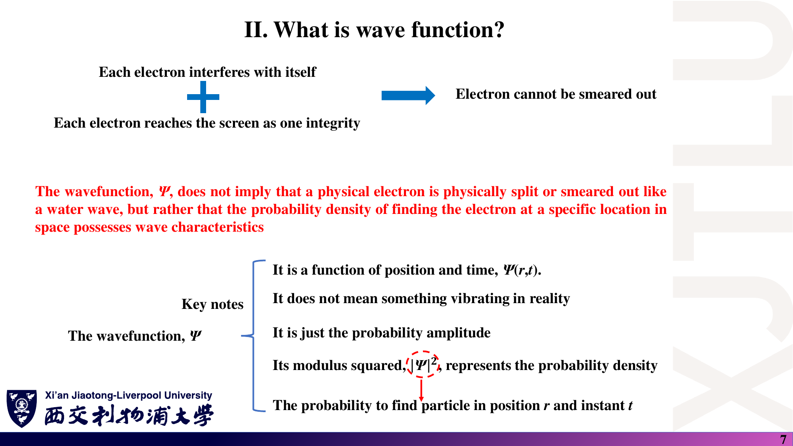

### 中文解释

**题目**：在二维正交归一基中，已知

$$
|\psi\rangle=C\begin{pmatrix}3\\4i\end{pmatrix},\qquad C>0.
$$

求 $C$、bra 与测量得到两个基态的概率。连续空间中的 $|\psi(x)|^2$ 是否直接等于某一区间的概率？

### 原理深入

归一化要求 $C^2(9+16)=1$，所以

$$
C=\frac15,\qquad\langle\psi|=\frac15(3,-4i).
$$

两基态的概率分别为 $9/25$ 和 $16/25$，和为 1。注意概率使用模平方，不是 $(4i)^2$。

连续位置表象中，区间概率为

$$
P([x_1,x_2])=\int_{x_1}^{x_2}|\psi(x)|^2\,dx.
$$

一维概率密度的单位为长度的倒数，积分后才是无量纲概率。

### Ref

- **原课件**：[Lecture Two，PDF 第 7–8 页](../Lecture_Two.pdf#page=7)。
- **推导**：[第二讲：概率与 Dirac 记号](02_波函数与密度算符.md)；延伸 [QM1](README.md#ref-qm1)。

## 3. 密度矩阵与期望值

### 课件截图

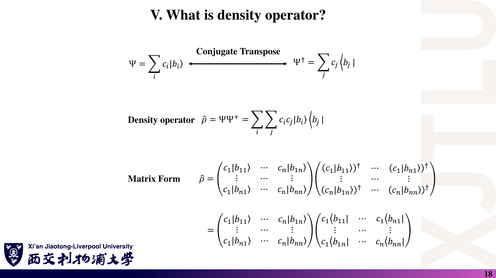

### 中文解释

**题目**：给定

$$
c=\frac1{\sqrt2}\begin{pmatrix}1\\i\end{pmatrix},
\qquad A=\begin{pmatrix}1&0\\0&-1\end{pmatrix},
$$

求 $\rho$、$\mathrm{Tr}\rho$ 和 $\langle A\rangle$。若期望值为 0，一次测量会得到 0 吗？

### 原理深入

外积中第二个向量必须共轭转置：

$$
\rho=cc^\dagger=\frac12\begin{pmatrix}1&-i\\i&1\end{pmatrix},
\qquad\mathrm{Tr}\rho=1.
$$

用两条路径计算：

$$
\langle A\rangle=c^\dagger Ac=\frac12-\frac12=0
=\mathrm{Tr}(\rho A).
$$

但 $A$ 的本征值只有 $+1,-1$，单次测量分别以 $1/2$ 概率得到它们，不会得到 0。进一步，$A^2=I$，所以方差 $\langle A^2\rangle-\langle A\rangle^2=1$，结果并不确定。

### Ref

- **原课件**：[Lecture Two，PDF 第 15 页](../Lecture_Two.pdf#page=15)、[第 18–20 页](../Lecture_Two.pdf#page=18)。
- **公式纠正**：[勘误：密度矩阵的复共轭](07_讲义勘误与易错点.md)；延伸 [QC1](README.md#ref-qc1)。

## 4. 相干叠加与统计混合

### 课件截图

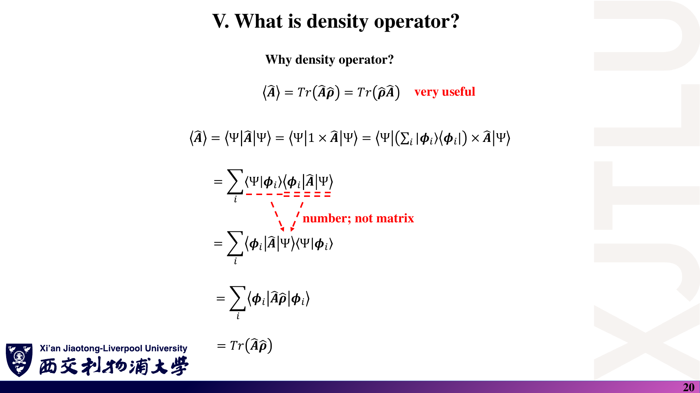

### 中文解释

**题目**：上一题的纯态与混态 $\rho_{\rm mix}=I/2$ 对 $A$ 的期望值相同。改测

$$
B=\begin{pmatrix}0&-i\\i&0\end{pmatrix},
$$

能否将两种制备方式区分？分别计算期望值。

### 原理深入

对纯态直接作用矩阵可得 $Bc=c$，所以

$$
\langle B\rangle_{\rm pure}=1.
$$

对混态则有

$$
\langle B\rangle_{\rm mix}=\mathrm{Tr}(B/2)=0.
$$

两种状态在原基底中的占据相同，但非对角相干信息不同。它们对某个特定观测量给出相同平均，不代表量子态相同；另一个观测量可以区分其统计性质。纯度也不同：$\mathrm{Tr}\rho_{\rm pure}^2=1$，$\mathrm{Tr}\rho_{\rm mix}^2=1/2$。

### Ref

- **原课件公式依据**：[Lecture Two，PDF 第 18–20 页](../Lecture_Two.pdf#page=20)。混态比较是补充练习。
- **延伸**：[QC1：密度算符与混态](README.md#ref-qc1)。

## 5. 换基

### 课件截图

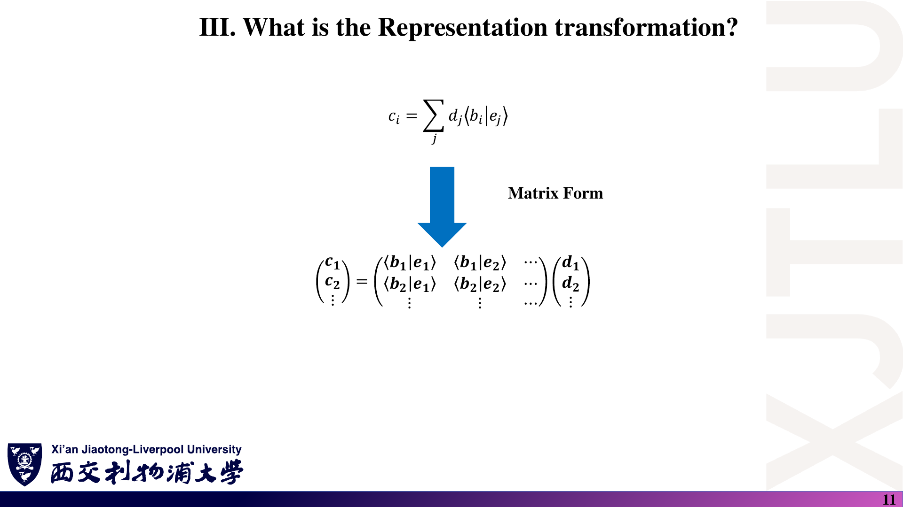

### 中文解释

**题目**：旧基为 $|0\rangle,|1\rangle$，新基为

$$
|+\rangle=\frac{|0\rangle+|1\rangle}{\sqrt2},\qquad
|-\rangle=\frac{|0\rangle-|1\rangle}{\sqrt2}.
$$

求 $U_{ij}=\langle b_i|e_j\rangle$，将 $c=(1,i)^T/\sqrt2$ 变换到新基，并检查归一化。

### 原理深入

将新基向量在旧基中的坐标依次作为列：

$$
U=\frac1{\sqrt2}\begin{pmatrix}1&1\\1&-1\end{pmatrix}.
$$

本题约定 $c=Ud$，故

$$
d=U^\dagger c=\frac12\begin{pmatrix}1+i\\1-i\end{pmatrix}.
$$

$$
|d_+|^2+|d_-|^2=\frac12+\frac12=1.
$$

这里 $U$ 恰好实对称，不能据此认为任意换基都有 $U=U^\dagger$。先定义重叠方向，再决定乘法方向，才不会在复基底里出错。

### Ref

- **原课件**：[Lecture Two，PDF 第 10–12 页](../Lecture_Two.pdf#page=11)。
- **完整推导**：[第二讲：表象变换](02_波函数与密度算符.md)；延伸 [QM2](README.md#ref-qm2)。

## 6. 三点网格哈密顿量

### 课件截图

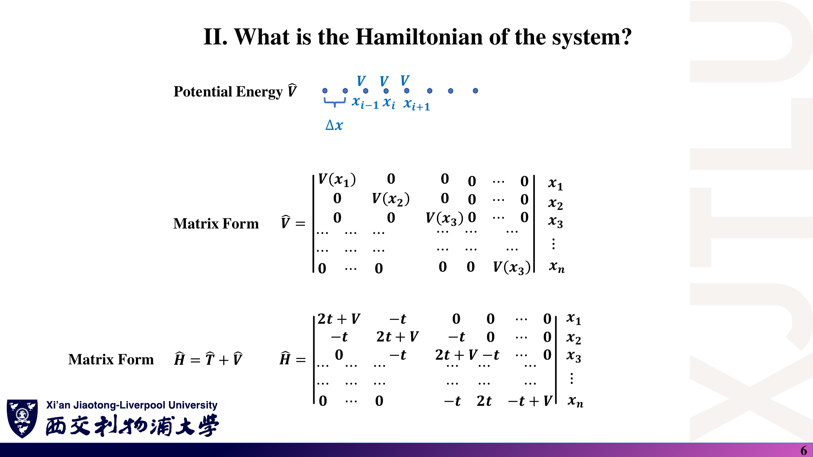

### 中文解释

**题目**：设 $t=1$ 个能量单位，$V_1=0,V_2=1,V_3=0$，两端外侧波函数为零。

1. 写出三点网格的哈密顿量。
2. 验证 $(1,1,1)^T$、$(1,0,-1)^T$、$(1,-2,1)^T$ 是否为本征向量。
3. 求对应本征值并归一化。

### 原理深入

由 $H_{ii}=2t+V_i$、$H_{i,i\pm1}=-t$：

$$
H=\begin{pmatrix}2&-1&0\\-1&3&-1\\0&-1&2\end{pmatrix}.
$$

逐个作用可得

$$
H(1,1,1)^T=(1,1,1)^T,
$$

$$
H(1,0,-1)^T=2(1,0,-1)^T,
$$

$$
H(1,-2,1)^T=4(1,-2,1)^T.
$$

因此三个归一化本征对是

$$
E_1=1,\quad c_1=(1,1,1)^T/\sqrt3,
$$

$$
E_2=2,\quad c_2=(1,0,-1)^T/\sqrt2,
$$

$$
E_3=4,\quad c_3=(1,-2,1)^T/\sqrt6.
$$

它们相互正交，且本征值之和 $1+2+4=7$ 等于 $\mathrm{Tr}H$。这里归一化的是数值列向量；若转回连续波函数采样值，还需按 $c_i=\sqrt{\Delta x}\psi_i$ 处理。

### Ref

- **原课件**：[Lecture Three，PDF 第 4–6 页](../Lecture_Three.pdf#page=6)。
- **Taylor 推导与边界条件**：[第三讲](03_哈密顿量与基组.md)。
- **数值文档**：[NUM](README.md#ref-num)。

## 7. 二能级模型

### 课件截图

### 中文解释

**题目**：给定

$$
H=\begin{pmatrix}2&0.4\\0.4&2\end{pmatrix}\ \mathrm{eV},
$$

求本征值、归一化本征向量和能级间距。$(1,-1)^T/\sqrt2$ 与 $(-1,1)^T/\sqrt2$ 是否为两个独立态？

### 原理深入

特征方程为 $(2-E)^2-0.4^2=0$，所以

$$
E_-=1.6\ \mathrm{eV},\quad c_-=(1,-1)^T/\sqrt2,
$$

$$
E_+=2.4\ \mathrm{eV},\quad c_+=(1,1)^T/\sqrt2.
$$

间距为 $0.8\ \mathrm{eV}$。整体负号等于整体相位 $e^{i\pi}$，不会产生新的物理态。截图中的重复向量问题，可以用线性相关性或代回 $Hc=Ec$ 直接发现。

### Ref

- **原课件**：[Lecture Three，PDF 第 11–12 页](../Lecture_Three.pdf#page=12)。
- **核验记录**：[二能级勘误](07_讲义勘误与易错点.md)。

## 8. 基组与重叠矩阵

### 课件截图

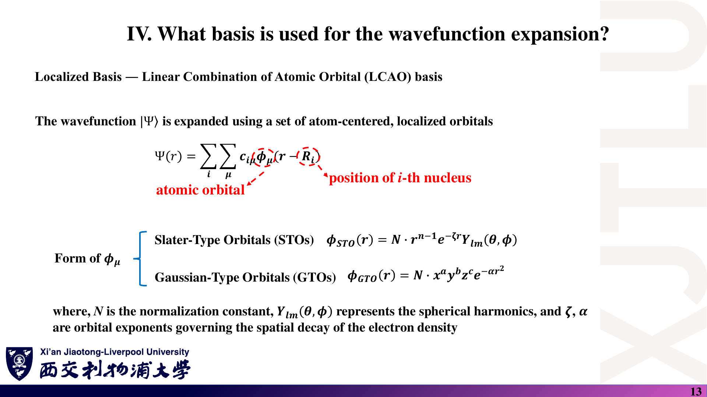

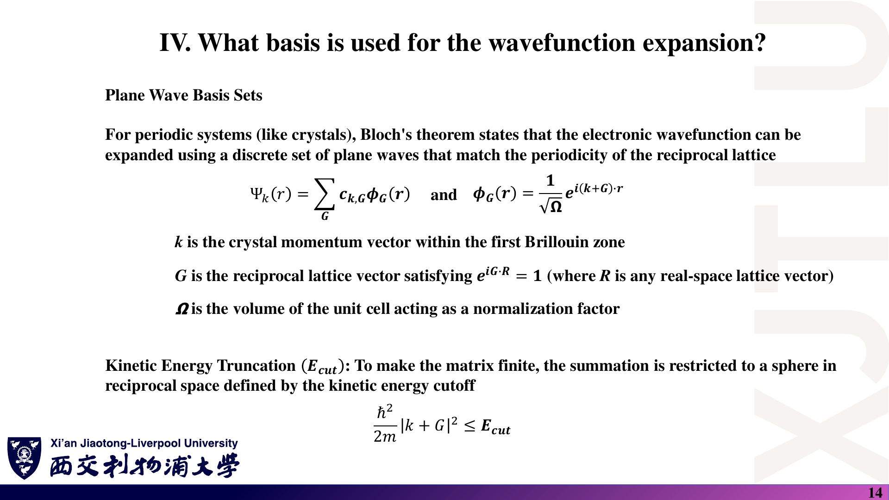

### 中文解释

**题目**：LCAO、平面波和实空间网格分别如何控制精度？若局域轨道不正交，本征方程与归一化应如何改写？

### 原理深入

- **LCAO**：增加或优化轨道集合、径向函数与范围。
- **平面波**：提高动能截断；k 点采样需另行检查收敛。
- **网格**：减小间距，检查区域大小与差分阶数。

非正交基中定义 $S_{ij}=\langle\phi_i|\phi_j\rangle$。将 $|\psi\rangle=\sum_jc_j|\phi_j\rangle$ 代入定态方程，再左乘 $\langle\phi_i|$，得到

$$
Hc=ESc,\qquad c^\dagger Sc=1.
$$

这说明重叠矩阵来自基底之间的内积，而不是可有可无的数值补丁。线性相关轨道还可能使 $S$ 奇异，需要检查基组的独立性。

### Ref

- **原课件**：[Lecture Three，PDF 第 13–16 页](../Lecture_Three.pdf#page=13)。
- **后续实践**：[OMX](README.md#ref-openmx)。广义本征方程为衔接后续课程的补充。

## 9. Bloch 相位与周期边界

### 课件截图

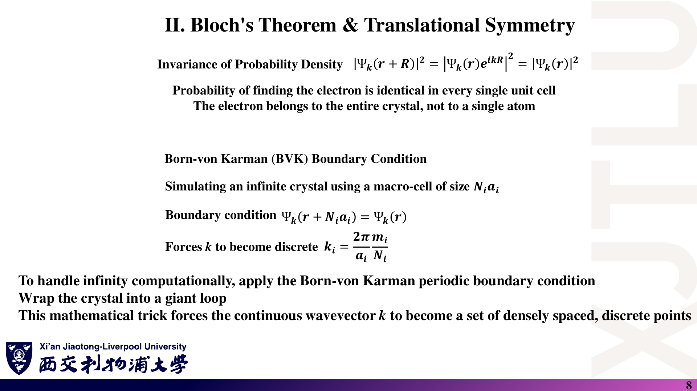

### 中文解释

**题目**：一维晶格常数为 $a$，某 Bloch 态满足 $ka=\pi/3$。

1. $\psi(x+a)$ 与 $\psi(x)$ 有何关系？
2. 两点概率密度是否相同？
3. 对长度 $L=6a$ 的周期边界，这个 k 是否允许？

### 原理深入

由 Bloch 定理，

$$
\psi(x+a)=e^{i\pi/3}\psi(x).
$$

相位因子模为 1，所以两点概率密度相同。但波函数本身通常不相等。

跨越 6 个晶胞：

$$
\psi(x+6a)=e^{i6ka}\psi(x)=e^{i2\pi}\psi(x)=\psi(x),
$$

因此允许，对应 $k=2\pi/(6a)$。它说明“每晶胞可有相位变化”与“整个计算盒必须首尾相接”并不冲突。

### Ref

- **原课件**：[Lecture Four，PDF 第 7–8 页](../Lecture_Four.pdf#page=8)。
- **对称性推导**：[第四讲：Bloch 定理](04_周期势_微扰与SOC.md)；延伸 [SS1](README.md#ref-ss1)。

## 10. Kronig–Penney 允许带

### 课件截图

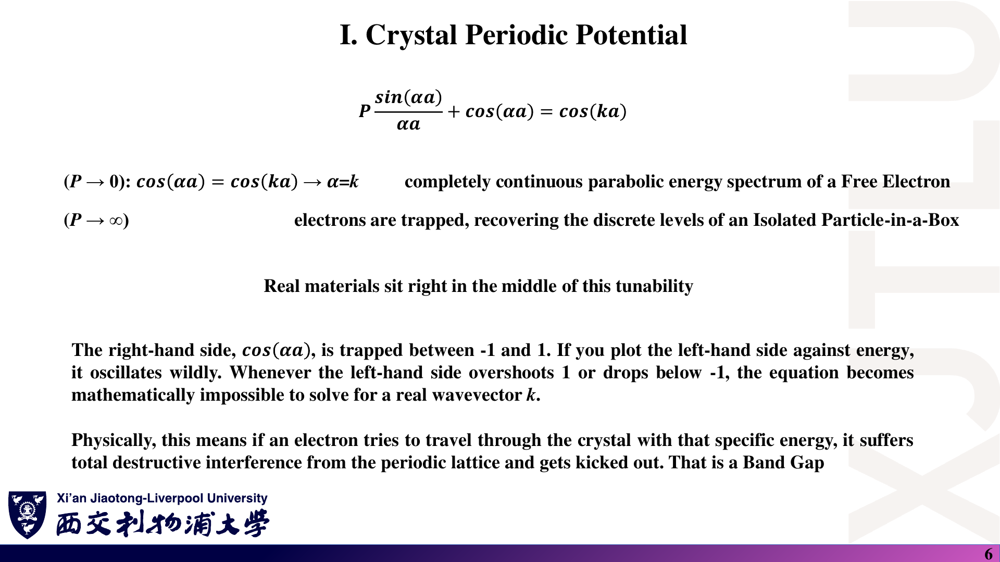

### 中文解释

**题目**：对窄高势垒模型，某能量下 $F(E)=0.8$，另一能量下 $F(E)=1.2$。哪一个允许实 k？写出允许情形的 $ka$，包括周期等价性。

### 原理深入

方程是 $F(E)=\cos(ka)$，故必须满足 $|F|\le1$。当 $F=0.8$，

$$
ka=\pm\arccos(0.8)+2\pi\ell,\qquad\ell\in\mathbb Z.
$$

当 $F=1.2$，没有实 k 解，处于该模型的禁带。这里排除的是传播型体态，不是说所有有限结构中的波函数都必须为零；衰减波和隧穿仍可存在。

### Ref

- **原课件**：[Lecture Four，PDF 第 5–6 页](../Lecture_Four.pdf#page=6)。
- **原理**：[第四讲：传递矩阵与允许带判据](04_周期势_微扰与SOC.md)；延伸 [SS1](README.md#ref-ss1)。

## 11. 非简并微扰

### 课件截图

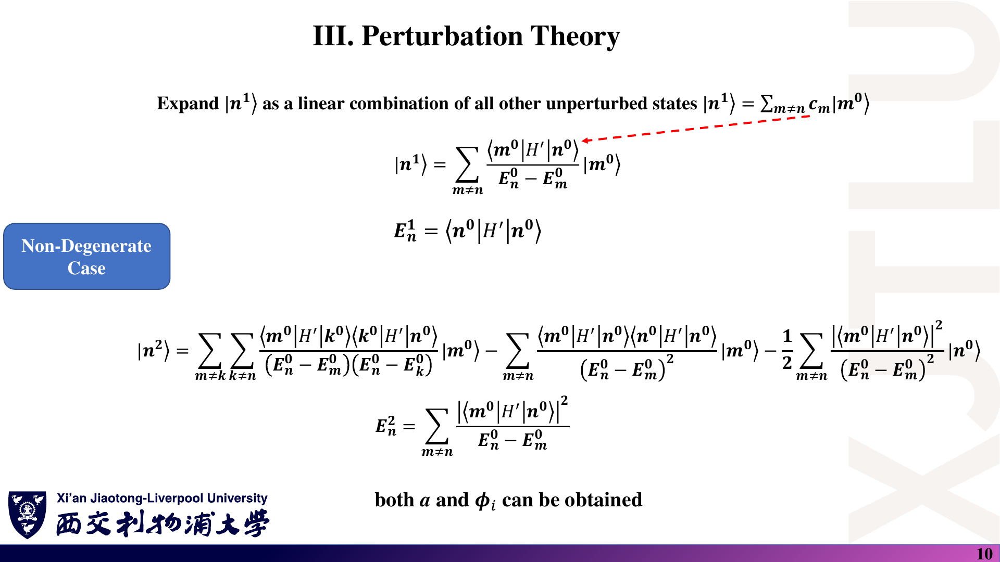

### 中文解释

**题目**：设

$$
H_0=\begin{pmatrix}0&0\\0&3\end{pmatrix}\ \mathrm{eV},
\qquad H'=\begin{pmatrix}0&0.1\\0.1&0\end{pmatrix}\ \mathrm{eV}.
$$

取 $\lambda=1$，求两能级的一阶、二阶能量修正，以及低能态的一阶态修正。说明为什么微扰近似合理。

### 原理深入

一阶修正为对角元，因此两者都是 0。二阶修正为

$$
E_1^{(2)}=\frac{(0.1)^2}{0-3}=-\frac1{300}\ \mathrm{eV},
\qquad E_2^{(2)}=\frac{(0.1)^2}{3-0}=\frac1{300}\ \mathrm{eV}.
$$

近似能量为 $-0.003333\ \mathrm{eV}$ 和 $3.003333\ \mathrm{eV}$：低的更低，高的更高，体现能级排斥。

低能态的一阶修正：

$$
|1^{(1)}\rangle=\frac{0.1}{0-3}|2^{(0)}\rangle
=-\frac1{30}|2^{(0)}\rangle.
$$

耦合/间距约为 $0.0333\ll1$，所以混合较弱。可写显式归一化近似态

$$
|\widetilde1\rangle\approx
\frac{|1^{(0)}\rangle-(1/30)|2^{(0)}\rangle}{\sqrt{1+1/900}},
$$

其中显式归一化包含部分更高阶项。精确解为

$$
E_\pm=\frac{3\pm\sqrt{9.04}}2\ \mathrm{eV}.
$$

精确低能量约 $-0.003329638\ \mathrm{eV}$，与二阶结果相近。

### Ref

- **原课件**：[Lecture Four，PDF 第 9–10 页](../Lecture_Four.pdf#page=10)、[第 12–13 页](../Lecture_Four.pdf#page=13)。
- **推导与适用条件**：[第四讲：微扰理论](04_周期势_微扰与SOC.md)；延伸 [QM1](README.md#ref-qm1)。

## 12. 简并微扰

### 课件截图

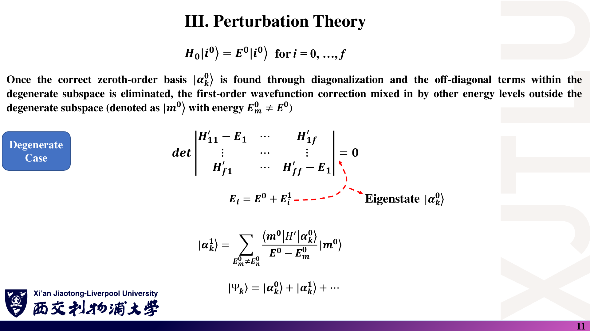

### 中文解释

**题目**：二维简并子空间中，$H_0=E_0I$，微扰矩阵为

$$
W=\begin{pmatrix}0&v\\v&0\end{pmatrix},\qquad v>0.
$$

为何不能套非简并公式？求一阶修正后的能量和合适的零阶态。

### 原理深入

原来两态能量相等，非简并态修正的分母为零。需要先对角化简并子空间中的 $W$：

$$
\det(W-wI)=w^2-v^2=0.
$$

本征值为 $-v,+v$，相应态为

$$
|\alpha_-\rangle=(1,-1)^T/\sqrt2,\qquad
|\alpha_+\rangle=(1,1)^T/\sqrt2.
$$

能量为 $E_0-\lambda v$ 和 $E_0+\lambda v$。若整个模型只有这两维且没有其他项，这也是精确解。微小耦合就能造成等权态混合，说明“耦合绝对值小”不意味着“波函数只发生微小变化”。

### Ref

- **原课件**：[Lecture Four，PDF 第 11 页](../Lecture_Four.pdf#page=11)。
- **延伸**：[QM1：简并微扰](README.md#ref-qm1)；[第三讲的二能级模型](03_哈密顿量与基组.md)。

## 13. 原子轨道与自旋维数

### 课件截图

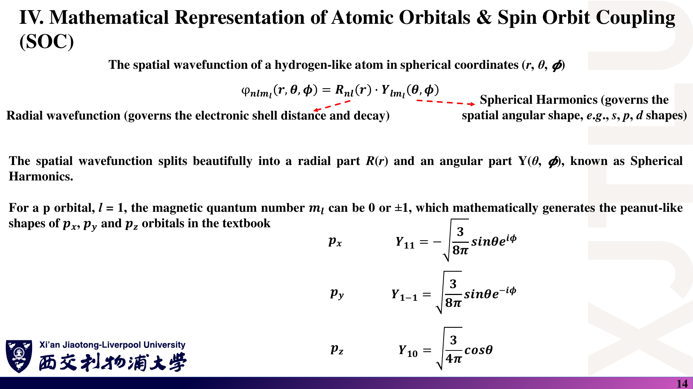

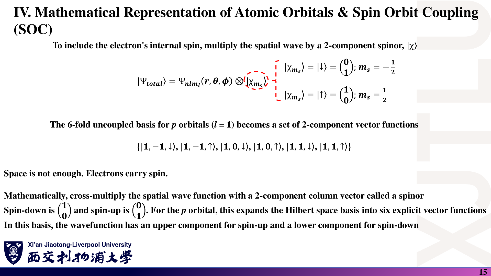

### 中文解释

**题目**：p 壳层的 $l$、$m_l$ 取值是什么？为何加入电子自旋后有 6 个乘积基态？$p_x$ 是否直接等于 $Y_1^1$？

### 原理深入

$l=1$，$m_l=-1,0,1$，每个轨道可配 $m_s=\pm1/2$，所以维数为

$$
(2l+1)(2s+1)=3\times2=6.
$$

常用实 $p_x$ 的角向部分为

$$
\frac{Y_1^{-1}-Y_1^1}{\sqrt2}\propto\sin\theta\cos\varphi,
$$

而单个 $Y_1^1\propto\sin\theta e^{i\varphi}$ 是复球谐函数，不是同一个实轨道。这种基底变换会改变 SOC 矩阵的外观，但在一致变换后不会改变本征能量。

### Ref

- **原课件**：[Lecture Four，PDF 第 14–15 页](../Lecture_Four.pdf#page=14)。
- **公式核验**：[DLMF](README.md#ref-dlmf)；[轨道与自旋标签勘误](07_讲义勘误与易错点.md)。

## 14. SOC 矩阵元与能级分裂

### 课件截图

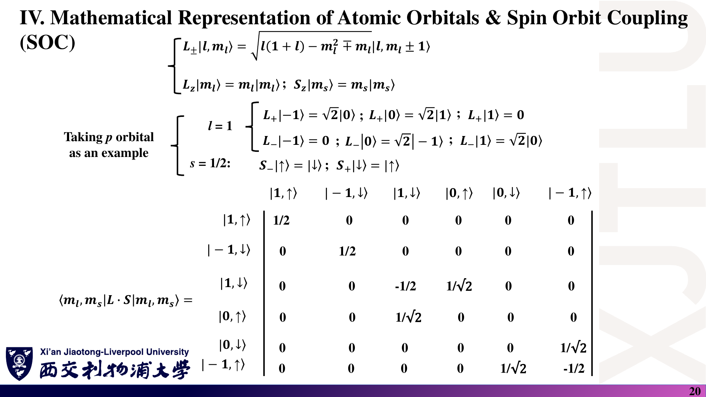

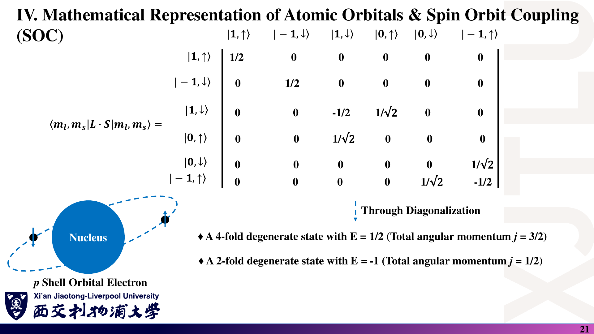

### 中文解释

**题目**：采用 $M=(\mathbf L\cdot\mathbf S)/\hbar^2$，固定 $l=1$。

1. 求 $\langle1,\downarrow|M|1,\downarrow\rangle$。
2. 求 $\langle1,\downarrow|M|0,\uparrow\rangle$。
3. 若 $H_{\rm SOC}=\xi M$，$\xi=0.2\ \mathrm{eV}$，求两组能量移动、简并度和间距。

### 原理深入

对角元来自 $L_zS_z$：$m_lm_s=1\times(-1/2)=-1/2$。

非对角元来自 $L_+S_-/2$：

$$
\frac{\hbar\sqrt2\times\hbar}{2\hbar^2}=\frac1{\sqrt2}.
$$

因此矩阵的非对角元不是任意拟合数，而是由角动量代数固定的系数。

本原子型 p 壳层模型中：

- $j=3/2$：能量移动 $\xi/2=+0.1\ \mathrm{eV}$，四重简并。
- $j=1/2$：能量移动 $-\xi=-0.2\ \mathrm{eV}$，二重简并。
- 间距：$3|\xi|/2=0.3\ \mathrm{eV}$。

若存在晶体场或磁场等其他作用，不能直接宣称这些简并仍保持。

### Ref

- **原课件**：[Lecture Four，PDF 第 16–21 页](../Lecture_Four.pdf#page=20)。
- **矩阵分块与总角动量检验**：[第四讲：SOC](04_周期势_微扰与SOC.md)；延伸 [QM2](README.md#ref-qm2)。

## 15. 综合判断与概念纠错

### 课件截图

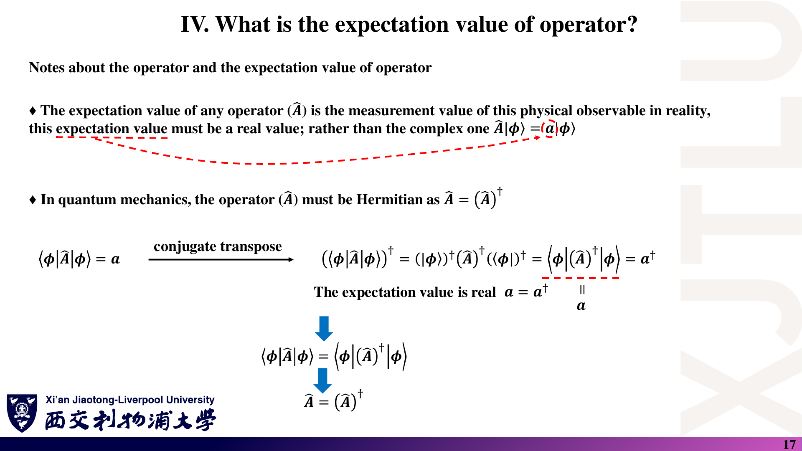

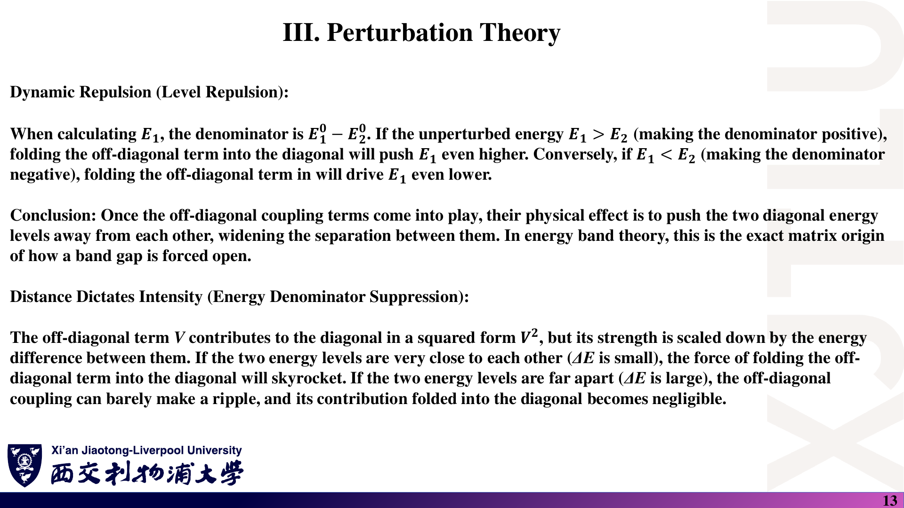

### 中文解释

**题目**：逐项判断并解释。

1. 任意量子力学算符都必须厄米。
2. 只有本征态才能使用 $\langle A\rangle=\langle\psi|A|\psi\rangle$。
3. Bloch 波函数一定满足 $\psi(x+a)=\psi(x)$。
4. 量子体系的所有能谱都是离散的。
5. 非对角耦合越小，微扰展开就一定可靠。
6. 发现平带，就已经证明材料会超导。

### 原理深入

**六项均错误**，分别遗漏了对象、条件或推理步骤：

1. 可观测量使用自伴算符；升降算符等不必厄米。
2. 公式要求态已归一化，不要求处于本征态。
3. 一般相差相位 $e^{ika}$；严格周期还需该相位等于 1。
4. 能谱可离散、连续或两者并存。
5. 必须比较耦合与能级间距；近简并可导致显著混合。
6. 平带提示动能尺度较小，不自动证明配对或超导相干性。

共同规律：**公式的适用条件和物理模型，是结论的一部分。**

### Ref

- **原课件**：[Lecture Two，第 15–17 页](../Lecture_Two.pdf#page=17)；[Lecture Three，第 3 页](../Lecture_Three.pdf#page=3)；[Lecture Four，第 7–13 页](../Lecture_Four.pdf#page=13)；[Lecture One，第 25–26 页](../Lecture_One.pdf#page=26)。
- **逐项核验**：[讲义勘误与易错点](07_讲义勘误与易错点.md)；延伸 [QM1](README.md#ref-qm1)、[SS1](README.md#ref-ss1)。

## 错题记录

| 题号 | 我错在哪里 | 正确原则 | 再做日期 |
|---|---|---|---|
|  |  |  |  |
|  |  |  |  |
|  |  |  |  |

第 2–5 题不熟，回看[第二讲](02_波函数与密度算符.md)；第 6–8 题回看[第三讲](03_哈密顿量与基组.md)；第 9–14 题回看[第四讲](04_周期势_微扰与SOC.md)。
