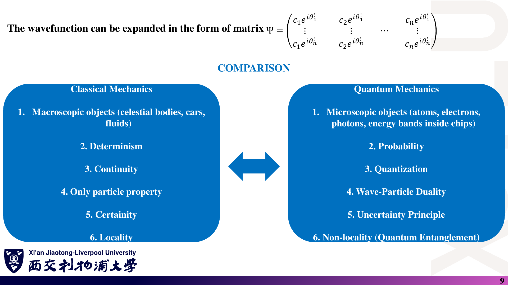
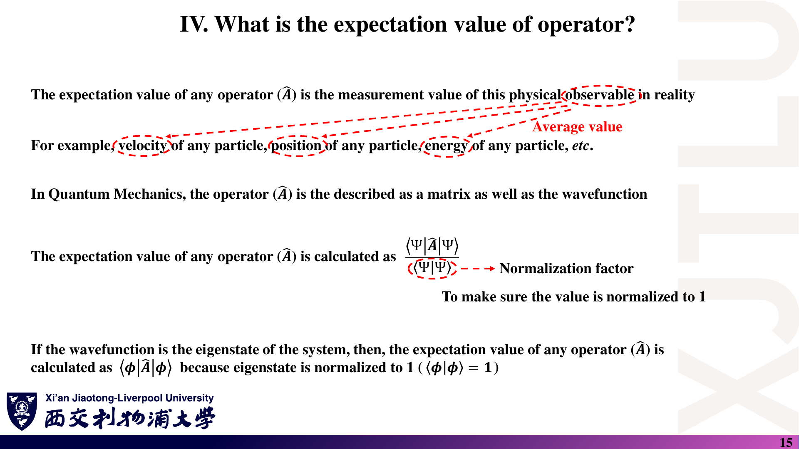
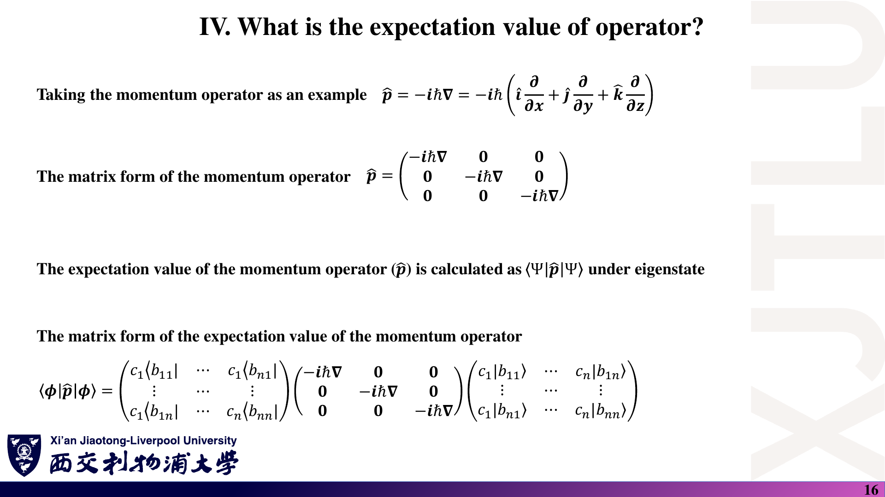
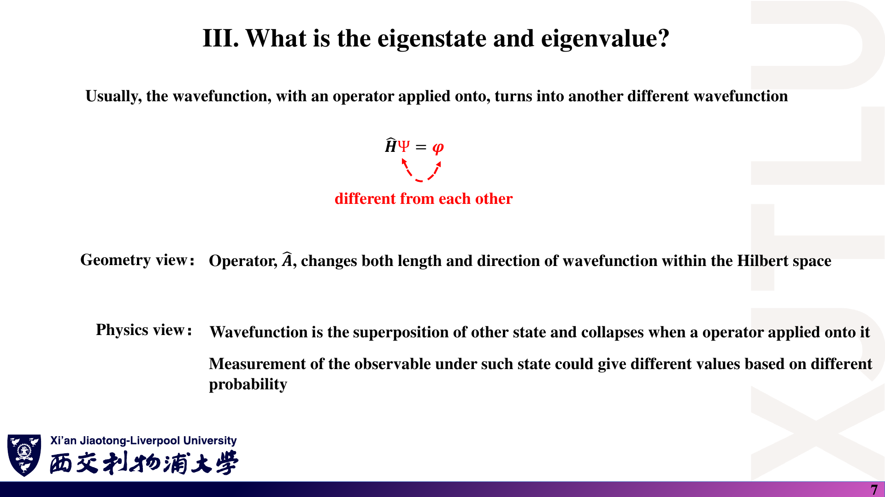
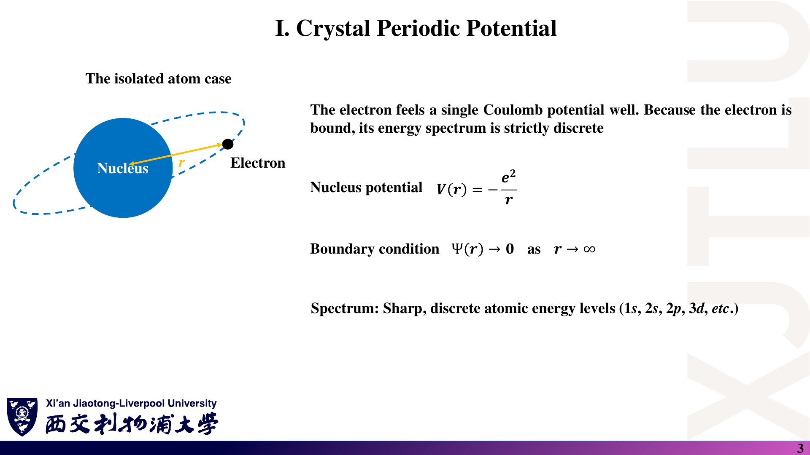
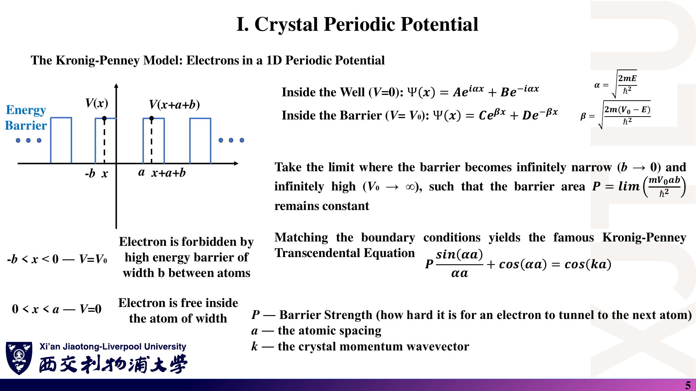
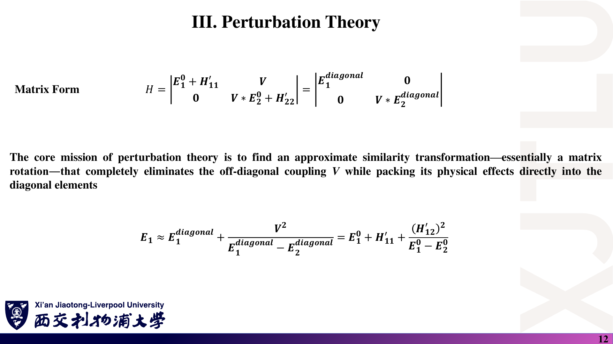
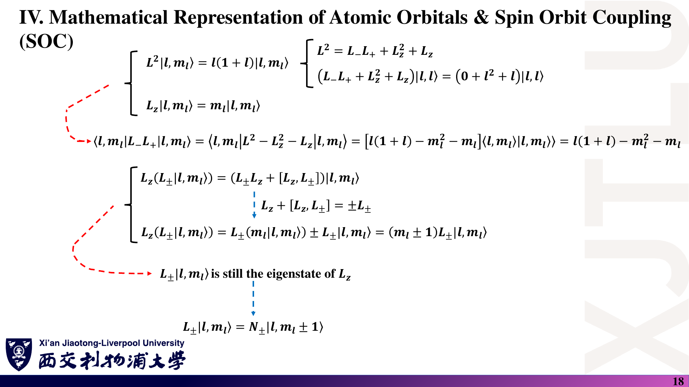

# 07 · 图文勘误、符号约定与易错点

[返回目录](README.md)

> 本文是**学习核对记录，不是教师发布的官方勘误**。截图忠实保留原稿；中文解释说明问题，原理深入给出正确写法和可复核理由。区分明确的笔误、没有说清的约定，以及不应泛化的物理结论。页码均为包含封面的 PDF 物理页码。

## 1. 态向量、归一化与复共轭

### 课件截图

### 中文解释

这里有三个不同问题：

1. 第 8–9 页的基向量和多列展开容易让人误以为“一个态就是任意方阵”。
2. 第 15–16 页将归一化公式与“本征态”过度绑定；本征态并不会自动范数为 1。
3. 第 18–19 页把 bra 和外积中的一般复系数写成 $c_j$，应为 $c_j^*$。

### 原理深入

#### 1.1 形状检查

在选定的 N 维基底下，一个态的坐标是列向量：

$$
c=(c_1,\ldots,c_N)^T,\quad
c^\dagger=(c_1^*,\ldots,c_N^*).
$$

多个不同态并排放置才形成多列矩阵。一般复向量的分量也不必全是单位模相位因子。

#### 1.2 正确的期望值条件

$$
\langle A\rangle=\frac{c^\dagger Ac}{c^\dagger c}.
$$

只要 $c^\dagger c=1$ 就可省去分母，不要求 c 是 A 或 H 的本征态。归一化约束的是总概率，不是把期望值本身“归一化到 1”。

#### 1.3 共轭为什么不可省？

$$
\langle\psi|=\sum_jc_j^*\langle b_j|,
\qquad\rho=\sum_{ij}c_ic_j^*|b_i\rangle\langle b_j|.
$$

用 $c=(1,i)^T/\sqrt2$ 检验：

$$
cc^\dagger=\frac12\begin{pmatrix}1&-i\\i&1\end{pmatrix},
\qquad cc^T=\frac12\begin{pmatrix}1&i\\i&-1\end{pmatrix}.
$$

前者迹为 1、厄米且半正定；后者迹为 0，不是这个态的密度矩阵。这是可直接手算的反例。只有明确系数均为实数时，复共轭才可不写。

### Ref

- **原课件**：[Lecture Two，PDF 第 8–9 页](../Lecture_Two.pdf#page=9)、[第 15–16 页](../Lecture_Two.pdf#page=15)、[第 18–19 页](../Lecture_Two.pdf#page=18)。
- **规范写法**：[第二讲](02_波函数与密度算符.md)；[复习题第 2–4 题](06_复习题与参考答案.md)。
- **延伸**：[QM2](README.md#ref-qm2)、[QC1](README.md#ref-qc1)。

## 2. 动量、厄米性与测量

### 课件截图

### 中文解释

需要区分“矢量算符与矩阵”“可观测量算符与一般算符”“数学作用与物理测量”。忽略这些区分，会把课件中的简化解释记成错误的普遍规则。

### 原理深入

#### 2.1 动量矩阵必须说明基底

$\hat{\mathbf p}=-i\hbar\nabla$ 有三个分量，不意味着它在所有问题中都是一个三阶数值矩阵。每一分量应根据所选基底求矩阵元：

$$
(p_x)_{ij}=\langle b_i|-i\hbar\partial_x|b_j\rangle.
$$

矩阵维数由基底数量决定，不是由物理空间恰好三维决定。

#### 2.2 不是所有算符都厄米

有限维中，可观测量用厄米矩阵表示；升降算符通常不是。例如 $L_+^\dagger=L_-$，一般并非 $L_+^\dagger=L_+$。

此外，单个态的期望值为实数不能证明整个算符厄米。例如

$$
A=\begin{pmatrix}1&1\\0&2\end{pmatrix},\qquad c=(1,0)^T
$$

给出 $c^\dagger Ac=1$，但 $A\ne A^\dagger$。有限维的相应结论需要对所有态的期望值成立。

#### 2.3 算符作用不是测量过程

数学运算 $A|\psi\rangle$ 不自动表示真实测量及其测后态。在理想投影测量中，结果 a 的概率与本征子空间投影算符 $P_a$ 有关；在采用 Lüders 更新的情形，测后态为 $P_a|\psi\rangle/\sqrt{\langle\psi|P_a|\psi\rangle}$（该概率非零时），不是一般的 $A|\psi\rangle$。

### Ref

- **原课件**：[Lecture Two，PDF 第 16–17 页](../Lecture_Two.pdf#page=16)；[Lecture Three，第 7–8 页](../Lecture_Three.pdf#page=7)。
- **延伸**：[QM1：可观测量与测量](README.md#ref-qm1)、[QC1：投影测量](README.md#ref-qc1)。测后态公式为补充说明。

## 3. Hilbert 空间、差分对象与网格归一化

### 课件截图

### 中文解释

第 3 页把可数基底与离散本征谱联系起来，范围过大。第 4–6 页用网格坐标代替波函数采样值，并在矩阵末行出现索引或排版问题。第 15–16 页的网格 delta 函数图像还需要补上正确归一化约定。

### 原理深入

#### 3.1 空间的基底与算符的谱不同

可分 Hilbert 空间可有可数正交基，却仍有连续谱算符。自由粒子具有连续动量谱，不能仅因为某个离散基能够展开其波包，就断言动量只能离散取值。

#### 3.2 差分波函数，不是差分坐标

正确公式为

$$
\psi''(x_i)\approx
\frac{\psi(x_{i+1})-2\psi(x_i)+\psi(x_{i-1})}{(\Delta x)^2}.
$$

若按原稿的坐标记号计算 $x_{i+1}-2x_i+x_{i-1}$，均匀网格中会恒为零，显然不能代表一般波函数的曲率。

#### 3.3 哈密顿量的末行

令 $t=\hbar^2/[2m(\Delta x)^2]$，应有

$$
H_{ii}=2t+V_i,\qquad H_{i,i\pm1}=-t.
$$

零值外侧边界下，末行以 $\ldots,-t,2t+V_N$ 结束。势能最后一个对角元为 $V(x_N)$，不是重复的 $V(x_3)$；势能也不应被加到相邻耦合项上。

#### 3.4 Kronecker delta 与 Dirac delta

离散基的 $\delta_{ij}$ 与连续的 $\delta(x-x')$ 不是同一对象。网格积分近似要求

$$
\sum_i|\psi_i|^2\Delta x\approx1.
$$

数值本征向量通常采用 $\sum_i|c_i|^2=1$，可通过 $c_i=\sqrt{\Delta x}\,\psi_i$ 对接。漏掉权重会让归一化随网格间距变化。

### Ref

- **原课件**：[Lecture Three，PDF 第 3–6 页](../Lecture_Three.pdf#page=4)、[第 15–16 页](../Lecture_Three.pdf#page=16)。
- **推导**：[第三讲：Taylor 展开、差分矩阵与边界条件](03_哈密顿量与基组.md)。
- **延伸**：[QM2：连续表象](README.md#ref-qm2)。

## 4. 伴随矩阵、本征向量与整体相位

### 课件截图

### 中文解释

第 10 页的等式混合了标量行列式与矩阵，需加单位矩阵。第 12 页列出的两个向量只相差一个负号，不能作为二能级非简并系统的两个独立本征态。

### 原理深入

#### 4.1 正确的伴随矩阵恒等式

$$
O\mathrm{adj}(O)=\det(O)I.
$$

令 $O=H-EI$，当行列式为零时，伴随矩阵的非零列属于 O 的零空间。但如果零空间维数较大，伴随矩阵可能全部为零，所以不能把它当作处理所有简并情形的通用算法。

$\mathrm{adj}(O)$ 是代数余子式形成的伴随矩阵，不是共轭转置 $O^\dagger$。

#### 4.2 二能级模型应有独立的对称与反对称组合

$$
H=\begin{pmatrix}\epsilon&\Delta\\\Delta&\epsilon\end{pmatrix}
\quad\Longrightarrow\quad
\begin{cases}
E_-=\epsilon-\Delta,&\phi_-=(1,-1)^T/\sqrt2,\\
E_+=\epsilon+\Delta,&\phi_+=(1,1)^T/\sqrt2.
\end{cases}
$$

原图中的 $(-1,1)^T/\sqrt2$ 只是 $\phi_-$ 的负数，对应同一个物理态。将其代回 H，会得到 $E_-$ 而不是 $E_+$（$\Delta\ne0$）。

归一化应是除以向量范数。对实 $\Delta\ne0$，$(\Delta,-\Delta)^T$ 的范数为 $\sqrt2|\Delta|$，并不是要求能量参数 $\Delta$ 被归一化为某个固定数。

### Ref

- **原课件**：[Lecture Three，PDF 第 10–12 页](../Lecture_Three.pdf#page=12)。
- **手算验证**：[第三讲二能级模型](03_哈密顿量与基组.md)、[复习题第 7 题](06_复习题与参考答案.md)。
- **延伸**：[QM2：厄米本征问题](README.md#ref-qm2)、[NUM](README.md#ref-num)。

## 5. 原子谱与 Kronig–Penney 模型的限定

### 课件截图

### 中文解释

这些页的物理方向是正确的，但要防止把“束缚态能级离散”泛化为全部能谱离散，把势垒强度当作带量纲的面积，或者把禁带描述成电子一定被踢出材料。

### 原理深入

#### 5.1 束缚谱与连续谱并存

孤立原子的束缚态能量离散，电离连续态也存在。类氢原子的库仑势若用 SI 单位，应写为 $V(r)=-Ze^2/(4\pi\varepsilon_0r)$；省略常数必须说明单位制。

#### 5.2 右边是 $\cos(ka)$

正确简化方程为

$$
F(E)=\cos(\alpha a)+P\frac{\sin(\alpha a)}{\alpha a}=\cos(ka).
$$

第 6 页解释文字误写成 $\cos(\alpha a)$。实 k 的限制来自右边的 $\cos(ka)$ 落在 $[-1,1]$ 内。

#### 5.3 势垒面积与无量纲强度不同

势垒面积为 $U=V_0b$，单位是能量 × 长度；$P=mUa/\hbar^2$ 才是无量纲强度。

该方程使用的是 $b\to0,V_0\to\infty$ 且 U 有限的极限，不是一般有限宽势垒的完整公式。

#### 5.4 禁带排除传播型体态，不排除一切波函数

势垒内可有指数衰减波与隧穿。禁带中的 k 可为复数，因此没有对应的实 k 传播解，但有限结构仍可能有衰减波、边界态等。不能把形象措辞当成“概率严格为零”的数学结论。

### Ref

- **原课件**：[Lecture Four，PDF 第 3 页](../Lecture_Four.pdf#page=3)、[第 5–6 页](../Lecture_Four.pdf#page=5)。
- **更深入解释**：[第四讲：周期势与传递矩阵](04_周期势_微扰与SOC.md)。
- **延伸**：[QM1](README.md#ref-qm1)、[SS1](README.md#ref-ss1)。

## 6. 微扰的求和下标与复数耦合

### 课件截图

### 中文解释

第 10 页二阶态修正的双重求和，第一个条件写成了 $m\ne k$。第 12 页矩阵中的 $V^*$ 与零的位置不一致，一般复数耦合的能量修正也不能直接使用 $V^2$。

### 原理深入

#### 6.1 求和应排除的是原态 n

二阶态修正中的相应项应为

$$
\sum_{m\ne n}\sum_{k\ne n}
\frac{V_{mk}V_{kn}}
{(E_n^{(0)}-E_m^{(0)})(E_n^{(0)}-E_k^{(0)})}|m^{(0)}\rangle.
$$

这里允许 $m=k$，因为 $V_{mm}$ 一般不为零。完整的二阶表达式还含对角修正和归一化项，见第四讲第 4.2 节；不同归一化约定会改变沿原态方向的写法。

#### 6.2 厄米矩阵和模平方

应采用

$$
H=\begin{pmatrix}a&V\\V^*&b\end{pmatrix},\qquad a,b\in\mathbb R.
$$

特征方程包含 $VV^*=|V|^2$，所以

$$
E_\pm=\frac{a+b}{2}\pm\sqrt{\frac{(a-b)^2}{4}+|V|^2}.
$$

若 $V=ig$ 且 g 为实数，$V^2=-g^2$，但 $|V|^2=g^2$，两者符号相反；这直接展示了漏写模平方的后果。

有限阶微扰对角化只在保留阶数内近似成立；接近简并时应重组子空间或直接求解，而不是认为发散修正代表真正无限大的能量变化。

### Ref

- **原课件**：[Lecture Four，PDF 第 10 页](../Lecture_Four.pdf#page=10)、[第 12–13 页](../Lecture_Four.pdf#page=12)。
- **完整公式**：[第四讲：微扰第 4.1–4.4 节](04_周期势_微扰与SOC.md)。
- **延伸**：[QM1：定态微扰](README.md#ref-qm1)。

## 7. 实轨道、自旋标签与 SOC 的单位

### 课件截图

### 中文解释

这里最容易混用三种约定：实 p 轨道或复球谐基、自旋分量顺序、是否设定 $\hbar=1$。不同约定都可使用，但必须把波函数、算符矩阵和标签一起变换。

### 原理深入

#### 7.1 实 p 轨道是线性组合

在常用球谐相位约定下，其角向部分为

$$
p_x:\frac{Y_1^{-1}-Y_1^1}{\sqrt2},\qquad
p_y:\frac{i(Y_1^{-1}+Y_1^1)}{\sqrt2},\qquad p_z:Y_1^0.
$$

因此不能直接写 $p_x=Y_1^1,p_y=Y_1^{-1}$。整体相位可另选，但计算矩阵元时必须一致。

#### 7.2 统一自旋标签

第 15 页上方公式与下方英文说明相反。本笔记使用

$$
|\uparrow\rangle=(1,0)^T,\qquad|\downarrow\rangle=(0,1)^T,
\qquad S_z=\frac\hbar2\begin{pmatrix}1&0\\0&-1\end{pmatrix}.
$$

可以改用相反分量顺序，但届时必须同时变换 $S_z$ 和其他矩阵，不能只改文字。

#### 7.3 对易关系不含多余的 $L_z$

第 18 页中间的一行混入了多余项。恢复单位后：

$$
[L_z,L_\pm]=\pm\hbar L_\pm,\qquad
L_zL_\pm=L_\pm L_z+[L_z,L_\pm].
$$

从而当 $L_\pm|l,m\rangle\ne0$ 时，它是 $L_z$ 的本征态，本征值为 $\hbar(m\pm1)$。

#### 7.4 无量纲本征值不等于实际能量

本笔记明确采用

$$
M=\frac{\mathbf L\cdot\mathbf S}{\hbar^2},\qquad H_{\rm SOC}=\xi M.
$$

$M$ 的本征值为无量纲的 $1/2$ 和 $-1$，实际能量移动为 $\xi/2$ 和 $-\xi$。四重与二重简并适用于固定 p 壳层的原子型各向同性模型；晶体场、磁场等可能进一步改变简并。

### Ref

- **原课件**：[Lecture Four，PDF 第 14–15 页](../Lecture_Four.pdf#page=14)、[第 18–21 页](../Lecture_Four.pdf#page=18)。
- **公式核验**：[DLMF：球谐函数](README.md#ref-dlmf)、[QM2：角动量代数](README.md#ref-qm2)。
- **逐项计算**：[第四讲 SOC 矩阵](04_周期势_微扰与SOC.md)、[复习题第 13–14 题](06_复习题与参考答案.md)。

## 8. 材料案例中的结论范围

### 课件截图

### 中文解释

导论中的研究案例用于展示原子级模拟能做什么，不是每个掺杂、每种应变、每个平带材料都满足的定律。实验体系、理论模型与引用论文的题目需要逐一核对。

### 原理深入

| 原页码 | 需要保留的限定 | 为什么重要 |
|---|---|---|
| One 9–11 | 实验涉及 Ag 掺杂 TiO₂，理论引用涉及 B/Ag 共掺杂 | 成分与构型不同，不能直接逐项比较数值 |
| One 14–19 | 掺杂开隙、应变改变电导依赖具体模型 | 对称性、边缘、载流子与散射同样影响结果 |
| One 22–24 | 力矩比值和翻转时间属于特定案例 | 必须确认单位、归一化、温度和器件条件 |
| One 25–26 | 标题与引用的 bilayer / double bilayer 名称不同 | 两层与两组双层不是同一结构 |
| One 25–26 | 平带本身不证明超导 | 配对、相互作用、填充和相干性还需进一步证据 |
| One 28–31 | 只有整体课时和实验方向 | 不应臆造评分比例、截止时间或计算参数 |

课件所引研究保留为可追溯的书目线索，不能把本笔记的概括当作已经独立核读论文或复现了计算。

### Ref

- **原课件**：[Lecture One，PDF 第 9–11 页](../Lecture_One.pdf#page=11)、[第 14–24 页](../Lecture_One.pdf#page=15)、[第 25–31 页](../Lecture_One.pdf#page=26)。
- **案例书目与解释**：[课程导论各模块的 Ref](01_课程导论.md)。
- **延伸**：[SS1：能带、耦合与输运](README.md#ref-ss1)。

## 核对优先级

1. **复共轭与矩阵形状**：先检查式子是否是正确类型的对象。
2. **归一化与独立性**：整体相位不同不代表新物理态。
3. **基底和单位**：轨道顺序、自旋标签、$\hbar$ 与能量约定必须统一。
4. **条件与范围**：边界、简并、模型假设与适用尺度都是公式的一部分。
