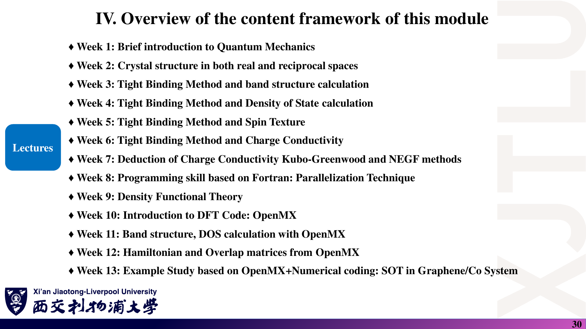
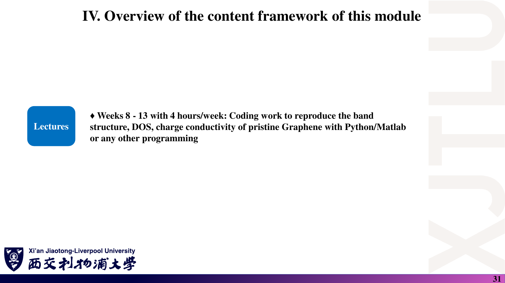
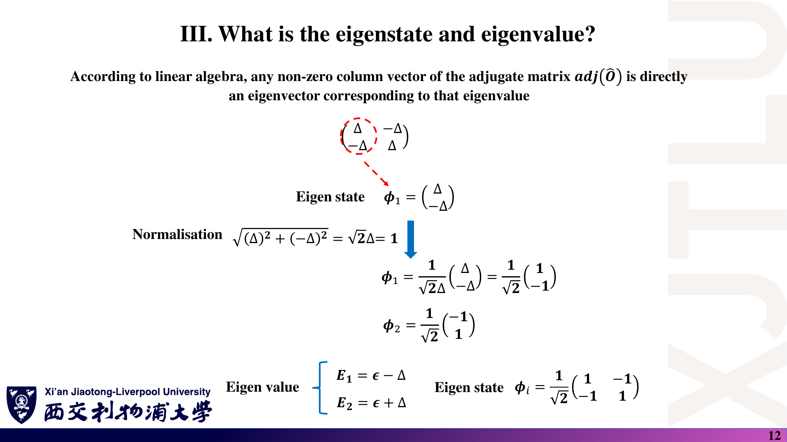

# MES306TC · 第一周图文学习笔记

课程：**Atomic-Level Materials Simulation（原子级材料模拟）** · 教师：Kenan Song

原始资料：4 份 PDF，共 **92 页**。以下 8 份 Markdown 均采用「课件截图 → 中文解释 → 原理深入 → Ref」结构。

> **截图是原讲义整页渲染，不是重新制作的幻灯片。** 原图中的笔误保留，正文单独解释正确写法。所有页码均为含封面的 PDF 物理页码。中文解释为整理，原理深入含补充推导，不能把二者都当作教师原话。

## 1. 怎样使用这套笔记？

### 课件截图



*先看原课件的知识顺序，再用下面的目录定位对应笔记。图片宽 1920 像素，公式较小时可打开原 PNG 放大。*

### 中文解释

第一周是在为后续石墨烯能带、态密度和电导率计算准备数学语言：量子态、基底、哈密顿量、本征值、周期性与自旋耦合。

| 顺序 | 文件 | 内容 |
|---|---|---|
| 0 | 本页 README | 阅读方法、课程地图、参考书目和学习记录 |
| 1 | [01_课程导论.md](01_课程导论.md) | 为什么模拟材料；案例、实验与课程安排 |
| 2 | [02_波函数与密度算符.md](02_波函数与密度算符.md) | 态、概率、换基、期望值与密度矩阵 |
| 3 | [03_哈密顿量与基组.md](03_哈密顿量与基组.md) | 差分矩阵、本征问题、二能级与基组 |
| 4 | [04_周期势_微扰与SOC.md](04_周期势_微扰与SOC.md) | 能带、Bloch 定理、微扰与 SOC |
| 5 | [05_公式与术语速查.md](05_公式与术语速查.md) | 对照原图记公式、条件及英文术语 |
| 6 | [06_复习题与参考答案.md](06_复习题与参考答案.md) | 每题配原图、题意说明、解析与来源 |
| 7 | [07_讲义勘误与易错点.md](07_讲义勘误与易错点.md) | 原图证据、正确写法与核验理由 |

### 原理深入

用同一条计算链串联各讲，而不是把它们当成独立名词：

```text
材料结构、原子种类和外场
  ↓ 决定模型参数与相互作用
选基底，构造 H 或 H(k)
  ↓ 对角化
本征能量 Eₙ、本征态 |n⟩
  ↓ 结合占据、算符及输运模型
能带、DOS、期望值、电导率、自旋相关响应
```

例如，**能带与电导率不是同一个计算结果**：能带给出允许的能量，输运还需要占据、速度矩阵元、散射或接触条件。懂得中间每一步用了什么假设，才是真正理解模型。

阅读每个模块建议做四件事：

1. **看截图**：找到标题、坐标轴、基底顺序与讲义写出的公式。
2. **读中文解释**：回答“这页在解决什么问题？”
3. **读原理深入**：回答“为什么成立？如何推导？什么时候失效？”
4. **查 Ref**：回到指定 PDF 页；需要更系统理解时查延伸书目。

### Ref

- **原课件**：Kenan Song，[Lecture One，PDF 第 30 页](../Lecture_One.pdf#page=30)；第 28–31 页介绍授课、实验和整体安排。
- **原始文件**：[Lecture One](../Lecture_One.pdf) · [Lecture Two](../Lecture_Two.pdf) · [Lecture Three](../Lecture_Three.pdf) · [Lecture Four](../Lecture_Four.pdf)。原 PDF 未修改。
- **来源记录**：[截图来源索引](课件截图/来源索引.json)，记录源 PDF 的 SHA-256、总页数及截图页码。

## 2. 学习顺序与完成标准

### 课件截图



### 中文解释

讲义列出的实践目标是复现本征石墨烯的**能带、DOS 和电导率**。理论 52 小时，实验 24 小时；实验在第 8–13 周进行。报告权重、截止时间、参数和收敛标准需以后续正式要求为准。

建议学习顺序：课程导论 → 波函数与算符 → 哈密顿量与基组 → 周期性与 SOC → 复习题 → 勘误复核。以下自学时间仅供安排：导论约 30 分钟，第二、三讲各约 60 分钟，第四讲约 90 分钟，主动复习约 45 分钟。

### 原理深入

把“学会”定义成可以亲手完成，而不是觉得公式眼熟：

- [ ] 用一个复数二分量态算归一化、bra、概率与密度矩阵。
- [ ] 用 $c^\dagger Ac$ 与 $\mathrm{Tr}(\rho A)$ 得到相同结果。
- [ ] 解释为什么换基不改变测量预测。
- [ ] 从 Taylor 展开得到二阶差分，再写出三点哈密顿量。
- [ ] 对二能级模型求本征对，验证残差与正交性。
- [ ] 区分正交基与非正交基的本征问题。
- [ ] 从平移相位推出 Bloch 密度周期性与离散 k 点。
- [ ] 判断微扰分母是否接近零，选择非简并或简并处理。
- [ ] 用升降算符求 SOC 非对角元 $1/\sqrt2$。
- [ ] 解释 p 壳层 SOC 的四重、二重分裂及其适用条件。

| 日期 | 已完成模块 | 能否独立推导 | 疑问与下一步 |
|---|---|---|---|
|  |  |  |  |
|  |  |  |  |
|  |  |  |  |

### Ref

- **原课件**：[Lecture One，PDF 第 28 页](../Lecture_One.pdf#page=28)、[第 29 页](../Lecture_One.pdf#page=29)、[第 31 页](../Lecture_One.pdf#page=31)。
- **配套练习**：[15 道复习题](06_复习题与参考答案.md)。这些题目为学习整理自编，不是官方作业。

## 3. 如何核对公式与使用 Ref？

### 课件截图



*示例：此原页的两个向量只差整体负号。截图忠实保留原文，不表示原式已经通过核验。*

### 中文解释

笔记的 Ref 区分三种来源：

- **原课件**：直接定位本知识点在本地 PDF 中的位置。
- **推导依据 / 配套笔记**：指向正确公式、例题或核验步骤。
- **延伸阅读**：推荐教材、论文或文档，帮助进一步学习；不是声称已逐页读完这些外部资料。

正文默认离散正交归一基和归一化态；例外会单独说明。$*$ 表示复共轭，$\dagger$ 表示共轭转置。SOC 部分明确保留或除去 $\hbar$，不混用能量与无量纲本征值。

### 原理深入

最简单的核验通常比背结论可靠。例如截图中的向量 $v$ 与 $-v$ 线性相关，组成的矩阵秩为 1，不可能作为二维非简并系统的完整本征基。应将候选向量代回 $Hv=Ev$，再检查内积与归一化。

同样可以用以下方法发现错误：

- **量纲**：概率无量纲，概率密度带积分测度的逆量纲。
- **形状**：态是列向量，期望值是标量，密度矩阵是外积。
- **对称性**：厄米矩阵必须满足 $H_{ij}=H_{ji}^*$。
- **极限**：耦合为零应恢复未耦合模型；接近简并不能机械使用非简并微扰。

截图覆盖四份讲义除封面与结束页外的 **84 页**，保存在 `课件截图/Lecture_*/page-XX.png`；各笔记按主题选图，不要求重复展示每一页。复制或分享笔记时请连同 `课件截图/` 一起保留。PDF 的 `#page=` 跳转是否生效取决于阅读器，但 Ref 中也写出了页码。

### Ref

- **原课件**：[Lecture Three，PDF 第 11–12 页（链接到第 12 页）](../Lecture_Three.pdf#page=12)。
- **核对记录**：[讲义勘误与易错点](07_讲义勘误与易错点.md)。它是学习记录，不是教师官方勘误。
- **外部资料使用说明**：下列教材为延伸书目，未逐章核读；未据此虚构页码。软件文档和 DLMF 页面已核对标题。讲义引用的研究案例只按课件归纳，未独立复现其结果。

#### 延伸参考书目与文档索引

<a id="ref-qm1"></a>
**[QM1]** David J. Griffiths & Darrell F. Schroeter, *Introduction to Quantum Mechanics*, 3rd ed., Cambridge University Press, 2018。检索主题：波函数统计解释、量子力学形式体系、角动量、定态微扰理论。

<a id="ref-qm2"></a>
**[QM2]** R. Shankar, *Principles of Quantum Mechanics*, 2nd ed., Plenum Press, 1994。检索主题：复向量空间、Dirac 记号、表象变换、对称性与角动量。

<a id="ref-ss1"></a>
**[SS1]** Neil W. Ashcroft & N. David Mermin, *Solid State Physics*, Holt, Rinehart and Winston, 1976。检索主题：Bloch 定理、周期势、紧束缚、能带与输运。

<a id="ref-qc1"></a>
**[QC1]** Michael A. Nielsen & Isaac L. Chuang, *Quantum Computation and Quantum Information*, 10th Anniversary Edition, Cambridge University Press, 2010。检索主题：密度算符、纯态、混态与测量。

<a id="ref-num"></a>
**[NUM]** [NumPy：`numpy.linalg.eigh` 官方文档](https://numpy.org/doc/stable/reference/generated/numpy.linalg.eigh.html)。用于厄米矩阵本征求解及返回值约定，不替代物理模型检验。

<a id="ref-openmx"></a>
**[OMX]** [OpenMX 3.9 用户手册](https://www.openmx-square.org/openmx_man3.9/)。用于理解局域轨道基、实际输入与收敛设置；第一周无需通读。

<a id="ref-dlmf"></a>
**[DLMF]** [NIST Digital Library of Mathematical Functions，§14.30：Spherical and Spheroidal Harmonics](https://dlmf.nist.gov/14.30)。用于核对球谐函数定义、归一化与相位约定。
