# 01 · 介观输运、接触电阻与 Landauer–Büttiker 公式

来源：[Lecture_Twenty-Five.pdf](../Lecture_Twenty-Five.pdf)，23 页。

[返回目录](README.md)

## 1. 为什么欧姆定律在纳米尺度失效？〔pp. 2–3〕

### 课件截图

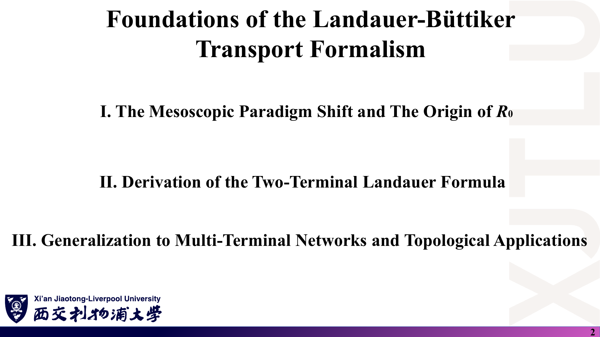

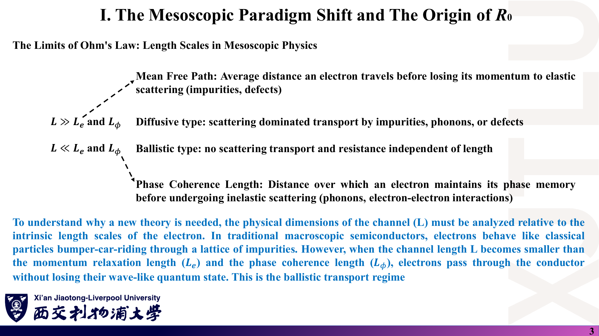

*第 3 页正文中 $\lambda_m$、$L_\varphi$ 等符号在 PDF 文本层中丢失，以截图为准。*

### 中文解释

本讲分三部分：介观输运的新图像与接触电阻 $R_0$ 的来源；两端 Landauer 公式的推导；多端网络与拓扑边缘态应用。

判断该用哪种输运图像，关键是把沟道长度 $L$ 与电子的两个内禀长度比较：

- **动量弛豫长度（平均自由程）$\lambda_m$**：电子因杂质、缺陷等弹性散射丢失动量前平均走过的距离。
- **相位相干长度 $L_\varphi$**：电子因声子、电子–电子等非弹性过程丢失相位记忆前走过的距离。

$L\gg\lambda_m$ 时是扩散输运，电阻随长度增加；$L<\lambda_m$ 且 $L<L_\varphi$ 时电子以“波”的身份穿过器件，称为弹道（ballistic）输运，电阻不再随长度线性增长。

### 原理深入

三种常见区间（〔补充〕整理）：

| 条件 | 输运区间 | 合适的模型 |
|---|---|---|
| $L\gg\lambda_m,\ L\gg L_\varphi$ | 扩散、经典 | Drude / Boltzmann、漂移扩散 |
| $L\lesssim\lambda_m,\ L\lesssim L_\varphi$ | 弹道、相干 | Landauer 透射图像、相干 NEGF |
| $\lambda_m<L<L_\varphi$ 或含明显非弹性散射 | 准弹道 / 部分相干 | NEGF + 散射自能、Büttiker 探针（见 [03](03_非弹性散射与量子器件应用.md)） |

注意两点：

1. **弹性散射不破坏相位**（静态杂质只改变干涉图样），非弹性散射才必然破坏相位并交换能量；第 3 页把两类长度分别与“弹性”“非弹性”对应，这是常用的简化。
2. “电阻与长度无关”只对弹道区间成立；一旦散射存在，Landauer 框架中的 $T(E)$ 会随长度下降，例如 $T\approx\lambda_m/(L+\lambda_m)$ 这一半经典结果〔补充，见 [DATTA1](README.md#ref-datta1)〕。

### Ref

- **原课件**：[Lecture Twenty-Five，PDF 第 2 页](../Lecture_Twenty-Five.pdf#page=2)、[第 3 页](../Lecture_Twenty-Five.pdf#page=3)。
- **延伸**：[DATTA1：特征长度与输运区间](README.md#ref-datta1)；[LJ](README.md#ref-lj)。

## 2. 完美无缺陷的导线为何仍有约 12.9 kΩ？〔pp. 4, 6〕

### 课件截图

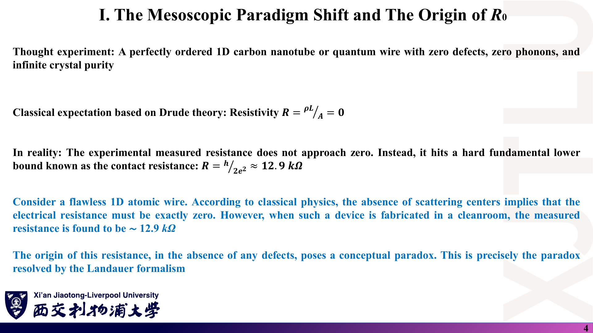

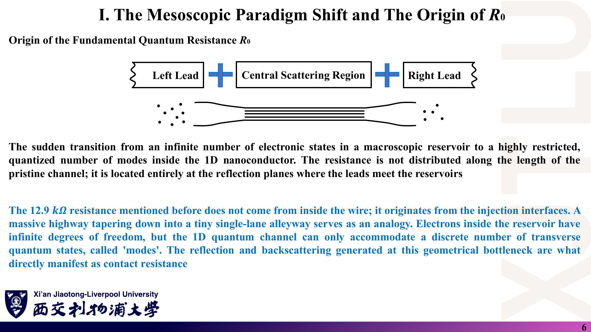

### 中文解释

按 Drude 图像，没有缺陷、没有声子的理想一维导线电阻应为零；实验测得的却是一个有限下限 $R=h/2e^2\approx12.9\ \text{k}\Omega$。

讲义的解释：电阻不在导线内部，而在**宏观电极（库）与一维通道的交界处**。库中有大量电子态，而一维导线只能容纳有限个横向模式（mode），这种“高速公路收窄成单车道”的几何瓶颈产生了接触电阻。

### 原理深入

数值核对：

$$
\frac{h}{e^2}=25.8128\ \text{k}\Omega,\qquad
R_0=\frac{h}{2e^2}\approx12.906\ \text{k}\Omega,\qquad
G_0=\frac{2e^2}{h}\approx7.748\times10^{-5}\ \text{S}.
$$

- 因子 2 来自**自旋简并**；若自旋已劈裂（强磁场、铁磁体），每个模式只贡献 $e^2/h$。
- $R_0$ 是**每个自旋简并模式**的值；$M$ 个理想模式并联给出 $R=h/(2e^2M)$。
- 第 4 页写“Resistivity $R=\rho L/A$”：$R$ 应称电阻（resistance），$\rho$ 才是电阻率；详见 [07 勘误](07_讲义勘误与易错点.md)。

〔补充〕把总电阻写成 $R=\dfrac{h}{2e^2M}\dfrac{1}{T}=\dfrac{h}{2e^2M}+\dfrac{h}{2e^2M}\dfrac{1-T}{T}$，第一项是与长度无关的接触电阻，第二项才是“器件本身”的散射电阻。这说明接触电阻是**开放系统**的普遍结果，而不是工艺缺陷。

### Ref

- **原课件**：[Lecture Twenty-Five，PDF 第 4 页](../Lecture_Twenty-Five.pdf#page=4)、[第 6 页](../Lecture_Twenty-Five.pdf#page=6)。
- **延伸**：[DATTA1：接触电阻](README.md#ref-datta1)；[DATTA2](README.md#ref-datta2)。
- **勘误**：[07 第 1 节](07_讲义勘误与易错点.md)。

## 3. 两端输运的标准模型由哪几部分组成？〔pp. 5, 7〕

### 课件截图

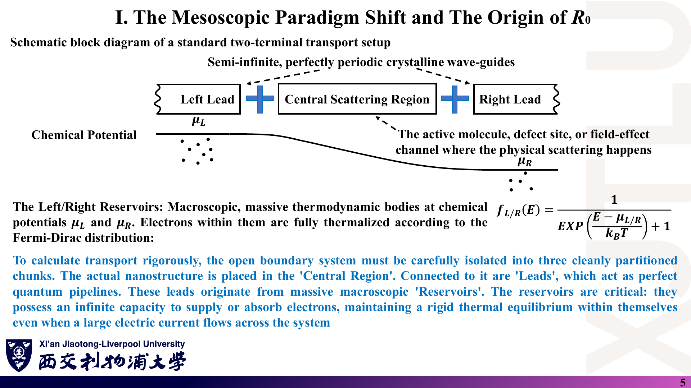

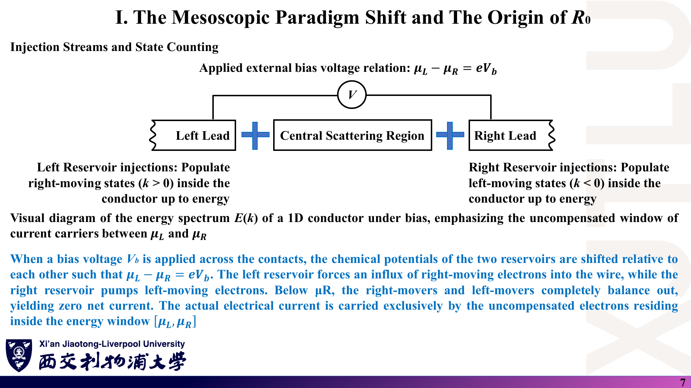

### 中文解释

开放系统被切成三块：

- **库（reservoir）**：宏观、可无限供给/吸收电子，内部始终热平衡，占据由 Fermi–Dirac 分布描述：

$$
f_{L/R}(E)=\frac{1}{\exp\!\big[(E-\mu_{L/R})/k_BT\big]+1}.
$$

- **引线（lead）**：半无限、完美周期的“量子波导”。
- **中心散射区**：分子、缺陷或场效应沟道，散射真正发生的地方。

加偏压后 $\mu_L-\mu_R=eV_b$。左库把右行态（$k>0$）填到 $\mu_L$，右库把左行态（$k<0$）填到 $\mu_R$。在 $\mu_R$ 以下两股流互相抵消，净电流只来自能量窗口 $[\mu_R,\mu_L]$ 中“未补偿”的电子。

### 原理深入

- **右行态由左库决定占据**：这是 Landauer 图像的核心假设——引线中的入射态只“记得”它所来自的库，因此右行态用 $f_L$，左行态用 $f_R$。
- **“偏压窗口”只是零温的说法**。有限温度下 $f_L-f_R$ 在窗口外也非零，窗口边缘被展宽约几个 $k_BT$。
- 讲义把窗口写成 $[\mu_L,\mu_R]$；按 $\mu_L>\mu_R$ 应写 $[\mu_R,\mu_L]$，这只是记法问题。
- 库“无限大、保持平衡”保证分布函数边界条件固定；这也是为什么 Landauer 公式里出现的是库的 $f$，而不是器件内部的非平衡分布。

### Ref

- **原课件**：[Lecture Twenty-Five，PDF 第 5 页](../Lecture_Twenty-Five.pdf#page=5)、[第 7 页](../Lecture_Twenty-Five.pdf#page=7)。
- **延伸**：[DATTA2：弹性电阻器模型](README.md#ref-datta2)。

## 4. 为什么每个通道每单位能量注入的电流恰好是 $2e/h$？〔pp. 8–10〕

### 课件截图

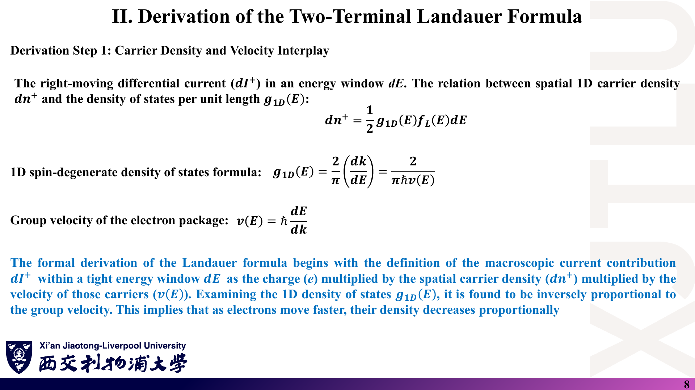

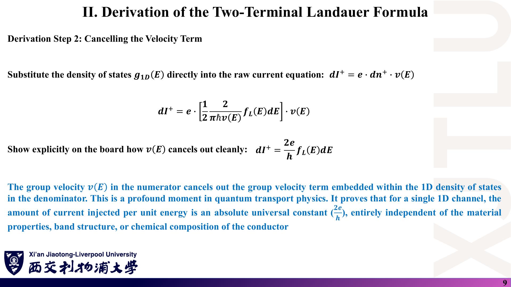

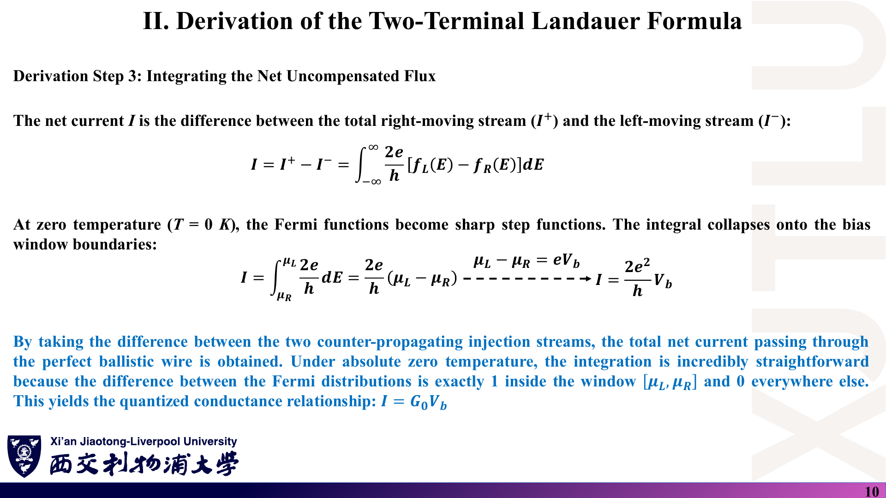

*第 8 页群速度写成 $v=\hbar\,dE/dk$，应为 $v=\hbar^{-1}dE/dk$；后面的 $g_{1D}=2/(\pi\hbar v)$ 用的是正确定义。*

### 中文解释

推导分三步：

1. 能量窗 $dE$ 内右行电子的线密度 $dn^+=\tfrac12 g_{1D}(E)f_L(E)\,dE$（因子 1/2：只取右行的一半态）。
2. 电流 $dI^+=e\,dn^+\,v(E)$。一维态密度 $g_{1D}\propto1/v$，与电流中的 $v$ **精确相消**，得到 $dI^+=(2e/h)f_L\,dE$——与材料、能带细节无关。
3. 净电流 $I=I^+-I^-=\dfrac{2e}{h}\displaystyle\int[f_L-f_R]\,dE$。零温时积分为 $(\mu_L-\mu_R)$，故 $I=\dfrac{2e^2}{h}V_b=G_0V_b$。

### 原理深入

一维、含自旋、长度 $L$ 的周期导线中，$k$ 点间距 $2\pi/L$。单位长度、单位能量的态数：

$$
g_{1D}(E)=\underbrace{2}_{\text{自旋}}\times\underbrace{2}_{\pm k}\times\frac{1}{2\pi}\left|\frac{dk}{dE}\right|
=\frac{2}{\pi}\left|\frac{dk}{dE}\right|=\frac{2}{\pi\hbar v(E)},
\qquad v(E)=\frac{1}{\hbar}\frac{dE}{dk}.
$$

代入：

$$
dI^+=e\cdot\frac12\cdot\frac{2}{\pi\hbar v}f_L\,dE\cdot v=\frac{e}{\pi\hbar}f_L\,dE=\boxed{\frac{2e}{h}f_L(E)\,dE}.
$$

用 $\pi\hbar=h/2$。**量纲检查**：$e/h$ 的单位是 C/(J·s)，乘以能量（J）得 A。

适用条件：单一横向模式、该能量处模式存在（在能带内）、完美透射。若一个能量下存在多个子带，每个子带各贡献 $2e/h$——这就是下一步的多通道推广。

### Ref

- **原课件**：[Lecture Twenty-Five，PDF 第 8–10 页](../Lecture_Twenty-Five.pdf#page=9)。
- **勘误**：[07 第 1 节：群速度定义](07_讲义勘误与易错点.md)。
- **延伸**：[DATTA1](README.md#ref-datta1)、[NB](README.md#ref-nb)。

## 5. 加入散射体后怎样描述？散射矩阵与透射概率〔pp. 11–12〕

### 课件截图

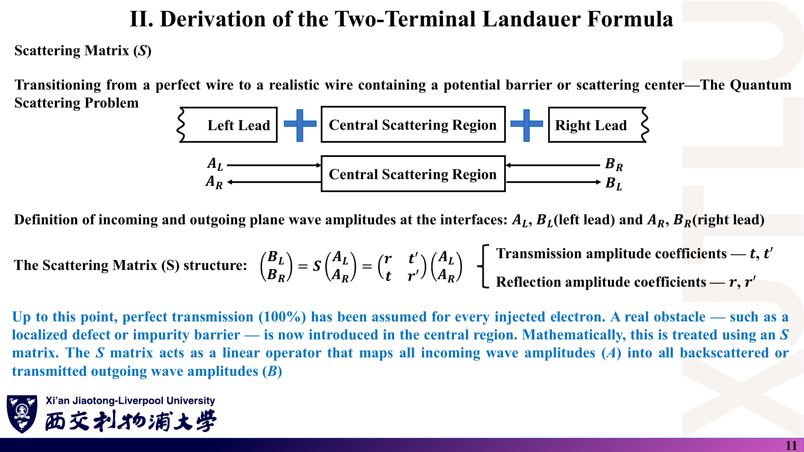

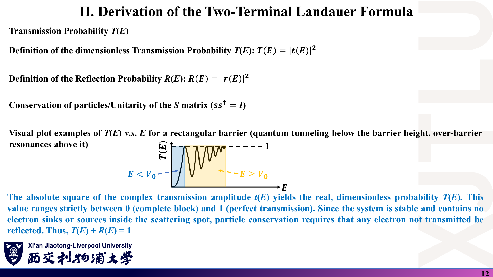

*第 11 页示意图中 $A_R$、$B_L$ 的位置与正文定义不一致，见下方说明。*

### 中文解释

中心区出现势垒或缺陷后，用散射矩阵 $S$ 把入射振幅映射为出射振幅：

$$
\begin{pmatrix}B_L\\B_R\end{pmatrix}=S\begin{pmatrix}A_L\\A_R\end{pmatrix}
=\begin{pmatrix}r&t'\\t&r'\end{pmatrix}\begin{pmatrix}A_L\\A_R\end{pmatrix}.
$$

透射概率 $T(E)=|t(E)|^2$，反射概率 $R(E)=|r(E)|^2$，粒子数守恒（$S$ 幺正）要求 $T+R=1$。矩形势垒例子：$E<V_0$ 时是隧穿，$E\ge V_0$ 时出现共振振荡并趋于 1。

### 原理深入

- **定义一致性**：正文说 $A_L,B_L$ 属于左引线，$A_R,B_R$ 属于右引线；因此左侧应画 $A_L$（入射）与 $B_L$（出射），右侧应画 $A_R$（入射）与 $B_R$（出射）。原图把 $A_R$、$B_L$ 画反了。
- **幺正性推出 $T+R=1$**：$S^\dagger S=I$ 的 (1,1) 元给出 $|r|^2+|t|^2=1$。若 $A,B$ 是**通量归一**的振幅（已乘 $\sqrt{v}$），这一结论才成立；左右引线速度不同时，直接用波函数振幅会得到错误的 $|t|^2$。
- **多通道**时 $t$ 是矩阵，$T=\operatorname{Tr}(t^\dagger t)$，$T$ 可以大于 1（但不超过通道数）。

〔补充〕矩形势垒在 $E>V_0$ 时，当势垒内波数满足 $k'a=n\pi$ 时 $T=1$（过垒共振），这就是图中振荡的来源。

### Ref

- **原课件**：[Lecture Twenty-Five，PDF 第 11 页](../Lecture_Twenty-Five.pdf#page=11)、[第 12 页](../Lecture_Twenty-Five.pdf#page=12)。
- **勘误**：[07 第 1 节：S 矩阵示意图](07_讲义勘误与易错点.md)。
- **延伸**：[DATTA1：S 矩阵](README.md#ref-datta1)。

## 6. 两端 Landauer 公式和多通道推广是什么？〔pp. 13–14〕

### 课件截图

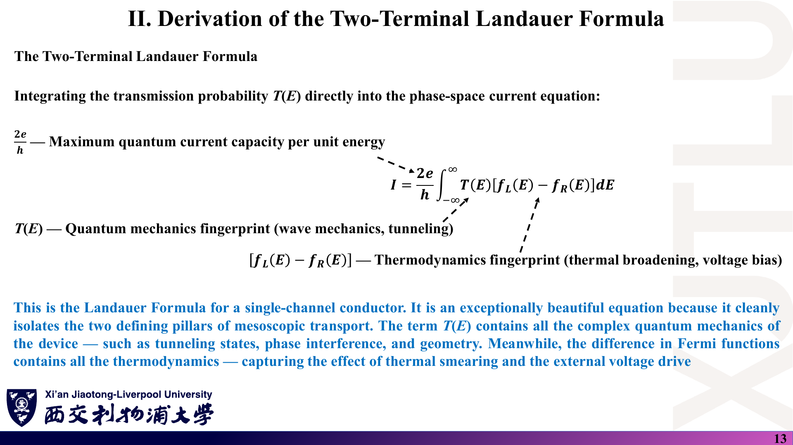

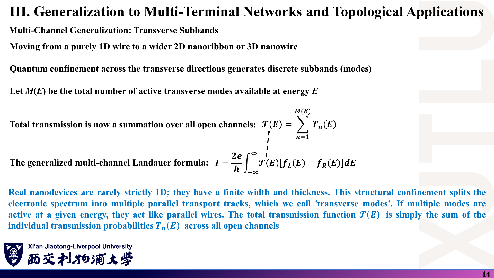

### 中文解释

把透射概率插入第 4 节的电流：

$$
\boxed{I=\frac{2e}{h}\int_{-\infty}^{\infty}T(E)\,[f_L(E)-f_R(E)]\,dE}.
$$

$T(E)$ 是“量子力学指纹”（隧穿、干涉、几何），$f_L-f_R$ 是“热力学指纹”（温度展宽、偏压）。器件有有限宽度时，横向量子限制形成多个子带（模式）；总透射为各开放通道之和 $\mathcal T(E)=\sum_{n=1}^{M(E)}T_n(E)$。

### 原理深入

- $\mathcal T(E)$ 一般**不是**概率，取值在 $[0,M(E)]$；本周代码算出的 $T(E)$ 最高约 1.44，就是因为它是多个通道的和（[08 代码导读](08_代码导读.md)）。
- 公式成立的条件：**相干、弹性**输运（电子入射与出射能量相同），且 $T(E)$ 与偏压无关或已在给定偏压下算好。偏压改变器件内电势时，严格做法是 $T(E,V)$，需与 Poisson 方程自洽。
- 第 13 页的说明写“single-channel conductor”，但公式本身对多通道也成立，只要把 $T$ 换成 $\mathcal T$。
- 若通道在中心区发生混合，更一般的写法是 $\mathcal T=\operatorname{Tr}(t^\dagger t)$，不必先找到“独立通道”。

### Ref

- **原课件**：[Lecture Twenty-Five，PDF 第 13 页](../Lecture_Twenty-Five.pdf#page=13)、[第 14 页](../Lecture_Twenty-Five.pdf#page=14)。
- **衔接**：$T(E)$ 的微观算法见 [02 Fisher–Lee 公式](02_格林函数_自能与Fisher-Lee公式.md)。
- **延伸**：[DATTA2](README.md#ref-datta2)、[LJ](README.md#ref-lj)。

## 7. 线性响应、费米导数窗口与零温量子化〔pp. 15–17〕

### 课件截图

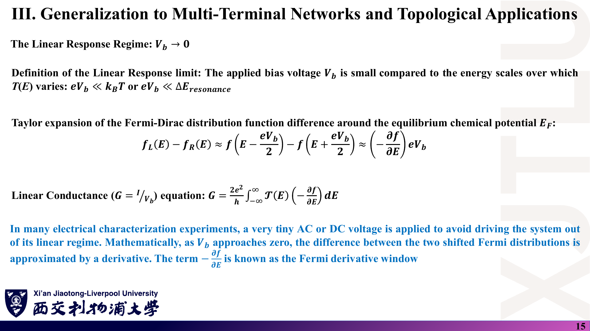

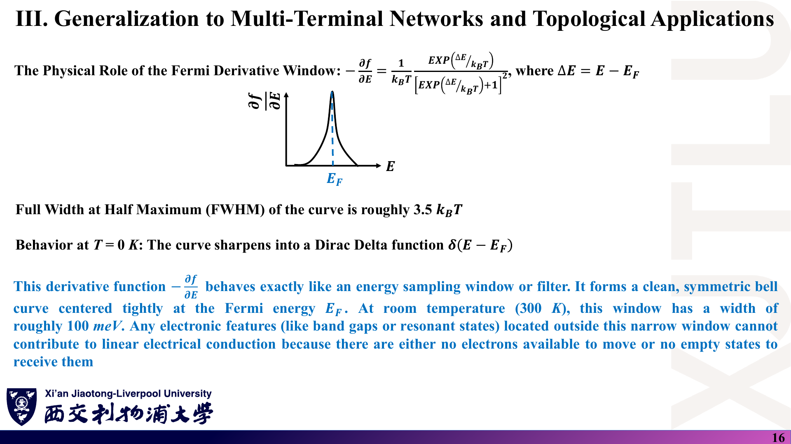

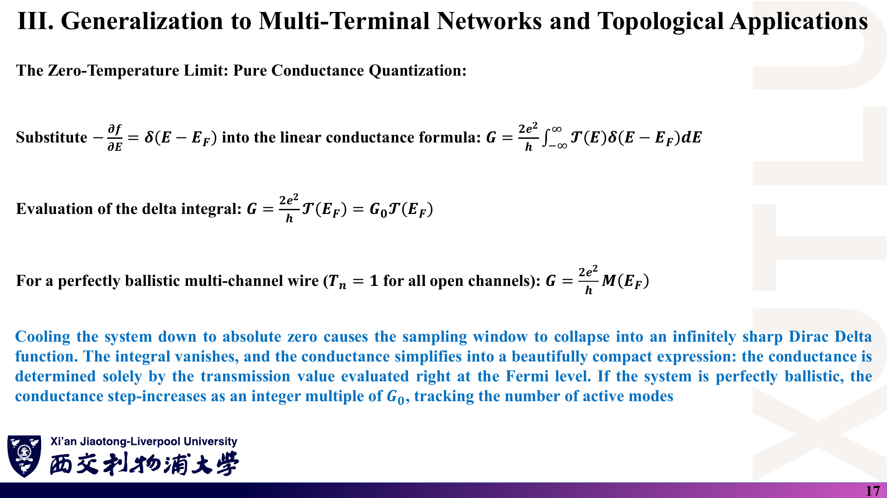

### 中文解释

小偏压时取 $\mu_{L,R}=E_F\pm eV_b/2$，对 Fermi 函数做 Taylor 展开：

$$
f_L-f_R\approx\Big(-\frac{\partial f}{\partial E}\Big)eV_b,
\qquad
G=\frac{I}{V_b}=\frac{2e^2}{h}\int\mathcal T(E)\Big(-\frac{\partial f}{\partial E}\Big)dE.
$$

$-\partial f/\partial E$ 是以 $E_F$ 为中心、面积为 1 的钟形“采样窗口”，宽度约 $3.5k_BT$（室温约 0.1 eV）。$T\to0$ 时它变为 $\delta(E-E_F)$，于是 $G=G_0\mathcal T(E_F)$；完美弹道导线 $T_n=1$，得到台阶状量子化电导 $G=G_0M(E_F)$。

### 原理深入

**窗口函数的性质**：

$$
-\frac{\partial f}{\partial E}=\frac{1}{4k_BT}\operatorname{sech}^2\!\frac{E-E_F}{2k_BT},
\qquad\int_{-\infty}^{\infty}\Big(-\frac{\partial f}{\partial E}\Big)dE=1.
$$

半高处 $\cosh u=\sqrt2$，$u=0.8814$，故 FWHM $=4\times0.8814\,k_BT\approx3.53\,k_BT$。300 K 时 $k_BT=25.85$ meV，FWHM $\approx91$ meV，与讲义“约 100 meV”一致。

**线性响应条件**：严格说需要 $f_L-f_R$ 的线性化成立且 $\mathcal T(E)$ 在偏压窗口内近似不变。讲义写成 $eV_b\ll k_BT$ 或 $eV_b\ll\Delta E_{\text{resonance}}$；更准确的理解是——偏压必须小于 $\mathcal T(E)$ 发生显著变化的能量尺度与热展宽中**起作用**的那个。

**常见误解**：

- 零温量子化要求 $T_n=1$；有散射时 $G$ 不再是整数倍。
- 室温下即使 $\mathcal T(E)$ 是台阶，热窗口也会把台阶抹平；实验看到清晰台阶需要低温或子带间距 $\gg k_BT$。

### Ref

- **原课件**：[Lecture Twenty-Five，PDF 第 15–17 页](../Lecture_Twenty-Five.pdf#page=16)。
- **复习**：[06 第 3 题](06_复习题与参考答案.md)。
- **延伸**：[LJ：近平衡输运](README.md#ref-lj)。

## 8. Landauer 观点带来了什么思维转变？〔p. 18〕

### 课件截图

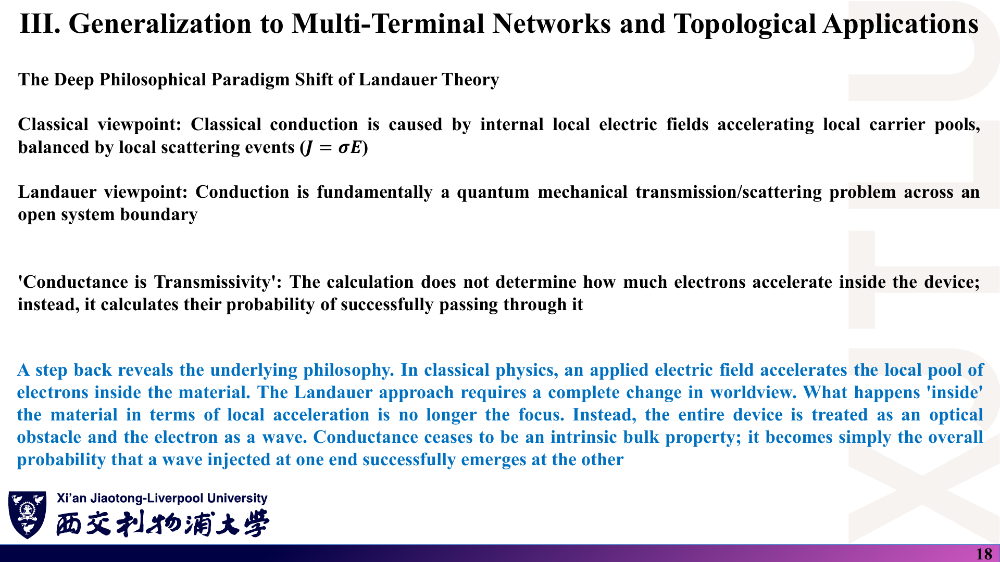

### 中文解释

经典图像：局域电场加速局域载流子，被局域散射平衡（$J=\sigma E$）。Landauer 图像：电导是一个**开放边界上的量子透射问题**——不追问电子在内部加速多少，而问它从一端成功到达另一端的概率。“Conductance is transmission”。

### 原理深入

- 经典的 $\sigma$ 是体材料的**本征性质**（电导率，S/m）；Landauer 的 $G$ 是**整个器件 + 接触**的性质（电导，S）。二者只有在长扩散导体极限下才通过 $G=\sigma A/L$ 联系。
- 这也是本周代码中 “Conductivity” 一词的易错点：程序输出的是 $G(E)=G_0\mathcal T(E)$，单位 S，不是电导率（[07 第 6 节](07_讲义勘误与易错点.md)）。
- 电势降在哪里？Landauer 图像中电势降主要发生在接触处与散射体附近，而不是均匀分布在导线中——这需要自洽静电计算才能定量，Landauer 公式本身不提供。

### Ref

- **原课件**：[Lecture Twenty-Five，PDF 第 18 页](../Lecture_Twenty-Five.pdf#page=18)。
- **延伸**：[DATTA1](README.md#ref-datta1)。

## 9. 多端器件怎样写 Landauer–Büttiker 方程？〔pp. 19–21〕

### 课件截图

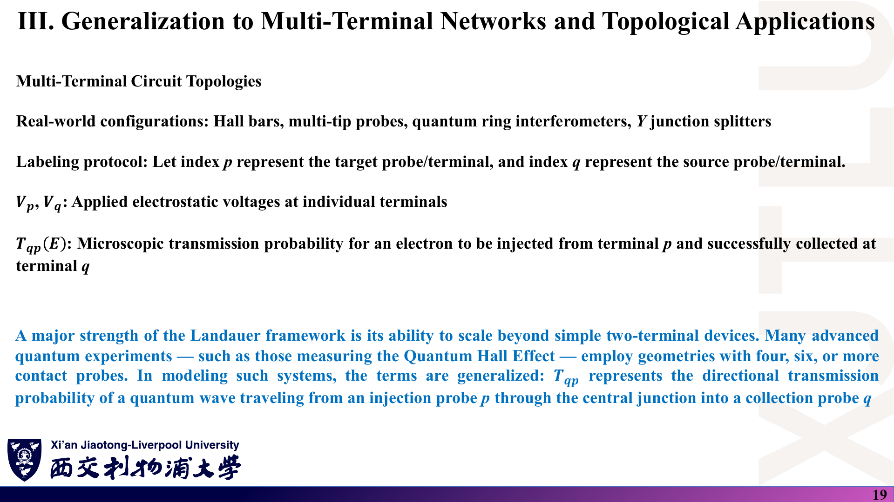

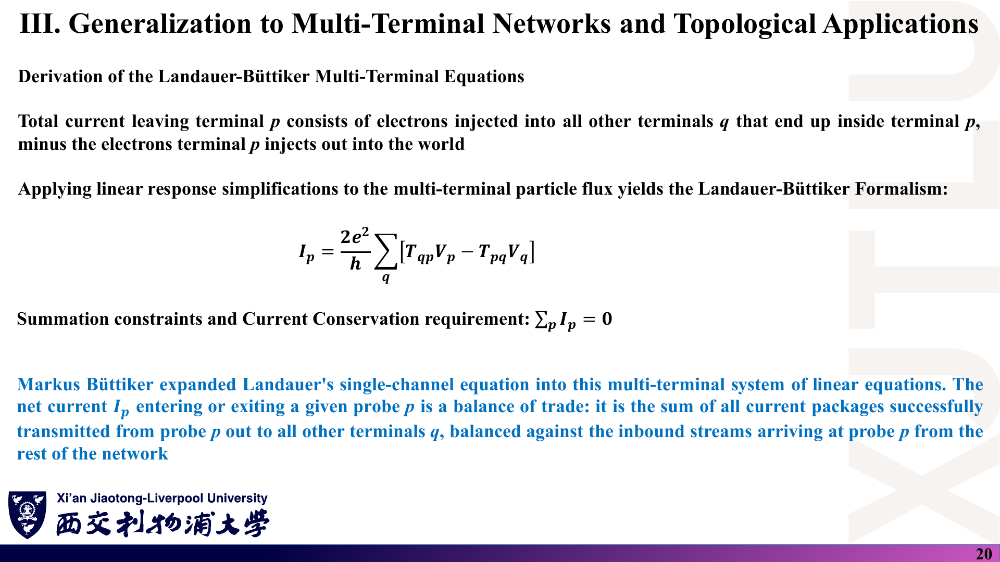

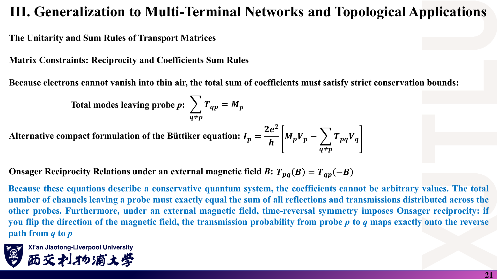

*第 21 页的求和规则漏掉了反射项，见原理深入。*

### 中文解释

Hall 条、多探针、量子环、Y 型分束器等都有多个端口。讲义定义 $T_{qp}(E)$：从端 $p$ 注入、在端 $q$ 被收集的透射概率（**第一个下标是接收端**）。线性响应下：

$$
I_p=\frac{2e^2}{h}\sum_q\big[T_{qp}V_p-T_{pq}V_q\big],\qquad\sum_pI_p=0.
$$

第一项是 $p$ 端向外发出的电流，第二项是其他端流入 $p$ 的电流。磁场下满足 Onsager 互易 $T_{pq}(B)=T_{qp}(-B)$。

### 原理深入

**下标约定要前后一致**。第 19 页一方面说“$p$ 是目标端、$q$ 是源端”，另一方面又把 $T_{qp}$ 定义为 $p\to q$。第 20 页公式与后者（即 Datta 书中的约定：$T_{qp}$ 第一个下标是终点）一致。建议只记一条：**$T_{\text{到}\,\leftarrow\,\text{从}}$**。

**正确的求和规则**。从 $p$ 发出的 $M_p$ 个模式要么透射到其他端、要么反射回 $p$：

$$
\sum_{q}T_{qp}=M_p\quad(\text{含 }q=p\text{ 的反射 }R_{pp}=T_{pp}),\qquad
\sum_{q\ne p}T_{qp}=M_p-R_{pp}.
$$

同理（时间反演或流守恒的另一种形式）$\sum_qT_{pq}=M_p$。于是紧凑形式应为

$$
I_p=\frac{2e^2}{h}\Big[(M_p-R_{pp})V_p-\sum_{q\ne p}T_{pq}V_q\Big],
$$

讲义的 $M_pV_p-\sum_{q\ne p}T_{pq}V_q$ 只在 $R_{pp}=0$ 时成立。

**两个性质**：

- 所有 $V$ 同加一个常数，电流不变（规范不变性）——这正依赖于完整的求和规则；
- $\sum_pI_p=0$（电荷守恒）。因此 $N$ 端方程中只有 $N-1$ 个独立，并可任取一个端为电压零点。

**Onsager 关系**：$T_{pq}(B)=T_{qp}(-B)$ 来源于时间反演对称；磁场本身破坏时间反演，所以必须同时翻转 $B$。

### Ref

- **原课件**：[Lecture Twenty-Five，PDF 第 19–21 页](../Lecture_Twenty-Five.pdf#page=20)。
- **勘误**：[07 第 1 节：多端下标与求和规则](07_讲义勘误与易错点.md)。
- **延伸**：[B86](README.md#ref-b86)、[DATTA1 多端导体](README.md#ref-datta1)。

## 10. 量子 Hall 条中手性边缘态给出什么电阻？〔p. 22〕

### 课件截图

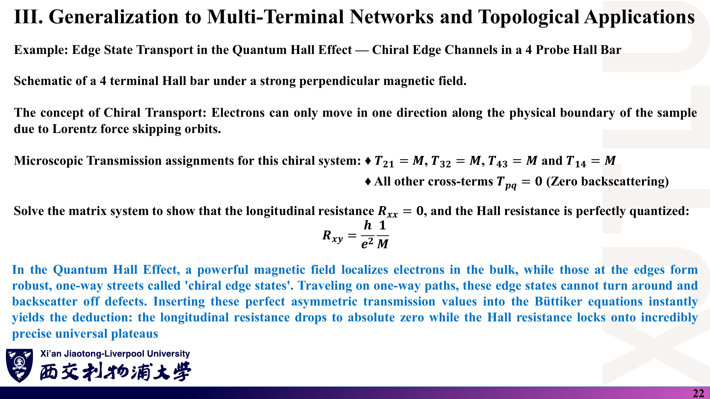

### 中文解释

强垂直磁场下，体内电子被局域，边缘形成只能单向运动的**手性边缘态**。四端口按环形顺序 1→2→3→4→1 排列，讲义给出 $T_{21}=T_{32}=T_{43}=T_{14}=M$，其余为 0（没有背散射）。代入 Büttiker 方程得到纵向电阻 $R_{xx}=0$，Hall 电阻量子化。

### 原理深入

记 $g$ 为每个模式的电导单位，由 $T_{p,p-1}=M$ 得

$$
I_1=gM(V_1-V_4),\ I_2=gM(V_2-V_1),\ I_3=gM(V_3-V_2),\ I_4=gM(V_4-V_3).
$$

- **Hall 配置**：电流 1→3，2、4 为电压探针（$I_2=I_4=0$）。得 $V_2=V_1$、$V_4=V_3$，$I=gM(V_1-V_3)$，

$$
R_{xy}=\frac{V_2-V_4}{I}=\frac{1}{gM}.
$$

- **纵向配置**：电流 1→2，测同一边的 3、4：$I_3=I_4=0\Rightarrow V_4=V_3=V_2$，所以 $R_{12,43}=0$。

**因子 2 的问题**：若沿用讲义第 20 页的 $g=2e^2/h$（自旋简并），结果是 $R_{xy}=h/(2e^2M)$；讲义写的 $h/(e^2M)$ 对应 $g=e^2/h$，即 $M$ 计入**自旋已劈裂**的边缘通道（量子 Hall 区间中 Zeeman 劈裂常使每个边缘通道非简并）。二者都可以，但同一推导中必须统一。

〔补充〕电阻是否为零取决于“电压探针都在同一边、且边缘态之间无背散射”，不是所有四端组合都给零。

### Ref

- **原课件**：[Lecture Twenty-Five，PDF 第 22 页](../Lecture_Twenty-Five.pdf#page=22)。
- **勘误**：[07 第 1 节：Hall 电阻中的因子 2](07_讲义勘误与易错点.md)。
- **延伸**：[B88：多探针量子 Hall 无背散射](README.md#ref-b88)；拓扑绝缘体的螺旋边缘态见 [03 第 9 节](03_非弹性散射与量子器件应用.md)。
