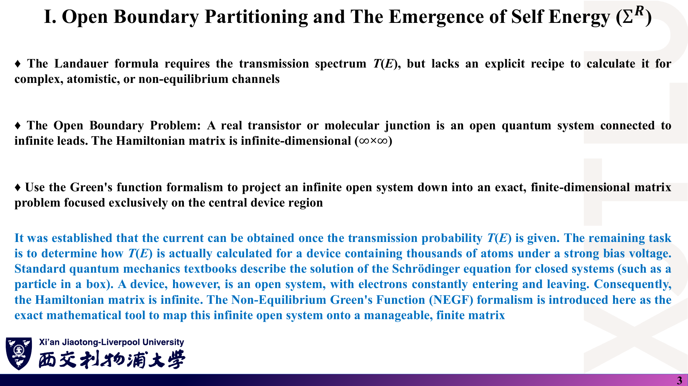
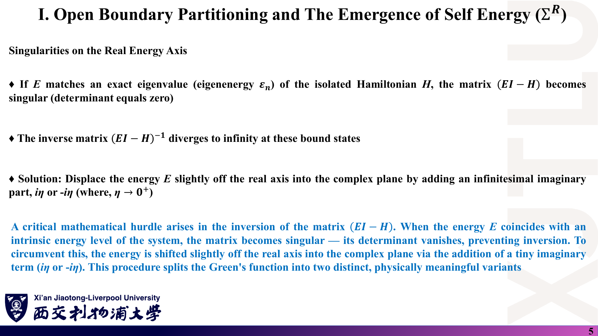
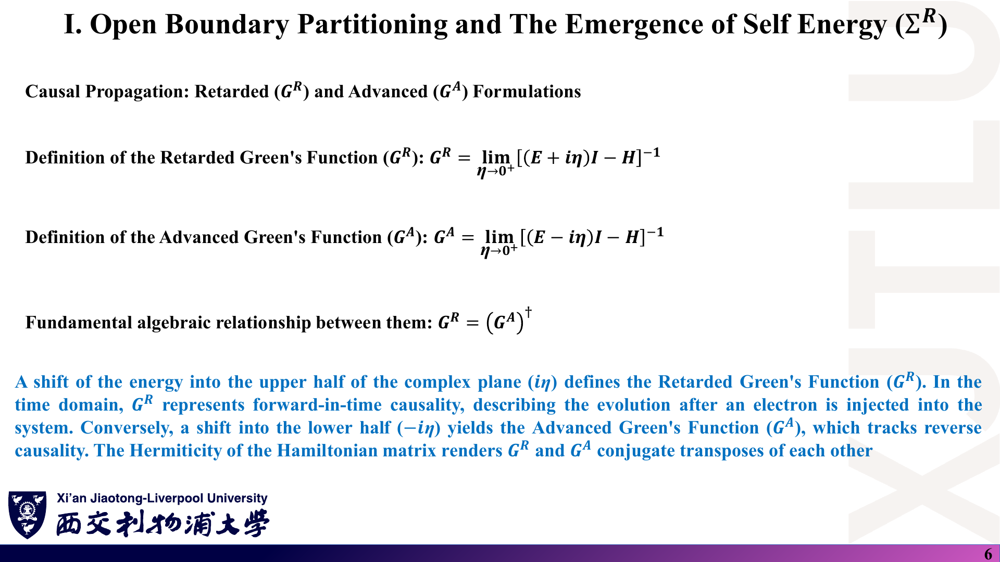
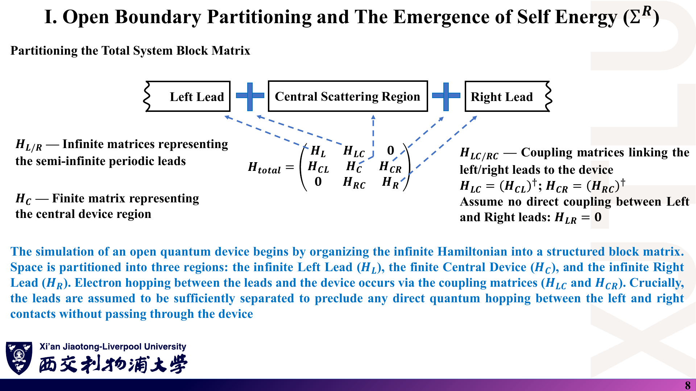
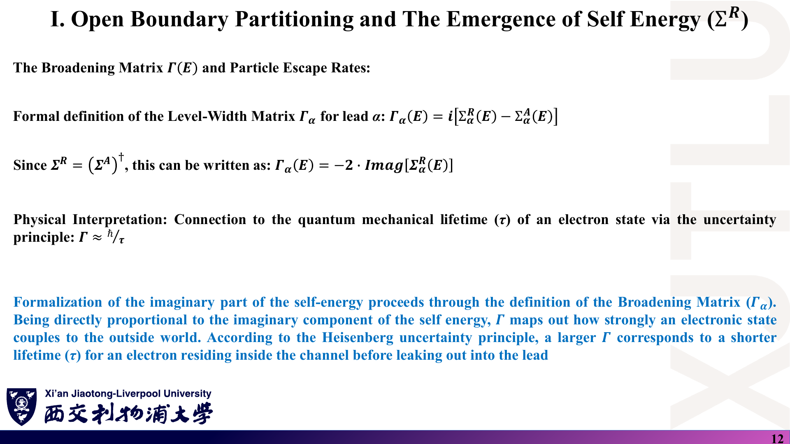
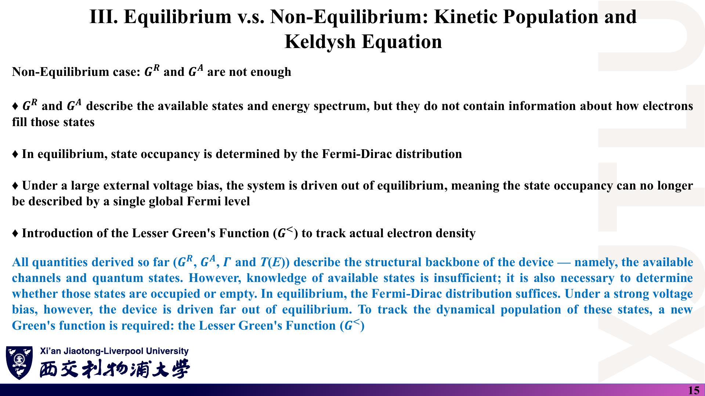
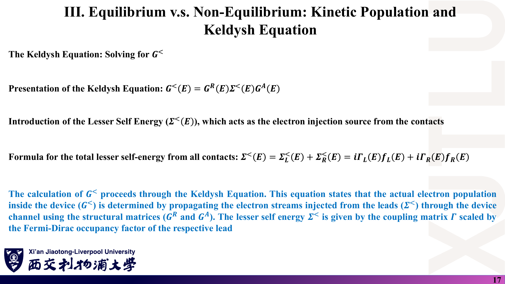
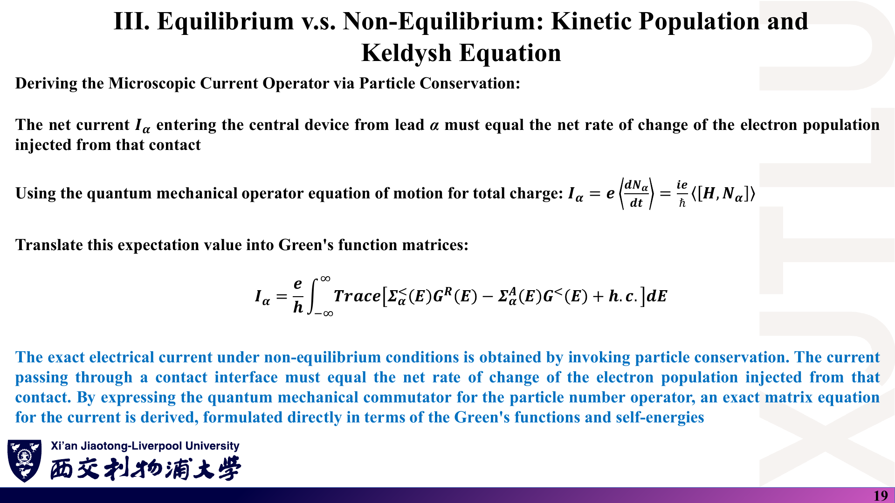
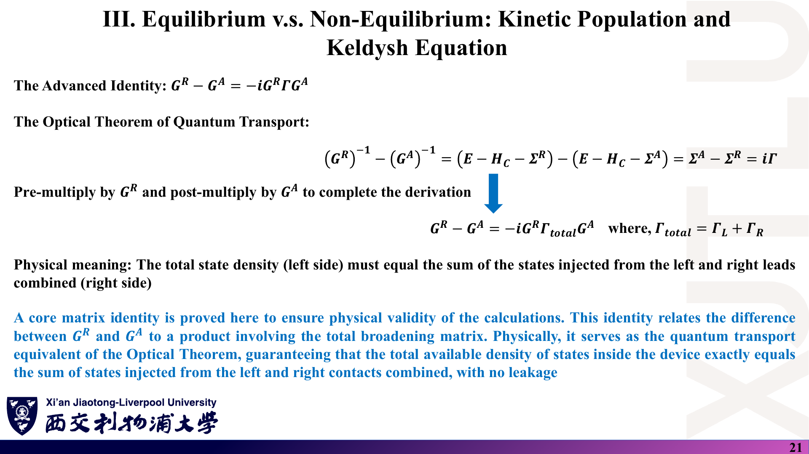

# 02 · 非平衡格林函数基础：自能、Fisher–Lee 公式与 Keldysh 方程

来源：[Lecture_Twenty-Six.pdf](../Lecture_Twenty-Six.pdf)，23 页。

[返回目录](README.md)

## 1. 已有 Landauer 公式，为什么还需要格林函数？〔pp. 2–4〕

### 课件截图

*第 4 页第二个式子左边应为 $(E-H)G(r,r',E)$，原图误写成 $\delta(r,r',E)$。*

### 中文解释

Landauer 公式需要 $T(E)$，但没有说怎样对含数千原子、处于偏压下的器件算出 $T(E)$。器件是**开放系统**：连接无限长引线，哈密顿矩阵是无穷维的。格林函数方法把这个无穷问题精确地投影成只涉及中心区的有限矩阵问题。

格林函数是“脉冲响应”：在 $r'$ 以能量 $E$ 注入一个电子，$G(r,r',E)$ 给出在 $r$ 处探测到它的概率幅。在紧束缚等离散基下：

$$
(EI-H)G=I\quad\Longrightarrow\quad G=(EI-H)^{-1}.
$$

### 原理深入

- 连续形式：$(E-\hat H)G(\mathbf r,\mathbf r';E)=\delta(\mathbf r-\mathbf r')$。离散化后 $\delta$ 变为单位矩阵，$G$ 变为矩阵逆。
- 若基组**非正交**（重叠矩阵 $S\ne I$），应为 $G=(ES-H)^{-1}$〔补充〕。本周代码使用正交 $p_z$ 紧束缚，$S=I$。
- “概率幅”的说法需要谨慎：$G$ 本身有能量倒数的量纲；与态密度、透射等可观测量相联系的是 $G$ 的组合（见第 3、7 节）。

### Ref

- **原课件**：[Lecture Twenty-Six，PDF 第 2–4 页](../Lecture_Twenty-Six.pdf#page=4)。
- **勘误**：[07 第 2 节](07_讲义勘误与易错点.md)。
- **延伸**：[DATTA2：格林函数与自能](README.md#ref-datta2)。

## 2. 能量恰好等于本征值时怎么办？推迟与超前格林函数〔pp. 5–6〕

### 课件截图

### 中文解释

$E$ 等于孤立哈密顿量的本征值时 $EI-H$ 奇异、不可逆。办法是把能量推离实轴：

$$
G^R=\lim_{\eta\to0^+}\big[(E+i\eta)I-H\big]^{-1},\qquad
G^A=\lim_{\eta\to0^+}\big[(E-i\eta)I-H\big]^{-1},\qquad G^R=(G^A)^\dagger.
$$

上半平面对应推迟格林函数（时间上因果、向前传播），下半平面对应超前格林函数。

### 原理深入

**为什么 $+i\eta$ 对应因果？**〔补充〕时域推迟格林函数 $G^R(t)=-\tfrac{i}{\hbar}\theta(t)e^{-iHt/\hbar}$，Fourier 变换 $\int dt\,e^{iEt/\hbar}G^R(t)$ 在 $t\to\infty$ 处需要收敛因子 $e^{-\eta t/\hbar}$，于是得到 $(E+i\eta-H)^{-1}$。

**$G^R=(G^A)^\dagger$ 的条件**：$H$ 厄米。用 $H=H^\dagger$，

$$
\big[(E+i\eta)I-H\big]^\dagger=(E-i\eta)I-H\quad\Rightarrow\quad (G^R)^\dagger=G^A.
$$

**数值上的 $\eta$**：理论上取极限 $\eta\to0^+$；在数值计算中常取有限小值（本周代码 $\eta=0.025$ eV）。它会给所有能级人为加上宽度约 $2\eta$ 的 Lorentz 展宽，太大则抹平结构，太小则需要更密的能量网格且表面格林函数迭代变慢（[08 第 3 节](08_代码导读.md)）。

### Ref

- **原课件**：[Lecture Twenty-Six，PDF 第 5–6 页](../Lecture_Twenty-Six.pdf#page=6)。
- **延伸**：[HJ：推迟/超前格林函数](README.md#ref-hj)。

## 3. 怎样从格林函数得到局域态密度？〔p. 7〕

### 课件截图

### 中文解释

谱函数 $A(E)=i[G^R(E)-G^A(E)]$。利用

$$
\lim_{\eta\to0^+}\frac{1}{x\pm i\eta}=\mathcal P\frac1x\mp i\pi\delta(x),
$$

可得 $\mathrm{Tr}A=2\pi\sum_n\delta(E-\varepsilon_n)=2\pi D(E)$。对角元给出第 $m$ 个原子/轨道上的局域态密度 $\rho_m(E)=A_{mm}(E)/2\pi$。

### 原理深入

在本征基 $H|n\rangle=\varepsilon_n|n\rangle$ 中：

$$
G^R=\sum_n\frac{|n\rangle\langle n|}{E-\varepsilon_n+i\eta},\qquad
A=\sum_n\frac{2\eta}{(E-\varepsilon_n)^2+\eta^2}|n\rangle\langle n|
\xrightarrow{\eta\to0^+}2\pi\sum_n\delta(E-\varepsilon_n)|n\rangle\langle n|.
$$

所以 $A_{mm}=2\pi\sum_n|\langle m|n\rangle|^2\delta(E-\varepsilon_n)$：**态密度按各本征态在 $m$ 上的权重分配**。

- $A$ 是厄米、半正定矩阵；$\int A_{mm}\,dE/2\pi=1$（每个轨道总共一个态，正交基下）。
- 有限 $\eta$ 时每个 $\delta$ 被 Lorentz 函数代替，这与第四周 DOS 的 Lorentz 展宽是同一回事。
- 开放系统中自能取代 $i\eta$，$A=G^R\Gamma G^A$（见第 10 节），能级本身就有物理展宽。

### Ref

- **原课件**：[Lecture Twenty-Six，PDF 第 7 页](../Lecture_Twenty-Six.pdf#page=7)。
- **延伸**：[DATTA2](README.md#ref-datta2)；第四周笔记的 Lorentz 展宽。

## 4. 怎样把“引线—器件—引线”写成分块矩阵？〔pp. 8–9〕

### 课件截图

*第 9 页中间那个矩阵应是未知的分块格林函数 $G$，原图误写成 $H$ 的分块。*

### 中文解释

总哈密顿量：

$$
H_{\text{total}}=\begin{pmatrix}H_L&H_{LC}&0\\H_{CL}&H_C&H_{CR}\\0&H_{RC}&H_R\end{pmatrix},
\qquad H_{LC}=H_{CL}^\dagger,\ H_{CR}=H_{RC}^\dagger,\ H_{LR}=0.
$$

$H_{L/R}$ 是半无限周期引线（无穷维），$H_C$ 是有限的中心区，$H_{LC},H_{CR}$ 是耦合块。假设左右引线不直接耦合，电子必须经过器件。

### 原理深入

格林函数方程应写成

$$
\begin{pmatrix}(E+i\eta)I-H_L&-H_{LC}&0\\-H_{CL}&(E+i\eta)I-H_C&-H_{CR}\\0&-H_{RC}&(E+i\eta)I-H_R\end{pmatrix}
\begin{pmatrix}G_L&G_{LC}&G_{LR}\\G_{CL}&G_C&G_{CR}\\G_{RL}&G_{RC}&G_R\end{pmatrix}=I.
$$

只需要第二列：它给出三个分块方程，其中 $G_{LC},G_{RC}$ 可被消去。

〔补充〕$H_{LR}=0$ 的要求意味着中心区要足够长，使左右引线的原子之间没有直接跳跃；在代码中，中心区 10 个原胞远大于最近邻距离，这一点自动满足。

### Ref

- **原课件**：[Lecture Twenty-Six，PDF 第 8–9 页](../Lecture_Twenty-Six.pdf#page=9)。
- **勘误**：[07 第 2 节](07_讲义勘误与易错点.md)。
- **代码对应**：[08 第 4 节：耦合矩阵](08_代码导读.md)。

## 5. 自能是怎样“替代”无限引线的？〔p. 10〕

### 课件截图

### 中文解释

由第一行 $[(E+i\eta)I-H_L]G_{LC}-H_{LC}G_C=0$ 得 $G_{LC}=g_LH_{LC}G_C$，其中 $g_L=[(E+i\eta)I-H_L]^{-1}$ 是**孤立引线**的格林函数。右侧同理。代回中间行：

$$
\big[(E+i\eta)I-H_C-\Sigma_L^R-\Sigma_R^R\big]G_C=I,\qquad
\Sigma_\alpha^R(E)=H_{C\alpha}\,g_\alpha^R(E)\,H_{\alpha C}.
$$

无穷维的引线消失，只留下附加在 $H_C$ 上的有限矩阵——自能。

### 原理深入

- **只需要表面格林函数**：$H_{\alpha C}$ 只连接引线最靠近器件的一层（主层），所以 $\Sigma_\alpha=\tau_\alpha^\dagger g_\alpha^{s}\tau_\alpha$ 中只出现表面块 $g^s_\alpha$。
- **表面格林函数怎样求**：半无限周期引线（主层哈密顿量 $H_{00}$、层间耦合 $H_{01}$）满足自洽方程

$$
g^s=\big[(E+i\eta)I-H_{00}-H_{01}\,g^s\,H_{01}^\dagger\big]^{-1}.
$$

  本周代码直接迭代这个方程；Sancho–Rubio 递推每步把有效长度翻倍，收敛快得多（[08 第 3 节](08_代码导读.md)、[SR](README.md#ref-sr)）。
- **自能依赖能量**、非厄米、一般是稠密矩阵（仅在与引线相接的那些格点上非零）。它不是一个“势能”，而是开放边界条件的精确表示。

### Ref

- **原课件**：[Lecture Twenty-Six，PDF 第 10 页](../Lecture_Twenty-Six.pdf#page=10)。
- **延伸**：[DATTA2](README.md#ref-datta2)、[SR](README.md#ref-sr)。

## 6. 自能的实部和虚部各有什么物理意义？〔pp. 11–12〕

### 课件截图

*第 11 页 $\Sigma^\pi$ 应为 $\Sigma^R$；“实部 $\Delta(E)$”“虚部 $\Gamma(E)$”的说法见下方矩阵版本的解释。*

### 中文解释

$$
G_C^R(E)=\big[EI-H_C-\Sigma_L^R(E)-\Sigma_R^R(E)\big]^{-1},\qquad
\Sigma^R=\Delta-\tfrac{i}{2}\Gamma.
$$

实部 $\Delta$ 使器件能级因与引线化学耦合而**移动**；虚部给出**寿命展宽**——电子在器件中停留有限时间后逃逸进引线。展宽矩阵

$$
\Gamma_\alpha=i\big[\Sigma_\alpha^R-\Sigma_\alpha^A\big],\qquad \Gamma\approx\hbar/\tau.
$$

### 原理深入

**矩阵情形的严格写法**：$\Sigma$ 是复矩阵，“实部/虚部”应理解为厄米部分与反厄米部分：

$$
\Delta=\frac{\Sigma^R+\Sigma^A}{2},\qquad
\Gamma=i(\Sigma^R-\Sigma^A)=-2\cdot\frac{\Sigma^R-(\Sigma^R)^\dagger}{2i}.
$$

讲义的 $\Gamma=-2\,\mathrm{Imag}[\Sigma^R]$ 只有在“Imag”指反厄米部分时才对；对矩阵逐元素取虚部一般不等于它（非对角元为复数时）。本周代码正确地使用 $i(\Sigma-\Sigma^\dagger)$。

**$\Gamma$ 半正定**：引线是“吸收”的，$\Gamma\ge0$ 保证粒子只会流出到库中，不会凭空产生。

**寿命**：单能级 $\varepsilon_0$ 耦合到引线后，$|\psi(t)|^2\propto e^{-\Gamma t/\hbar}$，所以 $\tau=\hbar/\Gamma$；$\Gamma$ 也正是谱函数 Lorentz 峰的 FWHM。

**注意中心区的 $i\eta$**：第 11 页的 $G^R_C$ 不再写 $i\eta$，因为引线自能已提供展宽；但当 $E$ 落在引线能带之外（$\Gamma=0$）而器件有束缚态时，仍需要 $\eta$ 避免奇异。代码在中心区也保留了 $i\eta$（[08 第 5 节](08_代码导读.md)）。

### Ref

- **原课件**：[Lecture Twenty-Six，PDF 第 11–12 页](../Lecture_Twenty-Six.pdf#page=11)。
- **勘误**：[07 第 2 节](07_讲义勘误与易错点.md)。
- **延伸**：[DATTA2](README.md#ref-datta2)。

## 7. 怎样由格林函数算透射？Fisher–Lee 公式〔p. 13〕

### 课件截图

### 中文解释

$$
\boxed{T(E)=\mathrm{Tr}\big[\Gamma_L(E)\,G_C^R(E)\,\Gamma_R(E)\,G_C^A(E)\big]}
$$

$\Gamma$ 与 $G$ 都是 $N\times N$ 矩阵（$N$ 为中心区基函数数），迹把矩阵乘积压缩成一个无量纲实数。它把上一讲抽象的 $T(E)$ 与器件的微观哈密顿量连接起来。

### 原理深入

- **为什么是实数且非负**：$\Gamma_L^{1/2}G^R\Gamma_R G^A\Gamma_L^{1/2}=(\Gamma_L^{1/2}G^R\Gamma_R^{1/2})(\cdots)^\dagger$ 是半正定矩阵，迹 $\ge0$。数值上迹的虚部只是舍入误差（代码输出的虚部约 $10^{-21}$）。
- **上界**：$T(E)\le\min(M_L,M_R)$，即不超过两侧引线的开放模式数。
- **与 S 矩阵的关系**：可以写成 $T=\mathrm{Tr}(t^\dagger t)$，$t=i\Gamma_R^{1/2}G^R\Gamma_L^{1/2}$（在适当的模式基中）〔补充，[FL](README.md#ref-fl)〕。
- **矩阵乘法顺序不能随意交换**，但迹的循环性允许写成 $\mathrm{Tr}[\Gamma_RG^A\Gamma_LG^R]$ 等等价形式；时间反演对称时左右透射相等。
- **维度一致**：$\Gamma_L$ 只在与左引线相接的格点上非零，实际计算中可以只取 $G^R$ 的“右上角块”$G^R_{1N}$，大幅降低计算量（递归格林函数法）〔补充〕。

### Ref

- **原课件**：[Lecture Twenty-Six，PDF 第 13 页](../Lecture_Twenty-Six.pdf#page=13)。
- **代码对应**：[08 第 5 节](08_代码导读.md)。
- **延伸**：[FL](README.md#ref-fl)、[DATTA2](README.md#ref-datta2)。

## 8. 单能级量子点的透射长什么样？〔p. 14〕

### 课件截图

### 中文解释

单能级 $\varepsilon_0$、两侧对称耦合 $\Gamma_L=\Gamma_R=\gamma$：

$$
T(E)=\frac{\gamma^2}{(E-\varepsilon_0-\Delta)^2+\gamma^2}.
$$

共振 $E=\varepsilon_0+\Delta$ 处 $T=1$（共振隧穿），半高全宽 $2\gamma$。

### 原理深入

一般（不对称）情形，$\Sigma=\Delta-\tfrac i2(\Gamma_L+\Gamma_R)$，标量格林函数

$$
G^R=\frac{1}{E-\varepsilon_0-\Delta+\tfrac i2(\Gamma_L+\Gamma_R)},
\qquad
T=\Gamma_L|G^R|^2\Gamma_R=\frac{\Gamma_L\Gamma_R}{(E-\varepsilon_0-\Delta)^2+\big(\tfrac{\Gamma_L+\Gamma_R}{2}\big)^2}.
$$

- 对称时 $\Gamma_L=\Gamma_R=\gamma$，$(\Gamma_L+\Gamma_R)/2=\gamma$，恢复讲义结果。
- 峰值 $T_{\max}=\dfrac{4\Gamma_L\Gamma_R}{(\Gamma_L+\Gamma_R)^2}\le1$，**只有对称耦合才达到 1**。
- FWHM $=\Gamma_L+\Gamma_R$（讲义对称时为 $2\gamma$）。
- 加入散射自能（下一讲）后分母多出 $\Gamma_s$，峰变矮变宽，$T_{\max}<1$——这就是 RTD 谷电流的来源。

### Ref

- **原课件**：[Lecture Twenty-Six，PDF 第 14 页](../Lecture_Twenty-Six.pdf#page=14)。
- **复习**：[06 第 6 题](06_复习题与参考答案.md)。
- **延伸**：[DATTA2：单能级模型](README.md#ref-datta2)。

## 9. 非平衡时为何还需要小于格林函数？〔pp. 15–18〕

### 课件截图

*第 16 页的 $\rho=\frac{1}{2\pi}\int\mathrm{Imag}[G^<]dE$ 只对对角元成立，完整矩阵应写 $\rho=\int\frac{dE}{2\pi i}G^<$。*

### 中文解释

$G^R$、$G^A$、$T(E)$ 描述“有哪些态、能否通过”，却不说明这些态被多少电子占据。平衡时用一个 Fermi 能即可；大偏压下没有统一的 Fermi 能，需要小于格林函数 $G^<$。Keldysh 方程：

$$
G^<=G^R\Sigma^<G^A,\qquad
\Sigma^<=\Sigma^<_L+\Sigma^<_R=i\Gamma_Lf_L+i\Gamma_Rf_R,
$$

$$
G^<=iG^R\Gamma_LG^Af_L+iG^R\Gamma_RG^Af_R.
$$

器件内电子分布是“左引线填充的态”与“右引线填充的态”按各自 Fermi 函数的加权叠加。

### 原理深入

**电子密度矩阵的正确写法**：$G^<$ 是反厄米矩阵（$(G^<)^\dagger=-G^<$），$-iG^<\equiv G^n$（Datta 记号中的“电子相关函数”）是厄米、半正定的：

$$
\rho=\int_{-\infty}^{\infty}\frac{dE}{2\pi i}\,G^<(E)=\int\frac{dE}{2\pi}\,G^n(E).
$$

对角元 $G^<_{ii}$ 是纯虚数，所以 $\rho_{ii}=\frac{1}{2\pi}\int\mathrm{Im}\,G^<_{ii}dE$ 成立；但对非对角元逐元素取虚部会丢掉实部信息，不能用于整个矩阵。

**平衡检验**：$f_L=f_R=f$ 时 $G^<=if\,G^R(\Gamma_L+\Gamma_R)G^A=if\,A$（用第 10 节恒等式），于是 $\rho=\int\frac{dE}{2\pi}f(E)A(E)$——就是“态密度 × 占据”，回到平衡统计。

**在偏压窗口外**：$f_L\approx f_R$，两股注入无法区分；**真正的非平衡只发生在偏压窗口附近**，这也是 Landauer 公式只需窗口内 $T(E)$ 的原因。

### Ref

- **原课件**：[Lecture Twenty-Six，PDF 第 15–18 页](../Lecture_Twenty-Six.pdf#page=17)。
- **勘误**：[07 第 2 节](07_讲义勘误与易错点.md)。
- **延伸**：[DATTA2：$G^n$ 与 $\Sigma^{in}$](README.md#ref-datta2)、[HJ](README.md#ref-hj)。

## 10. NEGF 电流公式怎样回到 Landauer 公式？〔pp. 19–21〕

### 课件截图

### 中文解释

从引线 $\alpha$ 流入器件的电流等于该引线粒子数的变化率：$I_\alpha=e\langle dN_\alpha/dt\rangle=\frac{ie}{\hbar}\langle[H,N_\alpha]\rangle$，改写为

$$
I_\alpha=\frac{e}{h}\int\mathrm{Tr}\big[\Sigma^<_\alpha G^R-\Sigma^A_\alpha G^<+\text{h.c.}\big]dE.
$$

代入 Keldysh 方程和恒等式 $G^R-G^A=-iG^R\Gamma G^A$（$\Gamma=\Gamma_L+\Gamma_R$），化为

$$
I_L=\frac{2e}{h}\int\mathrm{Tr}[\Gamma_LG^R\Gamma_RG^A]\,[f_L-f_R]\,dE,
$$

即 Landauer 公式，透射就是 Fisher–Lee 形式。

### 原理深入

**黑板上的代数**（〔补充〕逐步核验）。利用 $(\Sigma^<)^\dagger=-\Sigma^<$、$(G^<)^\dagger=-G^<$：

$$
\mathrm{Tr}[\Sigma^<_LG^R+\text{h.c.}]=\mathrm{Tr}[\Sigma^<_L(G^R-G^A)]=if_L\mathrm{Tr}[\Gamma_L(-iA)]=f_L\mathrm{Tr}[\Gamma_LA],
$$

$$
\mathrm{Tr}[-\Sigma^A_LG^<+\text{h.c.}]=\mathrm{Tr}[G^<(\Sigma^R_L-\Sigma^A_L)]=-i\mathrm{Tr}[\Gamma_LG^<].
$$

于是迹 $=\mathrm{Tr}\big[\Gamma_L(f_LA-G^n)\big]$。再代入 $A=G^R(\Gamma_L+\Gamma_R)G^A$、$G^n=G^R(\Gamma_Lf_L+\Gamma_Rf_R)G^A$，$\Gamma_L$ 项相消：

$$
\mathrm{Tr}\big[\Gamma_L(f_LA-G^n)\big]=\mathrm{Tr}[\Gamma_LG^R\Gamma_RG^A]\,(f_L-f_R).
$$

**物理意义**：$f_LA$ 是“若与左库平衡应有的占据”，$G^n$ 是实际占据；二者之差按 $\Gamma_L$ 加权就是流出/流入左引线的净电流。

**前置因子**：第 19 页写 $e/h$（每个自旋），第 20 页最终写 $2e/h$——中间默默乘上了自旋简并因子 2。自旋分辨（如自旋电子学）计算中要回到 $e/h$。

**光学定理恒等式**：

$$
(G^R)^{-1}-(G^A)^{-1}=\Sigma^A-\Sigma^R=i\Gamma
\ \Rightarrow\ G^R-G^A=-iG^R\Gamma G^A,\quad A=G^R\Gamma G^A.
$$

左乘 $G^R$、右乘 $G^A$ 时注意顺序：$G^R[(G^R)^{-1}-(G^A)^{-1}]G^A=G^A-G^R$。这一恒等式保证器件中总态密度 $A$ 恰好等于“左注入态 + 右注入态”，没有凭空的源或漏——前提是中心区没有其他吸收（有限 $\eta$ 会破坏这一点）。

### Ref

- **原课件**：[Lecture Twenty-Six，PDF 第 19–21 页](../Lecture_Twenty-Six.pdf#page=20)。
- **勘误**：[07 第 2 节：$e/h$ 与 $2e/h$](07_讲义勘误与易错点.md)。
- **延伸**：[MW：相互作用区的 Landauer 型公式](README.md#ref-mw)、[DATTA2](README.md#ref-datta2)。

## 11. 本讲的推导在什么前提下成立？〔p. 22〕

### 课件截图

*本页标题 “III. Generalization to Multi-Terminal Networks and Topological Applications” 沿用了上一讲第三部分的标题，与本讲内容不符，属版式问题。*

### 中文解释

本讲所有推导都假设**相干输运**：器件内没有声子或非弹性电子–电子散射，电子从进入到离开保持能量 $E$ 不变。要处理散射，只需在矩阵循环中加入散射自能 $\Sigma_S$——这正是下一讲的内容。

### 原理深入

- 相干假设下，不同能量完全解耦，每个 $E$ 可以独立计算（本周代码按能量点逐个循环，就是利用了这一点）。
- 加入 $\Sigma_S$ 后，$\Sigma_S$ 依赖 $G$ 本身，能量之间耦合，需要自洽迭代（SCBA）。
- 相干并不意味着无散射：静态缺陷、无序势仍可直接写进 $H_C$，它们是弹性、相干的散射。

### Ref

- **原课件**：[Lecture Twenty-Six，PDF 第 22 页](../Lecture_Twenty-Six.pdf#page=22)。
- **勘误**：[07 第 5 节：标题沿用](07_讲义勘误与易错点.md)。
- **衔接**：[03 非弹性散射](03_非弹性散射与量子器件应用.md)。
