# 03 · 多体散射、能量弛豫与先进量子器件

来源：[Lecture_Twenty-Seven.pdf](../Lecture_Twenty-Seven.pdf)，31 页。

[返回目录](README.md)

> 本讲后半部分大量引用研究论文的插图。下文“中文解释”转述课件说法；“原理深入”中凡涉及论文内容的判断，均已对照论文原文核对，核对结论与课件说法不一致处在 [07 第 4 节](07_讲义勘误与易错点.md) 汇总。论文本身未随仓库分发，书目见 [README 课程补充文献](README.md#ref-supp)。

## 1. 为什么要超越相干输运？〔pp. 2–4〕

### 课件截图

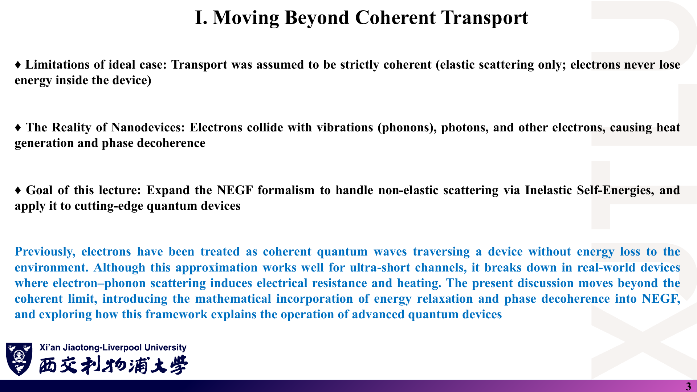

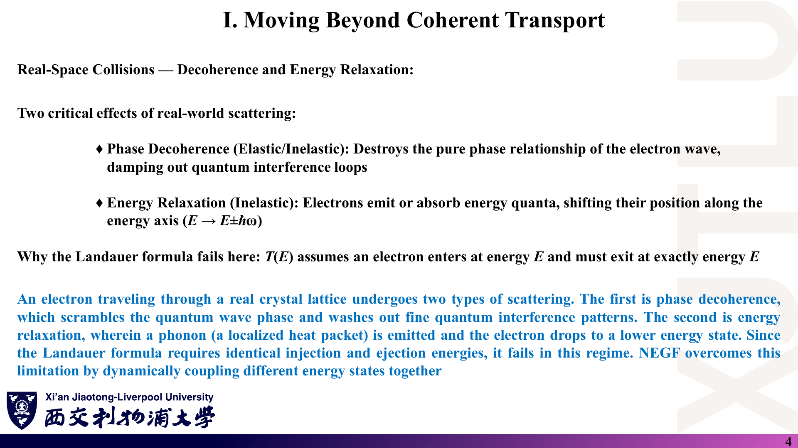

### 中文解释

前两讲假设输运严格相干：只有弹性散射，电子在器件内不损失能量。真实纳米器件中电子会与声子、光子和其他电子碰撞，产生热和退相干。散射有两类效应：

- **相位退相干**（弹性或非弹性）：破坏电子波的相位关系，抹平干涉；
- **能量弛豫**（非弹性）：电子吸收或发射能量量子，在能量轴上移动 $E\to E'$。

Landauer 公式中的 $T(E)$ 假定电子以 $E$ 进入、以同一 $E$ 离开，所以无法描述能量弛豫。

### 原理深入

- “Landauer 失效”的准确含义：**单一能量的 $T(E)$ 不够用**。若散射只是弹性的静态无序，把它写进 $H_C$ 后 Landauer 仍然精确；真正需要扩展的是动态的、非弹性的散射。
- 两类效应在 NEGF 中的位置：退相干主要来自 $\Sigma_S$ 对 $G^R$ 的展宽；能量弛豫来自 $\Sigma_S^<$ 把不同能量的 $G^<$ 联系起来（第 4 节）。
- 能量弛豫产生焦耳热：电子把能量交给晶格，这部分功率在纯相干模型中只能“记在库里”。

### Ref

- **原课件**：[Lecture Twenty-Seven，PDF 第 2–4 页](../Lecture_Twenty-Seven.pdf#page=3)。
- **延伸**：[DATTA2：退相干与 Büttiker 探针](README.md#ref-datta2)、[LAKE](README.md#ref-lake)。

## 2. 散射自能怎样加入 NEGF？〔pp. 5–7〕

### 课件截图

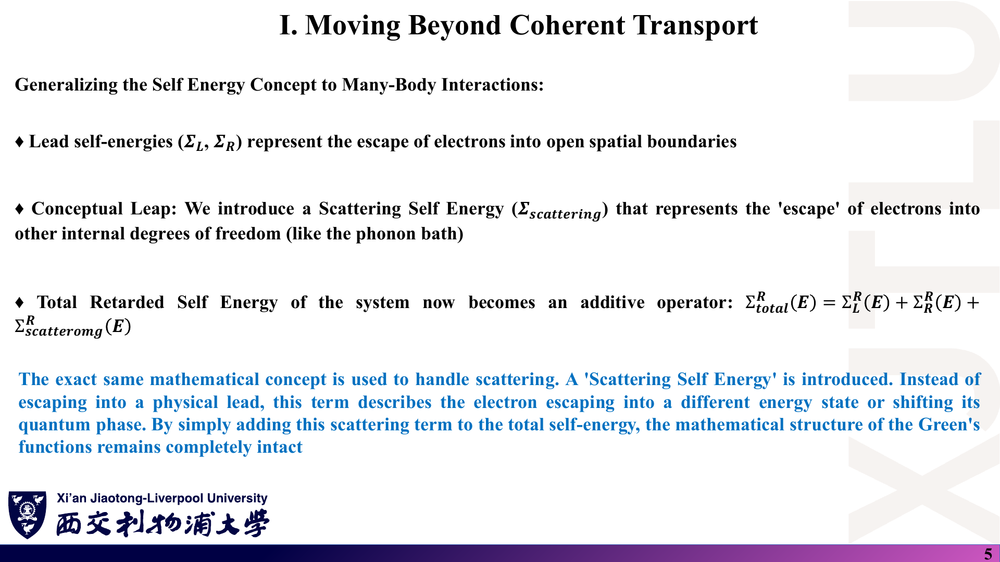

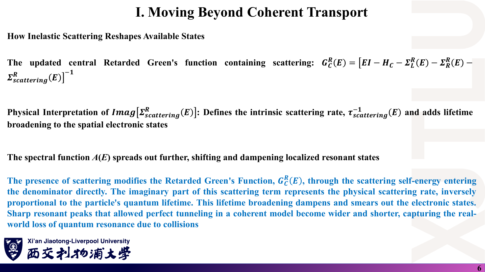

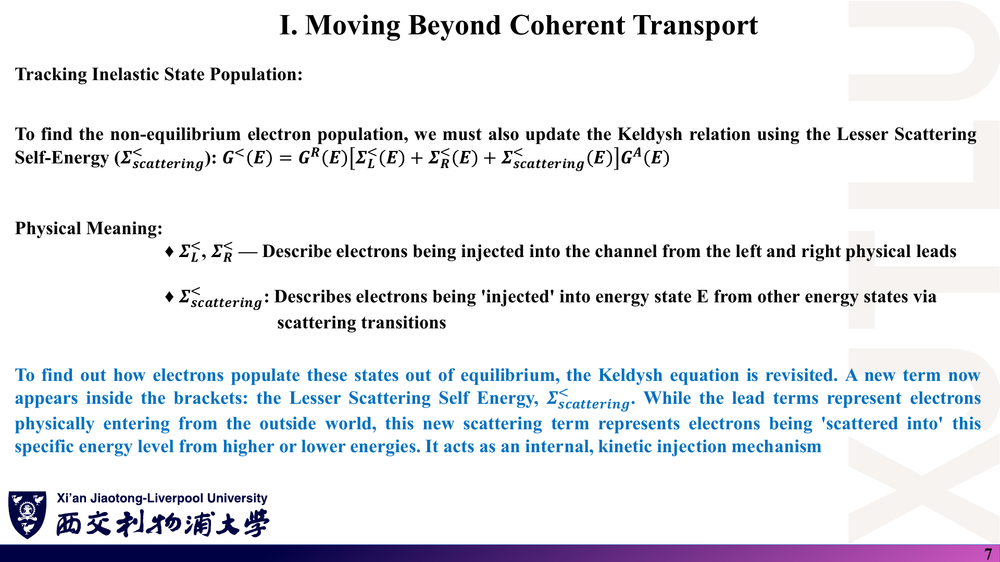

*第 5 页下标 “scatteromg” 是 “scattering” 的笔误。*

### 中文解释

引线自能代表电子“逃逸到空间边界”；散射自能 $\Sigma_S$ 代表电子“逃逸到其他内部自由度”（如声子浴）。总自能可加：

$$
\Sigma^R_{\text{tot}}=\Sigma^R_L+\Sigma^R_R+\Sigma^R_S,\qquad
G^R_C=\big[EI-H_C-\Sigma^R_L-\Sigma^R_R-\Sigma^R_S\big]^{-1},
$$

$$
G^<=G^R\big[\Sigma^<_L+\Sigma^<_R+\Sigma^<_S\big]G^A.
$$

$\Sigma_S^R$ 的虚部给出散射率 $\tau_S^{-1}$，使谱函数进一步展宽、共振峰变低；$\Sigma_S^<$ 描述电子从其他能量“被注入”到能量 $E$。

### 原理深入

- 结构“完全不变”是指**方程形式**不变；但 $\Sigma_S$ 与引线自能有本质区别：它依赖于 $G$ 本身（第 3 节），且通常把不同能量耦合在一起。
- 对应的 $\Gamma_S=i(\Sigma^R_S-\Sigma^A_S)$ 可理解为“通向一个虚拟库的耦合”，但这个“库”的分布不是给定的 Fermi 函数，而是由自洽决定——这正是第 5 节 Büttiker 探针的出发点。
- 有了 $\Sigma_S$ 后，光学定理恒等式变为 $A=G^R(\Gamma_L+\Gamma_R+\Gamma_S)G^A$。

### Ref

- **原课件**：[Lecture Twenty-Seven，PDF 第 5–7 页](../Lecture_Twenty-Seven.pdf#page=6)。
- **勘误**：[07 第 3 节](07_讲义勘误与易错点.md)。
- **延伸**：[LAKE：散射自能的推导](README.md#ref-lake)、[DATTA2](README.md#ref-datta2)。

## 3. 为什么需要自洽 Born 近似（SCBA）？〔p. 8〕

### 课件截图

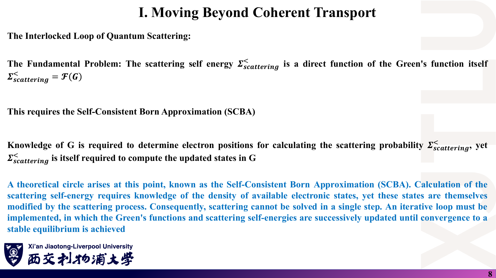

### 中文解释

散射自能是格林函数的函数 $\Sigma_S^<=\mathcal F(G)$：要算散射需先知道态与占据（$G$），而 $G$ 又被散射改变。因此不能一步求解，必须迭代——自洽 Born 近似。

### 原理深入

典型 SCBA 循环〔补充〕：

```text
初值 Σ_S = 0（相干解）
repeat
    对每个能量 E：G^R = [E − H_C − Σ_L − Σ_R − Σ_S^R]^{-1}
                  G^< = G^R (Σ_L^< + Σ_R^< + Σ_S^<) G^A
    用 G^R、G^<（可能在 E ± ħω 处）更新 Σ_S^R、Σ_S^<
    （可选）用电子密度更新 Poisson 方程中的电势
until Σ_S 与电流都收敛
```

- **“Born”**：自能只取到电子–声子耦合的二阶（一个声子线）；**“自洽”**：自能中用的是完整的 $G$ 而非裸 $G_0$。
- SCBA 是“守恒近似”，在收敛时保证总电流守恒；讲义把收敛结果称作“stable equilibrium”，更准确的说法是**非平衡稳态**。
- Lake 等人的论文还讨论了截断展开的“多次顺序散射（MSS）”算法，课件第 13–14 页的图正是 SCBA 与 MSS 的收敛比较（[LAKE](README.md#ref-lake)）。

### Ref

- **原课件**：[Lecture Twenty-Seven，PDF 第 8 页](../Lecture_Twenty-Seven.pdf#page=8)。
- **延伸**：[LAKE](README.md#ref-lake)、[LUISIER](README.md#ref-luisier)。

## 4. 声学声子与光学声子的散射自能有何不同？〔pp. 9–10〕

### 课件截图

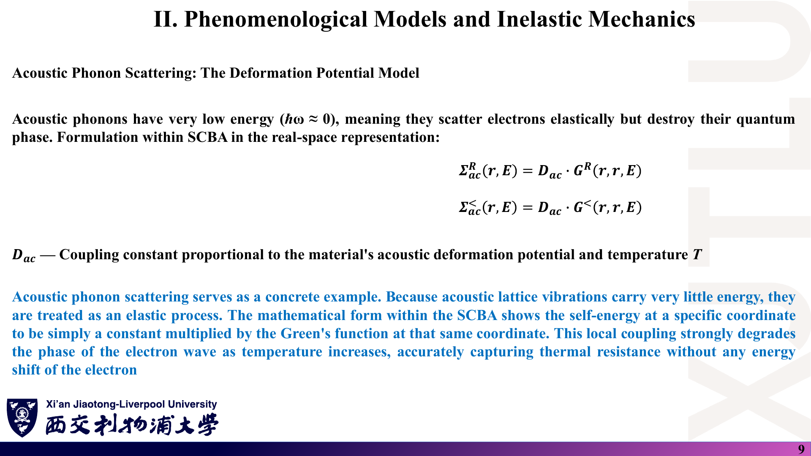

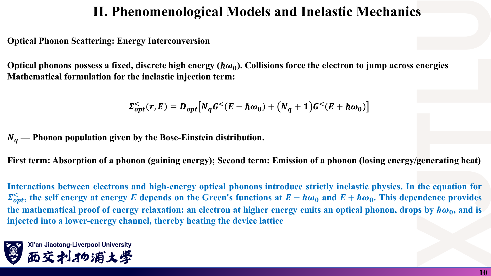

### 中文解释

**声学声子**能量很低（$\hbar\omega\approx0$），按弹性处理但破坏相位。实空间 SCBA 中自能是局域的：

$$
\Sigma^R_{ac}(r,E)=D_{ac}\,G^R(r,r,E),\qquad \Sigma^<_{ac}(r,E)=D_{ac}\,G^<(r,r,E),
$$

$D_{ac}$ 正比于形变势的平方和温度。

**光学声子**有固定的较高能量 $\hbar\omega_0$，碰撞使电子跳跃能量：

$$
\Sigma^<_{opt}(r,E)=D_{opt}\big[N_q\,G^<(E-\hbar\omega_0)+(N_q+1)\,G^<(E+\hbar\omega_0)\big],
$$

$N_q$ 为 Bose–Einstein 占据。第一项：电子从 $E-\hbar\omega_0$ 吸收声子到达 $E$；第二项：电子从 $E+\hbar\omega_0$ 发射声子落到 $E$（产生热）。

### 原理深入

- **对称的“流出”项**〔补充〕：与之配套的 $\Sigma^>_{opt}(E)=D_{opt}\big[(N_q+1)G^>(E-\hbar\omega_0)+N_qG^>(E+\hbar\omega_0)\big]$。只写 $\Sigma^<$ 不够，推迟自能可由 $\Sigma^R$ 的虚部 $=\tfrac{1}{2i}(\Sigma^>-\Sigma^<)$ 得到（忽略实部的主值项时）。
- **Bose 因子**：$N_q=1/(e^{\hbar\omega_0/k_BT}-1)$。GaAs LO 声子约 36 meV，300 K 时 $N_q\approx0.33$，所以发射（$\propto N_q+1$）远强于吸收——这就是能量弛豫的方向性。
- **$D_{ac}\propto T$** 的来源：低能声子处于高温（均分）极限，$N_q\approx k_BT/\hbar\omega\gg1$，吸收、发射近似相等，合并后正比于 $T$。
- **局域近似**：$\Sigma(r,E)$ 只与同一格点的 $G(r,r,E)$ 有关，要求声子关联长度远小于格点间距；它使自能成为对角矩阵，计算量大幅降低。

### Ref

- **原课件**：[Lecture Twenty-Seven，PDF 第 9–10 页](../Lecture_Twenty-Seven.pdf#page=10)。
- **延伸**：[LAKE](README.md#ref-lake)、[LUISIER](README.md#ref-luisier)、[HJ](README.md#ref-hj)。

## 5. 什么是 Büttiker 虚拟探针？〔p. 11〕

### 课件截图

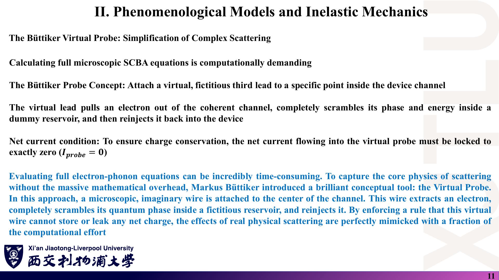

### 中文解释

完整 SCBA 计算量大。Büttiker 的简化办法：在沟道某点接一根虚构的第三引线，它把电子拉出相干沟道，在虚拟库中完全打乱相位与能量，再注回器件。为保证电荷守恒，令虚拟探针的净电流为零 $I_{\text{probe}}=0$。

### 原理深入

线性响应下用第 25 讲的多端方程即可求解〔补充〕。三端 $L$、$R$、探针 $p$，设无磁场（$T_{qp}=T_{pq}$）、探针无反射：由 $I_p=0$ 解出探针电势

$$
V_p=\frac{T_{pL}V_L+T_{pR}V_R}{T_{pL}+T_{pR}},
$$

代回得有效两端透射

$$
T_{\text{eff}}=T_{RL}+\frac{T_{Rp}\,T_{pL}}{T_{Rp}+T_{pL}}.
$$

第一项是相干直通，第二项是“先进入探针再出来”的非相干串联通道（像两个电导串联）。

- **两种版本**：只要求总电流 $I_p=0$ 的是“电压探针”（允许能量弛豫）；要求每个能量都 $I_p(E)=0$ 的是“退相位探针”（只破坏相位、不改变能量）。
- 探针耦合强度 $\Gamma_p$ 是唯象参数，常用来拟合迁移率或退相干长度，不是第一性原理结果。

### Ref

- **原课件**：[Lecture Twenty-Seven，PDF 第 11 页](../Lecture_Twenty-Seven.pdf#page=11)。
- **复习**：[06 第 9 题](06_复习题与参考答案.md)。
- **延伸**：[B86](README.md#ref-b86)、[DATTA1](README.md#ref-datta1)。

## 6. 有非弹性散射时电流怎样计算并保持守恒？〔p. 12〕

### 课件截图

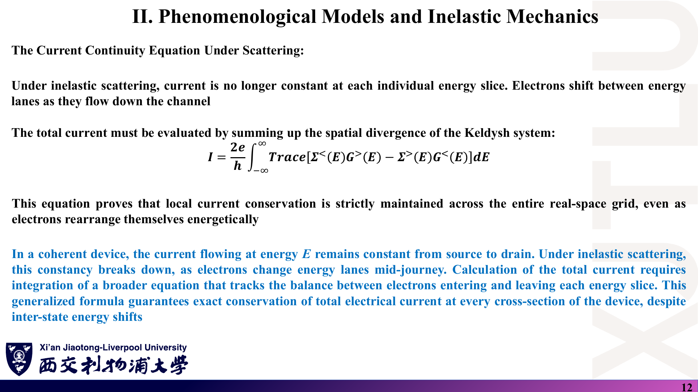

### 中文解释

非弹性散射下每个能量切片上的电流不再守恒，电子在流动中“换车道”。讲义给出

$$
I=\frac{2e}{h}\int\operatorname{Tr}\big[\Sigma^<(E)G^>(E)-\Sigma^>(E)G^<(E)\big]dE,
$$

并说明总电流在每个截面严格守恒。

### 原理深入

- 这个式子应理解为**对某一个接触 $\alpha$**：$I_\alpha=\frac{2e}{h}\int\operatorname{Tr}[\Sigma^<_\alpha G^>-\Sigma^>_\alpha G^<]dE$。若把 $\Sigma$ 取成全部自能之和（含 $\Sigma_S$），稳态下结果恒为零（粒子数守恒）。
- 与上一讲第 19 页的形式等价：在 Datta 记号中它就是 $\frac{q}{h}\operatorname{Tr}[\Sigma^{in}A-\Gamma G^n]$〔补充〕。
- 用 SCBA 时，$\int dE\,\operatorname{Tr}[\Sigma^<_SG^>-\Sigma^>_SG^<]=0$：散射只在能量间搬运电子，不产生净电流，所以 $I_L=-I_R$。但**单个能量**上 $I_L(E)\ne-I_R(E)$——这正是“能量弛豫”的定量表述。

### Ref

- **原课件**：[Lecture Twenty-Seven，PDF 第 12 页](../Lecture_Twenty-Seven.pdf#page=12)。
- **勘误**：[07 第 3 节：电流公式应带接触下标](07_讲义勘误与易错点.md)。
- **延伸**：[MW](README.md#ref-mw)、[LAKE](README.md#ref-lake)。

## 7. 共振隧穿二极管与量子级联激光器说明了什么？〔pp. 13–16〕

### 课件截图

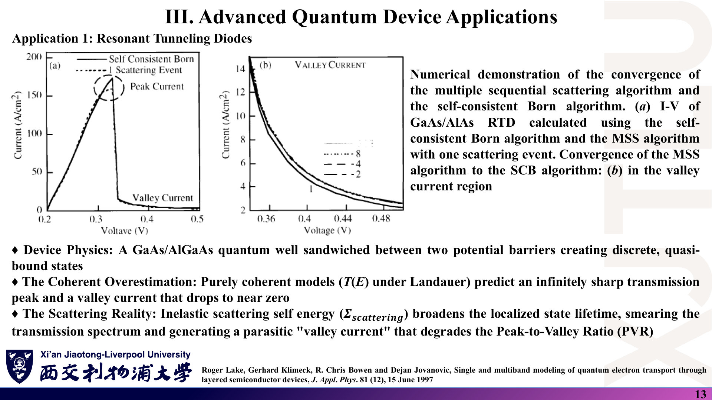

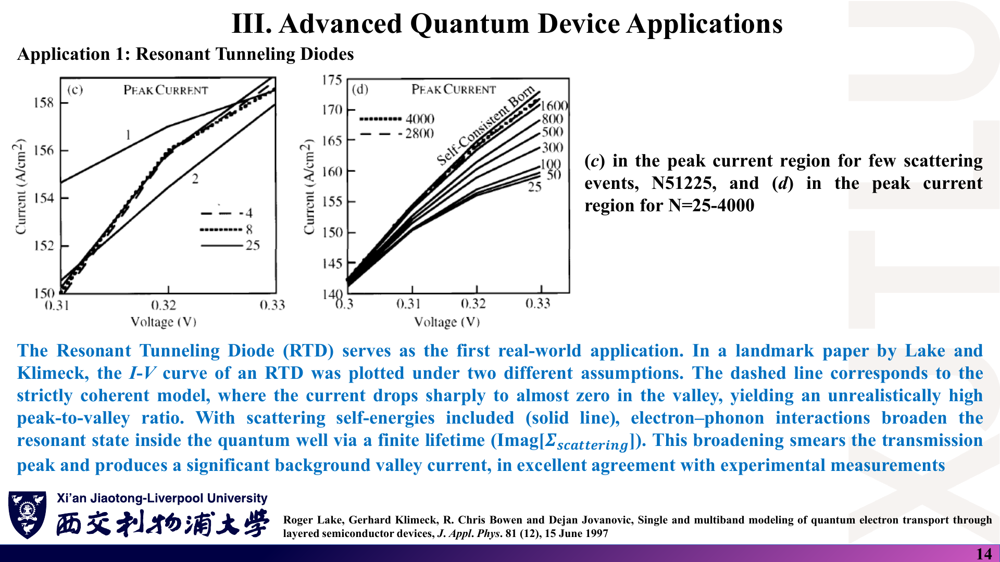

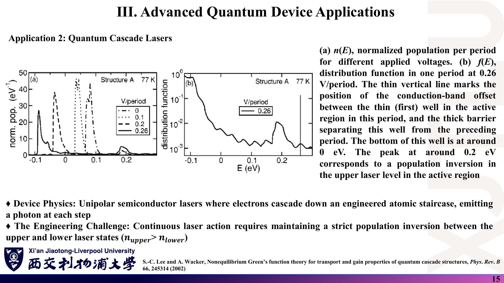

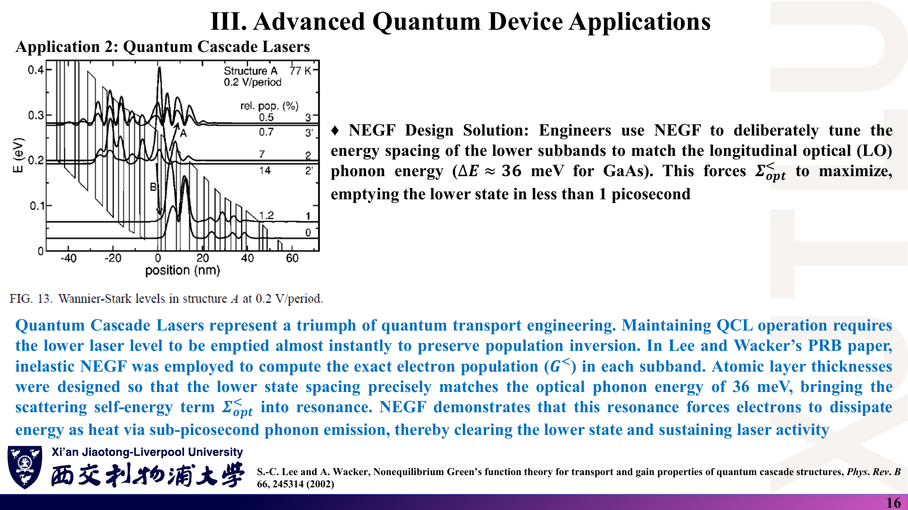

### 中文解释

**RTD**：GaAs/AlGaAs 量子阱夹在两个势垒之间形成准束缚态。纯相干模型预言极尖锐的透射峰和接近零的谷电流；散射自能展宽准束缚态，产生寄生谷电流，降低峰谷比（PVR）。

**QCL**：单极型激光器，电子沿设计好的“能级阶梯”逐级下落、每级发射一个光子。持续激射要求上能级粒子数大于下能级（粒子数反转）。课件称：把下能级间距调到 GaAs LO 声子能量（约 36 meV），使 $\Sigma^<_{opt}$ 共振，下能级在亚皮秒内被清空。

### 原理深入

- **RTD 谷电流的物理**：第 26 讲 Breit–Wigner 式中加入 $\Gamma_S$，$T_{\max}=\frac{4\Gamma_L\Gamma_R}{(\Gamma_L+\Gamma_R+\Gamma_S)^2}<1$，峰宽增大；另外非弹性散射把电子从其他能量散射到共振能级，使相干模型中几乎不导电的偏压下也有电流。
- **论文核对**（[LAKE](README.md#ref-lake)）：第 13 页插图的图例本身写的是 “Self Consistent Born”（实线）与 “1 Scattering Event”（虚线），说明它是 SCBA 与多次顺序散射（MSS）算法的**收敛比较**，两条曲线都含散射；第 14 页蓝字把虚线说成 “strictly coherent model”，与图例及论文不符（[07 第 4 节](07_讲义勘误与易错点.md)）。
- **QCL 论文核对**（[LEE](README.md#ref-lee)）：Lee 与 Wacker 在 SCBA 中包括界面粗糙度、杂质、电子–声子散射，并以平均场处理电子–电子相互作用；参数中 LO 声子能量取 $E_{LO}=36.7$ meV。第 16 页插图是论文 Fig. 13“结构 A 在 0.2 V/period 下的 Wannier–Stark 能级”。“工程师用 NEGF 调节层厚”是课件的概括，论文本身是对给定结构的输运与增益分析。
- 共振条件的直观解释：下能级与更低能级的间距 $\approx\hbar\omega_{LO}$ 时，$\Sigma^<_{opt}$ 中 $(N_q+1)G^<(E+\hbar\omega_0)$ 项把电子高效地从下能级移走。

### Ref

- **原课件**：[Lecture Twenty-Seven，PDF 第 13–16 页](../Lecture_Twenty-Seven.pdf#page=13)。
- **论文**：[LAKE](README.md#ref-lake)、[LEE](README.md#ref-lee)。
- **勘误**：[07 第 4 节](07_讲义勘误与易错点.md)。

## 8. 热电、短沟道晶体管与隧穿晶体管〔pp. 17–20〕

### 课件截图

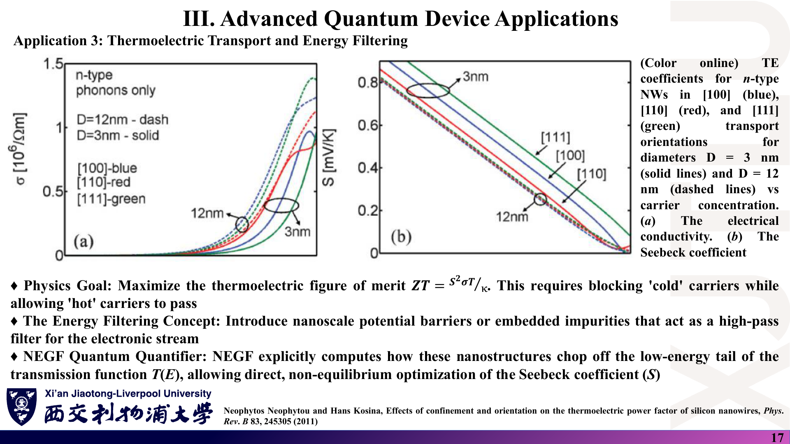

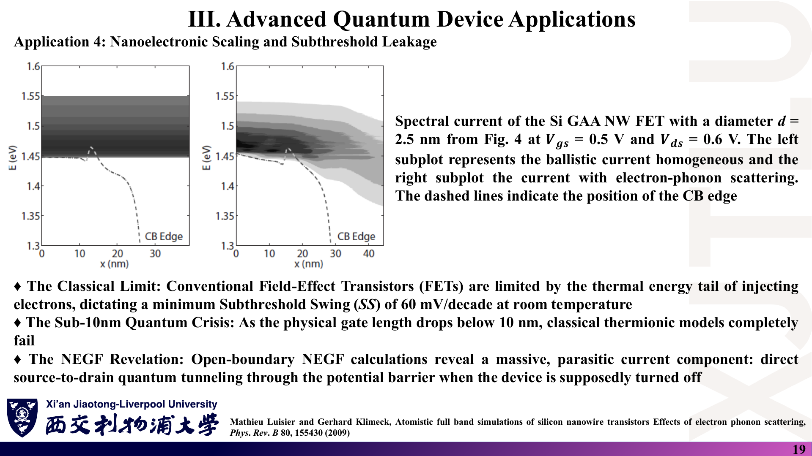

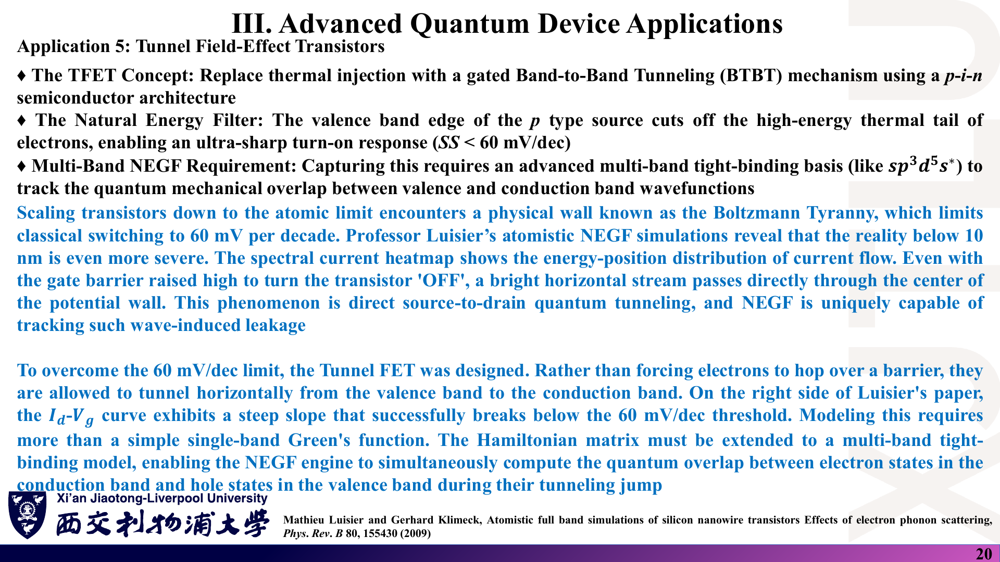

### 中文解释

- **热电**：优值 $ZT=S^2\sigma T/\kappa$。课件的思路是“能量过滤”——用势垒挡住低能“冷”载流子、只让高能“热”载流子通过，以提高 Seebeck 系数 $S$。
- **短沟道 FET**：热电子发射决定室温亚阈值摆幅下限约 60 mV/dec；栅长低于 10 nm 时经典模型失效，课件称 NEGF 揭示了关态下源–漏直接隧穿漏电。
- **TFET**：用栅控带间隧穿（BTBT）代替热注入，p 型源区的价带顶截断高能热尾，可实现 $SS<60$ mV/dec；需要 $sp^3d^5s^*$ 等多带紧束缚基组描述价带与导带的耦合。

### 原理深入

**60 mV/dec 从何而来**〔补充〕：热发射电流 $\propto e^{-E_b/k_BT}$，势垒 $E_b$ 随栅压最多一比一变化，故

$$
SS_{\min}=\ln10\,\frac{k_BT}{e}\approx59.6\ \text{mV/dec}\quad(300\ \text{K}).
$$

TFET 的源区价带顶像一个“截止滤波器”，注入分布不再有 Boltzmann 尾巴，所以可以突破这一极限。

**Seebeck 与 $T(E)$ 的关系**〔补充，Landauer 框架、线性响应〕：

$$
S=-\frac{1}{eT}\,\frac{\int(E-E_F)\,\mathcal T(E)\,(-\partial f/\partial E)\,dE}{\int\mathcal T(E)\,(-\partial f/\partial E)\,dE},
$$

$S$ 衡量载流子相对 $E_F$ 的平均能量；截掉 $E_F$ 以下附近的透射可增大 $|S|$，但常以降低 $\sigma$ 为代价。

**论文核对（重要）**：

- [NEO](README.md#ref-neo)（Neophytou & Kosina）用的是原子级 $sp^3d^5s^*$-SO 紧束缚能带 + **线性化 Boltzmann 输运**，不是 NEGF；论文研究纳米线直径与晶向对功率因子的影响，结论是功率因子的变化主要来自电导率而非 Seebeck 系数。第 17 页插图是电导率与 Seebeck 系数随载流子浓度的变化（论文 Fig. 1(a)(b)），而非 $T(E)$。
- [LUISIER](README.md#ref-luisier)（Luisier & Klimeck）的第 19 页插图（论文 Fig. 10）比较的是 $V_{gs}=0.5$ V、$V_{ds}=0.6$ V 下**弹道与含电子–声子散射**的谱电流，电流主要在导带边以上流动，说明的是散射引起的能量弛豫。在论文全文中检索 “tunnel”，只出现在引言（回顾 RTD 文献）与结尾段（把带间隧穿 TFET 作为今后可研究的器件）；论文中没有 TFET 的 $I_d$–$V_g$ 曲线。

这些应用方向本身是合理的（NEGF 确实广泛用于源–漏隧穿与 TFET 模拟），但不应把它们归为这两篇论文的结论。

### Ref

- **原课件**：[Lecture Twenty-Seven，PDF 第 17–20 页](../Lecture_Twenty-Seven.pdf#page=17)。
- **论文**：[NEO](README.md#ref-neo)、[LUISIER](README.md#ref-luisier)。
- **勘误**：[07 第 4 节](07_讲义勘误与易错点.md)。

## 9. 光伏与自旋电子学中的 NEGF〔pp. 21–27〕

### 课件截图

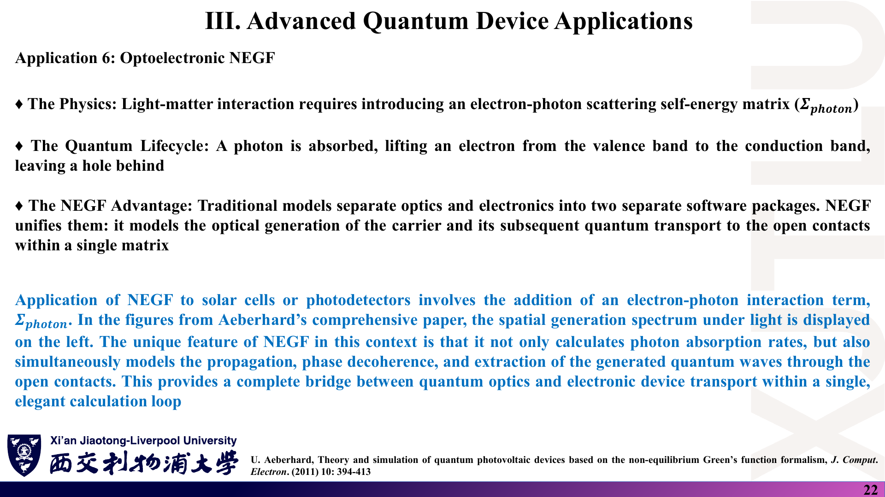

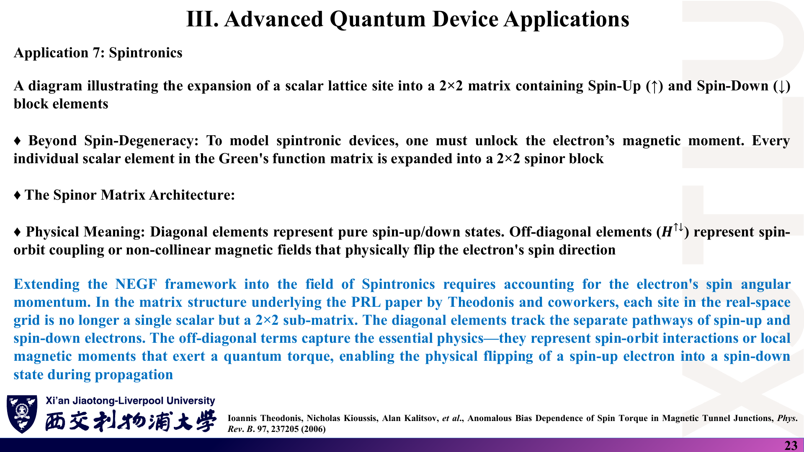

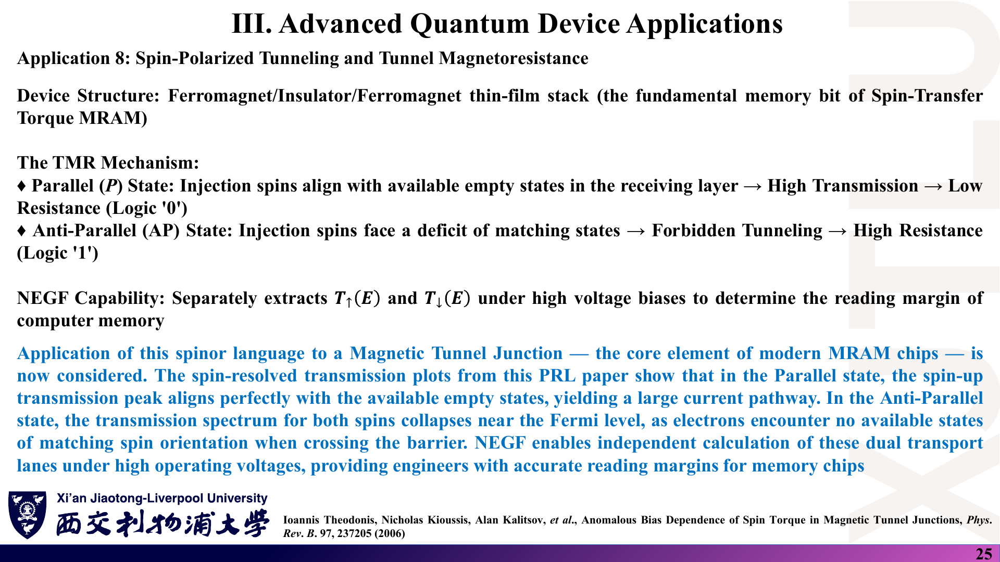

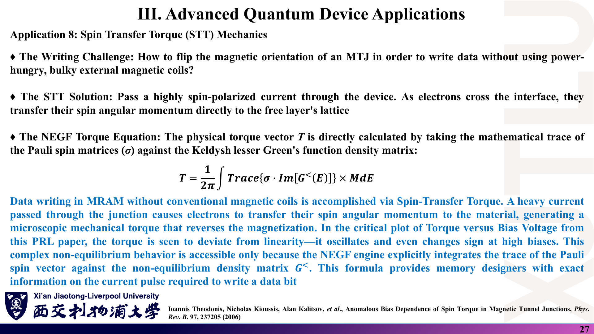

*第 23 页 “A diagram illustrating…” 与 “The Spinor Matrix Architecture:” 后面没有图或矩阵，像是占位文字未补全。*

### 中文解释

- **光伏**：光–物质相互作用通过电子–光子散射自能进入 NEGF；吸收光子把电子从价带激发到导带并留下空穴。NEGF 在同一套矩阵中同时描述光生载流子与其向开放接触的量子输运。
- **自旋电子学**：每个格点从标量扩展为 $2\times2$ 自旋块；对角块描述自旋向上/向下，非对角块 $H^{\uparrow\downarrow}$ 来自自旋–轨道耦合或非共线磁化，可使自旋翻转。
- **TMR**：铁磁/绝缘/铁磁隧道结中，平行态透射大、电阻低；反平行态透射小、电阻高。
- **STT**：自旋极化电流把角动量转移给自由层，翻转磁化；课件给出 $\mathbf T=\frac{1}{2\pi}\int\operatorname{Tr}\{\boldsymbol\sigma\cdot\mathrm{Im}[G^<(E)]\}\times\mathbf M\,dE$。

### 原理深入

**自旋块结构**〔补充，补全第 23 页空缺〕：

$$
H_{ij}=\begin{pmatrix}H_{ij}^{\uparrow\uparrow}&H_{ij}^{\uparrow\downarrow}\\H_{ij}^{\downarrow\uparrow}&H_{ij}^{\downarrow\downarrow}\end{pmatrix},
\qquad H_{ij}^{\downarrow\uparrow}=(H_{ji}^{\uparrow\downarrow})^*.
$$

矩阵维数翻倍，电流前置因子由 $2e/h$ 改为 $e/h$，自旋不再简并。

**TMR**：常用定义 $\mathrm{TMR}=(G_P-G_{AP})/G_{AP}$。

**STT 论文核对**（[THEO](README.md#ref-theo)）：

- 课件把它标为 *Phys. Rev. B* 97，实为 **Phys. Rev. Lett. 97, 237205 (2006)**；作者还有 M. Chshiev 与 W. H. Butler。
- 论文用紧束缚 + Keldysh 非平衡格林函数（把 Caroli 等人的方法推广到 $2\times2$ 自旋空间），由**相邻格点间**的小于格林函数 $G^<_{i,i+1}$ 求自旋流 $\mathbf I^s_{i,i+1}$，再用自旋流的散度得到局域力矩 $\mathbf T_i=-\nabla\cdot\mathbf I^s$。课件的 $\operatorname{Tr}\{\boldsymbol\sigma\cdot\mathrm{Im}G^<\}\times\mathbf M$ 是“局域自旋密度 × 磁化”的示意写法，不是论文使用的公式。
- 论文的主要结论是平行于界面的力矩分量 $T_\parallel$ 随偏压可出现反常依赖（不随偏压反号而变号，甚至二次依赖），垂直分量 $T_\perp$ 随偏压二次变化。论文正文中没有出现 “transmission” 一词；第 25 页所说“该 PRL 中的自旋分辨透射图”与原文不符。

**光伏论文**（[AEB](README.md#ref-aeb)）是综述性论文，以单量子阱光电二极管和氧化硅基超晶格吸收层为例，讨论光生、声子辅助间接跃迁、缺陷非辐射复合等过程的 NEGF 描述。

### Ref

- **原课件**：[Lecture Twenty-Seven，PDF 第 21–27 页](../Lecture_Twenty-Seven.pdf#page=23)。
- **论文**：[AEB](README.md#ref-aeb)、[THEO](README.md#ref-theo)。
- **勘误**：[07 第 3、4 节](07_讲义勘误与易错点.md)。

## 10. 拓扑绝缘体与“拓扑 Anderson 绝缘体”〔pp. 28–29〕

### 课件截图

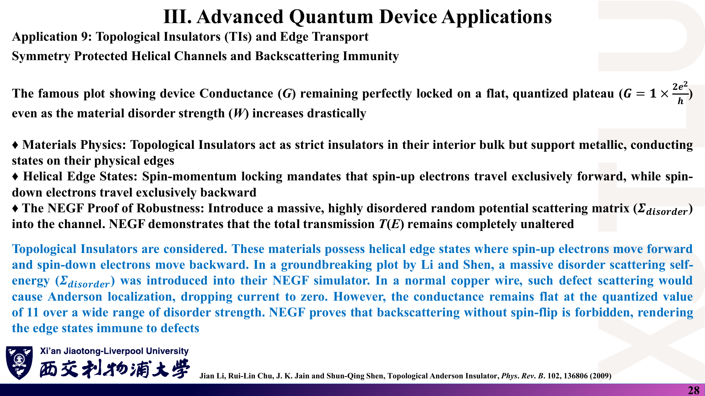

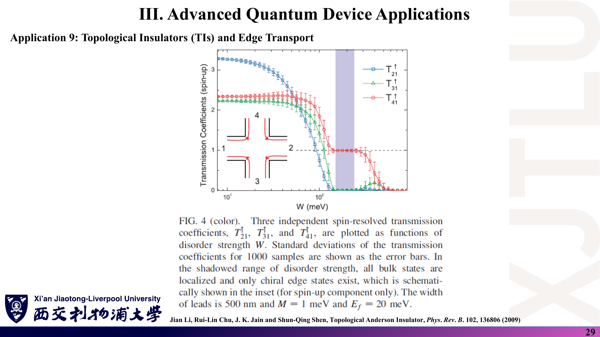

### 中文解释

课件说法：拓扑绝缘体体内绝缘、边缘导电；螺旋边缘态中自旋向上向前、自旋向下向后；在沟道中加入强无序（$\Sigma_{\text{disorder}}$），NEGF 显示总透射不变，电导锁定在 $G=1\times2e^2/h$，说明不翻转自旋的背散射被禁止。

### 原理深入

**论文核对**（[TAI](README.md#ref-tai)）：

- 引用应为 **Phys. Rev. Lett. 102, 136806 (2009)**，作者 J. Li、R.-L. Chu、J. K. Jain、S.-Q. Shen。
- 方法：HgTe/CdTe 量子阱的紧束缚模型，无序以均匀分布于 $[-W/2,W/2]$ 的**随机格点能**写入哈密顿量，用 **Landauer–Büttiker 公式**计算电导，并对 1000 个样本求平均与标准差——不是在 NEGF 中加入散射自能。
- 结论与课件侧重点不同：论文的“拓扑 Anderson 绝缘体（TAI）”指**干净极限下是金属、没有边缘态**的体系，在**足够强的无序**下出现量子化电导平台 $2e^2/h$；平台只存在于一定无序强度范围，更强无序进入普通 Anderson 绝缘体。第 29 页（论文 Fig. 4）中 $T^\uparrow_{41}$ 只在阴影区间锁定为 1，弱无序时约 2.3，强无序时降为 0——并非“透射完全不受无序影响”。
- 原本就处于拓扑绝缘相的体系，论文发现其对弱无序鲁棒、强无序时最终被破坏；这一点与课件说法一致。
- 课件蓝字中的 “quantized value of 11” 疑为排版丢失，应为 $G=2e^2/h$（两个自旋各贡献 $e^2/h$）。

**为什么螺旋边缘态抗背散射**〔补充〕：时间反演对称下，同一边缘的反向通道是自旋相反的 Kramers 伙伴；非磁性杂质不翻转自旋，因而不能把前进态散射到后退态。磁性杂质或强无序引起体态导通会破坏这种保护。

### Ref

- **原课件**：[Lecture Twenty-Seven，PDF 第 28–29 页](../Lecture_Twenty-Seven.pdf#page=28)。
- **论文**：[TAI](README.md#ref-tai)。
- **衔接**：手性边缘态与 Hall 条见 [01 第 10 节](01_介观输运与Landauer公式.md)。
- **勘误**：[07 第 4 节](07_讲义勘误与易错点.md)。

## 11. Landauer、Kubo 与 NEGF 各适合什么问题？〔p. 30〕

### 课件截图

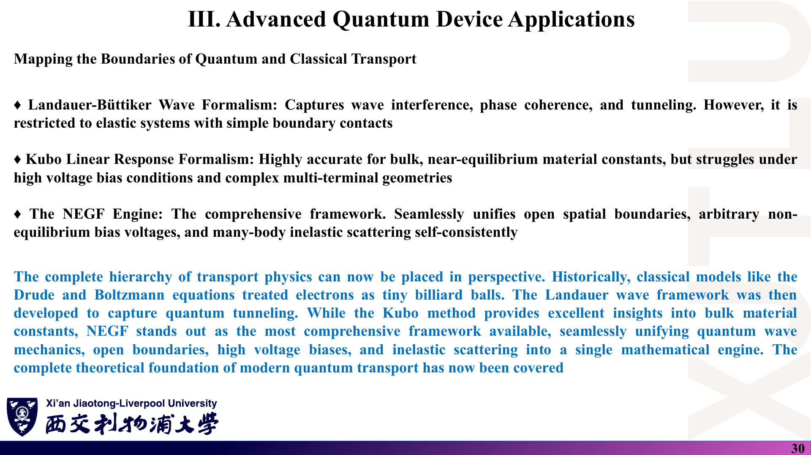

### 中文解释

- **Landauer–Büttiker**：描述波干涉、相位相干与隧穿；限于弹性体系与简单接触。
- **Kubo 线性响应**：适合体材料、近平衡的材料常数（如电导率），难以处理大偏压与复杂多端几何。
- **NEGF**：统一开放边界、任意非平衡偏压与多体非弹性散射（自洽处理）的综合框架。

### 原理深入

| 框架 | 典型输出 | 主要假设 | 本课程中的对应 |
|---|---|---|---|
| Kubo–Greenwood | 电导率 $\sigma(E_F)$ | 线性响应、周期体系、唯象展宽 | 输入文件中的 Kubo–Greenwood 参数段（前几周） |
| Landauer | 电导 $G$、$I$–$V$ | 相干、弹性、$T(E)$ 已知 | 本周代码的 $I$–$V$ |
| NEGF | $T(E)$、$G^<$、电荷、电流 | 平均场 + 自能近似（如 SCBA） | 本周代码中的 $T(E)$ 计算 |

- 相干、线性响应、长均匀样品极限下三者应给出一致结果；它们不是互相排斥的理论，而是适用范围不同的工具。
- NEGF 的“全面”有代价：自能需要近似（SCBA、局域近似等），计算量远高于 Landauer 或 Boltzmann。
- 区分**电导**（器件性质，S）与**电导率**（材料性质）——这也是本周结果图标注的易错点（[07 第 6 节](07_讲义勘误与易错点.md)）。

### Ref

- **原课件**：[Lecture Twenty-Seven，PDF 第 30 页](../Lecture_Twenty-Seven.pdf#page=30)。
- **延伸**：[DATTA2](README.md#ref-datta2)、[LJ](README.md#ref-lj)。
