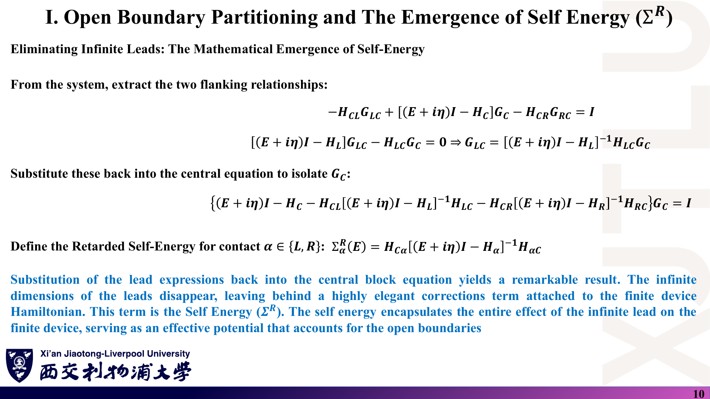
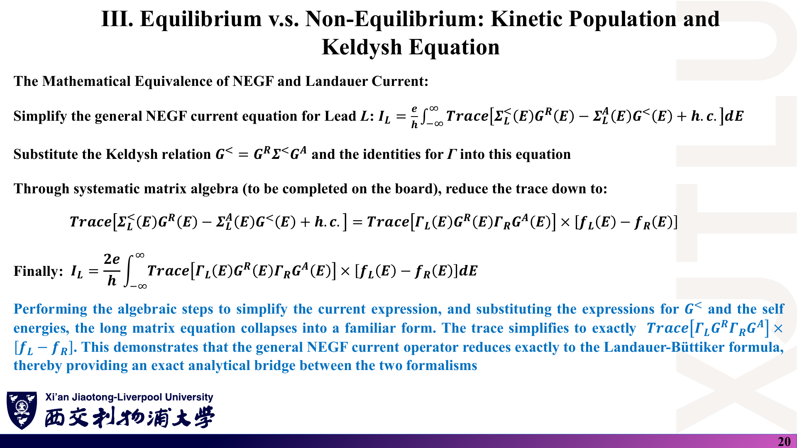
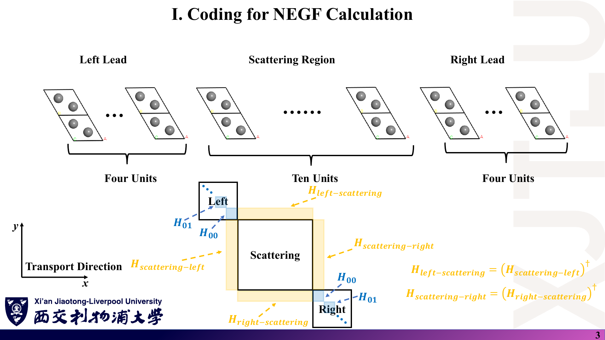
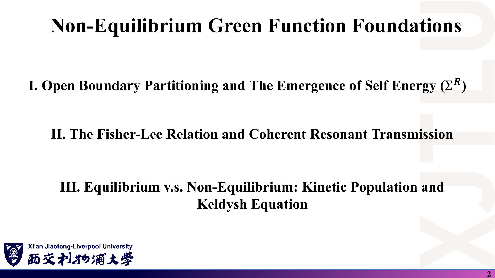

# 05 · 公式与中英文术语速查

[返回目录](README.md) · [第 25 讲](01_介观输运与Landauer公式.md) · [第 26 讲](02_格林函数_自能与Fisher-Lee公式.md) · [第 27 讲](03_非弹性散射与量子器件应用.md) · [第 28 讲](04_石墨烯NEGF编程与结果.md) · [代码](08_代码导读.md)

> 此页公式已按 [07 勘误](07_讲义勘误与易错点.md) 改为正确写法；与截图不同处以此页为准。默认正交基、自旋简并（因子 2 已计入 $2e/h$），不替代推导与适用条件。

## 1. 常数、尺度与输运区间

### 课件截图

### 中文解释

记住几个数：一个自旋简并模式的电导量子、室温热能和费米导数窗口宽度。

### 原理深入

$$
G_0=\frac{2e^2}{h}=7.748\times10^{-5}\ \text{S},\qquad
R_0=\frac{h}{2e^2}=12.906\ \text{k}\Omega,\qquad
\frac{h}{e^2}=25.813\ \text{k}\Omega.
$$

$$
k_BT(300\ \text{K})=25.85\ \text{meV},\qquad
\text{FWHM}\Big(-\frac{\partial f}{\partial E}\Big)\approx3.53\,k_BT\approx91\ \text{meV},\qquad
SS_{\min}=\ln10\frac{k_BT}{e}\approx59.6\ \text{mV/dec}.
$$

| 条件 | 区间 |
|---|---|
| $L\ll\lambda_m,\ L\ll L_\varphi$ | 弹道、相干 |
| $L\gg\lambda_m$ | 扩散 |
| $L\gtrsim L_\varphi$ 或有非弹性散射 | 需要散射自能 / 虚拟探针 |

### Ref

- **原课件**：[Lecture Twenty-Five，PDF 第 3–4 页](../Lecture_Twenty-Five.pdf#page=4)、[第 16 页](../Lecture_Twenty-Five.pdf#page=16)。
- **推导**：[01 第 1–2、7 节](01_介观输运与Landauer公式.md)。

## 2. Landauer 公式与线性响应

### 课件截图

### 中文解释

电流 = 每单位能量每通道 $2e/h$ × 透射 × 两侧占据差，再对能量积分。

### 原理深入

$$
g_{1D}=\frac{2}{\pi\hbar v},\quad v=\frac1\hbar\frac{dE}{dk},\quad dI^+=\frac{2e}{h}f_L\,dE.
$$

$$
I=\frac{2e}{h}\int\mathcal T(E)\,[f_L-f_R]\,dE,\qquad \mathcal T=\sum_{n=1}^{M(E)}T_n=\mathrm{Tr}(t^\dagger t),\qquad T+R=1\ (\text{单通道}).
$$

$$
\mu_{L,R}=E_F\pm\frac{eV}{2}:\quad
G=\frac{2e^2}{h}\int\mathcal T(E)\Big(-\frac{\partial f}{\partial E}\Big)dE\xrightarrow{T\to0}G_0\,\mathcal T(E_F)\xrightarrow{T_n=1}G_0M(E_F).
$$

$$
-\frac{\partial f}{\partial E}=\frac{1}{4k_BT}\mathrm{sech}^2\frac{E-E_F}{2k_BT},\qquad\int\Big(-\frac{\partial f}{\partial E}\Big)dE=1.
$$

### Ref

- **原课件**：[Lecture Twenty-Five，PDF 第 8–17 页](../Lecture_Twenty-Five.pdf#page=13)。
- **推导**：[01 第 4–7 节](01_介观输运与Landauer公式.md)。

## 3. 多端 Landauer–Büttiker

### 课件截图

### 中文解释

约定 $T_{qp}$：从端 $p$ 到端 $q$。端电流 = 流出 − 流入。

### 原理深入

$$
I_p=\frac{2e^2}{h}\sum_q\big[T_{qp}V_p-T_{pq}V_q\big],\qquad
\sum_qT_{qp}=\sum_qT_{pq}=M_p\ (\text{含反射 }T_{pp}),\qquad\sum_pI_p=0.
$$

$$
T_{pq}(B)=T_{qp}(-B).
$$

手性 Hall 条（$T_{21}=T_{32}=T_{43}=T_{14}=M$，每通道电导 $g$）：$R_{xx}=0$，$R_{xy}=1/(gM)$；$g=e^2/h$（自旋分辨）时 $R_{xy}=h/(e^2M)$。

Büttiker 探针（$I_p=0$，无磁场）：$T_{\text{eff}}=T_{RL}+\dfrac{T_{Rp}T_{pL}}{T_{Rp}+T_{pL}}$。

### Ref

- **原课件**：[Lecture Twenty-Five，PDF 第 19–22 页](../Lecture_Twenty-Five.pdf#page=20)、[Lecture Twenty-Seven，PDF 第 11 页](../Lecture_Twenty-Seven.pdf#page=11)。
- **推导**：[01 第 9–10 节](01_介观输运与Landauer公式.md)、[03 第 5 节](03_非弹性散射与量子器件应用.md)。

## 4. 格林函数、自能与展宽

### 课件截图

### 中文解释

把无限引线消去，留下“中心区哈密顿量 + 自能”；自能的厄米部分移动能级，反厄米部分给出展宽。

### 原理深入

$$
G^R=[(E+i\eta)I-H]^{-1},\quad G^A=(G^R)^\dagger,\quad A=i(G^R-G^A),\quad \rho_m(E)=\frac{A_{mm}}{2\pi},\quad\mathrm{Tr}A=2\pi D(E).
$$

$$
\Sigma^R_\alpha=H_{C\alpha}\,g^R_\alpha\,H_{\alpha C},\qquad
G^R_C=[EI-H_C-\Sigma^R_L-\Sigma^R_R]^{-1},\qquad
\Gamma_\alpha=i(\Sigma^R_\alpha-\Sigma^A_\alpha),\qquad\tau\approx\hbar/\Gamma.
$$

表面格林函数（引线主层 $H_{00}$、层间 $H_{01}$）：

$$
g^s=\big[(E+i\eta)I-H_{00}-H_{01}g^sH_{01}^\dagger\big]^{-1}.
$$

光学定理：$G^R-G^A=-iG^R\Gamma G^A$，$A=G^R(\Gamma_L+\Gamma_R)G^A$。

### Ref

- **原课件**：[Lecture Twenty-Six，PDF 第 4–12 页](../Lecture_Twenty-Six.pdf#page=10)、[第 21 页](../Lecture_Twenty-Six.pdf#page=21)。
- **推导**：[02 第 1–6 节](02_格林函数_自能与Fisher-Lee公式.md)。

## 5. 透射、小于格林函数与电流

### 课件截图

### 中文解释

Fisher–Lee 给 $T(E)$；Keldysh 方程给占据；电流公式把两者连成 Landauer 形式。

### 原理深入

$$
T(E)=\mathrm{Tr}[\Gamma_LG^R\Gamma_RG^A],\qquad
T_{\text{BW}}=\frac{\Gamma_L\Gamma_R}{(E-\varepsilon_0-\Delta)^2+\big(\frac{\Gamma_L+\Gamma_R}{2}\big)^2}.
$$

$$
G^<=G^R\Sigma^<G^A,\quad\Sigma^<=i\Gamma_Lf_L+i\Gamma_Rf_R,\quad
\rho=\int\frac{dE}{2\pi i}G^<=\int\frac{dE}{2\pi}G^n,\quad G^n\equiv-iG^<.
$$

$$
I_\alpha=\frac{2e}{h}\int\mathrm{Tr}\big[\Gamma_\alpha(f_\alpha A-G^n)\big]dE
=\frac{2e}{h}\int\mathrm{Tr}[\Sigma^<_\alpha G^>-\Sigma^>_\alpha G^<]dE
\xrightarrow{\text{相干，两端}}\frac{2e}{h}\int T(E)(f_L-f_R)dE.
$$

### Ref

- **原课件**：[Lecture Twenty-Six，PDF 第 13–20 页](../Lecture_Twenty-Six.pdf#page=13)、[Lecture Twenty-Seven，PDF 第 12 页](../Lecture_Twenty-Seven.pdf#page=12)。
- **推导**：[02 第 7–10 节](02_格林函数_自能与Fisher-Lee公式.md)。

## 6. 散射自能

### 课件截图

### 中文解释

散射自能与引线自能相加；它依赖 $G$ 自身，需要 SCBA 迭代。

### 原理深入

$$
\Sigma_{\text{tot}}=\Sigma_L+\Sigma_R+\Sigma_S,\qquad G^<=G^R(\Sigma^<_L+\Sigma^<_R+\Sigma^<_S)G^A.
$$

$$
\Sigma^{R,<}_{ac}(r,E)=D_{ac}\,G^{R,<}(r,r,E),\qquad
\Sigma^<_{opt}(E)=D_{opt}\big[N_qG^<(E-\hbar\omega_0)+(N_q+1)G^<(E+\hbar\omega_0)\big],
$$

$$
\Sigma^>_{opt}(E)=D_{opt}\big[(N_q+1)G^>(E-\hbar\omega_0)+N_qG^>(E+\hbar\omega_0)\big],\qquad N_q=\frac{1}{e^{\hbar\omega_0/k_BT}-1}.
$$

热电与磁阻：$ZT=\dfrac{S^2\sigma T}{\kappa_e+\kappa_l}$，$\mathrm{TMR}=\dfrac{G_P-G_{AP}}{G_{AP}}$。

### Ref

- **原课件**：[Lecture Twenty-Seven，PDF 第 5–12 页](../Lecture_Twenty-Seven.pdf#page=9)。
- **推导**：[03 第 2–6 节](03_非弹性散射与量子器件应用.md)。

## 7. 代码中的关键量

### 课件截图

### 中文解释

把程序变量与公式一一对应，便于读代码和写报告。

### 原理深入

| 代码变量 | 物理量 | 值 / 维数 |
|---|---|---|
| `hopping` | $t$ | $-2.7$ eV |
| `broadening` | $\eta$ | 0.025 eV |
| `electrodeh00`、`electrodeh01` | $H_{00}$、$H_{01}$ | $16\times16$ |
| `scatteringregion` | $H_C$ | $40\times40$ |
| `leftself`、`rightself` | $\Sigma_L$、$\Sigma_R$ | $40\times40$ |
| `leftbroadening`、`rightbroadening` | $\Gamma_L$、$\Gamma_R$ | $i(\Sigma-\Sigma^\dagger)$ |
| `alltranscoefficient` | $T(E)$（横向 $k$ 平均） | 1000 个能量 |
| `conductivity` | $G(E)=G_0T(E)$（**电导**，S） | |
| `ivcurve` | $I(V)$，$\mu_{L,R}=\pm V/2$ | 100 个偏压 |
| `kpoint` | $\frac{j-1/2}{100}\frac{\mathbf b_2}{2}$ | 100 个 |

### Ref

- **代码**：[08 代码导读](08_代码导读.md)。

## 8. 中英文术语表

### 课件截图

### 中文解释

术语按“几何 → 理论量 → 散射 → 器件”排列。

### 原理深入

| English | 中文 | 一句话 |
|---|---|---|
| Mesoscopic | 介观 | 尺寸介于原子与宏观之间、量子相干重要 |
| Mean free path / Momentum relaxation length | 平均自由程 / 动量弛豫长度 | 动量记忆丢失前的距离 |
| Phase coherence length | 相位相干长度 | 相位记忆丢失前的距离 |
| Ballistic / Diffusive transport | 弹道 / 扩散输运 | 无散射 / 散射主导 |
| Reservoir, Lead, Central region | 库、引线、中心区 | 开放系统的三段划分 |
| Contact resistance | 接触电阻 | $h/2e^2$ 每模式 |
| Transverse mode / Subband | 横向模式 / 子带 | 横向量子化形成的通道 |
| Scattering matrix | 散射矩阵 | 入射振幅 → 出射振幅 |
| Transmission / Reflection probability | 透射 / 反射概率 | $\lvert t\rvert^2$、$\lvert r\rvert^2$ |
| Linear response | 线性响应 | 小偏压近似 |
| Fermi derivative window | 费米导数窗口 | $-\partial f/\partial E$ |
| Onsager reciprocity | Onsager 互易 | $T_{pq}(B)=T_{qp}(-B)$ |
| Chiral / Helical edge state | 手性 / 螺旋边缘态 | 单向 / 自旋–动量锁定的边缘通道 |
| Retarded / Advanced Green's function | 推迟 / 超前格林函数 | $E\pm i\eta$ |
| Spectral function | 谱函数 | $A=i(G^R-G^A)$ |
| Local density of states (LDOS) | 局域态密度 | $A_{mm}/2\pi$ |
| Self-energy | 自能 | 开放边界或相互作用的有效修正 |
| Broadening (level-width) matrix | 展宽（能级宽度）矩阵 | $\Gamma=i(\Sigma^R-\Sigma^A)$ |
| Surface Green's function | 表面格林函数 | 半无限引线表层的 $g$ |
| Principal layer | 主层 | 只与相邻主层耦合的引线单元 |
| Fisher–Lee relation | Fisher–Lee 关系 | $T=\mathrm{Tr}[\Gamma_LG^R\Gamma_RG^A]$ |
| Breit–Wigner resonance | Breit–Wigner 共振 | Lorentz 型透射峰 |
| Lesser Green's function | 小于格林函数 | $G^<$，描述占据 |
| Keldysh equation | Keldysh 方程 | $G^<=G^R\Sigma^<G^A$ |
| Self-consistent Born approximation (SCBA) | 自洽 Born 近似 | 自能与 $G$ 迭代自洽 |
| Deformation potential | 形变势 | 声学声子耦合强度 |
| Büttiker probe | Büttiker 探针 | 净电流为零的虚拟引线 |
| Peak-to-valley ratio (PVR) | 峰谷比 | RTD 性能指标 |
| Population inversion | 粒子数反转 | 激射条件 |
| Subthreshold swing (SS) | 亚阈值摆幅 | 电流变化十倍所需栅压 |
| Band-to-band tunneling (BTBT) | 带间隧穿 | TFET 的开关机制 |
| Tunnel magnetoresistance (TMR) | 隧穿磁阻 | 平行 / 反平行电导差 |
| Spin-transfer torque (STT) | 自旋转移矩 | 自旋流转移角动量 |
| Topological Anderson insulator (TAI) | 拓扑 Anderson 绝缘体 | 无序诱导的拓扑相 |
| Conductance vs Conductivity | 电导 vs 电导率 | 器件性质（S）vs 材料性质 |

### Ref

- **主题来源**：[Lecture Twenty-Five，PDF 第 2 页](../Lecture_Twenty-Five.pdf#page=2)、[Lecture Twenty-Six，第 2 页](../Lecture_Twenty-Six.pdf#page=2)、[Lecture Twenty-Seven，第 2 页](../Lecture_Twenty-Seven.pdf#page=2)、[Lecture Twenty-Eight，第 2 页](../Lecture_Twenty-Eight.pdf#page=2)。
- **延伸**：[DATTA1](README.md#ref-datta1)、[DATTA2](README.md#ref-datta2)。术语表是学习归纳，不是截图的逐字翻译。

## 最后一分钟检查

**$T_{qp}$ 的方向对吗？因子 2 统一了吗？矩阵“虚部”用的是反厄米部分吗？画的是电导还是电导率？偏压是否改变了 $T(E)$？**
