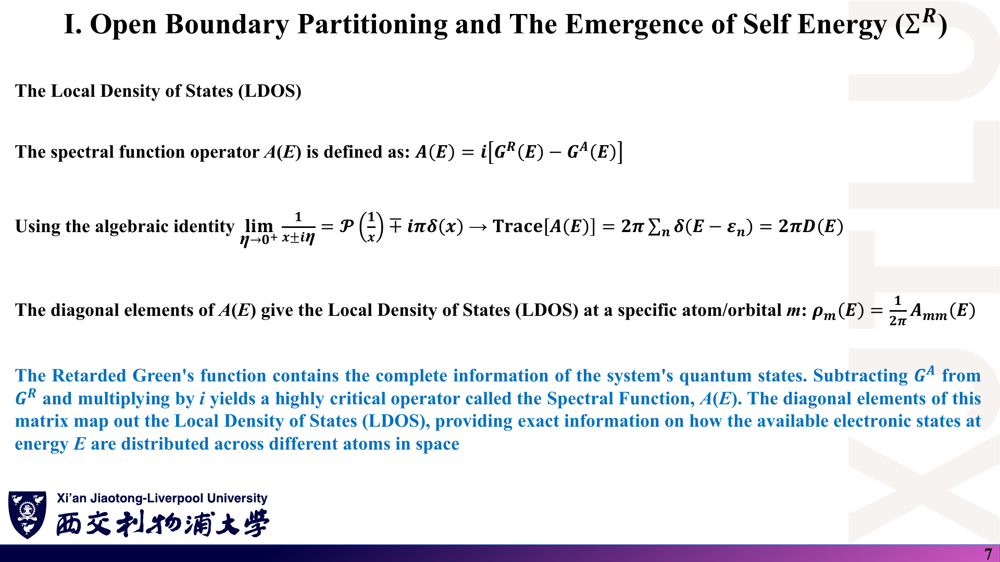
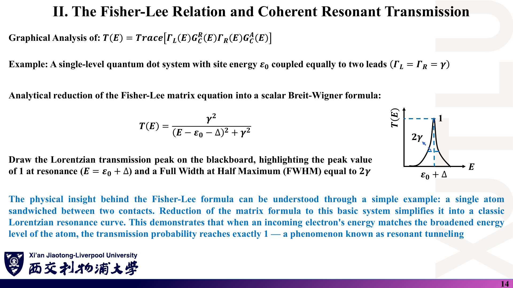
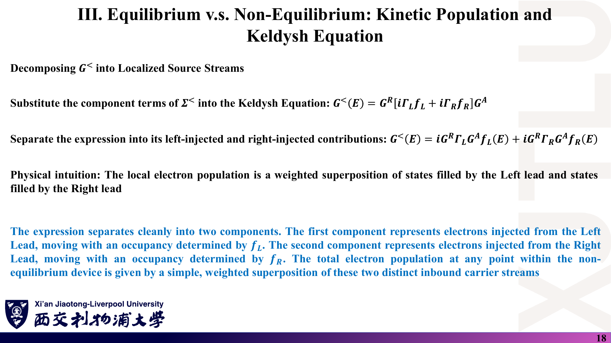
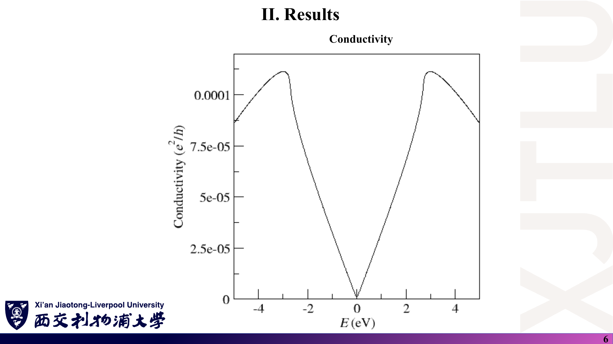

# 06 · 图文复习题与参考答案

[返回目录](README.md)

> 15 题均为根据讲义自编的练习，**不是课件原题或官方作业**。每题依次列出“课件截图 → 中文解释（题意）→ 原理深入（解析）→ Ref（来源）”。建议先遮住解析独立作答。截图保留原稿，正确公式以下方解析为准。

## 1. 输运区间判断

### 课件截图

### 中文解释

**题目**：某低温样品 $\lambda_m=200$ nm、$L_\varphi=1\ \mu$m。沟道长度分别为 (a) 50 nm，(b) 500 nm，(c) 5 μm 时属于什么输运区间？哪种情况下单独使用相干 Landauer + 弹道 $T\approx1$ 最不合适？

### 原理深入

- (a) $L<\lambda_m<L_\varphi$：弹道、相干，$T\approx1$（每个模式），电阻接近 $h/(2e^2M)$。
- (b) $\lambda_m<L<L_\varphi$：有弹性散射但仍相干，Landauer 仍可用，但 $T<1$ 且有干涉（如普适电导涨落），需要把无序写进 $H_C$。
- (c) $L>L_\varphi>\lambda_m$：扩散且退相干，弹道 $T\approx1$ 最不合适；应使用含散射自能/Büttiker 探针的 NEGF，或在长样品极限下用 Boltzmann/Drude。

### Ref

- **来源**：[Lecture Twenty-Five，PDF 第 3 页](../Lecture_Twenty-Five.pdf#page=3)；[01 第 1 节](01_介观输运与Landauer公式.md)。

## 2. 接触电阻

### 课件截图

### 中文解释

**题目**：(1) 计算 $h/2e^2$ 的数值。(2) 一根理想弹道纳米线在 $E_F$ 处有 3 个自旋简并模式，零温两端电阻是多少？(3) 把这根线加长一倍，电阻如何变化？为什么？

### 原理深入

(1) $h/e^2=25.813$ kΩ，故 $h/2e^2=12.906$ kΩ。

(2) $R=\dfrac{h}{2e^2M}=12.906/3\approx4.30$ kΩ。

(3) 不变。弹道导线内部没有散射，电阻来自库与有限模式通道的界面（接触电阻），与长度无关。只有当 $L$ 超过平均自由程、$T<1$ 时，才会出现随长度增长的部分。

### Ref

- **来源**：[Lecture Twenty-Five，PDF 第 4–6 页](../Lecture_Twenty-Five.pdf#page=4)；[01 第 2 节](01_介观输运与Landauer公式.md)。

## 3. 速度相消

### 课件截图

### 中文解释

**题目**：从 $v=\hbar^{-1}dE/dk$ 和一维 $k$ 点间距 $2\pi/L$ 出发，推出 $g_{1D}=2/(\pi\hbar v)$，再证明 $dI^+=(2e/h)f_L\,dE$。讲义第 8 页的速度定义哪里有误？

### 原理深入

单位长度、单位能量的态数：自旋 2 × 正负 $k$ 2 × $\frac{1}{2\pi}|dk/dE|$，得 $g_{1D}=\frac{2}{\pi}\frac{1}{\hbar v}$。右行占一半：$dn^+=\tfrac12g_{1D}f_L\,dE$。于是

$$
dI^+=e\,v\,dn^+=\frac{e}{\pi\hbar}f_LdE=\frac{2e}{h}f_LdE.
$$

讲义写 $v=\hbar\,dE/dk$，量纲为 J·m·J·s，不是速度；正确为 $v=\hbar^{-1}dE/dk$。

### Ref

- **来源**：[Lecture Twenty-Five，PDF 第 8–9 页](../Lecture_Twenty-Five.pdf#page=8)；[07 第 1 节](07_讲义勘误与易错点.md)。

## 4. 室温线性电导

### 课件截图

### 中文解释

**题目**：设 $\mathcal T(E)=\alpha|E-E_D|$（Dirac 型），$E_F=E_D$。求有限温度线性电导 $G(T)$。零温时 $G$ 是多少？这说明室温下测得的“最小电导”来自什么？

### 原理深入

$$
G=G_0\alpha\int|x|\Big(-\frac{\partial f}{\partial x}\Big)dx
=2G_0\alpha\int_0^\infty x\Big(-\frac{\partial f}{\partial x}\Big)dx
=2G_0\alpha\int_0^\infty f\,dx=2\ln2\,\alpha\,G_0\,k_BT.
$$

（分部积分，$\int_0^\infty\frac{dx}{e^{x/k_BT}+1}=k_BT\ln2$。）零温时 $G=G_0\mathcal T(E_D)=0$。室温下热窗口采到 $E_D$ 两侧的非零透射，$G\propto T$——这正是本周代码小偏压电导（约 $0.023G_0$）大于 $G_0T(0)$ 的原因之一。

### Ref

- **来源**：[Lecture Twenty-Five，PDF 第 15–17 页](../Lecture_Twenty-Five.pdf#page=16)；[01 第 7 节](01_介观输运与Landauer公式.md)；[04 第 5 节](04_石墨烯NEGF编程与结果.md)。

## 5. 散射矩阵与流守恒

### 课件截图

### 中文解释

**题目**：(1) 由 $S^\dagger S=I$ 证明单通道 $T+R=1$，并证明从左、从右入射的透射概率相等 $|t|^2=|t'|^2$。(2) 指出第 11 页示意图中与正文定义不一致的标签。

### 原理深入

(1) $S^\dagger S=I$ 的对角元：$|r|^2+|t|^2=1$，$|t'|^2+|r'|^2=1$；$SS^\dagger=I$ 的对角元：$|r|^2+|t'|^2=1$。比较得 $|t|^2=|t'|^2$，$|r|^2=|r'|^2$。注意需要通量归一的振幅。

(2) 左引线应为 $A_L$（入）、$B_L$（出），右引线应为 $A_R$（入）、$B_R$（出）；原图把 $A_R$ 画在左侧、$B_L$ 画在右侧。

### Ref

- **来源**：[Lecture Twenty-Five，PDF 第 11–12 页](../Lecture_Twenty-Five.pdf#page=11)；[07 第 1 节](07_讲义勘误与易错点.md)。

## 6. 多端求和规则

### 课件截图

### 中文解释

**题目**：三端器件，每端 $M=1$。端 1 的反射 $T_{11}=0.2$，$T_{21}=0.5$，$T_{31}=0.3$。(1) 用讲义第 21 页的 $\sum_{q\ne p}T_{qp}=M_p$ 检查是否成立。(2) 若所有端加相同电压 $V_0$，按讲义的紧凑式 $I_1=\frac{2e^2}{h}[M_1V_1-\sum_{q\ne1}T_{1q}V_q]$ 会得到什么矛盾？如何修正？（设 $\sum_{q}T_{1q}=1$，$T_{12}+T_{13}=0.8$。）

### 原理深入

(1) $T_{21}+T_{31}=0.8\ne1$；完整规则是 $\sum_qT_{q1}=T_{11}+T_{21}+T_{31}=1$。

(2) 紧凑式给 $I_1=\frac{2e^2}{h}[V_0-0.8V_0]=0.2\frac{2e^2}{h}V_0\ne0$——等电势下竟有电流，违反规范不变性。修正：$I_1=\frac{2e^2}{h}[(M_1-T_{11})V_1-\sum_{q\ne1}T_{1q}V_q]$，等电势时为 $(0.8-0.8)V_0=0$。

### Ref

- **来源**：[Lecture Twenty-Five，PDF 第 20–21 页](../Lecture_Twenty-Five.pdf#page=21)；[01 第 9 节](01_介观输运与Landauer公式.md)；[07 第 1 节](07_讲义勘误与易错点.md)。

## 7. 量子 Hall 条

### 课件截图

### 中文解释

**题目**：用讲义的透射分配 $T_{21}=T_{32}=T_{43}=T_{14}=M$（其余为 0），每通道电导 $g$。电流从 1 进、3 出，2、4 为电压探针。求 $V_2-V_4$ 与 $R_{xy}$。在 $g=2e^2/h$ 与 $g=e^2/h$ 时 $R_{xy}$ 分别是多少？

### 原理深入

$I_2=gM(V_2-V_1)=0\Rightarrow V_2=V_1$；$I_4=gM(V_4-V_3)=0\Rightarrow V_4=V_3$；$I=I_1=gM(V_1-V_4)=gM(V_1-V_3)$。

$$
R_{xy}=\frac{V_2-V_4}{I}=\frac{1}{gM}.
$$

$g=2e^2/h$：$R_{xy}=h/(2e^2M)$；$g=e^2/h$（自旋分辨通道）：$R_{xy}=h/(e^2M)$，与讲义一致。两者不能混用。

### Ref

- **来源**：[Lecture Twenty-Five，PDF 第 22 页](../Lecture_Twenty-Five.pdf#page=22)；[01 第 10 节](01_介观输运与Landauer公式.md)。

## 8. 推迟格林函数与 LDOS

### 课件截图

### 中文解释

**题目**：两能级体系 $`H=\begin{pmatrix}0&\gamma\\\gamma&0\end{pmatrix}`$。写出 $G^R(E)$，并求格点 1 的 LDOS $\rho_1(E)$（$\eta\to0^+$）。

### 原理深入

本征值 $\pm\gamma$，本征矢 $(1,\pm1)/\sqrt2$。

$$
G^R=\frac{1}{(E+i\eta)^2-\gamma^2}\begin{pmatrix}E+i\eta&\gamma\\\gamma&E+i\eta\end{pmatrix}.
$$

$|\langle1|\pm\rangle|^2=\tfrac12$，故

$$
\rho_1(E)=\frac{A_{11}}{2\pi}=\frac12\delta(E-\gamma)+\frac12\delta(E+\gamma),\qquad\int\rho_1dE=1.
$$

有限 $\eta$ 时每个 $\delta$ 变成半高宽 $2\eta$ 的 Lorentz 峰。

### Ref

- **来源**：[Lecture Twenty-Six，PDF 第 6–7 页](../Lecture_Twenty-Six.pdf#page=7)；[02 第 2–3 节](02_格林函数_自能与Fisher-Lee公式.md)。

## 9. 一维链的解析自能

### 课件截图

### 中文解释

**题目**：半无限一维链，格点能 0、跳跃 $t$，每个主层一个格点（$H_{00}=0$，$H_{01}=t$）。(1) 由 $g^s=[E+i\eta-t^2g^s]^{-1}$ 解出能带内的表面格林函数。(2) 若中心区一个格点与链端以 $t$ 耦合，求 $\Sigma$ 与 $\Gamma$，并说明 $\Gamma$ 与群速度的关系。

### 原理深入

(1) $t^2(g^s)^2-Eg^s+1=0$，$g^s=\dfrac{E\mp\sqrt{E^2-4t^2}}{2t^2}$。在带内 $|E|<2|t|$，取使 $\mathrm{Im}\,g^s<0$（推迟）的根：

$$
g^s=\frac{E-i\sqrt{4t^2-E^2}}{2t^2}.
$$

(2) $\Sigma=t^2g^s=\dfrac E2-\dfrac i2\sqrt{4t^2-E^2}$，$\Gamma=\sqrt{4t^2-E^2}$。用色散 $E=2t\cos ka$：$\Gamma=2|t\sin ka|=\hbar v/a$。展宽 = 每个格点的“逃逸速率”，带边 $v\to0$ 时 $\Gamma\to0$——这也是代码中不动点迭代在带边收敛慢的原因。

### Ref

- **来源**：[Lecture Twenty-Six，PDF 第 10–12 页](../Lecture_Twenty-Six.pdf#page=10)；[02 第 5–6 节](02_格林函数_自能与Fisher-Lee公式.md)；[08 第 3 节](08_代码导读.md)。

## 10. 不对称耦合的共振峰

### 课件截图

### 中文解释

**题目**：单能级量子点，$\Gamma_L=4$ meV，$\Gamma_R=1$ meV，$\Delta=0$。求峰值透射、半高全宽。讲义“共振时 $T=1$”在什么条件下成立？

### 原理深入

$$
T_{\max}=\frac{4\Gamma_L\Gamma_R}{(\Gamma_L+\Gamma_R)^2}=\frac{16}{25}=0.64,\qquad\text{FWHM}=\Gamma_L+\Gamma_R=5\ \text{meV}.
$$

只有对称耦合 $\Gamma_L=\Gamma_R$ 时 $T_{\max}=1$。若再加散射展宽 $\Gamma_S$，分母变为 $(\Gamma_L+\Gamma_R+\Gamma_S)^2$，峰更低更宽。

### Ref

- **来源**：[Lecture Twenty-Six，PDF 第 14 页](../Lecture_Twenty-Six.pdf#page=14)；[02 第 8 节](02_格林函数_自能与Fisher-Lee公式.md)。

## 11. Keldysh 方程的平衡检验

### 课件截图

### 中文解释

**题目**：证明当 $f_L=f_R=f$ 时 $G^<=if\,A$，并由此写出平衡密度矩阵。为什么讲义第 16 页的 $\rho=\frac{1}{2\pi}\int\mathrm{Imag}[G^<]dE$ 不能直接用于非对角元？

### 原理深入

$G^<=iG^R(\Gamma_L+\Gamma_R)G^Af=ifG^R\Gamma G^A=ifA$（光学定理）。于是

$$
\rho=\int\frac{dE}{2\pi i}G^<=\int\frac{dE}{2\pi}f(E)A(E),
$$

即“态密度 × Fermi 占据”。$G^<$ 是反厄米矩阵，$-iG^<$ 才是厄米的；对角元 $G^<_{ii}$ 为纯虚数，所以对角元取虚部正确，非对角元一般是复数，逐元素取虚部会丢掉实部。

### Ref

- **来源**：[Lecture Twenty-Six，PDF 第 16–18、21 页](../Lecture_Twenty-Six.pdf#page=17)；[02 第 9 节](02_格林函数_自能与Fisher-Lee公式.md)；[07 第 2 节](07_讲义勘误与易错点.md)。

## 12. NEGF 电流化为 Landauer

### 课件截图

### 中文解释

**题目**：从 $I_L\propto\mathrm{Tr}[\Gamma_L(f_LA-G^n)]$ 出发，代入 $A=G^R(\Gamma_L+\Gamma_R)G^A$、$G^n=G^R(\Gamma_Lf_L+\Gamma_Rf_R)G^A$，推出 Landauer 形式。第 19 页的 $e/h$ 与第 20 页的 $2e/h$ 差在哪里？

### 原理深入

$$
\mathrm{Tr}[\Gamma_L(f_LA-G^n)]=f_L\mathrm{Tr}[\Gamma_LG^R\Gamma_LG^A]+f_L\mathrm{Tr}[\Gamma_LG^R\Gamma_RG^A]-f_L\mathrm{Tr}[\Gamma_LG^R\Gamma_LG^A]-f_R\mathrm{Tr}[\Gamma_LG^R\Gamma_RG^A]
$$

$$
=\mathrm{Tr}[\Gamma_LG^R\Gamma_RG^A]\,(f_L-f_R).
$$

$e/h$ 是每个自旋的电流，乘自旋简并因子 2 得 $2e/h$。自旋分辨计算（如 MTJ）不能乘 2。

### Ref

- **来源**：[Lecture Twenty-Six，PDF 第 19–20 页](../Lecture_Twenty-Six.pdf#page=20)；[02 第 10 节](02_格林函数_自能与Fisher-Lee公式.md)。

## 13. 光学声子的吸收与发射

### 课件截图

### 中文解释

**题目**：GaAs LO 声子 $\hbar\omega_0\approx36$ meV。分别在 300 K 与 77 K 计算 $N_q$ 和发射/吸收强度比 $(N_q+1)/N_q$。说明 $\Sigma^<_{opt}$ 中哪一项代表“电子从高能落下来”。

### 原理深入

- 300 K：$k_BT=25.85$ meV，$N_q=1/(e^{1.393}-1)\approx0.33$，比值约 4.0。
- 77 K：$k_BT=6.64$ meV，$N_q=1/(e^{5.43}-1)\approx0.0044$，比值约 230。

$(N_q+1)G^<(E+\hbar\omega_0)$ 项：能量 $E+\hbar\omega_0$ 的电子发射声子落到 $E$，这是能量弛豫与发热的来源；低温下几乎只剩发射。

### Ref

- **来源**：[Lecture Twenty-Seven，PDF 第 10 页](../Lecture_Twenty-Seven.pdf#page=10)、[第 16 页](../Lecture_Twenty-Seven.pdf#page=16)；[03 第 4 节](03_非弹性散射与量子器件应用.md)。

## 14. Büttiker 探针

### 课件截图

### 中文解释

**题目**：相干直通 $T_{RL}=0.2$，左端到探针 $T_{pL}=0.6$，探针到右端 $T_{Rp}=0.6$（无磁场、对称）。求探针电势（用 $V_L$、$V_R$ 表示）与有效透射 $T_{\text{eff}}$。

### 原理深入

$I_p=0$：$V_p=\dfrac{T_{pL}V_L+T_{pR}V_R}{T_{pL}+T_{pR}}=\dfrac{V_L+V_R}{2}$。

$$
T_{\text{eff}}=T_{RL}+\frac{T_{Rp}T_{pL}}{T_{Rp}+T_{pL}}=0.2+\frac{0.36}{1.2}=0.5.
$$

第二项像两个电导串联：电子经探针“丢失相位后再注入”，补充了非相干通道。

### Ref

- **来源**：[Lecture Twenty-Seven，PDF 第 11 页](../Lecture_Twenty-Seven.pdf#page=11)；[03 第 5 节](03_非弹性散射与量子器件应用.md)。

## 15. 读懂本周代码的结果

### 课件截图

### 中文解释

**题目**：(1) 为什么程序的 $T(E)$ 可以大于 1？(2) 第 6 页纵轴峰值约 $1.1\times10^{-4}$，单位应是什么？它是电导还是电导率？(3) I–V 曲线为什么是超线性的？如果在中心区加一个随偏压线性变化的电势，结果会怎样改变？

### 原理深入

(1) $T(E)$ 是对所有横向通道求和、再对横向 $k$ 取平均的结果，表示每个横向超胞宽度上的开放通道数，不是单通道概率。

(2) $G_0T_{\max}=7.748\times10^{-5}\times1.4376=1.11\times10^{-4}$ S。单位是西门子；物理量是弹道 Landauer **电导**，与长度无关，不是电导率。

(3) 中心区与引线相同，$T(E)\approx\alpha|E|$，零温 $I\propto\int_{-eV/2}^{eV/2}|E|dE\propto V^2$；室温下小偏压段线性。程序中 $T(E)$ 不随偏压变化；若加入电势降，$T(E,V)$ 会随偏压移动（Dirac 点在中心区内平移），需要对每个偏压重新计算透射，严格做法还要与 Poisson 方程自洽。

### Ref

- **来源**：[Lecture Twenty-Eight，PDF 第 5–7 页](../Lecture_Twenty-Eight.pdf#page=6)；[04 第 3–5 节](04_石墨烯NEGF编程与结果.md)；[08 第 6–7 节](08_代码导读.md)。
