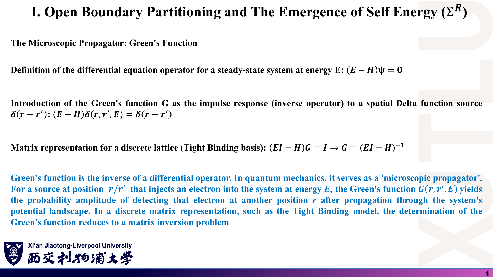
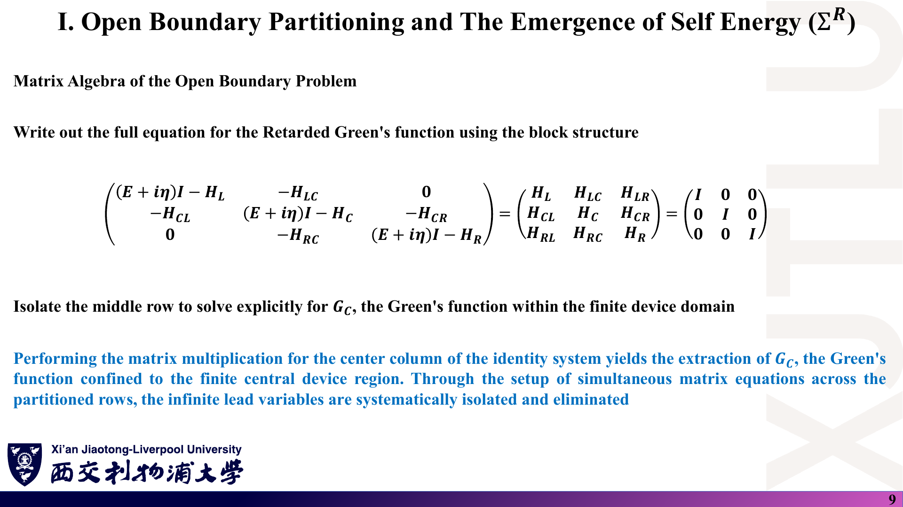
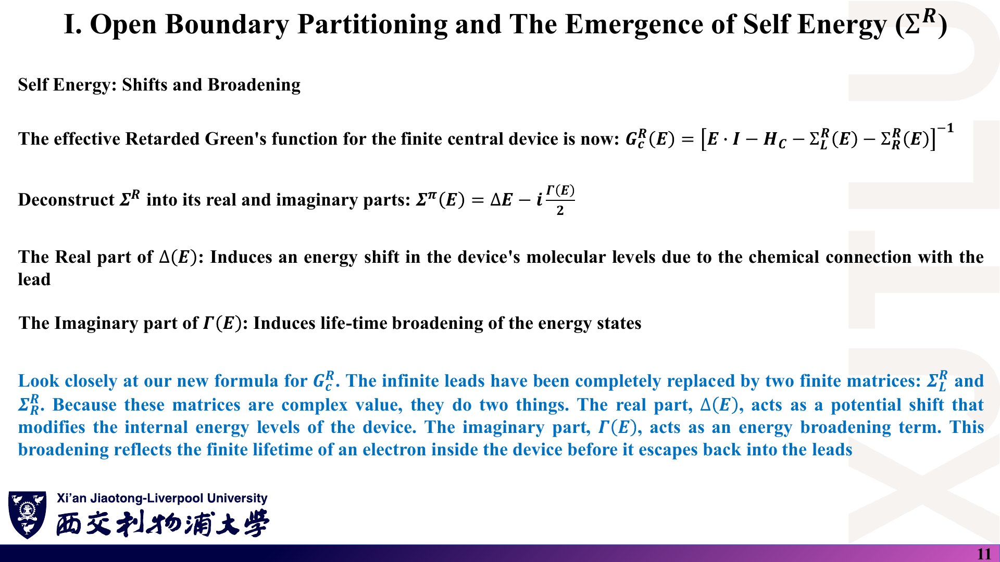
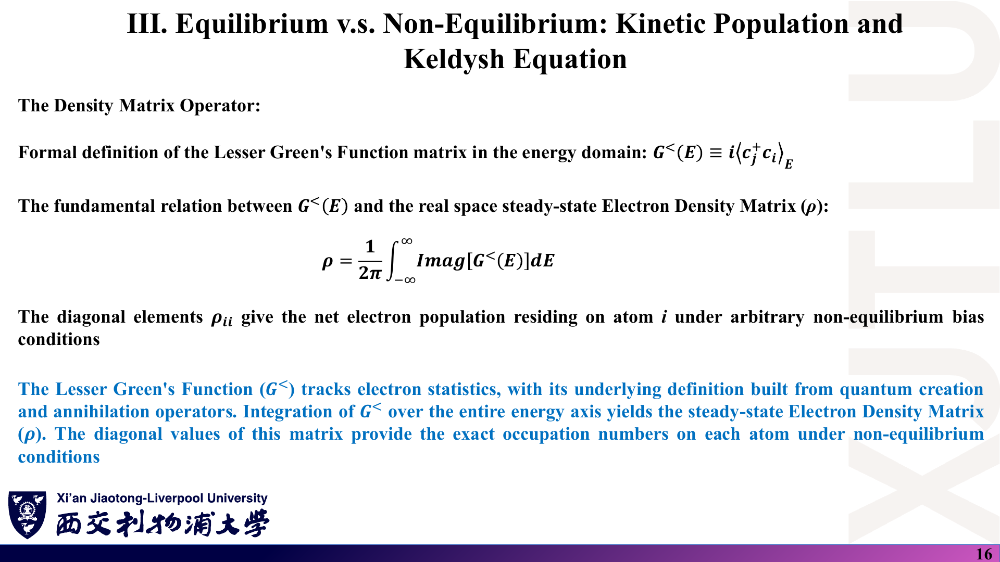
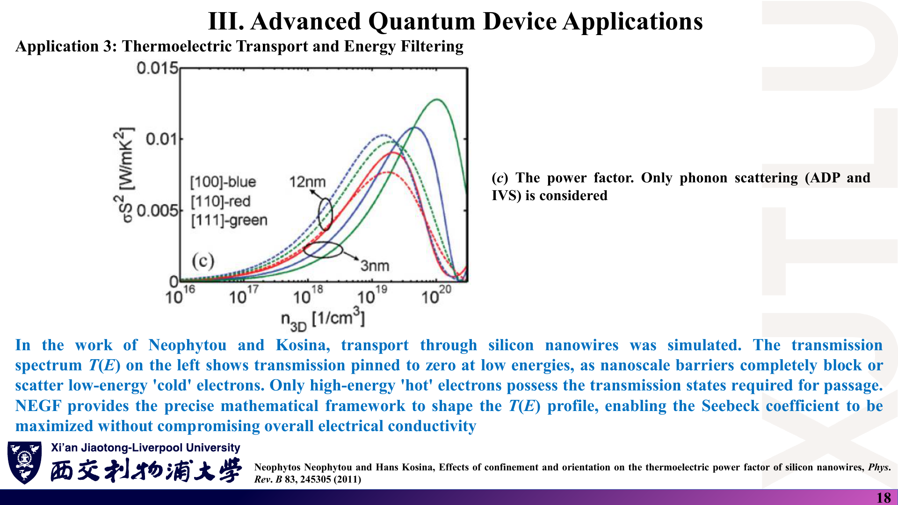
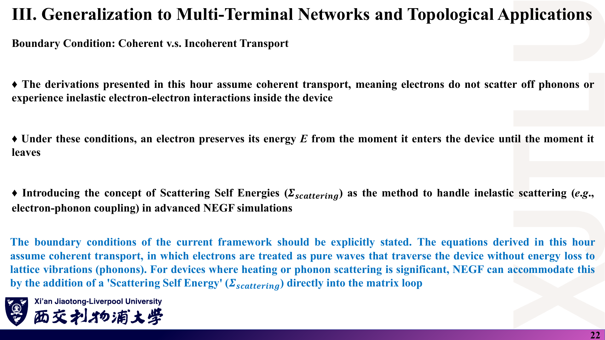
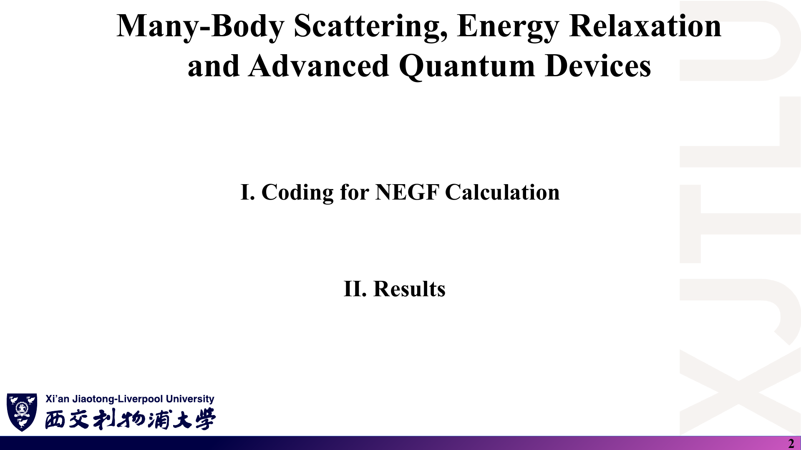
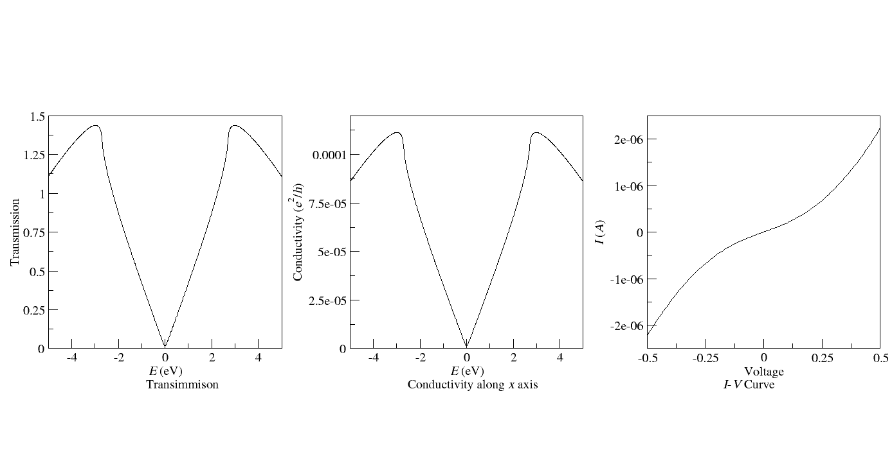
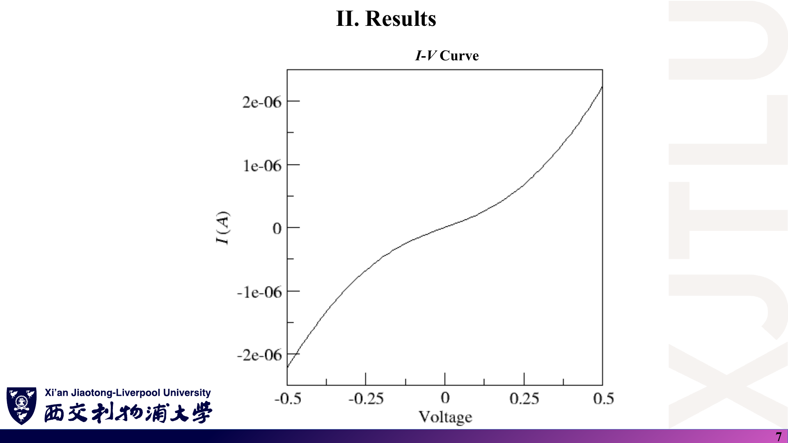

# 07 · 图文勘误、符号约定与易错点

[返回目录](README.md)

> 本文是**学习核对记录，不是教师发布的官方勘误**。截图（原图证据）忠实保留原稿；“中文解释”说明问题，“原理深入”给出正确写法与可复核的理由。只收录经过推导、数值或原文核对确认的问题，并区分明确笔误、未说清的约定与论文内容归属问题。页码均为含封面的 PDF 物理页码。论文核对基于课程补充文献原文（未随仓库分发，见 [README](README.md#ref-supp)）。

## 1. Lecture 25：定义、示意图与多端公式

### 课件截图

### 中文解释

1. 第 8 页群速度 $v(E)=\hbar\,dE/dk$ 写错了 $\hbar$ 的位置。
2. 第 4 页 “Resistivity $R=\rho L/A$”：$R$ 是电阻不是电阻率。
3. 第 11 页示意图中 $A_R$、$B_L$ 的位置与正文和矩阵方程矛盾。
4. 第 19 页“$p$ 为目标端、$q$ 为源端”与同页 $T_{qp}$（从 $p$ 到 $q$）的定义互相冲突。
5. 第 21 页求和规则 $\sum_{q\ne p}T_{qp}=M_p$ 漏掉了反射，紧凑形式因此只在无反射时成立。
6. 第 22 页 $R_{xy}=h/(e^2M)$ 与第 20 页的前置因子 $2e^2/h$ 不一致。
7. 第 7、10 页把偏压窗口写成 $[\mu_L,\mu_R]$（记法问题）。

### 原理深入

| 原页 | 问题 | 正确写法 | 核验理由 |
|---|---|---|---|
| 25-8 | $v=\hbar\,dE/dk$ | $v=\dfrac1\hbar\dfrac{dE}{dk}$ | 量纲：$dE/dk$ 单位 J·m，除以 $\hbar$（J·s）才得 m/s；同页 $g_{1D}=2/(\pi\hbar v)$ 也只有在 $dk/dE=1/(\hbar v)$ 时成立 |
| 25-4 | “Resistivity $R$” | 电阻 $R=\rho L/A$，$\rho$ 为电阻率 | 两者单位分别为 Ω 与 Ω·m |
| 25-11 | 左侧标 $A_R$、右侧标 $B_L$ | 左引线：$A_L$ 入、$B_L$ 出；右引线：$A_R$ 入、$B_R$ 出 | 正文：“$A_L,B_L$ (left lead) and $A_R,B_R$ (right lead)”；方程 $(B_L,B_R)^T=S(A_L,A_R)^T$ 中 $r$ 连接 $A_L\to B_L$ |
| 25-19/20 | 下标描述冲突 | 统一采用 $T_{qp}$：从 $p$ 到 $q$（“到←从”） | 第 20 页 $I_p\propto\sum_q[T_{qp}V_p-T_{pq}V_q]$ 的第一项是流出 $p$，只有在此约定下成立 |
| 25-21 | $\sum_{q\ne p}T_{qp}=M_p$；$I_p=\frac{2e^2}{h}[M_pV_p-\sum_{q\ne p}T_{pq}V_q]$ | $\sum_qT_{qp}=M_p$（含反射 $T_{pp}$）；$I_p=\frac{2e^2}{h}[(M_p-T_{pp})V_p-\sum_{q\ne p}T_{pq}V_q]$ | 规范不变性检验：所有 $V_q$ 相等时电流必须为零，这要求完整求和规则；同页蓝字也说“反射与透射之和” |
| 25-22 | $R_{xy}=\frac{h}{e^2}\frac1M$ | 用 $\frac{2e^2}{h}$ 时 $R_{xy}=\frac{h}{2e^2M}$；若 $M$ 计自旋分辨通道、前置因子 $\frac{e^2}{h}$，则 $\frac{h}{e^2M}$ | 用讲义给定的 $T_{21}=T_{32}=T_{43}=T_{14}=M$ 解四端方程得 $R_{xy}=1/(gM)$（推导见 [01 第 10 节](01_介观输运与Landauer公式.md)） |
| 25-7, 10 | 窗口 $[\mu_L,\mu_R]$ | $[\mu_R,\mu_L]$（$\mu_L>\mu_R$） | 记法，不影响结论 |

### Ref

- **原课件**：[Lecture Twenty-Five，PDF 第 4 页](../Lecture_Twenty-Five.pdf#page=4)、[第 8 页](../Lecture_Twenty-Five.pdf#page=8)、[第 11 页](../Lecture_Twenty-Five.pdf#page=11)、[第 19–22 页](../Lecture_Twenty-Five.pdf#page=21)。
- **规范写法**：[01 介观输运](01_介观输运与Landauer公式.md)。
- **延伸**：[DATTA1](README.md#ref-datta1)、[B86](README.md#ref-b86)。

## 2. Lecture 26：格林函数记号与矩阵写法

### 课件截图

### 中文解释

1. 第 4 页 $(E-H)\delta(r,r',E)=\delta(r-r')$：左边应是 $G$。
2. 第 9 页 $[\ldots]\times(\text{H 分块})=I$：未知矩阵应是 $G$ 的分块。
3. 第 11 页 $\Sigma^\pi$ 应为 $\Sigma^R$；“实部/虚部”对矩阵需解释为厄米/反厄米部分。
4. 第 12 页 $\Gamma=-2\,\mathrm{Imag}[\Sigma^R]$、第 16 页 $\rho=\frac1{2\pi}\int\mathrm{Imag}[G^<]dE$：逐元素取虚部只对对角元（或实对称情形）正确。
5. 第 19 页前置因子 $e/h$，第 20 页最终写 $2e/h$，中间未说明的自旋因子 2。

### 原理深入

| 原页 | 问题 | 正确写法 | 核验理由 |
|---|---|---|---|
| 26-4 | $(E-H)\delta(r,r',E)$ | $(E-H)G(r,r',E)=\delta(r-r')$ | 同页下一行矩阵形式 $(EI-H)G=I$ |
| 26-9 | 中间矩阵为 $H_L,H_{LC},\ldots$ | $\begin{pmatrix}G_L&G_{LC}&G_{LR}\\G_{CL}&G_C&G_{CR}\\G_{RL}&G_{RC}&G_R\end{pmatrix}$ | 若为 $H$，则方程变成 $(E-H)H=I$，与下一页用到的 $G_{LC}$、$G_C$ 不符 |
| 26-11 | $\Sigma^\pi=\Delta E-i\Gamma/2$ | $\Sigma^R=\Delta-\tfrac i2\Gamma$，$\Delta=\frac{\Sigma^R+\Sigma^A}{2}$，$\Gamma=i(\Sigma^R-\Sigma^A)$ | 与第 12 页定义一致；矩阵的“实部”须为厄米部分才保证 $\Delta$ 厄米 |
| 26-12 | $\Gamma=-2\,\mathrm{Imag}\Sigma^R$ | $\Gamma=i(\Sigma^R-\Sigma^{R\dagger})$ | 对复非对称矩阵，$\mathrm{Im}(\Sigma_{ij})\ne\frac{1}{2i}(\Sigma_{ij}-\Sigma_{ji}^*)$；代码使用的是正确形式 |
| 26-16 | $\rho=\frac1{2\pi}\int\mathrm{Imag}[G^<]dE$ | $\rho=\int\frac{dE}{2\pi i}G^<=\int\frac{dE}{2\pi}G^n$ | $G^<$ 反厄米：对角元为纯虚数，非对角元一般为复数，逐元素取虚部会丢掉实部 |
| 26-19/20 | $e/h\to2e/h$ | 自旋简并时乘 2；自旋分辨时保持 $e/h$ | 逐步代数见 [02 第 10 节](02_格林函数_自能与Fisher-Lee公式.md) |

另一个**易错点**（非笔误）：第 11 页 $G^R_C=[EI-H_C-\Sigma_L-\Sigma_R]^{-1}$ 不写 $i\eta$，在引线能带内没问题；但若中心区在引线能带外有束缚态，仍需保留 $i\eta$。

### Ref

- **原课件**：[Lecture Twenty-Six，PDF 第 4 页](../Lecture_Twenty-Six.pdf#page=4)、[第 9 页](../Lecture_Twenty-Six.pdf#page=9)、[第 11–12 页](../Lecture_Twenty-Six.pdf#page=11)、[第 16 页](../Lecture_Twenty-Six.pdf#page=16)、[第 19–20 页](../Lecture_Twenty-Six.pdf#page=20)。
- **规范写法**：[02 格林函数](02_格林函数_自能与Fisher-Lee公式.md)。
- **延伸**：[DATTA2](README.md#ref-datta2)、[HJ](README.md#ref-hj)。

## 3. Lecture 27：公式、笔误与占位文字

### 课件截图

### 中文解释

1. 第 5 页 $\Sigma^R_{\text{scatteromg}}$ 是 “scattering” 的笔误。
2. 第 8 页把 SCBA 收敛结果称为 “stable equilibrium”，实际是非平衡稳态。
3. 第 12 页 $I=\frac{2e}{h}\int\operatorname{Tr}[\Sigma^<G^>-\Sigma^>G^<]dE$ 没有标明是哪个接触的自能。
4. 第 23 页 “A diagram illustrating…” 和 “The Spinor Matrix Architecture:” 后没有图和矩阵。
5. 第 27 页的力矩公式是示意性写法（论文实际方法见第 4 节）。

### 原理深入

| 原页 | 问题 | 正确写法 | 核验理由 |
|---|---|---|---|
| 27-5 | scatteromg | scattering | 同页其他位置与第 6–8 页均为 scattering |
| 27-8 | stable equilibrium | 自洽的非平衡稳态 | 有偏压、有电流，体系不处于热平衡 |
| 27-12 | 未标接触 | $I_\alpha=\frac{2e}{h}\int\operatorname{Tr}[\Sigma^<_\alpha G^>-\Sigma^>_\alpha G^<]dE$ | 若取全部自能之和（含 $\Sigma_S$），稳态下总和为零（粒子守恒） |
| 27-23 | 缺少矩阵 | $H_{ij}=\begin{pmatrix}H^{\uparrow\uparrow}&H^{\uparrow\downarrow}\\H^{\downarrow\uparrow}&H^{\downarrow\downarrow}\end{pmatrix}_{ij}$ | 文字描述的正是这一结构 |
| 27-28 | “quantized value of 11” | $G=2e^2/h$（每个自旋 $e^2/h$） | 同页黑字写 $G=1\times\frac{2e^2}{h}$；论文给出 $2e^2/h$ 平台 |

### Ref

- **原课件**：[Lecture Twenty-Seven，PDF 第 5 页](../Lecture_Twenty-Seven.pdf#page=5)、[第 8 页](../Lecture_Twenty-Seven.pdf#page=8)、[第 12 页](../Lecture_Twenty-Seven.pdf#page=12)、[第 23 页](../Lecture_Twenty-Seven.pdf#page=23)、[第 28 页](../Lecture_Twenty-Seven.pdf#page=28)。
- **规范写法**：[03 非弹性散射](03_非弹性散射与量子器件应用.md)。

## 4. Lecture 27：文献引用与论文内容归属

### 课件截图

### 中文解释

课件后半部分引用了 7 篇论文。对照原文后，发现两处期刊名错误，以及若干处“课件描述与论文实际内容不符”的情况。这些不影响 NEGF 理论本身，但复述论文结论时要以原文为准。

### 原理深入

| 原页 | 课件写法 | 原文核对结果 | 核验依据 |
|---|---|---|---|
| 27-23~27 | Theodonis *et al.*, *Phys. Rev. B.* 97, 237205 (2006) | **Phys. Rev. Lett.** 97, 237205 (2006)；作者为 I. Theodonis, N. Kioussis, A. Kalitsov, M. Chshiev, W. H. Butler | 论文首页页眉 “PRL 97, 237205 (2006)”，DOI 10.1103/PhysRevLett.97.237205；课件蓝字自己也称其为 “PRL paper” |
| 27-28~29 | Li, Chu, Jain, Shen, *Phys. Rev. B.* 102, 136806 (2009) | **Phys. Rev. Lett.** 102, 136806 (2009) | 首页页眉 “PRL 102, 136806 (2009)”，DOI 10.1103/PhysRevLett.102.136806 |
| 27-14 | 虚线是 “strictly coherent model” | 虚线是只含 1 次散射事件的 MSS 算法，实线是 SCBA；两者都含散射 | 第 13 页图例 “Self Consistent Born / 1 Scattering Event”；Lake 等论文讨论 SCBA 与 MSS 的收敛关系 |
| 27-17~18 | Neophytou & Kosina 用 NEGF 计算能量过滤后的 $T(E)$ | 论文用原子级紧束缚 + **线性化 Boltzmann 输运**，研究纳米线直径、晶向对功率因子的影响；插图是 $\sigma$、$S$、功率因子随载流子浓度的变化 | 论文摘要与 Fig. 1 图注 |
| 27-19~20 | Luisier 的谱电流显示关态源–漏隧穿；其论文“右侧”的 TFET $I_d$–$V_g$ 突破 60 mV/dec | Fig. 10 是 $V_{gs}=0.5$ V、$V_{ds}=0.6$ V 下弹道与含电子–声子散射的谱电流对比；全文 “tunnel” 只出现在引言与结尾展望（TFET 作为今后应用），没有 TFET 的 $I_d$–$V_g$ | 论文 Fig. 10 图注与全文检索 |
| 27-25 | “该 PRL 的自旋分辨透射图” | Theodonis 论文研究的是自旋转移矩随偏压的变化（Fig. 2、3 为 $T_\perp$、$T_\parallel$），正文没有 “transmission” 一词 | 全文检索 |
| 27-27 | $\mathbf T=\frac1{2\pi}\int\operatorname{Tr}\{\boldsymbol\sigma\cdot\mathrm{Im}G^<\}\times\mathbf M\,dE$ | 论文用相邻格点的 $G^<_{i,i+1}$ 求自旋流，局域力矩 $\mathbf T_i=-\nabla\cdot\mathbf I^s=\mathbf I^s_{i-1,i}-\mathbf I^s_{i,i+1}$ | 论文式 (3)(4) |
| 27-28 | 加入 $\Sigma_{\text{disorder}}$，NEGF 显示透射完全不变 | 无序以随机格点能写入哈密顿量，用 Landauer–Büttiker 公式计算并对 1000 个样本平均；TAI 是干净极限下的**金属**在一定无序范围内出现 $2e^2/h$ 平台，强无序时平台消失 | 论文正文与 Fig. 2、Fig. 4 图注 |

**如何使用这些引用**：课件对 NEGF 应用方向的概括（RTD 谷电流、QCL 声子共振清空、TFET、STT、拓扑边缘态）作为物理图像是合理的；需要引用具体结论或图时，以论文原文为准。

### Ref

- **原课件**：[Lecture Twenty-Seven，PDF 第 13–29 页](../Lecture_Twenty-Seven.pdf#page=13)。
- **论文书目**：[LAKE](README.md#ref-lake)、[NEO](README.md#ref-neo)、[LUISIER](README.md#ref-luisier)、[THEO](README.md#ref-theo)、[TAI](README.md#ref-tai)。
- **正文讨论**：[03 第 7–10 节](03_非弹性散射与量子器件应用.md)。

## 5. 标题沿用：Lecture 26 第 22 页与 Lecture 28 第 2 页

### 课件截图

### 中文解释

- 第 26 讲最后一页（相干 vs 非相干的边界条件）的标题是 “III. Generalization to Multi-Terminal Networks and Topological Applications”，与第 25 讲第三部分相同，而本讲第三部分标题是 “Equilibrium v.s. Non-Equilibrium…”。
- 第 28 讲提纲页大标题 “Many-Body Scattering, Energy Relaxation and Advanced Quantum Devices” 与第 27 讲相同，但本讲内容是 NEGF 编程与结果。

### 原理深入

这两处是版式问题，不影响物理内容。复习时按内容归类：第 26 讲第 22 页属于“相干输运假设”，第 28 讲属于“代码实现与结果”。

### Ref

- **原课件**：[Lecture Twenty-Six，PDF 第 22 页](../Lecture_Twenty-Six.pdf#page=22)、[Lecture Twenty-Eight，PDF 第 2 页](../Lecture_Twenty-Eight.pdf#page=2)。

## 6. 结果图：“Conductivity” 实为电导，单位是 S

### 课件截图

### 中文解释

1. 纵轴标 “Conductivity ($e^2/h$)”，但数据是 $G(E)=G_0T(E)$，单位 S；物理量是**电导**而非电导率。
2. `results.png` 左图标题 “Transimmison” 应为 “Transmission”。
3. I–V 图横轴 “Voltage” 缺单位（V）。
4. 文件名 `Conductivity_along_x_axis.dat` 与程序变量 `conductivity` 沿用了“电导率”的叫法，但文件表头已正确写为 “Landauer conductance G(E) (S)”。

### 原理深入

| 原图 | 问题 | 正确写法 | 核验理由 |
|---|---|---|---|
| 28-6、results.png 中图 | “Conductivity ($e^2/h$)” | “Conductance $G$ (S)”，或改画 $G/(e^2/h)=2T$ | $T_{\max}=1.4376$，$G_0T_{\max}=1.114\times10^{-4}$ S，与纵轴峰值一致；若单位真是 $e^2/h$，峰值应为 2.88 |
| results.png 左图 | Transimmison | Transmission | 拼写 |
| 28-7、results.png 右图 | Voltage | Voltage (V) | 程序中偏压以 V 为单位 |

**电导与电导率的区别**：$G$ 是器件 + 接触的性质，弹道区与长度无关；$\sigma$ 是材料性质，只在扩散区通过 $G=\sigma W/L$（二维）联系。本程序是弹道计算，不能从 $G$ 推出 $\sigma$。

### Ref

- **原课件**：[Lecture Twenty-Eight，PDF 第 6–7 页](../Lecture_Twenty-Eight.pdf#page=6)。
- **数据**：[`Conductivity_along_x_axis.dat`](../Codes/Conductivity_along_x_axis.dat)。
- **正文**：[04 第 4 节](04_石墨烯NEGF编程与结果.md)、[08 第 7 节](08_代码导读.md)。

## 7. 代码模型的易错理解（不是代码错误）

### 课件截图

### 中文解释

程序本身按设计正确运行（I–V 可由 `transmission.dat` 独立复算到有效数字一致），但下列理解容易出错：

1. 中心“散射区”与引线是同一种完美石墨烯，没有散射；结果是弹道的。
2. $T(E)$ 只在零偏压下算一次；偏压只刚性平移 $\mu_{L,R}=\pm V/2$，没有电势降和 Poisson 自洽。
3. $T(E)$ 是对横向 $k$ 的**平均**，表示每个横向超胞宽度（约 4.26 Å）的透射，可以大于 1。
4. $E=0$ 处 $T\approx0.016$ 而非 0，来自 $\eta=0.025$ eV 与有限 $k$ 网格。
5. 表面格林函数用不动点迭代，减小 $\eta$ 时迭代数约按 $1/\eta$ 增长，可能超过 2000 次上限。

### 原理深入

- 这些是**模型假设**而不是 bug；写实验报告时应把它们列为局限，并说明它们对结果的影响（例如 I–V 的超线性完全来自 $T(E)\propto|E|$，而非某种器件效应）。
- 第 2 点的后果：真实器件在大偏压下 $T(E,V)$ 会变化（能带弯曲、电势降），刚性偏移的 I–V 只在小偏压或电势降可忽略时可靠。
- 第 5 点的估算见 [08 第 3 节](08_代码导读.md)。

### Ref

- **代码**：[08 代码导读](08_代码导读.md)。
- **结果**：[04 第 3–5 节](04_石墨烯NEGF编程与结果.md)。

## 核对优先级

1. **下标与方向**：$T_{qp}$ 是“从 $p$ 到 $q$”还是反过来？左右引线用 $H_{01}$ 还是 $H_{01}^\dagger$？
2. **因子 2**：自旋简并（$2e^2/h$）还是自旋分辨（$e^2/h$）？前后是否统一？
3. **矩阵的“实部/虚部”**：对矩阵一律用厄米/反厄米部分，而不是逐元素取虚部。
4. **物理量与单位**：电导（S）还是电导率；$T$ 是概率还是通道数之和。
5. **引用**：期刊名、作者、方法（NEGF 还是 Boltzmann、自能还是 Hamiltonian 中的无序）以原文为准。
