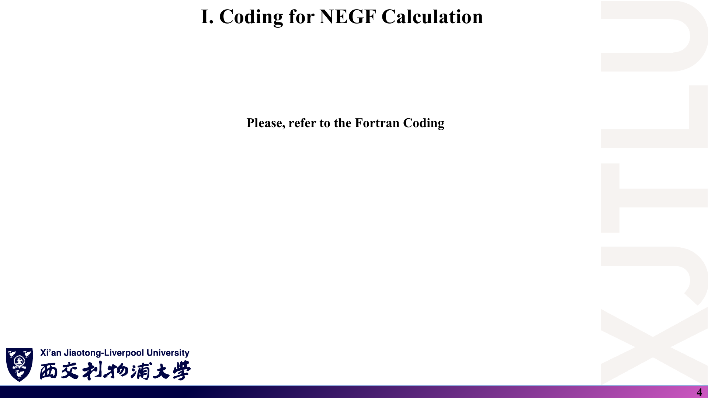
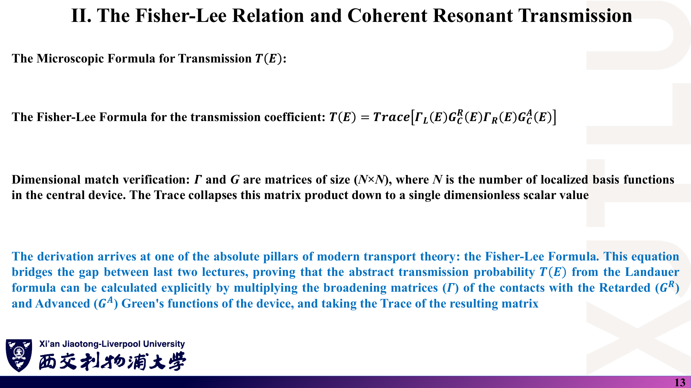
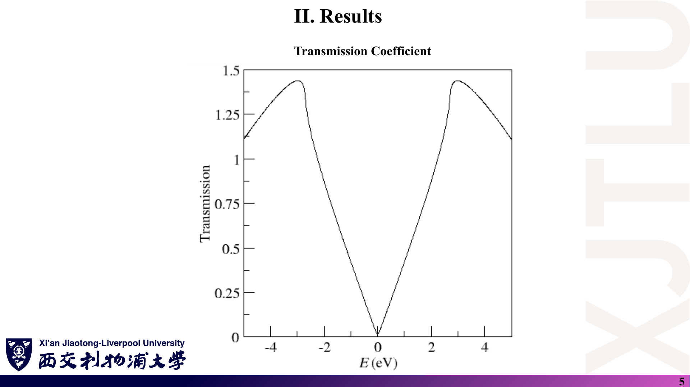

# 08 · 代码导读：石墨烯相干 NEGF 透射与 Landauer I–V

来源：[`Codes/TIGHTBINDINGFORGRAPHENE.f90`](../Codes/TIGHTBINDINGFORGRAPHENE.f90)（707 行）及同目录输入、脚本和输出；对应 [Lecture_Twenty-Eight.pdf](../Lecture_Twenty-Eight.pdf)。

[返回目录](README.md)

> 行号以仓库中的源文件为准。“原理深入”中的数值核验（如收敛迭代次数估计、I–V 复算）是本笔记作者的补充，不是教师给出的说明。代码未修改。

## 1. Codes 目录里有哪些文件？

### 课件截图



### 中文解释

| 文件 | 作用 |
|---|---|
| `TIGHTBINDINGFORGRAPHENE.f90` | 主程序：最近邻紧束缚 + 相干 NEGF + Landauer 积分 |
| `Graphene.vasp` | 输入：POSCAR 式晶格/原子 + 冒号分隔的参数行 |
| `compile.sh` / `run.sh` | Slurm 集群上的编译、运行脚本 |
| `transmission.dat` | $E$（eV）与 $T(E)$，第一行为表头 |
| `Conductivity_along_x_axis.dat` | $E$、$G(E)=G_0T(E)$ 的实部与虚部（S） |
| `I_V_Curve.dat` | $V$（V）、$I$ 实部与虚部（A） |
| `*_plotting.dat` | 去掉表头、只留两列的作图版本 |
| `Duration.dat` | 运行耗时；程序的警告也写入此文件 |
| `results.agr` / `results.png` | xmgrace 工程与导出的三联图 |

### 原理深入

- 虚部列（约 $10^{-21}$–$10^{-25}$）只是复数运算的舍入误差，物理量取实部。
- `Duration.dat` 只有一行 “Duration is 893.90899658 seconds.”。由于表面格林函数不收敛、迭代超过 500 次或 LAPACK 失败时都会向同一文件（单元 8）写信息，这一行说明本次运行**没有出现这些情况**。
- 输入文件中还有 DOS、SOC、Wilson loop、Kubo–Greenwood 等参数段，它们属于前几周程序共用的输入格式，本程序只读取与 NEGF 有关的行（第 553–581 行的 `SELECT CASE`）。

### Ref

- **代码**：[Codes 目录](../Codes/)。
- **对应笔记**：[04 第 1 节](04_石墨烯NEGF编程与结果.md)。

## 2. 输入如何解析？物理常数与参数是什么？（第 505–590 行）

### 课件截图


### 中文解释

| 量 | 值 | 位置 |
|---|---|---|
| 晶格常数 | 2.46 Å，$\mathbf a_1=(1,0,0)a$，$\mathbf a_2=(-\tfrac12,\tfrac{\sqrt3}{2},0)a$ | `Graphene.vasp` 第 1–5 行 |
| 原子（分数坐标） | A $(2/3,1/3)$，B $(1/3,2/3)$ | 第 8–9 行 |
| 最近邻跳跃 $t$ | $-2.7$ eV（写死在代码中） | 第 513 行 |
| 格点能 | 0, 0 | `onsite` |
| 能量网格 | $[-5,5]$ eV，1000 点（步长约 0.01 eV） | NEGF 参数行 |
| $k$ 网格 | `1 100`（第一项必须为 1） | 第 583–586 行检查 |
| 展宽 $\eta$ | 0.025 eV | `broadening value for NEGF method` |
| 温度 | 300 K | I–V 用 |
| 偏压 | $[-0.5,0.5]$ V，100 点 | |
| 引线 / 中心区超胞 | `4 2` / `10 2` | 横向（第二个数）必须相等，第 587–590 行检查 |
| 常数 | $\hbar=6.582119\times10^{-16}$ eV·s，$k_B=8.617\times10^{-5}$ eV/K，$G_0=7.748091729\times10^{-5}$ S | 第 509–511 行 |

### 原理深入

- **最近邻距离**由两个原子坐标直接算出（第 542 行）：$a_{cc}=a/\sqrt3\approx1.420$ Å；判定近邻的容差 `delta = 0.1` Å。
- 读入时 `latticeinrealspace` 先按行读、再转置，所以**列**是晶格矢量（第 523–526 行）。
- `NEIGHBOURHAMILTONIAN` 生成的近邻表 `firstlist` 被传入 `TRANSMISSION` 却未使用——透射子程序按距离重新搜索近邻。变量 `hbar`（拼作 `habr`）也未被使用。这些都不影响结果。
- 编译脚本使用 `-g -fbacktrace -fcheck=all`，这是调试选项，会明显降低速度；正式计算可改用 `-O2`（〔补充〕建议，代码仓库未改）。

### Ref

- **代码**：[第 505–590 行](../Codes/TIGHTBINDINGFORGRAPHENE.f90)；[`Graphene.vasp`](../Codes/Graphene.vasp)、[`compile.sh`](../Codes/compile.sh)。

## 3. 表面格林函数怎样求？与 Sancho–Rubio 有何区别？（第 120–214 行）

### 课件截图


### 中文解释

子程序 `SURFACEGREENFUNCTION` 用**不动点迭代**求半无限引线的自能：

$$
\Sigma^{(n+1)}=H_{01}\big[(E+i\eta)I-H_{00}-\Sigma^{(n)}\big]^{-1}H_{01}^\dagger,\qquad\Sigma^{(0)}=0,
$$

最多 2000 次，当 $\max|\Sigma^{(n+1)}-\Sigma^{(n)}|<10^{-10}$ 时停止，最后返回表面格林函数 $g^s=[(E+i\eta)I-H_{00}-\Sigma]^{-1}$。左引线调用时传入 $H_{01}^\dagger$（第 323–324 行），右引线传入 $H_{01}$（第 325 行），从而分别得到向左、向右延伸的半无限链。

### 原理深入

**物理含义**：第 $n$ 次迭代相当于把 $n$ 个主层的有限链“接”到表面上。有限 $\eta$ 让远处的层的贡献按 $e^{-\eta\cdot(\text{距离})/\hbar v}$ 衰减，因此迭代能收敛，并且自动选中**推迟**（物理）解。

**收敛速度估计**〔补充〕：传播态每走过一个主层（长度 $L=4a\approx9.84$ Å），振幅衰减约 $e^{-\eta L/\hbar v}$。取石墨烯 $\hbar v_F\approx5.75$ eV·Å、$\eta=0.025$ eV，每次迭代误差约乘以 $e^{-2\eta L/\hbar v}\approx e^{-0.086}$，达到 $10^{-10}$ 约需 $\ln10^{10}/0.086\approx270$ 次——在 2000 次上限之内，也与 `Duration.dat` 中没有 “Iter > 500” 记录相符。但：

- **带边、van Hove 点附近**群速度 $v\to0$，衰减变慢，所需迭代数可大幅增加；
- 若把 $\eta$ 减小到 0.0025 eV，估计需要约 2700 次，会超过上限而只得到警告和未收敛的自能；
- 迭代次数与 $1/\eta$ 成正比，这是不动点法的根本限制。

**Sancho–Rubio 递推**〔补充，[SR](README.md#ref-sr)〕每一步把有效耦合层数翻倍：

```text
ε_s = H00, ε = H00, α = H01, β = H01†
repeat
    g   = [(E+iη)I − ε]^{-1}
    ε_s = ε_s + α g β
    ε   = ε + α g β + β g α
    α   = α g α
    β   = β g β
until ‖α‖, ‖β‖ < tol
g_surface = [(E+iη)I − ε_s]^{-1}
```

$n$ 步覆盖 $2^n$ 个主层，通常 20–30 步即收敛，且对小 $\eta$ 不敏感。不动点法简单直观，适合教学；生产计算一般用 Sancho–Rubio 或直接求解引线的复能带（本征模式）方法。

**小问题**：迭代次数用 `I3` 格式输出（第 165、172 行），超过 999 时会显示为星号，只影响日志。

### Ref

- **代码**：[第 120–214 行](../Codes/TIGHTBINDINGFORGRAPHENE.f90)。
- **理论**：[02 第 5 节](02_格林函数_自能与Fisher-Lee公式.md)。
- **延伸**：[SR](README.md#ref-sr)、[DATTA2](README.md#ref-datta2)。

## 4. 引线、中心区与耦合矩阵怎样构造？（第 276–354、367–388 行）

### 课件截图


### 中文解释

- 原子坐标：引线主层（4×2 个原胞、16 个原子）复制一份，左引线整体平移 $-4\mathbf a_1$，右引线平移 $+10\mathbf a_1$（第 276–286 行）；中心区 10×2 个原胞、40 个原子（第 592–608 行）。
- 对每对原子 $(i,j)$ 和横向镜像 $k=-1,0,1$（平移 $k\cdot2\mathbf a_2$），若距离等于最近邻距离，就累加 $t\,e^{i\mathbf k\cdot\mathbf d}$，其中 $\mathbf d$ 是从 $i$ 指向 $j$ 的矢量。
  - $H_{00}$：同一主层内（第 301–309 行）；
  - $H_{01}$：主层与右侧相邻主层之间（把 $\mathbf d$ 加上 $4\mathbf a_1$，第 310–314 行）；
  - $H_{LC}$（`leftscattering`）、$H_{CR}$（`rightscattering`）：引线表面层与中心区之间（第 327–354 行）；
  - $H_C$（`scatteringregion`）：中心区内部（第 367–388 行）。
- 构造后用 $H_{ji}=H_{ij}^*$ 填下三角，保证厄米。

### 原理深入

- **Bloch 相位只在横向起作用**：$\mathbf k\parallel\mathbf b_2$，而 $\mathbf b_2\cdot\mathbf a_1=0$，所以沿输运方向 $x$ 的平移不带相位——输运方向没有 Bloch 波矢，这是开放边界计算的正确做法。
- 对超胞内部的键也乘了 $e^{i\mathbf k\cdot\mathbf d}$，这只是一种规范选择（等价于对基函数做相位变换），不改变透射。
- 原子编号按“原胞 $(i,j)$ 中的 A、B”排列，`onsite(MOD(i-1,2)+1)` 交替取 A/B 的格点能。
- 中心区与引线完全相同（同样的格点能和跳跃），**没有任何散射体**。若要研究缺陷，只需修改 `scatteringregion` 的对角元或删去某些键（见第 8 节练习）。

### Ref

- **代码**：[第 276–354、367–388 行](../Codes/TIGHTBINDINGFORGRAPHENE.f90)。
- **理论**：[02 第 4 节](02_格林函数_自能与Fisher-Lee公式.md)；[04 第 2 节](04_石墨烯NEGF编程与结果.md)。

## 5. 自能、展宽矩阵、推迟格林函数与 Fisher–Lee 透射（第 356–422 行）

### 课件截图



### 中文解释

逐行对应理论公式：

| 代码 | 公式 |
|---|---|
| `leftself = H_LC† g_L H_LC`（第 359 行） | $\Sigma_L=H_{CL}g_LH_{LC}$ |
| `rightself = H_CR g_R H_CR†`（第 360 行） | $\Sigma_R=H_{CR}g_RH_{RC}$ |
| `i*(Σ − Σ†)`（第 365–366 行） | $\Gamma=i(\Sigma^R-\Sigma^A)$ |
| `[(E+iη)I − H_C − Σ_L − Σ_R]^{-1}`（第 396–412 行） | $G^R_C$ |
| `CONJG(TRANSPOSE(G^R))`（第 413 行） | $G^A=(G^R)^\dagger$ |
| 迹 `Γ_L G^R Γ_R G^A`（第 415–422 行） | $T=\mathrm{Tr}[\Gamma_LG^R\Gamma_RG^A]$ |

### 原理深入

- 展宽矩阵用 $i(\Sigma-\Sigma^\dagger)$，是矩阵意义下正确的“$-2\,\mathrm{Im}\Sigma$”（[02 第 6 节](02_格林函数_自能与Fisher-Lee公式.md)）。
- **中心区也加了 $i\eta$**：这相当于在器件每个格点接一个均匀的“吸收体”，会使 $A\ne G^R(\Gamma_L+\Gamma_R)G^A$，少量电流“漏掉”，$T$ 略偏小、Dirac 点处不为零。$\eta$ 越小越接近理想结果，但表面格林函数迭代越慢（第 3 节）。
- 矩阵求逆用 LAPACK 的 `ZGETRF` + `ZGETRI`。只求 $T$ 时其实只需 $G^R$ 的角块，可用递归格林函数法或求解线性方程组代替显式求逆〔补充〕。
- 子程序中 LU 分解失败时直接 `RETURN`，此时透射保持为 0；由于 `Duration.dat` 中没有失败记录，本次运行未发生。

### Ref

- **代码**：[第 356–422 行](../Codes/TIGHTBINDINGFORGRAPHENE.f90)。
- **理论**：[02 第 6–7 节](02_格林函数_自能与Fisher-Lee公式.md)。

## 6. 横向 k 网格怎样生成？为什么取平均？（第 610–632 行）

### 课件截图



### 中文解释

$$
\mathbf k_j=\frac{j-\tfrac12}{N_k}\,\frac{\mathbf b_2}{N_y},\qquad j=1,\dots,N_k=100,\ N_y=2.
$$

$\mathbf b_2/N_y$ 是横向超胞（$2\mathbf a_2$）的倒格矢，所以 $\mathbf k\cdot(2\mathbf a_2)=2\pi(j-\tfrac12)/N_k$ 均匀覆盖横向一维布里渊区。对每个 $\mathbf k_j$ 和每个能量调用一次 `TRANSMISSION`，最后

$$
T(E)=\frac{1}{N_k}\sum_jT_{\mathbf k_j}(E).
$$

### 原理深入

- **偏移网格** $(j-\tfrac12)$ 避开了 $k=0$ 与区边界这些高对称点，同时对称地取样。
- **平均 vs 求和**：对无限宽片，总透射是 $\sum_k T_k$，正比于宽度；除以 $N_k$ 后得到“每个横向超胞宽度（垂直于 $x$ 约 4.26 Å）的透射”。这就是 $T(E)$ 可以是 1.44 这类非整数的原因。
- **为什么要求 `kmesh(1)=1`**：输运方向不能有 Bloch 波矢（开放边界），只能对横向取样；第 583–586 行的检查防止用户误设二维网格。
- 计算量：$100\ (k)\times1000\ (E)=10^5$ 次 `TRANSMISSION` 调用，每次两次表面格林函数迭代与一次 $40\times40$ 求逆，总耗时约 894 s。

### Ref

- **代码**：[第 610–632 行](../Codes/TIGHTBINDINGFORGRAPHENE.f90)。
- **结果解读**：[04 第 3 节](04_石墨烯NEGF编程与结果.md)。

## 7. 输出的 T、G 与 I–V 是怎样算的？能否复现？（第 634–685 行）

### 课件截图


*图为 `Codes/results.png`；中间子图纵轴单位实为 S，见 [07 第 6 节](07_讲义勘误与易错点.md)。*

### 中文解释

1. 写出 `transmission.dat`：$E$ 与 $\mathrm{Re}\,T(E)$。
2. 变量 `conductivity = T × G0`，写入 `Conductivity_along_x_axis.dat`，表头为 “Landauer conductance G(E) (S)”。
3. I–V：对每个偏压 $V$，$\mu_L=+V/2$、$\mu_R=-V/2$（eV），

$$
I(V)=G_0\sum_jw_j\,T(E_j)\,[f_L(E_j)-f_R(E_j)]\,\Delta E,\qquad w_1=w_N=\tfrac12,\ \text{其余}\ 1,
$$

即梯形积分。Fermi 函数在 $|E-\mu|/k_BT>700$ 时直接取 0 或 1，防止指数溢出。

### 原理深入

**单位**：Landauer 公式 $I=\frac{2e}{h}\int T\,\Delta f\,dE$ 中若 $dE$ 以 eV 计，$\frac{2e}{h}\cdot(e\cdot\text{eV 数})=\frac{2e^2}{h}\times(\text{eV 数})$，因此“$G_0\times$（以 eV 为单位的积分）”直接给出安培。

**独立复算**〔补充〕：用 `transmission.dat` 按上式重新积分（300 K）：

| $V$（V） | 复算 $I$（A） | `I_V_Curve.dat`（A） |
|---|---|---|
| 0.00505 | $9.0486\times10^{-9}$ | $9.0486\times10^{-9}$ |
| 0.24747 | $6.6758\times10^{-7}$ | $6.6758\times10^{-7}$ |
| 0.50000 | $2.2287\times10^{-6}$ | $2.2287\times10^{-6}$ |

完全一致，说明 I–V 只依赖零偏压 $T(E)$ 与 Fermi 函数。

**模型局限**：

- $T(E)$ 与偏压无关：没有电势降、没有 Poisson 自洽、没有 $T(E,V)$；
- 没有使用 $G^<$，不计算电荷分布；没有散射自能；
- 能量范围 $[-5,5]$ eV 远大于偏压窗口加若干 $k_BT$，积分截断误差可忽略；但对 I–V 来说，大部分能量点的 $f_L-f_R\approx0$，计算是浪费的，只算 $[-1,1]$ eV 即可。
- 偏压网格 100 点不含 $V=0$。

### Ref

- **代码**：[第 634–685 行](../Codes/TIGHTBINDINGFORGRAPHENE.f90)。
- **数据**：[`transmission.dat`](../Codes/transmission.dat)、[`Conductivity_along_x_axis.dat`](../Codes/Conductivity_along_x_axis.dat)、[`I_V_Curve.dat`](../Codes/I_V_Curve.dat)。
- **理论**：[01 第 6–7 节](01_介观输运与Landauer公式.md)。

## 8. 怎样运行？可以做哪些扩展练习？

### 课件截图


### 中文解释

在装有 gfortran 与 LAPACK/BLAS 的环境中，`compile.sh` 编译出 `TIGHTBINDINGFORGRAPHENE`，`run.sh` 用 `srun` 单进程运行；程序在当前目录读取 `Graphene.vasp`，写出上述 `.dat` 文件。两个脚本中的模块名、库路径与分区名是教师所用集群的设置，本地运行时需改为自己的 LAPACK 路径（例如直接 `gfortran TIGHTBINDINGFORGRAPHENE.f90 -llapack -lblas`）。

### 原理深入

建议的练习（〔补充〕，均不需改动理论框架）：

1. **验证引线模式数**：当前中心区与引线完全相同，$T(E)$ 应等于 $\sum_k M_k(E)/N_k$；在小 $|E|$ 处与 $2|E|W/(\pi\hbar v_F)$ 比较。
2. **加入缺陷**：把中心区某个原子的格点能设为很大的值（模拟空位），观察 $T(E)$ 下降与共振结构；此时 $T(E)$ 才真正体现“散射区”。
3. **加入势垒或栅压**：给中心区所有格点加常数 $U$，观察 Dirac 点移动；再让 $U$ 随 $V$ 线性变化，比较“刚性偏移”与“有电势降”的 I–V。
4. **改变 $\eta$**：比较 $\eta=0.05,0.025,0.01$ eV 时 $T(0)$ 与迭代次数（需在程序中打印迭代数）。
5. **实现 Sancho–Rubio**：替换 `SURFACEGREENFUNCTION`，检查结果一致、速度提升。
6. **检查透射的上界**：每个 $k$ 下 $T_k(E)$ 应不超过引线开放模式数。

### Ref

- **代码**：[`compile.sh`](../Codes/compile.sh)、[`run.sh`](../Codes/run.sh)。
- **延伸**：[SR](README.md#ref-sr)、[DATTA2](README.md#ref-datta2)。
