# 01 · 线性响应理论与 Kubo 公式

来源：[Lecture_Twenty_One.pdf](../Lecture_Twenty_One.pdf)，15 页。

[返回目录](README.md)

## 1. 为什么需要量子输运理论？〔pp. 2–3〕

### 课件截图

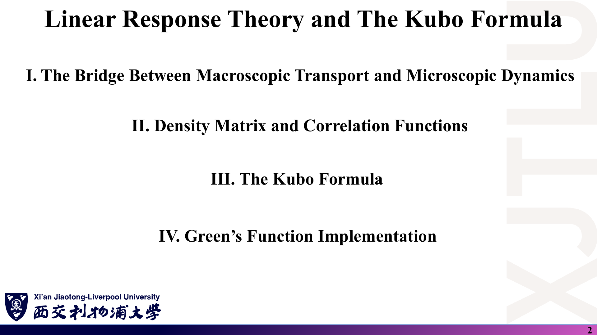

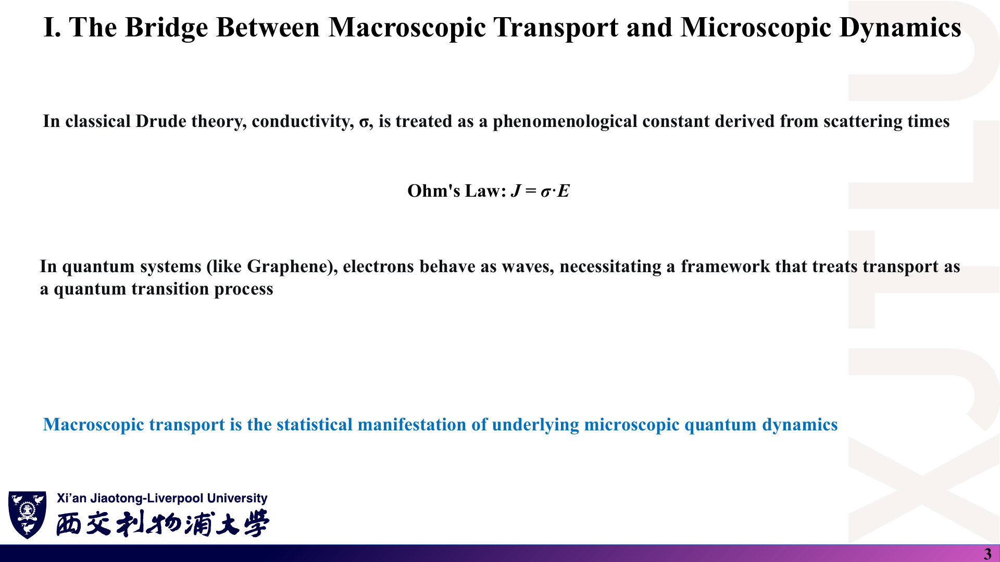

### 中文解释

本讲分四步：宏观输运与微观动力学的桥梁 → 密度矩阵与关联函数 → Kubo 公式 → 格林函数实现。

经典 Drude 理论把电导率 σ 当成由散射时间决定的唯象常数，欧姆定律写作 $\mathbf J=\sigma\mathbf E$。在石墨烯这类量子体系中，电子是波，输运应看作量子跃迁过程；**宏观电流是微观量子动力学的统计表现**。

### 原理深入

Drude 模型给出（每单位体积 $n$ 个载流子、有效质量 $m$、弛豫时间 $\tau$）：

$$
\sigma_{\text{Drude}}=\frac{ne^2\tau}{m},\qquad
\sigma(\omega)=\frac{ne^2\tau/m}{1-i\omega\tau}.
$$

它的局限在于：$n$、$m$、$\tau$ 都是输入；不能处理带间跃迁、量子干涉（弱局域化）、线性色散（石墨烯中 $m$ 无定义）等效应。Kubo 理论则从哈密顿量出发，**只用平衡态性质**（电流算符的关联函数）表达输运系数，这正是可以写进程序的形式。

注意：一般情况下 $\sigma$ 是**张量**，$J_\mu=\sum_\nu\sigma_{\mu\nu}E_\nu$；讲义写的 $J=\sigma\cdot E$ 应按张量理解。

### Ref

- **原课件**：[Lecture Twenty-One，PDF 第 2–3 页](../Lecture_Twenty_One.pdf#page=3)。
- **延伸**：[AM：Drude 模型](README.md#ref-am)；[MAHAN：线性响应](README.md#ref-mahan)。

## 2. 电场如何写成哈密顿量中的微扰？〔p. 4〕

### 课件截图

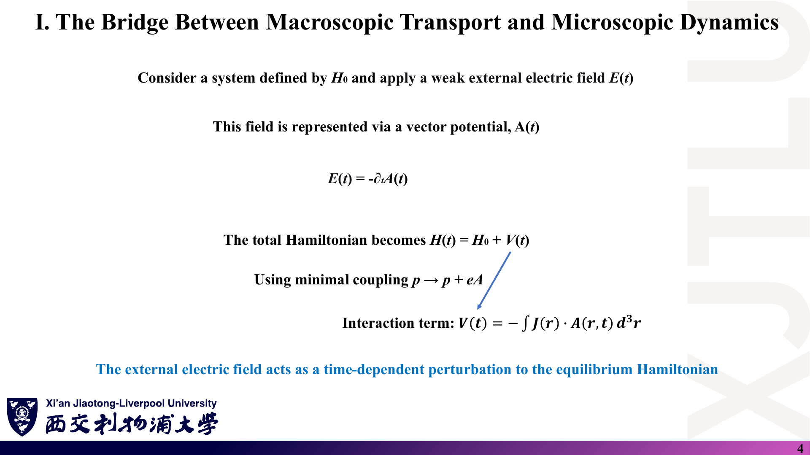

### 中文解释

对平衡体系 $H_0$ 施加弱电场 $\mathbf E(t)$，用矢势表示：$\mathbf E=-\partial_t\mathbf A$（取标势为零的规范）。最小耦合 $\mathbf p\to\mathbf p+e\mathbf A$ 后，总哈密顿量为 $H(t)=H_0+V(t)$，其中一阶相互作用项为

$$
V(t)=-\int\mathbf J(\mathbf r)\cdot\mathbf A(\mathbf r,t)\,d^3r .
$$

**外电场就是加在平衡哈密顿量上的含时微扰。**

### 原理深入

单电子（电荷 $-e$）：

$$
\frac{(\mathbf p+e\mathbf A)^2}{2m}
=\frac{\mathbf p^2}{2m}+\frac{e}{2m}(\mathbf p\cdot\mathbf A+\mathbf A\cdot\mathbf p)+\frac{e^2A^2}{2m}.
$$

- 一阶项：电流密度算符 $\mathbf J=-e\mathbf v$（顺磁电流），得 $V=-\int\mathbf J\cdot\mathbf A\,d^3r$。
- 二阶项 $e^2A^2/2m$ 在线性响应中贡献**抗磁项**（diamagnetic term），讲义略去了它。它对 DC 电导率实部的 KG 公式不贡献，但在严格推导 $\sigma(\omega)$ 的虚部和 f-求和规则时不能丢。

为什么用 $\mathbf A$ 而不用标势 $\phi=-\mathbf E\cdot\mathbf r$？在周期边界条件下 $\mathbf r$ 不是良定义的算符，而均匀的 $\mathbf A(t)$ 与平移对称性相容。频域中 $\mathbf E(\omega)=i\omega\mathbf A(\omega)$，这一关系最终把“对 $\mathbf A$ 的响应”变成“对 $\mathbf E$ 的响应”，并产生 σ 中的 $1/\omega$ 因子。

### Ref

- **原课件**：[Lecture Twenty-One，PDF 第 4 页](../Lecture_Twenty_One.pdf#page=4)。
- **延伸**：[BF：线性响应与电导率](README.md#ref-bf)。抗磁项讨论为补充。

## 3. 密度矩阵的一阶修正如何得到？〔pp. 5–6〕

### 课件截图

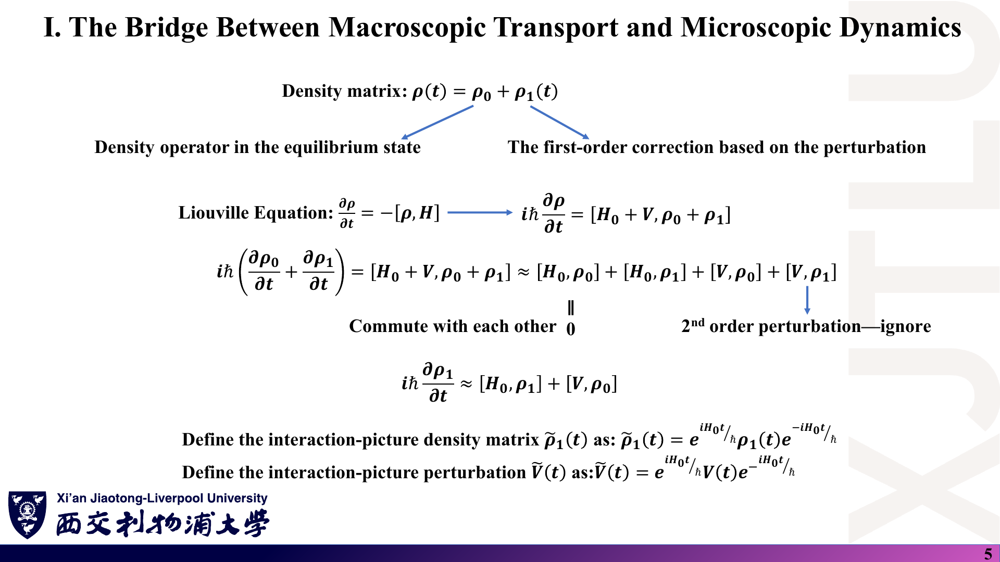

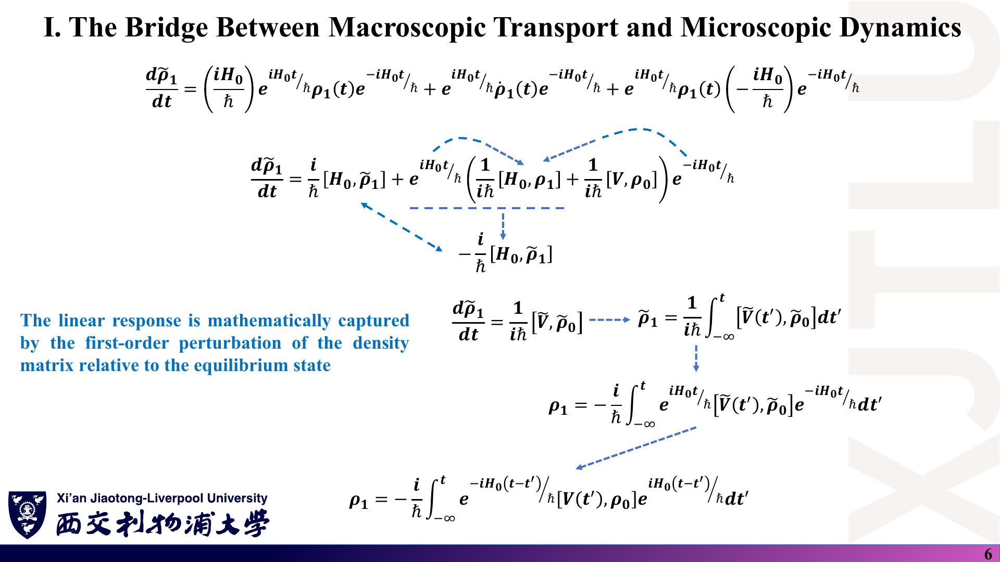

*第 5 页左侧 Liouville 方程漏写 $1/(i\hbar)$；第 6 页倒数第二行指数符号颠倒。见 [07 第 1 条](07_讲义勘误与易错点.md)。*

### 中文解释

令 $\rho(t)=\rho_0+\rho_1(t)$：$\rho_0$ 是平衡态密度算符，$\rho_1$ 是外场引起的一阶修正。代入 Liouville 方程，丢掉二阶小量 $[V,\rho_1]$，并利用 $[H_0,\rho_0]=0$，得到 $\rho_1$ 的运动方程；转到相互作用绘景后可直接积分。

### 原理深入

**Liouville–von Neumann 方程**：

$$
i\hbar\frac{\partial\rho}{\partial t}=[H,\rho]
\quad\Longleftrightarrow\quad
\frac{\partial\rho}{\partial t}=-\frac{i}{\hbar}[H,\rho]=\frac{i}{\hbar}[\rho,H].
$$

**一阶展开**：

$$
i\hbar\dot\rho_1\approx[H_0,\rho_1]+[V,\rho_0],
$$

其中 $[H_0,\rho_0]=0$（$\rho_0$ 是 $H_0$ 的函数），$[V,\rho_1]$ 为二阶小量。

**相互作用绘景**：定义 $\tilde\rho_1=e^{iH_0t/\hbar}\rho_1e^{-iH_0t/\hbar}$、$\tilde V=e^{iH_0t/\hbar}Ve^{-iH_0t/\hbar}$，求导后 $[H_0,\cdot]$ 项相消：

$$
\frac{d\tilde\rho_1}{dt}=\frac{1}{i\hbar}[\tilde V(t),\rho_0].
$$

取初始条件 $\rho_1(-\infty)=0$（外场在远古被绝热打开）：

$$
\tilde\rho_1(t)=\frac{1}{i\hbar}\int_{-\infty}^{t}[\tilde V(t'),\rho_0]\,dt',
$$

$$
\boxed{\rho_1(t)=-\frac{i}{\hbar}\int_{-\infty}^{t}
e^{-iH_0(t-t')/\hbar}[V(t'),\rho_0]\,e^{iH_0(t-t')/\hbar}\,dt'.}
$$

变回 Schrödinger 绘景时用的是 $\rho_1=e^{-iH_0t/\hbar}\tilde\rho_1e^{+iH_0t/\hbar}$，讲义第 6 页倒数第二行把两个指数的符号写反了，但最后一行是对的。

**核验**：若 $[V,\rho_0]=0$，则 $\rho_1\equiv0$——这就是第 7 页“与 $\rho_0$ 对易的微扰不产生线性响应”的来源。

### Ref

- **原课件**：[Lecture Twenty-One，PDF 第 5–6 页](../Lecture_Twenty_One.pdf#page=6)。
- **勘误**：[07 第 1 条](07_讲义勘误与易错点.md)。
- **延伸**：[BF：相互作用绘景与线性响应](README.md#ref-bf)。

## 4. 电流期望值如何变成关联函数？〔pp. 7–9〕

### 课件截图

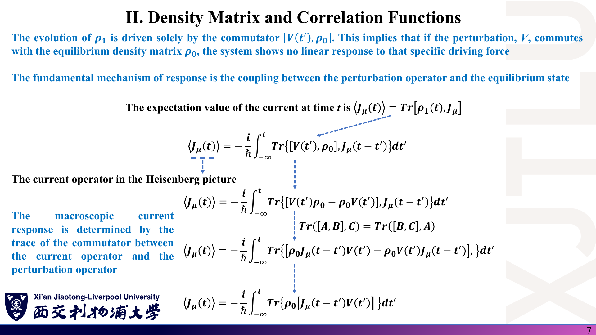

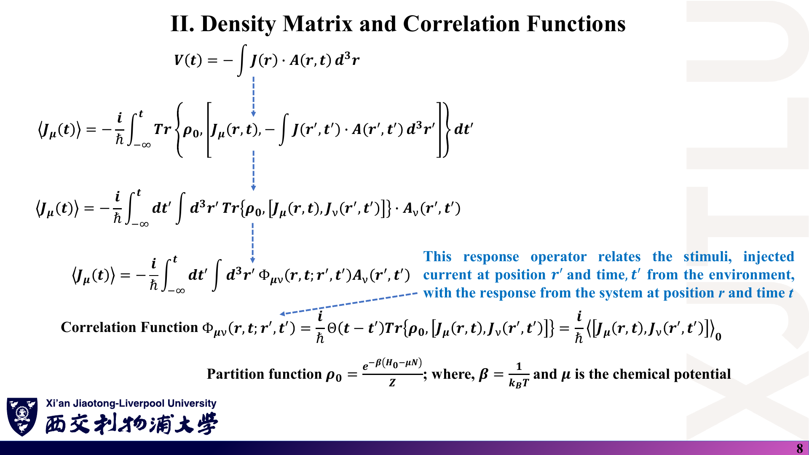

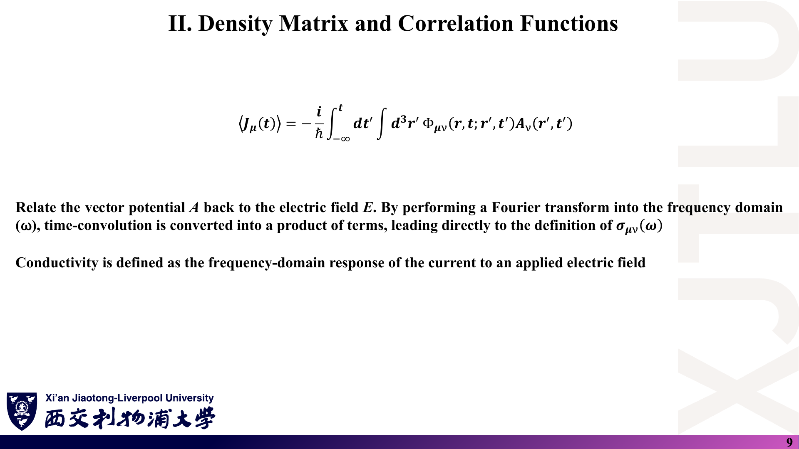

### 中文解释

电流的期望值等于 $\mathrm{Tr}(\rho J)$。平衡态本身不载流，所以线性部分来自 $\rho_1$。利用迹的循环性，可以把对易子从 $[V,\rho_0]$ “挪”到 $[J,V]$ 上，最终得到：**电流响应 = 推迟的电流-电流对易子关联函数 × 矢势**。时域中是卷积，傅里叶变换到频域后变为乘积，比例系数就是 $\sigma_{\mu\nu}(\omega)$。

### 原理深入

$$
\langle J_\mu(t)\rangle=\mathrm{Tr}[\rho_1(t)J_\mu]
$$

（讲义写成 $\mathrm{Tr}[\rho_1(t),J_\mu]$，逗号会被误读为对易子。）代入上节结果并用

$$
\mathrm{Tr}([A,B]C)=\mathrm{Tr}(A[B,C])=\mathrm{Tr}(B[C,A]),
$$

得

$$
\langle J_\mu(t)\rangle=-\frac{i}{\hbar}\int_{-\infty}^{t}\mathrm{Tr}\{\rho_0[J_{\mu,I}(t-t'),V(t')]\}\,dt',
$$

其中 $J_{\mu,I}(s)=e^{iH_0s/\hbar}J_\mu e^{-iH_0s/\hbar}$。再代入 $V(t')=-\int\mathbf J(\mathbf r')\cdot\mathbf A(\mathbf r',t')d^3r'$，**$V$ 自带的负号会与前面的 $-i/\hbar$ 抵消**：

$$
\langle J_\mu(\mathbf r,t)\rangle=\int_{-\infty}^{\infty}dt'\int d^3r'\;
\Pi^R_{\mu\nu}(\mathbf r,t;\mathbf r',t')\,A_\nu(\mathbf r',t'),
$$

$$
\boxed{\Pi^R_{\mu\nu}(\mathbf r,t;\mathbf r',t')=\frac{i}{\hbar}\Theta(t-t')
\big\langle[J_\mu(\mathbf r,t),J_\nu(\mathbf r',t')]\big\rangle_0 .}
$$

（另加上节提到的抗磁项。）讲义第 8 页把同一个 $i/\hbar$ 既放进 $\Phi$ 的定义，又保留在 $\langle J\rangle=-\frac{i}{\hbar}\int\Phi A$ 的前面，导致整体多出因子 $-i/\hbar$；见 [07 第 2 条](07_讲义勘误与易错点.md)。

**平衡分布**：$\rho_0=e^{-\beta(H_0-\mu N)}/Z$，$Z=\mathrm{Tr}e^{-\beta(H_0-\mu N)}$ 才是配分函数（讲义把 $\rho_0$ 标作 “Partition function”）。

**到 σ 的一步**（第 9 页的文字描述）：对均匀场，$\Pi^R$ 只依赖 $t-t'$，卷积定理给出 $J_\mu(\omega)=\Pi^R_{\mu\nu}(\omega)A_\nu(\omega)$；再用 $E(\omega)=i\omega A(\omega)$：

$$
\sigma_{\mu\nu}(\omega)=\frac{\Pi^R_{\mu\nu}(\omega)+\text{抗磁项}}{i(\omega+i\eta)\,\Omega}.
$$

### Ref

- **原课件**：[Lecture Twenty-One，PDF 第 7–9 页](../Lecture_Twenty_One.pdf#page=8)。
- **勘误**：[07 第 2 条](07_讲义勘误与易错点.md)。
- **延伸**：[MAHAN](README.md#ref-mahan)、[BF](README.md#ref-bf)：Kubo 公式与电流关联函数。

## 5. Kubo 公式说了什么？〔p. 10〕

### 课件截图

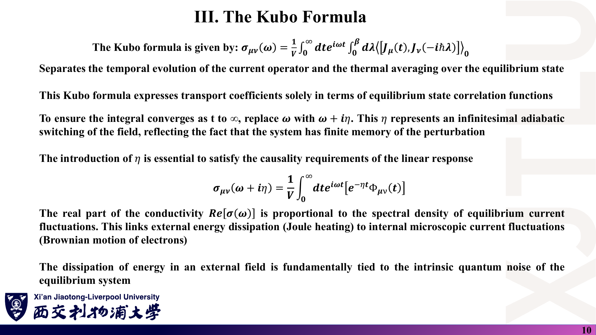

*本页 Kubo 公式在 λ 积分内写成了对易子 $\langle[J_\mu(t),J_\nu(-i\hbar\lambda)]\rangle$，这不是标准形式；见 [07 第 3 条](07_讲义勘误与易错点.md)。*

### 中文解释

Kubo 公式把输运系数完全写成**平衡态**的电流关联函数：时间积分负责“电流如何演化”，λ 积分（$0\to\beta$）负责“热平均”。为保证 $t\to\infty$ 时积分收敛，把 $\omega$ 换成 $\omega+i\eta$，相当于外场被无限缓慢地打开（绝热开启），体系对过去的扰动只有有限记忆；这也是**因果性**的要求。

$\mathrm{Re}\sigma(\omega)$ 正比于平衡态电流涨落的谱密度：外场中的能量耗散（焦耳热）与体系内在的电流涨落（电子的“布朗运动”）是同一件事的两面——涨落-耗散定理。

### 原理深入

**标准 Kubo 公式（典型关联形式）**：

$$
\boxed{\sigma_{\mu\nu}(\omega)=\frac{1}{\Omega}\int_0^{\infty}dt\,e^{i(\omega+i\eta)t}
\int_0^{\beta}d\lambda\,\big\langle J_\nu(-i\hbar\lambda)\,J_\mu(t)\big\rangle_0 .}
$$

λ 积分内是**乘积**而不是对易子。两种写法的联系是 **Kubo 恒等式**：

$$
\frac{i}{\hbar}\big\langle[A(t),B]\big\rangle_0=\int_0^{\beta}d\lambda\,\big\langle\dot B(-i\hbar\lambda)\,A(t)\big\rangle_0 ,
$$

即“$(i/\hbar)\times$对易子”与“λ 积分 × 普通关联”二者**择一**，不能同时出现。推导：$[B,e^{-\beta H}]=-i\hbar\,e^{-\beta H}\int_0^\beta d\lambda\,\dot B(-i\hbar\lambda)$，其中 $B(-i\hbar\lambda)=e^{\lambda H}Be^{-\lambda H}$，两边取迹并用循环性即可。在电导问题中 $B$ 取极化（偶极）算符，$\dot B$ 就是电流，于是对易子形式的 $\Pi^R$ 变成了上面的 λ 积分形式。

**量纲检查**：$\beta$ 的单位为 1/能量，$[J]^2\cdot t\cdot\beta/\Omega$ 给出电导率单位；若 λ 积分内再放对易子，就等于把 Kubo 恒等式的两边叠加使用，单位与物理意义都不对（$T\to0$ 时还会出错）。

**η 的作用**：$\int_0^\infty e^{i(\omega+i\eta)t}dt=\dfrac{i}{\omega+i\eta}$ 收敛。$\sigma(\omega)$ 在上半复平面解析，正对应“先有场，后有流”。讲义第 10 页的 $\sigma(\omega+i\eta)=\frac1V\int dt\,e^{i\omega t}[e^{-\eta t}\Phi(t)]$ 表达的就是这一点。

### Ref

- **原课件**：[Lecture Twenty-One，PDF 第 10 页](../Lecture_Twenty_One.pdf#page=10)。
- **勘误**：[07 第 3 条](07_讲义勘误与易错点.md)。
- **原始文献**：[KUBO57](README.md#ref-kubo)；教材 [MAHAN](README.md#ref-mahan)。

## 6. 实部、耗散与因果性有什么关系？〔p. 11 上半〕

### 课件截图

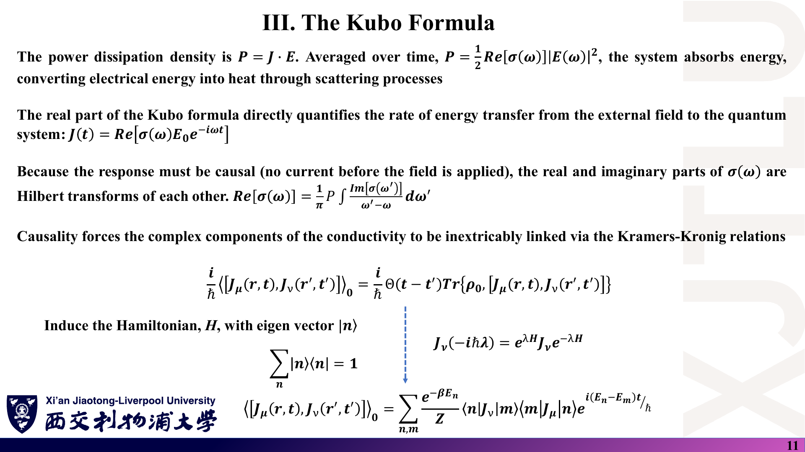

### 中文解释

单色场下时间平均的耗散功率密度为 $\bar P=\tfrac12\mathrm{Re}[\sigma(\omega)]|E(\omega)|^2$：**实部决定吸收（转化为热），虚部描述无耗散的相位滞后（色散）**。因果性迫使实部和虚部互为 Hilbert 变换，即 Kramers–Kronig（KK）关系。

### 原理深入

设 $E(t)=\mathrm{Re}[E_0e^{-i\omega t}]$、$J(t)=\mathrm{Re}[\sigma E_0e^{-i\omega t}]$，则

$$
\overline{J\cdot E}=\tfrac12\mathrm{Re}[\sigma(\omega)]\,|E_0|^2 .
$$

稳定的被动体系必须吸收能量，所以 $\mathrm{Re}\sigma_{\mu\mu}(\omega)\ge0$。

**KK 关系**（$\sigma$ 在上半平面解析且 $|\omega|\to\infty$ 时足够快衰减）：

$$
\mathrm{Re}\sigma(\omega)=\frac1\pi\,\mathcal P\!\int_{-\infty}^{\infty}\frac{\mathrm{Im}\sigma(\omega')}{\omega'-\omega}d\omega',\qquad
\mathrm{Im}\sigma(\omega)=-\frac1\pi\,\mathcal P\!\int_{-\infty}^{\infty}\frac{\mathrm{Re}\sigma(\omega')}{\omega'-\omega}d\omega'.
$$

讲义只给出了第一式（符号正确），第二式有负号。对理想金属，$\mathrm{Re}\sigma$ 在 $\omega=0$ 处有 Drude 权重 $\propto\delta(\omega)$，对应 $\mathrm{Im}\sigma\propto1/\omega$，使用 KK 时要单独处理这一奇点。

**实践意义**：实验常只测吸收谱（$\mathrm{Re}\sigma$），虚部可由 KK 变换得到，但需要足够宽的频率范围。

### Ref

- **原课件**：[Lecture Twenty-One，PDF 第 11 页](../Lecture_Twenty_One.pdf#page=11)。
- **延伸**：[MAHAN](README.md#ref-mahan)；第 23 讲光学电导见 [03 第 2 节](03_复杂材料中的电导率应用.md)。

## 7. 如何从 Kubo 公式得到 Kubo–Greenwood 公式？〔pp. 11–12〕

### 课件截图

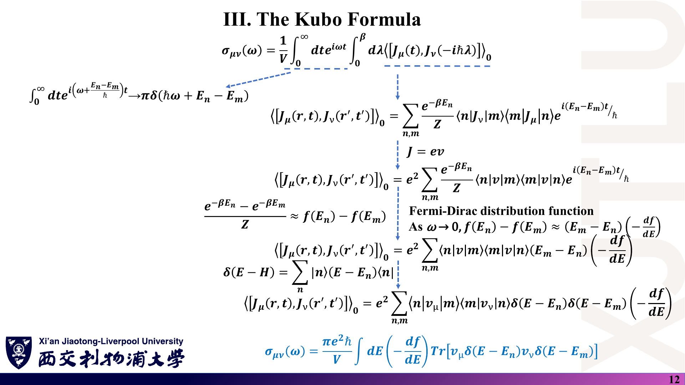

### 中文解释

插入完备基 $\sum_n|n\rangle\langle n|=1$（$|n\rangle$ 为 $H$ 的本征态），时间演化变成相位 $e^{i(E_n-E_m)t/\hbar}$，时间积分产生能量守恒的 δ 函数；Boltzmann 权重之差在非相互作用电子中变为 Fermi 函数之差；$\omega\to0$ 时它变成 $(E_m-E_n)(-\partial f/\partial E)$。最后得到 **Kubo–Greenwood（KG）公式**：

$$
\sigma_{\mu\nu}=\frac{\pi e^2\hbar}{\Omega}\int dE\left(-\frac{\partial f}{\partial E}\right)
\mathrm{Tr}\big[v_\mu\,\delta(E-H)\,v_\nu\,\delta(E-H)\big].
$$

本页最后一式（每自旋、DC）是**标准且正确**的；中间几行有若干记号问题。

### 原理深入

**非相互作用电子的规范结果**（单粒子本征态 $|n\rangle$，能量 $\varepsilon_n$，占据 $f_n$）：

$$
\mathrm{Re}\sigma_{\mu\mu}(\omega)=\frac{\pi e^2\hbar}{\Omega}\sum_{n,m}
\frac{f_n-f_m}{\varepsilon_m-\varepsilon_n}\,|\langle n|v_\mu|m\rangle|^2\,
\delta(\varepsilon_m-\varepsilon_n-\hbar\omega).
$$

其中 $\dfrac{f_n-f_m}{\varepsilon_m-\varepsilon_n}$ 来自 λ 积分 $\int_0^\beta e^{\lambda(\varepsilon_n-\varepsilon_m)}d\lambda$ 与 Fermi 统计的组合；$\omega\to0$ 时

$$
\frac{f_n-f_m}{\varepsilon_m-\varepsilon_n}\to-\frac{\partial f}{\partial E}\Big|_{E=\varepsilon_n}.
$$

再写 $\delta(\varepsilon_m-\varepsilon_n)=\int dE\,\delta(E-\varepsilon_n)\delta(E-\varepsilon_m)$，并用 $\delta(E-H)=\sum_n|n\rangle\delta(E-\varepsilon_n)\langle n|$：

$$
\boxed{\sigma_{\mu\mu}^{\text{DC}}=\frac{\pi e^2\hbar}{\Omega}\int dE\left(-\frac{\partial f}{\partial E}\right)
\mathrm{Tr}\big[v_\mu\delta(E-H)v_\mu\delta(E-H)\big]\quad(\text{每自旋}).}
$$

$T=0$ 时 $-\partial f/\partial E=\delta(E-E_F)$，于是 $\sigma(E_F)=\frac{\pi e^2\hbar}{\Omega}\mathrm{Tr}[v\delta(E_F-H)v\delta(E_F-H)]$。

**讲义中需注意的记号**（详见 [07 第 3–4 条](07_讲义勘误与易错点.md)）：

1. $\int_0^\infty dt\,e^{i(\omega+(E_n-E_m)/\hbar)t}$ 的实部是 $\pi\delta(\omega+(E_n-E_m)/\hbar)=\pi\hbar\,\delta(\hbar\omega+E_n-E_m)$，讲义漏了 $\hbar$，也略去了主值（虚部）项。
2. 第二行只写了对易子的一项；完整对易子给出 $(e^{-\beta E_n}-e^{-\beta E_m})/Z$，讲义下一行才体现这一点。
3. $\delta(E-H)=\sum_n|n\rangle(E-E_n)\langle n|$ 漏写了 δ，应为 $\sum_n|n\rangle\delta(E-E_n)\langle n|$。
4. 从“$(E_m-E_n)(-f')$”到“$\delta(E-E_n)\delta(E-E_m)$”之间省去了消去 $(E_m-E_n)$ 的一步（与 λ 积分或 $1/\omega$ 因子相消）。
5. 公式左端写 $\sigma(\omega)$，但 $\omega\to0$ 后结果是 **DC** 电导率；迹内的 $\delta(E-E_n)$ 应理解为算符 $\delta(E-H)$。

### Ref

- **原课件**：[Lecture Twenty-One，PDF 第 11–12 页](../Lecture_Twenty_One.pdf#page=12)。
- **勘误**：[07 第 3–4 条](07_讲义勘误与易错点.md)。
- **原始文献**：[GREENWOOD58](README.md#ref-greenwood)；教材 [MAHAN](README.md#ref-mahan)。

## 8. 格林函数形式如何用于数值计算？〔p. 13〕

### 课件截图

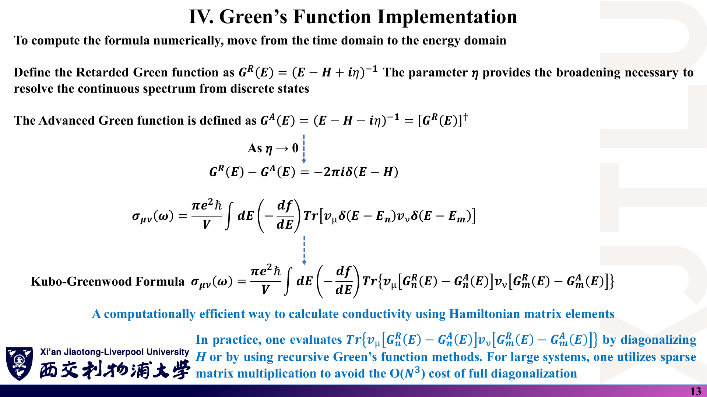

### 中文解释

数值计算在能量域进行。定义推迟、超前格林函数

$$
G^R(E)=(E-H+i\eta)^{-1},\qquad G^A(E)=(E-H-i\eta)^{-1}=[G^R(E)]^\dagger .
$$

$\eta\to0$ 时 $G^R-G^A=-2\pi i\,\delta(E-H)$，于是 δ 函数可以用格林函数之差表示，KG 公式可通过对角化 $H$ 或递归格林函数计算；大体系用稀疏矩阵乘法避免 $O(N^3)$ 的完全对角化。

### 原理深入

**证明 $G^R-G^A\to-2\pi i\delta$**：在本征基中，令 $x=E-\varepsilon_n$，

$$
\frac{1}{x+i\eta}-\frac{1}{x-i\eta}=\frac{-2i\eta}{x^2+\eta^2}
=-2\pi i\cdot\underbrace{\frac{1}{\pi}\frac{\eta}{x^2+\eta^2}}_{\eta\to0\;\Rightarrow\;\delta(x)} .
$$

所以有限 η 时，δ 函数被替换为**半高半宽为 η 的洛伦兹函数**——这就是程序中的“展宽”。

**正确的格林函数形式**：由 $\delta(E-H)=-\dfrac{1}{2\pi i}(G^R-G^A)$，

$$
\mathrm{Tr}[v\delta v\delta]=\frac{1}{(2\pi i)^2}\mathrm{Tr}[v(G^R-G^A)v(G^R-G^A)]
=-\frac{1}{4\pi^2}\mathrm{Tr}[v(G^R-G^A)v(G^R-G^A)],
$$

$$
\boxed{\sigma_{\mu\mu}=\frac{\hbar e^2}{4\pi\Omega}\int dE\left(-\frac{\partial f}{\partial E}\right)
\mathrm{Tr}\big[v_\mu(G^R-G^A)\,v_\mu(G^A-G^R)\big]
=\frac{\hbar e^2}{\pi\Omega}\int dE\left(-\frac{\partial f}{\partial E}\right)\mathrm{Tr}\big[v_\mu\mathrm{Im}G^R\,v_\mu\mathrm{Im}G^R\big].}
$$

讲义保留了 δ 形式的前置系数 $\pi e^2\hbar/V$ 并直接换成 $(G^R-G^A)$ 的乘积，结果差一个因子 $-1/(4\pi^2)$（连符号都反了）。课程程序除以的 $4\pi$ 正对应正确形式中的 $\hbar e^2/(4\pi\Omega)$，见 [08 代码导读](08_代码导读.md)。

讲义写的下标 $G^R_n$、$G^R_m$ 是在提示“在本征基中取对角元”，即

$$
\mathrm{Tr}[v(G^R-G^A)v(G^R-G^A)]=\sum_{n,m}|\langle n|v|m\rangle|^2\,g_n(E)\,g_m(E),\quad
g_n=\frac{-2i\eta}{(E-\varepsilon_n)^2+\eta^2},
$$

这正是程序第 208–215 行逐项累加的量。

### Ref

- **原课件**：[Lecture Twenty-One，PDF 第 13 页](../Lecture_Twenty_One.pdf#page=13)。
- **勘误**：[07 第 4 条](07_讲义勘误与易错点.md#4-kubogreenwood-公式的前置系数)。
- **代码对应**：[08 代码导读](08_代码导读.md)。

## 9. η 的物理意义与 Kubo 方法的适用范围？〔p. 14〕

### 课件截图

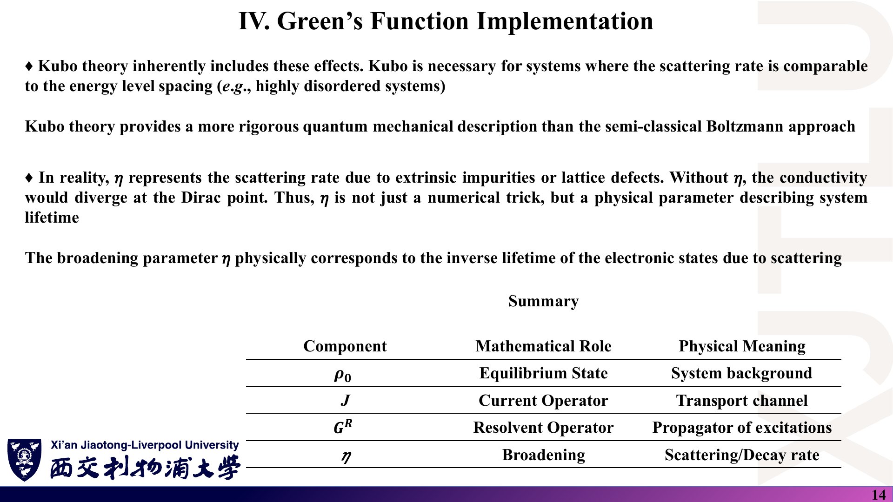

### 中文解释

Kubo 理论天然包含量子效应，在散射率与能级间距可比的强无序体系中是必需的，比半经典 Boltzmann 方法更严格。实际计算中 η 代表杂质或晶格缺陷导致的散射率；η 不只是数值技巧，而是描述态寿命的物理参数。总结表：$\rho_0$ 是体系背景（平衡态），$J$ 是输运通道（电流算符），$G^R$ 是激发的传播子（预解算符），η 是展宽（散射/衰减率）。

### 原理深入

**η 与寿命**：$G^R(t)\propto e^{-i\varepsilon t/\hbar}e^{-\eta t/\hbar}$，振幅寿命 $\hbar/\eta$，概率 $|G|^2$ 的寿命 $\tau=\hbar/(2\eta)$。$\eta=0.05$ eV 对应 $\tau\approx6.6$ fs。

**关于“没有 η，Dirac 点处电导率发散”**：这句话需要细化。对完美石墨烯用常数 η 的 KG 计算（本笔记按课程程序算法独立核验）：

| 能量 | η = 0.05 eV | η = 0.1 eV | 结论 |
|---|---|---|---|
| $E=1$ eV | 10.04 $e^2/h$ | 5.05 $e^2/h$ | 金属区 $\sigma\propto1/\eta$，$\eta\to0$ 时**发散** |
| $E=0$（Dirac 点） | 0.636 $e^2/h$ | 0.638 $e^2/h$ | 趋于与 η 无关的有限值 $\approx2/\pi$（每自旋） |

（每自旋数值，400×400 k 网格，详见 [08 代码导读](08_代码导读.md)。）

因此，$\eta\to0$ 时真正发散的是**远离 Dirac 点**的电导率（无散射的完美晶体是理想导体）；Dirac 点处 KG 给出有限的“最小电导率” $4e^2/(\pi h)$（含自旋），与 Dirac 费米子的已知结果一致（参见 [LUDWIG94](README.md#ref-ludwig)、[CASTRO09](README.md#ref-castro)）。数值上，η 很小而 k 网格不够密时，Dirac 点附近会因采样不足而出现噪声，这才是“需要 η 稳定计算”的含义。

**适用范围补充**：

- 本讲推导假设**非相互作用电子**（单粒子 $H$）；强关联需要用含自能的格林函数（第 23 讲 DMFT 案例）。
- 常数 η 不包含顶角修正（vertex corrections），因此**不会自动产生弱局域化**；要得到干涉效应必须在 $H$ 中显式放入无序并做构型平均（第 22 讲第 9 页、第 23 讲 Fan 等人的实空间 KG）。

### Ref

- **原课件**：[Lecture Twenty-One，PDF 第 14 页](../Lecture_Twenty_One.pdf#page=14)。
- **数值核验**：[08 代码导读](08_代码导读.md)；勘误 [07 第 6 条](07_讲义勘误与易错点.md)。
- **延伸**：[DATTA：展宽与寿命](README.md#ref-datta)、[LUDWIG94](README.md#ref-ludwig)、[CASTRO09](README.md#ref-castro)。
