# 02 · Kubo–Greenwood 公式的物理图像与数值诊断

来源：[Lecture_Twenty_Two.pdf](../Lecture_Twenty_Two.pdf)，17 页。

[返回目录](README.md)

## 1. 本讲要回答什么问题？〔p. 2〕

### 课件截图

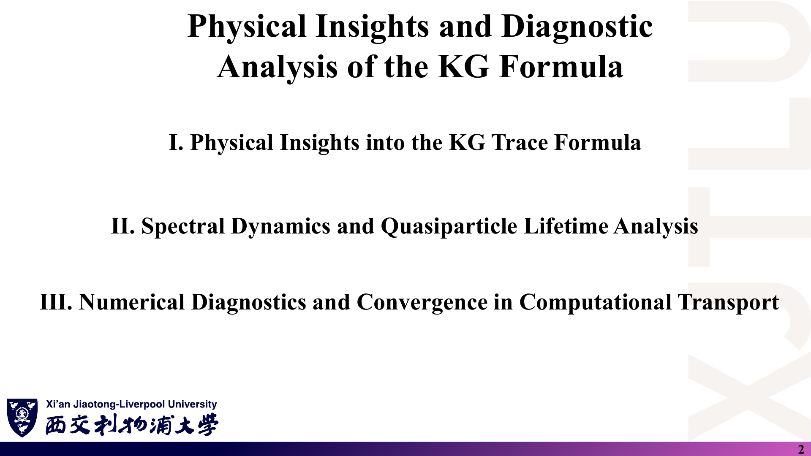

### 中文解释

上一讲得到了 KG 公式；本讲回答三个问题：

1. KG 迹公式在物理上意味着什么？
2. 格林函数、谱函数与准粒子寿命如何影响电导率？
3. 怎样判断一个 KG 计算是收敛的、物理上可信的？

### 原理深入

可以把本讲看成 KG 计算的“使用说明书”：第一部分给直觉，第二部分解释 η 的物理来源，第三部分给出检查清单。把它们与 [08 代码导读](08_代码导读.md) 对照阅读效果最好。

### Ref

- **原课件**：[Lecture Twenty-Two，PDF 第 2 页](../Lecture_Twenty_Two.pdf#page=2)。

## 2. 迹 Tr{…} 在物理上代表什么？〔pp. 3–4〕

### 课件截图

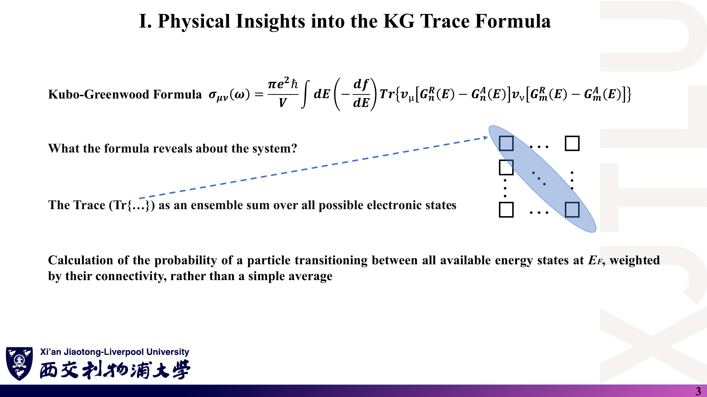

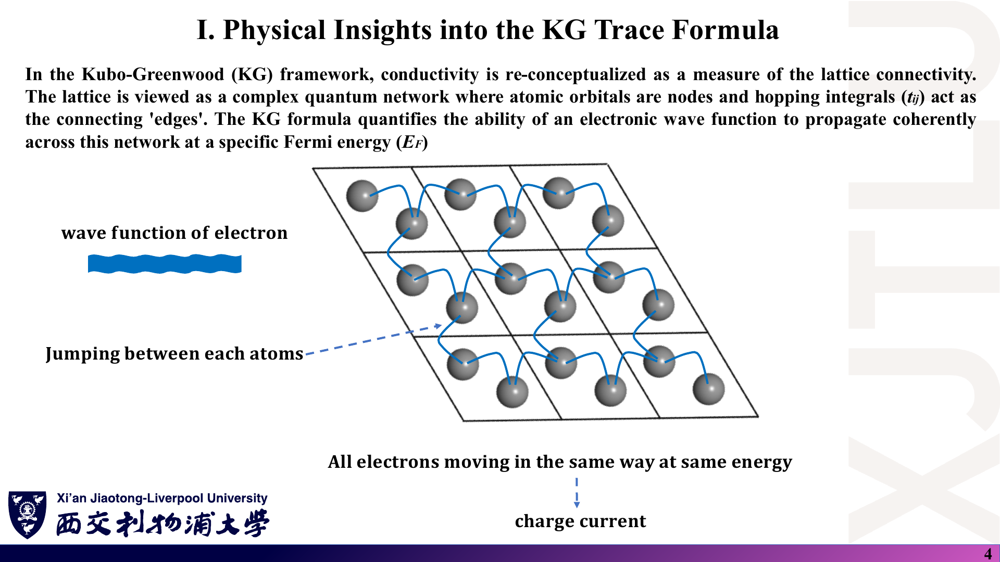

*第 3 页的 KG 公式前置系数沿用了第 21 讲的写法，需按 [07 第 4 条](07_讲义勘误与易错点.md#4-kubogreenwood-公式的前置系数) 修正。*

### 中文解释

- **迹是对所有电子态的系综求和**：对角线上每一项都是一个态的贡献，求和与基底选择无关。
- KG 公式计算的是：在费米能 $E_F$ 处，粒子在**所有可用能态之间跃迁**的概率，并按它们之间的“连通性”（速度矩阵元）加权，而不是简单平均。
- **网络图像**：原子轨道是节点，跃迁积分 $t_{ij}$ 是连边；KG 公式量化的是电子波函数在 $E_F$ 处沿这个网络**相干传播**的能力。

### 原理深入

**为什么速度算符由跃迁积分决定？** 紧束缚模型中位置算符近似为 $X=\sum_i x_i|i\rangle\langle i|$，速度

$$
v_x=\frac{i}{\hbar}[H,X],\qquad \langle i|v_x|j\rangle=\frac{i}{\hbar}(x_j-x_i)\,t_{ij}.
$$

没有连边（$t_{ij}=0$）就没有速度矩阵元，也就没有电流——这把“连通性”的比喻变成了公式。在 k 空间中对应 $v_x(\mathbf k)=\frac1\hbar\partial H(\mathbf k)/\partial k_x$，就是课程程序构造速度矩阵的方式（[08 第 3 节](08_代码导读.md)）。

**迹与 k 求和**：对周期晶体，$\mathrm{Tr}=\sum_{\mathbf k}\mathrm{tr}_{\text{轨道}}$，并且 $\Omega=N_k\Omega_{\text{cell}}$。所以

$$
\frac1\Omega\mathrm{Tr}[\cdots]=\frac{1}{N_k\Omega_{\text{cell}}}\sum_{\mathbf k}\mathrm{tr}[\cdots]_{\mathbf k},
$$

**k 求和必须除以 $N_k$**，否则结果随网格加密而线性增大。

### Ref

- **原课件**：[Lecture Twenty-Two，PDF 第 3–4 页](../Lecture_Twenty_Two.pdf#page=4)。
- **延伸**：[DATTA](README.md#ref-datta)、[CASTRO09：石墨烯紧束缚](README.md#ref-castro)。

## 3. 推迟格林函数为什么叫“传播子”？〔p. 5〕

### 课件截图

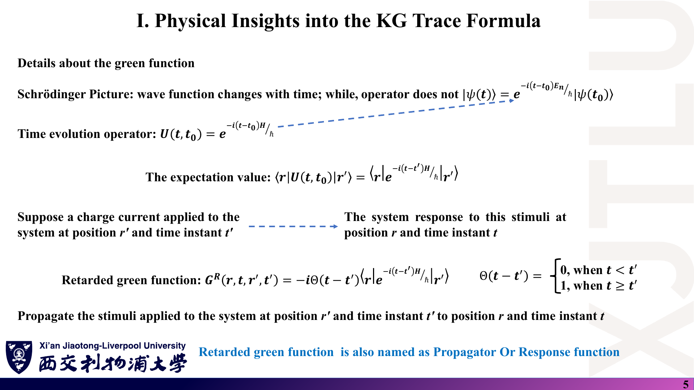

### 中文解释

Schrödinger 绘景中波函数随时间变化、算符不变，时间演化由 $U(t,t_0)=e^{-i(t-t_0)H/\hbar}$ 完成。若在 $(\mathbf r',t')$ 处施加刺激，体系在 $(\mathbf r,t)$ 处的响应由

$$
G^R(\mathbf r,t;\mathbf r',t')=-i\,\Theta(t-t')\,\langle\mathbf r|e^{-i(t-t')H/\hbar}|\mathbf r'\rangle
$$

描述。阶跃函数 $\Theta$ 保证“先因后果”：$t<t'$ 时为零。所以推迟格林函数也称为**传播子**或**响应函数**。

### 原理深入

需要区分的几处：

- $|\psi(t)\rangle=e^{-i(t-t_0)E_n/\hbar}|\psi(t_0)\rangle$ 只对能量本征态成立；一般态要用算符 $e^{-i(t-t_0)H/\hbar}$。
- $\langle\mathbf r|U|\mathbf r'\rangle$ 是**矩阵元（跃迁振幅）**，不是期望值（讲义写作 “The expectation value”）。
- 单粒子推迟格林函数的常用约定为 $G^R(t)=-\frac{i}{\hbar}\Theta(t)e^{-iHt/\hbar}$，这样傅里叶变换 $\int dt\,e^{iEt/\hbar}$ 直接给出 $(E-H+i\eta)^{-1}$；讲义取 $-i\Theta(t)\cdots$，变换后多出一个 $\hbar$，下一页再令 $\hbar=1$。两种约定只差常数因子，但混用会弄错前置系数。

### Ref

- **原课件**：[Lecture Twenty-Two，PDF 第 5 页](../Lecture_Twenty_Two.pdf#page=5)。
- **勘误**：[07 第 5 条](07_讲义勘误与易错点.md)。
- **延伸**：[BF：推迟格林函数](README.md#ref-bf)。

## 4. 从时域到能量域：η 为何必须是正的？〔p. 6〕

### 课件截图

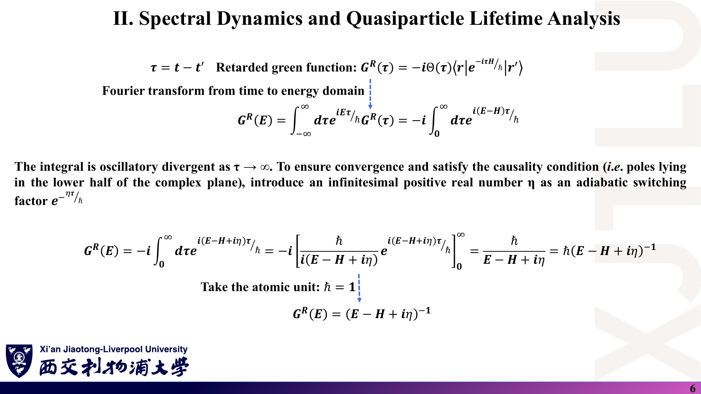

### 中文解释

把 $G^R(\tau)$（$\tau=t-t'$）变换到能量域时，积分 $\int_0^\infty e^{i(E-H)\tau/\hbar}d\tau$ 在 $\tau\to\infty$ 处振荡不收敛。乘上绝热因子 $e^{-\eta\tau/\hbar}$（η 为正无穷小）后积分收敛，得到 $G^R(E)=\hbar(E-H+i\eta)^{-1}$，取 $\hbar=1$ 即 $(E-H+i\eta)^{-1}$。极点位于复平面**下半平面**，这就是因果性。

### 原理深入

$$
G^R(E)=-i\int_0^\infty d\tau\,e^{i(E-H+i\eta)\tau/\hbar}
=-i\left[\frac{\hbar\,e^{i(E-H+i\eta)\tau/\hbar}}{i(E-H+i\eta)}\right]_0^\infty
=\frac{\hbar}{E-H+i\eta}.
$$

上限处 $e^{-\eta\tau/\hbar}\to0$ 正是需要 $\eta>0$ 的原因。若取 $\eta<0$，积分在 $\tau\to\infty$ 发散；对应的是 $\tau<0$ 一侧收敛的**超前**格林函数 $G^A=(E-H-i\eta)^{-1}$。

**极点位置与因果性**：$G^R(E)$ 作为 $E$ 的函数，极点在 $E=\varepsilon_n-i\eta$（下半平面），因此 $G^R$ 在上半平面解析——与第 21 讲 $\sigma(\omega)$ 的 KK 关系是同一数学结构。

### Ref

- **原课件**：[Lecture Twenty-Two，PDF 第 6 页](../Lecture_Twenty_Two.pdf#page=6)。
- **延伸**：[MAHAN](README.md#ref-mahan)、[BF](README.md#ref-bf)。

## 5. 谱函数和自能如何描述有限寿命？〔p. 7〕

### 课件截图

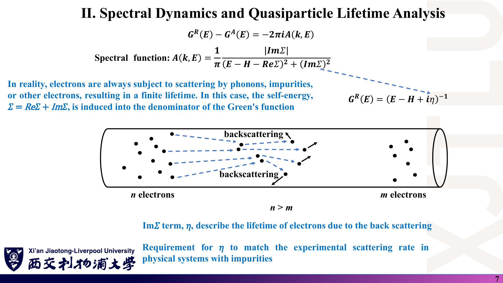

### 中文解释

$G^R-G^A=-2\pi i\,A(\mathbf k,E)$，谱函数

$$
A(\mathbf k,E)=\frac1\pi\frac{|\mathrm{Im}\Sigma|}{(E-\varepsilon_{\mathbf k}-\mathrm{Re}\Sigma)^2+(\mathrm{Im}\Sigma)^2}.
$$

真实电子会被声子、杂质或其他电子散射，寿命有限；这些效应写进格林函数分母中的**自能** $\Sigma=\mathrm{Re}\Sigma+i\mathrm{Im}\Sigma$。$\mathrm{Im}\Sigma$（即 η）描述因背散射导致的寿命；在含杂质的真实体系中，η 应与实验散射率相匹配。示意图中左端 n 个电子经背散射后到右端只剩 m 个（$n>m$）。

### 原理深入

- 推迟自能满足 $\mathrm{Im}\Sigma^R\le0$，讲义用绝对值 $|\mathrm{Im}\Sigma|$ 避免了符号问题。常数展宽对应 $\Sigma^R=-i\eta$。
- **归一化**：讲义的 $A$ 满足 $\int A\,dE=1$。很多教材定义 $A=i(G^R-G^A)=-2\mathrm{Im}G^R$，它满足 $\int A\,dE/(2\pi)=1$，二者差 $2\pi$。读文献时先确认约定。
- **准粒子图像**：$\mathrm{Re}\Sigma$ 移动能量（重整化），$\mathrm{Im}\Sigma$ 给出线宽 $\Gamma=2|\mathrm{Im}\Sigma|$ 与寿命 $\tau=\hbar/(2|\mathrm{Im}\Sigma|)$。
- 分母中的 $H$ 在 k 表象下应理解为 $\varepsilon_{\mathbf k}$（或矩阵 $H(\mathbf k)$），平方运算对矩阵需在本征基中进行。
- **DOS 与谱函数**：$D(E)=\frac{1}{\Omega}\sum_{\mathbf k}A(\mathbf k,E)=-\frac{1}{\pi\Omega}\mathrm{Im}\mathrm{Tr}G^R(E)$。

### Ref

- **原课件**：[Lecture Twenty-Two，PDF 第 7 页](../Lecture_Twenty_Two.pdf#page=7)。
- **延伸**：[MAHAN：自能与谱函数](README.md#ref-mahan)、[DATTA](README.md#ref-datta)。

## 6. η 太小或太大时会看到什么？〔p. 8〕

### 课件截图

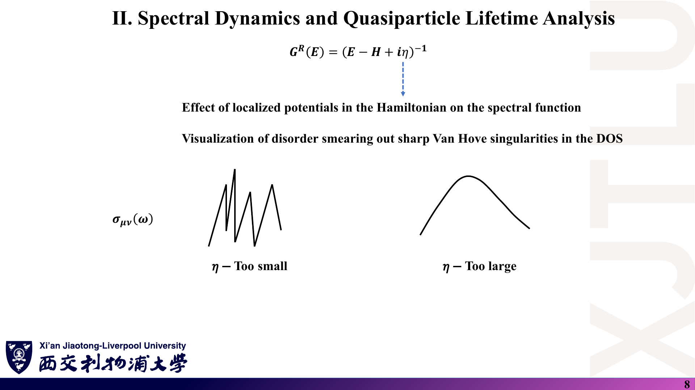

### 中文解释

哈密顿量中的局域势会改变谱函数；无序会抹平 DOS 中尖锐的 Van Hove 奇点。对 σ(ω) 曲线：**η 太小**——有限 k 网格（或有限体系）的离散能级各自成为尖峰，曲线锯齿状；**η 太大**——所有结构被过度展宽，变成一个宽包络，物理特征丢失。

### 原理深入

判定准则：η 应**大于**离散能级间距（由 k 网格密度决定），又应**小于**你想分辨的物理能量尺度（如带边、Van Hove 峰宽度、Landau 能级间距）。

对二维 k 网格，Dirac 锥附近的能级间距约为 $\hbar v_F\,\Delta k$，$\Delta k=|\mathbf b|/N$。石墨烯 $\hbar v_F=\tfrac{3}{2}|t|a_{cc}\approx5.75$ eV·Å，$|\mathbf b|=4\pi/(\sqrt3a)\approx2.95$ Å⁻¹：

| 网格 $N\times N$ | $\hbar v_F\Delta k$ | 对 η = 0.05 eV |
|---|---|---|
| 100 × 100 | ≈ 0.17 eV | 远大于 η，必然出现尖刺 |
| 500 × 500 | ≈ 0.034 eV | 小于 η，课程默认参数基本可用 |

本笔记的数值实验也印证了这一点：400×400 网格、η = 0.025 eV 时 Dirac 点电导偏离 $2/\pi$ 约 11%，η = 0.05 eV 时偏差 <0.2%（[08 第 6 节](08_代码导读.md)）。

### Ref

- **原课件**：[Lecture Twenty-Two，PDF 第 8 页](../Lecture_Twenty_Two.pdf#page=8)。
- **数值核验**：[08 代码导读](08_代码导读.md)。

## 7. 弱局域化是怎样的干涉效应？〔p. 9〕

### 课件截图

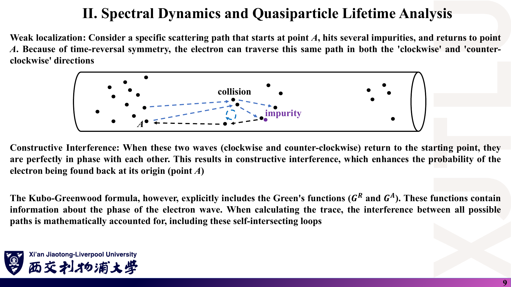

### 中文解释

考虑从 A 点出发、经若干杂质散射后回到 A 点的闭合路径。由于时间反演对称，电子可以沿同一路径顺时针或逆时针走一圈；两束波回到 A 点时**相位完全相同**，发生相长干涉，使电子回到原点的概率增大——这降低了电导，称为**弱局域化**。KG 公式含 $G^R$、$G^A$，它们携带波的相位信息，求迹时所有路径（包括这些自交回路）之间的干涉都在数学上被计入。

### 原理深入

- 经典概率：两条路径概率相加 $|A_1|^2+|A_2|^2=2|A|^2$；量子振幅相加 $|A_1+A_2|^2=4|A|^2$，回返概率**加倍**。
- 磁场会给两条路径附加相反的 Aharonov–Bohm 相位，破坏相干，所以弱局域化表现为**负磁阻**；退相干（如非弹性散射）在长度 $L_\phi$ 以上切断这种修正。
- **重要限定**：KG 公式“原则上”包含干涉，但前提是 $H$ 中**显式含有无序**，并在足够大的体系中计算（或做构型平均、在微扰论中保留最大交叉图）。课程程序是完美晶体 + 常数 η：常数 η 只是把每个本征态展宽，**不产生**弱局域化。第 23 讲 Fan 等人的实空间 KG 计算正是显式放入 Anderson 无序后才得到弱局域化与局域化结果。
- 对石墨烯，赝自旋带来 Berry 相位 π，长程无序下可出现**反弱局域化**；短程无序引起谷间散射后恢复弱局域化。这是补充背景，课件未涉及。

### Ref

- **原课件**：[Lecture Twenty-Two，PDF 第 9 页](../Lecture_Twenty_Two.pdf#page=9)。
- **勘误/限定**：[07 第 7 条](07_讲义勘误与易错点.md)。
- **延伸**：[DATTA：弱局域化](README.md#ref-datta)、[CASTRO09](README.md#ref-castro)、[FUH14](README.md#ref-fan)。

## 8. 为什么不能只在一个 k 点、一个能量上算？〔p. 10〕

### 课件截图

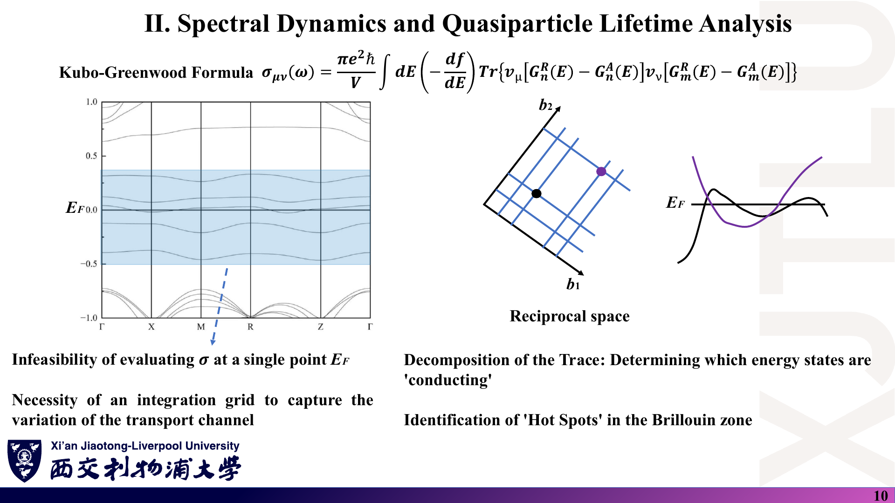

### 中文解释

- 只在单一 $E_F$、单一 k 点上计算 σ 是不可行的：需要在能量窗口和**倒空间网格**上积分，才能捕捉输运通道的变化。
- 把迹分解开来，可以判断**哪些能态在导电**，并找到布里渊区中贡献最大的“热点”（hot spots），例如费米面上群速度大的区域。

### 原理深入

在 $T=0$、常数 η 下，把 [01 第 8 节](01_线性响应与Kubo公式.md) 的格林函数形式只保留带内（$n=m$）项：

$$
\sigma^{\text{intra}}_{xx}(E)=\frac{\hbar e^2}{\pi\Omega}\sum_{n,\mathbf k}|v_{x,n\mathbf k}|^2\,
\frac{\eta^2}{[(E-\varepsilon_{n\mathbf k})^2+\eta^2]^2},
$$

被积函数集中在**等能面** $\varepsilon_{n\mathbf k}\approx E$ 附近、宽度约 η 的壳层里，权重是 $|v_x|^2$。因此：

1. 网格必须足够密，使每个宽度为 η 的壳层内有足够多的 k 点；
2. 把 $\mathbf k$ 分辨的贡献画成热图，就能看到“热点”；对石墨烯，低能下热点就是 K、K′ 附近的圆环。
3. η 较小时 $\eta^2/[x^2+\eta^2]^2\to\frac{\pi}{2\eta}\delta(x)$，于是

$$
\sigma^{\text{intra}}_{xx}\to\frac{\hbar e^2}{2\eta}\cdot\frac{1}{\Omega}\sum_{n\mathbf k}|v_{x,n\mathbf k}|^2\delta(E-\varepsilon_{n\mathbf k})
=e^2D(E)\,\langle v_x^2\rangle_E\,\tau,\qquad\tau=\frac{\hbar}{2\eta},
$$

正是弛豫时间近似下的 Boltzmann（Einstein 关系）结果，且明确显示 $\sigma\propto1/\eta$。

### Ref

- **原课件**：[Lecture Twenty-Two，PDF 第 10 页](../Lecture_Twenty_Two.pdf#page=10)。
- **延伸**：[AM：半经典输运](README.md#ref-am)。上式为补充推导。

## 9. Anderson 局域化与迁移率边是什么？〔p. 11〕

### 课件截图

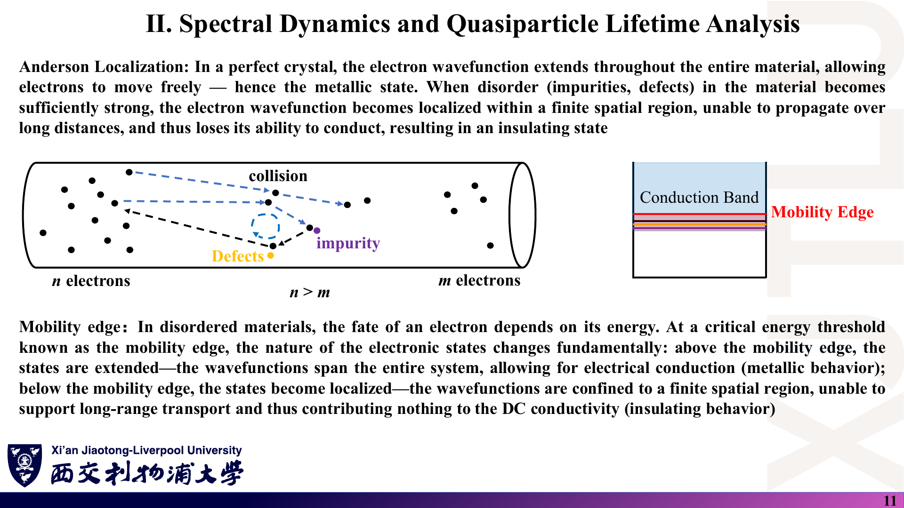

### 中文解释

完美晶体中电子波函数遍布整个材料，电子可自由移动（金属态）。当杂质、缺陷造成的无序足够强时，波函数被**局域**在有限区域，不能长程传播，失去导电能力——**Anderson 局域化**，体系变成绝缘体。

**迁移率边**：在无序材料中，电子的命运取决于其能量。在临界能量（迁移率边）以上（示意图中导带内）态是扩展的、可导电；以下态是局域的，对 DC 电导没有贡献。

### 原理深入

- 局域态包络 $|\psi(\mathbf r)|\sim e^{-|\mathbf r-\mathbf r_0|/\xi}$，ξ 为局域化长度；体系尺寸 $L\gg\xi$ 时该能量的 DC 电导趋于 0。
- 讲义说“迁移率边以上扩展”，适用于**导带底**附近（带尾局域）；对价带顶方向相反——能带**中心**更倾向扩展，**带尾**更易局域。
- **维度很关键**：标度理论表明，在无自旋轨道耦合、无磁场的正交类体系中，**二维**任意弱无序下所有态最终都局域（无真正的迁移率边）；三维才有迁移率边与金属-绝缘体转变。第 23 讲 Fan 等人对石墨烯的结论“所有态在足够大的体系中都局域”正是二维情形。
- 在 KG 计算中判断局域化需要**尺寸标度**：看 σ 随 $L$（或传播时间）是减小、不变还是增大；单一尺寸的数值无法判别。

### Ref

- **原课件**：[Lecture Twenty-Two，PDF 第 11 页](../Lecture_Twenty_Two.pdf#page=11)。
- **勘误/限定**：[07 第 7 条](07_讲义勘误与易错点.md)。
- **延伸**：[FUH14](README.md#ref-fan)、[03 第 7 节](03_复杂材料中的电导率应用.md)。

## 10. 如何区分物理平台与数值噪声？〔p. 12〕

### 课件截图

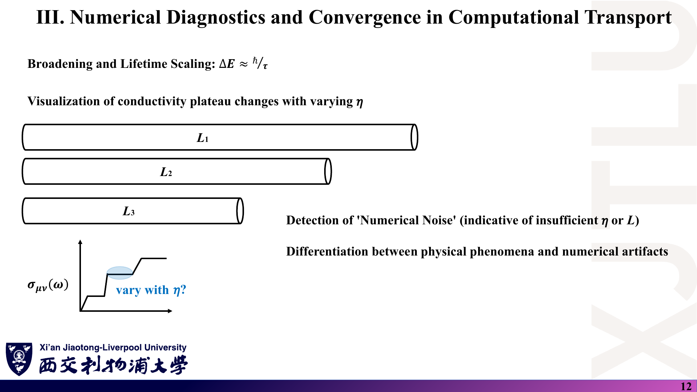

### 中文解释

展宽与寿命的关系 $\Delta E\approx\hbar/\tau$。改变 η 观察电导率“平台”是否变化：平台若随 η 移动，说明它可能不是稳健的物理特征。对不同长度 $L_1>L_2>L_3$ 的体系重复计算可以发现“数值噪声”（提示 η 或 L 不足），从而**区分物理现象与数值伪影**。

### 原理深入

一个实用的二维扫描策略：

1. 固定 η，增大 k 网格（或体系尺寸 L），直到曲线不再变化——这是**数值收敛**。
2. 再改变 η，观察结果如何变化——这是**物理依赖**。对完美晶体，金属区 σ 按 $1/\eta$ 变化，这是物理而不是噪声；Dirac 点值不随 η 变化。
3. 要求 $\eta\gg\Delta\varepsilon_{\text{网格}}$（见第 6 节）。减小 η 时必须同步加密网格。
4. 若“平台”只在某个 η 或某个 L 出现，就应怀疑它是伪影。

### Ref

- **原课件**：[Lecture Twenty-Two，PDF 第 12 页](../Lecture_Twenty_Two.pdf#page=12)。
- **配套练习**：[06 复习题](06_复习题与参考答案.md)。

## 11. 收敛、线性区与拓扑边缘态如何诊断？〔p. 13〕

### 课件截图

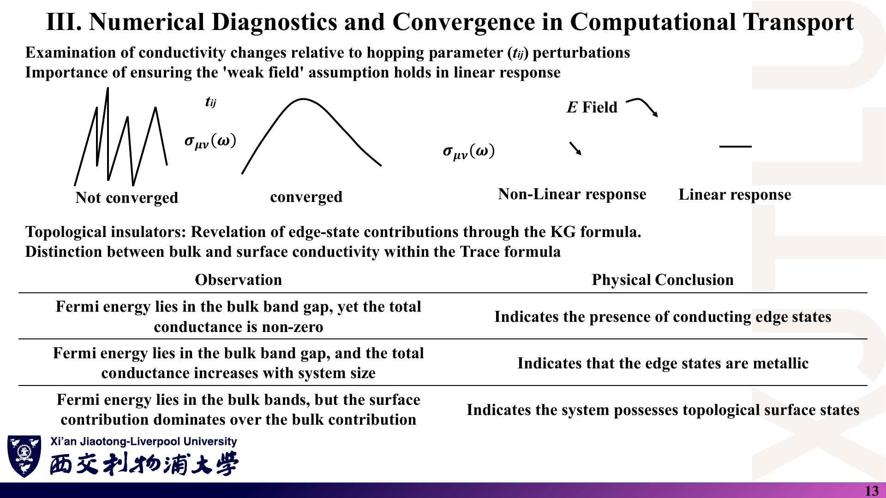

### 中文解释

- 检查电导率对跃迁参数 $t_{ij}$ 微小扰动的敏感度：曲线锯齿状为“未收敛”，平滑为“已收敛”。
- 确保线性响应的**弱场假设**成立：σ 不应随场强变化（右图水平线为线性响应，变化的为非线性响应）。
- **拓扑绝缘体**：KG 公式可揭示边缘态贡献，并在迹中区分体态与表面态。

| 观察 | 物理结论 |
|---|---|
| $E_F$ 位于体能隙中，但总电导非零 | 存在导电的边缘态 |
| $E_F$ 位于体能隙中，且总电导随体系尺寸增大 | 边缘态是金属性的 |
| $E_F$ 位于体能带中，但表面贡献主导体贡献 | 体系具有拓扑表面态 |

### 原理深入

- **线性响应本身就是 $E\to0$ 的极限**：KG 公式里没有场强，σ 天然与 E 无关。所谓“检查弱场”指的是：如果用含时模拟（例如显式加场的实时演化）计算电流，必须确认 $J\propto E$；或者确认实际实验场强足够小，使 KG 结果可用。
- **局部迹**：把迹拆成 $\mathrm{Tr}=\sum_i\langle i|\cdots|i\rangle$ 并按原子位置（体内/边缘）分组，就能区分体、边贡献。周期性 k 网格计算（如课程程序）没有边界，**看不到边缘态**；需要用带状（ribbon）或有限尺寸的超胞。
- **电导与电导率**：边缘通道贡献的是**电导**（$e^2/h$ 量级的整数倍），它与宽度无关；若除以截面换算成“电导率”，则会随尺寸变化。表中“随体系尺寸增大”的判据需要明确说的是哪个量。

### Ref

- **原课件**：[Lecture Twenty-Two，PDF 第 13 页](../Lecture_Twenty_Two.pdf#page=13)。
- **延伸**：[LC13：拓扑绝缘体表面态磁光电导](README.md#ref-lic)。

## 12. σxx = σyy 的真正依据是什么？〔p. 14〕

### 课件截图

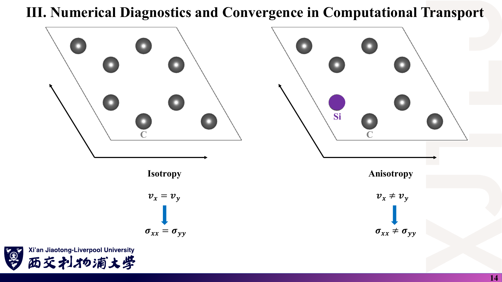

### 中文解释

左图为纯碳石墨烯超胞，讲义标注“$v_x=v_y\Rightarrow\sigma_{xx}=\sigma_{yy}$”（各向同性）；右图一个 C 被 Si 替代，标注“$v_x\neq v_y\Rightarrow\sigma_{xx}\neq\sigma_{yy}$”（各向异性）。

### 原理深入

“$v_x=v_y$”作为算符等式并不成立（在石墨烯中 $v_x$ 与 $v_y$ 是不同的矩阵，见程序第 189–194 行）。正确依据是**晶体对称性**：

- 二维二阶张量在 $C_3$（120°）旋转下不变，只能是 $\sigma_{ij}=\sigma_0\delta_{ij}$（另可有反对称的 Hall 部分，需破缺时间反演）。石墨烯具有 $C_{6v}$ 对称性，所以 $\sigma_{xx}=\sigma_{yy}$、$\sigma_{xy}=0$（无磁场）。
- 课程程序的输出完全证实了这一点：`Conductivity_along_x_axis.dat` 与 `..._y_axis.dat` 的 1000 个数据点逐位相同（[08 第 6 节](08_代码导读.md)）。
- 替位掺杂、应变或缺陷**降低**对称性后才可能各向异性。但也要注意：如果把 Si 杂质周期性地放在超胞中，各向异性程度取决于超胞形状与杂质排列；若是随机分布并做构型平均，宏观上可能又恢复各向同性。

### Ref

- **原课件**：[Lecture Twenty-Two，PDF 第 14 页](../Lecture_Twenty_Two.pdf#page=14)。
- **勘误**：[07 第 8 条](07_讲义勘误与易错点.md)。
- **延伸**：[PAP10：应变诱导各向异性](README.md#ref-pellegrino)、[03 第 5–6 节](03_复杂材料中的电导率应用.md)。

## 13. Dirac 点处为何需要有限 η？〔p. 15〕

### 课件截图

*能带图 Γ 点能量 ±8.1 eV = ±3|t|，与 t = −2.7 eV 一致。*

### 中文解释

石墨烯这类零带隙材料在 Dirac 点 DOS 降为零。数学上这会在格林函数计算中造成潜在“奇点”：做矩阵求逆时 $E-H$ 可能接近零，使求解器困难或数值爆炸。解决方法是引入有限 η 作为数值正则化；物理上它代表电子的有限寿命——即使理想晶体中也总有一定散射。这样可以稳定计算，并在 Dirac 点给出有限、符合物理的电导率。

### 原理深入

- $E-H$ 奇异（不可逆）的条件是 **E 恰好等于某个本征值**，这在任何能量都可能发生，与 DOS 是否为零无关；DOS 为零反而意味着 Dirac 点附近本征值稀少。Dirac 点的真正数值难点是：态少、线性色散，结果对 k 网格是否“碰到” K 点非常敏感。
- 物理结论：完美石墨烯 + 常数 η 时，Dirac 点电导率为与 η 无关的 $4e^2/(\pi h)$（含自旋），远离 Dirac 点则 $\propto1/\eta$（[01 第 9 节](01_线性响应与Kubo公式.md)）。实验上 Dirac 点附近还受电子-空穴“水坑”（charge puddles）等因素影响，最小电导率通常高于 $4e^2/(\pi h)$。
- 课程程序的 500×500 网格不包含 K 点：在程序的 120° 晶格约定下，K、K′ 的分数坐标为 (1/3, 1/3) 与 (2/3, 2/3)（本笔记已数值核验该处 $|H_{12}|\approx0$），而 500 不能被 3 整除。这实际上避免了在 Dirac 点出现恰好简并的采样点。

### Ref

- **原课件**：[Lecture Twenty-Two，PDF 第 15 页](../Lecture_Twenty_Two.pdf#page=15)。
- **勘误**：[07 第 6 条](07_讲义勘误与易错点.md)。
- **延伸**：[CASTRO09](README.md#ref-castro)、[LUDWIG94](README.md#ref-ludwig)。

## 14. 最后的检查清单是什么？〔p. 16〕

### 课件截图

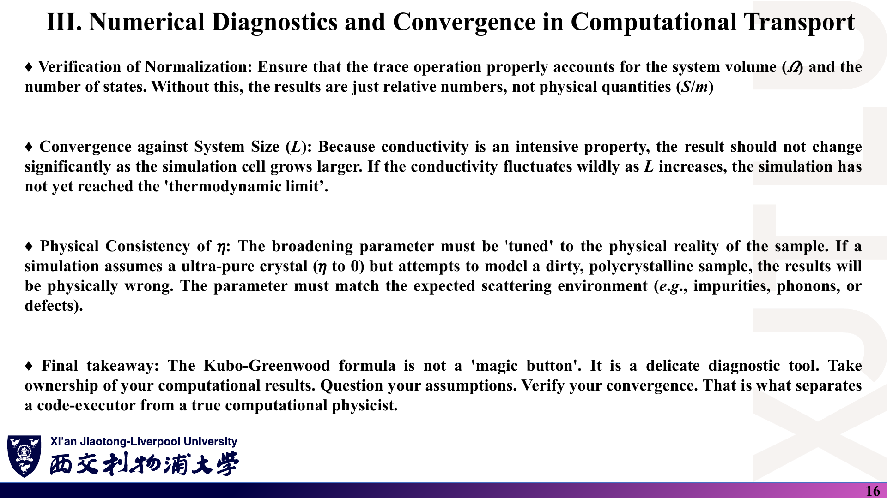

### 中文解释

- **归一化**：确保迹运算正确计入体系体积 Ω 与态的数目；否则结果只是相对数值，而不是物理量（S/m）。
- **对体系尺寸 L 收敛**：电导率是强度量，模拟胞增大时结果不应显著改变；若随 L 剧烈波动，尚未达到“热力学极限”。
- **η 的物理一致性**：η 要与样品的实际散射环境（杂质、声子、缺陷）相匹配；用超纯晶体的 η→0 去模拟脏的多晶样品，结论是错的。
- **总结**：KG 公式不是“魔法按钮”，而是精细的诊断工具。对计算结果负责，质疑假设，验证收敛——这区分了“代码执行者”与真正的计算物理学者。

### 原理深入

把清单落实到课程程序（详见 [08](08_代码导读.md)）：

| 检查项 | 课程程序现状 | 应做的处理 |
|---|---|---|
| 除以态数 $N_k$ | **未除** | 输出 ÷ 250000 |
| 面积 | 用了 $\mathbf a_1\cdot\mathbf a_2=-3.026$ Ų | 应为 $\vert \mathbf a_1\times\mathbf a_2\vert =5.241$ Ų |
| 单位因子 $e^2/\hbar$ | 未乘（`habr` 声明但未使用） | 输出即“以 $e^2/\hbar$ 为单位”需先完成上两项 |
| 自旋简并 | 未计 | ×2 |
| 维度单位 | 二维 | 结果单位是 S（方块电导），不是 S/m |

**二维与三维单位**：二维材料的电导率 $\sigma_{2D}$ 单位为 S；若要与三维材料比较，需要除以一个有效厚度（例如石墨层间距 3.35 Å），这一步带有约定成分，必须注明。

### Ref

- **原课件**：[Lecture Twenty-Two，PDF 第 16 页](../Lecture_Twenty_Two.pdf#page=16)。
- **代码核验**：[08 代码导读](08_代码导读.md)；[07 第 9、12 条](07_讲义勘误与易错点.md)。
