# 03 · Kubo/Kubo–Greenwood 在复杂材料体系中的应用

来源：[Lecture_Twenty_Three.pdf](../Lecture_Twenty_Three.pdf)，31 页。

[返回目录](README.md)

> 本讲以论文案例为主。下文“中文解释”只归纳课件呈现的内容；“原理深入”中的补充推导与数值核对由笔记作者完成。论文原文未随仓库分发，完整引用见 [README 课程补充文献](README.md#课程补充文献未随仓库分发)。

## 1. 本讲的目标与案例安排是什么？〔pp. 2–6〕

### 课件截图

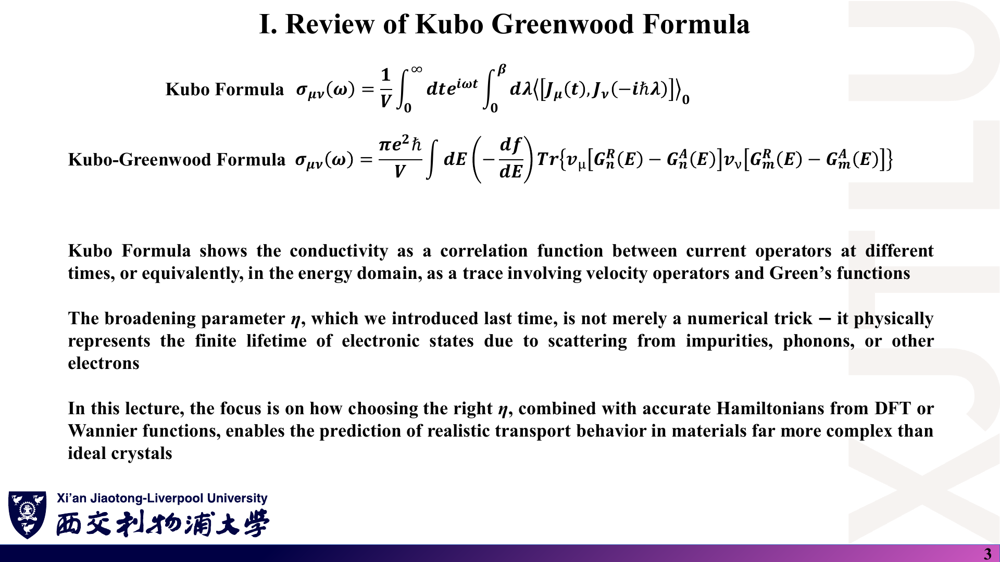

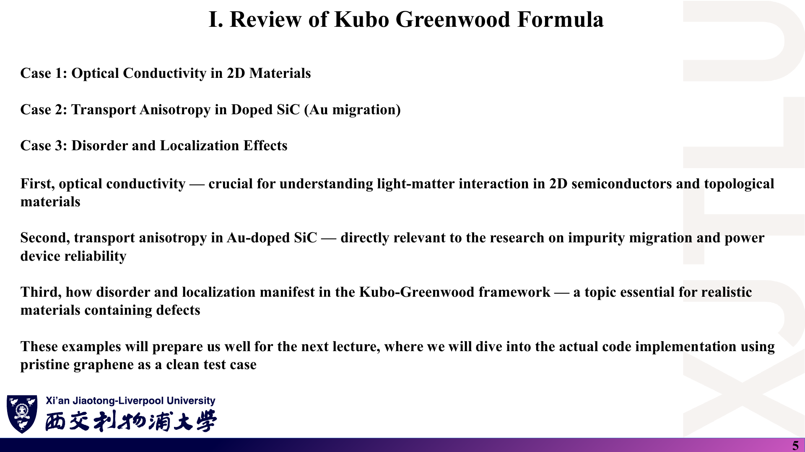

*第 3 页的两个公式沿用了第 21 讲的写法（λ 积分内的对易子、KG 前置系数），需按 [07 第 3–4 条](07_讲义勘误与易错点.md) 修正。*

### 中文解释

本讲四部分：KG 公式回顾 → 光学电导率 → 应变/缺陷引起的石墨烯输运各向异性 → 无序与强关联体系中的 KG。

- Kubo 公式把电导率表示为不同时刻电流算符的关联函数，等价地在能量域写成含速度算符与格林函数的迹。
- 上一讲引入的 η 不只是数值技巧，物理上代表杂质、声子或电子散射导致的有限寿命。
- 本讲的重点：选择合适的 η，配合来自 DFT 或 Wannier 函数的精确哈密顿量，就能预测远比理想晶体复杂的材料的真实输运行为。
- 芯片科学中要把量子力学与器件性能联系起来：例如 SiC 功率器件中痕量 Au 杂质影响长期可靠性；光电材料需要准确的光学电导来设计光电探测器。
- 第 5 页列出三个案例：①二维材料光学电导；②掺杂 SiC 的输运各向异性（Au 迁移）；③无序与局域化。第 6 页的学习目标：理解 KG 如何用于非理想体系、在真实材料语境下解释计算结果、为下一讲的数值实现做准备。

### 原理深入

- **案例②与实际内容不完全对应**：第 5 页预告的是“Au 掺杂 SiC”，但第 15–22 页实际展示的是**石墨烯**中应变与结构缺陷的案例，课件没有给出 SiC 的具体计算。学习时应以实际展示的论文为准。
- **哈密顿量来源**：KG 公式只需要 $H$ 与速度算符。紧束缚（课程程序）、Wannier 插值（从 DFT 构造的最局域 Wannier 函数紧束缚模型）、或直接用 DFT 基组都可以提供 $H(\mathbf k)$；速度算符一般取 $\frac1\hbar\partial H/\partial\mathbf k$（非正交基时需额外处理重叠矩阵）。

### Ref

- **原课件**：[Lecture Twenty-Three，PDF 第 2–6 页](../Lecture_Twenty_Three.pdf#page=3)。
- **勘误**：[07 第 3、4、11 条](07_讲义勘误与易错点.md)。

## 2. 光学电导率与 DC 电导率有何不同？〔p. 7〕

### 课件截图

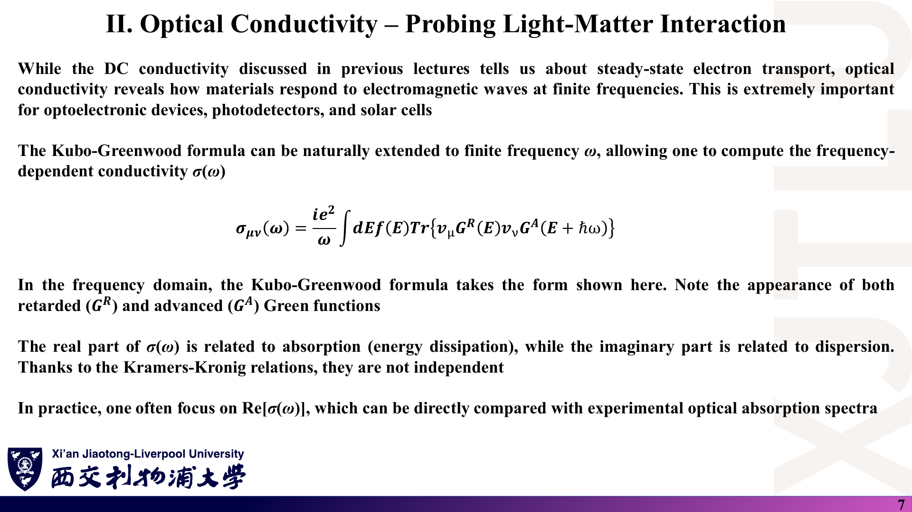

*本页的有限频率 KG 公式只是示意，缺少 $1/\Omega$ 等因子；规范形式见下方。*

### 中文解释

DC 电导描述稳态输运；光学电导描述材料对有限频率电磁波的响应，对光电器件、光电探测器和太阳能电池至关重要。KG 公式可自然推广到有限频率 ω，$\sigma(\omega)=\sigma_1(\omega)+i\sigma_2(\omega)$，其中同时出现 $G^R$ 与 $G^A$。实部与吸收（能量耗散）相关，虚部与色散相关；二者由 KK 关系联系。实践中常关注 $\mathrm{Re}\sigma(\omega)$，它可直接与实验吸收谱比较。

### 原理深入

**非相互作用电子的规范形式**（每自旋）：

$$
\boxed{\mathrm{Re}\sigma_{\mu\mu}(\omega)=\frac{\pi e^2\hbar}{\Omega}\int dE\,
\frac{f(E)-f(E+\hbar\omega)}{\hbar\omega}\,
\mathrm{Tr}\big[v_\mu\delta(E-H)\,v_\mu\delta(E+\hbar\omega-H)\big].}
$$

- $\omega\to0$ 时 $\frac{f(E)-f(E+\hbar\omega)}{\hbar\omega}\to-\partial f/\partial E$，回到 DC 的 KG 公式。
- 因子 $f(E)-f(E+\hbar\omega)$ 表达**泡利阻塞**：只有初态占据、末态空置的跃迁才吸收光子。
- 讲义的 $`\sigma=\frac{ie^2}{\omega}\int dE\,f(E)\mathrm{Tr}\{v G^R(E)vG^A(E+\hbar\omega)\}`$ 只保留了一种 $G^RG^A$ 组合，缺少 $1/\Omega$、$\hbar$ 以及 $G^RG^R$、$G^AG^A$ 项与抗磁项；作为“结构示意”可以，作为计算公式不完整。

**光学“带间”吸收与 DC“带内”输运**：在完美晶体中 $v$ 的带内矩阵元给出 Drude 峰（$\omega\approx0$），带间矩阵元给出 $\hbar\omega\ge2|\mu|$ 的吸收边。下面三个案例都是带间（或 Landau 能级间）跃迁。

### Ref

- **原课件**：[Lecture Twenty-Three，PDF 第 7 页](../Lecture_Twenty_Three.pdf#page=7)。
- **勘误**：[07 第 10 条](07_讲义勘误与易错点.md)。
- **延伸**：[MAHAN](README.md#ref-mahan)、[CASTRO09](README.md#ref-castro)。

## 3. 磁场下石墨烯的光学电导如何反映 Landau 能级？〔pp. 8–9〕

### 课件截图

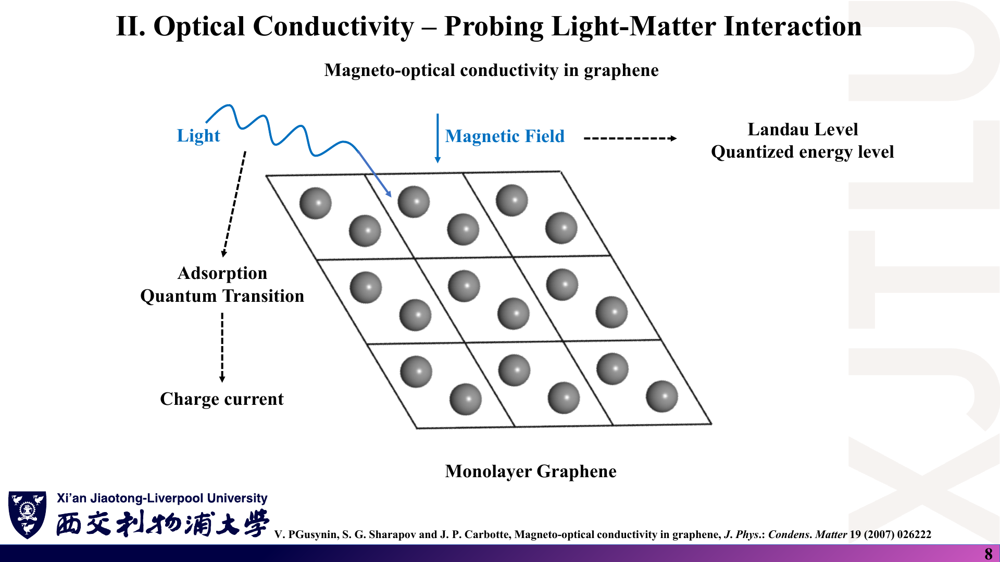

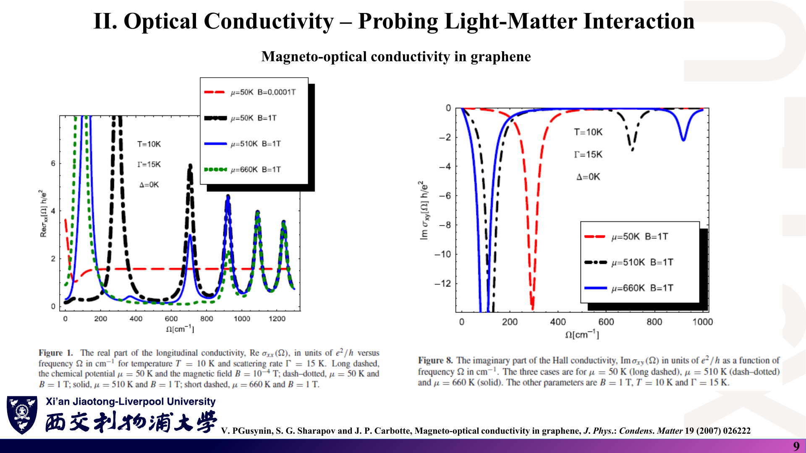

### 中文解释

垂直磁场把石墨烯的连续能带量子化为 **Landau 能级**；光子被吸收引起能级间的量子跃迁，产生电流。课件引用 Gusynin、Sharapov、Carbotte（2007）的结果：

- 左图（原文 Fig. 1）：$\mathrm{Re}\sigma_{xx}(\Omega)$（单位 $e^2/h$），$T=10$ K、散射率 $\Gamma=15$ K。几乎无磁场（$B=10^{-4}$ T，红色长虚线）时曲线在一个阈值后变为平台；$B=1$ T 时变为一系列分立吸收峰，峰的位置和强度随化学势 μ（50、510、660 K）变化。
- 右图（原文 Fig. 8）：Hall 电导虚部 $\mathrm{Im}\sigma_{xy}(\Omega)$ 的对应峰。

### 原理深入

**石墨烯 Landau 能级**（Dirac 模型）：

$$
E_n=\mathrm{sgn}(n)\sqrt{2e\hbar v_F^2B\,|n|},\qquad n=0,\pm1,\pm2,\ldots
$$

间距**不等**，且与 $\sqrt B$ 成正比（普通二维电子气为等间距 $\hbar eB/m$）。偶极选择定则为 $|n|\to|n|\pm1$。

**用峰位做一次核验**（取 $v_F\approx1\times10^6$ m/s，$B=1$ T）：$E_1=\sqrt{2e\hbar v_F^2B}\approx36$ meV ≈ 290 cm⁻¹。于是

| 跃迁 | 能量 | 预计波数 | 图中 μ = 50 K 曲线 |
|---|---|---|---|
| $0\to1$ | $E_1$ | ≈ 290 cm⁻¹ | 约 290 cm⁻¹ 的强峰 |
| $-1\to2$ | $(1+\sqrt2)E_1$ | ≈ 700 cm⁻¹ | 约 700 cm⁻¹ |
| $-2\to3$ | $(\sqrt2+\sqrt3)E_1$ | ≈ 920 cm⁻¹ | 约 920 cm⁻¹ |
| $-3\to4$ | $(\sqrt3+2)E_1$ | ≈ 1090 cm⁻¹ | 约 1090 cm⁻¹ |

不等间距的峰列正是 Dirac 型 Landau 能级的“指纹”。μ 增大时，部分低能跃迁被泡利阻塞，峰的权重重新分配（蓝、绿曲线）。$B\to0$ 时峰并成连续平台，平台高度接近下一节的普适值 $\pi e^2/(2h)\approx1.57\,e^2/h$——这与左图红线的平台高度一致。

### Ref

- **原课件**：[Lecture Twenty-Three，PDF 第 8–9 页](../Lecture_Twenty_Three.pdf#page=9)。
- **论文**：[GSC07](README.md#ref-gusynin)（课件引文作者名误排为 “V. PGusynin”，应为 V. P. Gusynin）。
- 表中波数为本笔记按 Dirac 模型估算，$v_F$ 取值不同会有小幅偏移。

## 4. 石墨的“普适光学电导”是什么？〔pp. 10–11〕

### 课件截图

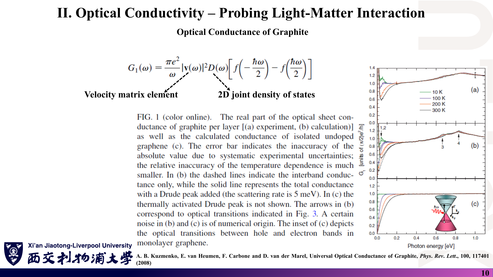

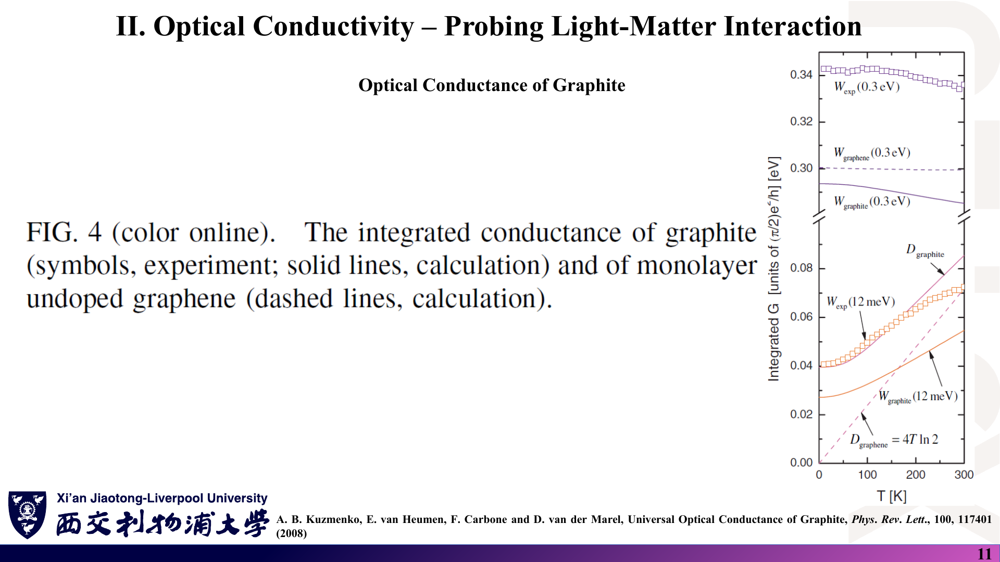

### 中文解释

Kuzmenko 等人（2008）测得石墨**每层**的光学方块电导非常接近孤立单层石墨烯的理论值 $\pi e^2/(2h)$。课件给出的公式

$$
G_1(\omega)=\frac{\pi e^2}{\omega}|v(\omega)|^2D(\omega)\Big[f\big(-\tfrac{\hbar\omega}{2}\big)-f\big(\tfrac{\hbar\omega}{2}\big)\Big],
$$

其中 $|v(\omega)|^2$ 是速度矩阵元，$D(\omega)$ 是二维联合态密度。第 10 页图：(a) 实验、(b) 计算（虚线为仅带间，实线加入 5 meV 散射率的 Drude 峰）、(c) 孤立未掺杂石墨烯的计算；纵轴单位 $(\pi/2)e^2/h$，各温度曲线在 0.1–1 eV 间都接近 1。第 11 页：积分电导随温度变化，实验、石墨计算、石墨烯计算三者对比。

### 原理深入

- 公式结构与第 2 节一致：速度矩阵元平方 × 联合态密度 × 占据差 / ω。占据差 $f(-\hbar\omega/2)-f(\hbar\omega/2)$ 对应 Dirac 锥上对称的竖直跃迁：价带 $-\hbar\omega/2$ → 导带 $+\hbar\omega/2$。
- 对线性色散，联合态密度 $\propto\omega$，于是 $1/\omega$ 被抵消，$T=0$ 时得到与频率、费米速度都无关的

$$
G_0=\frac{\pi e^2}{2h}=\frac{e^2}{4\hbar}\approx6.08\times10^{-5}\ \text{S}.
$$

- 物理推论：悬浮单层石墨烯的吸收率约为 $\pi\alpha\approx2.3\%$（$\alpha$ 为精细结构常数），这是一个只由基本常数决定的量。
- 有限温度下 $\hbar\omega\lesssim k_BT$ 时占据差小于 1，所以低频处曲线下降（第 10 页 (c) 中 300 K 曲线在 0.2 eV 以下下降）。
- 注意区分：这是**光学（带间）**电导 $\pi e^2/(2h)$；第 22 讲 Dirac 点的 **DC 最小电导** $4e^2/(\pi h)$ 是不同的量，二者相差因子 $\pi^2/8$。

### Ref

- **原课件**：[Lecture Twenty-Three，PDF 第 10–11 页](../Lecture_Twenty_Three.pdf#page=10)。
- **论文**：[KUZ08](README.md#ref-kuzmenko)；背景 [CASTRO09](README.md#ref-castro)。

## 5. 拓扑绝缘体表面态的磁光电导有何特点？〔pp. 12–14〕

### 课件截图

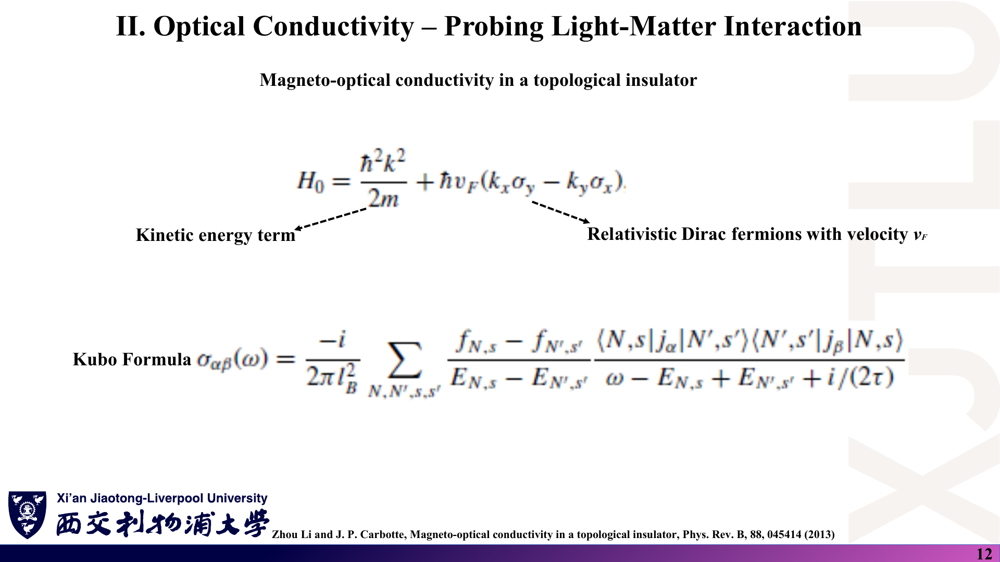

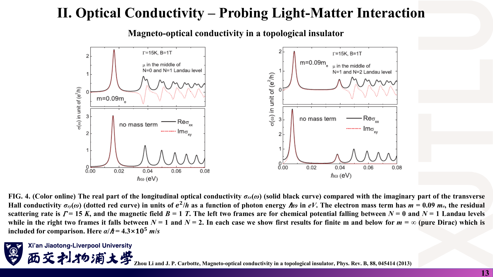

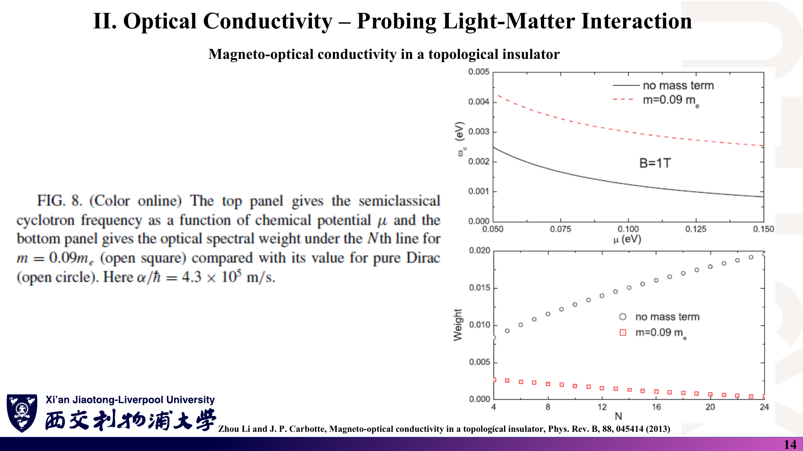

### 中文解释

Li 与 Carbotte（2013）研究拓扑绝缘体表面态：

$$
H_0=\frac{\hbar^2k^2}{2m}+\hbar v_F(k_x\sigma_y-k_y\sigma_x),
$$

第一项是动能（二次）项，第二项是速度为 $v_F$ 的相对论性 Dirac 费米子项。磁场下用 Landau 能级本征态 $|N,s\rangle$ 写出 Kubo 公式

$$
\sigma_{\alpha\beta}(\omega)=\frac{-i}{2\pi l_B^2}\sum_{N,N',s,s'}
\frac{f_{N,s}-f_{N',s'}}{E_{N,s}-E_{N',s'}}\,
\frac{\langle N,s|j_\alpha|N',s'\rangle\langle N',s'|j_\beta|N,s\rangle}{\omega-E_{N,s}+E_{N',s'}+i/(2\tau)}.
$$

第 13 页（原文 Fig. 4）：$m=0.09m_e$、$\Gamma=15$ K、$B=1$ T，μ 位于 $N=0,1$ 之间（左）与 $N=1,2$ 之间（右）时的 $\mathrm{Re}\sigma_{xx}$ 与 $\mathrm{Im}\sigma_{xy}$，上排含质量项、下排为纯 Dirac（$m=\infty$）。第 14 页（原文 Fig. 8）：半经典回旋频率随 μ 的变化，以及第 N 条吸收线的光学谱权重。

### 原理深入

- 这一 Kubo 公式与 [01 第 7 节](01_线性响应与Kubo公式.md) 的本征态形式完全同构：占据差 / 能量差 × 电流矩阵元乘积 × 洛伦兹分母。$1/(2\pi l_B^2)$ 是每个 Landau 能级单位面积的简并度（$l_B=\sqrt{\hbar/eB}\approx25.7$ nm @ 1 T），起到“$1/\Omega\sum_{\mathbf k}$”的作用；$1/(2\tau)$ 就是散射展宽 η（式中取 $\hbar=1$）。
- **二次项的作用**：$\hbar^2k^2/2m$ 使导带与价带不对称（“沙漏”形色散），因此正负 Landau 能级不再对称，吸收线发生劈裂/移动，并使原本相互抵消的部分 Hall 响应不再抵消——比较第 13 页上下两排可以看到 $\mathrm{Im}\sigma_{xy}$ 在高频处出现正负交替的结构。
- **与 DC 的联系**：$\omega\to0$ 时 $\sigma_{xy}$ 给出量子 Hall 电导；拓扑表面态的特点是半整数量子化（每个表面 $(N+\tfrac12)e^2/h$）。这是背景补充，课件未展开。

### Ref

- **原课件**：[Lecture Twenty-Three，PDF 第 12–14 页](../Lecture_Twenty_Three.pdf#page=12)。
- **论文**：[LC13](README.md#ref-lic)。

## 6. 应变和缺陷如何改变石墨烯的电导及其各向异性？〔pp. 15–22〕

### 课件截图

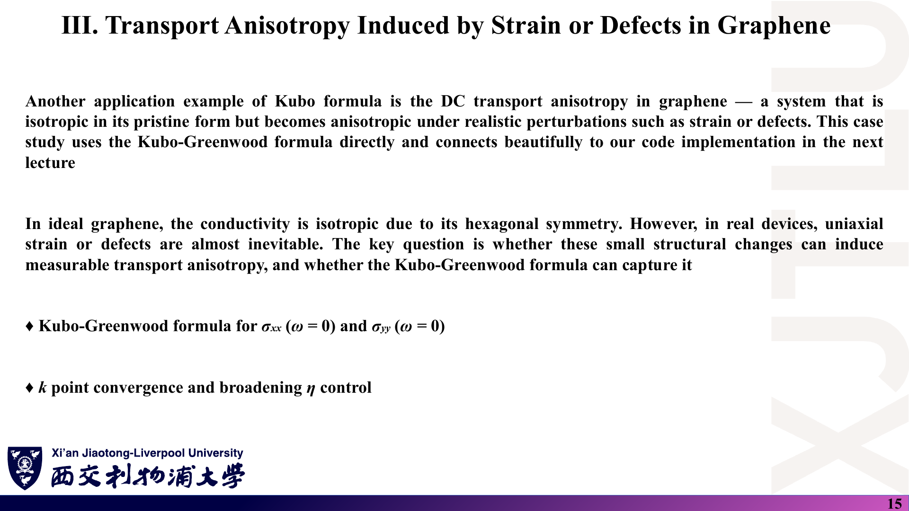

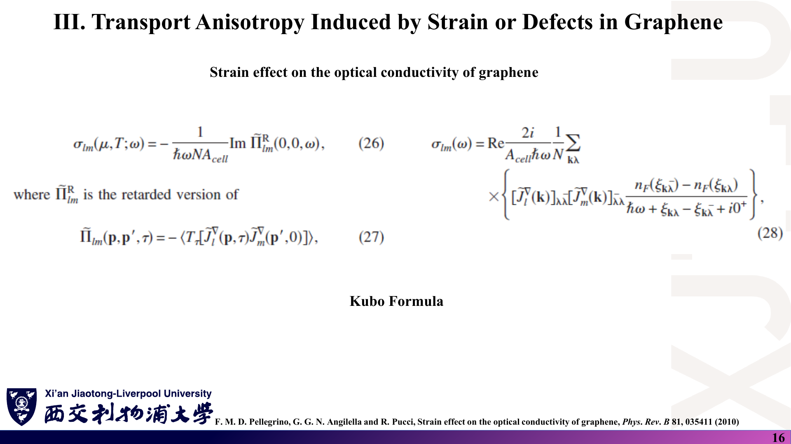

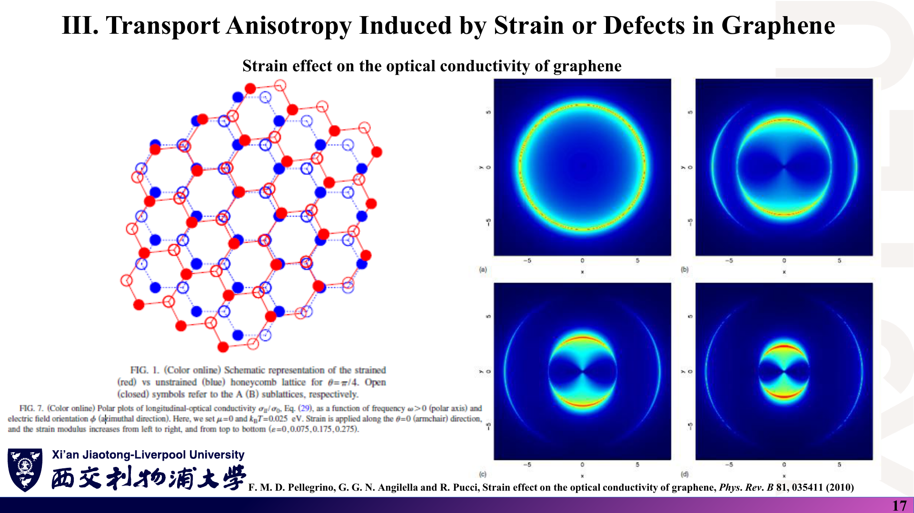

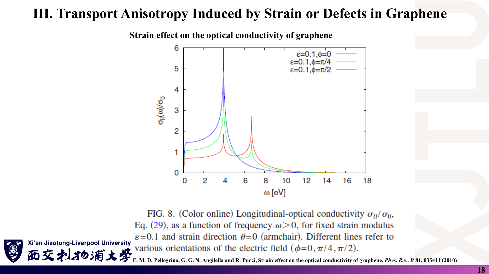

### 中文解释

**问题**（第 15 页）：理想石墨烯因六角对称而电导各向同性；真实器件中单轴应变或缺陷几乎不可避免。小的结构变化能否引起可测量的输运各向异性？KG 公式能否捕捉？要点：用 KG 计算 $\sigma_{xx}(\omega=0)$ 与 $\sigma_{yy}(\omega=0)$，并控制 k 点收敛与展宽。

**应变（Pellegrino 等，2010）**：

- 第 16 页：$\sigma_{lm}(\mu,T;\omega)=-\frac{1}{\hbar\omega NA_{cell}}\mathrm{Im}\tilde\Pi^R_{lm}(0,0,\omega)$，以及在能带基中的展开式（含 $[n_F(\xi_{\mathbf k\bar\lambda})-n_F(\xi_{\mathbf k\lambda})]$ 与 $\hbar\omega+\xi_{\mathbf k\lambda}-\xi_{\mathbf k\bar\lambda}+i0^+$）。
- 第 17 页：应变（红）与未应变（蓝）蜂窝晶格示意；纵向光学电导 $\sigma_{ll}/\sigma_0$ 随频率（径向）和电场方向 φ（极角）的极坐标图，应变沿扶手椅方向，$\varepsilon=0,0.075,0.175,0.275$。未应变时图案圆对称，加应变后变得各向异性。
- 第 18 页：$\varepsilon=0.1$ 时，电场方向 $\phi=0,\pi/4,\pi/2$ 的 $\sigma_{ll}(\omega)/\sigma_0$：Van Hove 峰（未应变时约 $2|t|$ 处的单峰）分裂为位置、权重随 φ 变化的多个峰。

**缺陷（Lherbier 等，2012）**：

- 第 19 页：三种结构缺陷——Stone–Wales（SW）、585 双空位、555-777 双空位，红色虚线为对称轴。
- 第 20 页（原文 Fig. 12）：不同缺陷组合（SW/585、SW/555-777、585/555-777）、浓度 0.1%–1.0% 下，电导率随能量（左）和载流子密度（右）的变化；单位 $G_0=2e^2/h$，绿色虚线为 $2/\pi$。
- 第 21 页（原文 Fig. 13）：$n_d=1.0\%$ 时，归一化扩散系数随时间的变化。
- 第 22 页总结：KG 方法可以量化真实扰动引起的输运各向异性，为下一讲以本征石墨烯为基准的程序实现做准备。

### 原理深入

**光学 vs DC**：第 15 页提出的是 DC（$\omega=0$）各向异性，但 Pellegrino 的论文与第 16–18 页的图都是**光学电导**（$\omega>0$）。应变的确也会使 DC 电导各向异性（Dirac 锥变成椭圆、速度各向异性），但课件展示的证据是光学的。

**为什么应变产生各向异性**：单轴应变使三个最近邻跃迁 $t_1,t_2,t_3$ 不再相等，打破 $C_3$ 对称（[02 第 12 节](02_KG公式的物理图像与数值诊断.md)），Dirac 点离开 K 点，等能线由圆变椭圆，$\langle v_x^2\rangle\neq\langle v_y^2\rangle$。原来三个 M 点等价的 Van Hove 奇点被区分开，所以光学电导的单峰分裂为多峰，各峰权重取决于电场方向与应变方向的夹角。

**Lherbier 案例的要点**：

- 他们用的是**实空间 order-N Kubo–Greenwood 方法**（波包演化 + 扩散系数 $D(E,t)=\Delta R^2(E,t)/t$），在约 280 万原子的大样品中显式放入随机缺陷，因而能包含多重散射与量子干涉——这与课程程序“完美晶体 + 常数 η”有本质区别。
- 随缺陷浓度增加，电导率逐渐下降并在一个平台处饱和，该平台就是图中虚线 $2/\pi\cdot G_0=4e^2/(\pi h)$（与 [01 第 9 节](01_线性响应与Kubo公式.md) 的最小电导一致）。
- **注意**：论文明确写道，为避免某一取向占优而产生各向异性，他们**让缺陷取向随机分布**。所以第 19–21 页展示的主要是缺陷对电导大小与局域化的影响，而不是各向异性本身；只有当缺陷取向（或应变）有择优方向时才会出现 $\sigma_{xx}\neq\sigma_{yy}$。
- 扩散系数随时间的三个阶段：弹道（$D\propto t$）→ 扩散（$D\to D_{\max}$，平均自由程 $\ell_e=D_{\max}/(2v)$）→ 局域化（$D$ 随 t 下降）。

### Ref

- **原课件**：[Lecture Twenty-Three，PDF 第 15–22 页](../Lecture_Twenty_Three.pdf#page=15)。
- **论文**：[PAP10](README.md#ref-pellegrino)、[LHE12](README.md#ref-lherbier)。缺陷取向随机化一点据论文第 III 节原文核对。
- **勘误**：[07 第 11 条](07_讲义勘误与易错点.md)。

## 7. KG 如何用于识别 Anderson 局域化？〔pp. 23–27〕

### 课件截图

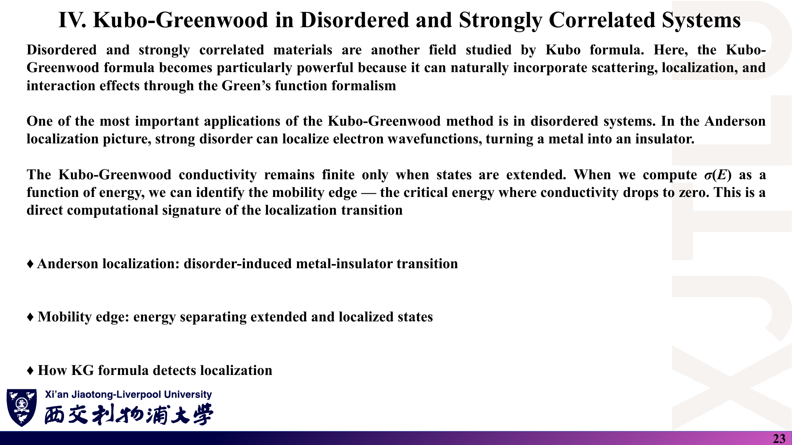

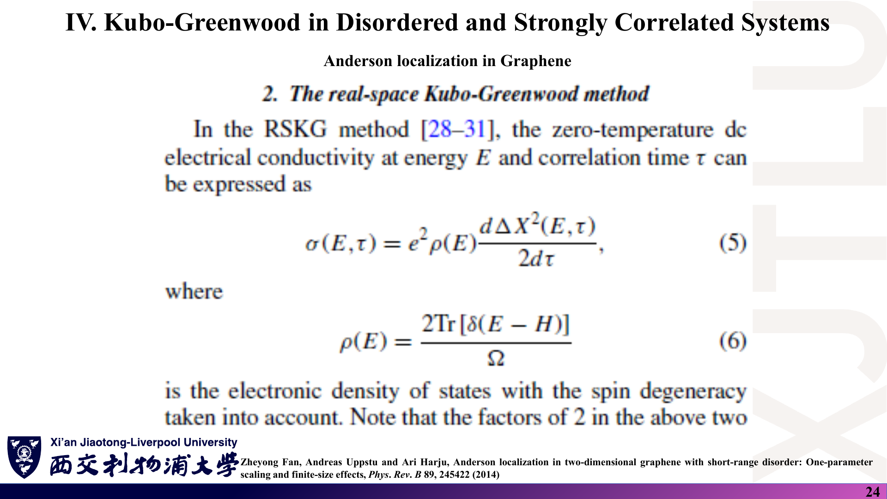

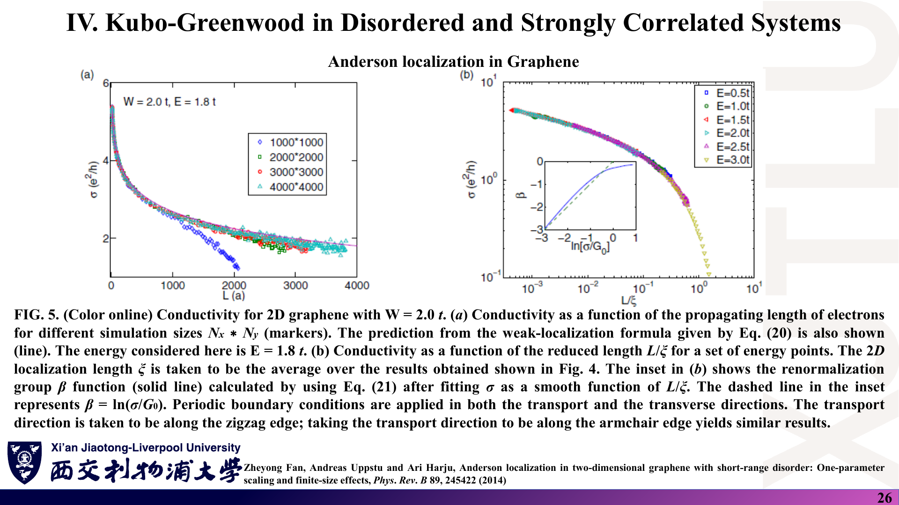

### 中文解释

第 23 页：无序与强关联材料是 Kubo 公式的另一个应用领域；KG 通过格林函数自然地包含散射、局域化与相互作用效应。在 Anderson 局域化图像中，强无序可使波函数局域，把金属变为绝缘体。KG 电导只在态扩展时才有限；计算 $\sigma(E)$ 可以识别迁移率边。

Fan、Uppstu、Harju（2014）：

- 第 24 页：实空间 KG（RSKG）中，零温 DC 电导 $\sigma(E,\tau)=e^2\rho(E)\dfrac{d\Delta X^2(E,\tau)}{2d\tau}$，态密度 $\rho(E)=2\mathrm{Tr}[\delta(E-H)]/\Omega$（含自旋简并）。
- 第 25 页（原文 Fig. 2）：局域化长度的单参数标度，所有数据落在一条标度曲线上。
- 第 26 页（原文 Fig. 5）：$W=2.0t$ 时电导率随传播长度的下降（与弱局域化公式比较），以及 σ 对 $L/\xi$ 的普适标度和 β 函数。
- 第 27 页结论：短程无序石墨烯中的 Anderson 局域化完全由单参数标度描述；提出的解析标度函数可以从准一维计算可靠地得到二维局域化长度；电荷中性点（CNP）的“反常”是有限尺寸效应；不存在金属-绝缘体转变——足够大的体系中零温下所有态都局域。

### 原理深入

**RSKG 与课程公式的关系**：把 $\mathrm{Tr}[v\delta(E-H)v\delta(E-H)]$ 改写成时间域的速度自关联，再积分一次得到均方位移：

$$
\sigma(E,t)=e^2\rho(E)\,\frac{d}{dt}\frac{\Delta X^2(E,t)}{2},\qquad
\Delta X^2(E,t)=\frac{\mathrm{Tr}\{[X(t)-X(0)]^2\delta(E-H)\}}{\mathrm{Tr}\delta(E-H)}.
$$

这就是 Einstein 关系 $\sigma=e^2\rho D$ 的含时推广。优势：不需对角化，用 Chebyshev 展开与随机相位矢量估计迹，计算量 $\propto N$（原子数），可以处理百万原子级别的无序体系，从而**显式包含**多重散射与干涉。

**单参数标度**：Abrahams 等人的标度理论认为无量纲电导 $g$ 随尺寸的变化只依赖 $g$ 本身：$\beta(g)=\dfrac{d\ln g}{d\ln L}$。二维正交类（无 SOC、无磁场）中 $\beta<0$ 对所有 $g$ 成立，所以 $L\to\infty$ 时都局域，**没有真正的迁移率边**——这正是 Fan 等人的结论，也说明第 22 讲“迁移率边”的图像主要适用于三维。

**对课程程序的启示**：要研究局域化，必须①在超胞中放入随机势，②做尺寸标度，③不能用大 η 掩盖干涉（大 η 等效于强退相干）。

### Ref

- **原课件**：[Lecture Twenty-Three，PDF 第 23–27 页](../Lecture_Twenty_Three.pdf#page=24)。
- **论文**：[FUH14](README.md#ref-fan)；配套 [02 第 9 节](02_KG公式的物理图像与数值诊断.md)。

## 8. 强关联多层纳米结构中如何算输运？〔pp. 28–30〕

### 课件截图

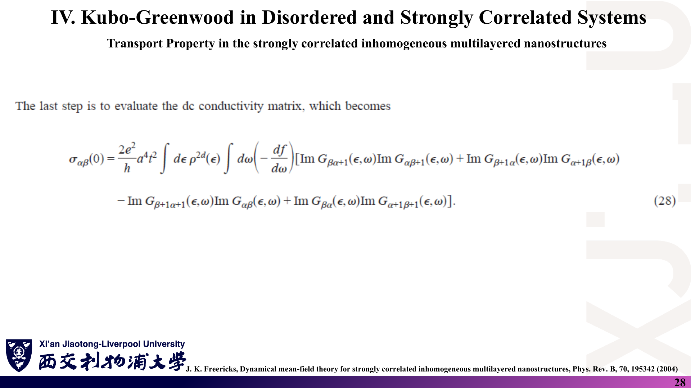

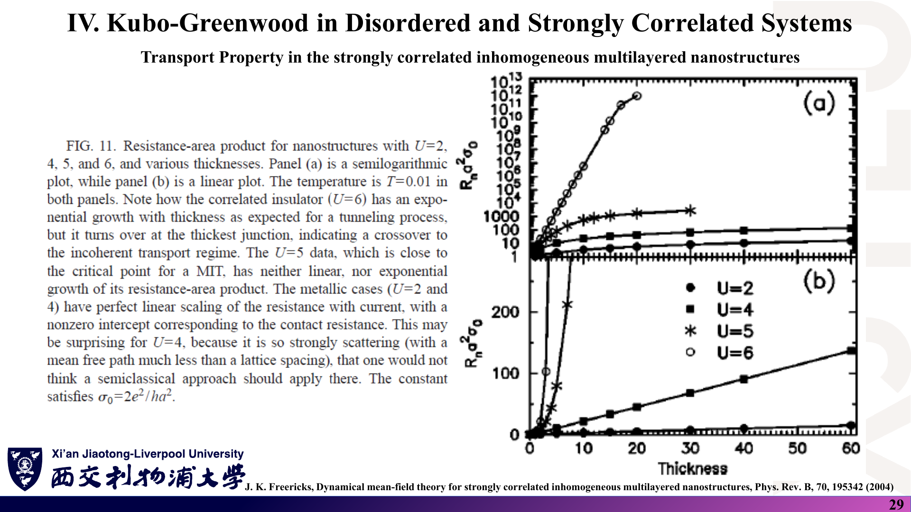

### 中文解释

Freericks（2004）用动力学平均场理论（DMFT）研究强关联非均匀多层结构：两侧为金属引线，中间是可调到 Mott 金属-绝缘体转变的强关联势垒层。

- 第 28 页：DC 电导率矩阵 $\sigma_{\alpha\beta}(0)=\frac{2e^2}{h}a^4t^2\int d\epsilon\,\rho^{2d}(\epsilon)\int d\omega(-\frac{df}{d\omega})[\cdots]$，方括号内是相邻层（α、α+1、β、β+1）格林函数虚部的乘积组合。
- 第 29 页（原文 Fig. 11）：$U=2,4,5,6$、$T=0.01$ 时电阻-面积乘积 $R_na^2\sigma_0$ 随势垒厚度的变化。关联绝缘体（$U=6$）随厚度指数增长（隧穿），在最厚处转向非相干输运；接近临界点的 $U=5$ 既非线性也非指数；金属情形（$U=2,4$）电阻随厚度线性增长，截距对应接触电阻。$\sigma_0=2e^2/(ha^2)$。
- 第 30 页（原文 Fig. 12）：$U=4,6$ 时电阻-面积乘积随温度的变化；低温为隧穿，高温交叉到非相干输运，交叉温度由广义 Thouless 能量 $E_{Th}=T$ 决定。

### 原理深入

- **与 KG 的联系**：公式结构仍是“$(-df/d\omega)\times$ 速度（这里是层间跃迁 $t$）$\times\mathrm{Im}G\times\mathrm{Im}G$”，即 [01 第 8 节](01_线性响应与Kubo公式.md) 的 $\mathrm{Tr}[v\mathrm{Im}G\,v\mathrm{Im}G]$。区别在于 $G$ 中含有由 DMFT 自洽求得的**局域、依赖频率的自能** $\Sigma_\alpha(\omega)$，取代了常数 η；层指数 α 让自能随位置变化（非均匀）。
- 在 DMFT 中顶角修正对局域自能可以忽略（无穷维极限下严格），因此“气泡”形式的 KG 公式在这里是合理近似。
- 论文采用的相互作用模型是 Falicov–Kimball 模型（据论文正文核对），课件未写明。
- 电阻随厚度“线性 vs 指数”是区分**欧姆（非相干）输运**与**隧穿**的经典判据，可类比器件中的势垒层设计。

### Ref

- **原课件**：[Lecture Twenty-Three，PDF 第 28–30 页](../Lecture_Twenty_Three.pdf#page=28)。
- **论文**：[FRE04](README.md#ref-freericks)。
