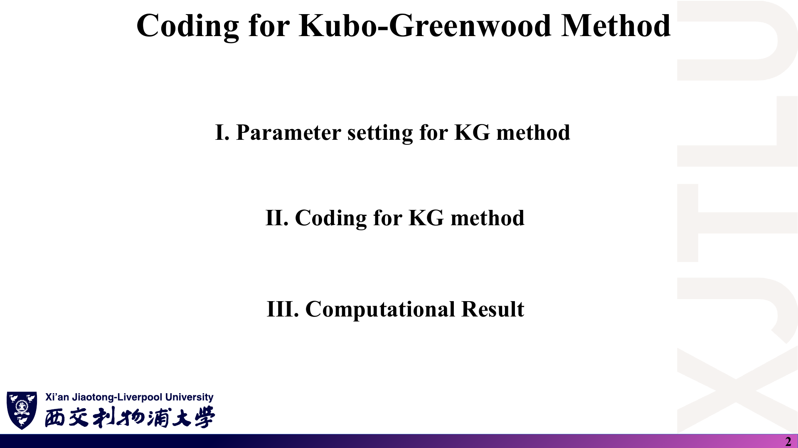
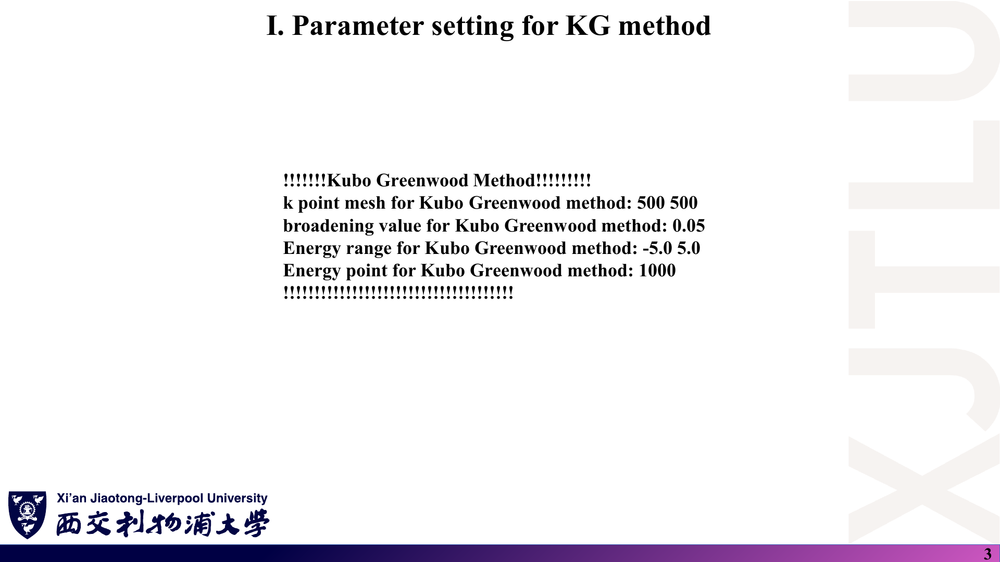
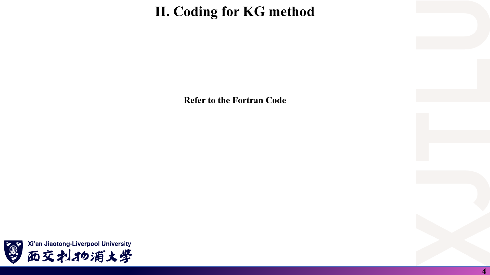
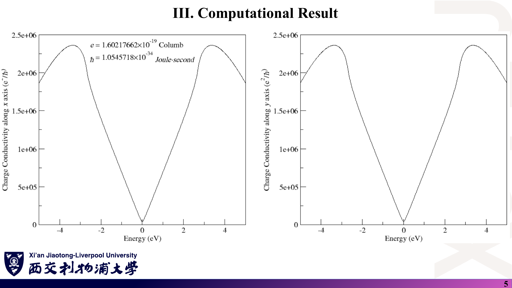
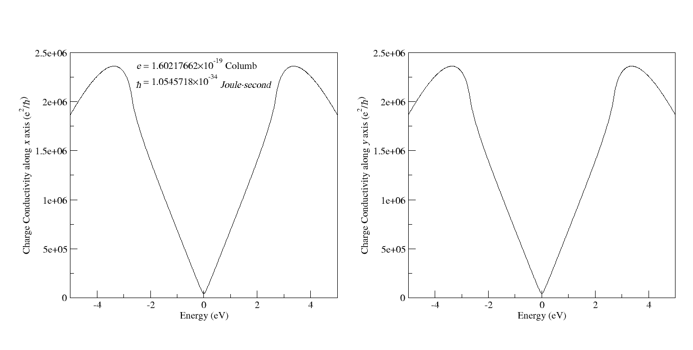

# 04 · Kubo–Greenwood 方法的参数设置、程序与计算结果

来源：[Lecture_Twenty_Four.pdf](../Lecture_Twenty_Four.pdf)，6 页。

[返回目录](README.md)

## 1. 本讲包括哪些内容？〔p. 2〕

### 课件截图

### 中文解释

本讲是 KG 方法的上机部分：①KG 方法的参数设置；②KG 方法的编程；③计算结果。讲义本身很短，主要内容在 `Codes/` 目录的 Fortran 程序中。

### 原理深入

本讲把前三讲的理论落到一个最简单的基准体系——**本征（无缺陷、无掺杂、无应变）石墨烯**的最近邻紧束缚模型。选它作基准的理由：解析结构已知（Dirac 锥、Van Hove 奇点、$C_3$ 对称），可以用来检验程序是否正确，再去处理第 23 讲那样的复杂体系。逐行代码解读见 [08 代码导读](08_代码导读.md)。

### Ref

- **原课件**：[Lecture Twenty-Four，PDF 第 2 页](../Lecture_Twenty_Four.pdf#page=2)。
- **代码**：[`TIGHTBINDINGFORGRAPHENE.f90`](../Codes/TIGHTBINDINGFORGRAPHENE.f90)。

## 2. KG 计算需要设置哪些参数？〔p. 3〕

### 课件截图

### 中文解释

输入文件 `Graphene.vasp` 末尾的 KG 参数块：

| 参数 | 值 | 含义 |
|---|---|---|
| k point mesh | 500 × 500 | 布里渊区均匀网格，共 250 000 个 k 点 |
| broadening | 0.05 | 展宽 η（eV） |
| Energy range | −5.0 ~ 5.0 | 计算 σ(E) 的能量窗口（eV，相对于 Dirac 点） |
| Energy point | 1000 | 能量采样点数 |

### 原理深入

- **参数之间的约束**：η = 0.05 eV 要大于网格造成的能级间距（500×500 时 Dirac 锥附近约 0.034 eV），否则曲线出现锯齿；能量步长 $10/1000=0.01$ eV 小于 η，曲线能被平滑解析。见 [02 第 6 节](02_KG公式的物理图像与数值诊断.md)。
- **能量点并不包含 5.0**：程序用 $E_i=E_{\min}+(E_{\max}-E_{\min})(i-1)/N$，所以实际范围是 −5.00 到 4.99 eV（输出文件可证实）。
- **“能量”的含义**：程序在 $T=0$ 下计算，横轴 $E$ 相当于费米能 $E_F$（通过门电压或掺杂调节）；$E=0$ 为电中性的 Dirac 点（onsite 均为 0）。
- `Graphene.vasp` 中的其他参数（DOS、k 圆网格、SOC、Wilson loop）属于本课程其他实验，本程序不读取它们；晶格常数与原子坐标在程序中写死，没有从文件读取。

### Ref

- **原课件**：[Lecture Twenty-Four，PDF 第 3 页](../Lecture_Twenty_Four.pdf#page=3)。
- **输入文件**：[`Graphene.vasp`](../Codes/Graphene.vasp)；读取逻辑见 [08 第 2 节](08_代码导读.md)。

## 3. 程序如何实现 KG 公式？〔p. 4〕

### 课件截图

### 中文解释

讲义此页只写了“Refer to the Fortran Code”。程序的主线是：对每个 k 点构造 2×2 的 $H(\mathbf k)$ 和速度矩阵 → 对角化 → 把速度矩阵转到本征基 → 在每个能量点按 KG 格林函数形式累加 → 对所有 k 点求和 → 归一化并输出。

### 原理深入

程序实际计算的量（$T=0$，每自旋，未换算单位）：

$$
C_\mu(E)=\frac{1}{4\pi\,(\mathbf a_1\cdot\mathbf a_2)}\sum_{\mathbf k}\sum_{j,l=1}^{2}
|\langle j\mathbf k|\partial_{k_\mu}H|l\mathbf k\rangle|^2\,g_l(E)\,g_j(E),
\qquad g_j(E)=\frac{-2i\eta}{(E-\varepsilon_{j\mathbf k})^2+\eta^2}.
$$

对比正确的物理公式（[01 第 8 节](01_线性响应与Kubo公式.md)）：

$$
\sigma_{\mu\mu}(E)=\frac{e^2}{\hbar}\cdot\frac{1}{4\pi N_k\Omega_{\text{cell}}}\sum_{\mathbf k}\sum_{j,l}
|\langle j|\partial_{k_\mu}H|l\rangle|^2\,(-g_lg_j)\quad(\text{每自旋}),
$$

二者结构一致（$4\pi$ 因子正确），但程序：①没有除以 $N_k$；②用 $\mathbf a_1\cdot\mathbf a_2=-3.026$ Ų 代替原胞面积 $5.241$ Ų（负号恰好抵消了 $g_lg_j<0$ 的符号）；③没有乘 $e^2/\hbar$；④未计自旋。换算关系：

$$
\boxed{\sigma_{\mu\mu}\,[e^2/\hbar,\ \text{每自旋}]=\frac{|\mathbf a_1\cdot\mathbf a_2|}{N_k\,\Omega_{\text{cell}}}\,C_\mu
=\frac{C_\mu}{\sqrt3\,N_k}\approx2.309\times10^{-6}\,C_\mu .}
$$

### Ref

- **原课件**：[Lecture Twenty-Four，PDF 第 4 页](../Lecture_Twenty_Four.pdf#page=4)。
- **详细推导与核验**：[08 代码导读](08_代码导读.md)；[07 第 12 条](07_讲义勘误与易错点.md)。

## 4. 计算结果应该怎样读？〔p. 5〕

### 课件截图

*第二张为 `Codes/` 中教师提供的同一结果图（由 `pristine_graphene.agr` 用 Grace 绘制），与讲义第 5 页一致。*

### 中文解释

两张子图分别是沿 x、y 方向的电导率随能量的变化，二者完全相同（各向同性）。曲线特征：

- $E=0$（Dirac 点）处最小但不为零；
- $|E|\lesssim2.7$ eV 范围内近似随 $|E|$ 线性增大，在 $|E|\approx|t|=2.7$ eV（Van Hove 奇点）附近斜率突变；
- 在 $|E|\approx3.37$ eV 处达到最大值，随后下降；
- 曲线关于 $E=0$ 对称（最近邻模型的电子-空穴对称）。

纵轴标注 “Charge Conductivity (e²/ħ)”，量级为 $10^6$。

### 原理深入

**纵轴单位需要修正**：输出值并不是以 $e^2/\hbar$ 为单位的电导率。按上节的换算：

| 位置 | 程序输出 $C$ | 换算 [$e^2/h$，含自旋 ×2] | 换算 [S，含自旋] |
|---|---|---|---|
| $E=0$ | 4.389 × 10⁴ | 1.27 ≈ $4/\pi$ | 4.9 × 10⁻⁵ |
| $E=1$ eV | 6.914 × 10⁵ | 20.1 | 7.8 × 10⁻⁴ |
| $E=\pm2.7$ eV | 2.054 × 10⁶ | 59.6 | 2.3 × 10⁻³ |
| $E=\pm3.37$ eV（峰） | 2.364 × 10⁶ | 68.6 | 2.7 × 10⁻³ |

（$1\,e^2/\hbar=2\pi\,e^2/h$；$e^2/h\approx3.874\times10^{-5}$ S。）

**形状的物理解释**：

- **Dirac 点**：DOS 为零，但带间项与洛伦兹尾给出与 η 无关的最小电导 $4e^2/(\pi h)$（含自旋）——换算后的 1.27 正好吻合。这是检验整套归一化是否正确的最好“标尺”。
- **线性区**：带内项 $\sigma\approx e^2D(E)\langle v_x^2\rangle\tau$。Dirac 锥上 $D\propto|E|$、$v=v_F$ 常数、$\tau=\hbar/2\eta$ 常数，所以 $\sigma\propto|E|/\eta$。
- **峰不在 Van Hove 点**：$\sigma$ 正比于 $D(E)\langle v_x^2\rangle_E$；在 $|E|=|t|$ 处 DOS 发散（对数），但 M 点附近群速度很小，二者乘积的最大值移到 $|E|\approx3.37$ eV。所以“电导率峰 = DOS 峰”是常见误解。
- **随 η 的变化**：把 η 减半，线性区数值约加倍，Dirac 点几乎不变（[08 第 6 节](08_代码导读.md)）。这说明该图的绝对值依赖于 η，单张图不能直接与实验比较。
- **σxx = σyy**：两个输出文件的 1000 个数值逐位相同，体现 $C_3$ 对称（[02 第 12 节](02_KG公式的物理图像与数值诊断.md)）。

### Ref

- **原课件**：[Lecture Twenty-Four，PDF 第 5 页](../Lecture_Twenty_Four.pdf#page=5)。
- **数据文件**：[`Conductivity_along_x_axis.dat`](../Codes/Conductivity_along_x_axis.dat)、[`Conductivity_along_y_axis.dat`](../Codes/Conductivity_along_y_axis.dat)、[`pristine_graphene.agr`](../Codes/pristine_graphene.agr)。
- **勘误**：[07 第 12 条](07_讲义勘误与易错点.md)。
- **延伸**：[CASTRO09](README.md#ref-castro)、[LUDWIG94](README.md#ref-ludwig)。
