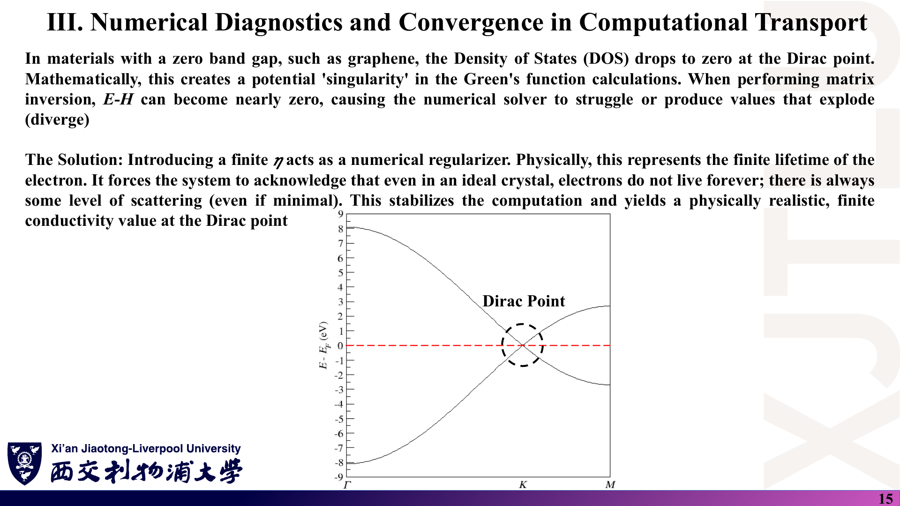

# 05 · 公式与中英文术语速查

[返回目录](README.md) · [第 21 讲](01_线性响应与Kubo公式.md) · [第 22 讲](02_KG公式的物理图像与数值诊断.md) · [第 23 讲](03_复杂材料中的电导率应用.md) · [第 24 讲](04_KG方法的参数与计算结果.md) · [代码导读](08_代码导读.md)

> 下列公式为**核验后的规范形式**，与讲义原图不同之处已在 [07 勘误](07_讲义勘误与易错点.md) 说明。约定：单粒子非相互作用电子、电子电荷 $-e$、体积（二维为面积）Ω、$\eta>0$、每自旋（物理值需乘自旋简并 2）。

## 1. 线性响应的出发点

### 课件截图

### 中文解释

外场 → 微扰 $V$ → 密度矩阵一阶修正 $\rho_1$ → 电流期望值。只保留 $V$ 的一次项。

### 原理深入

$$
\mathbf E=-\partial_t\mathbf A,\qquad H=H_0+V,\qquad V(t)=-\int\mathbf J\cdot\mathbf A\,d^3r\ (+\text{抗磁项}).
$$

$$
i\hbar\dot\rho=[H,\rho],\qquad
\rho_1(t)=-\frac{i}{\hbar}\int_{-\infty}^{t}e^{-iH_0(t-t')/\hbar}[V(t'),\rho_0]e^{iH_0(t-t')/\hbar}dt'.
$$

$$
\rho_0=\frac{e^{-\beta(H_0-\mu N)}}{Z},\quad Z=\mathrm{Tr}e^{-\beta(H_0-\mu N)},\quad
\langle J_\mu\rangle=\mathrm{Tr}(\rho_1J_\mu).
$$

$$
\langle J_\mu(t)\rangle=\int dt'\,\Pi^R_{\mu\nu}(t-t')A_\nu(t'),\qquad
\Pi^R_{\mu\nu}(t)=\frac{i}{\hbar}\Theta(t)\langle[J_\mu(t),J_\nu(0)]\rangle_0 .
$$

### Ref

- **原课件**：[Lecture Twenty-One，PDF 第 4–9 页](../Lecture_Twenty_One.pdf#page=5)。
- **推导**：[01 第 2–4 节](01_线性响应与Kubo公式.md)。

## 2. Kubo 公式、耗散与因果性

### 课件截图

### 中文解释

输运系数 = 平衡态电流关联函数；$\omega\to\omega+i\eta$ 保证因果；实部 = 吸收；实部与虚部由 KK 关系相连。

### 原理深入

$$
\sigma_{\mu\nu}(\omega)=\frac1\Omega\int_0^\infty dt\,e^{i(\omega+i\eta)t}\int_0^\beta d\lambda\,\langle J_\nu(-i\hbar\lambda)J_\mu(t)\rangle_0,
\qquad J(-i\hbar\lambda)=e^{\lambda H}Je^{-\lambda H}.
$$

$$
\text{Kubo 恒等式：}\ \frac{i}{\hbar}\langle[A(t),B]\rangle_0=\int_0^\beta d\lambda\,\langle\dot B(-i\hbar\lambda)A(t)\rangle_0 .
$$

$$
\bar P=\tfrac12\mathrm{Re}\sigma(\omega)|E_0|^2\ge0,\qquad
\mathrm{Re}\sigma(\omega)=\frac1\pi\mathcal P\!\int\frac{\mathrm{Im}\sigma(\omega')}{\omega'-\omega}d\omega',\quad
\mathrm{Im}\sigma(\omega)=-\frac1\pi\mathcal P\!\int\frac{\mathrm{Re}\sigma(\omega')}{\omega'-\omega}d\omega'.
$$

$$
\int_0^\infty e^{i(x+i\eta)t}dt=\frac{i}{x+i\eta}=\pi\delta(x)+i\,\mathcal P\frac1x\quad(\eta\to0^+).
$$

### Ref

- **原课件**：[Lecture Twenty-One，PDF 第 10–11 页](../Lecture_Twenty_One.pdf#page=10)。
- **推导**：[01 第 5–6 节](01_线性响应与Kubo公式.md)；[KUBO57](README.md#ref-kubo)。

## 3. 格林函数、谱函数与 Kubo–Greenwood 公式

### 课件截图

### 中文解释

δ 函数形式与格林函数形式等价，但前置系数不同；有限 η 时 δ 变为洛伦兹函数。

### 原理深入

$$
G^{R/A}(E)=(E-H\pm i\eta)^{-1},\qquad G^A=(G^R)^\dagger,\qquad
G^R-G^A=-2\pi i\,\delta_\eta(E-H),\quad\delta_\eta(x)=\frac1\pi\frac{\eta}{x^2+\eta^2}.
$$

$$
A(\mathbf k,E)=\frac1\pi\frac{|\mathrm{Im}\Sigma|}{(E-\varepsilon_{\mathbf k}-\mathrm{Re}\Sigma)^2+(\mathrm{Im}\Sigma)^2},\qquad
\tau=\frac{\hbar}{2|\mathrm{Im}\Sigma|},\qquad
D(E)=-\frac{1}{\pi\Omega}\mathrm{Im}\mathrm{Tr}G^R(E).
$$

**KG（DC，每自旋）**：

$$
\sigma_{\mu\mu}=\frac{\pi\hbar e^2}{\Omega}\int dE\Big(-\frac{\partial f}{\partial E}\Big)\mathrm{Tr}[v_\mu\delta(E-H)v_\mu\delta(E-H)]
$$

$$
=\frac{\hbar e^2}{4\pi\Omega}\int dE\Big(-\frac{\partial f}{\partial E}\Big)\mathrm{Tr}[v_\mu(G^R-G^A)v_\mu(G^A-G^R)]
=\frac{\hbar e^2}{\pi\Omega}\int dE\Big(-\frac{\partial f}{\partial E}\Big)\mathrm{Tr}[v_\mu\mathrm{Im}G^R\,v_\mu\mathrm{Im}G^R].
$$

**本征基展开**：$\mathrm{Tr}[v\delta v\delta]=\sum_{n,m}|\langle n|v|m\rangle|^2\delta(E-\varepsilon_n)\delta(E-\varepsilon_m)$。

**带内极限 = Boltzmann**：$\sigma^{\text{intra}}\to e^2D(E)\langle v_x^2\rangle_E\tau$，$\tau=\hbar/(2\eta)$，故 $\sigma\propto1/\eta$。

**光学（每自旋）**：

$$
\mathrm{Re}\sigma(\omega)=\frac{\pi\hbar e^2}{\Omega}\int dE\,\frac{f(E)-f(E+\hbar\omega)}{\hbar\omega}\mathrm{Tr}[v\delta(E-H)v\delta(E+\hbar\omega-H)].
$$

### Ref

- **原课件**：[Lecture Twenty-One，PDF 第 12–13 页](../Lecture_Twenty_One.pdf#page=13)；[Lecture Twenty-Two，PDF 第 6–7 页](../Lecture_Twenty_Two.pdf#page=7)；[Lecture Twenty-Three，PDF 第 7 页](../Lecture_Twenty_Three.pdf#page=7)。
- **勘误**：[07 第 4、10 条](07_讲义勘误与易错点.md)。

## 4. 石墨烯相关数值与单位

### 课件截图

### 中文解释

记住几个“标尺”数值，可以快速判断计算结果是否合理。

### 原理深入

| 量 | 表达式 / 数值 |
|---|---|
| 晶格常数、C–C 距离 | $a=2.46$ Å，$a_{cc}=1.42$ Å |
| 原胞面积 | $\vert \mathbf a_1\times\mathbf a_2\vert =\frac{\sqrt3}{2}a^2=5.241$ Ų（不是 $\mathbf a_1\cdot\mathbf a_2$） |
| 跃迁、带宽 | $t=-2.7$ eV；Γ 点 $\pm3\vert t\vert =\pm8.1$ eV；Van Hove 奇点 $\pm\vert t\vert$ |
| 费米速度 | $\hbar v_F=\frac32\vert t\vert a_{cc}\approx5.75$ eV·Å，$v_F\approx8.7\times10^5$ m/s |
| 电导量子 | $e^2/h=3.874\times10^{-5}$ S；$e^2/\hbar=2\pi e^2/h=2.434\times10^{-4}$ S |
| DC 最小电导（含自旋、谷） | $4e^2/(\pi h)\approx1.27\,e^2/h$ |
| 普适光学电导 | $\pi e^2/(2h)=e^2/(4\hbar)\approx6.08\times10^{-5}$ S；吸收率 $\pi\alpha\approx2.3\%$ |
| Landau 能级 | $E_n=\mathrm{sgn}(n)\sqrt{2e\hbar v_F^2B\vert n\vert }$，选择定则 $\vert n\vert \to\vert n\vert \pm1$ |
| 磁长度 | $l_B=\sqrt{\hbar/eB}\approx25.7$ nm（1 T） |
| 寿命 | $\tau=\hbar/(2\eta)$；η = 0.05 eV → 6.6 fs |
| 课程程序换算 | $\sigma\,[e^2/h,\text{含自旋}]=2.902\times10^{-5}\times$ 输出值 |
| 二维电导率单位 | S（方块电导）；三维为 S/m |

### Ref

- **原课件**：[Lecture Twenty-Two，PDF 第 15 页](../Lecture_Twenty_Two.pdf#page=15)；[Lecture Twenty-Three，PDF 第 9–10 页](../Lecture_Twenty_Three.pdf#page=10)。
- **核验**：[08 代码导读](08_代码导读.md)；[CASTRO09](README.md#ref-castro)。

## 5. 中英文术语表

### 课件截图

### 中文解释

按出现顺序整理本周术语，括号内为课件原文用词。

### 原理深入

| 中文 | English | 一句话说明 |
|---|---|---|
| 线性响应 | linear response | 只保留对外场一次的响应 |
| 矢势 / 最小耦合 | vector potential / minimal coupling | $\mathbf p\to\mathbf p+e\mathbf A$ |
| 密度算符（矩阵） | density operator (matrix) | $\rho_0$ 平衡态，$\rho_1$ 一阶修正 |
| Liouville–von Neumann 方程 | Liouville equation | $i\hbar\dot\rho=[H,\rho]$ |
| 相互作用绘景 | interaction picture | 用 $H_0$ 演化算符 |
| 关联函数 | correlation function | 平衡态下两时刻算符乘积/对易子的期望 |
| 推迟 / 超前 | retarded / advanced | $G^R$ 极点在下半平面，$G^A=(G^R)^\dagger$ |
| 绝热开启 | adiabatic switching | 因子 $e^{-\eta t}$ |
| 因果性 | causality | 响应不早于激励 |
| Kramers–Kronig 关系 | Kramers–Kronig relations | 实部与虚部互为 Hilbert 变换 |
| 涨落-耗散定理 | fluctuation–dissipation theorem | 耗散 ↔ 平衡涨落 |
| 焦耳热 | Joule heating | $\tfrac12\mathrm{Re}\sigma\vert E\vert ^2$ |
| 预解算符 | resolvent | $(E-H)^{-1}$ |
| 展宽 | broadening | η，洛伦兹半高半宽 |
| 自能 | self-energy | Σ，$\mathrm{Im}\Sigma$ 给寿命 |
| 谱函数 | spectral function | $A(\mathbf k,E)$ |
| 准粒子寿命 | quasiparticle lifetime | $\hbar/(2\vert \mathrm{Im}\Sigma\vert )$ |
| Van Hove 奇点 | Van Hove singularity | DOS 的发散/拐点，石墨烯在 $\pm\vert t\vert$ |
| 弱局域化 | weak localization | 时间反演路径相长干涉降低电导 |
| Anderson 局域化 | Anderson localization | 强无序使波函数指数局域 |
| 迁移率边 | mobility edge | 扩展态与局域态的能量分界 |
| 局域化长度 | localization length | ξ |
| 单参数标度 | one-parameter scaling | $\beta(g)=d\ln g/d\ln L$ 只依赖 g |
| 热力学极限 | thermodynamic limit | 体系尺寸 → ∞ |
| 光学电导 | optical conductivity | 有限频率 σ(ω) |
| 联合态密度 | joint density of states | 能量差为 ħω 的态对数目 |
| Landau 能级 | Landau level | 磁场下的量子化能级 |
| 磁光电导 | magneto-optical conductivity | 磁场下的 σxx(ω)、σxy(ω) |
| Hall 电导 | Hall conductivity | 横向 σxy |
| 单轴应变 | uniaxial strain | 破缺 $C_3$ 对称 |
| Stone–Wales 缺陷 | Stone–Wales defect | C–C 键旋转 90° 形成 5-7-7-5 环 |
| 双空位 585 / 555-777 | divacancy | 两个缺失原子的重构 |
| 扩散系数 | diffusivity | $D(E,t)=\Delta R^2/t$ |
| 动力学平均场理论 | dynamical mean-field theory (DMFT) | 局域、频率依赖的自能 |
| Mott 金属-绝缘体转变 | Mott metal–insulator transition | 关联导致的绝缘 |
| Thouless 能量 | Thouless energy | 隧穿 ↔ 非相干输运的交叉尺度 |
| 带内 / 带间跃迁 | intraband / interband | $n=m$ / $n\neq m$ 的速度矩阵元 |
| 最小电导率 | minimal conductivity | Dirac 点 $4e^2/(\pi h)$ |

### Ref

- **原课件**：[Lecture Twenty-One，PDF 第 14 页](../Lecture_Twenty_One.pdf#page=14)；第 22–23 讲各页。
- **延伸**：[MAHAN](README.md#ref-mahan)、[BF](README.md#ref-bf)、[DATTA](README.md#ref-datta)。
