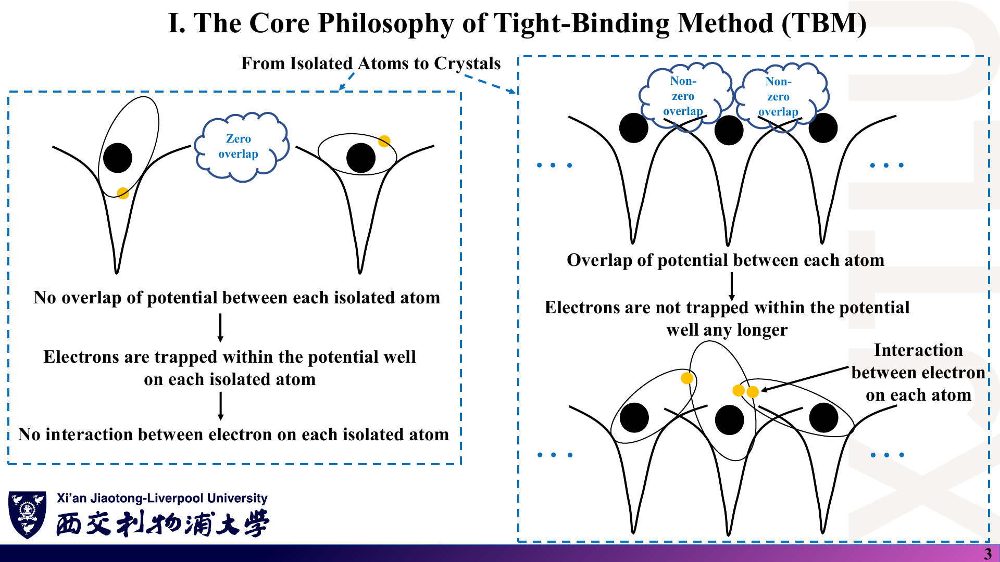
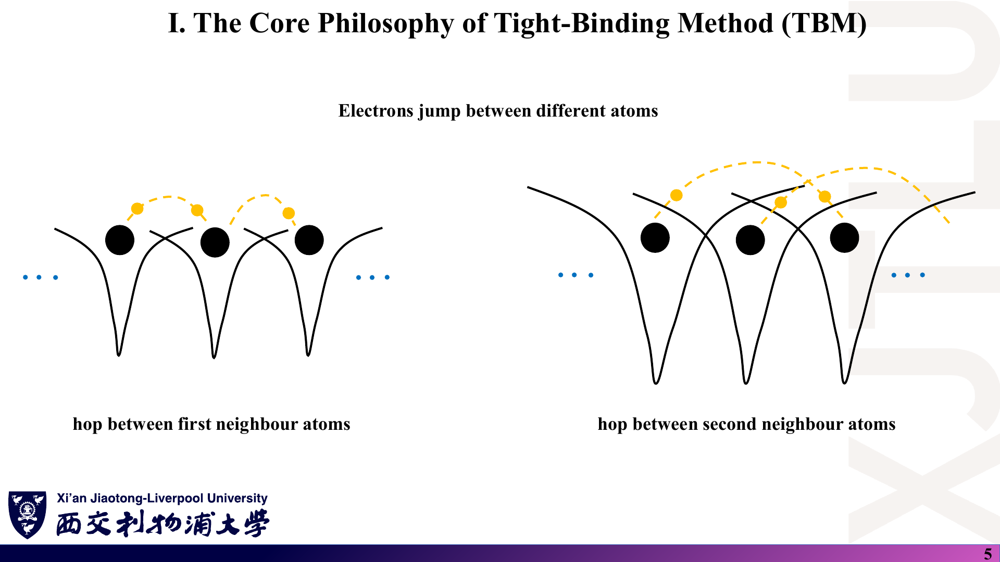
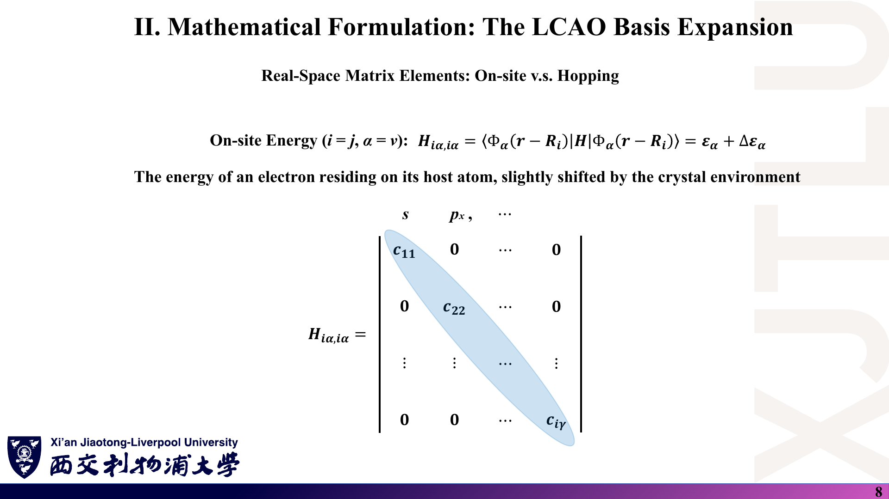
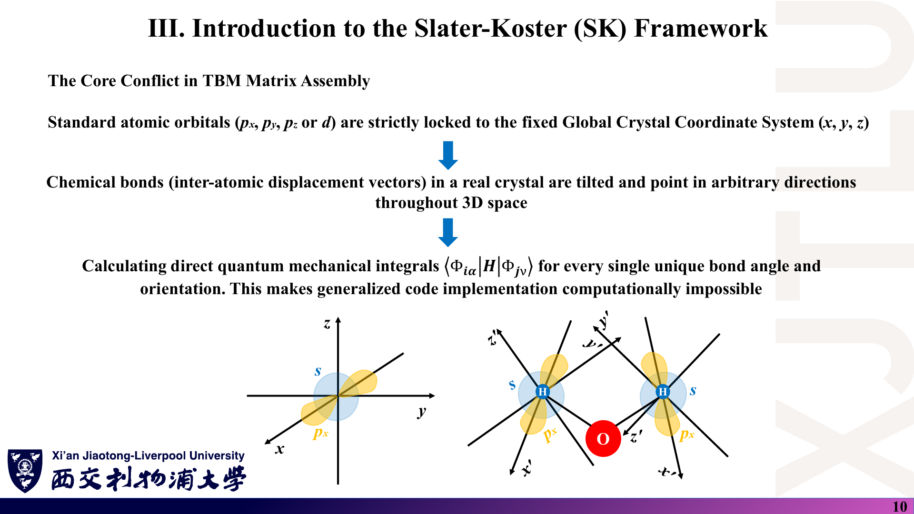
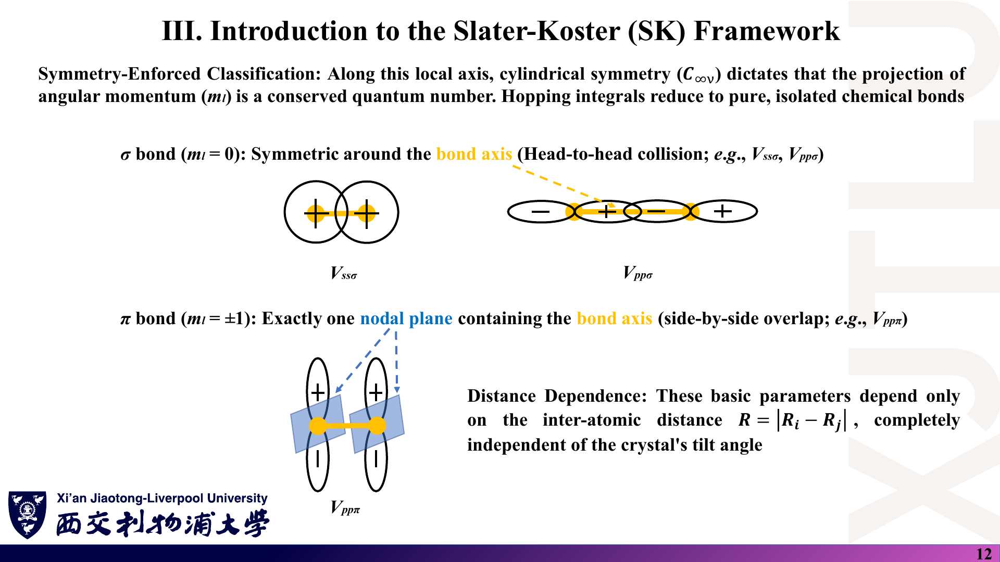
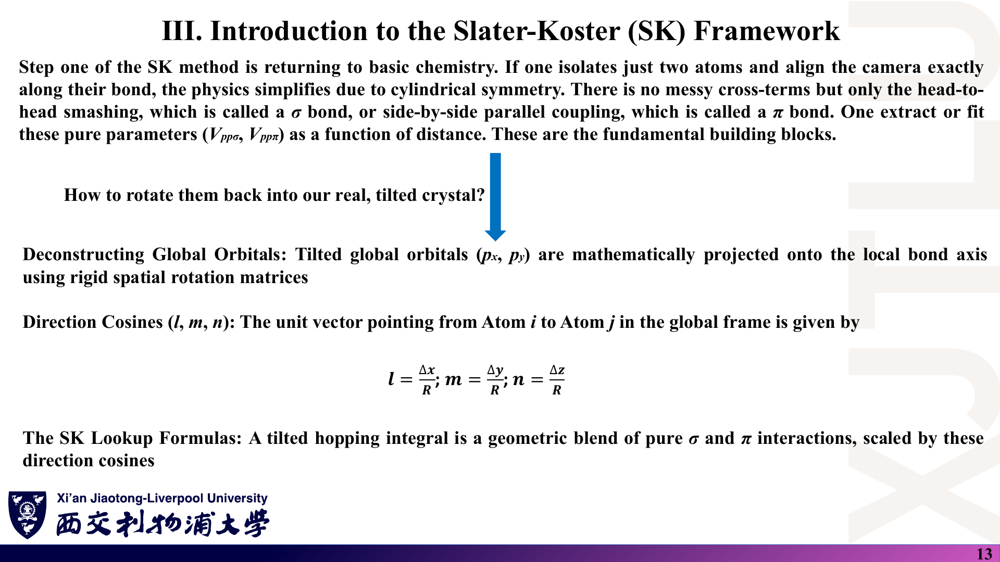
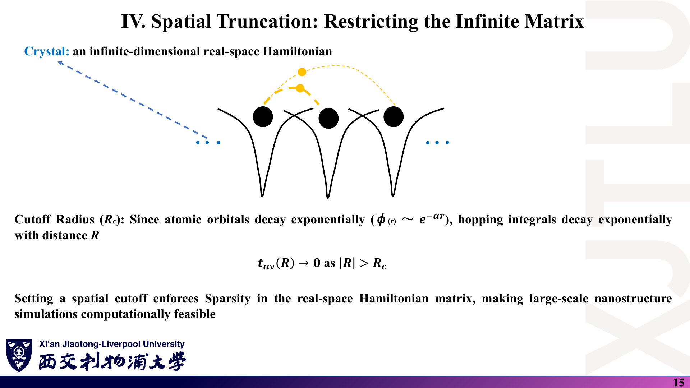
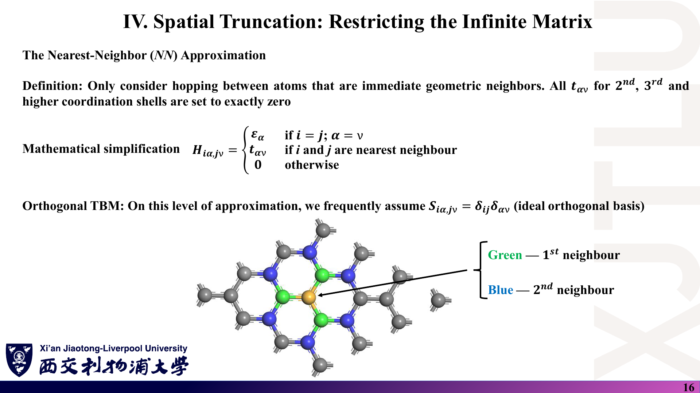

# 01 · 紧束缚方法基础与 Slater–Koster 框架

来源：[Lecture_Nine.pdf](../Lecture_Nine.pdf)，17 页（由 `Lecture_Nine.pptx` 转换）。

[返回目录](README.md)

## 1. 从孤立原子到晶体，紧束缚的出发点是什么？〔pp. 3–5〕

### 课件截图

### 中文解释

孤立原子相距很远时，各自的势阱互不重叠，电子被束缚在本原子上，能级是分立的原子能级 $\varepsilon_\alpha$。原子靠近组成晶体后，相邻势阱发生重叠，电子可以从一个原子“跳”到另一个原子；离得越近的原子之间跳得越容易（第一近邻 > 第二近邻）。紧束缚方法（Tight-Binding Method, TBM）就是**把晶体看成“原子 + 弱扰动”**：仍用原子轨道描述电子，只额外计入原子间的跳跃。

### 原理深入

讲义第 4 页的分解：

$$
H_{\rm total}=H_{\rm atom}+\Delta V(\mathbf r),\qquad H_{\rm atom}\Phi_\alpha=\varepsilon_\alpha\Phi_\alpha .
$$

$\Delta V$ 是晶格中**其他所有离子**对某个原子上电子的附加势。对一个以 $\mathbf R_i$ 为中心的电子：

$$
\Delta V_i(\mathbf r)=\sum_{j\ne i}V_{\rm at}(\mathbf r-\mathbf R_j)\quad\text{（补充：最简单的“原子势叠加”图像）}.
$$

**补充：紧束缚何时适用？**

- 轨道足够局域：轨道半径小于或接近近邻距离，重叠是“小量”。典型例子是 d 电子、共价半导体的价带、石墨烯的 $p_z$ 带。
- 不适合近自由电子金属（如 Na 的价电子），那里平面波更自然。
- “微扰性重叠”（讲义原文 *overlap perturbatively*）只是物理图像，不是说必须用微扰论计算；紧束缚最后仍是精确对角化一个模型矩阵。

**第一近邻与第二近邻（第 5 页）**：跳跃强度随距离迅速衰减，因此通常只保留少数几层近邻。第 6 节会给出这种截断的依据。

### Ref

- **原课件**：[Lecture Nine，PDF 第 3–5 页](../Lecture_Nine.pdf#page=4)。
- **延伸**：[SS1：紧束缚方法](README.md#ref-ss1)；[HAR：从原子轨道到化学键](README.md#ref-har)。

## 2. LCAO 如何把薛定谔方程变成矩阵问题？〔pp. 6–7〕

### 课件截图

*第 6 页右侧把系数排成多列方阵，且第一行最后一列重复写成 $c_{12}$；一个波函数的系数应是一列向量，见 [07 勘误](07_讲义勘误与易错点.md)。*

### 中文解释

晶体波函数写成所有原子上所有轨道的线性组合（LCAO）。下标 $i$ 标记原子位置，$\alpha$ 标记轨道类型（s、$p_x$、$p_y$、$p_z$、$d_{xy}$……）。把这个展开代入薛定谔方程并投影到每个基函数上，连续的偏微分方程就变成关于系数 $c_{j\nu}$ 的线性代数方程。

### 原理深入

$$
\Psi(\mathbf r)=\sum_{i,\alpha}c_{i\alpha}\,\Phi_\alpha(\mathbf r-\mathbf R_i).
$$

**推导〔补充〕**：代入 $H|\Psi\rangle=E|\Psi\rangle$，左乘 $\langle\Phi_\alpha(\mathbf r-\mathbf R_i)|$：

$$
\sum_{j,\nu}c_{j\nu}\,\langle\Phi_{i\alpha}|H|\Phi_{j\nu}\rangle
=E\sum_{j,\nu}c_{j\nu}\,\langle\Phi_{i\alpha}|\Phi_{j\nu}\rangle ,
$$

即讲义第 7 页的

$$
\boxed{\sum_{j\nu}H_{i\alpha,j\nu}\,c_{j\nu}=E\sum_{j\nu}S_{i\alpha,j\nu}\,c_{j\nu}}
\quad\Longleftrightarrow\quad Hc=ESc,
$$

$$
H_{i\alpha,j\nu}=\langle\Phi_\alpha(\mathbf r-\mathbf R_i)|H|\Phi_\nu(\mathbf r-\mathbf R_j)\rangle,\qquad
S_{i\alpha,j\nu}=\langle\Phi_\alpha(\mathbf r-\mathbf R_i)|\Phi_\nu(\mathbf r-\mathbf R_j)\rangle .
$$

要点：

- **系数向量的形状**：把所有 $(i,\alpha)$ 排成一个复合指标，$c$ 是**一列**；不同本征态才并排成多列。
- **不同原子的轨道一般不正交**：同一原子上的 s 与 p 正交，但 $\langle\Phi_s(\mathbf r-\mathbf R_1)|\Phi_s(\mathbf r-\mathbf R_2)\rangle\ne0$。所以一般是**广义本征问题**；第 6 节的“正交 TBM”假设 $S=I$ 才退化为 $Hc=Ec$（与第一周 03 笔记的 $Hc=ESc$ 衔接）。
- **矩阵维数**：每个原子的轨道数 × 原子数；对无穷晶体是无穷大，需要第十讲的 Bloch 定理化简。

### Ref

- **原课件**：[Lecture Nine，PDF 第 6–7 页](../Lecture_Nine.pdf#page=7)。
- **衔接**：[第一周 03：广义本征方程](../../Week_One/学习笔记/03_哈密顿量与基组.md)。
- **核验**：[07 勘误：系数矩阵与符号](07_讲义勘误与易错点.md)。

## 3. 在位能与跳跃积分分别表示什么？〔pp. 8–9〕

### 课件截图

*两页的矩阵元素沿用了系数符号 $c$，并把 $|c_{21}|^2$ 称作“跳跃概率”；矩阵元应写作 $H$ 或 $t$，且跳跃积分是能量而不是概率，见 [07 勘误](07_讲义勘误与易错点.md)。*

### 中文解释

哈密顿矩阵只有两类非零元素：

- **对角元（在位能，on-site energy）**：电子待在自己原子的某个轨道上的能量。它接近孤立原子能级，但被晶体环境稍微移动。
- **非对角元（跳跃积分，hopping integral）**：把电子从 $j$ 原子的 $\nu$ 轨道“搬到” $i$ 原子的 $\alpha$ 轨道的耦合强度。

紧束缚的核心就是：**不再求解连续偏微分方程，而只需要知道少数几个 ε 和 t**。

### 原理深入

$$
H_{i\alpha,i\alpha}=\varepsilon_\alpha+\Delta\varepsilon_\alpha,\qquad
\Delta\varepsilon_\alpha=\langle\Phi_{i\alpha}|\Delta V_i|\Phi_{i\alpha}\rangle\ \text{（晶体场位移）}.
$$

$$
t_{\alpha\nu}(\mathbf R_i-\mathbf R_j)=H_{i\alpha,j\nu}=\langle\Phi_\alpha(\mathbf r-\mathbf R_i)|H|\Phi_\nu(\mathbf r-\mathbf R_j)\rangle,\quad i\ne j .
$$

**为什么 t 常为负？〔补充推导〕** 设 $\Phi_{j\nu}$ 满足 $(H_{\rm atom,j})\Phi_{j\nu}=\varepsilon_\nu\Phi_{j\nu}$，则

$$
t=\langle\Phi_{i\alpha}|H_{\rm atom,j}+\Delta V_j|\Phi_{j\nu}\rangle
=\varepsilon_\nu S_{i\alpha,j\nu}+\langle\Phi_{i\alpha}|\Delta V_j|\Phi_{j\nu}\rangle .
$$

在正交近似（$S\approx0$）下主要剩第二项。$\Delta V_j$ 是其他离子的吸引势，处处 $<0$；若两个轨道在重叠区同号（例如两个 s 轨道、两个平行的 $p_z$ 轨道），积分为负，$t<0$。

**但不能把“t<0”当成普遍定律**：符号取决于两个轨道在重叠区的相对相位。例如两个都指向 $+x$ 的 $p_x$ 轨道沿 x 轴排列时，重叠区一正一负，$V_{pp\sigma}$ 按常用约定为正。石墨烯 $p_z$ 的 $t=V_{pp\pi}\approx-2.7$ eV 属于前一类。

**单位**：ε、t 都是能量（eV）。它们是矩阵元，不是概率；“概率幅”的说法只在含时问题中才有意义：短时间内从 $j$ 跃迁到 $i$ 的振幅约为 $-i t\,\Delta t/\hbar$。

### Ref

- **原课件**：[Lecture Nine，PDF 第 8–9 页](../Lecture_Nine.pdf#page=9)。
- **延伸**：[HAR：σ/π 矩阵元的符号](README.md#ref-har)；[SK54](README.md#ref-sk54)。
- **核验**：[07 勘误：跳跃积分不是概率](07_讲义勘误与易错点.md)。

## 4. 为什么需要 Slater–Koster 双中心近似？〔pp. 10–12〕

### 课件截图

### 中文解释

$p_x$、$p_y$、$p_z$ 是按**全局晶体坐标**定义的，但真实晶体中的键可以指向任意方向。若对每个键角都重新计算一次积分，程序将无法通用。Slater 与 Koster（1954）的办法是：

1. **双中心近似**：只考虑两个原子本身，忽略第三个原子势场的影响；
2. 以**键轴为局部 z 轴**，此时问题具有绕键轴的柱对称性；
3. 轨道按绕键轴的角动量投影 $m_l$ 分类：$m_l=0$ 为 σ 键，$|m_l|=1$ 为 π 键（d 轨道还有 δ 键）；
4. 只需拟合少数“纯”参数 $V_{ss\sigma},V_{sp\sigma},V_{pp\sigma},V_{pp\pi},\dots$，它们只依赖原子间距离 $R$。

### 原理深入

**为什么柱对称导致“只剩 σ、π”？〔补充〕** 绕键轴转动 $\phi$ 时，局部 $m_l$ 轨道获得相位 $e^{im_l\phi}$；哈密顿量在此转动下不变，所以 $\langle m_l|H|m_l'\rangle$ 只有在 $m_l=m_l'$ 时才可能非零。于是 p–p 相互作用在局部坐标里是对角的：

$$
\langle p_{z'}|H|p_{z'}\rangle=V_{pp\sigma},\qquad
\langle p_{x'}|H|p_{x'}\rangle=\langle p_{y'}|H|p_{y'}\rangle=V_{pp\pi},\qquad
\text{交叉项}=0 .
$$

**双中心近似的代价**：真实晶体中 $\Delta V$ 包含所有其他原子的势，三中心积分会使同一距离、不同环境的键略有差别。经验 SK 参数通常通过拟合第一性原理能带“吸收”这些效应，因此**参数的可移植性有限**（换结构时需谨慎）。

**距离依赖**：讲义强调参数“只依赖 $R=|\mathbf R_i-\mathbf R_j|$，与晶体取向无关”。取向信息全部交给下一节的方向余弦。

### Ref

- **原课件**：[Lecture Nine，PDF 第 10–12 页](../Lecture_Nine.pdf#page=11)。
- **原始论文**：[SK54](README.md#ref-sk54)；综述 [PM03](README.md#ref-pm03)（课程补充文献）。

## 5. 方向余弦如何把 σ、π 参数“转回”晶体？〔pp. 13–14〕

### 课件截图

### 中文解释

设从原子 $i$ 指向原子 $j$ 的单位矢量为 $(l,m,n)=(\Delta x,\Delta y,\Delta z)/R$。把全局 $p_x$ 轨道分解为“沿键方向的分量”和“垂直键方向的分量”：沿键的分量贡献 σ 相互作用，垂直的分量贡献 π 相互作用。讲义以 $p_x$–$p_x$ 为例：键沿 x 轴时只剩 $V_{pp\sigma}$，键沿 y 轴时只剩 $V_{pp\pi}$，45° 时各占一半。

### 原理深入

**推导 $E_{x,x}$〔补充〕**：令 $\hat{\mathbf d}=(l,m,n)$。p 轨道像矢量一样变换，$p_x$ 对应单位矢量 $\hat{\mathbf x}$，分解为

$$
\hat{\mathbf x}=(\hat{\mathbf x}\cdot\hat{\mathbf d})\,\hat{\mathbf d}+\big[\hat{\mathbf x}-(\hat{\mathbf x}\cdot\hat{\mathbf d})\hat{\mathbf d}\big]
=l\,\hat{\mathbf d}+\mathbf x_\perp .
$$

σ 部分系数 $l$；π 部分为 $\mathbf x_\perp$，其模方为 $1-l^2$。两原子的 $p_x$ 作同样分解后，σ–π 交叉项为零，于是

$$
\boxed{E_{x,x}=l^2V_{pp\sigma}+(1-l^2)V_{pp\pi}} .
$$

同理（SK 表中的常用几项，补充）：

| 矩阵元 | SK 表达式 |
|---|---|
| $E_{s,s}$ | $V_{ss\sigma}$ |
| $E_{s,x}$ | $l\,V_{sp\sigma}$ |
| $E_{x,x}$ | $l^2V_{pp\sigma}+(1-l^2)V_{pp\pi}$ |
| $E_{x,y}$ | $lm\,(V_{pp\sigma}-V_{pp\pi})$ |
| $E_{x,z}$ | $ln\,(V_{pp\sigma}-V_{pp\pi})$ |
| $E_{z,z}$ | $n^2V_{pp\sigma}+(1-n^2)V_{pp\pi}$ |

**与石墨烯的联系**：石墨烯所有近邻键都在 xy 平面内，$n=0$，所以

$$
E_{z,z}=V_{pp\pi}\equiv t .
$$

这就是第十二讲只用**一个**跳跃参数 $t$ 的原因（程序中取 $-2.7$ eV）。同时，$E_{s,z}=nV_{sp\sigma}=0$、$E_{x,z}=E_{y,z}=0$，说明平面石墨烯的 $p_z$（π）带与 $s,p_x,p_y$（σ）带严格解耦——只要结构保持平面。

**易错点**：

- 方向余弦有方向：$E_{s,x}$ 在 $i\leftrightarrow j$ 互换时 $l\to-l$ 变号；而 $E_{x,x}$ 只含 $l^2$，不变。
- 45° 时 $l^2=0.5$，“50–50 混合”只对 $E_{x,x}$ 这一项成立。

### Ref

- **原课件**：[Lecture Nine，PDF 第 13–14 页](../Lecture_Nine.pdf#page=14)。
- **完整 SK 表**：[SK54](README.md#ref-sk54)；[HAR](README.md#ref-har)。
- **练习**：[复习题第 2 题](06_复习题与参考答案.md)。

## 6. 怎样把无穷大的哈密顿矩阵截断？〔pp. 15–16〕

### 课件截图

### 中文解释

原子轨道指数衰减，所以跳跃积分随距离迅速变小。设定截断半径 $R_c$，超过它的 $t$ 一律视为 0，实空间矩阵因此变得稀疏。最极端也最常用的是**最近邻（NN）近似**：只保留第一配位壳层的跳跃。再加上**正交基假设** $S=\delta_{ij}\delta_{\alpha\nu}$，问题就变成普通的厄米矩阵本征值问题。

### 原理深入

讲义的 NN 模型：

$$
H_{i\alpha,j\nu}=\begin{cases}
\varepsilon_\alpha, & i=j,\ \alpha=\nu\\
t_{\alpha\nu}, & i,j\ \text{为最近邻}\\
0, & \text{其他}
\end{cases}
\qquad S_{i\alpha,j\nu}=\delta_{ij}\delta_{\alpha\nu}.
$$

需要说明的几点〔补充〕：

- **“$t\to0$ as $|R|>R_c$”是模型选择，不是数学极限**：实际 $t(R)$ 只是渐近衰减，截断带来可控误差，应检验结果对 $R_c$ 是否敏感。
- **同一原子不同轨道** $(i=j,\ \alpha\ne\nu)$ 在上式中归入“0”。在高对称位点这通常由对称性保证，低对称环境（晶体场）下可能非零。
- **石墨烯的近邻壳层**（第 16 页图）：第一近邻 3 个，距离 $a/\sqrt3\approx1.42$ Å，**属于另一子格**；第二近邻 6 个，距离 $a=2.46$ Å，**属于同一子格**。所以加入第二近邻会出现在 $H(\mathbf k)$ 的**对角元**上，破坏 $E\to-E$ 的电子-空穴对称性。
- **正交近似与参数拟合**：若真实轨道不正交，正交 TB 的 ε、t 是“有效参数”，与 $Hc=ESc$ 模型中的参数数值不同，不能混用。
- **稀疏性的意义**：对纳米结构等无周期体系，矩阵仍是实空间的，稀疏性使存储与对角化成本可控；对周期晶体，下一讲用 Bloch 定理直接把问题约化到每个 k 点。

### Ref

- **原课件**：[Lecture Nine，PDF 第 15–16 页](../Lecture_Nine.pdf#page=16)。
- **代码对应**：近邻搜索与 $R_{\min}\pm\delta$ 判据见 [08 代码导读](08_代码导读.md)。
- **延伸**：[CN09：石墨烯的第二近邻跳跃](README.md#ref-cn09)。
