# 02 · Bloch 定理、多子格变换与一维链

来源：[Lecture_Ten.pdf](../Lecture_Ten.pdf)，18 页（由 `Lecture_Ten.pptx` 转换）。

[返回目录](README.md)

## 1. 平移对称性为什么能约束本征态？〔p. 3〕

### 课件截图

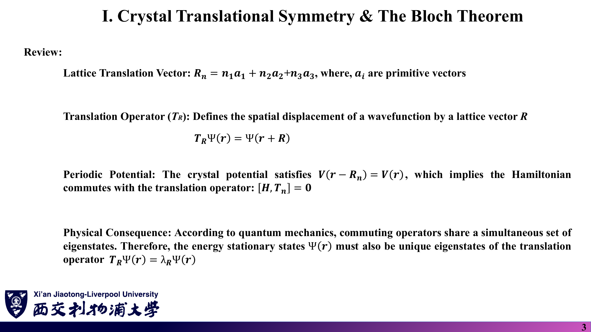

### 中文解释

晶体沿格矢 $\mathbf R_n=n_1\mathbf a_1+n_2\mathbf a_2+n_3\mathbf a_3$ 平移后看起来完全一样，所以势能是周期的，哈密顿量与平移算符对易。对易算符可以拥有共同的本征态，于是可以把能量本征态同时选成平移算符的本征态，用平移本征值 $\lambda_{\mathbf R}$ 给它们贴标签。

### 原理深入

$$
T_{\mathbf R}\Psi(\mathbf r)=\Psi(\mathbf r+\mathbf R),\qquad V(\mathbf r+\mathbf R_n)=V(\mathbf r)\ \Rightarrow\ [H,T_{\mathbf R_n}]=0 .
$$

**措辞要精确〔补充〕**：讲义写“能量本征态必然也是平移算符的唯一本征态”。严格说法是：**可以选择**一组共同本征态。若某能级简并，简并子空间中的任意线性组合仍是 H 的本征态，却未必是 $T_{\mathbf R}$ 的本征态。数值求解 $H(\mathbf k)$ 时我们实际上是在每个 k 子空间内求解，因此自动得到这组“好”的态。

**$\lambda_{\mathbf R}$ 的性质**：$T_{\mathbf R}T_{\mathbf R'}=T_{\mathbf R+\mathbf R'}$，故 $\lambda_{\mathbf R}\lambda_{\mathbf R'}=\lambda_{\mathbf R+\mathbf R'}$；$T$ 是酉算符，故 $|\lambda|=1$。满足这两条的只能是 $\lambda_{\mathbf R}=e^{i\mathbf k\cdot\mathbf R}$ 的形式。

### Ref

- **原课件**：[Lecture Ten，PDF 第 3 页](../Lecture_Ten.pdf#page=3)。
- **衔接**：第一周 04 笔记的 Bloch 定理；延伸 [SS1](README.md#ref-ss1)。

## 2. 周期性边界条件如何给出离散 k 与第一布里渊区？〔pp. 4–5〕

### 课件截图

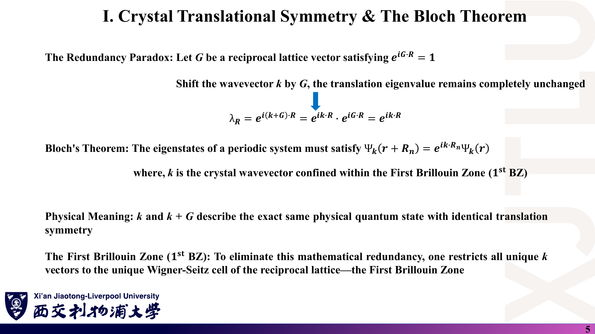

*第 4 页最后一行把一般格矢写成 $\sum N_i\mathbf a_i$，应为 $\sum n_i\mathbf a_i$（$n_i$ 为任意整数）；$N_i$ 是边界条件中的原胞个数，见 [07 勘误](07_讲义勘误与易错点.md)。*

### 中文解释

把宏观晶体想象成每个方向有 $N_i$ 个原胞、首尾相接的环。绕一圈回到原处，波函数不变，这要求平移本征值是 $N_i$ 次单位根，于是 k 只能取离散值。另外，k 加上任意倒格矢 $\mathbf G$ 后平移本征值不变，所以只需在一个倒格原胞（通常选第一布里渊区）内取 k。

### 原理深入

周期性边界条件：

$$
\Psi(\mathbf r+N_i\mathbf a_i)=\Psi(\mathbf r)\ \Rightarrow\ \lambda_{\mathbf a_i}^{N_i}=1\ \Rightarrow\ \lambda_{\mathbf a_i}=e^{i2\pi m_i/N_i},\quad m_i\in\mathbb Z .
$$

对一般格矢 $\mathbf R=\sum_i n_i\mathbf a_i$：

$$
\lambda_{\mathbf R}=\prod_i\lambda_{\mathbf a_i}^{n_i}=e^{i\mathbf k\cdot\mathbf R},\qquad
\boxed{\mathbf k=\sum_i\frac{m_i}{N_i}\mathbf b_i},\qquad \mathbf a_i\cdot\mathbf b_j=2\pi\delta_{ij}.
$$

最后一个条件是倒格矢的定义，正是它让 $\mathbf k\cdot\mathbf R=2\pi\sum_i m_in_i/N_i$ 成立。

**k 点数等于原胞数〔补充〕**：$m_i$ 取 $0,1,\dots,N_i-1$ 就遍历了所有不等价的 k，共 $N=N_1N_2N_3$ 个——每个原胞贡献一个 k，每个 k 上有“每原胞轨道数”条能带，总态数守恒。这也是后面 DOS 计算要在**均匀 k 网格**上采样的原因。

**Bloch 定理**：

$$
\Psi_{\mathbf k}(\mathbf r+\mathbf R_n)=e^{i\mathbf k\cdot\mathbf R_n}\Psi_{\mathbf k}(\mathbf r).
$$

$\mathbf k$ 与 $\mathbf k+\mathbf G$ 给出相同的平移本征值，是同一组量子数；第一布里渊区是倒格子的 Wigner–Seitz 原胞，选它只是去除重复的一种约定。程序中 k 点用**分数坐标**（以 $\mathbf b_i$ 为基）给出，再乘以倒格矢矩阵换成笛卡尔坐标，见 [08](08_代码导读.md)。

### Ref

- **原课件**：[Lecture Ten，PDF 第 4–5 页](../Lecture_Ten.pdf#page=4)。
- **核验**：[07 勘误：一般格矢的系数](07_讲义勘误与易错点.md)。
- **延伸**：[SS1：周期性边界条件与倒格子](README.md#ref-ss1)。

## 3. Bloch 和怎样把无穷大矩阵变成 H(k)？〔pp. 6–7〕

### 课件截图

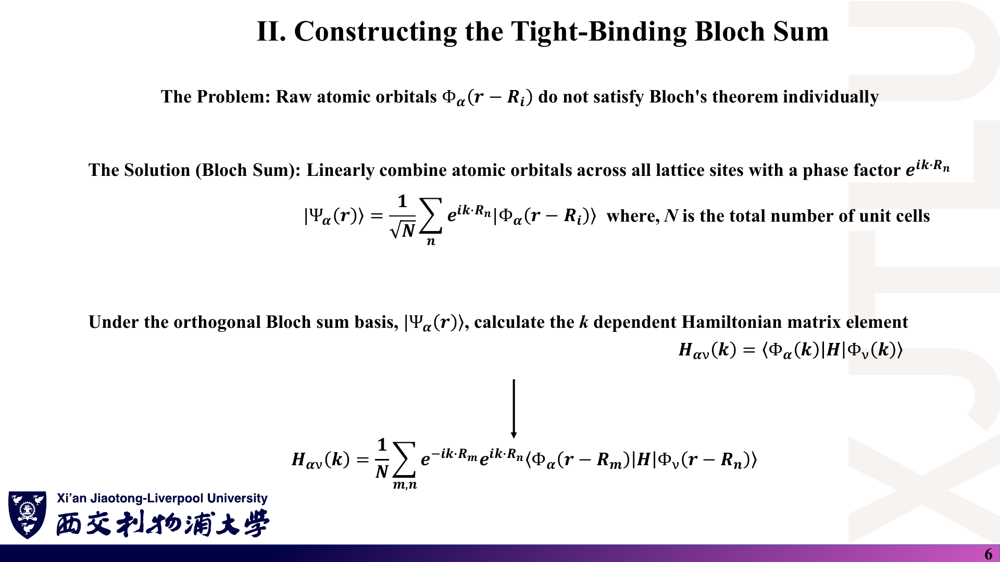

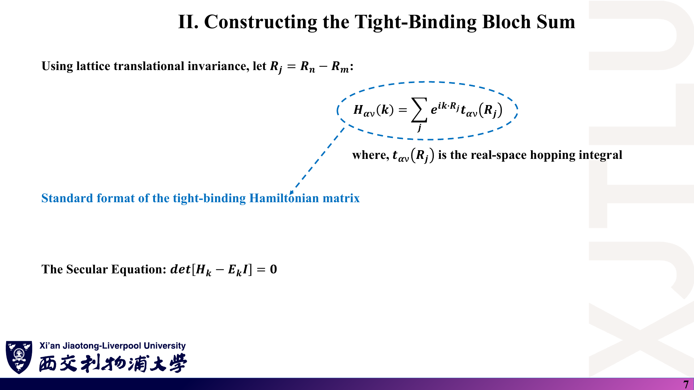

*第 6 页的 Bloch 和对 $n$ 求和，但轨道写成 $\Phi_\alpha(\mathbf r-\mathbf R_i)$，应为 $\Phi_\alpha(\mathbf r-\mathbf R_n)$；左侧记号 $\Psi_\alpha$ 与下面的 $\Phi_\alpha(\mathbf k)$ 指同一对象。*

### 中文解释

单个原子轨道不满足 Bloch 定理（平移后变成另一个原子的轨道，而不是自身乘相位）。把所有原胞上同类轨道带着相位 $e^{i\mathbf k\cdot\mathbf R_n}$ 加起来，就得到满足 Bloch 定理的“Bloch 和”。用 Bloch 和做基底，不同 k 之间的矩阵元为零，每个 k 只剩一个小矩阵 $H(\mathbf k)$。

### 原理深入

$$
|\Phi_\alpha(\mathbf k)\rangle=\frac1{\sqrt N}\sum_n e^{i\mathbf k\cdot\mathbf R_n}\,|\Phi_\alpha(\mathbf r-\mathbf R_n)\rangle .
$$

**验证它满足 Bloch 定理〔补充〕**：

$$
T_{\mathbf R}\Phi_\alpha(\mathbf k)=\frac1{\sqrt N}\sum_n e^{i\mathbf k\cdot\mathbf R_n}\Phi_\alpha(\mathbf r+\mathbf R-\mathbf R_n)
\overset{\mathbf R_{n'}=\mathbf R_n-\mathbf R}{=}e^{i\mathbf k\cdot\mathbf R}\,\frac1{\sqrt N}\sum_{n'}e^{i\mathbf k\cdot\mathbf R_{n'}}\Phi_\alpha(\mathbf r-\mathbf R_{n'}).
$$

**矩阵元**：

$$
H_{\alpha\nu}(\mathbf k)=\frac1N\sum_{m,n}e^{-i\mathbf k\cdot\mathbf R_m}e^{i\mathbf k\cdot\mathbf R_n}\langle\Phi_\alpha(\mathbf r-\mathbf R_m)|H|\Phi_\nu(\mathbf r-\mathbf R_n)\rangle .
$$

平移不变性使矩阵元只依赖 $\mathbf R_j=\mathbf R_n-\mathbf R_m$；对 $m$ 的求和给出 $N$ 个相同的项，抵消 $1/N$：

$$
\boxed{H_{\alpha\nu}(\mathbf k)=\sum_j e^{i\mathbf k\cdot\mathbf R_j}\,t_{\alpha\nu}(\mathbf R_j)},\qquad
\det[H(\mathbf k)-E(\mathbf k)I]=0 .
$$

注意 $t_{\alpha\nu}(\mathbf 0)$ 就是在位能（同一原胞、同一轨道），它包含在 $j$ 的求和中。

**不同 k 不耦合〔补充〕**：$\langle\Phi_\alpha(\mathbf k)|H|\Phi_\nu(\mathbf k')\rangle\propto\sum_m e^{i(\mathbf k'-\mathbf k)\cdot\mathbf R_m}=N\delta_{\mathbf k\mathbf k'}$。这是“对角化无穷矩阵 → 对角化很多小矩阵”的根本原因。

**正交性的前提**：讲义称其为“正交 Bloch 和基”，这需要原子轨道本身正交（第九讲 $S=I$ 假设）；否则还要计算 $S_{\alpha\nu}(\mathbf k)=\sum_j e^{i\mathbf k\cdot\mathbf R_j}S_{\alpha\nu}(\mathbf R_j)$，解 $H(\mathbf k)c=ES(\mathbf k)c$。

### Ref

- **原课件**：[Lecture Ten，PDF 第 6–7 页](../Lecture_Ten.pdf#page=7)。
- **另一种推导**：[03：二次量子化 Fourier 变换](03_二次量子化与代码架构.md)。
- **核验**：[07 勘误：Bloch 和的下标](07_讲义勘误与易错点.md)。

## 4. 一维单原子链的能带是怎样算出来的？〔pp. 8–10〕

### 课件截图

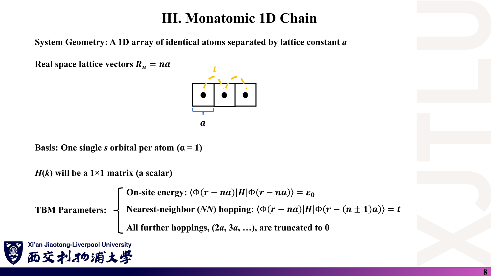

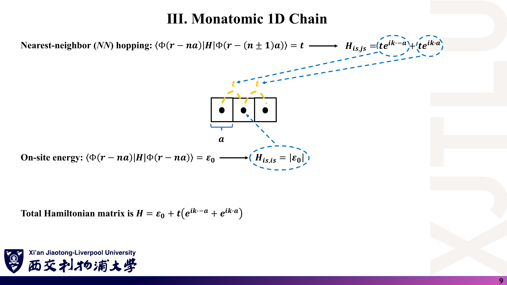

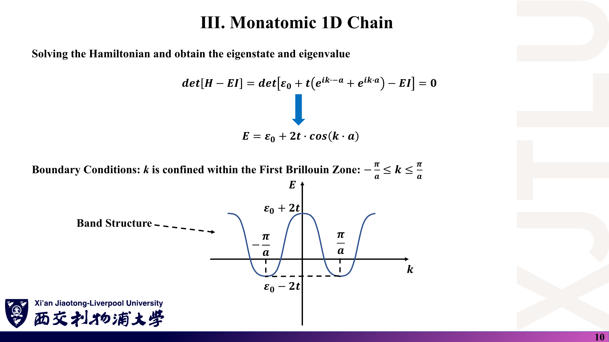

*第 9 页把在位项写成 $|\varepsilon_0|$，绝对值号多余；第 10 页的曲线形状（k=0 处为最高点）对应 $t>0$，与第九讲“t 通常为负”不一致，见 [07 勘误](07_讲义勘误与易错点.md)。*

### 中文解释

一维链每个原胞只有一个原子、一个 s 轨道，所以 $H(k)$ 是 1×1 矩阵（一个数），对角化就是直接读出它。只保留左右两个最近邻（格矢 $\pm a$）的跳跃，两项相位互为共轭，合起来是余弦。

### 原理深入

$$
H(k)=\sum_j e^{ikR_j}t(R_j)=\varepsilon_0+t\,e^{-ika}+t\,e^{ika}=\boxed{\varepsilon_0+2t\cos ka},\qquad -\frac\pi a<k\le\frac\pi a .
$$

本征值就是 $E(k)=H(k)$，本征态是 Bloch 和本身。

**能带形状由 t 的符号决定〔补充〕**：

| | $k=0$ | $k=\pm\pi/a$ |
|---|---|---|
| $t<0$（s 轨道的常见情形） | $\varepsilon_0+2t$ = **带底** | $\varepsilon_0-2t$ = **带顶** |
| $t>0$ | 带顶 | 带底 |

讲义第 10 页的图对应 $t>0$。按第九讲 $t<0$ 的设定，应把曲线上下翻转：$k=0$ 处最低。

**与有限链的关系〔补充〕**：$N$ 个原子首尾相连时，$k=2\pi m/(Na)$，$m=0,\dots,N-1$，得到 $N$ 个分立能级，全部落在 $[\varepsilon_0-2|t|,\varepsilon_0+2|t|]$ 内——孤立原子的一个能级展宽成了宽度 $4|t|$ 的能带。

### Ref

- **原课件**：[Lecture Ten，PDF 第 8–10 页](../Lecture_Ten.pdf#page=10)。
- **练习**：[复习题第 4 题](06_复习题与参考答案.md)。

## 5. 带宽、群速度与有效质量说明了什么？〔p. 11〕

### 课件截图

*原图带宽写作 $4t$，应为 $4|t|$；“Top of band (k = 0)” 应为 $k=\pm\pi/a$；$d^2E/d^2k$ 应写 $d^2E/dk^2$。*

### 中文解释

能带的宽度由跳跃强度决定：跳得越容易，能带越宽。群速度是能带斜率，表示电子波包的传播速度；有效质量由能带曲率决定，带底附近像正质量的自由电子，带顶附近表现为负质量（可等效为正质量的空穴）。

### 原理深入

$$
W=E_{\max}-E_{\min}=\boxed{4|t|},
$$

$$
v_g(k)=\frac1\hbar\frac{dE}{dk}=-\frac{2ta}{\hbar}\sin ka,
\qquad
m^*(k)=\hbar^2\left(\frac{d^2E}{dk^2}\right)^{-1}=-\frac{\hbar^2}{2ta^2\cos ka}.
$$

取 $t<0$（与讲义第 11 页右侧 “$m^*>0$ at band bottom” 一致）：

- **带底 $k=0$**：$m^*=-\hbar^2/(2ta^2)=\hbar^2/(2|t|a^2)>0$，电子型；
- **带顶 $k=\pm\pi/a$**：$\cos ka=-1$，$m^*=\hbar^2/(2ta^2)<0$，空穴型。

讲义把带顶也写成 $k=0$，与公式矛盾（$k=0$ 时 $\cos ka=1$，只能给出一个值）。

**物理要点〔补充〕**：

- $v_g$ 在带底、带顶都为零，在 $k=\pm\pi/(2a)$ 取极大值 $2|t|a/\hbar$。
- 带底附近展开 $E\approx\varepsilon_0-2|t|+|t|a^2k^2$，与自由电子 $\hbar^2k^2/(2m^*)$ 比较即得同一 $m^*$——**窄带（小 $|t|$）对应大有效质量**。
- 在 $k=\pm\pi/(2a)$ 处 $m^*\to\infty$（曲率为零），这里“有效质量”概念失效，不是物理上质量无限大。

### Ref

- **原课件**：[Lecture Ten，PDF 第 11 页](../Lecture_Ten.pdf#page=11)。
- **核验**：[07 勘误：带宽与有效质量](07_讲义勘误与易错点.md)。
- **延伸**：[SS1：半经典动力学与有效质量](README.md#ref-ss1)。

## 6. 多原子原胞为什么要按子格分别构造 Bloch 和？〔pp. 12–15〕

### 课件截图

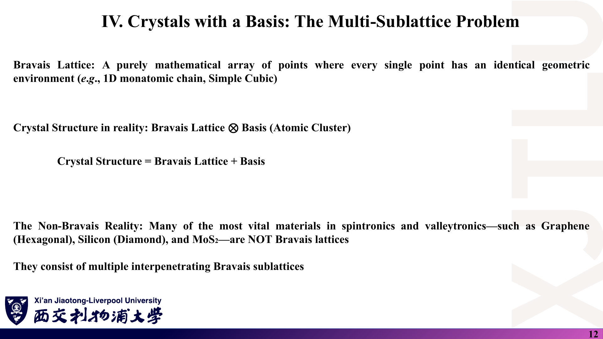

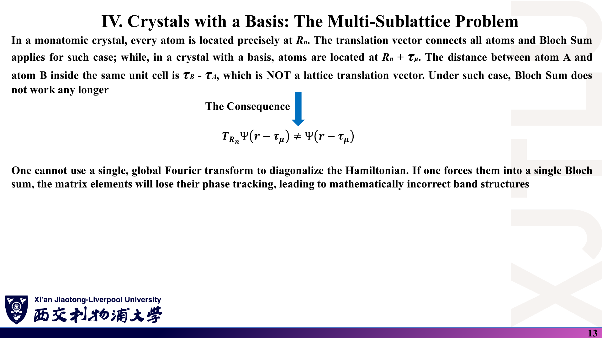

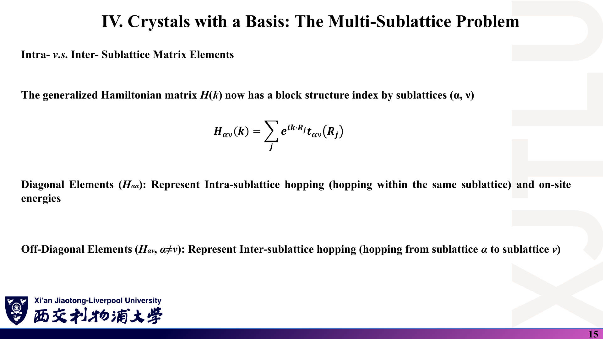

### 中文解释

石墨烯、硅、MoS₂ 都不是 Bravais 格子：一个原胞里有多个原子，同一原胞内 A、B 两原子之间的矢量 $\boldsymbol\tau_B-\boldsymbol\tau_A$ 不是格矢。A 原子平移一个格矢仍落在 A 原子上，却永远到不了 B 原子。因此要把 A 原子集合与 B 原子集合视为两个互相穿插的 Bravais 子格，**为每个子格（每种轨道）单独**构造 Bloch 和；$H(\mathbf k)$ 的维数等于原胞内的轨道总数。

### 原理深入

原子位置 $\mathbf r_{n\mu}=\mathbf R_n+\boldsymbol\tau_\mu$。子格 $\mu$ 的 Bloch 和（讲义第 14 页，下标应为 $\alpha\mu$）：

$$
|\Phi_{\alpha\mu}(\mathbf k)\rangle=\frac1{\sqrt N}\sum_n e^{i\mathbf k\cdot\mathbf R_n}\,|\Phi_\alpha(\mathbf r-\mathbf R_n-\boldsymbol\tau_\mu)\rangle .
$$

于是

$$
H_{\mu\nu}(\mathbf k)=\sum_j e^{i\mathbf k\cdot\mathbf R_j}\,t_{\mu\nu}(\mathbf R_j),\qquad
t_{\mu\nu}(\mathbf R_j)=\langle\Phi(\mathbf r-\boldsymbol\tau_\mu)|H|\Phi(\mathbf r-\mathbf R_j-\boldsymbol\tau_\nu)\rangle .
$$

- **对角块 $H_{\mu\mu}$**：在位能 + 同一子格内的跳跃（石墨烯中是第二近邻）。
- **非对角块 $H_{\mu\nu}$**：不同子格之间的跳跃（石墨烯中是第一近邻）。

**讲义说法的修正〔补充〕**：第 13 页称“Bloch 和不再适用”。更准确地说，是**单一的、对所有原子一起求和的 Bloch 和**不能把 A、B 区分开；Bloch 定理本身仍成立，只是需要每个子格一个 Bloch 和，结果是一个 $D\times D$ 的 $H(\mathbf k)$ 而非标量。

**两种相位约定〔补充，重要〕**：

| 约定 | Bloch 和中的相位 | 非对角元 | 出处 |
|---|---|---|---|
| 原胞约定（讲义第 14 页） | $e^{i\mathbf k\cdot\mathbf R_n}$ | $\sum t\,e^{i\mathbf k\cdot\mathbf R_j}$ | 第十讲 |
| 原子位置约定 | $e^{i\mathbf k\cdot(\mathbf R_n+\boldsymbol\tau_\mu)}$ | $\sum t\,e^{i\mathbf k\cdot(\mathbf R_j+\boldsymbol\tau_\nu-\boldsymbol\tau_\mu)}$ | 第十二讲与示例代码 |

两者相差对角幺正变换 $U=\mathrm{diag}(e^{i\mathbf k\cdot\boldsymbol\tau_\mu})$：$H^{\rm atom}(\mathbf k)=U^\dagger H^{\rm cell}(\mathbf k)U$。所以**本征值（能带）完全相同**，本征矢只差每个分量的相位。讲义第 14 页称原胞约定为“标准约定”，这只是众多文献中的一种；课程补充文献 [BM09] 专门讨论了两种基的差别：能带相同，但 $H(\mathbf k)$ 不是 BZ 周期函数（原子位置约定下 $H(\mathbf k+\mathbf G)\ne H(\mathbf k)$，只差幺正变换），涉及位置算符、Berry 相位等量时必须用一致的约定。

### Ref

- **原课件**：[Lecture Ten，PDF 第 12–15 页](../Lecture_Ten.pdf#page=14)。
- **课程补充文献**：[BM09：石墨烯紧束缚的两种基](README.md#ref-bm09)。
- **代码中的约定**：[08 代码导读](08_代码导读.md)。

## 7. 双原子链：讲义例子与完整结果〔pp. 16–17〕

### 课件截图

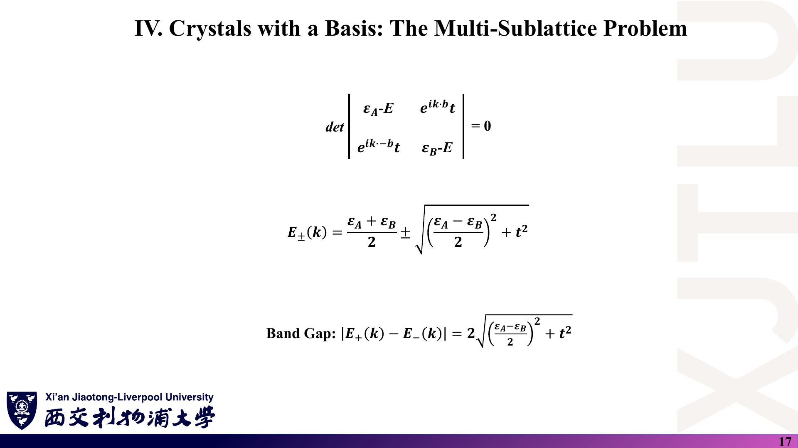

*这两页只计入了原胞内 A–B 一条键，因此 $E_\pm$ 与 k 无关；完整模型应同时计入原胞间的 B–A 键。*

### 中文解释

双原子链每个原胞有 A、B 两个原子，所以 $H(k)$ 是 2×2 矩阵：对角元是两个在位能，非对角元是 A–B 跳跃乘相位。求 2×2 矩阵的本征值得到两条能带 $E_\pm$。讲义给出的 $E_\pm$ 中只出现 $t^2$，不含 k——因为它只连了原胞内的一条键：这实际上描述的是一串互不相连的“双原子分子”，能带是平的。

### 原理深入

**讲义版本**（只有原胞内键，原子位置约定）：

$$
H(k)=\begin{pmatrix}\varepsilon_A&t\,e^{ikb}\\ t\,e^{-ikb}&\varepsilon_B\end{pmatrix},\qquad
E_\pm=\frac{\varepsilon_A+\varepsilon_B}2\pm\sqrt{\left(\frac{\varepsilon_A-\varepsilon_B}2\right)^2+t^2}.
$$

由于 $|te^{ikb}|^2=t^2$，相位在久期方程中消失。$E_+-E_-$ 是**同一 k 处**两能级的分裂，不是带隙的一般定义。

**完整版本〔补充〕**：A 在 $na$，B 在 $na+b$。设原胞内键 $t_1$（长度 $b$），原胞间键 $t_2$（$B_n$ 到 $A_{n+1}$，长度 $a-b$）。原胞约定下

$$
H(k)=\begin{pmatrix}\varepsilon_A&t_1+t_2e^{-ika}\\ t_1+t_2e^{ika}&\varepsilon_B\end{pmatrix},
\qquad |h(k)|^2=t_1^2+t_2^2+2t_1t_2\cos ka,
$$

$$
\boxed{E_\pm(k)=\bar\varepsilon\pm\sqrt{\Delta^2+t_1^2+t_2^2+2t_1t_2\cos ka}},\qquad
\bar\varepsilon=\frac{\varepsilon_A+\varepsilon_B}2,\ \Delta=\frac{\varepsilon_A-\varepsilon_B}2 .
$$

带隙 $=\min_kE_+-\max_kE_-$。若 $t_1t_2>0$，$|h|$ 在 $k=\pi/a$ 最小：

$$
E_g=2\sqrt{\Delta^2+(t_1-t_2)^2}.
$$

两个来源都会开隙：**在位能差**（$\Delta\ne0$，离子性）和**键长交替**（$t_1\ne t_2$，Peierls 二聚化）。等间距链 $t_1=t_2$ 时 $E_g=|\varepsilon_A-\varepsilon_B|$——这与第十二讲石墨烯的结论形式完全相同。

**其他细节**：

- 第 16 页 $H(k)=(\sum\varepsilon_i+\sum e^{ikb}t)+{\rm h.c.}$ 若照写，“h.c.”会把对角的 ε 再加一次（变成 $2\varepsilon$）；在位项应放在括号外。
- 第 16 页在矩阵中用 $e^{ikb}$（原子间距），与第 14 页“只用原胞矢量”的约定不一致。按第 14 页约定原胞内键的相位应为 1。两者本征值相同（见第 6 节）。
- 讲义给出的 $E_\pm$ 恰是完整结果在 $t_2=0$ 时的特例。

### Ref

- **原课件**：[Lecture Ten，PDF 第 16–17 页](../Lecture_Ten.pdf#page=17)。
- **核验**：[07 勘误：双原子链](07_讲义勘误与易错点.md)；[复习题第 6 题](06_复习题与参考答案.md)。
- **衔接**：[04：石墨烯的子格势带隙](04_石墨烯紧束缚与带隙调控.md)。
