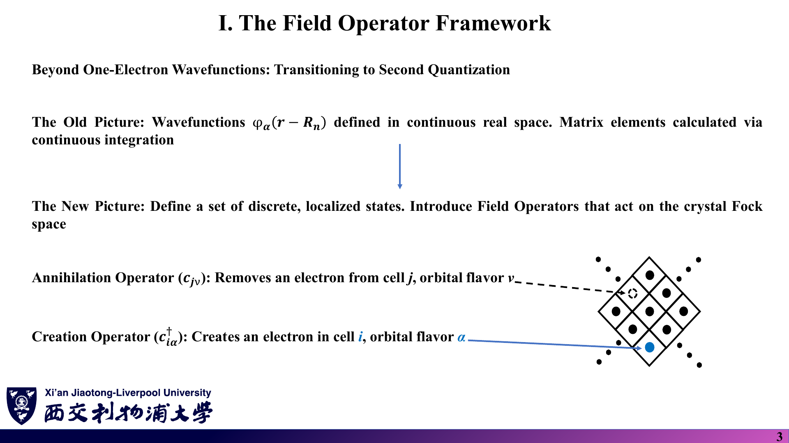
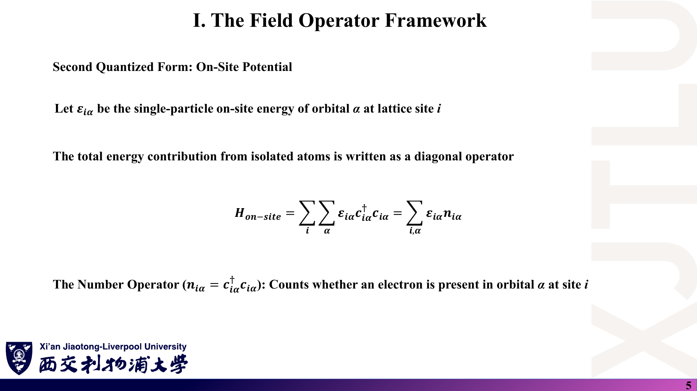
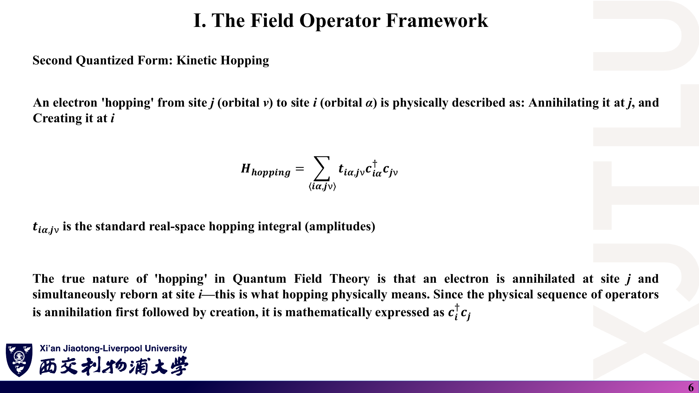
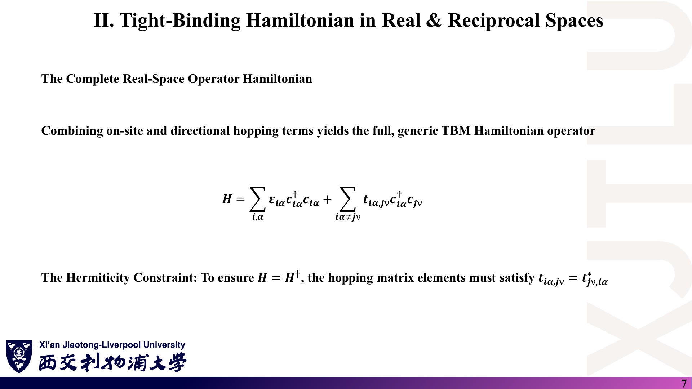
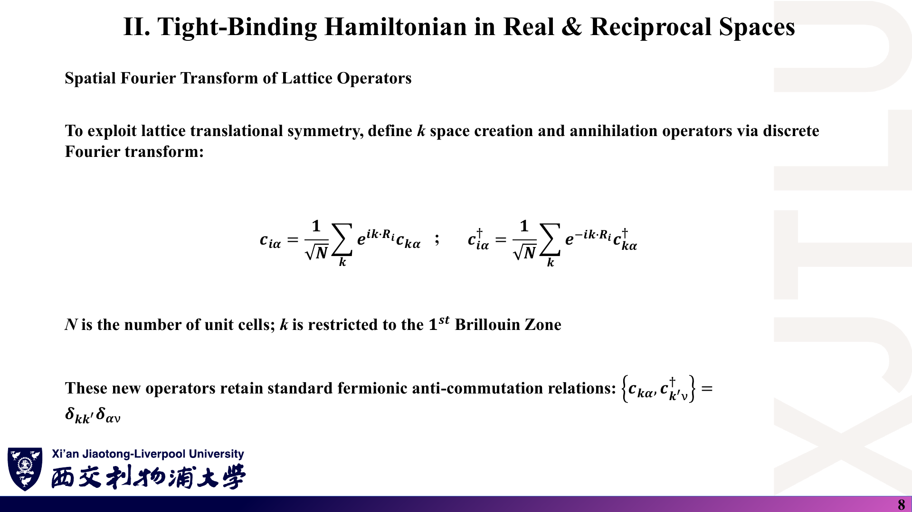
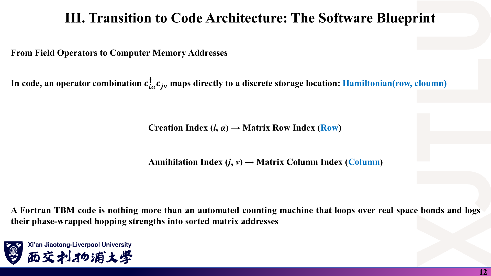
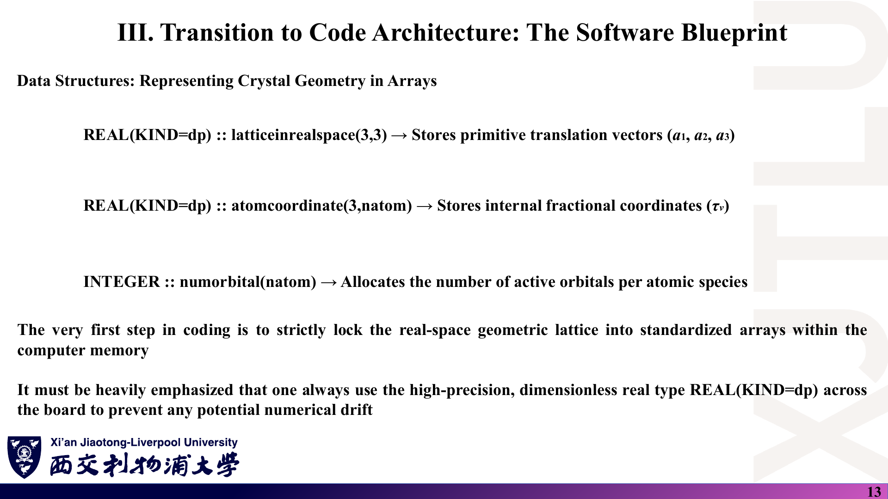

# 03 · 二次量子化表述与通用紧束缚代码架构

来源：[Lecture_Eleven.pdf](../Lecture_Eleven.pdf)，22 页（由 `Lecture_Eleven.pptx` 转换）。

[返回目录](README.md)

## 1. 为什么要引入产生与湮灭算符？〔pp. 3–4〕

### 课件截图




*第 4 页最后一式把 $c^\dagger c^\dagger|0\rangle$ 写成 $|0\rangle$，应为零矢量 $0$，见 [07 勘误](07_讲义勘误与易错点.md)。*

### 中文解释

第九、十讲用连续空间中的波函数和积分来定义矩阵元。紧束缚模型一旦参数化，就只剩“哪个格点哪个轨道上有没有电子”这类离散信息。产生算符 $c^\dagger_{i\alpha}$ 在原胞 $i$ 的轨道 $\alpha$ 上放一个电子，湮灭算符 $c_{j\nu}$ 从原胞 $j$ 的轨道 $\nu$ 上拿走一个电子。电子是费米子，这些算符满足反对易关系，自动保证同一个态不能放两个电子（Pauli 不相容原理）。

### 原理深入

$$
\{c_{i\alpha},c^\dagger_{j\nu}\}=\delta_{ij}\delta_{\alpha\nu},\qquad
\{c_{i\alpha},c_{j\nu}\}=\{c^\dagger_{i\alpha},c^\dagger_{j\nu}\}=0 .
$$

**Pauli 原理的正确写法〔补充〕**：取 $i\alpha=j\nu$，由 $\{c^\dagger,c^\dagger\}=2(c^\dagger_{i\alpha})^2=0$ 得

$$
\boxed{c^\dagger_{i\alpha}c^\dagger_{i\alpha}|0\rangle=0}\quad(\text{零矢量，不是真空态 }|0\rangle).
$$

$|0\rangle$ 是归一化的真空态，范数为 1；$0$ 是范数为 0 的零矢量，表示“这个态不存在”。

**本课程的单粒子性质〔补充〕**：紧束缚哈密顿量是二次型（每项一个 $c^\dagger$、一个 $c$），不含电子-电子相互作用。对这样的哈密顿量，二次量子化只是**记账方式**，最终仍归结为对角化 $D\times D$ 的单粒子矩阵；多电子基态是把电子按能量从低到高填入这些单粒子能级。讲义称之为“场算符”，严格地说 $c_{i\alpha}$ 是**格点（局域轨道）产生湮灭算符**；场算符 $\hat\psi(\mathbf r)=\sum_{i\alpha}\Phi_\alpha(\mathbf r-\mathbf R_i)c_{i\alpha}$ 由它们与轨道函数组合而成（正交基下）。

### Ref

- **原课件**：[Lecture Eleven，PDF 第 3–4 页](../Lecture_Eleven.pdf#page=4)。
- **延伸**：[BF：二次量子化](README.md#ref-bf)。
- **核验**：[07 勘误：Pauli 原理的算符写法](07_讲义勘误与易错点.md)。

## 2. 在位项与跳跃项怎样用算符写出？〔pp. 5–7〕

### 课件截图







### 中文解释

在位项“数一数每个轨道上有几个电子，再乘以该轨道的能量”，用粒子数算符 $n_{i\alpha}=c^\dagger_{i\alpha}c_{i\alpha}$ 表示。跳跃项“先在 $j$ 处湮灭一个电子，再在 $i$ 处产生一个电子”，写成 $c^\dagger_{i\alpha}c_{j\nu}$——算符从右往左作用，所以右边的 $c_{j\nu}$ 先作用。哈密顿量必须厄米，所以 $i\leftarrow j$ 的跳跃振幅与 $j\leftarrow i$ 的跳跃振幅互为复共轭。

### 原理深入

$$
H=\sum_{i,\alpha}\varepsilon_{i\alpha}c^\dagger_{i\alpha}c_{i\alpha}+\sum_{i\alpha\ne j\nu}t_{i\alpha,j\nu}\,c^\dagger_{i\alpha}c_{j\nu},
\qquad
\boxed{t_{i\alpha,j\nu}=t^*_{j\nu,i\alpha}} .
$$

**厄米条件的推导〔补充〕**：$(c^\dagger_{i\alpha}c_{j\nu})^\dagger=c^\dagger_{j\nu}c_{i\alpha}$，所以

$$
H^\dagger_{\rm hop}=\sum t^*_{i\alpha,j\nu}c^\dagger_{j\nu}c_{i\alpha}
\overset{\text{交换哑指标}}{=}\sum t^*_{j\nu,i\alpha}c^\dagger_{i\alpha}c_{j\nu}.
$$

要使 $H^\dagger=H$，逐项比较系数即得上式。

**与第九讲矩阵的对应**：单粒子态 $|i\alpha\rangle=c^\dagger_{i\alpha}|0\rangle$，则 $\langle i\alpha|H|j\nu\rangle=t_{i\alpha,j\nu}$。也就是说，**$c^\dagger_{i\alpha}c_{j\nu}$ 的系数就是矩阵的第 $(i\alpha)$ 行、第 $(j\nu)$ 列**——这正是第 12 页“创建指标 → 行，湮灭指标 → 列”的来源。

**求和记号的陷阱**：$\sum_{\langle i\alpha,j\nu\rangle}$ 可能表示“每对近邻只数一次”（此时必须写 $+{\rm h.c.}$）或“有序对，两个方向都数”（此时不能再加 h.c.）。读文献和写代码前先确认是哪一种，否则跳跃项会多算或少算一倍。

### Ref

- **原课件**：[Lecture Eleven，PDF 第 5–7 页](../Lecture_Eleven.pdf#page=7)。
- **延伸**：[BF](README.md#ref-bf)。

## 3. Fourier 变换为何能让 H 在 k 空间块对角？〔pp. 8–10〕

### 课件截图




*第 9 页两处归一化应为 $1/N$：两个 $1/\sqrt N$ 相乘得 $1/N$，格点求和恒等式也是 $\frac1N\sum_ie^{i(\mathbf k'-\mathbf k)\cdot\mathbf R_i}=\delta_{\mathbf k\mathbf k'}$。*

### 中文解释

把实空间算符写成所有 k 的叠加，代入哈密顿量后，格点求和会强制产生算符和湮灭算符的 k 相同。于是哈密顿量只剩 $c^\dagger_{\mathbf k\alpha}c_{\mathbf k\nu}$ 这类“同 k”项，不同 k 完全不耦合；每个 k 前面的系数矩阵就是 $H(\mathbf k)$。

### 原理深入

定义（$N$ 为原胞数）：

$$
c_{i\alpha}=\frac1{\sqrt N}\sum_{\mathbf k}e^{i\mathbf k\cdot\mathbf R_i}c_{\mathbf k\alpha},\qquad
c^\dagger_{i\alpha}=\frac1{\sqrt N}\sum_{\mathbf k}e^{-i\mathbf k\cdot\mathbf R_i}c^\dagger_{\mathbf k\alpha}.
$$

**完整推导〔补充，修正归一化〕**：令 $\mathbf R_j=\mathbf R_i+\mathbf b$（$\mathbf b$ 为格矢）。

$$
\sum_{i}t_{\alpha\nu}(\mathbf b)\,c^\dagger_{i\alpha}c_{j\nu}
=\sum_i t_{\alpha\nu}(\mathbf b)\,\frac{1}{N}\sum_{\mathbf k\mathbf k'}e^{-i\mathbf k\cdot\mathbf R_i}e^{i\mathbf k'\cdot(\mathbf R_i+\mathbf b)}c^\dagger_{\mathbf k\alpha}c_{\mathbf k'\nu}.
$$

利用

$$
\frac1N\sum_ie^{i(\mathbf k'-\mathbf k)\cdot\mathbf R_i}=\delta_{\mathbf k\mathbf k'},
$$

得

$$
H_{\rm hop}=\sum_{\mathbf k}\sum_{\alpha,\nu}\Big[\sum_{\mathbf b}t_{\alpha\nu}(\mathbf b)e^{i\mathbf k\cdot\mathbf b}\Big]c^\dagger_{\mathbf k\alpha}c_{\mathbf k\nu}.
$$

在位项同理（$\mathbf b=\mathbf 0$）变为 $\sum_{\mathbf k\alpha}\varepsilon_\alpha c^\dagger_{\mathbf k\alpha}c_{\mathbf k\alpha}$。合并：

$$
\boxed{H=\sum_{\mathbf k}\sum_{\alpha\nu}H_{\alpha\nu}(\mathbf k)\,c^\dagger_{\mathbf k\alpha}c_{\mathbf k\nu},\qquad
H_{\alpha\nu}(\mathbf k)=\varepsilon_\alpha\delta_{\alpha\nu}+\sum_{\mathbf b}t_{\alpha\nu}(\mathbf b)e^{i\mathbf k\cdot\mathbf b}} .
$$

这与第十讲 Bloch 和推出的 $H_{\alpha\nu}(\mathbf k)=\sum_je^{i\mathbf k\cdot\mathbf R_j}t_{\alpha\nu}(\mathbf R_j)$ 完全相同，只是语言不同。

**为什么归一化重要？** 若写成 $1/\sqrt N$，结果会多出一个 $\sqrt N$ 因子，能带随样品大小变化，显然不合理。也可以检验：变换后的算符仍满足 $\{c_{\mathbf k\alpha},c^\dagger_{\mathbf k'\nu}\}=\delta_{\mathbf k\mathbf k'}\delta_{\alpha\nu}$，这同样需要正确的 $1/N$。

**对角化的含义**：讲义第 10 页说“对角化就是寻找新的准粒子算符，使交叉项全部消失”。具体做法是令 $d_{\mathbf kn}=\sum_\nu U^*_{\nu n}(\mathbf k)c_{\mathbf k\nu}$，其中 $U(\mathbf k)$ 的列是 $H(\mathbf k)$ 的本征矢，于是 $H=\sum_{\mathbf kn}E_n(\mathbf k)d^\dagger_{\mathbf kn}d_{\mathbf kn}$。

### Ref

- **原课件**：[Lecture Eleven，PDF 第 8–10 页](../Lecture_Eleven.pdf#page=9)。
- **对照**：[02：Bloch 和推导](02_Bloch定理与多子格.md)。
- **核验**：[07 勘误：Fourier 变换的归一化](07_讲义勘误与易错点.md)。

## 4. “+h.c.” 写法与厄米矩阵的上、下三角有什么关系？〔p. 11〕

### 课件截图


*原式最后一个等号写成 $H^*_{\nu\alpha}$，应为 $H_{\nu\alpha}$（或保留 $H^*_{\alpha\nu}$）。*

### 中文解释

厄米矩阵的下三角完全由上三角的复共轭决定。文献里常只写出 $\alpha<\nu$ 的一半，再加一句“+h.c.”（Hermitian conjugate，厄米共轭），表示另一半照此补齐。这对应到程序中就是：只计算并存储上三角。

### 原理深入

$$
H=\sum_\alpha\varepsilon_\alpha c^\dagger_\alpha c_\alpha+\Big(\sum_{\alpha<\nu}H_{\alpha\nu}c^\dagger_\alpha c_\nu+{\rm h.c.}\Big)
$$

（省略了 k 下标与 $\sum_{\mathbf k}$。）h.c. 部分：

$$
(H_{\alpha\nu}c^\dagger_\alpha c_\nu)^\dagger=H^*_{\alpha\nu}c^\dagger_\nu c_\alpha=\boxed{H_{\nu\alpha}\,c^\dagger_\nu c_\alpha},
$$

最后一步用了厄米性 $H_{\nu\alpha}=H^*_{\alpha\nu}$。讲义写成 $H^*_{\nu\alpha}$ 相当于又共轭了一次，会把下三角写成上三角元素本身（未共轭）。

**两个细节〔补充〕**：

- 对角元不能放进“+h.c.”的括号，否则会被算两次（$2\varepsilon$）。
- 讲义此处对角项只写了 $\varepsilon_\alpha$。如果模型含**同子格跳跃**（例如石墨烯第二近邻），$H_{\alpha\alpha}(\mathbf k)$ 还包含 $\sum_{\mathbf b}t_{\alpha\alpha}(\mathbf b)e^{i\mathbf k\cdot\mathbf b}$，它是实数（$\pm\mathbf b$ 成对出现），但随 k 变化，同样必须写在对角上。

### Ref

- **原课件**：[Lecture Eleven，PDF 第 11 页](../Lecture_Eleven.pdf#page=11)。
- **代码对应**：[08 代码导读：只填上三角](08_代码导读.md)。

## 5. 算符如何对应到程序里的数组？〔pp. 12–13〕

### 课件截图





### 中文解释

写程序时没有“算符”，只有数组。$c^\dagger_{i\alpha}c_{j\nu}$ 的系数存进矩阵的（行 = 产生指标，列 = 湮灭指标）位置。程序的第一步是把晶体几何存进标准数组：晶格矢量、原子分数坐标、每个原子的轨道数。讲义把整个 TB 程序概括为“遍历实空间键、乘上相位、累加到矩阵对应地址的计数机器”。

### 原理深入

| 讲义中的数组 | 含义 | 示例代码中的对应 |
|---|---|---|
| `latticeinrealspace(3,3)` | 列为 $\mathbf a_1,\mathbf a_2,\mathbf a_3$（Å） | 同名，硬编码 |
| `atomcoordinate(3,natom)` | 原子位置 $\boldsymbol\tau_\mu$ | 同名，但存的是**笛卡尔坐标**（由分数坐标换算） |
| `numorbital(natom)` | 每个原子的轨道数 | 示例代码未使用（每个 C 只有 1 个 $p_z$） |

**多轨道时的行列编号〔补充〕**：若原子 $\mu$ 有 $n_\mu$ 个轨道，常用偏移量 $\text{off}_\mu=\sum_{\mu'<\mu}n_{\mu'}$，则 $(\mu,\alpha)\mapsto\text{off}_\mu+\alpha$。矩阵维数 $D=\sum_\mu n_\mu$。讲义的 `numorbital(natom)` 按原子编号分配，注释写的“每种原子”（species）不够准确——同种元素的不同原子也各占一组行列。

**关于精度〔补充〕**：`REAL(KIND=dp)` 是双精度（约 15–16 位有效数字），能显著减小舍入误差，但“实数类型”本身没有“无量纲”之说，也不能“防止一切数值漂移”。单位一致性（Å、Å⁻¹、eV）仍需程序员自己保证。

### Ref

- **原课件**：[Lecture Eleven，PDF 第 12–13 页](../Lecture_Eleven.pdf#page=13)。
- **代码**：[08 代码导读：参数化部分](08_代码导读.md)。

## 6. 程序怎样自动找到近邻？〔pp. 14–15〕

### 课件截图


### 中文解释

计算机不知道谁和谁成键，所以要做一次“距离扫描”：对原胞内每一对原子 $(i,j)$，再遍历周围的镜像原胞 $n_1,n_2,n_3\in\{-1,0,1\}$，算出距离，落在 $R_{\min}\pm\delta$ 范围内就记为一条键。近邻表只需在初始化时建一次；之后每个 k 点都直接复用其中的原子编号、键矢量（和多轨道时的方向余弦），避免在 k 循环中重复开平方。

### 原理深入

$$
R=\big|\mathbf R_{\rm replica}(n_1,n_2,n_3)+\boldsymbol\tau_j-\boldsymbol\tau_i\big|,\qquad R_{\min}-\delta<R<R_{\min}+\delta .
$$

**几个易错点〔补充〕**：

1. **镜像范围是否足够**：$\{-1,0,1\}^3$ 只在截断半径小于原胞尺寸时可靠。若要第三近邻、或原胞很扁，需要扩大范围。
2. **垂直方向的“假近邻”**：二维材料若在 z 方向只留很小的周期（示例代码中 $\mathbf a_3=2.46$ Å），z 方向镜像原子距离为 2.46 Å——恰好等于石墨烯的**第二近邻**距离。只做第一近邻（1.42 Å）时不受影响，扩展到第二近邻时会错误地把上下层“镜像”算进来。应加大真空层或令 $n_3=0$。
3. **$\delta$ 的选取**：要小于相邻两个壳层距离差的一半（石墨烯 1.42 与 2.46 Å），又要大于浮点误差；结构弛豫后键长不再严格相等时尤其要检查找到的键数（石墨烯每个原子应有 3 个第一近邻）。
4. **键矢量的方向**：讲义第 15 页写 $\mathbf R_j-\mathbf R_i$；示例代码存的是 $\boldsymbol\tau_i-\boldsymbol\tau_j+\mathbf R$（方向相反），相位符号随之相反，见 [08](08_代码导读.md)。
5. **“空间换时间”**：近邻表很小（石墨烯 6 条有向键），缓存几何量几乎不占内存，但能使 k 循环只做乘加和三角函数。

### Ref

- **原课件**：[Lecture Eleven，PDF 第 14–15 页](../Lecture_Eleven.pdf#page=14)。
- **代码**：[08 代码导读：近邻搜索子程序](08_代码导读.md)。

## 7. k 路径、相位累加、上三角与 ZHEEV 怎样配合？〔pp. 16–19〕

### 课件截图


### 中文解释

能带图沿布里渊区高对称点之间的直线画出，所以先在相邻高对称点之间线性插值得到一串 k 点。每个 k 点都要从零开始组装 $H(\mathbf k)$：遍历近邻表，算出相位 $\mathbf k\cdot\mathbf R$，把 $t\,e^{i\mathbf k\cdot\mathbf R}$ 加到对应矩阵元上。由于矩阵厄米，只需计算上三角（行 ≤ 列），然后调用 LAPACK 的复厄米本征求解器 ZHEEV，并用参数 `'U'` 告诉它“只读上三角”。

### 原理深入

**k 路径（第 16 页）**：讲义用 $t$ 作插值参数，与跳跃积分同名，这里改记 $s$：

$$
\mathbf k(s)=\mathbf k_{\rm start}+\frac{s}{N_{\rm seg}}(\mathbf k_{\rm end}-\mathbf k_{\rm start}),\qquad s=0,1,\dots
$$

$s$ 取到 $N_{\rm seg}-1$ 还是 $N_{\rm seg}$，决定线段终点是否包含在内；示例代码每段都不含终点，结果是**最后一个高对称点 M 没有被计算**（见 [08](08_代码导读.md)）。横坐标应使用累计的 $|\Delta\mathbf k|$（笛卡尔 Å⁻¹），这样不同线段的长度比例才真实。

**相位累加（第 17 页）**：

```text
H(k) ← 0
for 每条键 b = (i, j, R_b):
    phase = k · R_b          ! k 与 R_b 必须是同一坐标系、单位 Å⁻¹ 与 Å
    H(i, j) += t_b * (cos(phase) + i sin(phase))
```

讲义伪代码用 `k` 作键循环变量，容易与 k 点混淆，且未写出 `i, j` 从近邻表取值。

**只填上三角（第 18 页）为何正确〔补充〕**：近邻表含有向键 $(i\to j,\mathbf R)$ 与 $(j\to i,-\mathbf R)$ 两份。对 $i<j$ 的键累加到 $(i,j)$；$i>j$ 的键给出的正是 $(j,i)$ 元的复共轭信息，可以跳过，因为 ZHEEV 用 `'U'` 时**根本不读取**下三角。对角块（$i=j$，同子格跳跃）必须保留 $\pm\mathbf R$ 两项，其和为实数。“组装时间恰好减半”是近似说法：省掉的是一半的三角函数调用。

**ZHEEV 参数〔对照 LAPACK 文档〕**：

| 参数 | 含义 |
|---|---|
| `JOBZ='V'` / `'N'` | 同时求本征矢 / 只求本征值。本征值总按**升序**返回，与 `JOBZ` 无关 |
| `UPLO='U'` / `'L'` | 只使用上 / 下三角；另一半被视为其共轭 |
| `A` | 输入矩阵；`JOBZ='V'` 时**被本征矢覆盖** |
| `LWORK` | 工作区长度，至少 $\max(1,2N-1)$ |
| `INFO` | 0 表示成功，应在程序中检查 |

只画能带时用 `'N'` 即可；需要轨道投影、权重或态密度投影时才需要 `'V'`。

### Ref

- **原课件**：[Lecture Eleven，PDF 第 16–19 页](../Lecture_Eleven.pdf#page=17)。
- **文档**：[LAPACK：ZHEEV](README.md#ref-lapack)。
- **代码**：[08 代码导读：k 循环与对角化](08_代码导读.md)。

## 8. 结果如何输出，整个程序的流程是什么？〔pp. 20–21〕

### 课件截图


### 中文解释

每个 k 点对角化后得到按大小排列的 D 个本征值。把“k 路径累计长度 + 所有本征值”逐行写入文本文件，就能用 Gnuplot、Matplotlib、Matlab（示例代码作者用的是 xmgrace）画能带图。整个程序：几何 → 一次性近邻搜索 → 生成 k 路径 → 循环（组装上三角 H(k) → ZHEEV('U') → 写盘）。

### 原理深入

讲义的格式 `'(F10.5, 8F12.6)'` 每行最多写 8 个本征值，D > 8 时需要修改格式（Fortran 会换行继续写，绘图脚本可能读错）。示例代码采用另一种格式：**逐条能带**写出两列 `(k 距离, 能量)`，能带之间以空行分隔——这正是 xmgrace/Gnuplot 识别多条曲线的常见格式。

**按升序排列的副作用〔补充〕**：ZHEEV 每个 k 点都把本征值从小到大排列。若两条能带在某处**真正交叉**（如对称性保护的交叉），排序后的“第 n 条带”会在交叉点“换道”。画图看不出差别，但计算能带指标相关的量（如沿带的群速度、轨道特征）时需注意。石墨烯 K 点两条带恰好简并，这个问题在示例中不影响结果。

**完整流程**：

```text
几何（a_i, τ_μ, 轨道） ──► 近邻表（仅一次，实空间）
        │
        ▼
k 路径（分数坐标 → 乘以 b_i 得到 Å⁻¹）
        │
        ▼  对每个 k：
H_upper(k) = 在位能 + Σ_键 t·e^{ik·R}  ──► ZHEEV('U') ──► 写入 E_n(k)
```

### Ref

- **原课件**：[Lecture Eleven，PDF 第 20–21 页](../Lecture_Eleven.pdf#page=21)。
- **代码**：[08 代码导读：输出与绘图](08_代码导读.md)。
