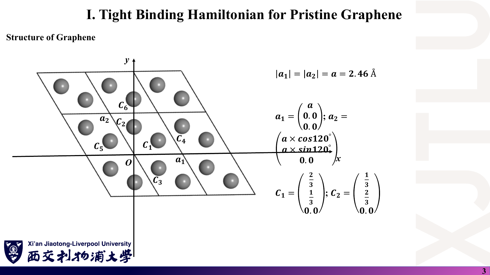
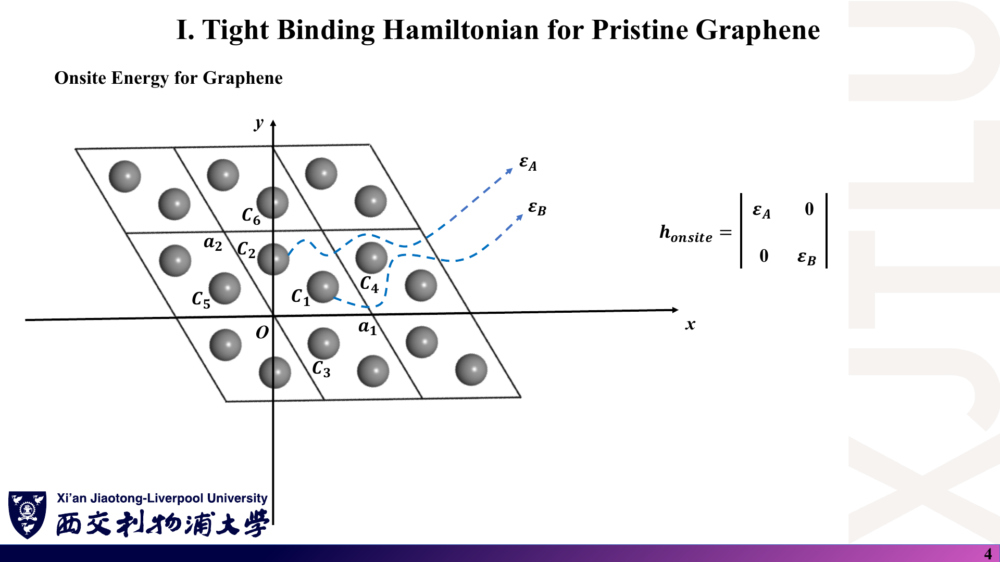
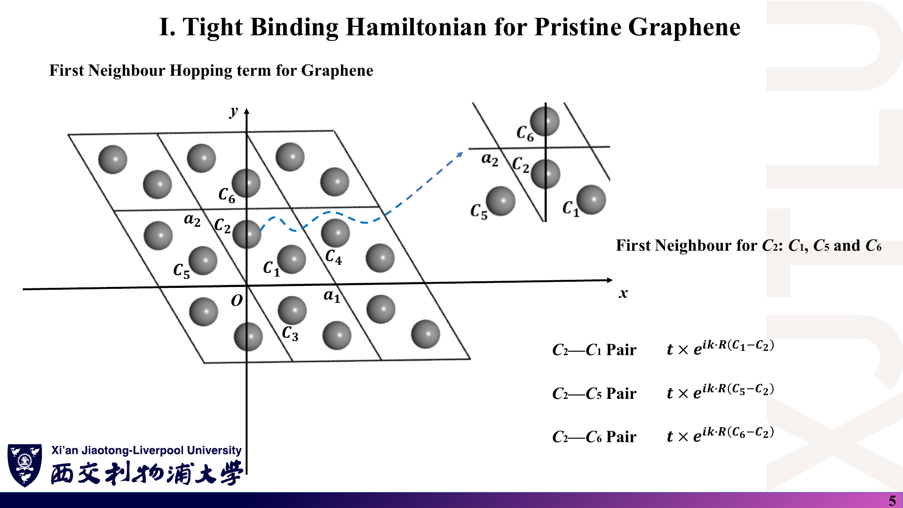
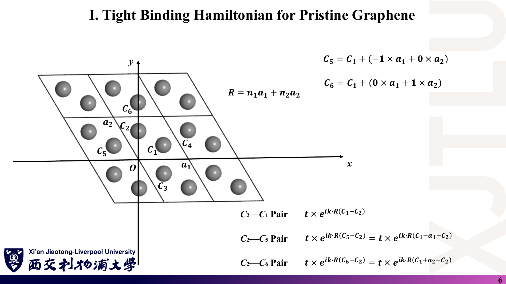
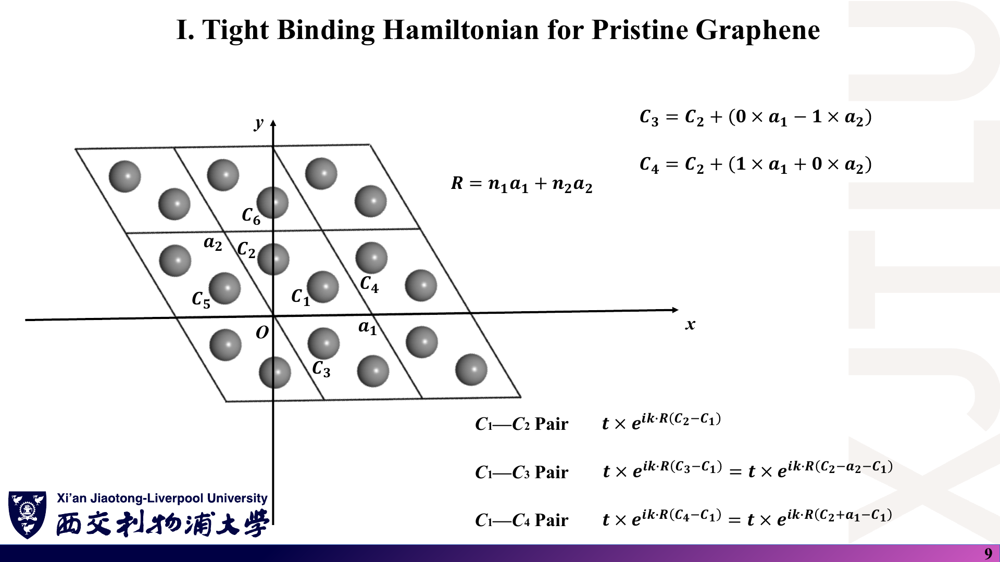
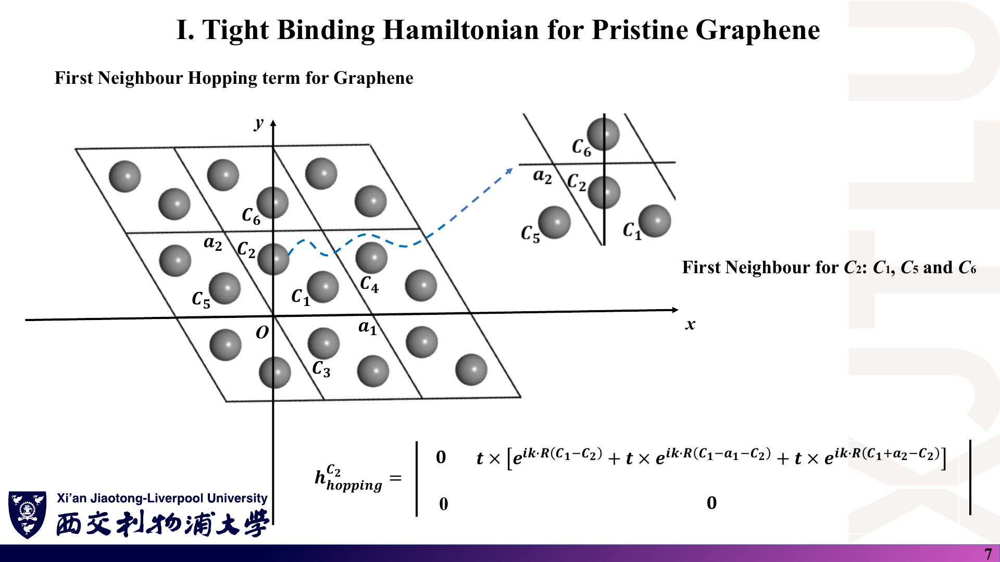
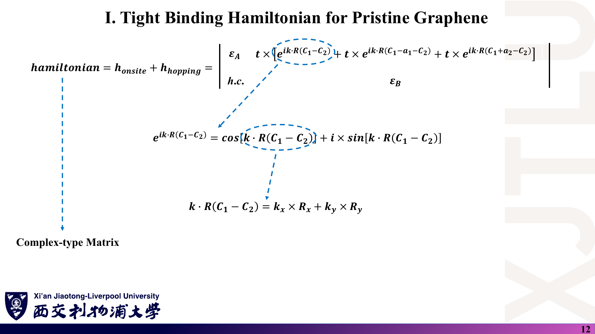
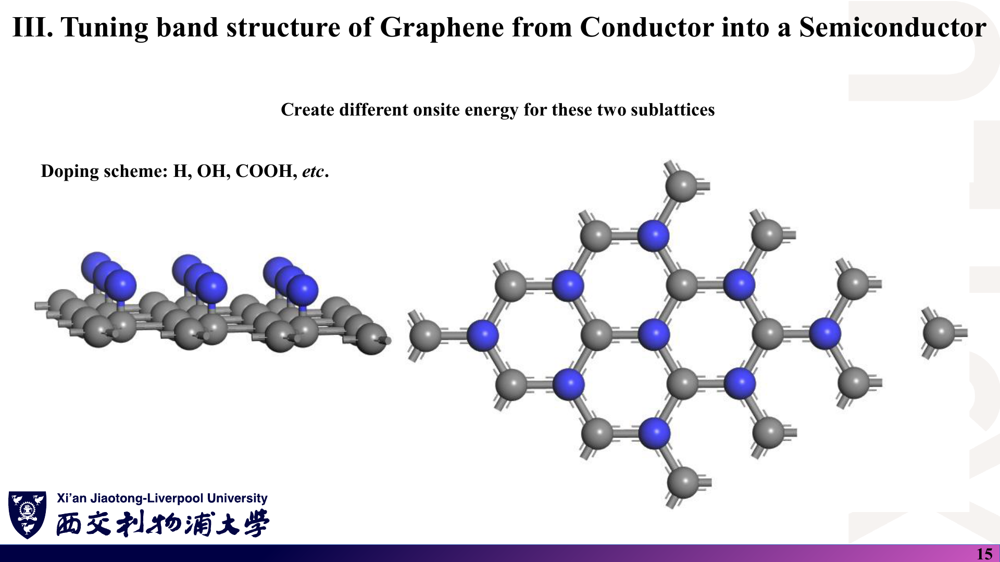
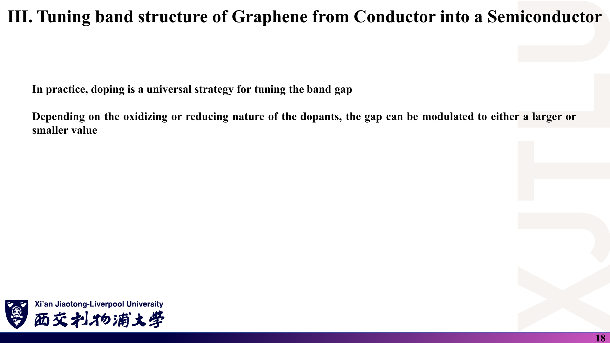

# 04 · 石墨烯紧束缚哈密顿量、能带与带隙调控

来源：[Lecture_Twelve.pdf](../Lecture_Twelve.pdf)，19 页（由 `Lecture_Twelve.pptx` 转换）。

[返回目录](README.md)

## 1. 石墨烯的晶格与原胞如何定义？〔p. 3〕

### 课件截图

### 中文解释

石墨烯是蜂窝状的二维碳晶格，但蜂窝本身不是 Bravais 格子：它是三角 Bravais 格子 + 每个原胞两个碳原子（C₁、C₂，即 A、B 两个子格）。讲义选取夹角 120° 的两个基矢，长度都是晶格常数 $a=2.46$ Å，两个碳原子位于原胞内的分数坐标 $(2/3,1/3)$ 与 $(1/3,2/3)$。

### 原理深入

$$
\mathbf a_1=a(1,0,0),\qquad \mathbf a_2=a(\cos120^\circ,\sin120^\circ,0)=a\Big(-\tfrac12,\tfrac{\sqrt3}2,0\Big),\qquad a=2.46\ \text{Å}.
$$

分数坐标换成笛卡尔坐标〔补充计算〕：

$$
\boldsymbol\tau_{1}=\tfrac23\mathbf a_1+\tfrac13\mathbf a_2=\Big(\tfrac a2,\tfrac{a}{2\sqrt3},0\Big)\approx(1.230,\,0.710,\,0)\ \text{Å},
$$

$$
\boldsymbol\tau_{2}=\tfrac13\mathbf a_1+\tfrac23\mathbf a_2=\Big(0,\tfrac{a}{\sqrt3},0\Big)\approx(0,\,1.420,\,0)\ \text{Å}.
$$

于是 C₁–C₂ 距离 $|\boldsymbol\tau_2-\boldsymbol\tau_1|=a/\sqrt3\approx1.420$ Å，正是碳–碳键长（代码中的 `firstneighbour = 1.42`）。

**倒格矢〔补充〕**：由 $\mathbf a_i\cdot\mathbf b_j=2\pi\delta_{ij}$，

$$
\mathbf b_1=\frac{2\pi}{a}\Big(1,\frac1{\sqrt3},0\Big),\qquad \mathbf b_2=\frac{2\pi}{a}\Big(0,\frac2{\sqrt3},0\Big).
$$

高对称点（分数坐标，相对于 $\mathbf b_1,\mathbf b_2$）：$\Gamma=(0,0)$，$K=(1/3,1/3)$，$M=(1/2,0)$。对应长度 $|\Gamma K|=4\pi/(3a)\approx1.7028$ Å⁻¹，$|\Gamma M|=2\pi/(\sqrt3a)\approx1.4746$ Å⁻¹，$|KM|=|\Gamma K|/2\approx0.8514$ Å⁻¹。示例输出中 K 点横坐标 `1.702760246` 与此吻合。

**为何只用 $p_z$ 轨道**：平面结构中 σ（$s,p_x,p_y$）与 π（$p_z$）严格解耦（见 [01 第 5 节](01_紧束缚基础与Slater-Koster.md)），费米能附近只有 π 带，所以每个原子一个轨道、$H(\mathbf k)$ 为 2×2。

### Ref

- **原课件**：[Lecture Twelve，PDF 第 3 页](../Lecture_Twelve.pdf#page=3)。
- **延伸**：[CN09：石墨烯晶格与布里渊区](README.md#ref-cn09)；[WAL47](README.md#ref-wal47)。

## 2. 在位能项是什么样子？〔p. 4〕

### 课件截图

### 中文解释

两个子格各一个 $p_z$ 轨道，在位能矩阵是对角的 $\operatorname{diag}(\varepsilon_A,\varepsilon_B)$，不依赖 k。本征石墨烯两个碳原子完全等价，$\varepsilon_A=\varepsilon_B$；后面打开带隙的全部诀窍，就是让这两个数不相等。

### 原理深入

$$
h_{\rm onsite}=\begin{pmatrix}\varepsilon_A&0\\0&\varepsilon_B\end{pmatrix}.
$$

- 在位能的绝对值没有物理意义（能量零点可任选）；$\varepsilon_A=\varepsilon_B=\varepsilon$ 只是把整个能带平移 $\varepsilon$。
- 有意义的是**差值** $\varepsilon_A-\varepsilon_B$，它破坏 A、B 子格之间的对称（反演对称）。
- 示例代码从 `Graphene.vasp` 的 `onsite:` 行读取这两个数，见 [08](08_代码导读.md)。

### Ref

- **原课件**：[Lecture Twelve，PDF 第 4 页](../Lecture_Twelve.pdf#page=4)。

## 3. 每个碳原子的三个第一近邻在哪里？〔pp. 5–6，8–9〕

### 课件截图

### 中文解释

每个碳原子有 3 个第一近邻，且**都属于另一个子格**。对 C₂ 而言，近邻是本原胞的 C₁，以及相邻原胞中的 C₁ 镜像 C₅、C₆；对 C₁ 而言，近邻是本原胞的 C₂ 及其镜像 C₃、C₄。讲义把每个镜像原子都写成“本原胞原子 + 格矢”，从而知道每条键跨越了哪个原胞。

### 原理深入

讲义给出的关系（第 6、9 页）：

$$
C_5=C_1-\mathbf a_1,\quad C_6=C_1+\mathbf a_2;\qquad C_3=C_2-\mathbf a_2,\quad C_4=C_2+\mathbf a_1 .
$$

**用坐标核对〔补充〕**：$C_5=(-1.23,0.71)$、$C_6=(0,2.84)$ 到 $C_2=(0,1.42)$ 的距离都是 1.42 Å；$C_3=(1.23,-0.71)$、$C_4=(2.46,1.42)$ 到 $C_1=(1.23,0.71)$ 的距离也都是 1.42 Å。

从 C₁（A）指向其三个近邻 B 的键矢量：

$$
\boldsymbol\delta_1=\boldsymbol\tau_2-\boldsymbol\tau_1,\quad
\boldsymbol\delta_2=\boldsymbol\tau_2-\mathbf a_2-\boldsymbol\tau_1,\quad
\boldsymbol\delta_3=\boldsymbol\tau_2+\mathbf a_1-\boldsymbol\tau_1 ,
$$

数值上 $\boldsymbol\delta_1=(-1.23,0.71)$、$\boldsymbol\delta_2=(0,-1.42)$、$\boldsymbol\delta_3=(1.23,0.71)$ Å，三者长度相等、两两夹角 120°，且 $\boldsymbol\delta_1+\boldsymbol\delta_2+\boldsymbol\delta_3=\mathbf 0$。它们的差恰为格矢：$\boldsymbol\delta_3-\boldsymbol\delta_1=\mathbf a_1$，$\boldsymbol\delta_1-\boldsymbol\delta_2=\mathbf a_2$。

C₂ 的三条键正好是这三条的反向（$-\boldsymbol\delta_m$），这就是第 11 页“共轭转置”配对的几何原因。

### Ref

- **原课件**：[Lecture Twelve，PDF 第 5–6 页](../Lecture_Twelve.pdf#page=5)、[第 8–9 页](../Lecture_Twelve.pdf#page=9)。
- **代码对应**：近邻搜索自动找到的 6 条有向键，见 [08](08_代码导读.md)。

## 4. 怎样把三条键组装成 2×2 的 H(k)？〔pp. 7，10–12〕

### 课件截图

*这几页方括号内第二、三项前多写了“$t\times$”，括号外已有一个 $t$，按原式会出现 $t^2$；正确写法是 $t\,[e^{\cdots}+e^{\cdots}+e^{\cdots}]$，见 [07 勘误](07_讲义勘误与易错点.md)。*

### 中文解释

把 C₂ 的三条键（相位分别对应三个键矢量）加起来放进一个非对角元，把 C₁ 的三条键加起来放进另一个非对角元。讲义指出，这两组相位一一互为相反数，所以两个非对角元互为复共轭——只需算一个，另一个写“h.c.”。再加上在位能，就得到完整的 2×2 复厄米矩阵；相位通过 Euler 公式拆成 cos 与 sin 计算。

### 原理深入

定义结构因子〔补充记号〕

$$
f(\mathbf k)=\sum_{m=1}^{3}e^{i\mathbf k\cdot\boldsymbol\delta_m}.
$$

讲义（与示例代码）的矩阵按 (C₁, C₂) 排列，且相位矢量取“行原子 − 列原子”方向，于是

$$
\boxed{H(\mathbf k)=\begin{pmatrix}\varepsilon_A & t\,f^*(\mathbf k)\\ t\,f(\mathbf k) & \varepsilon_B\end{pmatrix}}
$$

（讲义第 11 页上排的三项相位 $C_1-C_2$、$C_1-\mathbf a_1-C_2$、$C_1+\mathbf a_2-C_2$ 正是 $-\boldsymbol\delta_1,-\boldsymbol\delta_3,-\boldsymbol\delta_2$。）许多教材取相反方向，得到 $H_{AB}=t f(\mathbf k)$，即上式的转置。因为 $H^T$ 与 $H$ 有相同本征值，且 $t$ 为实数时 $f(-\mathbf k)=f^*(\mathbf k)$，两种写法给出同一能带。

**相位用的是原子间矢量**（第十讲第 14 页所称“原子位置约定”），而不是第十讲推荐的原胞矢量。按原胞约定，本原胞内的键（$C_1$–$C_2$）相位为 1，另外两条为 $e^{\pm i\mathbf k\cdot\mathbf a_{1,2}}$。两者差一个对角幺正变换，能带相同（证明见 [02 第 6 节](02_Bloch定理与多子格.md)）。

**解析解〔补充推导〕**：2×2 厄米矩阵的本征值

$$
E_\pm(\mathbf k)=\frac{\varepsilon_A+\varepsilon_B}{2}\pm\sqrt{\Big(\frac{\varepsilon_A-\varepsilon_B}{2}\Big)^2+t^2|f(\mathbf k)|^2},
$$

$$
|f(\mathbf k)|^2=3+2\cos(\mathbf k\cdot\mathbf a_1)+2\cos(\mathbf k\cdot\mathbf a_2)+2\cos\big(\mathbf k\cdot(\mathbf a_1+\mathbf a_2)\big).
$$

（展开 $|f|^2=\sum_{m,m'}e^{i\mathbf k\cdot(\boldsymbol\delta_m-\boldsymbol\delta_{m'})}$，交叉项的 $\boldsymbol\delta$ 差正是 $\pm\mathbf a_1,\pm\mathbf a_2,\pm(\mathbf a_1+\mathbf a_2)$。）

| 点 | $\mathbf k\cdot\mathbf a_1,\ \mathbf k\cdot\mathbf a_2$ | $\lvert f\rvert$ | $\varepsilon_A=\varepsilon_B=0$ 时 $E_\pm$（$t=-2.7$ eV） |
|---|---|---|---|
| Γ | $0,\ 0$ | 3 | $\pm8.1$ eV |
| K | $2\pi/3,\ 2\pi/3$ | 0 | 0（二重简并，Dirac 点） |
| M | $\pi,\ 0$ | 1 | $\pm2.7$ eV |

这三个数可直接与讲义第 14 页图和 `pristine_bandstructure.dat` 对照。

**Dirac 锥〔补充〕**：在 K 附近 $\mathbf k=\mathbf K+\mathbf q$，展开得 $|f|\approx\frac{\sqrt3}{2}a|\mathbf q|$，于是 $E_\pm\approx\pm\hbar v_F|\mathbf q|$，

$$
v_F=\frac{\sqrt3|t|a}{2\hbar}\approx0.87\times10^6\ \text{m/s}\quad(t=-2.7\ \text{eV},\ a=2.46\ \text{Å}).
$$

能量与动量呈线性关系，这是石墨烯“无质量 Dirac 费米子”说法的来源。

**k 的单位**：第 12 页 $\mathbf k\cdot\mathbf R=k_xR_x+k_yR_y$ 只有在 k 为笛卡尔 Å⁻¹（含 $2\pi$）、R 为 Å 时才正确；若 k 用分数坐标，必须先乘倒格矢矩阵。

### Ref

- **原课件**：[Lecture Twelve，PDF 第 7 页](../Lecture_Twelve.pdf#page=7)、[第 10–12 页](../Lecture_Twelve.pdf#page=11)。
- **课程补充文献**：[BM09：两种相位约定](README.md#ref-bm09)。
- **延伸**：[CN09](README.md#ref-cn09)；[WAL47](README.md#ref-wal47)。
- **核验**：[07 勘误：多余的 t 因子](07_讲义勘误与易错点.md)。

## 5. 程序算出的本征石墨烯能带长什么样？〔pp. 13–14〕

### 课件截图

### 中文解释

第 13 页提示“查看 Fortran 代码”（导读见 [08](08_代码导读.md)）。第 14 页是程序沿 Γ–K–M 算出的两条 π 带：Γ 点约 ±8.1 eV，在 K 点两带相交于零能（Dirac 点），M 点约 ±2.7 eV。讲义指出 Dirac 点的位置由在位能决定：若 $\varepsilon_A=\varepsilon_B=\varepsilon\ne0$，交点出现在 $E=\varepsilon$ 处。

### 原理深入

- **为什么是半金属/零带隙**：每个碳原子贡献 1 个 $p_z$ 电子，2 个电子（自旋简并）恰好填满下面一条带。费米能正好落在 K 点的交叉处：价带顶与导带底在 K 点重合，带隙为零。
- **电子-空穴对称**：最近邻模型且 $\varepsilon_A=\varepsilon_B$ 时 $E_+(\mathbf k)=-E_-(\mathbf k)$（以 ε 为中心）；加入第二近邻跳跃会破坏这种对称（见 [01 第 6 节](01_紧束缚基础与Slater-Koster.md)）。
- **Dirac 点为何稳健**：K 点 $f(\mathbf K)=0$ 是由三条键相位 $1,e^{i2\pi/3},e^{i4\pi/3}$ 之和为零保证的——这是 $C_3$ 对称性的结果，不依赖 $t$ 的具体数值。要打开带隙，必须破坏 A、B 等价性（下一节）。
- **图上的细节**：纵轴记为 $E-E_F$，本征情形 $E_F=0$ 正好在 Dirac 点。横轴最右端标 M，但示例程序每段不含终点，最后一个点距 M 还差一步（见 [08](08_代码导读.md)）。

### Ref

- **原课件**：[Lecture Twelve，PDF 第 13–14 页](../Lecture_Twelve.pdf#page=14)。
- **数据**：[`Codes/pristine_bandstructure.dat`](../Codes/pristine_bandstructure.dat)；教师绘图 [`Codes/band.png`](../Codes/band.png)。

## 6. 怎样把石墨烯从导体变成半导体？〔pp. 15–18〕

### 课件截图

### 中文解释

讲义的方案是让两个子格的在位能不同（第 15 页图中蓝色原子全在同一个子格上，代表被 H、OH、COOH 等基团修饰的位置）。第 16 页取 $\varepsilon_A=1$ eV、$\varepsilon_B=0$，第 17 页算出 K 点的交叉消失，出现 $|\varepsilon_A-\varepsilon_B|=1$ eV 的带隙。第 18 页指出，在实践中“掺杂”是调节带隙的普遍手段，带隙大小随掺杂物的性质增减。

### 原理深入

**带隙公式的推导〔补充〕**：由第 4 节的解析解，$E_+$ 的最小值与 $E_-$ 的最大值都出现在 $|f|=0$ 的 K 点：

$$
E_+(\mathbf K)=\max(\varepsilon_A,\varepsilon_B),\qquad E_-(\mathbf K)=\min(\varepsilon_A,\varepsilon_B)
\quad\Longrightarrow\quad
\boxed{E_g=|\varepsilon_A-\varepsilon_B|}.
$$

它是**直接带隙**（位于 K 点），且在最近邻模型下与 $t$ 无关。代入 1 eV 与 0：价带顶 0、导带底 1.000 eV，与 `gapped_bandstructure.dat` 完全一致；Γ 点 $0.5\pm\sqrt{0.25+8.1^2}\approx8.615,\,-7.615$ eV 也与数据吻合。K 点附近能带变为双曲线 $E\approx\bar\varepsilon\pm\sqrt{\Delta^2+(\hbar v_Fq)^2}$，相当于给 Dirac 费米子一个“质量”$\Delta$。

**模型与真实材料之间的距离〔补充，谨慎阅读〕**：

- **子格势是有效模型**：真实的 H、OH 等共价修饰会把被修饰碳原子从 $sp^2$ 变成 $sp^3$，其 $p_z$ 轨道参与新的 σ 键而**离开 π 体系**。这更接近“删除该位点”或“极大的在位能”，而不只是 1 eV 的小移动；局部还会改变键长与 $t$。讲义的 $\varepsilon_A\ne\varepsilon_B$ 抓住的是“破坏 A/B 等价性”这一核心机理。
- **均匀子格势的典型实例**是六方氮化硼（B、N 分处两个子格，在位能差很大，是宽带隙绝缘体），以及与 hBN 对齐的石墨烯中由衬底诱导的较小子格势。CW1 的讨论可以从这类“破坏子格对称性”的机制入手查文献（见 [CN09](README.md#ref-cn09)）。
- **“掺杂”的含义**：电化学意义上的 n/p 掺杂（加入或拿走电子）主要**移动费米能**，并不自动打开带隙；只有破坏子格对称或周期性的修饰才在模型中开隙。第 18 页“带隙可增大或减小”的说法，在本模型中对应 $|\varepsilon_A-\varepsilon_B|$ 的大小变化，与 $\varepsilon_A-\varepsilon_B$ 的正负无关。
- **纵轴 $E-E_F$**：有隙时费米能位于带隙中某处，位置取决于温度与掺杂；图中“0”实际上是价带顶（$\varepsilon_B=0$），不是严格意义上的 $E_F$。

### Ref

- **原课件**：[Lecture Twelve，PDF 第 15–18 页](../Lecture_Twelve.pdf#page=17)。
- **数据**：[`Codes/gapped_bandstructure.dat`](../Codes/gapped_bandstructure.dat)。
- **延伸**：[CN09：子格对称破缺与带隙](README.md#ref-cn09)。
- **作业关联**：[README 第 4 节：CW1](README.md#4-本周与课程作业-cw1-有什么关系)。
