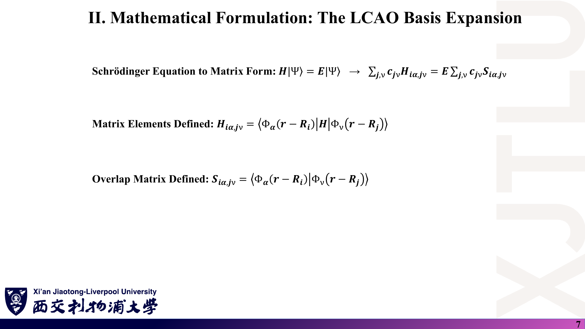
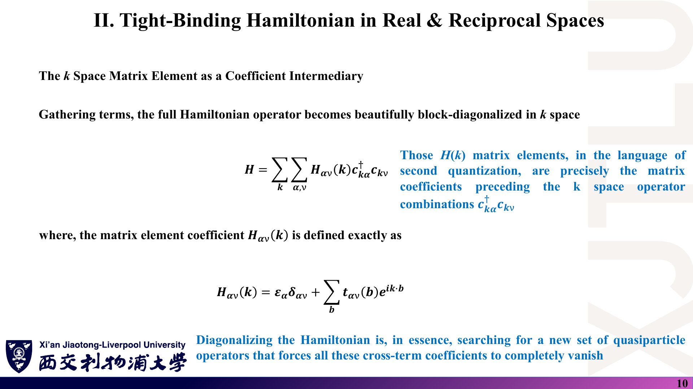
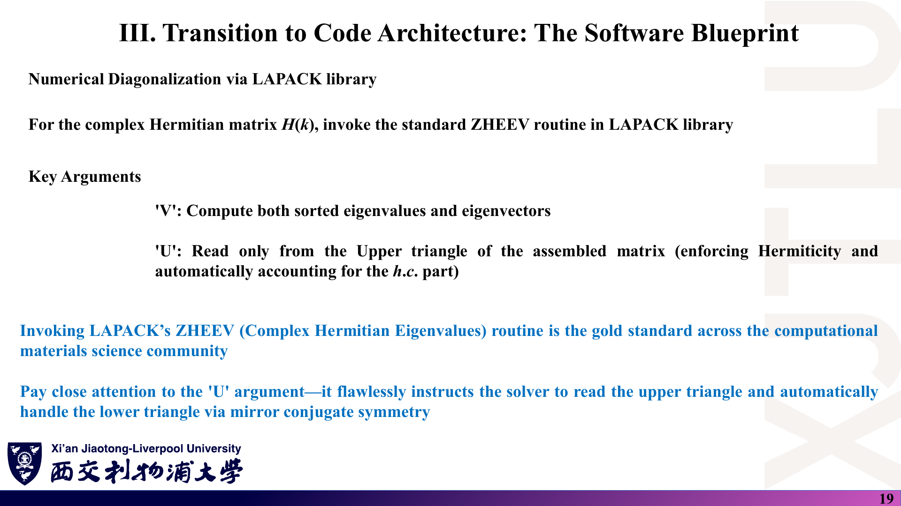

# 05 · 公式与中英文术语速查

[返回目录](README.md) · [第九讲](01_紧束缚基础与Slater-Koster.md) · [第十讲](02_Bloch定理与多子格.md) · [第十一讲](03_二次量子化与代码架构.md) · [第十二讲](04_石墨烯紧束缚与带隙调控.md)

> 默认正交紧束缚（$S=I$）、最近邻近似、单 $p_z$ 轨道（石墨烯）。此页的公式已按 [07 勘误](07_讲义勘误与易错点.md) 修正，与原图不同之处均在正文说明；它不替代推导与适用条件。

## 1. LCAO 与紧束缚矩阵元

### 课件截图

### 中文解释

紧束缚的全部输入是两类矩阵元：在位能（对角）和跳跃积分（非对角）。非正交基还需要重叠矩阵。

### 原理深入

$$
\Psi(\mathbf r)=\sum_{i\alpha}c_{i\alpha}\Phi_\alpha(\mathbf r-\mathbf R_i),\qquad Hc=ESc .
$$

$$
H_{i\alpha,j\nu}=\langle\Phi_{i\alpha}|H|\Phi_{j\nu}\rangle,\qquad S_{i\alpha,j\nu}=\langle\Phi_{i\alpha}|\Phi_{j\nu}\rangle .
$$

$$
\text{NN 正交模型：}\ H_{i\alpha,j\nu}=\varepsilon_\alpha\ (i=j,\alpha=\nu),\quad t_{\alpha\nu}\ (\text{最近邻}),\quad 0\ (\text{其他});\qquad S=I .
$$

**SK（方向余弦 $l,m,n$ 由 $i$ 指向 $j$）**：

$$
E_{s,s}=V_{ss\sigma},\quad E_{s,x}=lV_{sp\sigma},\quad E_{x,x}=l^2V_{pp\sigma}+(1-l^2)V_{pp\pi},\quad E_{x,y}=lm(V_{pp\sigma}-V_{pp\pi}).
$$

平面结构 $n=0$：$E_{z,z}=V_{pp\pi}=t$（石墨烯）。

| 中文 | 英文 | 备注 |
|---|---|---|
| 紧束缚方法 | tight-binding method (TBM) | |
| 原子轨道线性组合 | linear combination of atomic orbitals (LCAO) | |
| 在位能 | on-site energy | 对角元，单位 eV |
| 跳跃积分 | hopping integral / hopping parameter | 能量，不是概率 |
| 重叠矩阵 | overlap matrix | 正交 TB 中取 $I$ |
| 双中心近似 | two-center approximation | 忽略三中心积分 |
| 方向余弦 | direction cosines | $(l,m,n)=\Delta\mathbf r/R$ |
| 截断半径 | cutoff radius $R_c$ | |
| 最近邻近似 | nearest-neighbour (NN) approximation | |
| 配位壳层 | coordination shell | |

### Ref

- **原课件**：[Lecture Nine，PDF 第 7–9 页](../Lecture_Nine.pdf#page=7)、[第 13–16 页](../Lecture_Nine.pdf#page=14)。
- **推导**：[01](01_紧束缚基础与Slater-Koster.md)；[SK54](README.md#ref-sk54)。

## 2. Bloch 定理与 H(k)

### 课件截图

### 中文解释

周期性让每个 k 点各有一个 $D\times D$ 矩阵；多原子原胞要为每个子格（轨道）单独构造 Bloch 和。

### 原理深入

$$
\Psi_{\mathbf k}(\mathbf r+\mathbf R)=e^{i\mathbf k\cdot\mathbf R}\Psi_{\mathbf k}(\mathbf r),\qquad
\mathbf k=\sum_i\frac{m_i}{N_i}\mathbf b_i,\qquad \mathbf a_i\cdot\mathbf b_j=2\pi\delta_{ij}.
$$

$$
|\Phi_{\alpha\mu}(\mathbf k)\rangle=\frac1{\sqrt N}\sum_ne^{i\mathbf k\cdot\mathbf R_n}|\Phi_\alpha(\mathbf r-\mathbf R_n-\boldsymbol\tau_\mu)\rangle,\qquad
H_{\mu\nu}(\mathbf k)=\sum_je^{i\mathbf k\cdot\mathbf R_j}t_{\mu\nu}(\mathbf R_j).
$$

$$
\text{原子位置约定：}\ H^{\rm atom}_{\mu\nu}(\mathbf k)=e^{-i\mathbf k\cdot\boldsymbol\tau_\mu}H^{\rm cell}_{\mu\nu}(\mathbf k)e^{i\mathbf k\cdot\boldsymbol\tau_\nu}\quad(\text{本征值相同}).
$$

**一维单原子链**（$t<0$ 时 $k=0$ 为带底）：

$$
E=\varepsilon_0+2t\cos ka,\quad W=4|t|,\quad v_g=-\frac{2ta}{\hbar}\sin ka,\quad m^*=-\frac{\hbar^2}{2ta^2\cos ka}.
$$

**双原子链**（原胞内 $t_1$、原胞间 $t_2$）：

$$
E_\pm=\bar\varepsilon\pm\sqrt{\Delta^2+t_1^2+t_2^2+2t_1t_2\cos ka},\qquad E_g=2\sqrt{\Delta^2+(t_1-t_2)^2}\ (t_1t_2>0).
$$

| 中文 | 英文 |
|---|---|
| 平移算符 | translation operator |
| 周期性（Born–von Kármán）边界条件 | periodic boundary condition |
| 倒格矢 | reciprocal lattice vector |
| 第一布里渊区 | first Brillouin zone (1st BZ) |
| Bloch 和 | Bloch sum |
| 久期方程 | secular equation |
| 带宽 | bandwidth |
| 群速度 | group velocity |
| 有效质量 | effective mass |
| 基元 / 子格 | basis / sublattice |

### Ref

- **原课件**：[Lecture Ten，PDF 第 4–7 页](../Lecture_Ten.pdf#page=7)、[第 10–17 页](../Lecture_Ten.pdf#page=14)。
- **推导与修正**：[02](02_Bloch定理与多子格.md)。

## 3. 二次量子化

### 课件截图

### 中文解释

二次量子化只是同一个单粒子模型的另一种记账方式：系数 $H_{\alpha\nu}(\mathbf k)$ 就是矩阵元。

### 原理深入

$$
\{c_{i\alpha},c^\dagger_{j\nu}\}=\delta_{ij}\delta_{\alpha\nu},\qquad (c^\dagger_{i\alpha})^2=0 .
$$

$$
H=\sum_{i\alpha}\varepsilon_{i\alpha}n_{i\alpha}+\sum_{i\alpha\ne j\nu}t_{i\alpha,j\nu}c^\dagger_{i\alpha}c_{j\nu},\qquad t_{i\alpha,j\nu}=t^*_{j\nu,i\alpha}.
$$

$$
c_{i\alpha}=\frac1{\sqrt N}\sum_{\mathbf k}e^{i\mathbf k\cdot\mathbf R_i}c_{\mathbf k\alpha},\qquad \frac1N\sum_ie^{i(\mathbf k'-\mathbf k)\cdot\mathbf R_i}=\delta_{\mathbf k\mathbf k'} .
$$

$$
H=\sum_{\mathbf k}\sum_{\alpha\nu}H_{\alpha\nu}(\mathbf k)c^\dagger_{\mathbf k\alpha}c_{\mathbf k\nu},\qquad
H_{\alpha\nu}(\mathbf k)=\varepsilon_\alpha\delta_{\alpha\nu}+\sum_{\mathbf b}t_{\alpha\nu}(\mathbf b)e^{i\mathbf k\cdot\mathbf b}.
$$

$$
(H_{\alpha\nu}c^\dagger_\alpha c_\nu)^\dagger=H_{\nu\alpha}c^\dagger_\nu c_\alpha .
$$

| 中文 | 英文 |
|---|---|
| 二次量子化 | second quantization |
| 产生 / 湮灭算符 | creation / annihilation operator |
| 反对易关系 | anti-commutation relation |
| 粒子数算符 | number operator |
| Fock 空间 | Fock space |
| 厄米共轭 | Hermitian conjugate (h.c.) |
| 准粒子 | quasiparticle |

### Ref

- **原课件**：[Lecture Eleven，PDF 第 4–11 页](../Lecture_Eleven.pdf#page=9)。
- **推导与修正**：[03](03_二次量子化与代码架构.md)；[BF](README.md#ref-bf)。

## 4. 石墨烯

### 课件截图

### 中文解释

两个子格、一个 $p_z$ 轨道、三条最近邻键，就得到 2×2 的 $H(\mathbf k)$ 与闭式能带。

### 原理深入

$$
\mathbf a_1=a(1,0,0),\ \ \mathbf a_2=a(-\tfrac12,\tfrac{\sqrt3}2,0),\ \ a=2.46\ \text{Å};\quad
\boldsymbol\tau_A=(\tfrac23,\tfrac13),\ \boldsymbol\tau_B=(\tfrac13,\tfrac23)\ (\text{分数});\quad a_{cc}=a/\sqrt3\approx1.42\ \text{Å}.
$$

$$
f(\mathbf k)=\sum_{m=1}^3e^{i\mathbf k\cdot\boldsymbol\delta_m},\qquad
|f|^2=3+2\cos\mathbf k\cdot\mathbf a_1+2\cos\mathbf k\cdot\mathbf a_2+2\cos\mathbf k\cdot(\mathbf a_1+\mathbf a_2).
$$

$$
H(\mathbf k)=\begin{pmatrix}\varepsilon_A&tf^*\\tf&\varepsilon_B\end{pmatrix},\qquad
E_\pm=\frac{\varepsilon_A+\varepsilon_B}2\pm\sqrt{\Big(\frac{\varepsilon_A-\varepsilon_B}2\Big)^2+t^2|f|^2}.
$$

$$
|f(\Gamma)|=3,\ \ |f(K)|=0,\ \ |f(M)|=1;\qquad E_g=|\varepsilon_A-\varepsilon_B|\ (\text{K 点直接带隙});\qquad v_F=\frac{\sqrt3|t|a}{2\hbar}.
$$

$K=(\tfrac13,\tfrac13)$、$M=(\tfrac12,0)$（以 $\mathbf b_1,\mathbf b_2$ 为基）；$|\Gamma K|=4\pi/(3a)$，$|\Gamma M|=2\pi/(\sqrt3a)$。示例程序 $t=-2.7$ eV（只在代码中给出，讲义未给数值）。

| 中文 | 英文 |
|---|---|
| 蜂窝晶格 | honeycomb lattice |
| 狄拉克点 | Dirac point |
| 费米速度 | Fermi velocity |
| 子格对称性破缺 | sublattice symmetry breaking |
| 直接带隙 | direct band gap |
| 化学修饰 / 官能化 | chemical functionalization |
| 态密度 | density of states (DOS) |

### Ref

- **原课件**：[Lecture Twelve，PDF 第 3–17 页](../Lecture_Twelve.pdf#page=12)。
- **推导**：[04](04_石墨烯紧束缚与带隙调控.md)；[CN09](README.md#ref-cn09)。

## 5. 程序与数值

### 课件截图

### 中文解释

程序层面的“公式”是索引映射、相位计算与 LAPACK 参数。

### 原理深入

$$
c^\dagger_{i\alpha}c_{j\nu}\ \mapsto\ H(\text{row}=i\alpha,\ \text{col}=j\nu),\qquad
\mathbf k_{\rm cart}=\sum_i\kappa_i\mathbf b_i,\qquad
\text{phase}=\mathbf k_{\rm cart}\cdot\mathbf R_{\rm bond}.
$$

$$
\text{近邻判据：}\ R_{\min}-\delta\le|\boldsymbol\tau_i-\boldsymbol\tau_j+\mathbf R|\le R_{\min}+\delta,\quad n_{1,2,3}\in\{-1,0,1\}.
$$

`ZHEEV(JOBZ, UPLO, N, A, LDA, W, WORK, LWORK, RWORK, INFO)`：`'V'`/`'N'` 是否算本征矢；`'U'`/`'L'` 读上/下三角；W 升序；`LWORK ≥ 2N−1`；`RWORK` 长度 $\max(1,3N-2)$；检查 `INFO = 0`。

| 中文 | 英文 |
|---|---|
| 近邻表 | neighbour list |
| 高对称路径 | high-symmetry k-path |
| 线性插值 | linear interpolation |
| 上三角 | upper triangle |
| 复厄米本征求解 | complex Hermitian eigensolver (ZHEEV) |
| 分数（直接）坐标 | fractional (direct) coordinates |

### Ref

- **原课件**：[Lecture Eleven，PDF 第 12–21 页](../Lecture_Eleven.pdf#page=19)。
- **代码**：[08](08_代码导读.md)；[LAPACK](README.md#ref-lapack)。
