# 06 · 图文复习题与参考答案

[返回目录](README.md)

> 14 题均为根据讲义自编的练习，**不是课件原题、官方作业或 CW1 的答案**。每题依次列出“课件截图 → 中文解释（题目）→ 原理深入（解析）→ Ref（来源）”。建议先遮住解析独立作答。截图保留原稿，正确公式以下方解析为准。数值题默认 $\hbar^2/(2m_e)\approx3.81$ eV·Å²。

## 1. 紧束缚的出发点

### 课件截图

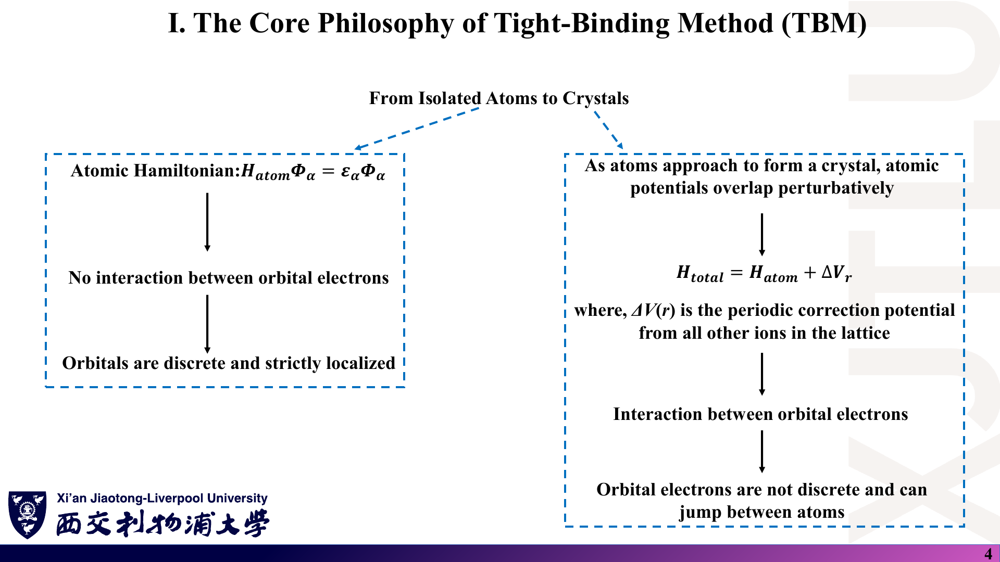

### 中文解释

**题目**：写出紧束缚方法对晶体哈密顿量的分解，说明 $\Delta V$ 的含义。为什么紧束缚适合描述石墨烯的 π 带，却不适合描述 Na 的价电子？

### 原理深入

$H_{\rm total}=H_{\rm atom}+\Delta V$，$\Delta V$ 是除本原子外所有离子对电子的附加（吸引）势。紧束缚假设基函数是局域原子轨道、相邻轨道只有少量重叠，因此只需少数近邻参数。石墨烯的 $p_z$ 轨道局域、π 带主要由近邻跳跃决定，适用；Na 的 3s 价电子高度离域、接近自由电子，用少数近邻原子轨道展开收敛慢，平面波描述更自然。

### Ref

- **来源**：[Lecture Nine，PDF 第 3–5 页](../Lecture_Nine.pdf#page=4)；[01 第 1 节](01_紧束缚基础与Slater-Koster.md)。

## 2. Slater–Koster 投影

### 课件截图

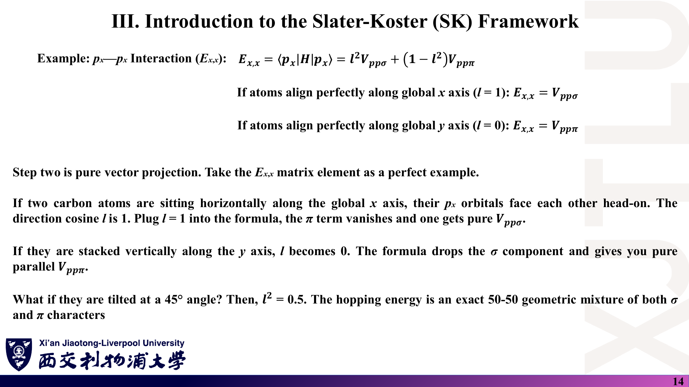

### 中文解释

**题目**：两碳原子位于 xy 平面，键与 x 轴夹角 60°。用 $V_{pp\sigma}$、$V_{pp\pi}$ 写出 $E_{x,x}$、$E_{x,y}$、$E_{z,z}$。为什么石墨烯只需一个跳跃参数？

### 原理深入

$(l,m,n)=(\cos60^\circ,\sin60^\circ,0)=(\tfrac12,\tfrac{\sqrt3}2,0)$。

$$
E_{x,x}=\tfrac14V_{pp\sigma}+\tfrac34V_{pp\pi},\qquad
E_{x,y}=lm(V_{pp\sigma}-V_{pp\pi})=\tfrac{\sqrt3}4(V_{pp\sigma}-V_{pp\pi}),\qquad
E_{z,z}=V_{pp\pi}.
$$

石墨烯所有键都在平面内，$n=0$，$p_z$–$p_z$ 永远是纯 π 键，且 $p_z$ 与 $s,p_x,p_y$ 的矩阵元都正比于 $n$ 而为零，所以 π 体系只需 $t=V_{pp\pi}$。

### Ref

- **来源**：[Lecture Nine，PDF 第 13–14 页](../Lecture_Nine.pdf#page=14)；[01 第 5 节](01_紧束缚基础与Slater-Koster.md)；[SK54](README.md#ref-sk54)。

## 3. 跳跃积分的符号

### 课件截图

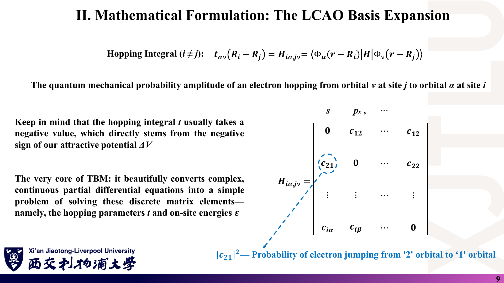

### 中文解释

**题目**：讲义说“t 通常为负，因为 $\Delta V$ 是吸引势”。(a) 在正交近似下说明这一结论；(b) 举一个按常用约定 $V>0$ 的例子；(c) 讲义说 $|c_{21}|^2$ 是“跳跃概率”，这一说法有什么问题？

### 原理深入

(a) $t\approx\langle\Phi_i|\Delta V|\Phi_j\rangle$，$\Delta V<0$，两轨道在重叠区同号（s–s、平行 $p_z$–$p_z$）时积分为负。
(b) 两个都指向 $+x$ 的 $p_x$ 轨道沿 x 轴排列，重叠区一正一负，$V_{pp\sigma}>0$。符号取决于轨道相位约定。
(c) 跳跃积分是**能量**（eV），可以为负，也可以大于 1；它不是概率，模方也不是概率。它决定的是跃迁速率与能带宽度。

### Ref

- **来源**：[Lecture Nine，PDF 第 9 页](../Lecture_Nine.pdf#page=9)；[01 第 3 节](01_紧束缚基础与Slater-Koster.md)；[07 勘误](07_讲义勘误与易错点.md)。

## 4. 一维链的带宽与有效质量

### 课件截图

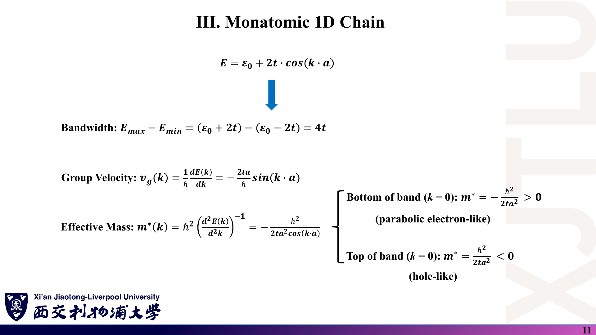

### 中文解释

**题目**：一维 s 轨道链 $t=-1$ eV，$a=2$ Å。求带宽、带底与带顶的位置、带底有效质量（以 $m_e$ 为单位），以及群速度最大的 k。

### 原理深入

$E=\varepsilon_0+2t\cos ka=\varepsilon_0-2\cos ka$（eV）。带宽 $W=4|t|=4$ eV。$t<0$：带底在 $k=0$（$\varepsilon_0-2$ eV），带顶在 $k=\pm\pi/a$（$\varepsilon_0+2$ eV）。

$$
m^*_{\rm bottom}=\frac{\hbar^2}{2|t|a^2}\ \Rightarrow\ \frac{m^*}{m_e}=\frac{\hbar^2/(2m_e)}{|t|a^2}=\frac{3.81}{1\times4}\approx0.95 .
$$

$|v_g|=2|t|a|\sin ka|/\hbar$ 在 $k=\pm\pi/(2a)$ 最大。注意讲义把带顶写成 $k=0$，与公式矛盾。

### Ref

- **来源**：[Lecture Ten，PDF 第 10–11 页](../Lecture_Ten.pdf#page=11)；[02 第 4–5 节](02_Bloch定理与多子格.md)。

## 5. 周期性边界条件与离散 k

### 课件截图

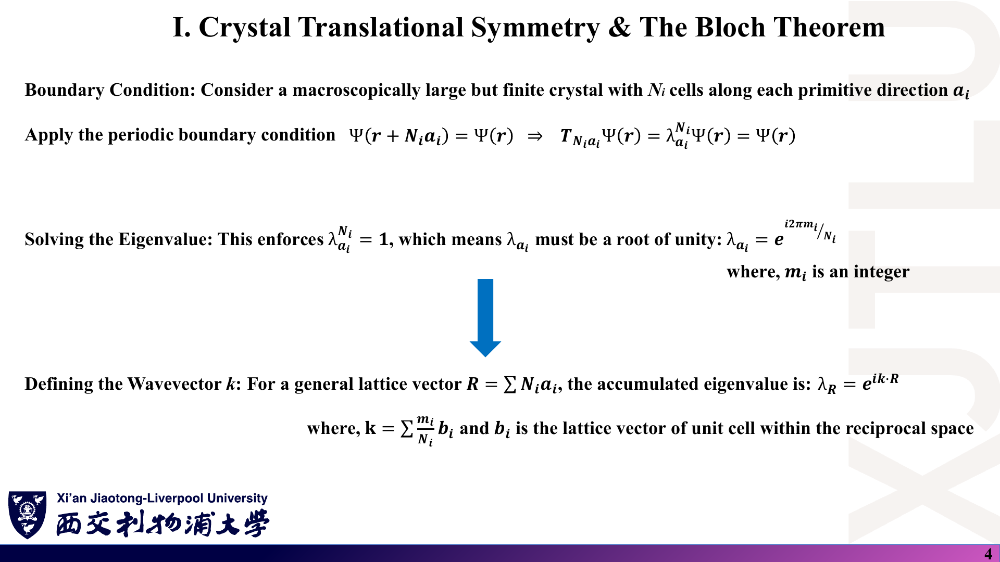

### 中文解释

**题目**：6 个原子组成的环（周期性边界），s 轨道，参数 $\varepsilon_0$、$t$。列出所有允许的 k 与能量，并给出每个能级的简并度。这与“k 点数 = 原胞数”有何关系？

### 原理深入

$k=2\pi m/(6a)$，$m=0,\pm1,\pm2,3$（共 6 个，$m=3$ 与 $-3$ 等价）。

| $m$ | $ka$ | $E$ | 简并度 |
|---|---|---|---|
| 0 | 0 | $\varepsilon_0+2t$ | 1 |
| ±1 | $\pm\pi/3$ | $\varepsilon_0+t$ | 2 |
| ±2 | $\pm2\pi/3$ | $\varepsilon_0-t$ | 2 |
| 3 | $\pi$ | $\varepsilon_0-2t$ | 1 |

总计 6 个态，等于原子（原胞）数。这正是苯分子 π 轨道的 Hückel 能级；当 $N\to\infty$，这些分立能级连成宽 $4|t|$ 的能带。

### Ref

- **来源**：[Lecture Ten，PDF 第 4–5 页](../Lecture_Ten.pdf#page=4)；[02 第 2 节](02_Bloch定理与多子格.md)。

## 6. 双原子链的完整能带

### 课件截图

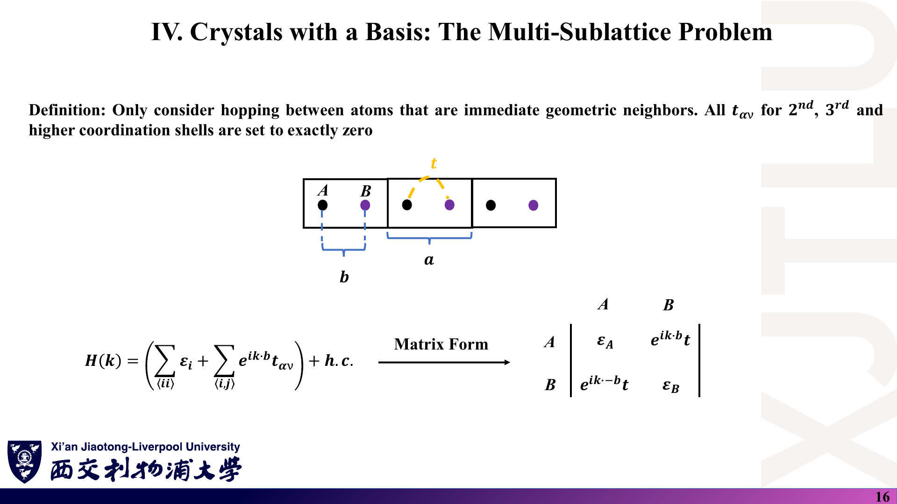

### 中文解释

**题目**：双原子链 $\varepsilon_A=\varepsilon_B=0$，原胞内键 $t_1=-2$ eV，原胞间键 $t_2=-1$ eV。(a) 写出 $H(k)$；(b) 求带隙与每条带的宽度；(c) 为什么讲义第 17 页的 $E_\pm$ 不含 k？

### 原理深入

(a) 原胞约定：$`H(k)=\begin{pmatrix}0&t_1+t_2e^{-ika}\\ t_1+t_2e^{ika}&0\end{pmatrix}`$，$E_\pm=\pm\sqrt{5+4\cos ka}$（eV）。
(b) $|h|$ 在 $k=0$ 为 3，在 $k=\pi/a$ 为 1。上带范围 $[1,3]$ eV，下带 $[-3,-1]$ eV，各宽 2 eV；带隙 $E_g=2|t_1-t_2|=2$ eV，位于 $k=\pi/a$。
(c) 讲义只计入了 $t_1$（相当于 $t_2=0$），$|h|=|t_1|$ 与 k 无关，描述的是互不相连的双原子分子。

### Ref

- **来源**：[Lecture Ten，PDF 第 16–17 页](../Lecture_Ten.pdf#page=17)；[02 第 7 节](02_Bloch定理与多子格.md)；[07 勘误](07_讲义勘误与易错点.md)。

## 7. 费米子算符的基本运算

### 课件截图

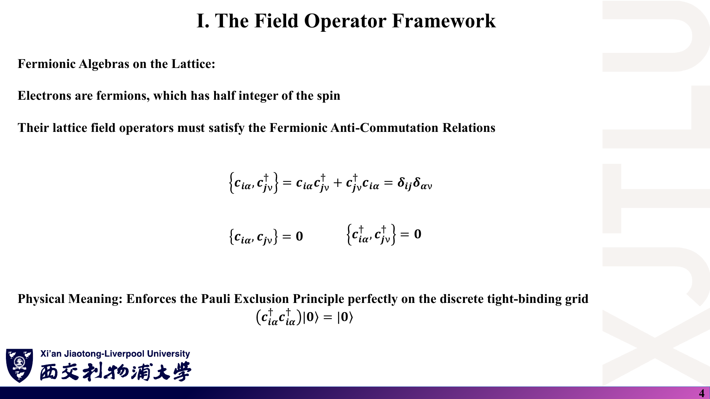

### 中文解释

**题目**：用反对易关系证明 (a) $c^\dagger c^\dagger|0\rangle=0$；(b) 粒子数算符满足 $n^2=n$，因此本征值只能是 0 或 1。讲义写的 $c^\dagger c^\dagger|0\rangle=|0\rangle$ 错在哪里？

### 原理深入

(a) $`\{c^\dagger,c^\dagger\}=2c^\dagger c^\dagger=0`$，所以作用在任何态上都得零矢量。
(b) $n^2=c^\dagger cc^\dagger c=c^\dagger(1-c^\dagger c)c=c^\dagger c-c^\dagger c^\dagger cc=n$。由 $n^2=n$，本征值 $\lambda^2=\lambda$，即 0 或 1——一个轨道最多一个（同自旋）电子。
讲义的写法把“零矢量”误写为“真空态”；真空态范数为 1，不是“不存在”。

### Ref

- **来源**：[Lecture Eleven，PDF 第 4–5 页](../Lecture_Eleven.pdf#page=4)；[03 第 1 节](03_二次量子化与代码架构.md)。

## 8. Fourier 变换的归一化

### 课件截图

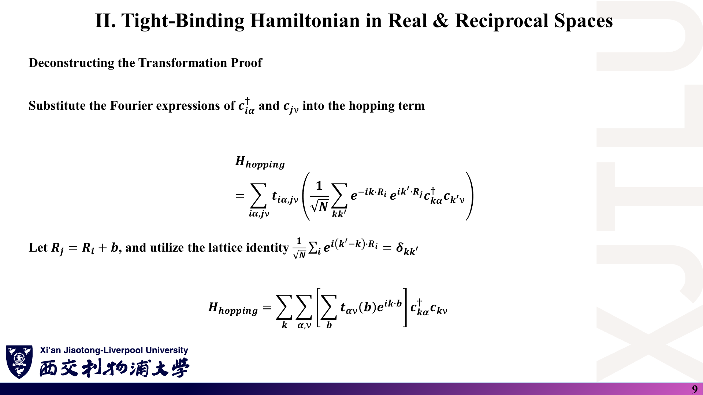

### 中文解释

**题目**：把 $c^\dagger_{i\alpha}$、$c_{j\nu}$ 的 Fourier 展开代入 $\sum_it_{\alpha\nu}(\mathbf b)c^\dagger_{i\alpha}c_{i+\mathbf b,\nu}$，写出每一步的归一化因子。如果按讲义第 9 页写成 $1/\sqrt N$，最终 $H(\mathbf k)$ 会出现什么问题？

### 原理深入

两个 $1/\sqrt N$ 相乘得 $1/N$；对 $i$ 求和给出 $N\delta_{\mathbf k\mathbf k'}$；二者相消，得到 $\sum_{\mathbf k}t_{\alpha\nu}(\mathbf b)e^{i\mathbf k\cdot\mathbf b}c^\dagger_{\mathbf k\alpha}c_{\mathbf k\nu}$，与样品大小无关。若误用 $1/\sqrt N$，结果多出因子 $\sqrt N$，能带会随原胞数发散——物理上荒谬，可作为快速自检。正确恒等式是 $\frac1N\sum_ie^{i(\mathbf k'-\mathbf k)\cdot\mathbf R_i}=\delta_{\mathbf k\mathbf k'}$。

### Ref

- **来源**：[Lecture Eleven，PDF 第 8–10 页](../Lecture_Eleven.pdf#page=9)；[03 第 3 节](03_二次量子化与代码架构.md)。

## 9. “+h.c.” 与 ZHEEV 的 'U'

### 课件截图

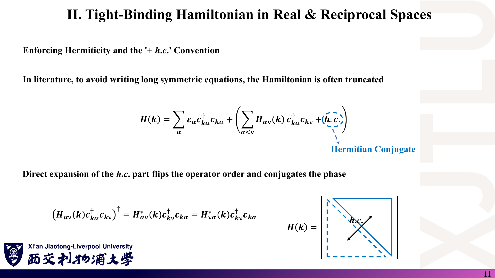

### 中文解释

**题目**：某 k 点 $H_{11}=H_{22}=0$，上三角 $H_{12}=2+3i$ eV。(a) 写出“h.c.”项对应的算符与系数；(b) 用 `ZHEEV('N','U',…)` 时，下三角存放任何数会影响结果吗？(c) 求本征值。

### 原理深入

(a) $(H_{12}c^\dagger_1c_2)^\dagger=H_{12}^*c^\dagger_2c_1=(2-3i)\,c^\dagger_2c_1$，即 $H_{21}=2-3i$。
(b) 不影响：`UPLO='U'` 时 ZHEEV 只读上三角（含对角线），下三角内容被忽略。反之若误传 `'L'`，求解器会读到未赋值（通常为 0）的下三角，得到错误的本征值。
(c) $E=\pm|H_{12}|=\pm\sqrt{13}\approx\pm3.61$ eV。

### Ref

- **来源**：[Lecture Eleven，PDF 第 11 页](../Lecture_Eleven.pdf#page=11)、[第 18–19 页](../Lecture_Eleven.pdf#page=19)；[03 第 4、7 节](03_二次量子化与代码架构.md)；[LAPACK](README.md#ref-lapack)。

## 10. 近邻搜索

### 课件截图

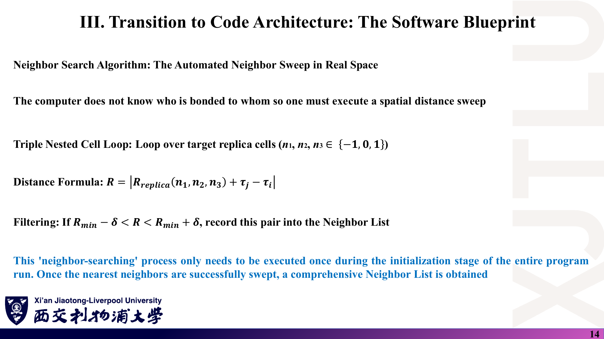

### 中文解释

**题目**：示例代码中 $`n_{1,2,3}\in\{-1,0,1\}`$，$R_{\min}=1.42$ Å，$\delta=0.1$ Å，2 个原子。(a) 一共会找到几条有向键？其中 `atomi < atomj` 的有几条？(b) 代码中 $\mathbf a_3=(0,0,2.46)$ Å。如果把程序扩展到第二近邻（2.46 Å），会出现什么错误？

### 原理深入

(a) 每个原子 3 个第一近邻，有向键共 $2\times3=6$ 条；`atomi=1, atomj=2` 的 3 条被用于填上三角，`atomi=2, atomj=1` 的 3 条被跳过（它们是共轭信息）。
(b) $(n_1,n_2,n_3)=(0,0,\pm1)$ 时，原子与自己在 z 方向的镜像相距 2.46 Å，恰好等于面内第二近邻距离，会被误判为第二近邻（每个原子多出 2 个“假近邻”）。解决：加大 $|\mathbf a_3|$（真空层）或对二维体系固定 $n_3=0$。

### Ref

- **来源**：[Lecture Eleven，PDF 第 14–15 页](../Lecture_Eleven.pdf#page=14)；[08 代码导读](08_代码导读.md)。

## 11. 石墨烯的键矢量与 Dirac 点

### 课件截图

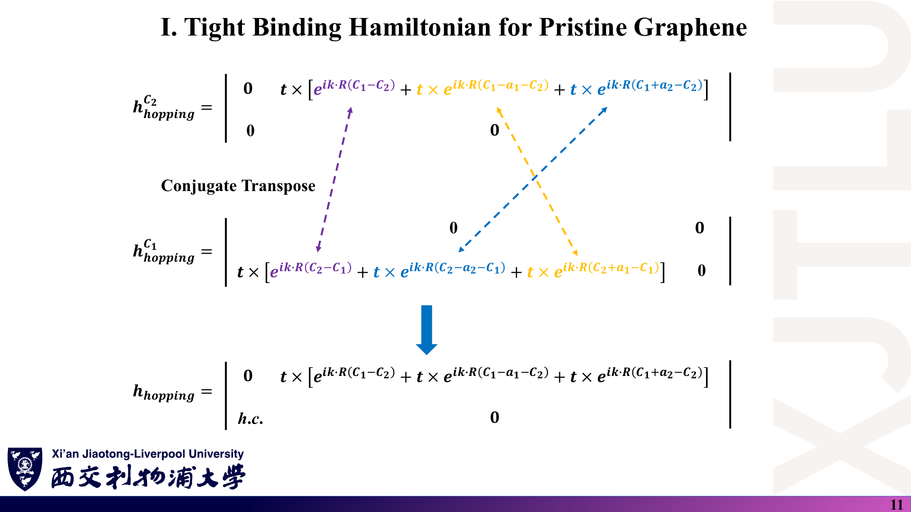

### 中文解释

**题目**：用讲义的 $\mathbf a_1,\mathbf a_2$ 和 C₁、C₂ 坐标，写出 C₁ 到三个近邻的键矢量 $\boldsymbol\delta_m$，并验证在 $K=(\mathbf b_1+\mathbf b_2)/3$ 处 $f(K)=\sum_me^{iK\cdot\boldsymbol\delta_m}=0$。

### 原理深入

$\boldsymbol\delta_1=(-1.23,0.71)$，$\boldsymbol\delta_2=(0,-1.42)$，$\boldsymbol\delta_3=(1.23,0.71)$ Å。由于 $\boldsymbol\delta_3=\boldsymbol\delta_1+\mathbf a_1$，$\boldsymbol\delta_2=\boldsymbol\delta_1-\mathbf a_2$：

$$
f(K)=e^{iK\cdot\boldsymbol\delta_1}\big(1+e^{iK\cdot\mathbf a_1}+e^{-iK\cdot\mathbf a_2}\big)
=e^{iK\cdot\boldsymbol\delta_1}\big(1+e^{i2\pi/3}+e^{-i2\pi/3}\big)=0 ,
$$

因为 $K\cdot\mathbf a_1=K\cdot\mathbf a_2=2\pi/3$，而 $1+2\cos(2\pi/3)=0$。

### Ref

- **来源**：[Lecture Twelve，PDF 第 5–11 页](../Lecture_Twelve.pdf#page=11)；[04 第 3–4 节](04_石墨烯紧束缚与带隙调控.md)。

## 12. 用解析解核对程序输出

### 课件截图

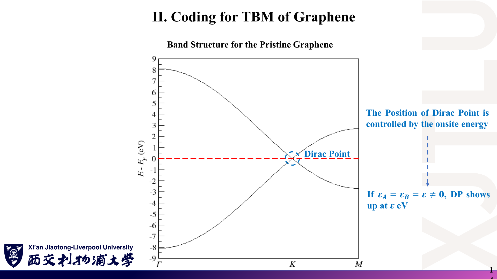

### 中文解释

**题目**：$t=-2.7$ eV，$\varepsilon_A=\varepsilon_B=0$。算出 Γ、K、M 三点的能量，与讲义能带图对照。示例数据最后一行的能量是 $\pm2.699704$ eV 而不是 $\pm2.7$ eV，为什么？

### 原理深入

$|f(\Gamma)|=3,\ |f(K)|=0,\ |f(M)|=1$，所以 $E=\pm8.1$、$0$、$\pm2.7$ eV，与图一致。程序每段 k 路径只取 $j=1,\dots,100$，最后一点是 $K+\tfrac{99}{100}(M-K)$，并未到达 M，所以能量略小于 2.7 eV；横坐标最大值 2.5456 Å⁻¹ 也小于 $|\Gamma K|+|KM|\approx2.5542$ Å⁻¹。

### Ref

- **来源**：[Lecture Twelve，PDF 第 14 页](../Lecture_Twelve.pdf#page=14)；[04 第 4–5 节](04_石墨烯紧束缚与带隙调控.md)；[08 代码导读](08_代码导读.md)。

## 13. 子格势打开带隙

### 课件截图

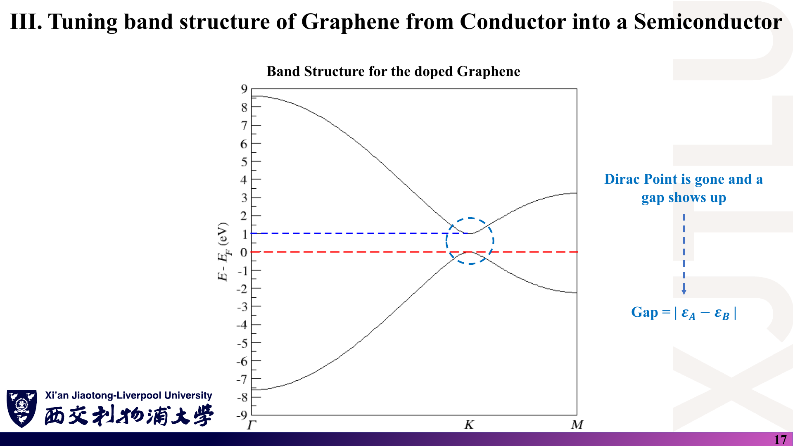

### 中文解释

**题目**：取 $\varepsilon_A=0.4$ eV、$\varepsilon_B=-0.2$ eV、$t=-2.7$ eV。求带隙大小、位置、价带顶与导带底，以及 Γ 点两条带的能量。若改为 $\varepsilon_A=-0.4$、$\varepsilon_B=0.2$，带隙变吗？

### 原理深入

$\bar\varepsilon=0.1$ eV，$\Delta=0.3$ eV。K 点 $|f|=0$：价带顶 $-0.2$ eV，导带底 $0.4$ eV，直接带隙 $E_g=0.6$ eV $=|\varepsilon_A-\varepsilon_B|$。Γ 点：$E_\pm=0.1\pm\sqrt{0.09+65.61}\approx0.1\pm8.106$，即 $8.206$ 与 $-8.006$ eV。交换符号后 $|\varepsilon_A-\varepsilon_B|$ 不变，带隙仍为 0.6 eV（只是 K 点价带态的子格权重换到另一个子格上）。

### Ref

- **来源**：[Lecture Twelve，PDF 第 15–17 页](../Lecture_Twelve.pdf#page=17)；[04 第 6 节](04_石墨烯紧束缚与带隙调控.md)。

## 14. 两种相位约定给出相同能带

### 课件截图

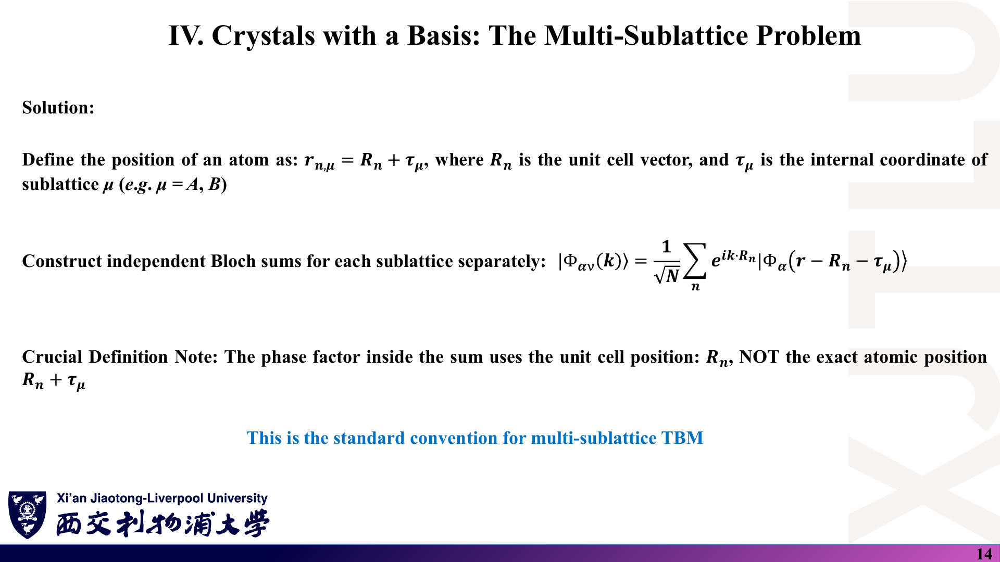

### 中文解释

**题目**：第十讲主张相位用原胞矢量 $\mathbf R_n$，第十二讲和示例代码用原子间矢量 $\mathbf R_n+\boldsymbol\tau_\nu-\boldsymbol\tau_\mu$。证明两种 $H(\mathbf k)$ 的本征值相同，并指出本征矢差在哪里。

### 原理深入

$$
H^{\rm atom}_{\mu\nu}(\mathbf k)=\sum_jt_{\mu\nu}(\mathbf R_j)e^{i\mathbf k\cdot(\mathbf R_j+\boldsymbol\tau_\nu-\boldsymbol\tau_\mu)}
=e^{-i\mathbf k\cdot\boldsymbol\tau_\mu}H^{\rm cell}_{\mu\nu}(\mathbf k)e^{i\mathbf k\cdot\boldsymbol\tau_\nu},
$$

即 $H^{\rm atom}=U^\dagger H^{\rm cell}U$，$U=\mathrm{diag}(e^{i\mathbf k\cdot\boldsymbol\tau_\mu})$ 为幺正矩阵。相似变换不改变本征值；本征矢 $c^{\rm atom}=U^\dagger c^{\rm cell}$，每个分量多一个相位。能带、DOS 不受影响；涉及本征矢相位的量（Berry 相位、位置/速度算符矩阵元）必须在一种约定内一致地计算，见课程补充文献 [BM09](README.md#ref-bm09)。

### Ref

- **来源**：[Lecture Ten，PDF 第 14 页](../Lecture_Ten.pdf#page=14)、[Lecture Twelve，PDF 第 7 页](../Lecture_Twelve.pdf#page=7)；[02 第 6 节](02_Bloch定理与多子格.md)。
