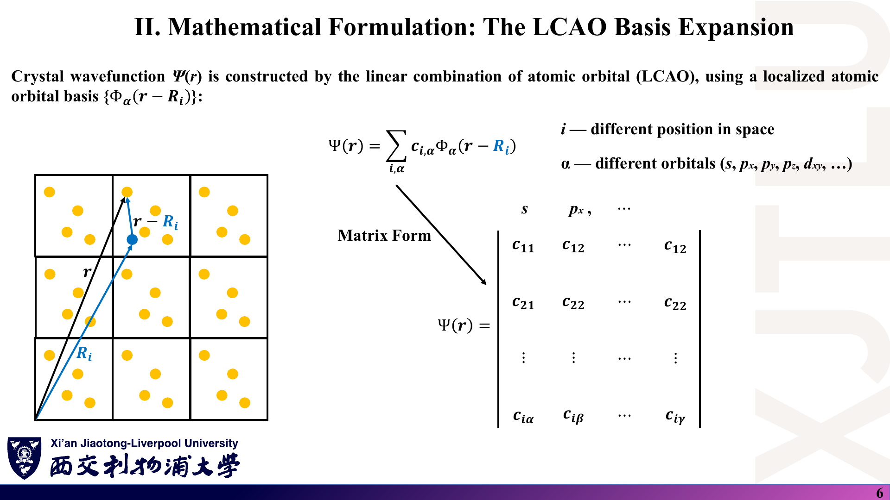
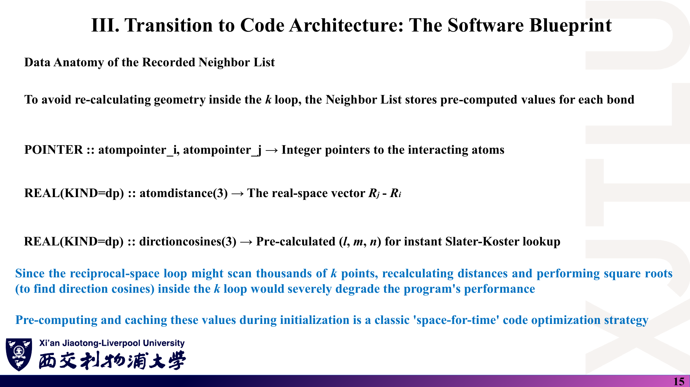
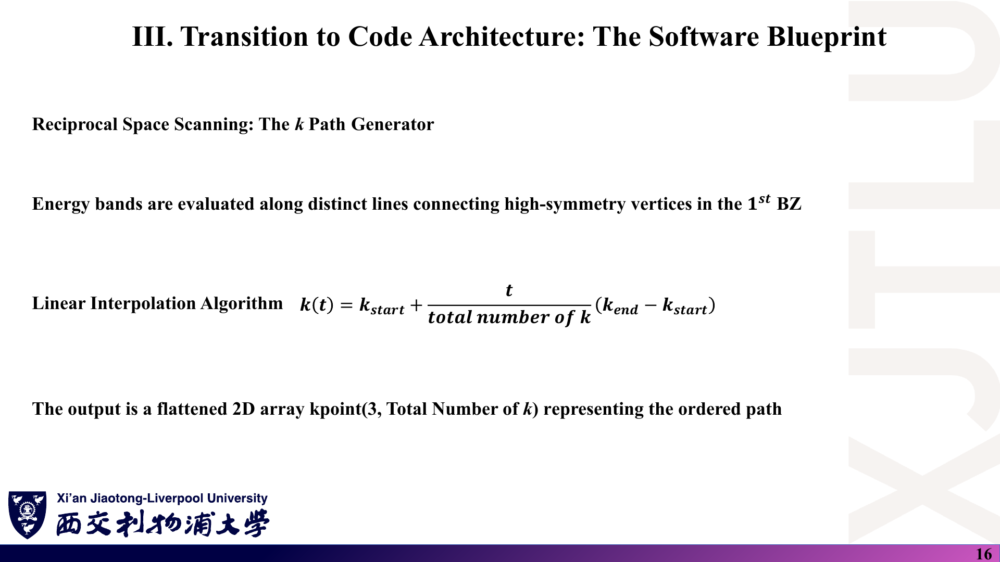
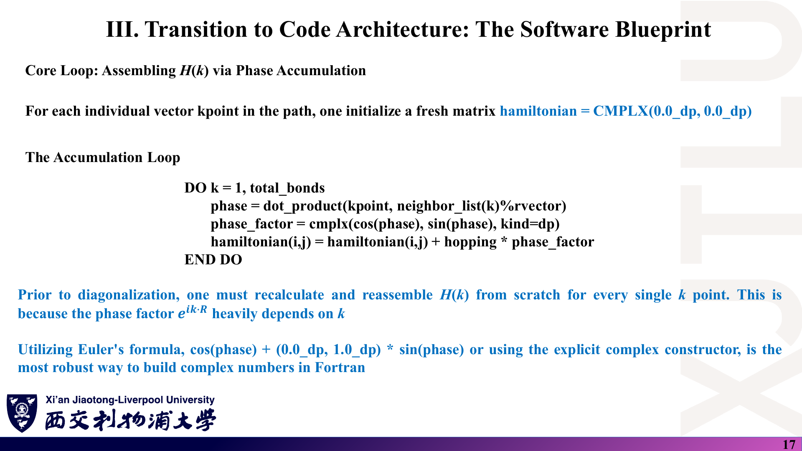

# 07 · 图文勘误、符号约定与易错点

[返回目录](README.md)

> 本文是**学习核对记录，不是教师发布的官方勘误**。截图忠实保留原稿（PDF 由 pptx 转换，内容与 pptx 一致）；“中文解释”说明原图的问题，“原理深入”给出**正确写法**与可复核的**核验理由**。条目区分三类：**明确笔误**（公式或数字写错）、**表述不严谨**（结论需限定）、**约定差异**（不同讲之间写法不同但都可用）。只收录经推导或数值验证的问题。页码均为含封面的 PDF 物理页码。

## 1. 系数矩阵与“跳跃概率”（第九讲）

### 课件截图

### 中文解释

类别：**明确笔误 + 表述不严谨**。

1. 第 6 页：“Matrix Form” 把一个波函数的系数排成多列方阵，第一行最后一列写作 $c_{12}$（第二行末列写作 $c_{22}$），与第二列重复。
2. 第 8–9 页：$H_{i\alpha,i\alpha}$、$H_{i\alpha,j\nu}$ 的矩阵元仍用系数记号 $c_{11},c_{12},\dots$ 填写，与第 6 页的展开系数 $c_{i\alpha}$ 同名。
3. 第 9 页：称 $|c_{21}|^2$ 为“电子从轨道 2 跳到轨道 1 的概率”，第 9 页正文也称跳跃积分为“概率幅”。

### 原理深入

**正确写法**：

- 一个本征态的系数是**列向量** $c=(c_{1s},c_{1p_x},\dots,c_{2s},\dots)^T$；若要排成表格，行标原子、列标轨道，末列应为 $c_{1\gamma}$ 等不同符号。
- 哈密顿矩阵元记作 $H_{i\alpha,j\nu}$：对角为 $\varepsilon_\alpha$，非对角为 $t_{\alpha\nu}$。
- 跳跃积分 $t$ 是**能量**矩阵元，可正可负，量纲 eV。

**核验理由**：(1) 同一记号不能同时表示待求系数与已知矩阵元，否则 $Hc=Ec$ 写不出来。(2) 若 $|t|^2$ 是概率，它应无量纲且 ≤ 1；但石墨烯 $|t|^2=7.29$ eV²，显然不是概率。含时微扰下，短时间 $\Delta t$ 内的跃迁振幅约为 $-it\Delta t/\hbar$，$t$ 决定的是**速率**。

### Ref

- **原课件**：[Lecture Nine，PDF 第 6 页](../Lecture_Nine.pdf#page=6)、[第 8–9 页](../Lecture_Nine.pdf#page=9)。
- **规范写法**：[01 第 2–3 节](01_紧束缚基础与Slater-Koster.md)；[复习题第 3 题](06_复习题与参考答案.md)。

## 2. 一般格矢的系数与“唯一本征态”（第十讲 pp. 3–4）

### 课件截图

### 中文解释

1. 第 4 页（**明确笔误**）：“For a general lattice vector $\mathbf R=\sum N_i\mathbf a_i$”。$N_i$ 在同一页是周期性边界条件中第 $i$ 方向的原胞总数，用它构成的只是“绕整个晶体一圈”的特殊矢量。
2. 第 3 页（**表述不严谨**）：“能量本征态必然也是平移算符的唯一本征态”。

### 原理深入

**正确写法**：

$$
\mathbf R=\sum_in_i\mathbf a_i,\quad n_i\in\mathbb Z;\qquad \lambda_{\mathbf R}=e^{i\mathbf k\cdot\mathbf R},\quad \mathbf k=\sum_i\frac{m_i}{N_i}\mathbf b_i .
$$

“对易算符**可以选取**共同本征态”；简并能级的任意组合仍是 H 的本征态，但不一定是 $T_{\mathbf R}$ 的本征态。

**核验理由**：若 $\mathbf R=\sum N_i\mathbf a_i$，则 $\mathbf k\cdot\mathbf R=2\pi\sum m_i$，$\lambda_{\mathbf R}\equiv1$，对任何 k 都一样，无法定义 k——与该页要说明的结论矛盾。简并反例：一维链 $E(k)=E(-k)$，$\Psi_k+\Psi_{-k}$ 是 H 的本征态，但 $T_a(\Psi_k+\Psi_{-k})=e^{ika}\Psi_k+e^{-ika}\Psi_{-k}$ 一般不与原态成比例。

### Ref

- **原课件**：[Lecture Ten，PDF 第 3–4 页](../Lecture_Ten.pdf#page=4)。
- **规范写法**：[02 第 1–2 节](02_Bloch定理与多子格.md)。

## 3. Bloch 和的下标（第十讲 pp. 6、14）

### 课件截图

### 中文解释

类别：**明确笔误**。

1. 第 6 页：$|\Psi_\alpha(\mathbf r)\rangle=\frac1{\sqrt N}\sum_ne^{i\mathbf k\cdot\mathbf R_n}|\Phi_\alpha(\mathbf r-\mathbf R_i)\rangle$——求和指标是 $n$，轨道中心却是固定的 $\mathbf R_i$；左侧记号 $\Psi_\alpha(\mathbf r)$ 又与下文的 $\Phi_\alpha(\mathbf k)$ 不统一，且未标出 k 依赖。
2. 第 14 页：左侧写作 $|\Phi_{\alpha\nu}(\mathbf k)\rangle$，右侧子格下标是 $\mu$，$\nu$ 在式中没有出现。

### 原理深入

**正确写法**：

$$
|\Phi_\alpha(\mathbf k)\rangle=\frac1{\sqrt N}\sum_ne^{i\mathbf k\cdot\mathbf R_n}|\Phi_\alpha(\mathbf r-\mathbf R_n)\rangle,\qquad
|\Phi_{\alpha\mu}(\mathbf k)\rangle=\frac1{\sqrt N}\sum_ne^{i\mathbf k\cdot\mathbf R_n}|\Phi_\alpha(\mathbf r-\mathbf R_n-\boldsymbol\tau_\mu)\rangle .
$$

**核验理由**：若轨道中心不随 $n$ 变，求和变成 $\big(\frac1{\sqrt N}\sum_ne^{i\mathbf k\cdot\mathbf R_n}\big)\Phi_\alpha(\mathbf r-\mathbf R_i)$，对 $\mathbf k\ne0$ 为零，对 $\mathbf k=0$ 只是单个原子轨道乘 $\sqrt N$，都不满足 Bloch 定理。

### Ref

- **原课件**：[Lecture Ten，PDF 第 6 页](../Lecture_Ten.pdf#page=6)、[第 14 页](../Lecture_Ten.pdf#page=14)。
- **规范写法**：[02 第 3、6 节](02_Bloch定理与多子格.md)。

## 4. 一维链：|ε₀|、t 的符号、带宽与带顶位置（第十讲 pp. 9–11）

### 课件截图

### 中文解释

1. 第 9 页（**明确笔误**）：$H_{is,is}=|\varepsilon_0|$，绝对值号多余（可能想表示 1×1 矩阵，但与行列式记号冲突）。
2. 第 10 页（**前后不一致**）：图中 $\varepsilon_0+2t$ 标在 $k=0$ 的**最高点**，$\varepsilon_0-2t$ 在 $k=\pm\pi/a$ 的最低点，这只在 $t>0$ 时成立；第九讲第 9 页与本讲第 11 页（“带底 $m^*=-\hbar^2/(2ta^2)>0$”）都以 $t<0$ 为前提。
3. 第 11 页（**明确笔误**）：带宽写作 $4t$；“Top of band (k = 0)” 的 k 值与 “Bottom of band (k = 0)” 相同；$d^2E/d^2k$ 应为 $d^2E/dk^2$。

### 原理深入

**正确写法**：

$$
H(k)=\varepsilon_0+2t\cos ka,\qquad W=4|t|,\qquad
m^*=-\frac{\hbar^2}{2ta^2\cos ka}\ \Rightarrow\
\begin{cases}k=0:&m^*=-\dfrac{\hbar^2}{2ta^2}>0\ (t<0,\ \text{带底})\\[2mm]
k=\pm\pi/a:&m^*=\dfrac{\hbar^2}{2ta^2}<0\ (t<0,\ \text{带顶})\end{cases}
$$

图应以 $t<0$ 画：$k=0$ 处为最低点 $\varepsilon_0-2|t|$。

**核验理由**：(1) 带宽是正数，$t<0$ 时 $4t<0$。(2) 在同一个 $k=0$ 处 $\cos ka=1$，$m^*$ 只有一个值，不可能同时是带底与带顶。(3) 第 11 页带底 $m^*>0$ 的不等式只在 $t<0$ 时成立，故第 10 页图的形状与之矛盾。

### Ref

- **原课件**：[Lecture Ten，PDF 第 9–11 页](../Lecture_Ten.pdf#page=11)。
- **规范写法**：[02 第 4–5 节](02_Bloch定理与多子格.md)；[复习题第 4 题](06_复习题与参考答案.md)。

## 5. 双原子链例子过度简化（第十讲 pp. 13、16–17）

### 课件截图

### 中文解释

1. 第 16–17 页（**模型不完整**）：一维双原子链只计入原胞内 A–B 键，漏掉了 $B_n$ 与 $A_{n+1}$ 之间的原胞间键。结果 $E_\pm$ 不含 k（平带），描述的是互不相连的双原子分子而不是链。
2. 第 16 页（**明确笔误**）：$H(k)=\big(\sum\varepsilon_i+\sum e^{ikb}t\big)+{\rm h.c.}$ 把在位项放进了 h.c. 括号，会被计算两次。
3. 第 16 页（**约定不一致**）：矩阵中相位用原子间距 $e^{ikb}$，而两页之前（第 14 页）刚强调“相位只用原胞矢量”。
4. 第 17 页（**定义不严谨**）：把 $|E_+(k)-E_-(k)|$ 称为带隙；带隙应为 $\min_kE_+-\max_kE_-$。
5. 第 13 页（**表述过度**）：“Bloch 和不再适用”。实际上只是**单一** Bloch 和不够，需要每个子格一个。

### 原理深入

**正确写法**（原胞约定，原胞内键 $t_1$、原胞间键 $t_2$）：

$$
H(k)=\begin{pmatrix}\varepsilon_A&t_1+t_2e^{-ika}\\ t_1+t_2e^{ika}&\varepsilon_B\end{pmatrix},\qquad
E_\pm(k)=\bar\varepsilon\pm\sqrt{\Delta^2+t_1^2+t_2^2+2t_1t_2\cos ka},
$$

$$
E_g=2\sqrt{\Delta^2+(t_1-t_2)^2}\quad(t_1t_2>0,\ \text{位于}\ k=\pi/a).
$$

算符形式应写 $H=\sum\varepsilon_ic^\dagger_ic_i+\big(\sum t\,c^\dagger_Ac_B+{\rm h.c.}\big)$。

**核验理由**：(1) 每个原子在无限链中有左右两个近邻，只连一个就不是链。(2) 令 $t_2=0$，完整公式退化为讲义公式——讲义结果是一个特例。(3) 把 ε 放进 h.c. 括号，对角元变为 $2\varepsilon$，令 $t=0$ 时得到 $2\varepsilon_A,2\varepsilon_B$，与孤立原子能级不符。(4) 第 14 页约定下原胞内键的相位为 $e^{ik\cdot0}=1$；不过两种约定的本征值相同（见第 10 节），所以这一点不影响能带。

### Ref

- **原课件**：[Lecture Ten，PDF 第 13 页](../Lecture_Ten.pdf#page=13)、[第 16–17 页](../Lecture_Ten.pdf#page=17)。
- **规范写法**：[02 第 6–7 节](02_Bloch定理与多子格.md)；[复习题第 6 题](06_复习题与参考答案.md)。

## 6. Pauli 原理的算符写法（第十一讲 p. 4）

### 课件截图

### 中文解释

类别：**明确笔误**。原式 $(c^\dagger_{i\alpha}c^\dagger_{i\alpha})|0\rangle=|0\rangle$，右边应是零矢量 $0$，而不是真空态 $|0\rangle$。

### 原理深入

**正确写法**：

$$
c^\dagger_{i\alpha}c^\dagger_{i\alpha}|0\rangle=0 .
$$

**核验理由**：由 $`\{c^\dagger_{i\alpha},c^\dagger_{i\alpha}\}=2(c^\dagger_{i\alpha})^2=0`$ 直接得到。若右边是 $|0\rangle$，则对两边取范数得 $1=\|c^\dagger c^\dagger|0\rangle\|$，与 $(c^\dagger)^2=0$ 矛盾；物理上意味着“放两个电子后回到空态”，也说不通。

### Ref

- **原课件**：[Lecture Eleven，PDF 第 4 页](../Lecture_Eleven.pdf#page=4)。
- **规范写法**：[03 第 1 节](03_二次量子化与代码架构.md)；[复习题第 7 题](06_复习题与参考答案.md)。

## 7. Fourier 变换的归一化（第十一讲 p. 9）

### 课件截图

### 中文解释

类别：**明确笔误**。代入后的双重求和前写 $\frac1{\sqrt N}$；所用的格点恒等式也写成 $\frac1{\sqrt N}\sum_ie^{i(\mathbf k'-\mathbf k)\cdot\mathbf R_i}=\delta_{\mathbf k\mathbf k'}$。两处都应为 $\frac1N$。

### 原理深入

**正确写法**：

$$
c^\dagger_{i\alpha}c_{j\nu}=\frac1N\sum_{\mathbf k\mathbf k'}e^{-i\mathbf k\cdot\mathbf R_i}e^{i\mathbf k'\cdot\mathbf R_j}c^\dagger_{\mathbf k\alpha}c_{\mathbf k'\nu},\qquad
\frac1N\sum_ie^{i(\mathbf k'-\mathbf k)\cdot\mathbf R_i}=\delta_{\mathbf k\mathbf k'} .
$$

**核验理由**：(1) 两个 $1/\sqrt N$ 相乘是 $1/N$。(2) 令 $\mathbf k=\mathbf k'$，左边求和得 $N$ 个 1，除以 $N$ 才等于 1，除以 $\sqrt N$ 得 $\sqrt N$。讲义的最终结果 $H_{\rm hop}=\sum_{\mathbf k}[\sum_{\mathbf b}t e^{i\mathbf k\cdot\mathbf b}]c^\dagger c$ 是对的，只是中间两步的因子相互“抵消”地写错了。

### Ref

- **原课件**：[Lecture Eleven，PDF 第 9 页](../Lecture_Eleven.pdf#page=9)。
- **规范写法**：[03 第 3 节](03_二次量子化与代码架构.md)；[复习题第 8 题](06_复习题与参考答案.md)。

## 8. h.c. 展开多了一次共轭（第十一讲 p. 11）

### 课件截图

### 中文解释

类别：**明确笔误**。原式 $(H_{\alpha\nu}c^\dagger_{\mathbf k\alpha}c_{\mathbf k\nu})^\dagger=H^*_{\alpha\nu}c^\dagger_{\mathbf k\nu}c_{\mathbf k\alpha}=H^*_{\nu\alpha}c^\dagger_{\mathbf k\nu}c_{\mathbf k\alpha}$，最后一个等号错误。

### 原理深入

**正确写法**：

$$
(H_{\alpha\nu}c^\dagger_{\mathbf k\alpha}c_{\mathbf k\nu})^\dagger=H^*_{\alpha\nu}c^\dagger_{\mathbf k\nu}c_{\mathbf k\alpha}=H_{\nu\alpha}c^\dagger_{\mathbf k\nu}c_{\mathbf k\alpha}.
$$

**核验理由**：厄米性是 $H_{\nu\alpha}=H^*_{\alpha\nu}$，故 $H^*_{\nu\alpha}=H_{\alpha\nu}$，原式等于 $H_{\alpha\nu}c^\dagger_\nu c_\alpha$，即把上三角元素原样（未共轭）放到下三角，矩阵一般不再厄米。数值例：$H_{12}=i$，正确的 $H_{21}=-i$；按原式会得 $H_{21}=i$，矩阵 $`\begin{pmatrix}0&i\\i&0\end{pmatrix}`$ 的本征值 $\pm i$ 不是实数。

### Ref

- **原课件**：[Lecture Eleven，PDF 第 11 页](../Lecture_Eleven.pdf#page=11)。
- **规范写法**：[03 第 4 节](03_二次量子化与代码架构.md)；[复习题第 9 题](06_复习题与参考答案.md)。

## 9. 石墨烯哈密顿量中多余的 t（第十二讲 pp. 7、10–12、16）

### 课件截图

### 中文解释

类别：**明确笔误**。非对角元写作 $t\times[e^{i\cdots}+t\times e^{i\cdots}+t\times e^{i\cdots}]$。括号外已乘 $t$，括号内第二、三项又各乘一次 $t$，按字面展开为 $te^{\cdots}+t^2e^{\cdots}+t^2e^{\cdots}$。第 7、10、11、12、16 页沿用了同一写法。

### 原理深入

**正确写法**：

$$
H_{12}(\mathbf k)=t\big[e^{i\mathbf k\cdot(C_1-C_2)}+e^{i\mathbf k\cdot(C_1-\mathbf a_1-C_2)}+e^{i\mathbf k\cdot(C_1+\mathbf a_2-C_2)}\big]=t\,f^*(\mathbf k).
$$

**核验理由**：(1) 量纲：$t$ 与 $t^2$ 不能相加。(2) 数值：在 Γ 点按原式得 $|H_{12}|=|t+2t^2|=|-2.7+14.58|=11.88$ eV，本征值 ±11.88 eV；而讲义第 14 页图与 `pristine_bandstructure.dat` 都是 ±8.1 eV $=3|t|$，与正确写法一致。示例代码对每条键只乘一次 `hopping`，也是正确写法。

### Ref

- **原课件**：[Lecture Twelve，PDF 第 7 页](../Lecture_Twelve.pdf#page=7)、[第 10–12 页](../Lecture_Twelve.pdf#page=11)、[第 16 页](../Lecture_Twelve.pdf#page=16)。
- **规范写法**：[04 第 4 节](04_石墨烯紧束缚与带隙调控.md)；[08 代码导读](08_代码导读.md)。

## 10. 相位约定与键矢量方向（约定差异，不是错误）

### 课件截图

### 中文解释

类别：**约定差异**。三处写法不同：

- 第十讲第 14 页：相位只用原胞矢量 $\mathbf R_n$，称之为多子格 TB 的“标准约定”。
- 第十二讲与示例代码：相位用完整的原子间矢量（如 $C_5-C_2$）。
- 第十一讲第 15 页：键矢量为 $\mathbf R_j-\mathbf R_i$；示例代码 `rvector = τ_i − τ_j + R`，方向相反，且代码注释写“从 i 指向 j”，与实际方向不符。

### 原理深入

**统一结论**：

$$
H^{\rm atom}(\mathbf k)=U^\dagger H^{\rm cell}(\mathbf k)U,\quad U=\mathrm{diag}(e^{i\mathbf k\cdot\boldsymbol\tau_\mu});\qquad
H^{\rm reversed}(\mathbf k)=H(-\mathbf k)=H(\mathbf k)^T\ (t\ \text{为实数}).
$$

**核验理由**：幺正相似变换与转置都不改变本征值，所以三种写法给出相同能带；示例数据在 Γ、K、M 处与解析解一致也证实了这一点。差别只体现在本征矢的相位上，需要本征矢的计算（投影、Berry 相位、光学矩阵元）必须在一种约定下自洽。“标准约定”的说法应理解为“本课程采用的一种常见约定”；课程补充文献 [BM09](README.md#ref-bm09) 正是讨论这两种基的差异。

### Ref

- **原课件**：[Lecture Ten，PDF 第 14 页](../Lecture_Ten.pdf#page=14)、[Lecture Eleven，PDF 第 15 页](../Lecture_Eleven.pdf#page=15)、[Lecture Twelve，PDF 第 6 页](../Lecture_Twelve.pdf#page=6)。
- **证明**：[02 第 6 节](02_Bloch定理与多子格.md)；[复习题第 14 题](06_复习题与参考答案.md)。

## 11. 其他记号与表述问题（第十一、十二讲）

### 课件截图

### 中文解释

类别：**表述不严谨 / 小笔误**，不影响结果，但写代码时容易出错。

| 位置 | 原文 | 问题 |
|---|---|---|
| L11 p. 12 | `Hamiltonian(row, cloumn)` | 拼写：column |
| L11 p. 13 | `numorbital(natom)` “per atomic species” | 数组按原子编号，不是按元素种类 |
| L11 p. 13 | “dimensionless real type REAL(KIND=dp)” | 精度类型与量纲无关；双精度只能减小而不能“杜绝”舍入误差 |
| L11 p. 16 | $\mathbf k(t)=\mathbf k_{\rm start}+\frac{t}{\cdots}(\cdots)$ | 插值参数与跳跃积分 $t$ 同名 |
| L11 p. 17 | `DO k = 1, total_bonds` | 键循环变量与 k 点同名；`i, j` 未从近邻表取出 |
| L11 p. 11 | 对角项只写 $\varepsilon_\alpha$ | 若含同子格跳跃，对角元也随 k 变化 |
| L12 p. 17 | 有隙能带纵轴 $E-E_F$，0 位于价带顶 | 有隙时 $E_F$ 位于隙中、位置取决于温度与掺杂；图中的 0 实为 $\varepsilon_B$ |
| L12 pp. 15, 18 | H/OH/COOH 修饰 = 子格在位能差 | 有效模型：真实共价修饰使 C 变为 $sp^3$、$p_z$ 离开 π 体系；n/p 掺杂主要移动 $E_F$ |

### 原理深入

**建议写法**：插值参数记为 $s$；键循环用 `ib`；纵轴在有隙情形写“$E$ (eV)，以价带顶为零点”；讨论真实材料时说明“子格势模型抓住的是 A/B 对称性破缺这一机制”。

**核验理由**：前六项可从代码语义直接判断（同名变量会在 Fortran 中真正冲突：若键循环变量与 k 点循环变量都叫 `k`，内层循环会改写外层计数器）。后两项是物理表述的适用范围问题，正文 [04 第 6 节](04_石墨烯紧束缚与带隙调控.md) 给出了更完整的讨论。

### Ref

- **原课件**：[Lecture Eleven，PDF 第 11–17 页](../Lecture_Eleven.pdf#page=16)、[Lecture Twelve，PDF 第 15–18 页](../Lecture_Twelve.pdf#page=17)。
- **相关笔记**：[03 第 5–7 节](03_二次量子化与代码架构.md)；[04 第 6 节](04_石墨烯紧束缚与带隙调控.md)；[08 代码导读](08_代码导读.md)。
