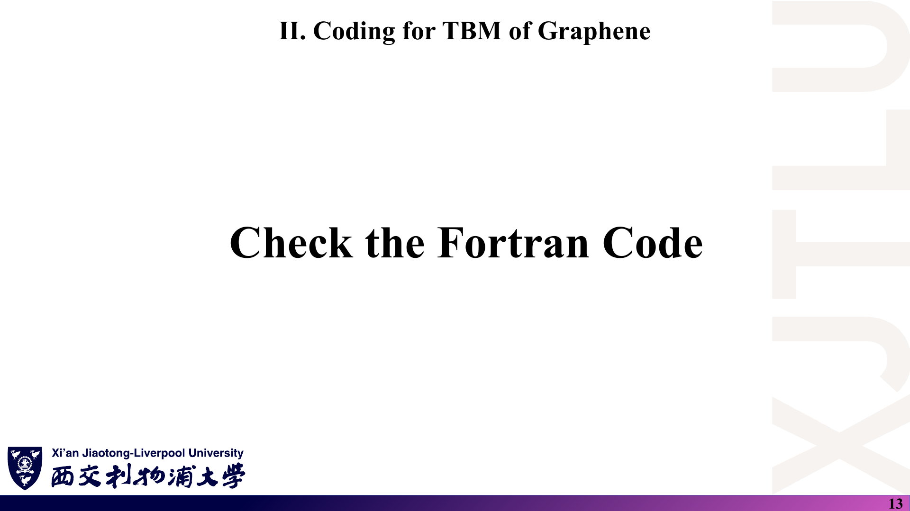
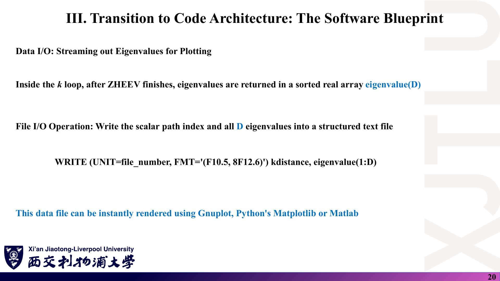
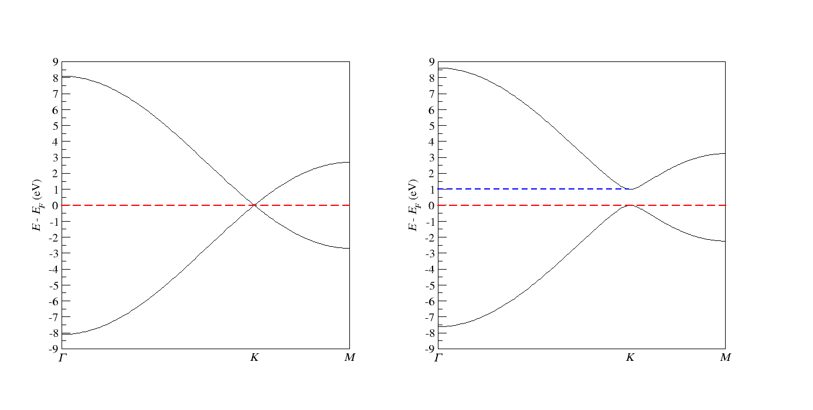
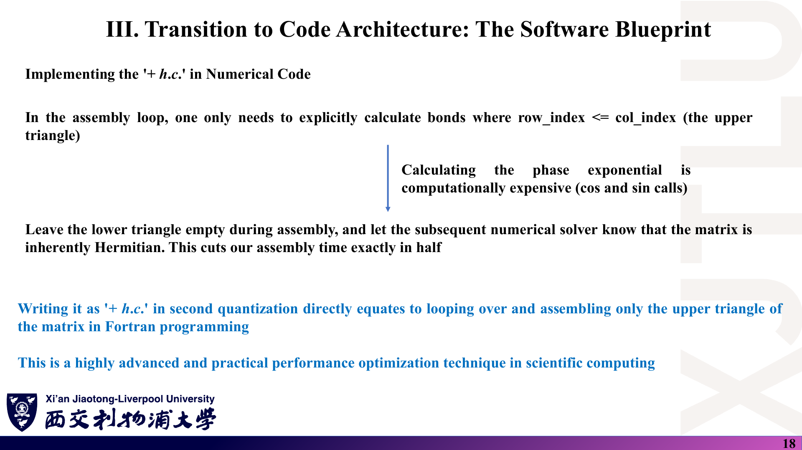

# 08 · 石墨烯紧束缚 Fortran 代码导读

来源：[Codes/](../Codes/) 目录（教师示例代码）；对应讲义 [Lecture_Eleven.pdf](../Lecture_Eleven.pdf) 第 12–21 页与 [Lecture_Twelve.pdf](../Lecture_Twelve.pdf) 第 13–17 页。

[返回目录](README.md)

> 本文只解读教师提供的示例程序，行号对应 [`TIGHTBINDINGFORGRAPHENE.f90`](../Codes/TIGHTBINDINGFORGRAPHENE.f90)（279 行）。文中的数值核对基于仓库中已有的输出文件，未在本地重新编译运行。CW1 要求提交**原创**代码，本文不是作业答案。

## 1. Codes 目录里有哪些文件？

### 课件截图



### 中文解释

讲义第十二讲第 13 页只写了“查看 Fortran 代码”，代码本身放在 `Codes/` 中。各文件作用如下：

| 文件 | 作用 |
|---|---|
| `TIGHTBINDINGFORGRAPHENE.f90` | 主程序：构造石墨烯 2×2 $H(\mathbf k)$，沿 Γ–K–M 对角化，输出能带 |
| `Graphene.vasp` | POSCAR 风格的结构文件；**程序只读取其中的 `onsite:` 一行** |
| `compile.sh` | Slurm 作业脚本：加载 LAPACK 模块并用 gfortran 编译 |
| `run.sh` | Slurm 作业脚本：用 `srun` 运行可执行文件 |
| `bandstructure.dat` | 最近一次运行的输出（内容与 `pristine_bandstructure.dat` 逐字节相同） |
| `pristine_bandstructure.dat` | 本征石墨烯（`onsite: 0.0 0.0`）的能带数据 |
| `gapped_bandstructure.dat` | 有隙石墨烯（在位能 1.0 / 0.0 eV）的能带数据 |
| `band.agr` | xmgrace 工程文件，含左右两个图（G0、G1），各两条能带 |
| `band.png` | 教师用 xmgrace 导出的能带图（左：本征；右：有隙），即讲义第 14、17 页所用图 |

### 原理深入

程序结构对应第十一讲第 21 页的流程图：

```text
DOTPRODUCT / CROSSPRODUCT / KSPACE   ← 第 1–52 行：倒格矢
MODULE GEOMETRY → NEIGHBOURHAMILTONIAN ← 第 54–121 行：近邻表（一次性）
PROGRAM TIGHTBINDINGFORGRAPHENE
  参数化（第 159–182 行）→ k 路径（第 188–213 行）→ 近邻表（第 216 行）
  → 读 onsite（第 220–232 行）→ k 循环：组装 + ZHEEV（第 234–256 行）
  → 写文件（第 258–263 行）→ 释放与关闭（第 265–278 行）
```

### Ref

- **原课件**：[Lecture Twelve，PDF 第 13 页](../Lecture_Twelve.pdf#page=13)；[Lecture Eleven，PDF 第 21 页](../Lecture_Eleven.pdf#page=21)。
- **代码**：[Codes 目录](../Codes/)。

## 2. 倒格矢是怎样算出来的？（第 1–52 行）

### 课件截图


### 中文解释

三个小子程序：`DOTPRODUCT` 求点积，`CROSSPRODUCT` 求叉积，`KSPACE` 用二者按标准公式由实空间晶格矢量求倒格矢。之后 k 点先用分数坐标给出，再乘倒格矢矩阵变成笛卡尔坐标。

### 原理深入

第 40–49 行实现

$$
\mathbf b_1=2\pi\frac{\mathbf a_2\times\mathbf a_3}{\mathbf a_1\cdot(\mathbf a_2\times\mathbf a_3)},\quad
\mathbf b_2=2\pi\frac{\mathbf a_3\times\mathbf a_1}{V},\quad
\mathbf b_3=2\pi\frac{\mathbf a_1\times\mathbf a_2}{V},
$$

满足 $\mathbf a_i\cdot\mathbf b_j=2\pi\delta_{ij}$。数组约定：`latticeinrealspace(:,i)` 与 `latticeinkspace(:,i)` 的**第 i 列**是第 i 个矢量。第 5 行 `SELECTED_REAL_KIND(15,14)` 即双精度。

二维材料也要给 $\mathbf a_3$，否则体积为零；这里第 166 行令 $\mathbf a_3=(0,0,2.46)$ Å，它不影响面内能带，但会影响近邻搜索（见第 3 节）。程序把倒格矢写入 `kspace.dat`（第 210–213 行），可用来手工核对：$\mathbf b_1\approx(2.554,1.475,0)$、$\mathbf b_2\approx(0,2.949,0)$ Å⁻¹（由 $2\pi/a\cdot(1,1/\sqrt3)$ 与 $2\pi/a\cdot(0,2/\sqrt3)$ 算得）。

### Ref

- **原课件**：[Lecture Ten，PDF 第 4 页](../Lecture_Ten.pdf#page=4)。
- **推导**：[04 第 1 节](04_石墨烯紧束缚与带隙调控.md)。

## 3. 近邻表是怎样建立的？（第 54–121 行）

### 课件截图


### 中文解释

`MODULE GEOMETRY` 定义了近邻记录类型 `neighbour`（原子编号 `atomi`、`atomj`、键矢量 `rvector`、键长 `region`），以及子程序 `NEIGHBOURHAMILTONIAN`。后者对所有原子对 $(i,j)$ 和周围 27 个镜像原胞做距离扫描，把距离落在 $1.42\pm0.1$ Å 的组合记为键。

### 原理深入

逐段说明：

- **第 83–84 行**：预分配 `natom**2*9 = 36` 条记录。
- **第 89–107 行**：五重循环 `i, j, n1, n2, n3`。镜像格矢 `rcell = n1 a1 + n2 a2 + n3 a3`；距离 `|τ_i − τ_j + rcell|`；满足 `distance − delta ≤ d ≤ distance + delta` 则记录。
- **第 101 行**：`rvector = τ_i − τ_j + rcell`。这是**从 j 的镜像（位于 $\boldsymbol\tau_j-\mathbf R$）指向 i** 的矢量；第 63 行注释“from atom i to atom j”与实际方向相反。随后 `H(i,j)` 用的相位是 $e^{i\mathbf k\cdot(\boldsymbol\tau_i-\boldsymbol\tau_j+\mathbf R)}$，与讲义第十二讲“行原子 − 列原子”的写法一致，等价于常见约定下的 $H(-\mathbf k)$，能带不变（见 [07 第 10 节](07_讲义勘误与易错点.md)）。
- **第 109–116 行**：用 `MOVE_ALLOC` 把数组截短为实际键数 `nbond`。石墨烯得到 6 条有向键：(1→2) 3 条、(2→1) 3 条。

**两个潜在问题**：

1. **数组上限**：循环最多产生 $\text{natom}^2\times27$ 个候选，而只预留了 $\text{natom}^2\times9$。第一近邻时每对原子最多 3 条键，不会越界；若扩展到第二近邻（同子格 6 条）或增大截断，可能越界写内存，应改为 `natom**2*27` 或先计数再分配。
2. **z 方向假近邻**：$|\mathbf a_3|=2.46$ Å 等于面内第二近邻距离。若把 `firstneighbour` 改为 2.46 Å，$(0,0,\pm1)$ 镜像会被当成近邻。应加大 $\mathbf a_3$ 或令 `n3 = 0`。

### Ref

- **原课件**：[Lecture Eleven，PDF 第 14–15 页](../Lecture_Eleven.pdf#page=14)。
- **相关笔记**：[03 第 6 节](03_二次量子化与代码架构.md)；[复习题第 10 题](06_复习题与参考答案.md)。

## 4. 主程序硬编码了哪些参数？（第 123–182 行）

### 课件截图


### 中文解释

几何与模型参数全部写死在源代码里，没有从 `Graphene.vasp` 读取。要改晶格常数、k 点数或跳跃积分，必须改源码并重新编译。

### 原理深入

| 行 | 变量 | 值 | 含义 |
|---|---|---|---|
| 161–166 | `scalingfactor`、`latticeinrealspace` | 2.46 Å；$\mathbf a_1=(a,0,0)$，$\mathbf a_2=(a\cos120^\circ,a\sin120^\circ,0)$，$\mathbf a_3=(0,0,a)$ | 与讲义第十二讲第 3 页一致 |
| 167–168 | `firstneighbour`、`delta` | 1.42、0.1 Å | 近邻判据 |
| 169 | `natom` | 2 | 也是 $H(\mathbf k)$ 的维数 |
| 170–176 | `atomcoordinate` | 分数坐标 (2/3,1/3)、(1/3,2/3) 换算成笛卡尔 Å | C₁、C₂ |
| 177 | `nk` | 100 | 每段 k 路径的点数 |
| 178–181 | `kpoint` | Γ(0,0,0)、K(1/3,1/3,0)、M(1/2,0,0) | 以 $\mathbf b_i$ 为基的分数坐标 |
| 182 | `hopping` | −2.7 eV | **只在代码中给出**，讲义未写具体数值 |

`Graphene.vasp` 虽然也写了晶格与坐标，但只有最后一行 `onsite: 0.0 0.0` 会被读取。两处数据若不一致，程序不会报错——修改结构时要同时改源码。

### Ref

- **原课件**：[Lecture Twelve，PDF 第 3 页](../Lecture_Twelve.pdf#page=3)；[Lecture Eleven，PDF 第 13 页](../Lecture_Eleven.pdf#page=13)。
- **代码**：[`Graphene.vasp`](../Codes/Graphene.vasp)。

## 5. k 路径是怎样生成的？（第 188–213 行）

### 课件截图


### 中文解释

先把三个高对称点从分数坐标换成笛卡尔坐标（第 190–192 行），再在 Γ→K、K→M 两段上各取 100 个等距点（第 195–204 行），最后累加相邻点间距得到横坐标（第 205–207 行）。

### 原理深入

数组 `kpath(4+natom, 2*nk)`：第 1–3 行存 k 的笛卡尔坐标（Å⁻¹），第 4 行存累计路径长度，第 5–6 行留给两个本征值。

第 200 行 `kpath(…) = kpoint(:,i) + inter*DBLE(j-1)`，$j=1,\dots,100$，所以每段取的是 $\mathbf k_{\rm start}+\frac{s}{100}(\mathbf k_{\rm end}-\mathbf k_{\rm start})$，$s=0,\dots,99$：

- 第 1 段：Γ（含）→ K 前一步；
- 第 2 段：K（含，第 101 个点）→ M 前一步；
- **M 点本身从未被计算**。最后一个点是 $K+0.99(M-K)$，横坐标 2.545627 Å⁻¹，而真实的 $|\Gamma K|+|KM|\approx2.5542$ Å⁻¹。

这解释了为什么 `pristine_bandstructure.dat` 最后一行是 $\pm2.699704$ 而不是 $\pm2.7$ eV，以及 `band.agr` 把 M 标在 2.5456266 处。若要包含终点，可在最后一段多取一个点（$s=0,\dots,N_{\rm seg}$），或整体使用 $s/(N_{\rm seg}-1)$。

k 与键矢量都是笛卡尔坐标、单位分别为 Å⁻¹（含 $2\pi$）与 Å，所以第 249 行可以直接点乘得到无量纲相位。

### Ref

- **原课件**：[Lecture Eleven，PDF 第 16 页](../Lecture_Eleven.pdf#page=16)。
- **核对**：[复习题第 12 题](06_复习题与参考答案.md)。

## 6. 在位能是如何读入的？（第 185、220–240 行）

### 课件截图


### 中文解释

程序逐行读 `Graphene.vasp`，找到含冒号的行，若冒号前是 `onsite`，就把冒号后的数字读进 `onsite(1:natom)`。然后构造对角矩阵 `honsite`。要算有隙石墨烯，只需把这一行改成 `onsite: 1.0 0.0`，无须重新编译。

### 原理深入

- **第 185 行** `OPEN(UNIT=3, …, IOSTAT=k)`：变量 `k` 被借用为文件状态标志，第 222 行 `DO WHILE (k == 0)` 读到文件尾时退出。
- **静默失败**：若 `Graphene.vasp` 不存在，`k ≠ 0`，循环一次也不执行，`onsite` 保持第 221 行的初值 0，程序照常算出本征石墨烯能带而**不报错**。运行目录里一定要有这个文件，最好在程序中检查 `IOSTAT`。
- **第 229 行** 内部读 `READ(UNIT=str(i+1:), FMT=*) onsite` 需要至少 `natom` 个数，少写一个会运行时报错。
- **第 237–240 行** `honsite` 为 $\mathrm{diag}(\varepsilon_A,\varepsilon_B)$，与讲义第十二讲第 4 页相同。

### Ref

- **原课件**：[Lecture Twelve，PDF 第 4 页](../Lecture_Twelve.pdf#page=4)、[第 16 页](../Lecture_Twelve.pdf#page=16)。

## 7. 每个 k 点的 H(k) 怎样组装与对角化？（第 241–256 行）

### 课件截图


### 中文解释

外层循环遍历 200 个 k 点。每个 k 点先把 `hhopping` 清零，再遍历 6 条键：跳过 `atomi > atomj` 的 3 条，只把另外 3 条的 $t\,e^{i\mathbf k\cdot\mathbf r}$ 加到 `hhopping(1,2)`。加上在位矩阵后调用 `ZHEEV('V','U',…)`，本征值存入 `kpath(5:6, i)`。

### 原理深入

第 247–252 行实际构造的是

$$
H(\mathbf k)=\begin{pmatrix}\varepsilon_A & t\sum_{m}e^{-i\mathbf k\cdot\boldsymbol\delta_m}\\ (\text{未赋值}) & \varepsilon_B\end{pmatrix},
$$

下三角保持 0。由于 `UPLO='U'`，ZHEEV 只读上三角，把下三角视为其共轭——这就是第十一讲第 18–19 页“+h.c. = 只填上三角”的实现。

**几点说明**：

- **第 241–243 行** 工作数组：`lwork = 3N−1 = 5`（LAPACK 最小要求 $2N-1=3$），`rwork` 长度 $3N-2=4$，均满足要求。
- **`'V'` 的代价**：程序要求返回本征矢，但之后从未使用；`hamiltonian` 数组被本征矢覆盖。只画能带时用 `'N'` 即可。
- **`info` 未检查**：若对角化失败（`info ≠ 0`），程序仍会写出结果。
- **第 253 行** 每个 k 点重新求和 `honsite + hhopping`，与讲义第 17 页“每个 k 点从零组装”一致。
- **成本**：每个 k 点 3 次 sin/cos 与一次 2×2 对角化，200 个 k 点瞬间完成。CW1 的 DOS 需要在整个布里渊区的均匀网格上取远多于此的点，此时计算量才变得可观。

### Ref

- **原课件**：[Lecture Eleven，PDF 第 17–19 页](../Lecture_Eleven.pdf#page=18)。
- **相关笔记**：[03 第 7 节](03_二次量子化与代码架构.md)；[LAPACK](README.md#ref-lapack)。

## 8. 输出格式与收尾（第 258–279 行）

### 课件截图



### 中文解释

程序把每条能带单独写成一块：两列 `(累计 k 距离, 能量)`，共 200 行，块与块之间空一行。文件共 402 行（2 × 200 + 2 个空行）。然后释放数组、关闭文件。

### 原理深入

- 格式 `'(F15.9,3X,F15.9)'`，能量单位 eV，k 距离单位 Å⁻¹。与讲义第 20 页“每行一个 k 点、所有本征值”的格式不同，但更便于 xmgrace/Gnuplot 直接画多条曲线。
- **第 210 行** 打开的 `kspace.dat`（单元 7）始终没有显式 `CLOSE`；Fortran 程序正常结束时会自动关闭，通常无害，但属于不规范写法。
- 输出文件名固定为 `bandstructure.dat`，每次运行都会覆盖。教师的两份数据显然是分别运行后手动改名得到的；`bandstructure.dat` 当前与 `pristine_bandstructure.dat` 完全相同。

### Ref

- **原课件**：[Lecture Eleven，PDF 第 20 页](../Lecture_Eleven.pdf#page=20)。
- **数据**：[`bandstructure.dat`](../Codes/bandstructure.dat)。

## 9. 如何在 HPC 上编译和运行？

### 课件截图


### 中文解释

两个脚本都是 Slurm 批处理脚本，用 `sbatch` 提交到计算节点，而不是在登录节点直接 `bash` 运行。先编译，再运行；运行目录中必须同时有可执行文件和 `Graphene.vasp`。

### 原理深入

**编译** [`compile.sh`](../Codes/compile.sh)：

- `#SBATCH --partition=cpu8358`（注释写“或 cpu6348”）、`--qos=300cores`、1 节点 1 任务；日志写入 `作业号.out` / `作业号.error`。
- `module load netlib-lapack/3.11.0-gcc-8.5.0-r63wfp7` 加载 LAPACK。
- `gfortran TIGHTBINDINGFORGRAPHENE.f90 -L<lib64> -llapack -lblas -Wl,-rpath,<lib64> -o TIGHTBINDINGFORGRAPHENE`：`-L` 指定链接时库路径，`-rpath` 把同一路径写进可执行文件，使运行时无需再加载模块即可找到 `liblapack.so`。
- `rm *.mod` 删除编译 `MODULE GEOMETRY` 产生的 `geometry.mod`。
- 脚本中的 `--mail-user` 是教师邮箱，自己提交时应删除或改成自己的地址。分区名、QOS 与库路径是该集群特有的，换集群需修改。

**运行** [`run.sh`](../Codes/run.sh)：`module purge`、`OMP_NUM_THREADS=1`，再 `srun ./TIGHTBINDINGFORGRAPHENE`。

```bash
sbatch compile.sh          # 生成可执行文件 TIGHTBINDINGFORGRAPHENE
sbatch run.sh              # 读取 Graphene.vasp，生成 bandstructure.dat 与 kspace.dat
# 有隙情形：把 Graphene.vasp 最后一行改为  onsite: 1.0 0.0  后再次 sbatch run.sh
```

不在集群上时，本地装有 gfortran 与 LAPACK/BLAS 也可用 `gfortran TIGHTBINDINGFORGRAPHENE.f90 -llapack -lblas -o TIGHTBINDINGFORGRAPHENE` 编译（库名与路径以本机安装为准）。

### Ref

- **脚本**：[`compile.sh`](../Codes/compile.sh)、[`run.sh`](../Codes/run.sh)。

## 10. 怎样核对输出与教师的能带图？

### 课件截图



*这张图来自 `Codes/band.png`，不是讲义页面；讲义第 14、17 页分别截取了它的左、右两半。*

### 中文解释

`band.agr` 是 xmgrace 工程文件（`xmgrace band.agr` 打开），包含两个图：G0 画本征数据、G1 画有隙数据，横轴刻度标在 0（Γ）、1.7027602（K）、2.5456266（M），纵轴 −9 到 9 eV，标签为 $E-E_F$ (eV)。红、蓝虚线分别标出 0 与 1 eV。

### 原理深入

用 [04 第 4 节](04_石墨烯紧束缚与带隙调控.md) 的解析式逐点核对（$t=-2.7$ eV）：

| 位置 | 解析值（本征） | `pristine_bandstructure.dat` | 解析值（1.0/0.0） | `gapped_bandstructure.dat` |
|---|---|---|---|---|
| Γ（第 1 点） | ±8.1 | −8.100000000 / 8.100000000 | 0.5 ± 8.1154 | −7.615417426 / 8.615417426 |
| K（第 101 点，x = 1.702760246） | 0 / 0 | −0.000000000 / 0.000000000 | 0 / 1 | −0.000000000 / 1.000000000 |
| 末点（≈ 0.99 KM） | ≈ ±2.7 | −2.699703915 / 2.699703915 | ≈ 0.5 ± 2.746 | −2.245614909 / 3.245614909 |

有隙情形的带隙 $=1.000$ eV $=|\varepsilon_A-\varepsilon_B|$，价带顶在 0，与讲义第 17 页一致。

**自己画图**：Gnuplot 可直接 `plot 'bandstructure.dat' with lines`（空行自动断开曲线）。用 Python 时可以按空行分块读取，例如：

```python
import numpy as np, matplotlib.pyplot as plt
blocks = open("bandstructure.dat").read().strip().split("\n\n")
for b in blocks:
    d = np.loadtxt(b.splitlines())
    plt.plot(d[:, 0], d[:, 1], "k-")
plt.axhline(0, ls="--", c="r"); plt.ylabel("E (eV)")
plt.xticks([0, 1.702760246, 2.545626568], ["Γ", "K", "M (≈)"]); plt.show()
```

### Ref

- **原课件**：[Lecture Twelve，PDF 第 14 页](../Lecture_Twelve.pdf#page=14)、[第 17 页](../Lecture_Twelve.pdf#page=17)。
- **文件**：[`band.agr`](../Codes/band.agr)、[`band.png`](../Codes/band.png)、[`pristine_bandstructure.dat`](../Codes/pristine_bandstructure.dat)、[`gapped_bandstructure.dat`](../Codes/gapped_bandstructure.dat)。

## 11. 读这份代码最容易踩的坑

### 课件截图



### 中文解释

示例代码能正确给出石墨烯最近邻能带，但它是为这一个算例写的。改参数、改结构或在此基础上理解 CW1 时，下列问题最常见。

### 原理深入

| 问题 | 位置 | 后果 | 建议 |
|---|---|---|---|
| 几何硬编码，只从文件读 `onsite` | 第 161–182 行 | 改 `Graphene.vasp` 的结构无效 | 从文件读晶格与坐标，或同步修改源码 |
| 缺少 `Graphene.vasp` 时静默使用 0 | 第 185、222 行 | 以为算了有隙情形，实际是本征 | 检查 `IOSTAT` 并报错 |
| 末端 M 点未计算 | 第 199–203 行 | 末点能量 ±2.6997 而非 ±2.7 | 最后一段多取一个点 |
| `rvector` 注释方向写反 | 第 63、101 行 | 改写相位时符号易错 | 以代码为准：$\boldsymbol\tau_i-\boldsymbol\tau_j+\mathbf R$ |
| 跳过 `atomi > atomj` 依赖 `'U'` | 第 248、254 行 | 若改成 `'L'` 结果错误 | 二者必须配套；或显式填满整个矩阵 |
| 近邻数组按 `natom²·9` 分配 | 第 84 行 | 扩展近邻壳层时可能越界 | 先计数再分配 |
| $\lvert\mathbf a_3\rvert=2.46$ Å | 第 166 行 | 第二近邻搜索会混入 z 方向镜像 | 加大真空层或固定 `n3 = 0` |
| `'V'` 却不用本征矢；`info` 不检查 | 第 254 行 | 浪费计算；失败不报警 | 用 `'N'`；检查 `info` |
| `kspace.dat` 未关闭；输出名固定 | 第 186、210 行 | 多次运行互相覆盖 | 显式 `CLOSE`；输出文件名参数化 |
| `t = −2.7` eV 只在代码中 | 第 182 行 | 报告中需交代参数来源 | 在报告里写明并引用文献（如 [CN09](README.md#ref-cn09)） |

**与 CW1 的关系**：这份代码只覆盖“沿高对称路径的能带”。DOS 需要均匀 k 网格与展宽（或四面体）积分，示例中没有对应部分；CW1 要求自行编写原创代码，参见 [README 第 4 节](README.md#4-本周与课程作业-cw1-有什么关系)。

### Ref

- **原课件**：[Lecture Eleven，PDF 第 18 页](../Lecture_Eleven.pdf#page=18)。
- **勘误汇总**：[07](07_讲义勘误与易错点.md)。
