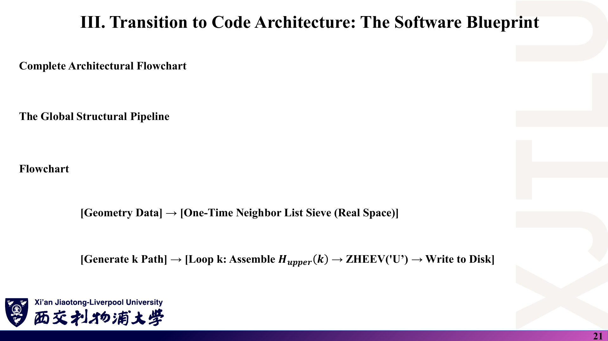
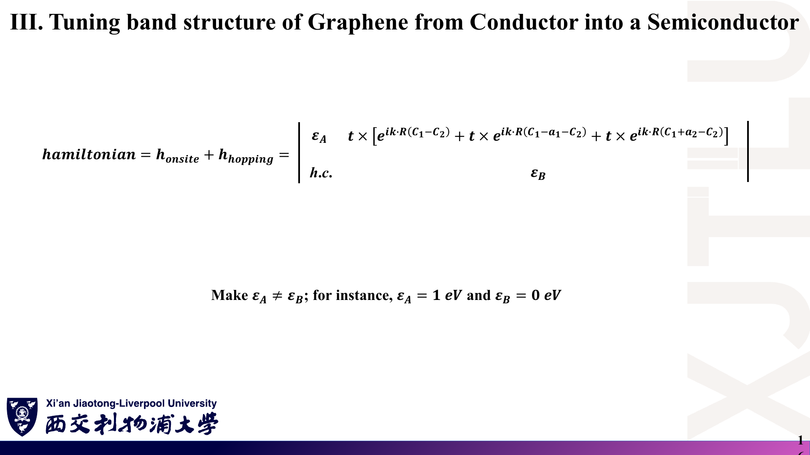
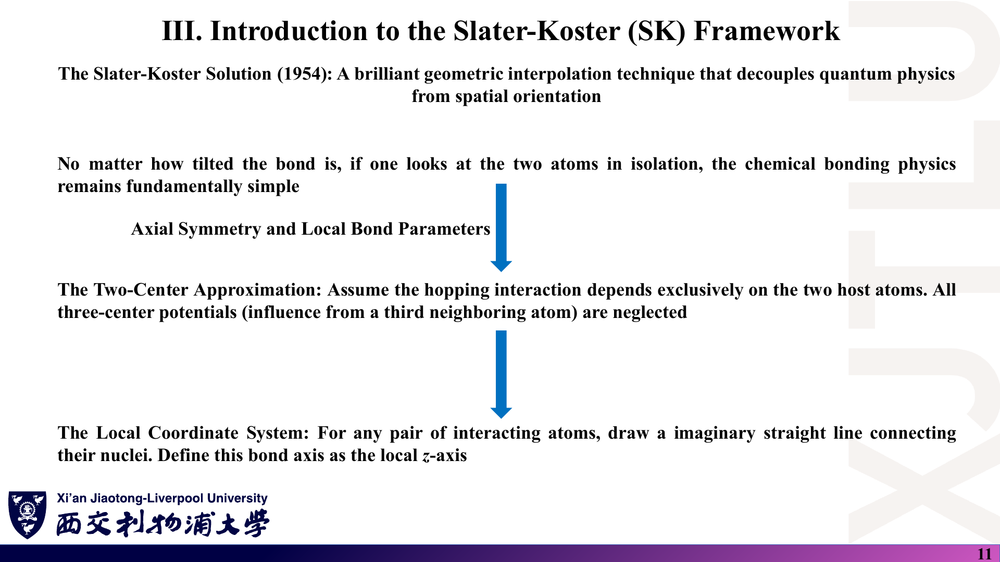

# MES306TC · 第三周图文学习笔记

课程：**Atomic-Level Materials Simulation（原子级材料模拟）** · 教师：Kenan Song

原始资料：Lecture Nine–Twelve 共 4 份讲义，合计 **76 页**（17 + 18 + 22 + 19），外加 `Codes/` 中的石墨烯紧束缚 Fortran 程序。以下 9 份 Markdown 中，知识模块均采用「课件截图 → 中文解释 → 原理深入 → Ref」结构。

> **截图是原讲义整页渲染，不是重新制作的幻灯片。** 本周的原始文件是 `Lecture_Nine.pptx`–`Lecture_Twelve.pptx`；同目录下的 `Lecture_*.pdf` 由 Microsoft PowerPoint「另存为 PDF」转换得到，截图再由 PDF 整页渲染（见[来源索引](课件截图/来源索引.json)）。若 PDF 与 pptx 在排版上有出入，以 pptx 为准。原图中的笔误保留，正文单独解释正确写法。所有页码均为含封面的 PDF 物理页码。中文解释为整理，原理深入含补充推导，不能把二者都当作教师原话。

## 1. 怎样使用这套笔记？

### 课件截图



*第十一讲最后一页把本周内容压缩成一条程序流水线：几何 → 近邻表 → k 路径 → 逐点组装 H(k) → ZHEEV → 写文件。四讲恰好对应这条链上的不同环节。*

### 中文解释

第三周从「原子轨道如何组成晶体能带」出发，一步步落到一份能跑的石墨烯能带程序：

- 第九讲讲**为什么**可以用少量参数（在位能 ε、跳跃积分 t）描述晶体；
- 第十讲讲**怎样**利用平移对称性把无穷大矩阵变成每个 k 点上的小矩阵 H(k)；
- 第十一讲用二次量子化语言重写同一件事，并给出**程序架构**；
- 第十二讲把它们全部用在石墨烯上，并通过让两个子格在位能不同来**打开带隙**。

| 顺序 | 文件 | 内容 |
|---|---|---|
| 0 | 本页 README | 阅读方法、课程地图、CW1 关联、参考书目和学习记录 |
| 1 | [01_紧束缚基础与Slater-Koster.md](01_紧束缚基础与Slater-Koster.md) | 第九讲：LCAO、在位能与跳跃积分、SK 双中心近似、截断与最近邻 |
| 2 | [02_Bloch定理与多子格.md](02_Bloch定理与多子格.md) | 第十讲：Bloch 定理、Bloch 和、一维单原子链、多子格与双原子链 |
| 3 | [03_二次量子化与代码架构.md](03_二次量子化与代码架构.md) | 第十一讲：产生湮灭算符、实空间与 k 空间哈密顿量、h.c.、程序蓝图 |
| 4 | [04_石墨烯紧束缚与带隙调控.md](04_石墨烯紧束缚与带隙调控.md) | 第十二讲：石墨烯结构、近邻相位、H(k)、Dirac 点与子格势打开带隙 |
| 5 | [05_公式与术语速查.md](05_公式与术语速查.md) | 对照原图记公式、适用条件及英文术语 |
| 6 | [06_复习题与参考答案.md](06_复习题与参考答案.md) | 14 道自编题，每题配原图、题意、解析与来源 |
| 7 | [07_讲义勘误与易错点.md](07_讲义勘误与易错点.md) | 原图证据、问题、正确写法与核验理由 |
| 8 | [08_代码导读.md](08_代码导读.md) | `Codes/` 文件作用、逐段讲解、HPC 编译运行、输出与陷阱 |

### 原理深入

本周的计算链可以写成：

```text
原子轨道 φ_α(r − R_i)（局域、可数）
  ↓ LCAO 展开 + 只保留 ε 与近邻 t（第九讲）
实空间稀疏矩阵 H_{iα, jν}（无穷大）
  ↓ 平移对称性 → Bloch 和 / Fourier 变换（第十、十一讲）
每个 k 点一个 D×D 厄米矩阵 H(k)，D = 每个原胞的轨道数
  ↓ 沿高对称路径扫描 k，逐点对角化（第十一讲程序蓝图）
能带 E_n(k)；石墨烯：D = 2，Dirac 点、子格势打开带隙（第十二讲）
```

关键思想只有一个：**周期性让不同 k 互不耦合**。因此「对角化一个无穷大矩阵」变成「对很多个 2×2 矩阵分别对角化」。代码中所有复杂度都来自如何正确地给每条键配上相位 $e^{i\mathbf k\cdot\mathbf R}$。

阅读每个模块建议做四件事：

1. **看截图**：找到标题、矩阵的行列顺序、相位里用的是哪个矢量。
2. **读中文解释**：回答“这页在解决什么问题？”
3. **读原理深入**：回答“为什么成立？如何推导？什么时候失效？”
4. **查 Ref**：回到指定 PDF 页；需要更系统理解时查延伸书目。

### Ref

- **原课件**：Kenan Song，[Lecture Eleven，PDF 第 21 页](../Lecture_Eleven.pdf#page=21)。
- **原始文件**：[Lecture Nine](../Lecture_Nine.pdf) · [Lecture Ten](../Lecture_Ten.pdf) · [Lecture Eleven](../Lecture_Eleven.pdf) · [Lecture Twelve](../Lecture_Twelve.pdf)（均由同名 `.pptx` 转换；pptx 与 PDF 均未修改）。
- **代码**：[Codes 目录](../Codes/)，讲解见 [08_代码导读](08_代码导读.md)。
- **来源记录**：[截图来源索引](课件截图/来源索引.json)，记录 pptx 与 PDF 的 SHA-256、PDF 总页数及截图页码。

## 2. 学习顺序与完成标准

### 课件截图


### 中文解释

本周的“终点图”就是这一页：同一个程序，仅把两个子格的在位能从 (0, 0) 改成 (1, 0) eV，K 点的 Dirac 交叉就变成 1 eV 的带隙。能独立解释这张图的每一个数字（Γ 点 ±8.1 eV 附近、K 点 0 与 1 eV、M 点约 ±2.7 eV 附近），就说明前三讲都学通了。

建议顺序：第九讲 → 第十讲 → 第十一讲 → 第十二讲 → 08 代码导读（边读边对照 `.f90`）→ 复习题 → 勘误复核。以下自学时间仅供安排：第九、十讲各约 60 分钟，第十一讲约 75 分钟，第十二讲加代码约 120 分钟，主动复习约 60 分钟。

### 原理深入

把“学会”定义成可以亲手完成，而不是觉得公式眼熟：

- [ ] 从 LCAO 展开推导 $Hc=ESc$，说明何时可退化为 $Hc=Ec$。
- [ ] 用方向余弦写出 $E_{x,x}$、$E_{x,y}$，并说明石墨烯 $p_z$ 轨道为何只剩 $V_{pp\pi}$。
- [ ] 由周期性边界条件推出 $\mathbf k=\sum_i (m_i/N_i)\mathbf b_i$。
- [ ] 推导一维链 $E=\varepsilon_0+2t\cos ka$，写出带宽 $4|t|$、群速度、有效质量并判断带底带顶位置。
- [ ] 写出双原子链**两种**键都计入后的 $H(k)$ 与带隙。
- [ ] 把 $c^\dagger_{i\alpha}$、$c_{j\nu}$ 的 Fourier 展开代入跳跃项，得到 $H_{\alpha\nu}(\mathbf k)$（注意 $1/N$）。
- [ ] 解释“+h.c.”、只填上三角、ZHEEV 的 `'U'` 参数三者的对应关系。
- [ ] 手写石墨烯的 $f(\mathbf k)$，在 Γ、K、M 三点算出能量，与程序输出比对。
- [ ] 证明“相位用原胞矢量”与“相位用原子间矢量”两种约定的本征值相同。
- [ ] 用 $E_\pm=\bar\varepsilon\pm\sqrt{\Delta^2+|t f|^2}$ 解释带隙 $=|\varepsilon_A-\varepsilon_B|$。

| 日期 | 已完成模块 | 能否独立推导 | 疑问与下一步 |
|---|---|---|---|
|  |  |  |  |
|  |  |  |  |
|  |  |  |  |

### Ref

- **原课件**：[Lecture Twelve，PDF 第 14 页](../Lecture_Twelve.pdf#page=14)、[第 17 页](../Lecture_Twelve.pdf#page=17)。
- **配套练习**：[14 道复习题](06_复习题与参考答案.md)。这些题目为学习整理自编，不是官方作业。

## 3. 如何核对公式与使用 Ref？

### 课件截图


*示例：此页的 $E_\pm$ 不含 k，说明只计入了原胞内一条键。截图忠实保留原文，不表示原式已经通过核验。*

### 中文解释

笔记的 Ref 区分三种来源：

- **原课件**：直接定位本知识点在本地 PDF 中的位置（PDF 由 pptx 转换，页码与 pptx 幻灯片编号一致）。
- **推导依据 / 配套笔记**：指向正确公式、例题、代码行或核验步骤。
- **延伸阅读**：推荐教材、论文或文档，帮助进一步学习；不是声称已逐页读完这些外部资料，也不给出未核实的页码。

记号约定：$t$ 一律指跳跃积分（能量），程序中 `hopping = -2.7` eV；k 路径插值参数不用 $t$，改记 $s$。$\mathbf R$ 为格矢，$\boldsymbol\tau_\mu$ 为原胞内原子位置，$\boldsymbol\delta$ 为近邻键矢量。

### 原理深入

本周最有效的核验手段是**拿程序输出对照解析解**。石墨烯最近邻模型有闭式解（推导见 [04](04_石墨烯紧束缚与带隙调控.md)）：

$$
E_\pm(\mathbf k)=\frac{\varepsilon_A+\varepsilon_B}{2}\pm\sqrt{\left(\frac{\varepsilon_A-\varepsilon_B}{2}\right)^2+t^2|f(\mathbf k)|^2},\qquad |f(\Gamma)|=3,\ |f(K)|=0,\ |f(M)|=1.
$$

代入 $t=-2.7$ eV、$\varepsilon_A=\varepsilon_B=0$ 得 Γ 点 ±8.1 eV、K 点 0、M 点 ±2.7 eV——与 `pristine_bandstructure.dat` 第一行 `-8.100000000`、`8.100000000` 完全一致。用这种方法可以发现：

- **量纲**：$t$、$\varepsilon$ 是能量；相位 $\mathbf k\cdot\mathbf R$ 无量纲，所以 k 必须是 Å⁻¹（含 2π）且与 R 同一坐标系。
- **厄米性**：$H_{ji}(\mathbf k)=H_{ij}(\mathbf k)^*$；只填一半时求解器必须知道是哪一半。
- **对称性**：本征值应在 $\mathbf k\to\mathbf k+\mathbf G$ 下不变。
- **极限**：$t\to0$ 应回到孤立原子能级 $\varepsilon_A,\varepsilon_B$；$\varepsilon_A=\varepsilon_B$ 应在 K 点简并。

截图覆盖四份讲义除封面与结束页外的 **68 页**，保存在 `课件截图/Lecture_*/page-XX.png`；各笔记按主题选图。复制或分享笔记时请连同 `课件截图/` 一起保留。

### Ref

- **原课件**：[Lecture Ten，PDF 第 16–17 页](../Lecture_Ten.pdf#page=17)。
- **核对记录**：[讲义勘误与易错点](07_讲义勘误与易错点.md)。它是学习记录，不是教师官方勘误。
- **数值核对**：[08 代码导读 · 输出文件](08_代码导读.md)。

## 4. 本周与课程作业 CW1 有什么关系？

### 课件截图



### 中文解释

课程作业 CW1（*Practical Project: Tuning the electronic structure of graphene*，作业说明为单独下发的文件，不在本仓库中）要求学生**独立**用 Fortran、C 或 C++ 编写紧束缚程序，完成：

1. 本征石墨烯的哈密顿量、能带与 DOS；
2. 用 Gaussian、Lorentzian、四面体（tetrahedron）三种方法计算 DOS；
3. 引入微扰打开带隙（带隙大小自选），重新计算能带与 DOS；
4. 一份报告，写出石墨烯紧束缚哈密顿量，比较无隙与有隙两种情况，并讨论真实材料中如何实现带隙。

评分按“本征能带 / 本征 DOS / 掺杂能带 / 掺杂 DOS / 报告”五项各 20%。

本周内容直接对应其中**能带部分的物理与程序骨架**；DOS 与三种展宽方法不在第三周讲义中。

### 原理深入

本周各讲与 CW1 要求的对应关系（只指出“用到什么知识”，**不提供作业答案或代码**）：

| CW1 要求 | 本周知识点 | 仍需自己补的内容 |
|---|---|---|
| 写出石墨烯 TB 哈密顿量 | 第十讲多子格 H(k)；第十二讲 $H(\mathbf k)$ 与近邻表 | 报告中自洽地说明相位约定与参数来源 |
| 本征能带 | 第十一讲 k 路径、组装、ZHEEV；第十二讲 Γ–K–M | 路径端点、k 坐标单位、与解析解比对 |
| 打开带隙 | 第十二讲子格在位能 $\varepsilon_A\ne\varepsilon_B$ | 自选带隙值并解释与 $\lvert\varepsilon_A-\varepsilon_B\rvert$ 的关系 |
| DOS 与三种展宽 | 本周未讲 | 均匀 k 网格（不是高对称路径）、展宽宽度与网格密度的收敛 |
| 讨论真实材料 | 第十二讲第 15、18 页（H/OH/COOH 等） | 查文献；注意子格势只是有效模型（见 [07](07_讲义勘误与易错点.md)） |

需要特别注意两点：

- **能带用路径，DOS 用网格。** 讲义与示例代码只沿 Γ–K–M 取点，这对 DOS 不够：DOS 是整个布里渊区的积分，必须在均匀网格上采样。
- **原创性要求。** CW1 明确要求 “original code”。[08 代码导读](08_代码导读.md) 只用于理解教师示例的结构；直接改写示例代码是否被允许，以教师的正式说明为准。

### Ref

- **原课件**：[Lecture Twelve，PDF 第 15–18 页](../Lecture_Twelve.pdf#page=16)。
- **作业说明**：*MES306TC Coursework*（单独下发，未随仓库分发）。
- **延伸**：[BJA94：四面体方法](#ref-bja94)；[CN09：石墨烯电子性质综述](#ref-cn09)。

## 5. 延伸参考书目与文档索引

### 课件截图



### 中文解释

下列条目分三类：课程补充文献（教师提供、因版权**未随仓库分发**）、经典原始论文、教材与软件文档。笔记 Ref 中出现的方括号缩写都链接到这里。

### 原理深入

外部资料使用说明：课程补充文献已核对首页的作者、期刊、年份与 DOI；其余教材与论文为延伸书目，未逐章核读，未据此虚构页码。讲义中的研究案例（如 H、OH、COOH 修饰）只按课件归纳，未独立复现。

#### 课程补充文献（未随仓库分发）

<a id="ref-bm09"></a>
**[BM09]** Cristina Bena & Gilles Montambaux, “Remarks on the tight-binding model of graphene”, *New Journal of Physics* **11**, 095003 (2009)。DOI: [10.1088/1367-2630/11/9/095003](https://doi.org/10.1088/1367-2630/11/9/095003)。检索主题：多原子原胞的两种紧束缚基（相位用原胞矢量还是原子位置），对应本周第十讲第 14 页与第十二讲相位约定的差异。

<a id="ref-pm03"></a>
**[PM03]** D. A. Papaconstantopoulos & M. J. Mehl, “The Slater–Koster tight-binding method: a computationally efficient and accurate approach”, *Journal of Physics: Condensed Matter* **15**, R413–R440 (2003)。DOI: [10.1088/0953-8984/15/10/201](https://doi.org/10.1088/0953-8984/15/10/201)。检索主题：SK 参数化、双中心近似、拟合能带与 DOS。

#### 原始论文与综述

<a id="ref-sk54"></a>
**[SK54]** J. C. Slater & G. F. Koster, “Simplified LCAO Method for the Periodic Potential Problem”, *Physical Review* **94**, 1498 (1954)。SK 方向余弦表的出处。

<a id="ref-wal47"></a>
**[WAL47]** P. R. Wallace, “The Band Theory of Graphite”, *Physical Review* **71**, 622 (1947)。石墨/石墨烯最近邻紧束缚能带的经典起点。

<a id="ref-cn09"></a>
**[CN09]** A. H. Castro Neto, F. Guinea, N. M. R. Peres, K. S. Novoselov & A. K. Geim, “The electronic properties of graphene”, *Reviews of Modern Physics* **81**, 109 (2009)。检索主题：石墨烯紧束缚、Dirac 点、子格对称性破缺与带隙。

<a id="ref-bja94"></a>
**[BJA94]** P. E. Blöchl, O. Jepsen & O. K. Andersen, “Improved tetrahedron method for Brillouin-zone integrations”, *Physical Review B* **49**, 16223 (1994)。CW1 中四面体法 DOS 的常用参考。

#### 教材与文档

<a id="ref-ss1"></a>
**[SS1]** Neil W. Ashcroft & N. David Mermin, *Solid State Physics*, Holt, Rinehart and Winston, 1976。检索主题：Bloch 定理、周期性边界条件、倒格子、紧束缚方法。

<a id="ref-har"></a>
**[HAR]** Walter A. Harrison, *Electronic Structure and the Properties of Solids: The Physics of the Chemical Bond*, W. H. Freeman, 1980（Dover 重印本 1989）。检索主题：LCAO、σ/π 键、SK 矩阵元与方向余弦。

<a id="ref-bf"></a>
**[BF]** Henrik Bruus & Karsten Flensberg, *Many-Body Quantum Theory in Condensed Matter Physics: An Introduction*, Oxford University Press, 2004。检索主题：二次量子化、费米子反对易关系、动量表象。

<a id="ref-lapack"></a>
**[LAPACK]** E. Anderson et al., *LAPACK Users' Guide*, 3rd ed., SIAM, 1999；[Netlib LAPACK 主页](https://www.netlib.org/lapack/)。用于核对 `ZHEEV` 的 `JOBZ`、`UPLO`、`LWORK` 参数含义。

### Ref

- **原课件**：[Lecture Nine，PDF 第 11 页](../Lecture_Nine.pdf#page=11)（讲义引用 Slater–Koster 1954）。
- **使用方式**：各笔记 Ref 中的 `[SK54]`、`[BM09]` 等均链接到本节锚点。
