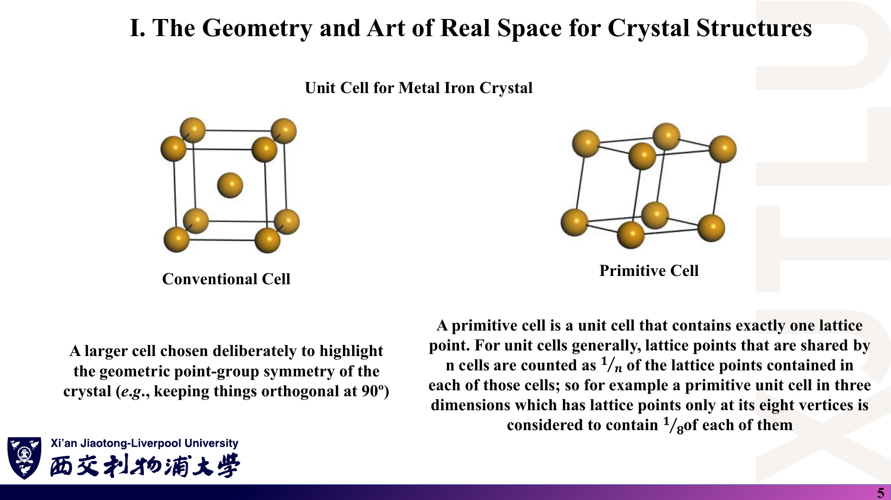
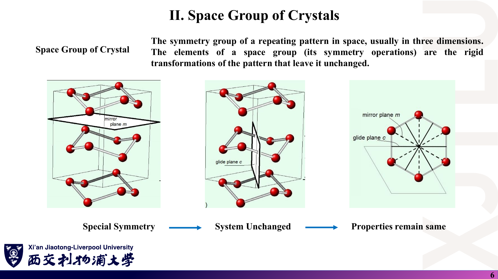
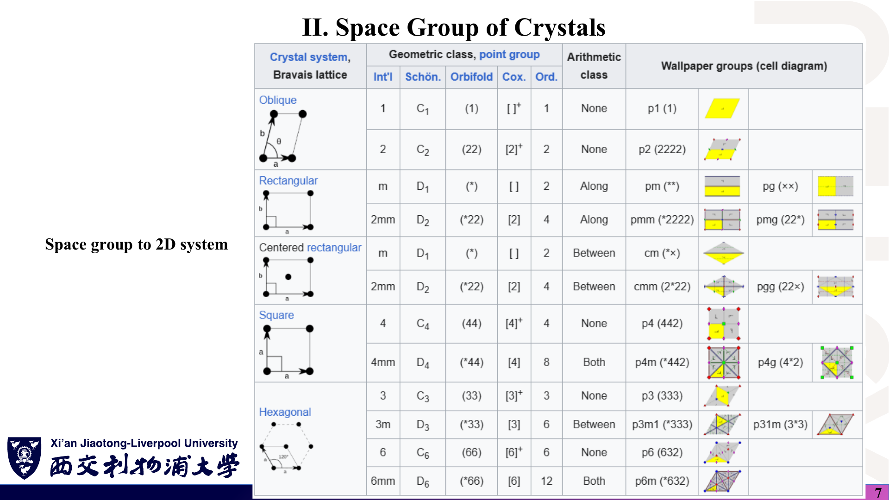
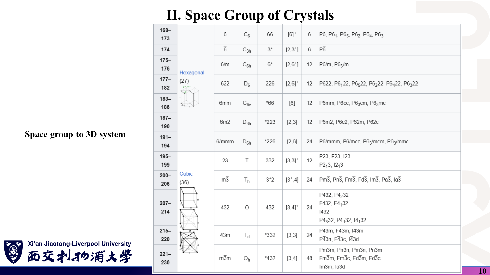
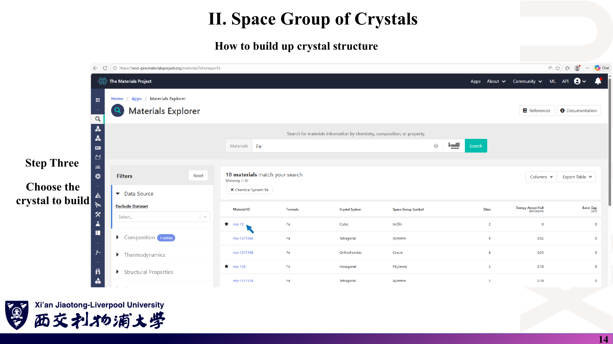
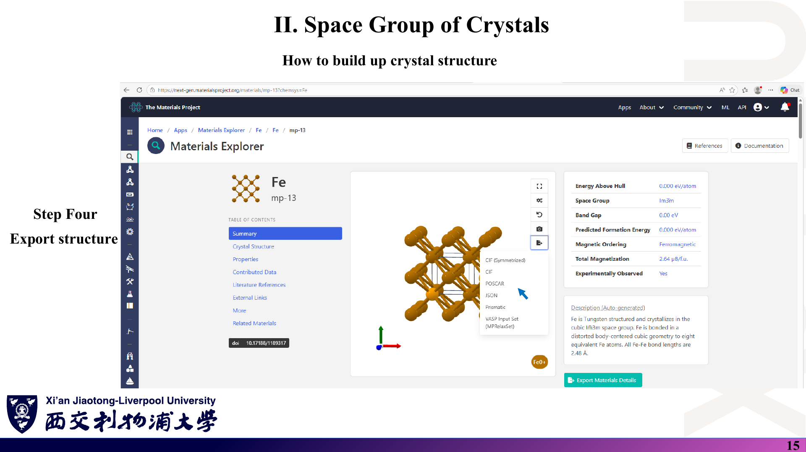
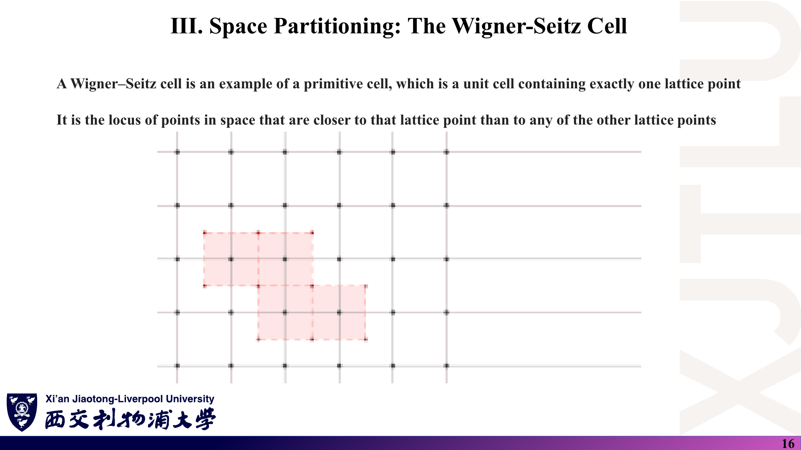
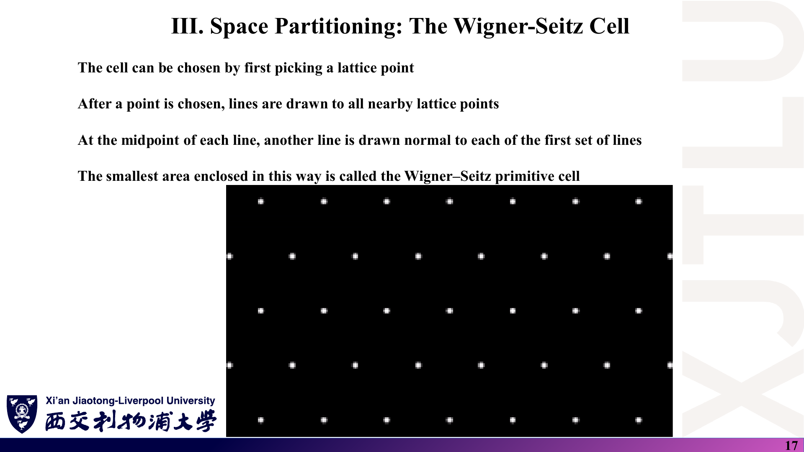
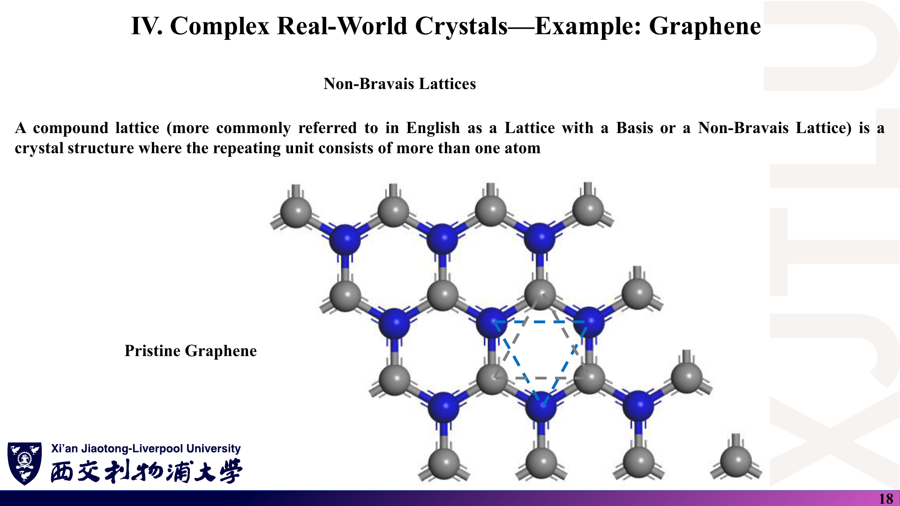
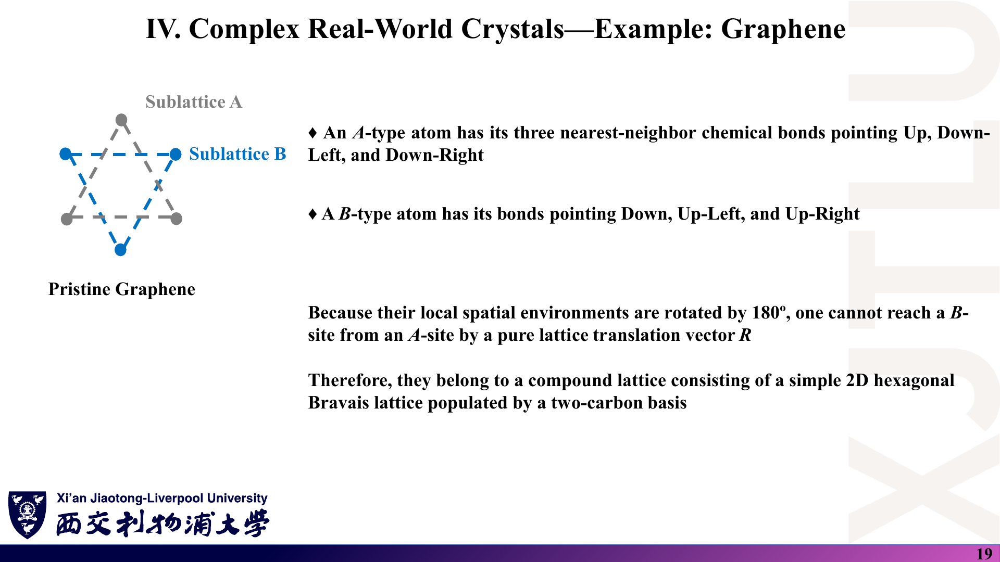

# 01 · 实空间：晶体几何、空间群与 Wigner–Seitz 胞

来源：[Lecture_Five.pdf](../Lecture_Five.pdf)，20 页。

[返回目录](README.md)

## 1. 晶体结构由什么组成？〔pp. 3–4〕

### 课件截图

*第 4 页用 $n_1=2,n_2=2,n_3=3$ 演示整数组合；图中的 a、b、c 是立方惯用胞的边，讨论见下方“易错点”。*

### 中文解释

晶体 = **Bravais 格子**（一组数学上的点）+ **基元**（放在每个格点上的同一组原子）。Bravais 格子由三条不共面的原胞矢量 $\mathbf a_1,\mathbf a_2,\mathbf a_3$ 生成：所有整数组合 $\mathbf R=n_1\mathbf a_1+n_2\mathbf a_2+n_3\mathbf a_3$ 就是全部格点。从任何一个格点看出去，周围环境都完全一样。

这正是模拟软件能只算“一个胞”的原因：只要给出晶格矢量和胞内原子坐标，整个无限晶体就确定了。

### 原理深入

**定义〔讲义〕**：

$$
\boxed{\mathbf R=n_1\mathbf a_1+n_2\mathbf a_2+n_3\mathbf a_3,\qquad n_i\in\mathbb Z.}
$$

$\mathbf a_i$ 只要求线性无关（不必相互垂直）。

**补充：晶体中原子的位置**。若基元中第 $s$ 个原子相对格点的位置是 $\boldsymbol\tau_s$，则所有原子位置为

$$
\mathbf r_{s}(\mathbf R)=\mathbf R+\boldsymbol\tau_s .
$$

“Bravais 格子”只包含 $\mathbf R$；“晶体结构”同时包含 $\mathbf R$ 与 $`\{\boldsymbol\tau_s\}`$。

**易错点：惯用胞的边不一定是原胞矢量**。第 4 页左图把立方胞的三条边标为 a、b、c。对 BCC 铁，体心原子位于 $(\tfrac12,\tfrac12,\tfrac12)$（以 a、b、c 为单位），**不能**写成 a、b、c 的整数组合。要让 $\mathbf R=\sum n_i\mathbf a_i$ 覆盖所有格点（包括体心），必须使用 BCC 的原胞矢量，例如

$$
\mathbf a_1=\tfrac a2(-1,1,1),\quad
\mathbf a_2=\tfrac a2(1,-1,1),\quad
\mathbf a_3=\tfrac a2(1,1,-1).
$$

若坚持用立方边作 $\mathbf a_i$，就必须把体心原子算作基元的第二个原子（这正是第 8 讲 `Fe.vasp` 的做法：立方胞 + 2 个原子）。

### Ref

- **原课件**：[Lecture Five，PDF 第 3 页](../Lecture_Five.pdf#page=3)、[第 4 页](../Lecture_Five.pdf#page=4)。
- **延伸**：[SS1：Bravais 格子与基元](README.md#ref-ss1)；[SS2](README.md#ref-ss2)。
- **核验记录**：[07 第 1 节](07_讲义勘误与易错点.md)。

## 2. 惯用胞与原胞有什么区别？〔p. 5〕

### 课件截图

### 中文解释

- **原胞（primitive cell）**：恰好含 **1 个格点**的最小重复单元，体积最小。
- **惯用胞（conventional cell）**：故意取得更大，以便直观显示点群对称性（例如让轴保持 90°）。

同一种晶体可以用两种胞描述，物理完全相同；但胞不同，原子数、晶格矢量和倒格子的“外观”都不同，计算成本也不同。

### 原理深入

**格点计数〔讲义给出 $1/n$ 规则〕**：被 $n$ 个胞共享的格点，每个胞只算 $1/n$。在三维中：

| 位置 | 共享胞数 | 每胞计入 |
|---|---|---|
| 顶角 | 8 | 1/8 |
| 棱心 | 4 | 1/4 |
| 面心 | 2 | 1/2 |
| 体内 | 1 | 1 |

因此：简单立方 $8\times\frac18=1$；BCC 惯用胞 $8\times\frac18+1=2$；FCC 惯用胞 $8\times\frac18+6\times\frac12=4$。

**体积关系〔补充〕**：原胞体积 $V_{\rm p}=|\mathbf a_1\cdot(\mathbf a_2\times\mathbf a_3)|$ 与胞的具体取法无关；惯用胞体积等于 $V_{\rm p}\times$（胞内格点数）。对 BCC：

$$
V_{\rm p}=\left|\det\frac a2\begin{pmatrix}-1&1&1\\1&-1&1\\1&1&-1\end{pmatrix}\right|=\frac{a^3}{2}.
$$

**计算上的含义**：平面波或局域轨道 DFT 的成本随胞内原子数迅速增长，所以正式计算通常用原胞；惯用胞适合可视化与搭建超胞。但用惯用胞时，其“布里渊区”只是真正第一布里渊区的一部分，能带会发生折叠（见 [03 第 9 节](03_晶体对称性与能带.md)）。

### Ref

- **原课件**：[Lecture Five，PDF 第 5 页](../Lecture_Five.pdf#page=5)。
- **延伸**：[SS1：原胞、惯用胞](README.md#ref-ss1)。

## 3. 什么是空间群？平面群与 230 个空间群怎样分类？〔pp. 6–10〕

### 课件截图

*第 8–9 页为 1–167 号空间群表，结构与第 10 页相同，未重复展示。*

### 中文解释

**空间群**是让晶体图案保持不变的所有刚体变换（旋转、镜面、反演、平移以及它们的组合，如滑移面、螺旋轴）构成的群。讲义第 6 页的逻辑链是：**特殊对称 → 体系不变 → 性质不变**。

- 二维：5 种 Bravais 格子，**17 个平面群**（第 7 页的 wallpaper groups）。
- 三维：7 个晶系、14 种 Bravais 格子、32 个点群、**230 个空间群**（第 8–10 页的表按编号 1–230 列出）。

### 原理深入

**Seitz 记号〔补充〕**：空间群元素写作 $`\{R\,|\,\mathbf t\}`$，作用为

$$
\{R\,|\,\mathbf t\}\,\mathbf r=R\mathbf r+\mathbf t ,
$$

$R$ 为正交矩阵（旋转、反演、镜面），$\mathbf t$ 为平移。纯平移是 $`\{E|\mathbf R\}`$；滑移面、螺旋轴的 $\mathbf t$ 是**格矢的分数**（如 $\tfrac12\mathbf c$），单独拿出来不是对称操作。

**点群与空间群**：把每个元素的平移部分去掉，得到的 $`\{R\}`$ 集合就是晶体的点群。230 个空间群中，73 个是“简单的”（symmorphic，可以选一个原点让所有 $\mathbf t$ 都是格矢），其余含滑移面或螺旋轴。

**读表技巧**：以 BCC Fe 为例，表中第 229 号 $Im\bar3m$：`I` 表示体心格子，$m\bar3m$ 为点群 $O_h$（48 个元素）。Materials Studio 中显示该群操作数为 96（第 8 讲第 7 页），即 48 个点群操作 × 2 个体心平移代表。

**为什么要关心空间群**：(1) 用最少参数描述结构；(2) 决定布里渊区形状与高对称点（第 6 讲）；(3) 约化 k 点数目、预测能带简并（第 7 讲）。

### Ref

- **原课件**：[Lecture Five，PDF 第 6–10 页](../Lecture_Five.pdf#page=6)。
- **延伸**：[ITA：空间群与平面群表](README.md#ref-ita)；[GT](README.md#ref-gt)。

## 4. Wyckoff 位置如何描述原子？〔p. 11〕

### 课件截图

*原图标题拼作 “Wycoff”，定义句中的 “(see below)” 在本页没有对应内容；见 [07](07_讲义勘误与易错点.md)。*

### 中文解释

Wyckoff 位置是“在空间群操作下等价的一组点”的标签。只需给出每种原子的 Wyckoff 标签和一个代表坐标，再用空间群的对称操作，就能生成胞内所有原子坐标。

BCC Fe（$Im\bar3m$）只需一行：**2a，Fe，(0, 0, 0)**。

### 原理深入

**Wyckoff 标签的含义〔补充〕**：“2a”中的数字 2 是**重数**——在惯用胞中由该位置生成的等价点数；字母 a 是字母序号（按位置对称性从高到低排列）。

**展开 2a**：$Im\bar3m$ 的体心平移为 $(0,0,0)+$ 与 $(\tfrac12,\tfrac12,\tfrac12)+$。对代表点 $(0,0,0)$ 施加全部操作，点群部分把它映射回自身，体心平移得到第二点：

$$
(0,0,0),\qquad(\tfrac12,\tfrac12,\tfrac12).
$$

恰好 2 个——与惯用胞中 BCC 的 2 个原子一致，也就是 `Fe.vasp` 中 `Direct` 下的两行。

**“位置对称群互为共轭”的意思**：同一 Wyckoff 位置的各点，其保持自身不动的对称操作集合（site-symmetry group）结构相同，只是取向不同，所以化学环境等价。

### Ref

- **原课件**：[Lecture Five，PDF 第 11 页](../Lecture_Five.pdf#page=11)；建胞时的使用见 [Lecture Eight，PDF 第 4、9–10 页](../Lecture_Eight.pdf#page=4)。
- **延伸**：[ITA：Wyckoff 位置](README.md#ref-ita)。
- **配套笔记**：[04 第 1 节：在 Materials Studio 中输入 Wyckoff 坐标](04_结构建模_HPC与倒格矢编程.md)。

## 5. 怎样从 Materials Project 获得晶体结构？〔pp. 12–15〕

### 课件截图

*第 12–13 页为首页与元素周期表选择界面。*

### 中文解释

讲义给出四步：打开 <https://next-gen.materialsproject.org/> → 在 Materials Explorer 中只选所含元素（Fe）→ 从结果列表中挑选要建的晶体（mp-13，立方 $Im\bar3m$，2 个位点，Energy Above Hull = 0）→ 导出结构（CIF、POSCAR 等）。

### 原理深入

**如何挑选条目〔补充〕**：同一化学式会有多个多晶型。第 14 页列表中 Fe 就有立方、四方、正交、六角等 10 个条目。常用筛选依据：

- **Energy Above Hull**：相对热力学凸包的能量，0 表示（在该数据库的计算水平下）最稳定；
- **Experimentally Observed**：是否有实验对应（mp-13 为 Yes）；
- **Magnetic Ordering**：mp-13 标为铁磁，总磁矩 2.64 μB/f.u.——提醒后续计算需要考虑自旋极化。

**导出格式的区别**：`CIF (Symmetrized)` 保留空间群与 Wyckoff 信息，适合导入 Materials Studio / VESTA；`POSCAR` 可直接给 VASP 类程序。数据库给出的是**计算优化的**晶格常数（取决于所用泛函），不等于实验值；本课程 `Fe.vasp` 使用的是 2.86 Å。

### Ref

- **原课件**：[Lecture Five，PDF 第 12–15 页](../Lecture_Five.pdf#page=12)；同一导出步骤在 [Lecture Six，PDF 第 17 页](../Lecture_Six.pdf#page=17) 重复出现。
- **延伸**：[MP](README.md#ref-mp)。

## 6. Wigner–Seitz 胞怎样构造？〔pp. 16–17〕

### 课件截图

*第 17 页原为构造动画，PDF 只保留了静态格点图。*

### 中文解释

Wigner–Seitz（WS）胞是“离某个格点比离其他任何格点都近的点”的集合。构造方法：选一个格点 → 连到邻近格点 → 在每条连线中点作垂直平分线（三维为平分面）→ 围出的最小区域就是 WS 胞。它是原胞的一种，恰含 1 个格点，而且具有格子的全部点群对称性。

### 原理深入

**集合定义〔补充〕**：

$$
\mathrm{WS}=\{\mathbf r:\ |\mathbf r|\le|\mathbf r-\mathbf R|,\ \forall\mathbf R\neq\mathbf 0\}.
$$

把不等式平方展开：$|\mathbf r|^2\le|\mathbf r|^2-2\mathbf r\cdot\mathbf R+|\mathbf R|^2$，即

$$
\boxed{\mathbf r\cdot\hat{\mathbf R}\le\tfrac12|\mathbf R|}.
$$

每个 $\mathbf R$ 给出一个半空间，边界正是 $\mathbf R$ 的垂直平分面——这就是“连线 + 中垂线”作图法的代数版本。实际只需考虑近邻几个壳层的 $\mathbf R$，远处的平分面不会切到胞。

**例子**：

- 二维正方格子：WS 胞是以格点为中心的正方形（第 16 页阴影）。
- 二维六角格子：WS 胞是正六边形（第 17 页的格点排列）。
- 三维 BCC：截角八面体；FCC：菱形十二面体。

**为什么重要**：把 WS 构造搬到倒格子上，得到的就是**第一布里渊区**（[02 第 4 节](02_倒空间与布里渊区.md)）。第 17 页说的 “smallest area” 在三维应理解为“体积”。

### Ref

- **原课件**：[Lecture Five，PDF 第 16–17 页](../Lecture_Five.pdf#page=16)。
- **延伸**：[SS1：Wigner–Seitz 原胞](README.md#ref-ss1)。

## 7. 为什么石墨烯是“六角格子 + 两原子基元”？〔pp. 18–19〕

### 课件截图

### 中文解释

蜂窝状的碳原子网**本身不是 Bravais 格子**。A 位原子的三根键指向“上、左下、右下”，B 位指向“下、左上、右上”——两者局部环境旋转了 180°。任何纯平移都不能把 A 位变成 B 位，所以 A、B 是两套子格。正确描述是：**二维六角（三角）Bravais 格子 + 两个碳原子组成的基元**。

### 原理深入

**坐标〔补充，常用约定〕**：取晶格常数 $a=|\mathbf a_1|=|\mathbf a_2|\approx2.46$ Å，

$$
\mathbf a_1=a(1,0),\qquad\mathbf a_2=a\left(\tfrac12,\tfrac{\sqrt3}{2}\right),
$$

两个碳原子的分数坐标可取 $(\tfrac13,\tfrac13)$ 与 $(\tfrac23,\tfrac23)$，最近邻 C–C 距离

$$
d=\frac{a}{\sqrt3}\approx1.42\ \text{Å}.
$$

（不同教材对 $\mathbf a_2$ 取 60° 或 120°，分数坐标随之改变，但物理相同。）

**检验“不能平移互达”**：A 位的三个最近邻矢量 $\boldsymbol\delta_j$ 与 B 位的 $-\boldsymbol\delta_j$ 方向相反；平移保持所有矢量方向不变，因此不可能把 A 的环境映射成 B 的环境。连接 A、B 的操作是**反演**（以 C–C 键中点为中心）或 $C_2$ 旋转，不是平移。

**后果**：每个原胞 2 个 $p_z$ 轨道 → 紧束缚哈密顿量是 $2\times2$ 矩阵 → 两条 π 能带在 K 点相接形成 Dirac 锥；若衬底使 A、B 不再等价（反演被破坏），K 点开隙（[03 第 3 节](03_晶体对称性与能带.md)）。

### Ref

- **原课件**：[Lecture Five，PDF 第 18–19 页](../Lecture_Five.pdf#page=18)。
- **延伸**：[GR09：蜂窝格子与两个子格](README.md#ref-gr09)；[SS1](README.md#ref-ss1)。
- **后续**：[02 第 3 节：石墨烯倒格矢](02_倒空间与布里渊区.md)。
