# 02 · 倒空间：倒格矢、布里渊区与高对称点

来源：[Lecture_Six.pdf](../Lecture_Six.pdf)，22 页。

[返回目录](README.md)

## 1. 为什么要引入倒空间？〔pp. 3, 8〕

### 课件截图

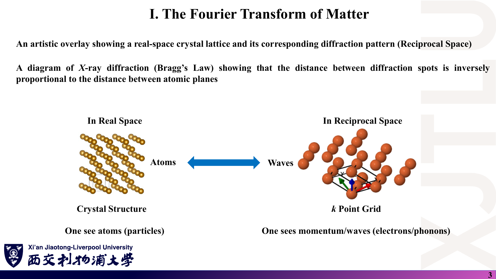

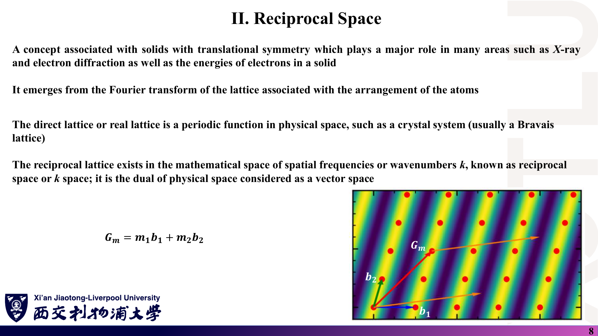

### 中文解释

实空间描述“原子在哪里”；倒空间（k 空间）描述“波长多长、朝哪个方向”。电子、声子都是在晶体中传播的波，衍射实验直接测到的也是倒格子（衍射斑间距与晶面间距成反比）。因此能带 $E_n(\mathbf k)$、k 点网格等都定义在倒空间里。

### 原理深入

**讲义定义（二维）**：倒格点 $\mathbf G_m=m_1\mathbf b_1+m_2\mathbf b_2$（三维再加 $m_3\mathbf b_3$），$m_i\in\mathbb Z$。

**“傅里叶变换”的确切含义〔补充〕**：倒格矢是使平面波在所有格矢上取相同值的波矢：

$$
\boxed{e^{i\mathbf G\cdot\mathbf R}=1\quad\forall\,\mathbf R}
\iff\mathbf G\cdot\mathbf R\in2\pi\mathbb Z .
$$

任何具有晶格周期的函数（电荷密度、势能）都只能展开成这些平面波：

$$
V(\mathbf r)=\sum_{\mathbf G}V_{\mathbf G}\,e^{i\mathbf G\cdot\mathbf r}.
$$

再把格点写成 δ 函数之和 $\sum_{\mathbf R}\delta(\mathbf r-\mathbf R)$，它的傅里叶变换正比于 $\sum_{\mathbf G}\delta(\mathbf q-\mathbf G)$——“倒格子是实格子的傅里叶变换”就是这个意思。

**衍射条件**：散射波矢变化 $\Delta\mathbf k=\mathbf G$ 时出现衍射峰（Laue 条件），等价于 Bragg 定律 $2d\sin\theta=n\lambda$，其中晶面间距 $d=2\pi/|\mathbf G_{\min}|$。所以“斑点间距 ∝ 1/面间距”。

### Ref

- **原课件**：[Lecture Six，PDF 第 3 页](../Lecture_Six.pdf#page=3)、[第 8 页](../Lecture_Six.pdf#page=8)。
- **延伸**：[SS1：倒格子与衍射](README.md#ref-ss1)；[SS2](README.md#ref-ss2)。

## 2. 倒格矢怎么计算？〔pp. 4–5〕

### 课件截图

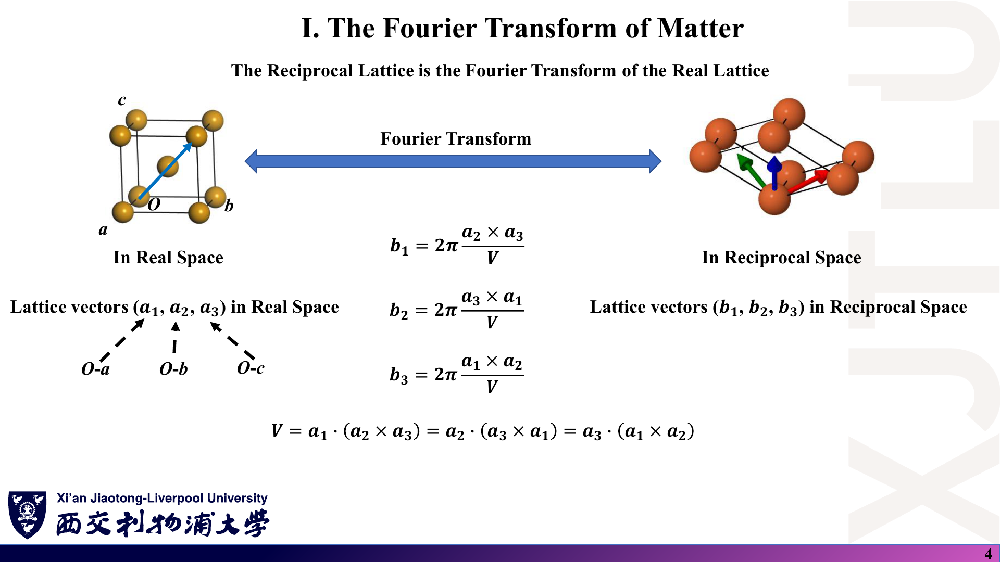

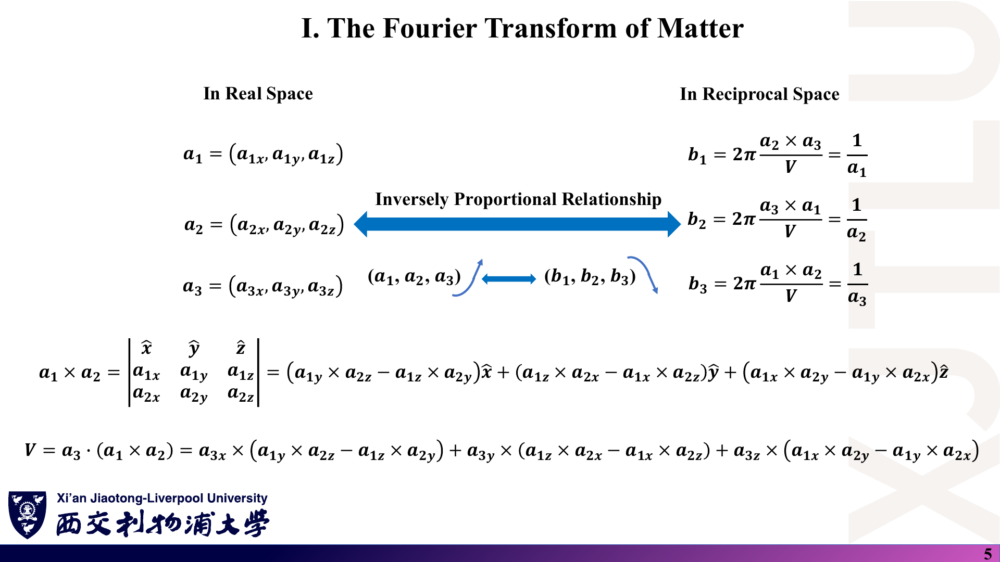

### 中文解释

已知原胞矢量 $\mathbf a_1,\mathbf a_2,\mathbf a_3$，倒格矢由叉积除以原胞体积再乘 $2\pi$ 得到。第 5 页把叉积和三重积按分量展开，正是第 8 讲 Fortran 程序 `CROSSPRODUCT`、`DOTPRODUCT` 的写法。

### 原理深入

**讲义公式**：

$$
\boxed{\mathbf b_1=2\pi\frac{\mathbf a_2\times\mathbf a_3}{V},\quad
\mathbf b_2=2\pi\frac{\mathbf a_3\times\mathbf a_1}{V},\quad
\mathbf b_3=2\pi\frac{\mathbf a_1\times\mathbf a_2}{V},\quad
V=\mathbf a_1\cdot(\mathbf a_2\times\mathbf a_3).}
$$

$V$ 的三种写法相等，因为三重积在轮换下不变。

**核心性质：对偶关系〔补充推导〕**。$\mathbf a_2\times\mathbf a_3$ 同时垂直于 $\mathbf a_2,\mathbf a_3$，所以 $\mathbf a_2\cdot\mathbf b_1=\mathbf a_3\cdot\mathbf b_1=0$；而 $\mathbf a_1\cdot\mathbf b_1=2\pi V/V=2\pi$。一般地

$$
\boxed{\mathbf a_i\cdot\mathbf b_j=2\pi\delta_{ij}.}
$$

矩阵形式：把 $\mathbf a_i$ 作为矩阵 $A$ 的**行**、$\mathbf b_j$ 作为矩阵 $B$ 的行，则 $AB^{T}=2\pi I$，即

$$
B=2\pi\,(A^{-1})^{T}.
$$

这是最不容易写错的计算方式，也可用来检验程序输出。

**由此推出 $\mathbf G\cdot\mathbf R\in2\pi\mathbb Z$**：$(\sum m_j\mathbf b_j)\cdot(\sum n_i\mathbf a_i)=2\pi\sum_i m_in_i$。

**体积关系**：倒格子原胞体积 $V^*=\mathbf b_1\cdot(\mathbf b_2\times\mathbf b_3)=(2\pi)^3/V$。实空间胞越大，倒空间胞越小（“反比关系”的准确表述）。

**关于第 5 页的“$\mathbf b_1=1/\mathbf a_1$”**：矢量的倒数没有定义；这一写法只能理解为示意。正确的量级关系是：**仅当晶格正交**时 $|\mathbf b_i|=2\pi/|\mathbf a_i|$，且方向平行于 $\mathbf a_i$；斜交晶格（如六角、BCC 原胞）不成立。另外，第 5 页分量式中的“×”表示数乘，不是叉积。详见 [07](07_讲义勘误与易错点.md)。

**数值例（立方 Fe，$a=2.86$ Å）**：$\mathbf a_i=a\hat{\mathbf e}_i$ 时 $V=a^3$，$\mathbf b_i=(2\pi/a)\hat{\mathbf e}_i$，$2\pi/2.86\approx2.1969$ Å⁻¹——与第 8 讲程序输出一致。

### Ref

- **原课件**：[Lecture Six，PDF 第 4–5 页](../Lecture_Six.pdf#page=4)；编程实现见 [Lecture Eight，PDF 第 31–33 页](../Lecture_Eight.pdf#page=31)。
- **延伸**：[SS1：倒格子](README.md#ref-ss1)。
- **核验记录**：[07 第 2 节](07_讲义勘误与易错点.md)；代码：[08](08_代码导读.md)。

## 3. 为什么 BCC 与 FCC 互为倒格子？〔p. 6〕

### 课件截图

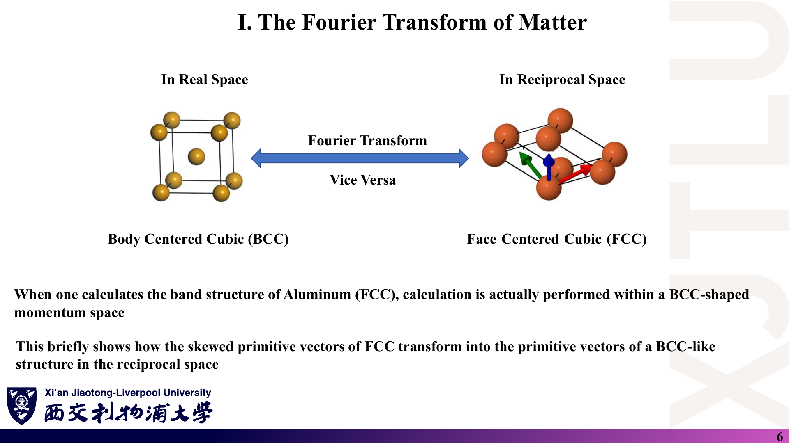

### 中文解释

FCC 实格子的倒格子是 BCC，反之亦然。所以计算 FCC 铝（或硅、铜）的能带时，第一布里渊区是 BCC 倒格子的 WS 胞——截角八面体；计算 BCC 铁时，第一布里渊区是 FCC 倒格子的 WS 胞——菱形十二面体。

### 原理深入

**推导〔补充〕**：BCC 原胞

$$
\mathbf a_1=\tfrac a2(-1,1,1),\ \mathbf a_2=\tfrac a2(1,-1,1),\ \mathbf a_3=\tfrac a2(1,1,-1),\qquad V=\tfrac{a^3}{2}.
$$

计算 $\mathbf a_2\times\mathbf a_3=\tfrac{a^2}{4}\big((-1)(-1)-1\cdot1,\ 1\cdot1-1\cdot(-1),\ 1\cdot1-(-1)\cdot1\big)=\tfrac{a^2}{2}(0,1,1)$，于是

$$
\mathbf b_1=\frac{2\pi}{a}(0,1,1),\quad
\mathbf b_2=\frac{2\pi}{a}(1,0,1),\quad
\mathbf b_3=\frac{2\pi}{a}(1,1,0).
$$

这正是边长 $4\pi/a$ 的 FCC 格子的原胞矢量。同理 FCC 原胞 $\tfrac a2(0,1,1)$ 等给出 $\tfrac{2\pi}{a}(-1,1,1)$ 等，是边长 $4\pi/a$ 的 BCC。

**数值核对**：第 20 页 SeeK-path 对 Fe 给出 $\mathbf b_1=(0,\,2.1946,\,2.1946)$ Å⁻¹，与上式 $\tfrac{2\pi}{a}(0,1,1)$ 完全对应（$a\approx2.863$ Å）。

**易错点**：如果像 `Fe.vasp` 那样用**立方惯用胞**（2 个原子）计算，得到的是简单立方倒格子 $\tfrac{2\pi}{a}\hat{\mathbf e}_i$，不是 FCC——这不是错，而是换了一个更大的实空间胞，对应更小的布里渊区。

### Ref

- **原课件**：[Lecture Six，PDF 第 6 页](../Lecture_Six.pdf#page=6)、[第 20 页](../Lecture_Six.pdf#page=20)。
- **延伸**：[SS1](README.md#ref-ss1)；[SC10：BCC/FCC 布里渊区](README.md#ref-sc10)。

## 4. 二维体系（石墨烯）的倒格矢怎样算？〔p. 7〕

### 课件截图

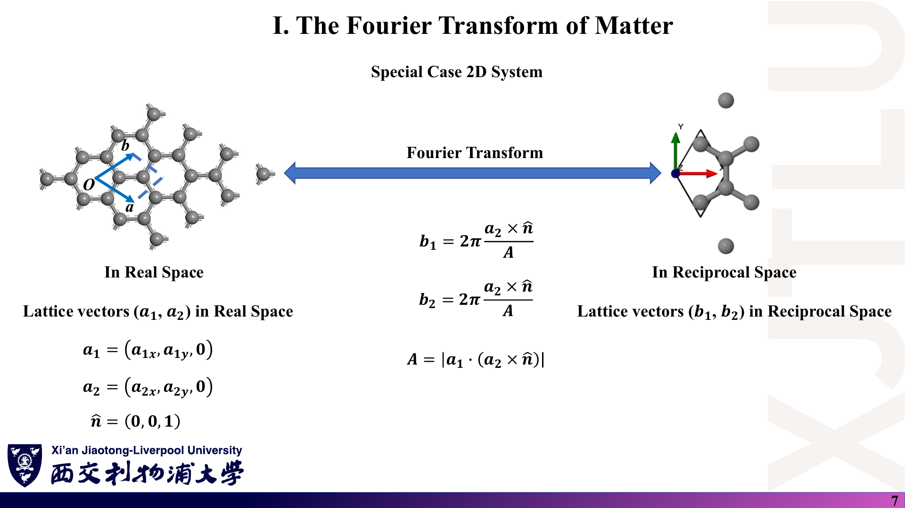

### 中文解释

二维材料只有两条面内格矢。做法是补一条垂直于平面的单位矢量 $\hat{\mathbf n}=(0,0,1)$ 充当 $\mathbf a_3$，再套三维公式。讲义中 $\mathbf b_1$ 正确，但 $\mathbf b_2$ 的分子误写成与 $\mathbf b_1$ 相同的 $\mathbf a_2\times\hat{\mathbf n}$。

### 原理深入

**正确公式**：

$$
\boxed{\mathbf b_1=2\pi\frac{\mathbf a_2\times\hat{\mathbf n}}{A},\qquad
\mathbf b_2=2\pi\frac{\hat{\mathbf n}\times\mathbf a_1}{A},\qquad
A=\mathbf a_1\cdot(\mathbf a_2\times\hat{\mathbf n}).}
$$

这就是三维公式取 $\mathbf a_3=\hat{\mathbf n}$ 的结果（$\mathbf b_2\propto\mathbf a_3\times\mathbf a_1$）。讲义用 $|\cdot|$ 取 $A$ 的绝对值；若 $\mathbf a_1,\mathbf a_2,\hat{\mathbf n}$ 为左手系，$A<0$，取绝对值会使 $\mathbf a_i\cdot\mathbf b_i=-2\pi$。最稳妥的做法是不取绝对值，或保证右手系。

**石墨烯例〔补充〕**：$\mathbf a_1=a(1,0,0)$，$\mathbf a_2=a(\tfrac12,\tfrac{\sqrt3}2,0)$，$A=\tfrac{\sqrt3}{2}a^2$：

$$
\mathbf b_1=\frac{2\pi}{a}\left(1,-\frac1{\sqrt3}\right),\qquad
\mathbf b_2=\frac{2\pi}{a}\left(0,\frac2{\sqrt3}\right),\qquad
|\mathbf b_i|=\frac{4\pi}{\sqrt3\,a}.
$$

验算：$\mathbf a_1\cdot\mathbf b_1=2\pi$，$\mathbf a_2\cdot\mathbf b_1=2\pi(\tfrac12-\tfrac12)=0$，$\mathbf a_1\cdot\mathbf b_2=0$，$\mathbf a_2\cdot\mathbf b_2=2\pi$。✓

$\mathbf b_1,\mathbf b_2$ 夹角 120°，长度相等——倒格子仍是六角格子，但相对实格子转了 30°（第 7 页右图）。

### Ref

- **原课件**：[Lecture Six，PDF 第 7 页](../Lecture_Six.pdf#page=7)。
- **核验记录**：[07 第 2 节](07_讲义勘误与易错点.md)；练习：[06 第 7 题](06_复习题与参考答案.md)。
- **延伸**：[GR09](README.md#ref-gr09)。

## 5. 什么是第一布里渊区？高阶布里渊区又是什么？〔pp. 9–10〕

### 课件截图

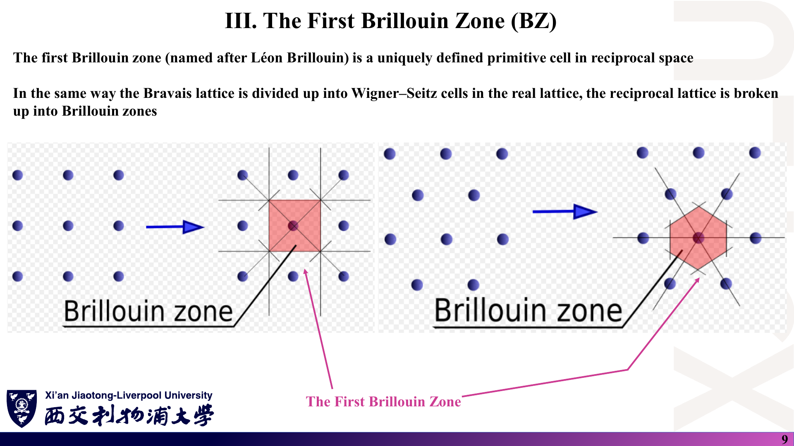

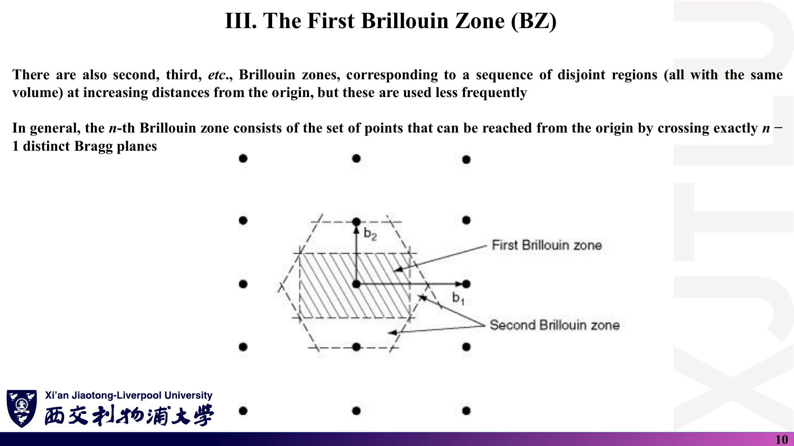

### 中文解释

在倒格子上做 Wigner–Seitz 构造（连向邻近倒格点、作中垂面），围住原点的区域就是**第一布里渊区**（1st BZ）。它是倒空间中唯一确定的原胞。从原点出发，穿过恰好 $n-1$ 个 Bragg 平面才能到达的区域叫第 $n$ 布里渊区；各阶布里渊区体积相同，但较少使用。

### 原理深入

**定义〔补充〕**：

$$
\text{1st BZ}=\{\mathbf k:\ |\mathbf k|\le|\mathbf k-\mathbf G|,\ \forall\mathbf G\ne\mathbf 0\}
\iff\mathbf k\cdot\hat{\mathbf G}\le\tfrac12|\mathbf G|.
$$

边界 $\mathbf k\cdot\hat{\mathbf G}=\tfrac12|\mathbf G|$ 就是 **Bragg 平面**：在此处 $|\mathbf k|=|\mathbf k-\mathbf G|$，满足弹性衍射条件，近自由电子模型中能隙恰好在这些平面上打开。

**体积**：第一布里渊区体积 $=(2\pi)^3/V$；若晶体含 $N$ 个原胞并取周期性边界条件，允许的 k 点在区内恰好 $N$ 个——每条能带在每个 k 点容纳 2 个电子（含自旋），所以一条能带共容纳 $2N$ 个电子。

**易混点**：第一布里渊区与倒格子“原胞”体积相同，但形状唯一、对称性最高；用平行六面体（$\mathbf b_1,\mathbf b_2,\mathbf b_3$ 张成的胞）做 k 点网格在数学上等价，只是画能带时不直观。

### Ref

- **原课件**：[Lecture Six，PDF 第 9–10 页](../Lecture_Six.pdf#page=9)。
- **前置**：[01 第 6 节：Wigner–Seitz 胞](01_晶体几何与空间群.md)。
- **延伸**：[SS1：布里渊区与 Bragg 平面](README.md#ref-ss1)。

## 6. 为什么只看第一布里渊区就够了？〔p. 11〕

### 课件截图

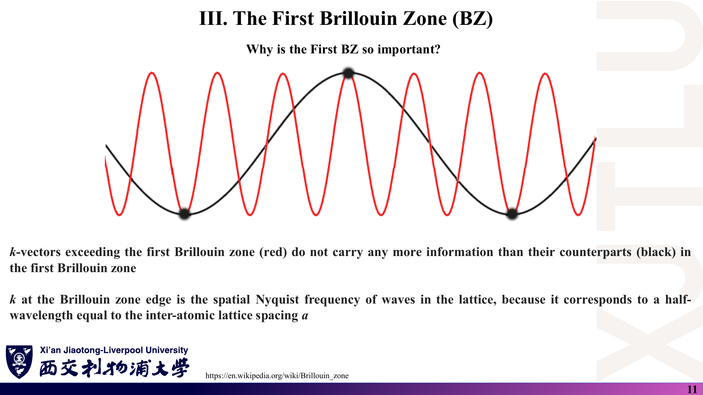

### 中文解释

在格点上采样时，波矢差一个倒格矢的两列波完全无法区分（图中红、黑两条曲线在所有黑点处取值相同）。所以区外的 k 不携带任何新信息，所有物理都可以折回第一布里渊区中描述。区边界处的 k 相当于格点上的“Nyquist 频率”：半波长等于晶格常数 $a$。

### 原理深入

**证明〔补充〕**：对任意倒格矢 $\mathbf G$，

$$
e^{i(\mathbf k+\mathbf G)\cdot\mathbf R}=e^{i\mathbf k\cdot\mathbf R}\,e^{i\mathbf G\cdot\mathbf R}=e^{i\mathbf k\cdot\mathbf R}.
$$

在 Bloch 定理中，$\psi_{\mathbf k+\mathbf G}$ 与 $\psi_{\mathbf k}$ 满足相同的平移条件，因此

$$
E_n(\mathbf k+\mathbf G)=E_n(\mathbf k).
$$

**一维 Nyquist 关系**：格距 $a$ 时 $G=2\pi/a$，第一布里渊区为 $[-\pi/a,\pi/a]$；区边界 $k=\pi/a$ 对应波长 $\lambda=2\pi/k=2a$，即半波长 $=a$——两个相邻格点之间恰好半个周期，这是格点能分辨的最短波。

**物理含义的限制**：k 是**晶体动量**（准动量），只定义到相差一个 $\mathbf G$；$\hbar\mathbf k$ 不等于电子的真实动量 $\langle\hat{\mathbf p}\rangle$。

### Ref

- **原课件**：[Lecture Six，PDF 第 11 页](../Lecture_Six.pdf#page=11)（图源讲义标注为 Wikipedia “Brillouin zone” 词条）。
- **延伸**：[SS1：晶体动量](README.md#ref-ss1)；与 Bloch 定理的关系见 [03 第 7 节](03_晶体对称性与能带.md)。

## 7. 高对称点怎样命名？〔pp. 12–16〕

### 课件截图

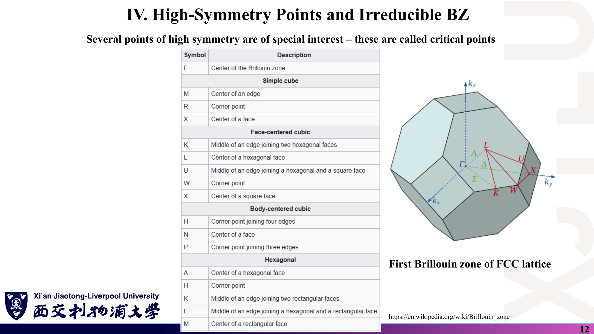

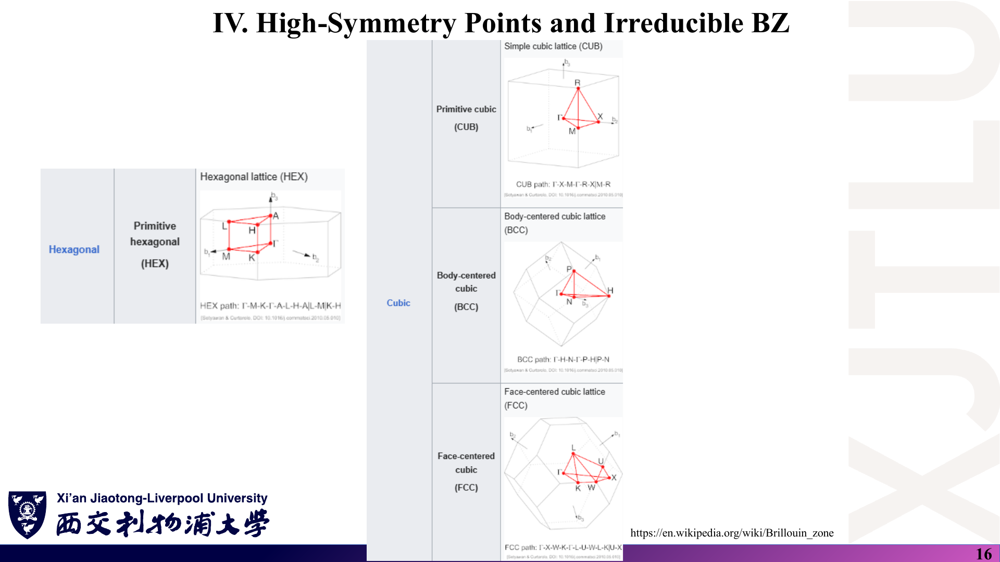

*第 13–15 页依次为三斜、单斜、正交、四方、菱方晶系的布里渊区，图下注明出自 Setyawan & Curtarolo (DOI 10.1016/j.commatsci.2010.05.010)。*

### 中文解释

布里渊区中对称性特别高的点（中心、面心、棱中点、顶角）有约定俗成的字母名，称为高对称点（讲义称 critical points）。能带图通常沿连接这些点的折线绘制，例如：

- 中心永远是 $\Gamma$；
- FCC：X（方形面中心）、L（六边形面中心）、K、U、W；
- BCC：H（四棱交汇的顶点）、N（面心）、P（三棱交汇的顶点）；
- 六角：M（矩形面中心）、K（两个矩形面相交的棱中点）、A、H、L。

### 原理深入

**同一字母在不同格子中坐标不同**：例如 BCC 的 H 点是 $\tfrac{2\pi}{a}(0,1,0)$，FCC 的 X 点也是 $\tfrac{2\pi}{a}(0,1,0)$，但它们在各自布里渊区中的位置意义不同。因此一定要说明格子类型和坐标约定。

**标准路径**：第 16 页给出 CUB：Γ–X–M–Γ–R–X|M–R；BCC：Γ–H–N–Γ–P–H|P–N；FCC：Γ–X–W–K–Γ–L–U–W–L–K|U–X；HEX：Γ–M–K–Γ–A–L–H–A|L–M|K–H。竖线“|”表示路径在此断开、跳到下一段起点。

**为什么同一晶系还分子类型（如 BCT1/BCT2、RHL1/RHL2）**：布里渊区形状取决于晶格参数比（如 $c/a$），比值跨过某个阈值后多面体的面数会改变，高对称点的集合随之变化。

### Ref

- **原课件**：[Lecture Six，PDF 第 12–16 页](../Lecture_Six.pdf#page=12)。
- **延伸**：[SC10：14 种布里渊区与标准路径](README.md#ref-sc10)。

## 8. 如何用 SeeK-path 得到 k 路径和坐标？〔pp. 17–20〕

### 课件截图

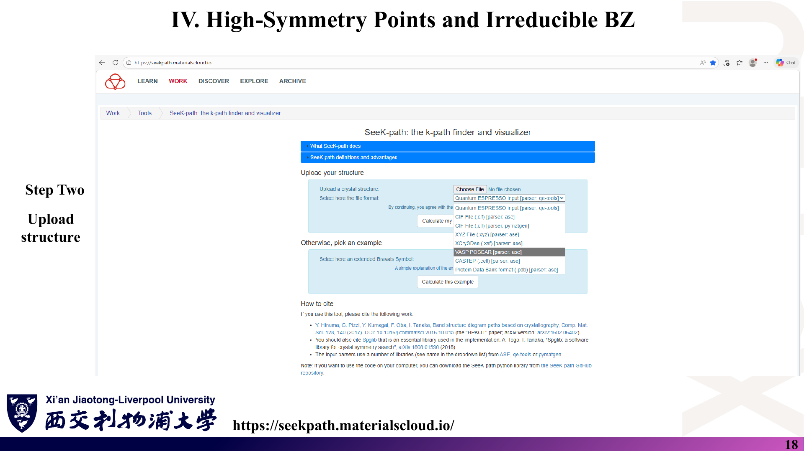

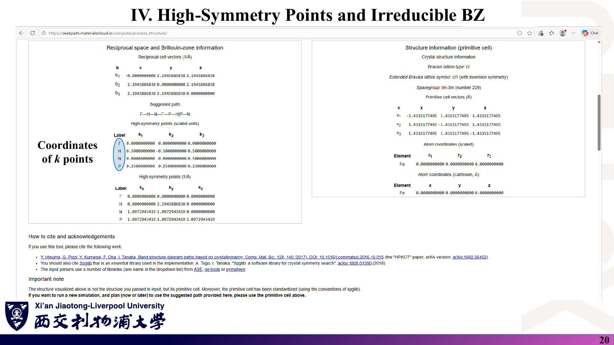

*第 17 页为从 Materials Project 导出 POSCAR；第 19 页为布里渊区与原胞的三维可视化。*

### 中文解释

流程：从 Materials Project 导出 POSCAR → 打开 <https://seekpath.materialscloud.io/> → 上传文件并选择格式（VASP POSCAR）→ 得到布里渊区图、建议路径和每个高对称点的坐标。对 BCC Fe，建议路径为 Γ–H–N–Γ–P–H|P–N，并同时给出分数坐标（以 $\mathbf b_i$ 为单位）和笛卡尔坐标（Å⁻¹）。

### 原理深入

**两种坐标的换算〔补充〕**：分数坐标 $(k_1,k_2,k_3)$ 与笛卡尔坐标的关系是 $\mathbf k=k_1\mathbf b_1+k_2\mathbf b_2+k_3\mathbf b_3$。以 H 为例，$\mathbf b_1=c(0,1,1)$，$\mathbf b_2=c(1,0,1)$，$\mathbf b_3=c(1,1,0)$，$c=2.1946$ Å⁻¹：

$$
\mathbf k_H=0.5\mathbf b_1-0.5\mathbf b_2+0.5\mathbf b_3=c\,(0,1,0)=(0,\ 2.1946,\ 0)\ \text{Å}^{-1},
$$

与第 20 页下表一致；同理 N $=\tfrac c2(1,1,0)=(1.0973,1.0973,0)$，P $=\tfrac c2(1,1,1)$。

**页面上的重要提示**（第 20 页 “Important note”）：SeeK-path 显示的不是你上传的胞，而是按 spglib 约定**标准化后的原胞**；若要使用其建议的路径，后续计算必须使用这个原胞（这里原胞矢量变成了 $\tfrac a2(-1,1,1)$ 等，原子只有 1 个）。用其他胞（例如立方惯用胞）时，坐标需要自行换算。

**单位**：SeeK-path 的倒格矢含 $2\pi$（$2\pi/2.8631\approx2.1946$）。不同软件对“倒格矢”是否含 $2\pi$ 的约定不同，比较数值前先确认。

### Ref

- **原课件**：[Lecture Six，PDF 第 17–20 页](../Lecture_Six.pdf#page=17)。
- **延伸**：[HPKOT：SeeK-path 方法](README.md#ref-hpkot)；[MP](README.md#ref-mp)。
- **练习**：[06 第 6 题](06_复习题与参考答案.md)。

## 9. 不可约布里渊区是什么？石墨烯的为什么是 Γ–M–K？〔p. 21〕

### 课件截图

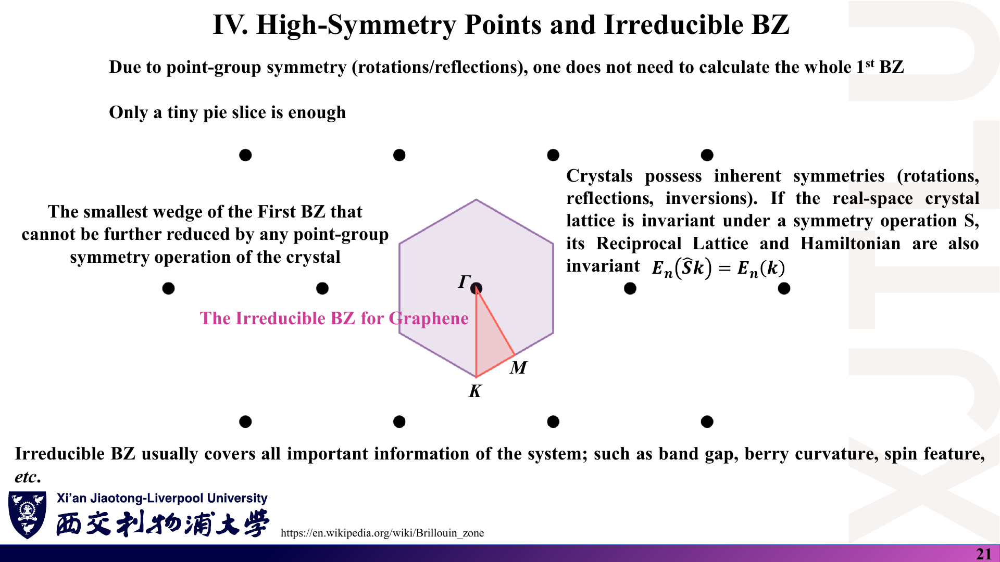

### 中文解释

若晶体在对称操作 $S$ 下不变，则倒格子和哈密顿量也不变，有 $E_n(\hat S\mathbf k)=E_n(\mathbf k)$。因此只需计算第一布里渊区中“不能再被点群操作约化”的最小楔形——**不可约布里渊区（IBZ）**，其余部分由对称性复制得到。石墨烯的六角布里渊区被 12 个点群操作分成 12 份，每份是三角形 Γ–M–K。

### 原理深入

**石墨烯的高对称点〔补充，接第 4 节的约定〕**：

$$
\mathbf K=\tfrac13(2\mathbf b_1+\mathbf b_2)=\frac{2\pi}{a}\left(\tfrac23,0\right),\quad|\Gamma\mathbf K|=\frac{4\pi}{3a};
\qquad
\mathbf M=\tfrac12\mathbf b_1,\quad|\Gamma\mathbf M|=\frac{2\pi}{\sqrt3\,a}.
$$

K 是六边形的顶点，M 是边的中点；$|\Gamma\mathbf M|/|\Gamma\mathbf K|=\sqrt3/2=\cos30°$。二维点群 $6mm$（$C_{6v}$）有 12 个元素，故 IBZ 面积为整个布里渊区的 1/12。

**使用 IBZ 的注意事项**：

1. **k 点权重**：自洽计算在 IBZ 内取点时，每个点要乘以它在全区中的等价点数（权重），否则积分错误。
2. **带边位置**：沿 IBZ 边界画能带不保证找到真实的导带底/价带顶——极值可能落在 IBZ 内部。判断带隙最好再用全区或 IBZ 内的密网格核对。
3. **讲义说 IBZ 涵盖“Berry 曲率、自旋特征”等信息**：这些量不是标量，在对称操作下会**变号或转向**（例如时间反演下 Berry 曲率 $\Omega(-\mathbf k)=-\Omega(\mathbf k)$）。只能说它们可由 IBZ 中的值**按变换规则**推出，不能简单复制；求全区积分（如反常霍尔电导）时更要谨慎。
4. **磁性体系**：磁序会降低对称性，IBZ 变大；要按磁空间群而非晶体空间群约化。

### Ref

- **原课件**：[Lecture Six，PDF 第 21 页](../Lecture_Six.pdf#page=21)。
- **延伸**：[GT：对称性与 k 点约化](README.md#ref-gt)；[GR09：石墨烯 K 点](README.md#ref-gr09)。
- **核验记录**：[07 第 6 节](07_讲义勘误与易错点.md)；对称性原理见 [03 第 2–3 节](03_晶体对称性与能带.md)。
