# 03 · 晶体对称性与能带结构

来源：[Lecture_Seven.pdf](../Lecture_Seven.pdf)，22 页。

[返回目录](README.md)

## 1. 晶体有哪些对称操作？它们的矩阵怎么写？〔pp. 3–6〕

### 课件截图

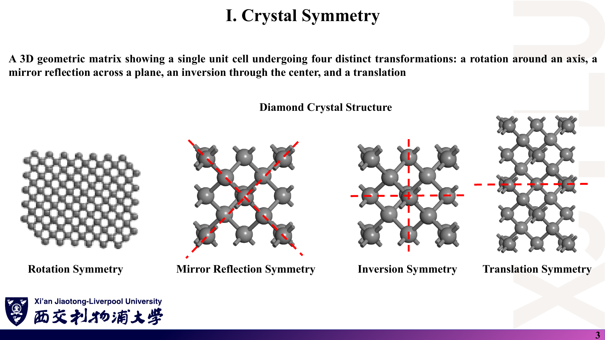

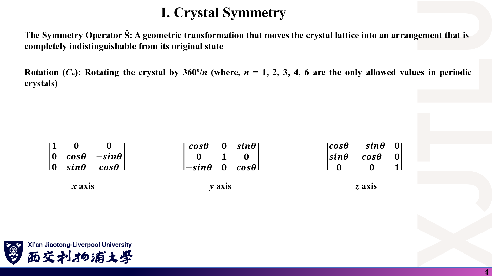

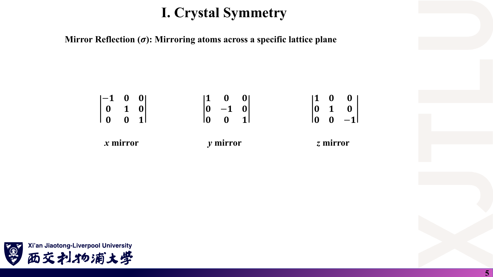

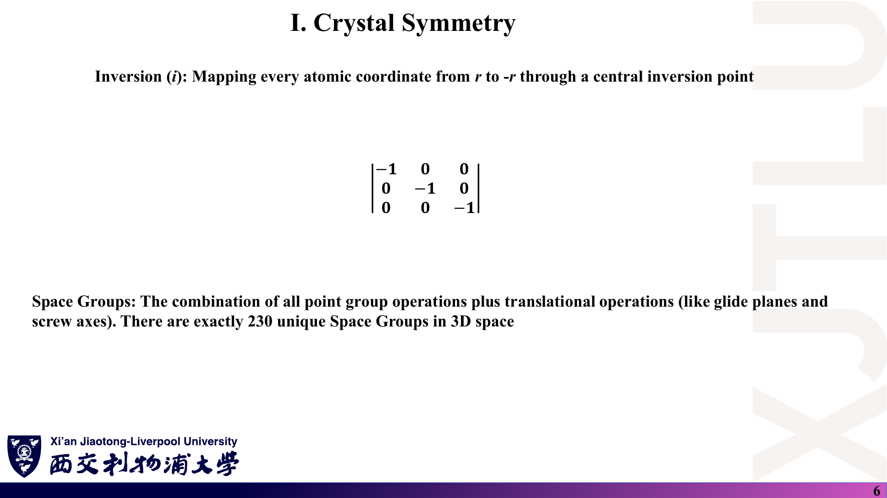

*原图把矩阵画在单竖线 $|\cdot|$ 中，这在数学上是行列式记号；这里应理解为矩阵（下方用圆括号书写）。*

### 中文解释

对称操作 $\hat S$ 把晶体变成与原来完全无法区分的样子。四类基本操作：

- **旋转 $C_n$**：绕轴转 $360°/n$；周期晶体只允许 $n=1,2,3,4,6$。
- **镜面 $\sigma$**：关于某平面反射。讲义的“x mirror”指把 $x\to-x$ 的镜面（即 $yz$ 平面）。
- **反演 $i$**：$\mathbf r\to-\mathbf r$。
- **平移**：沿格矢移动。

点群操作与平移（以及滑移面、螺旋轴这类“点操作 + 分数平移”）组合，三维共有 230 个空间群。

### 原理深入

**讲义矩阵（改用圆括号）**：

$$
R_z(\theta)=\begin{pmatrix}\cos\theta&-\sin\theta&0\\ \sin\theta&\cos\theta&0\\0&0&1\end{pmatrix},\qquad
\sigma_x=\begin{pmatrix}-1&0&0\\0&1&0\\0&0&1\end{pmatrix},\qquad
i=-I_3 .
$$

旋转矩阵行列式为 $+1$（真转动），镜面与反演为 $-1$（非真转动）。另有 $\sigma=i\,C_2$：例如 $\sigma_z=i\,R_z(\pi)$。

**晶体学限制定理〔补充证明〕**：在以 $\mathbf a_1,\mathbf a_2,\mathbf a_3$ 为基的坐标中，对称旋转必须把格矢映射为格矢，所以其矩阵元都是**整数**，迹也是整数。迹与基底无关，在笛卡尔坐标中

$$
\mathrm{Tr}R(\theta)=1+2\cos\theta\in\mathbb Z
\ \Rightarrow\ 2\cos\theta\in\{-2,-1,0,1,2\}
\ \Rightarrow\ \theta\in\{180°,120°,90°,60°,0°\}.
$$

对应 $n=2,3,4,6,1$。五次轴（$2\cos72°\approx0.618$）不可能出现在周期晶体中（准晶不是周期结构）。

**群元素数**：第 5 讲表中 “Ord.” 一列就是点群阶数，例如 $O_h$（$m\bar3m$）为 48。

### Ref

- **原课件**：[Lecture Seven，PDF 第 3–6 页](../Lecture_Seven.pdf#page=3)。
- **延伸**：[GT：点群与表示](README.md#ref-gt)；[ITA](README.md#ref-ita)。
- **核验记录**：[07 第 7 节](07_讲义勘误与易错点.md)。

## 2. 为什么对称性决定能带的简并？〔pp. 7–8〕

### 课件截图

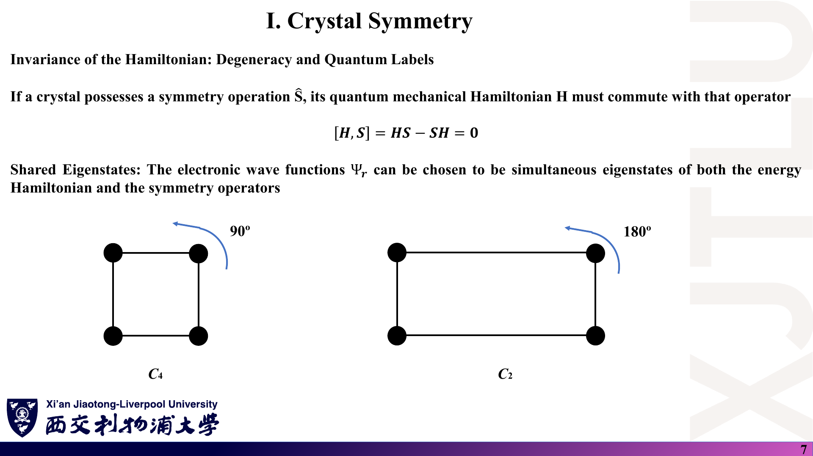

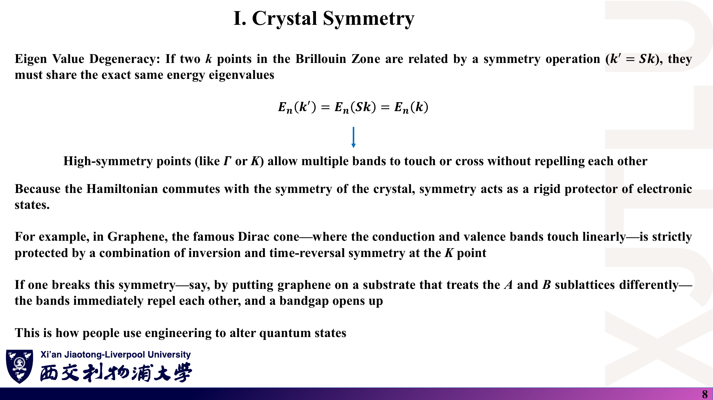

### 中文解释

若晶体具有对称操作 $\hat S$，哈密顿量与它对易：$[H,S]=0$。于是可以选取波函数同时是 $H$ 和 $S$ 的本征态（对称性给出量子标签）；而且由对称操作联系的两个 k 点能量相同：$E_n(S\mathbf k)=E_n(\mathbf k)$。在 $\Gamma$、K 等高对称点，多条能带可以被对称性“允许”相交或简并而不互相排斥。

### 原理深入

**讲义公式**：

$$
\boxed{[H,S]=HS-SH=0},\qquad\boxed{E_n(S\mathbf k)=E_n(\mathbf k)}.
$$

**推导〔补充〕**：设 $H\psi_{n\mathbf k}=E_n(\mathbf k)\psi_{n\mathbf k}$。由 $HS=SH$，

$$
H(S\psi_{n\mathbf k})=S(H\psi_{n\mathbf k})=E_n(\mathbf k)\,(S\psi_{n\mathbf k}),
$$

所以 $S\psi_{n\mathbf k}$ 是同能量的本征态。再看它的 Bloch 波矢：对点操作 $R$（作用为 $S\psi(\mathbf r)=\psi(R^{-1}\mathbf r)$），

$$
S\psi_{n\mathbf k}(\mathbf r+\mathbf T)=\psi_{n\mathbf k}(R^{-1}\mathbf r+R^{-1}\mathbf T)=e^{i\mathbf k\cdot R^{-1}\mathbf T}\,S\psi_{n\mathbf k}(\mathbf r)=e^{i(R\mathbf k)\cdot\mathbf T}\,S\psi_{n\mathbf k}(\mathbf r),
$$

（最后一步用到 $R$ 正交：$\mathbf k\cdot R^{-1}\mathbf T=(R\mathbf k)\cdot\mathbf T$），即它是波矢 $R\mathbf k$ 的 Bloch 态，故 $E_n(R\mathbf k)=E_n(\mathbf k)$。

**“简并”的两层含义**：

1. **不同 k 点之间**：星（star）中各 k 点能量相同——这只是“等价”，不是同一 k 点上的简并。
2. **同一 k 点上**：若 k 点的**小群**（保持 k 不变或只差一个 $\mathbf G$ 的操作）有二维及以上的不可约表示，属于该表示的能带在此点必然简并（例如立方晶体 $\Gamma$ 点的三重简并 p 型态）。高对称点小群大，所以简并多。

**“共享本征态”的限定**：$[H,S]=0$ 保证**可以选取**共同本征态，不是说 $H$ 的任意本征态都自动是 $S$ 的本征态（简并子空间内需要适当组合）。

### Ref

- **原课件**：[Lecture Seven，PDF 第 7–8 页](../Lecture_Seven.pdf#page=7)。
- **延伸**：[GT：小群与能带简并](README.md#ref-gt)；与不可约布里渊区的联系见 [02 第 9 节](02_倒空间与布里渊区.md)。

## 3. 石墨烯的 Dirac 锥为什么受保护？衬底为什么能打开带隙？〔p. 8〕

### 课件截图

### 中文解释

讲义要点：本征石墨烯的导带和价带在 K 点线性相接（Dirac 锥），这一交点受**反演 + 时间反演**的组合保护；如果把石墨烯放在一个“区别对待 A、B 子格”的衬底上，对称性被打破，两带立即相互排斥并打开带隙——这就是用工程手段调控量子态。

### 原理深入

**K 点附近的有效模型〔补充〕**：在 (A, B) 子格基下，

$$
H_{\mathbf K}(\mathbf q)\approx\hbar v_F\,(q_x\sigma_x+q_y\sigma_y)+\Delta\,\sigma_z,
\qquad E_\pm(\mathbf q)=\pm\sqrt{(\hbar v_Fq)^2+\Delta^2},
$$

$\mathbf q=\mathbf k-\mathbf K$。$\Delta$ 是 A、B 两个子格的在位能差的一半。

- **本征石墨烯**：A、B 由反演联系，必须等价，$\Delta=0$，$E_\pm=\pm\hbar v_F|\mathbf q|$——线性无隙。
- **衬底（如与 A、B 不等价耦合的六方氮化硼）**：$\Delta\neq0$，K 点带隙 $E_g=2|\Delta|$。

**为什么是“PT 组合”**：反演 P 与时间反演 T 的组合使 $H(\mathbf k)$ 在适当基下可取为**实矩阵**；二维实对称 $2\times2$ 矩阵只有 $\sigma_x,\sigma_z$ 两个可调参数，在二维 k 空间中能带交点是稳定的（微小扰动只会移动交点，不能消除它）。而三重旋转 $C_3$ 进一步把交点**钉在 K 点**。这是补充的更完整表述；讲义只点出 P + T。

**相关但不同的开隙方式**：自旋–轨道耦合也能在 K 点开出（极小的）隙且不破坏 P、T——这说明“受保护”是相对于所考虑的哈密顿量项而言的。

### Ref

- **原课件**：[Lecture Seven，PDF 第 8 页](../Lecture_Seven.pdf#page=8)。
- **延伸**：[GR09：Dirac 方程与子格对称性破缺](README.md#ref-gr09)；结构背景见 [01 第 7 节](01_晶体几何与空间群.md)。

## 4. 时间反演、Kramers 简并与自旋能带有什么关系？〔pp. 9–10〕

### 课件截图

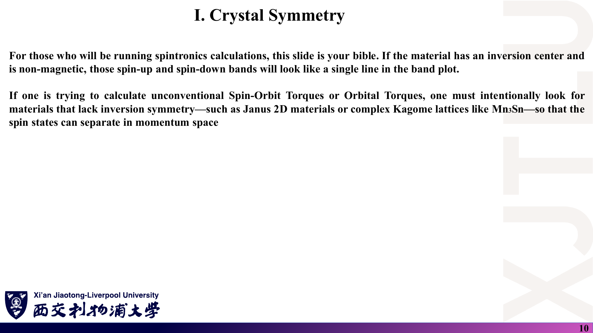

### 中文解释

- 时间反演 $\hat T$：$t\to-t$，在量子力学中同时反转动量 $\mathbf k\to-\mathbf k$ 和自旋 $\uparrow\to\downarrow$。
- **Kramers 定理**：奇数个电子、存在时间反演对称（无外磁场、无磁序）时，每个能级至少二重简并；对能带：$E_n(\mathbf k,\uparrow)=E_n(-\mathbf k,\downarrow)$。
- **P + T**：若同时有空间反演，则在**每个** k 点自旋上、下能带重合：$E_n(\mathbf k,\uparrow)=E_n(\mathbf k,\downarrow)$。能带图上它们看起来是一条线。
- 要产生自旋劈裂、自旋流或自旋–轨道矩（SOT），必须引入磁性元素或表面/界面来打破这些对称性。

### 原理深入

**两个关系相乘得到自旋简并〔补充〕**：

$$
\underbrace{E_n(\mathbf k,\uparrow)=E_n(-\mathbf k,\downarrow)}_{T}
\quad\text{与}\quad
\underbrace{E_n(-\mathbf k,\downarrow)=E_n(\mathbf k,\downarrow)}_{P\ (\text{不翻转自旋})}
\ \Rightarrow\ E_n(\mathbf k,\uparrow)=E_n(\mathbf k,\downarrow).
$$

**Kramers 定理的核心**：对自旋 1/2 粒子 $T^2=-1$（奇数电子时），若 $|\psi\rangle$ 与 $T|\psi\rangle$ 线性相关，则会推出 $T^2|\psi\rangle=+|\psi\rangle$，矛盾；所以它们是正交的同能态。对能带而言，只在**时间反演不变动量**（$-\mathbf k=\mathbf k+\mathbf G$，如 $\Gamma$、M）上这对态位于同一 k 点；一般 k 点上，T 只把 $\mathbf k$ 与 $-\mathbf k$ 联系起来。

**“↑/↓”标签的适用范围**：无 SOC 时自旋是好量子数；有 SOC 时应改称“Kramers 对”或赝自旋，讲义公式中的箭头要理解为 Kramers 伙伴。

**铁磁体**：T 被磁序破坏，自旋上、下能带沿能量轴相对移动（交换劈裂），即第 9 页文字描述的情形。

**关于第 10 页的材料举例**：讲义把 Janus 二维材料和 Kagome 化合物 Mn₃Sn 都列为“缺乏反演对称”的例子。Janus 层（两面原子不同）确实破坏反演；但 Mn₃Sn 的**晶体结构**通常报道为中心对称的六方 $P6_3/mmc$，其特殊的自旋/输运性质主要源于**非共线反铁磁序破坏时间反演**（及相关组合对称性），而非晶格缺乏反演中心。建议引用时区分“晶格对称性”与“磁对称性”，详见 [07 第 8 节](07_讲义勘误与易错点.md)。

### Ref

- **原课件**：[Lecture Seven，PDF 第 9–10 页](../Lecture_Seven.pdf#page=9)。
- **延伸**：[GT：时间反演与 Kramers 简并](README.md#ref-gt)。第一周 SOC 内容见 [Week One 04](../../Week_One/学习笔记/04_周期势_微扰与SOC.md)。

## 5. 能带是怎样从原子能级形成的？〔pp. 11–12〕

### 课件截图

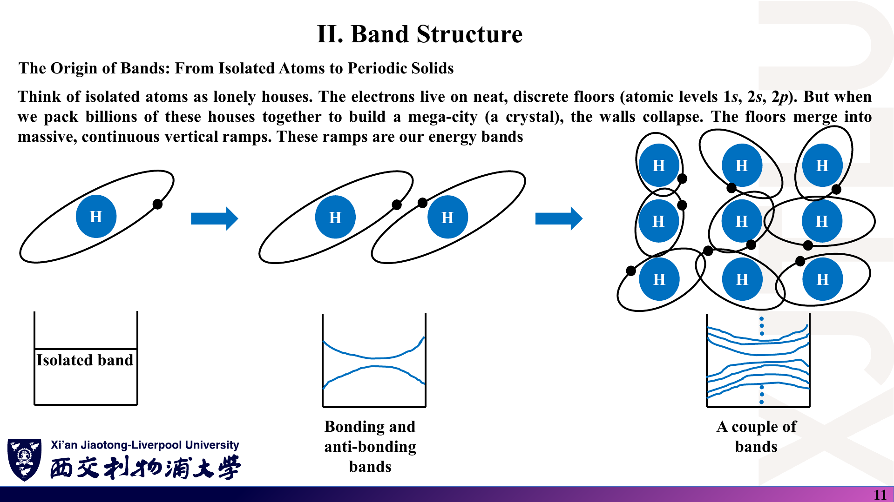

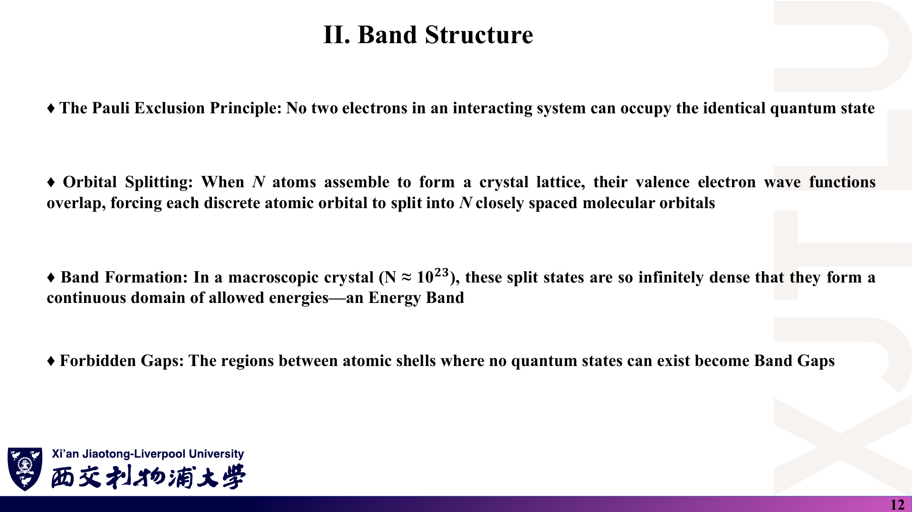

### 中文解释

孤立原子的电子占据分立能级（像独栋房子里的“楼层”）。两个原子靠近，轨道重叠，一个能级劈裂成成键与反键两个；$N$ 个原子组成晶体，每个原子能级劈裂成 $N$ 个紧密排列的能级。宏观晶体中 $N\sim10^{23}$，这些能级密集到形成准连续的**能带**；原子壳层之间没有态的能量区间成为**带隙**。

### 原理深入

**$N$ 原子链的紧束缚例〔补充〕**：每格点一个 s 轨道，在位能 $\varepsilon_0$，最近邻跃迁 $-t$，周期边界条件下

$$
E(k)=\varepsilon_0-2t\cos(ka),\qquad k=\frac{2\pi m}{Na},\ m=0,1,\ldots,N-1.
$$

$N$ 个原子给出 $N$ 个能级，全部落在宽度 $4t$ 的带内；$N\to\infty$ 时能级间距 $\sim t/N\to0$，形成连续带。**带宽由轨道重叠（$t$）决定，不由 $N$ 决定**。

**表述上的两点限定**：

- Pauli 原理对任何全同费米子成立，与是否“相互作用”无关；能带论中它决定的是**如何填充**能带，而劈裂本身来自轨道重叠（哈密顿量的非对角元）。
- 能级“无限密集”是 $N\to\infty$ 的极限；有限 $N$ 时仍是分立的 $N$ 个能级。带隙也不总是“原子壳层之间”的间隙：例如硅的带隙产生于 sp³ 杂化后的成键–反键劈裂。

### Ref

- **原课件**：[Lecture Seven，PDF 第 11–12 页](../Lecture_Seven.pdf#page=11)。
- **延伸**：[SS1：紧束缚方法](README.md#ref-ss1)；第一周的周期势与 Bloch 定理见 [Week One 04](../../Week_One/学习笔记/04_周期势_微扰与SOC.md)。

## 6. 怎样由带隙区分导体、半导体和绝缘体？n 型与 p 型有什么不同？〔pp. 13–16〕

### 课件截图

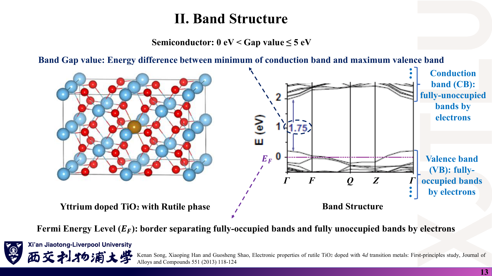

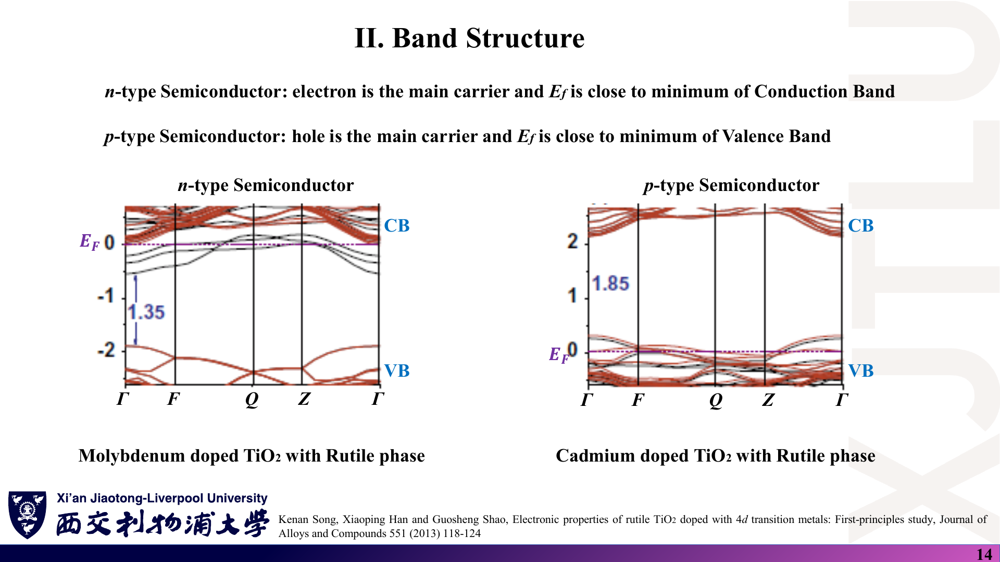

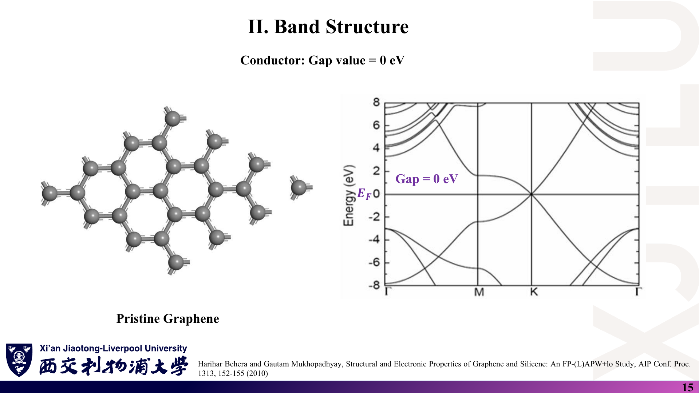

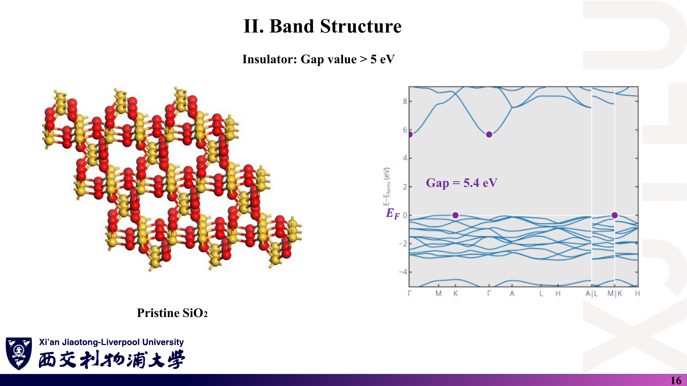

### 中文解释

- **带隙** $E_g$ = 导带最低点（CBM）− 价带最高点（VBM）。
- 讲义的分类：导体 $E_g=0$；半导体 $0<E_g\le5$ eV；绝缘体 $E_g>5$ eV。例子：本征石墨烯 0 eV；Y 掺杂金红石 TiO₂ 图中标注 1.75 eV；SiO₂ 5.4 eV。
- **费米能级** $E_F$：讲义定义为“全满带与全空带的分界”。
- **n 型**：电子为多数载流子，$E_F$ 靠近导带底；**p 型**：空穴为多数载流子，$E_F$ 应靠近**价带顶**（讲义第 14 页误写为 “minimum of Valence Band”）。

### 原理深入

**费米能级的严格含义〔补充〕**：$E_F$ 是电子的化学势 $\mu$，Fermi–Dirac 分布 $f(E)=1/[e^{(E-\mu)/k_BT}+1]$ 在 $E=\mu$ 处占据 1/2。绝缘体/半导体的 $\mu$ 位于带隙内（本征情况下接近带隙中部）；能带软件常把 VBM 或 $\mu$ 设为能量零点，图中的 “$E_F=0$” 只是作图约定。

**掺杂如何移动 $E_F$**：施主（如 TiO₂ 中的 Mo）提供额外电子，填入导带底附近或施主能级 → $E_F$ 上移到导带底附近；受主（如 Cd）造成电子缺失 → $E_F$ 下移到价带顶附近。第 14 页左图中 $E_F=0$ 已经落在价带上方那组能带之内（这些带部分占据），1.35 eV 标注的是价带顶到这组能带底的间距；右图 $E_F$ 则贴在价带顶。读图时要看清箭头两端分别是哪条带，以及 $E_F$ 在带内还是带隙中——高浓度掺杂的超胞计算中 $E_F$ 进入能带（简并掺杂）很常见。

**分类阈值是约定，不是定律**：

- 5 eV 是讲义采用的分界；文献中“宽禁带半导体”（如 Ga₂O₃ 约 4.8 eV）与绝缘体之间并无统一界限。
- **DFT（LDA/GGA）通常低估带隙**。SiO₂ 的 5.4 eV 是计算值（图样式与数据库能带图一致），实验光学带隙约为 9 eV 量级；比较时必须说明方法。
- **石墨烯**：带隙为零但费米面上态密度也为零，严格称**半金属 / 零带隙半导体**，与铜这类有大费米面的金属不同。讲义将其归为 “Conductor: Gap = 0”，是按带隙的粗分类。

### Ref

- **原课件**：[Lecture Seven，PDF 第 13–16 页](../Lecture_Seven.pdf#page=13)；TiO₂ 能带图引自 K. Song, X. Han, G. Shao, *J. Alloys Compd.* 551 (2013) 118–124；石墨烯能带图引自 H. Behera & G. Mukhopadhyay, *AIP Conf. Proc.* 1313, 152–155 (2010)（按讲义引用信息）。
- **延伸**：[SS2：半导体载流子与费米能级](README.md#ref-ss2)。
- **核验记录**：[07 第 3、9 节](07_讲义勘误与易错点.md)。

## 7. 能带曲率怎样决定有效质量？〔p. 17〕

### 课件截图

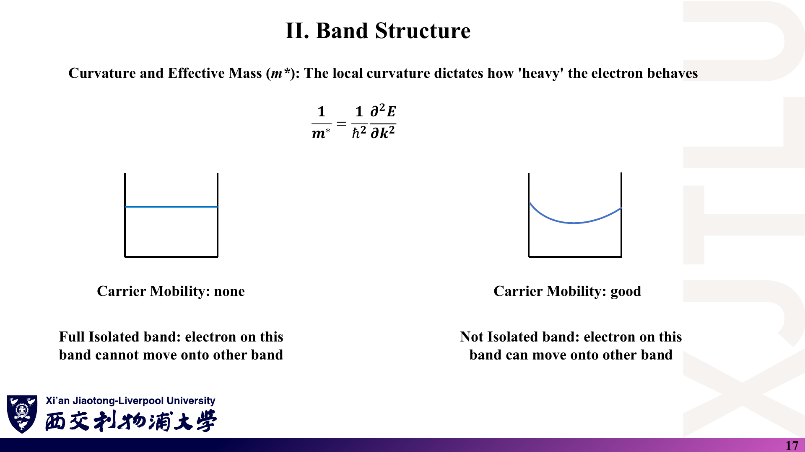

### 中文解释

能带越“弯”（曲率越大），电子表现得越“轻”，在电场下越容易加速；能带越平，电子越“重”。讲义公式

$$
\frac1{m^*}=\frac1{\hbar^2}\frac{\partial^2E}{\partial k^2}.
$$

讲义用一条平带（迁移率“none”）和一条抛物线带（迁移率“good”）对比。

### 原理深入

**由抛物线带验证〔补充〕**：自由电子 $E=\hbar^2k^2/2m$，代入得 $m^*=m$。在带边附近展开 $E(\mathbf k)\approx E_0+\hbar^2|\mathbf k-\mathbf k_0|^2/2m^*$，即可从拟合的曲率读出 $m^*$。

**一般形式是张量**：

$$
\left(\frac1{m^*}\right)_{ij}=\frac1{\hbar^2}\frac{\partial^2E_n}{\partial k_i\partial k_j},\qquad
\mathbf v_n(\mathbf k)=\frac1\hbar\nabla_{\mathbf k}E_n(\mathbf k).
$$

各向异性材料不同方向的有效质量不同；价带顶曲率为负，对应空穴的正有效质量。

**平带**：$\partial E/\partial k=0$ 与 $\partial^2E/\partial k^2=0$ → 群速度为零、$m^*\to\infty$，载流子不能有效传播（局域化）。

**讲义第 17 页两句说明的限定**：“Full isolated band：电子不能移到其他带”与“迁移率 none”是两个不同的机制：

1. **满带不导电**：满带中 $\mathbf k$ 与 $-\mathbf k$ 的速度成对抵消，总电流为零——与能带平不平无关；
2. **平带迁移率低**：由 $m^*\to\infty$ 导致。

迁移率还取决于散射时间 $\tau$（$\mu=e\tau/m^*$），只有曲率并不能完全决定迁移率。

### Ref

- **原课件**：[Lecture Seven，PDF 第 17 页](../Lecture_Seven.pdf#page=17)。
- **延伸**：[SS1：半经典动力学与有效质量](README.md#ref-ss1)。
- **练习**：[06 第 11 题](06_复习题与参考答案.md)。

## 8. Bloch 定理说了什么？〔p. 18〕

### 课件截图

### 中文解释

在周期势 $V(\mathbf r+\mathbf R)=V(\mathbf r)$ 中，哈密顿量的本征态都是“被周期函数调制的平面波”：

$$
\Psi_{n\mathbf k}(\mathbf r)=u_{n\mathbf k}(\mathbf r)\,e^{i\mathbf k\cdot\mathbf r},\qquad u_{n\mathbf k}(\mathbf r+\mathbf R)=u_{n\mathbf k}(\mathbf r).
$$

$n$ 是能带编号，$\mathbf k$ 是第一布里渊区内的量子标签（准动量）。

### 原理深入

**等价形式**：$\Psi_{n\mathbf k}(\mathbf r+\mathbf R)=e^{i\mathbf k\cdot\mathbf R}\Psi_{n\mathbf k}(\mathbf r)$。

**证明思路〔补充〕**：平移算符 $\hat T_{\mathbf R}f(\mathbf r)=f(\mathbf r+\mathbf R)$ 与 $H$ 对易（因 $V$ 周期），不同平移互相对易，故可取共同本征态。$\hat T_{\mathbf R}\hat T_{\mathbf R'}=\hat T_{\mathbf R+\mathbf R'}$ 且保持归一化，迫使本征值形如 $e^{i\mathbf k\cdot\mathbf R}$。这正是第 2 节 $[H,S]=0$ 思想在“平移”这个对称操作上的应用。

**为什么 n 和 k 都需要**：固定 $\mathbf k$ 后，$u_{n\mathbf k}$ 满足一个只在一个原胞内求解的方程

$$
\left[\frac{(\hat{\mathbf p}+\hbar\mathbf k)^2}{2m}+V(\mathbf r)\right]u_{n\mathbf k}=E_n(\mathbf k)\,u_{n\mathbf k},
$$

有限区域上的本征问题给出一系列分立本征值，用 $n$ 编号。

**一个小限定**：讲义说 $u_{n\mathbf k}$ “在每个原子核处达到峰值”，这只是示意图的描述；实际的 $u_{n\mathbf k}$ 形状取决于轨道特征（例如 p 型态在核处为零）。

### Ref

- **原课件**：[Lecture Seven，PDF 第 18 页](../Lecture_Seven.pdf#page=18)。
- **延伸**：[SS1：Bloch 定理](README.md#ref-ss1)；第一周的推导见 [Week One 04](../../Week_One/学习笔记/04_周期势_微扰与SOC.md)。

## 9. 一次计算会有多少条能带？〔p. 19〕

### 课件截图

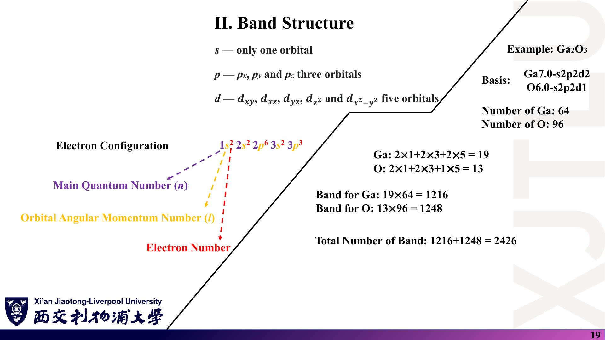

### 中文解释

在局域原子轨道基下，**能带数 = 胞内基函数（轨道）总数**。s、p、d 分别有 1、3、5 个轨道。讲义以 Ga₂O₃（64 个 Ga、96 个 O 的胞）为例，基组 `Ga7.0-s2p2d2`、`O6.0-s2p2d1`，按“每原子轨道数 × 原子数”求和。

### 原理深入

**基组标记的读法〔补充，OpenMX 风格〕**：`Ga7.0-s2p2d2` 表示 Ga 的数值原子轨道截断半径 7.0（原子单位 bohr），s、p、d 各取 2 个径向函数。

**正确计数**：

$$
\text{Ga}:\ 2\times1+2\times3+2\times5=\mathbf{18},\qquad
\text{O}:\ 2\times1+2\times3+1\times5=13 .
$$

$$
N_{\rm band}=18\times64+13\times96=1152+1248=\boxed{2400}.
$$

讲义写成 Ga 每原子 19、总数 $1216+1248=2426$——两处都需更正：$2+6+10=18$；即使按讲义的 19 计算，$1216+1248$ 也应为 2464。

**其他注意点**：

- 若做非共线自旋或含 SOC 计算，哈密顿量维数翻倍，能带数为 $2\times2400=4800$。
- 平面波基组的能带数不由轨道数决定，而是用户指定（需多于占据带数）。
- 讲义左侧示例电子构型 $1s^22s^22p^63s^23p^3$ 是磷（15 个电子），只用来说明记号中 $n$、$l$、电子数的位置，与 Ga、O 无关。

### Ref

- **原课件**：[Lecture Seven，PDF 第 19 页](../Lecture_Seven.pdf#page=19)。
- **延伸**：[OMX：基组标记](README.md#ref-omx)。
- **核验记录**：[07 第 4 节](07_讲义勘误与易错点.md)；练习：[06 第 12 题](06_复习题与参考答案.md)。

## 10. 为什么 3N×3N 超胞把 Dirac 点折叠到 Γ？〔pp. 20–21〕

### 课件截图

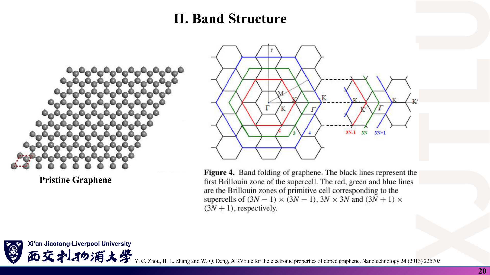

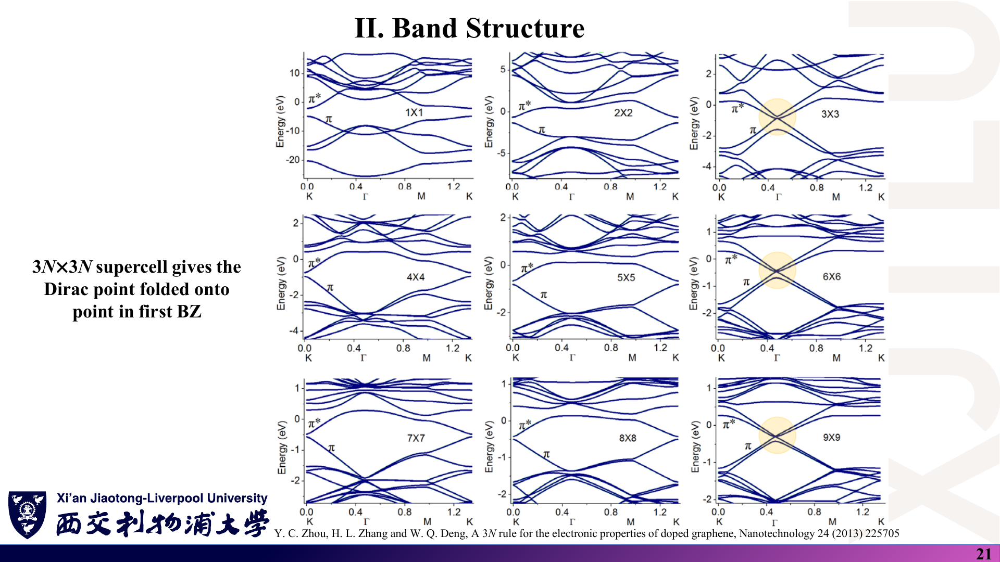

*第 21 页左侧文字 “folded onto ␣ point” 中缺少一个符号，按上下文与右侧图应为 “Γ”——原 PDF 文本层中就没有这个字符，换用 pdftoppm 与 PyMuPDF 两种渲染器结果相同，属于原文件缺失，见 [07 第 10 节](07_讲义勘误与易错点.md)。*

### 中文解释

掺杂或缺陷计算需要用超胞（把原胞沿两个方向各重复 $N$ 次）。超胞的布里渊区缩小为原来的 $1/N^2$，原布里渊区中的能带被“折叠”进小区。当超胞边长是 3 的倍数（3×3、6×6、9×9…）时，原来位于 K、K′ 的 Dirac 点恰好折叠到小区中心 $\Gamma$；其他尺寸时仍在小区的 K 点。这就是文献所说的 “3N 规则”。

### 原理深入

**折叠条件〔补充推导〕**：沿用 [02 第 4 节](02_倒空间与布里渊区.md) 的 $\mathbf b_1,\mathbf b_2$，K 点为

$$
\mathbf K=\tfrac23\mathbf b_1+\tfrac13\mathbf b_2 .
$$

$N\times N$ 超胞的倒格矢为 $\mathbf B_i=\mathbf b_i/N$，所以

$$
\mathbf K=\frac{2N}{3}\mathbf B_1+\frac N3\mathbf B_2 .
$$

当且仅当 $N$ 是 3 的倍数时，$\mathbf K$ 是超胞倒格子的格点，即与 $\Gamma$ 等价：Dirac 点折叠到 $\Gamma$。否则 $\mathbf K$ 折叠到超胞布里渊区的 K 或 K′。

**物理后果**：$3N\times3N$ 时 K 与 K′ 两个谷都落在 $\Gamma$，取代掺杂等周期微扰可以耦合两个谷，可能在 $\Gamma$ 处开隙；非 3N 尺寸时两谷仍分离。原论文据此讨论掺杂石墨烯电子性质随超胞尺寸的变化。

**实用提醒**：折叠后的能带“看起来不同”，但未掺杂时与原胞计算是同一物理；判断是否开隙必须注意 Dirac 点被折到了哪里，k 路径要经过该点。

### Ref

- **原课件**：[Lecture Seven，PDF 第 20–21 页](../Lecture_Seven.pdf#page=20)。
- **延伸**：[3N：Zhou, Zhang & Deng (2013)](README.md#ref-3n)；[GR09](README.md#ref-gr09)。
- **练习**：[06 第 13 题](06_复习题与参考答案.md)。
