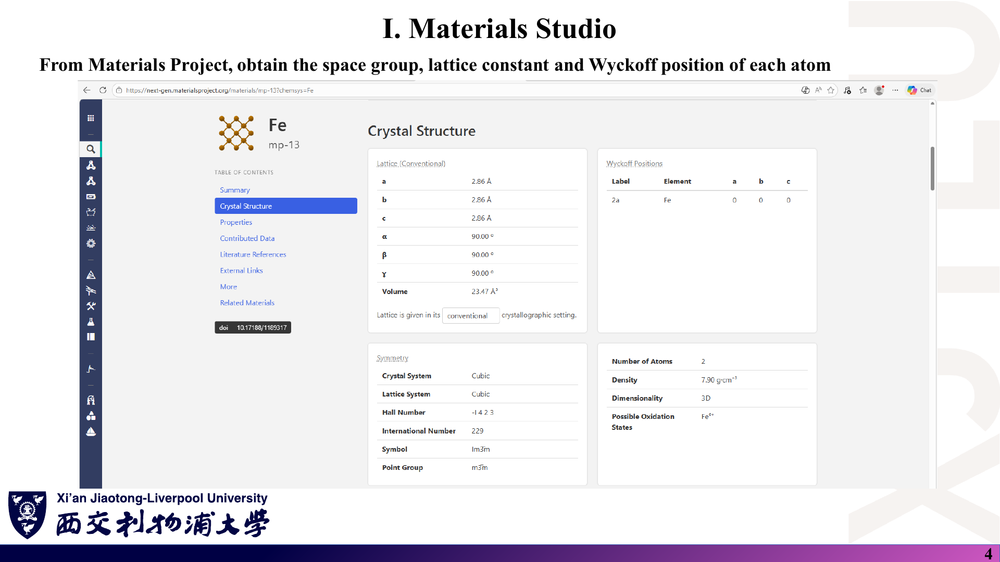
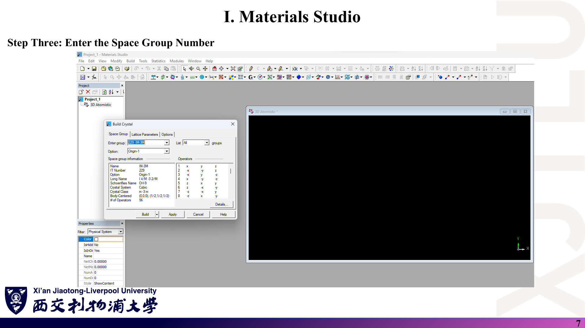
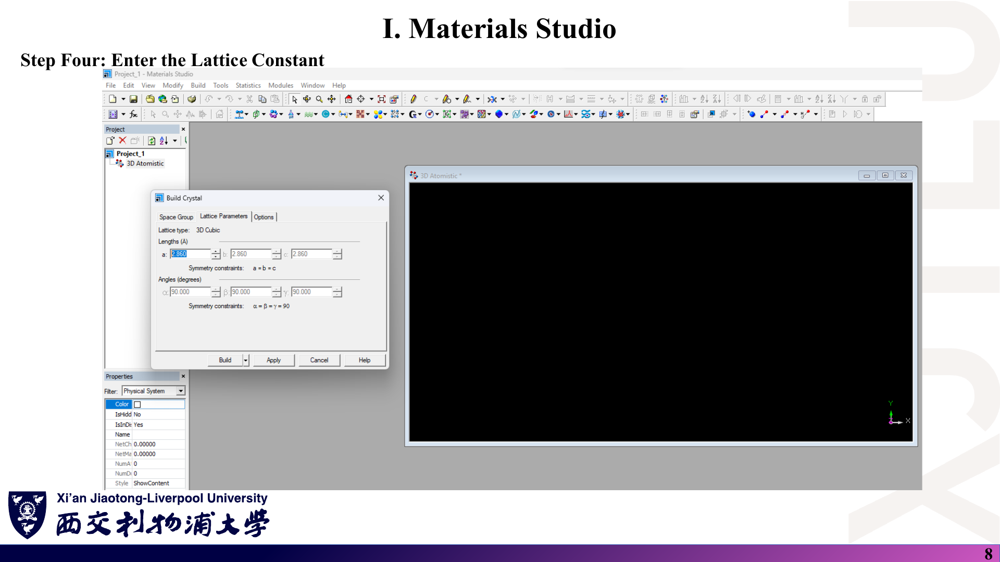
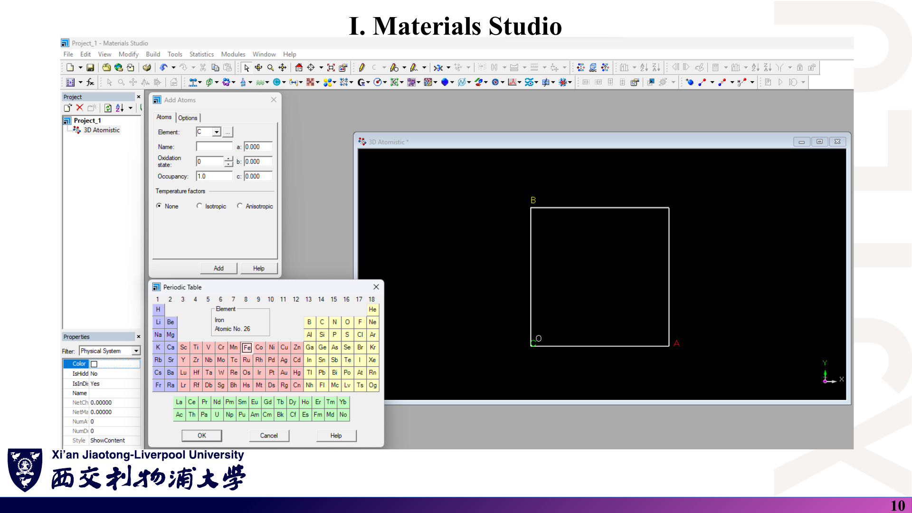
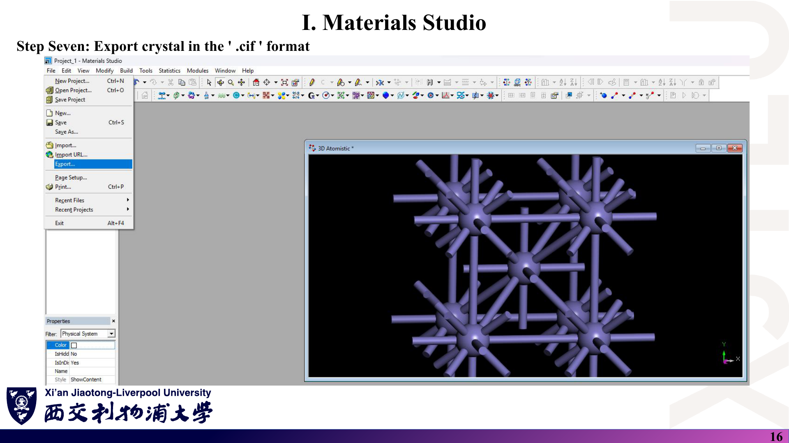
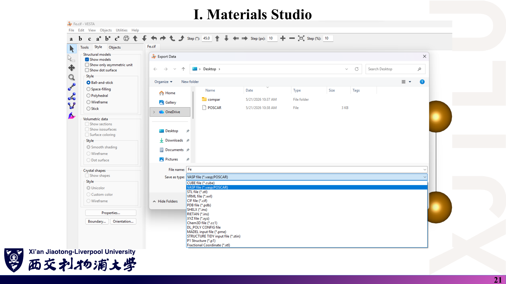
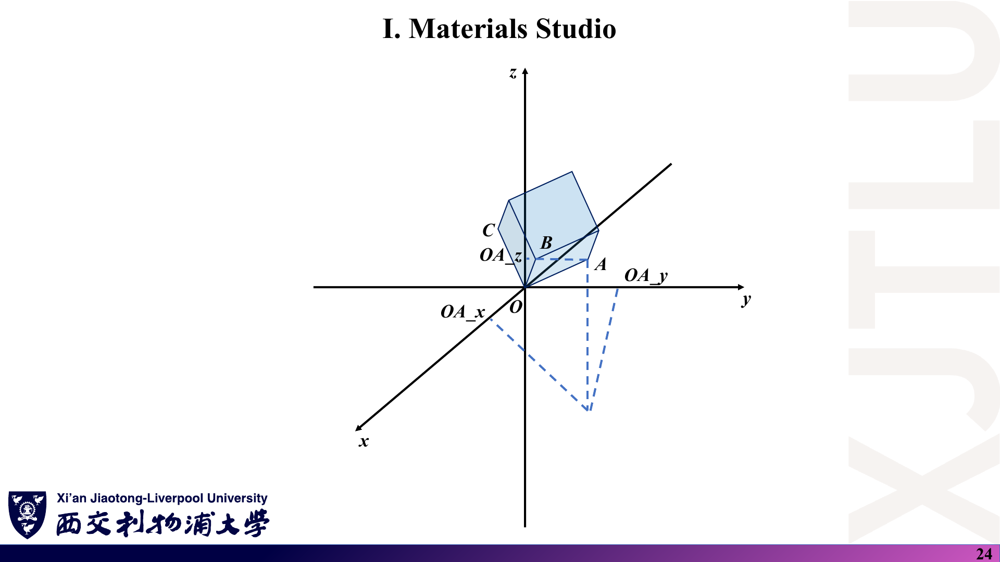
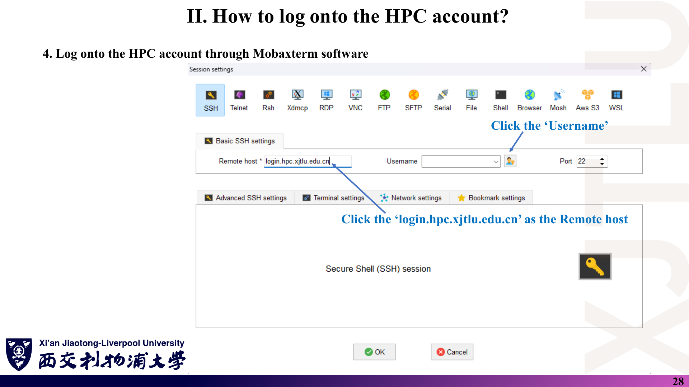
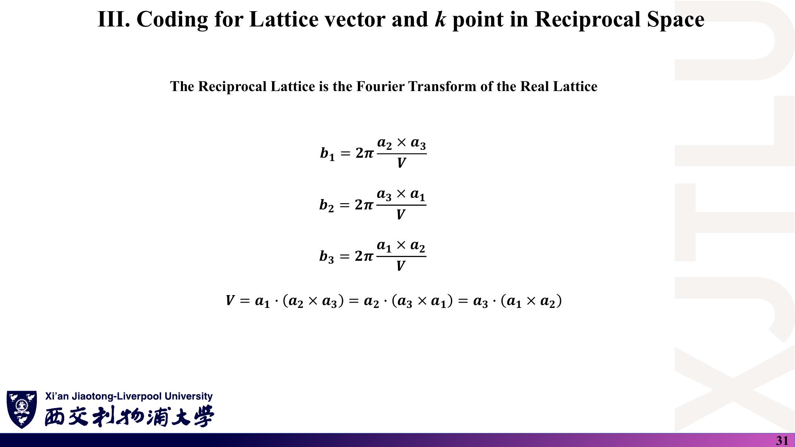

# 04 · 结构建模、登录 HPC 与倒格矢编程

来源：[Lecture_Eight.pdf](../Lecture_Eight.pdf)，41 页。

[返回目录](README.md)

## 1. 怎样在 Materials Studio 中按空间群搭建晶胞？〔pp. 3–15〕

### 课件截图









*第 5–6 页为新建 3D Atomistic 文档与打开 Build Crystal；第 9 页为 Build → Add Atoms 菜单；第 11–15 页为加原子后的显示与显示样式调整。*

### 中文解释

Materials Studio（BIOVIA 公司的材料建模软件）搭建 BCC Fe 的步骤：

1. 在 Materials Project 的 mp-13 页面读取：惯用胞 $a=b=c=2.86$ Å、$\alpha=\beta=\gamma=90°$，空间群 $Im\bar3m$（229 号），Wyckoff 位置 2a，Fe，(0, 0, 0)；
2. 新建 **3D Atomistic** 文档；
3. Build → Crystals → **Build Crystal**，在 Space Group 页输入 229；
4. 在 Lattice Parameters 页输入 $a=2.860$（立方晶系的约束 $a=b=c$、角度 90° 由软件自动保持）；
5. Build → **Add Atoms**，选 Fe，填写分数坐标 (0, 0, 0)；
6. 调整显示样式（如球棍模型）。

### 原理深入

**为什么只需输入一个原子**：软件根据空间群操作自动生成等价位置。$Im\bar3m$ 的体心平移把 (0, 0, 0) 复制到 $(\tfrac12,\tfrac12,\tfrac12)$，所以加一个原子就得到惯用胞中的 2 个原子（[01 第 4 节](01_晶体几何与空间群.md)）。第 7 页对话框显示 “Body-Centered (0,0,0), (1/2,1/2,1/2)” 和 “# of Operators 96”，即 48 个点群操作 × 2 个体心平移代表。

**常见错误**：

- 先加原子、后改空间群，可能导致对称生成的原子重复或丢失；应先定空间群与晶格，再加不等价原子。
- 在 Add Atoms 中输入的是**分数坐标**（a、b、c 栏），不是 Å。
- Materials Project 列出的晶格常数通常是计算优化值；如需实验值应另查文献，并在报告中注明来源。

### Ref

- **原课件**：[Lecture Eight，PDF 第 3–15 页](../Lecture_Eight.pdf#page=4)。
- **延伸**：[MP](README.md#ref-mp)；[ITA：Wyckoff 位置](README.md#ref-ita)。

## 2. 怎样导出 CIF 并用 VESTA 转成 POSCAR？〔pp. 16–22〕

### 课件截图






*第 18 页为用 VESTA 打开 .cif；第 20 页为 File → Export Data。第 22 页右上方 “$C_{car}=$” 之后没有任何内容，原公式在 PDF 渲染中缺失，见 [07 第 10 节](07_讲义勘误与易错点.md)。*

### 中文解释

步骤：Materials Studio 导出 `.cif` → 用 VESTA 打开 → File → Export Data → 保存类型选 **VASP file (\*.vasp; POSCAR)** → 在弹出的选项中选择 **Fractional coordinates**（写成 `Direct`）或 Cartesian coordinates。

### 原理深入

**分数坐标与笛卡尔坐标的换算〔补充，补全第 22 页缺失公式〕**：设 $\mathbf a_1,\mathbf a_2,\mathbf a_3$ 为晶格矢量（POSCAR 第 3–5 行，已乘缩放因子），分数坐标 $(f_1,f_2,f_3)$，则

$$
\boxed{\mathbf r_{\rm car}=f_1\mathbf a_1+f_2\mathbf a_2+f_3\mathbf a_3}
\quad\Longleftrightarrow\quad
\mathbf r_{\rm car}^{T}=\mathbf f^{T}A,
$$

其中 $A$ 的第 $i$ 行是 $\mathbf a_i$。反过来 $\mathbf f^{T}=\mathbf r_{\rm car}^{T}A^{-1}$。

例：立方 Fe，$\mathbf f=(\tfrac12,\tfrac12,\tfrac12)$ → $\mathbf r_{\rm car}=(1.43,1.43,1.43)$ Å。

**为什么推荐分数坐标**：改变晶格常数（例如做体积优化或施加应变）时，分数坐标保持不变，原子随晶胞一起缩放；笛卡尔坐标则需要重新计算。

### Ref

- **原课件**：[Lecture Eight，PDF 第 16–22 页](../Lecture_Eight.pdf#page=16)。
- **延伸**：[VESTA](README.md#ref-vesta)；[POSCAR](README.md#ref-poscar)。

## 3. POSCAR 每一行是什么意思？〔pp. 23–24〕

### 课件截图




### 中文解释

以课程的 `Fe.vasp` 为例：

| 行 | 内容 | 含义 |
|---|---|---|
| 1 | `3D\Atomistic` | 注释行（讲义称 File name；VASP 不解析，可写任何文字） |
| 2 | `1.0` | 缩放因子（universal scaling factor） |
| 3–5 | `2.86 0 0` 等 | 三条晶格矢量 $\mathbf a_1,\mathbf a_2,\mathbf a_3$ 的笛卡尔分量（Å），每**行**一条矢量：$(OA_x,OA_y,OA_z)$、$(OB_x,OB_y,OB_z)$、$(OC_x,OC_y,OC_z)$ |
| 6 | `Fe` | 元素符号 |
| 7 | `2` | 每种元素的原子数 |
| 8 | `Direct` | 坐标类型：Direct = 分数坐标；Cartesian = 笛卡尔坐标 |
| 9– | `0 0 0`、`0.5 0.5 0.5` | 每个原子一行的坐标 |

### 原理深入

**讲义标注中需要更正的两处**（详见 [07 第 5 节](07_讲义勘误与易错点.md)）：

1. 第 3–5 行是**晶格矢量**，不只是“三个轴向的晶格常数”。本例矢量恰好沿坐标轴，才看起来像三个常数；六角、BCC 原胞等情形每行都有多个非零分量。
2. `Direct` 下的三列是沿 $\mathbf a_1,\mathbf a_2,\mathbf a_3$ 的**分数坐标**，不是“沿 x、y、z 轴的坐标”（只有当晶格矢量恰好沿坐标轴时两者才成比例）。

**缩放因子的规则**：正数时，晶格矢量（以及 Cartesian 原子坐标）都乘以该数；负数时，表示目标原胞**体积**（ų）。[POSCAR](README.md#ref-poscar) 中有官方说明。第 8 讲的 Fortran 程序直接**跳过**这一行（见 [08](08_代码导读.md)），只在缩放因子为 1.0 时结果正确。

**第 24 页的几何意义**：$\mathbf a_1=\overrightarrow{OA}=(OA_x,OA_y,OA_z)$ 是从原点 O 指向晶胞顶点 A 的矢量，三个分量是它在笛卡尔轴上的投影；B、C 同理。

### Ref

- **原课件**：[Lecture Eight，PDF 第 23–24 页](../Lecture_Eight.pdf#page=23)。
- **延伸**：[POSCAR](README.md#ref-poscar)。
- **数据文件**：[`Codes/Fe.vasp`](../Codes/Fe.vasp)。

## 4. 怎样用 MobaXterm 登录学校 HPC？〔pp. 25–30〕

### 课件截图



*第 25 页为 MobaXterm 官网下载；第 26–27 页为 Session → SSH；第 29–30 页为新建用户名凭据并填写分配的账号与密码。*

### 中文解释

1. 从 <https://mobaxterm.mobatek.net> 安装 MobaXterm；
2. 点 **Session** → **SSH**；
3. Remote host 填 `login.hpc.xjtlu.edu.cn`，端口 22；
4. 点 Username 旁的图标 → **New**，自定义一个名称，填入学校分配的用户名和密码；
5. 确认后即可打开登录节点的终端（讲义截图中的提示符形如 `[用户名@xpszlogin1 目录]`，后跟美元符号）。

### 原理深入

**等价的命令行登录〔补充〕**：在 macOS/Linux 终端或 Windows PowerShell 中可直接

```bash
ssh 你的用户名@login.hpc.xjtlu.edu.cn
```

MobaXterm 的优点是自带图形化 SFTP 侧栏，方便上传 `Fe.vasp`、下载结果。

**登录节点的使用规范（一般 HPC 惯例）**：登录节点供编辑、编译、提交作业等轻量操作；第 8 讲的小程序在登录节点直接编译运行即可（讲义第 39 页就是这样做的）。正式的 DFT 计算应通过作业调度系统提交到计算节点（后续周的 `compile.sh`/`run.sh` 即为此类脚本），具体规定以学校 HPC 文档为准。

**安全**：不要把密码写进共享的会话文件或脚本；公共电脑用完后删除保存的凭据。

### Ref

- **原课件**：[Lecture Eight，PDF 第 25–30 页](../Lecture_Eight.pdf#page=25)。
- **后续**：[08 第 5 节：在 HPC 上编译运行](08_代码导读.md)。

## 5. 如何手算立方 Fe 的倒格矢？〔pp. 31–33〕

### 课件截图




### 中文解释

把 `Fe.vasp` 的三行晶格矢量代入第 6 讲的公式：$\mathbf a_2\times\mathbf a_3=a^2\hat{\mathbf x}$，$V=a^3$，所以 $\mathbf b_1=2\pi a^{-1}\hat{\mathbf x}$，同理 $\mathbf b_2,\mathbf b_3$。代入 $a=2.8599998951$ Å 得 $2\pi/a=2.1969180202$ Å⁻¹。

### 原理深入

讲义的推导完全正确，这里补两点：

**数值**：$2\pi/2.8599998951=2.19691802\ldots$ Å⁻¹，与 [`Codes/kspace.dat`](../Codes/kspace.dat) 一致。若取 $a=2.86$ 则为 2.1969179396，两者只相差约 $8\times10^{-8}$ Å⁻¹，来自 VESTA 写出的单精度舍入（2.8599998951 ≈ 2.86 的 float 表示）。

**这不是 BCC 的“真正”倒格子**：`Fe.vasp` 是含 2 个原子的立方惯用胞，因此算出的是**简单立方**倒格子；BCC 原胞对应的倒格子是 FCC，$|\mathbf b_i|=\sqrt2\cdot2\pi/a\approx3.107$ Å⁻¹（见 [02 第 3 节](02_倒空间与布里渊区.md) 与 SeeK-path 输出）。两种描述都正确，但布里渊区与 k 路径不同，选择 k 点前必须清楚自己用的是哪个胞。

### Ref

- **原课件**：[Lecture Eight，PDF 第 31–33 页](../Lecture_Eight.pdf#page=31)。
- **理论**：[02 第 2–3 节](02_倒空间与布里渊区.md)；练习 [06 第 14 题](06_复习题与参考答案.md)。

## 6. Fortran 程序是怎样组织的？〔pp. 34–40〕

### 课件截图


*第 34 页为 `INPUT.dat` 的内容；第 37–38 页为 `CROSSPRODUCT`、`DOTPRODUCT` 子程序源码；第 40 页为 `kspace.dat` 的内容。*

### 中文解释

程序由一个输入文件和一个源文件组成：

- `INPUT.dat`：一行 `File Name: Fe.vasp`，告诉程序要读哪个结构文件；
- `LATTICECONVERSION.f90`：主程序 ① 读 `INPUT.dat` → ② 读 `Fe.vasp` 的晶格矢量 → ③ 调用 `KSPACE` 计算倒格矢并写入 `kspace.dat`；`KSPACE` 内部调用 `CROSSPRODUCT`（叉积）与 `DOTPRODUCT`（点积，用来求体积）。

编译与运行（第 39 页）：

```bash
gfortran LATTICECONVERSION.f90 -o LATTICECONVERSION
./LATTICECONVERSION
ls          # 出现 kspace.dat
```

### 原理深入

逐行解读、输出格式、可改进之处与常见陷阱都放在 [08_代码导读](08_代码导读.md)。这里只强调程序与理论的对应关系：

| 理论（第 6 讲） | 程序 |
|---|---|
| $\mathbf a_2\times\mathbf a_3$ | `CALL CROSSPRODUCT(a(:,2), a(:,3), cross)` |
| $V=\mathbf a_1\cdot(\mathbf a_2\times\mathbf a_3)$ | `CALL DOTPRODUCT(a(:,1), cross, volume)` |
| $\mathbf b_1=2\pi(\mathbf a_2\times\mathbf a_3)/V$ | `k(:,1) = cross / volume`，最后整体乘 `2*pi` |
| 轮换得到 $\mathbf b_2,\mathbf b_3$ | 再调用两次 `CROSSPRODUCT` |

〔核验〕本笔记作者在本地用 gfortran 编译运行原程序，输出与 `Codes/kspace.dat` 逐字一致（对角元 2.1969180202，其余为 0）。

### Ref

- **原课件**：[Lecture Eight，PDF 第 34–40 页](../Lecture_Eight.pdf#page=35)。
- **源码**：[`Codes/LATTICECONVERSION.f90`](../Codes/LATTICECONVERSION.f90) · [`INPUT.dat`](../Codes/INPUT.dat) · [`kspace.dat`](../Codes/kspace.dat)。
- **延伸**：[GFORT](README.md#ref-gfort)。
