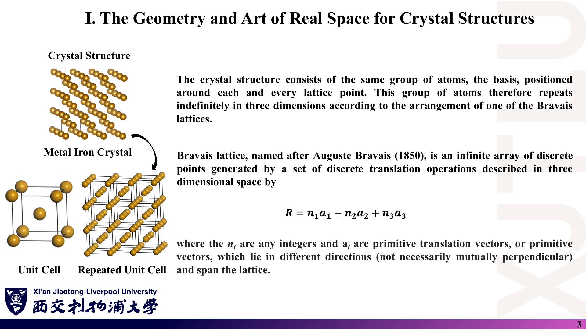
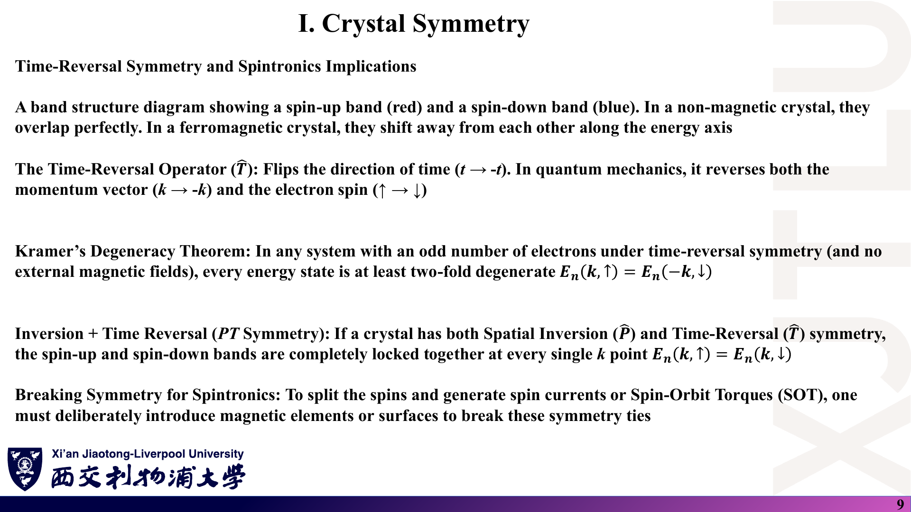
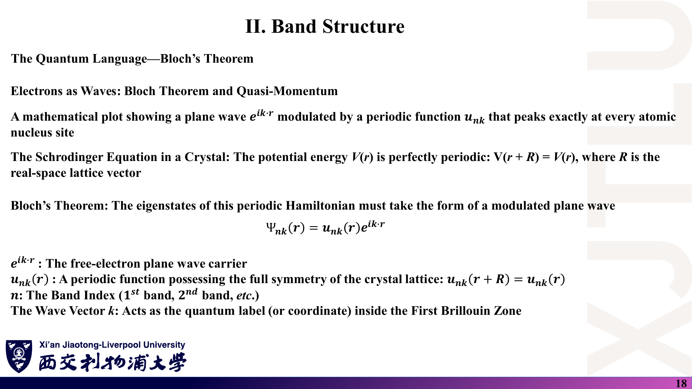
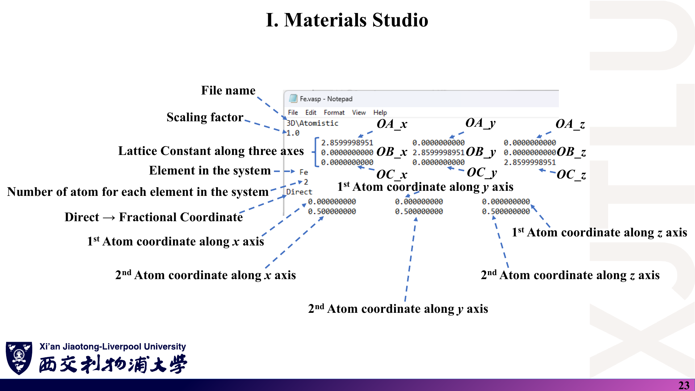

# 05 · 公式与中英文术语速查

[返回目录](README.md) · [概念与推导：第五讲](01_晶体几何与空间群.md) · [第六讲](02_倒空间与布里渊区.md) · [第七讲](03_晶体对称性与能带.md) · [第八讲](04_结构建模_HPC与倒格矢编程.md)

> 默认三维、右手系晶格矢量，倒格矢含 $2\pi$。此页包含正文已标明的必要补充，不替代推导与适用条件。

## 1. 实空间几何

### 课件截图

### 中文解释

晶体 = Bravais 格子 + 基元。原胞含 1 个格点；惯用胞更大但更直观。Wyckoff 位置 + 空间群可以生成胞内全部原子。

### 原理深入

$$
\mathbf R=n_1\mathbf a_1+n_2\mathbf a_2+n_3\mathbf a_3,\quad n_i\in\mathbb Z;\qquad
\mathbf r_s(\mathbf R)=\mathbf R+\boldsymbol\tau_s .
$$

$$
V_{\rm p}=|\mathbf a_1\cdot(\mathbf a_2\times\mathbf a_3)|;\qquad
N_{\text{格点/胞}}=\tfrac18N_{\rm 顶角}+\tfrac14N_{\rm 棱}+\tfrac12N_{\rm 面}+N_{\rm 体内}.
$$

| 格子 | 惯用胞格点数 | 原胞矢量（常用取法） |
|---|---|---|
| SC | 1 | $a\hat{\mathbf x},a\hat{\mathbf y},a\hat{\mathbf z}$ |
| BCC | 2 | $\tfrac a2(-1,1,1),\ \tfrac a2(1,-1,1),\ \tfrac a2(1,1,-1)$ |
| FCC | 4 | $\tfrac a2(0,1,1),\ \tfrac a2(1,0,1),\ \tfrac a2(1,1,0)$ |
| 2D 六角（石墨烯） | — | $a(1,0),\ a(\tfrac12,\tfrac{\sqrt3}2)$；C–C 距离 $a/\sqrt3$ |

Wigner–Seitz 胞：$\{\mathbf r:\ \mathbf r\cdot\hat{\mathbf R}\le\tfrac12|\mathbf R|,\ \forall\mathbf R\ne0\}$。

### Ref

- **原课件**：[Lecture Five，PDF 第 3–5、11、16–19 页](../Lecture_Five.pdf#page=3)。
- **推导**：[01](01_晶体几何与空间群.md)；延伸 [SS1](README.md#ref-ss1)。

## 2. 倒空间与布里渊区

### 课件截图

### 中文解释

倒格矢由叉积和原胞体积给出；倒格子的 WS 胞就是第一布里渊区。二维材料取 $\hat{\mathbf n}$ 作第三条矢量。

### 原理深入

$$
\mathbf b_1=2\pi\frac{\mathbf a_2\times\mathbf a_3}{V},\quad
\mathbf b_2=2\pi\frac{\mathbf a_3\times\mathbf a_1}{V},\quad
\mathbf b_3=2\pi\frac{\mathbf a_1\times\mathbf a_2}{V},\quad
V=\mathbf a_1\cdot(\mathbf a_2\times\mathbf a_3).
$$

$$
\mathbf a_i\cdot\mathbf b_j=2\pi\delta_{ij},\qquad B=2\pi(A^{-1})^{T},\qquad V^*=\frac{(2\pi)^3}{V},\qquad e^{i\mathbf G\cdot\mathbf R}=1.
$$

二维：$\mathbf b_1=2\pi\,\mathbf a_2\times\hat{\mathbf n}/A$，$\mathbf b_2=2\pi\,\hat{\mathbf n}\times\mathbf a_1/A$，$A=\mathbf a_1\cdot(\mathbf a_2\times\hat{\mathbf n})$。

| 实格子 | 倒格子 | 倒格矢（原胞） |
|---|---|---|
| SC（边长 $a$） | SC（边长 $2\pi/a$） | $\tfrac{2\pi}a\hat{\mathbf e}_i$ |
| BCC | FCC（惯用边 $4\pi/a$） | $\tfrac{2\pi}a(0,1,1)$ 等 |
| FCC | BCC（惯用边 $4\pi/a$） | $\tfrac{2\pi}a(-1,1,1)$ 等 |
| 石墨烯 | 六角，转 30° | $\tfrac{2\pi}a(1,-\tfrac1{\sqrt3})$，$\tfrac{2\pi}a(0,\tfrac2{\sqrt3})$ |

石墨烯：$\mathbf K=\tfrac13(2\mathbf b_1+\mathbf b_2)$，$|\Gamma\mathbf K|=\tfrac{4\pi}{3a}$；$\mathbf M=\tfrac12\mathbf b_1$，$|\Gamma\mathbf M|=\tfrac{2\pi}{\sqrt3a}$。BCC：$H=\tfrac{2\pi}a(0,1,0)$，$N=\tfrac{\pi}a(1,1,0)$，$P=\tfrac{\pi}a(1,1,1)$。

第一布里渊区：$\{\mathbf k:\ \mathbf k\cdot\hat{\mathbf G}\le\tfrac12|\mathbf G|\}$；$E_n(\mathbf k+\mathbf G)=E_n(\mathbf k)$；一维区边界 $k=\pi/a$。

### Ref

- **原课件**：[Lecture Six，PDF 第 4–11、20–21 页](../Lecture_Six.pdf#page=4)。
- **推导**：[02](02_倒空间与布里渊区.md)；延伸 [SC10](README.md#ref-sc10)、[HPKOT](README.md#ref-hpkot)。

## 3. 对称性

### 课件截图

### 中文解释

对称操作与哈密顿量对易 → 等价 k 点同能量、高对称点出现简并。时间反演联系 $\mathbf k$ 与 $-\mathbf k$ 并翻转自旋；再加反演则每个 k 点自旋简并。

### 原理深入

$$
R_z(\theta)=\begin{pmatrix}\cos\theta&-\sin\theta&0\\\sin\theta&\cos\theta&0\\0&0&1\end{pmatrix},\quad
\sigma_x=\operatorname{diag}(-1,1,1),\quad i=-I,\quad \sigma=iC_2 .
$$

$$
\operatorname{Tr}R=1+2\cos\theta\in\mathbb Z\Rightarrow n\in\{1,2,3,4,6\}.
$$

$$
[H,S]=0\Rightarrow E_n(S\mathbf k)=E_n(\mathbf k);\quad
T:\ E_n(\mathbf k,\uparrow)=E_n(-\mathbf k,\downarrow);\quad
P:\ E_n(\mathbf k,\sigma)=E_n(-\mathbf k,\sigma);\quad
PT:\ E_n(\mathbf k,\uparrow)=E_n(\mathbf k,\downarrow).
$$

石墨烯 K 点：$H\approx\hbar v_F(q_x\sigma_x+q_y\sigma_y)+\Delta\sigma_z$，$E_g=2|\Delta|$（$\Delta\ne0$ 需破坏 A/B 等价）。

计数：二维 17 个平面群；三维 7 晶系、14 Bravais 格子、32 点群、230 空间群（73 个 symmorphic）。

### Ref

- **原课件**：[Lecture Seven，PDF 第 4–10 页](../Lecture_Seven.pdf#page=4)。
- **推导**：[03 第 1–4 节](03_晶体对称性与能带.md)；延伸 [GT](README.md#ref-gt)。

## 4. 能带与载流子

### 课件截图

### 中文解释

Bloch 态由带指标 $n$ 和第一布里渊区内的 $\mathbf k$ 标记；带隙决定材料类别；曲率决定有效质量；在局域基下，能带数等于基函数数。

### 原理深入

$$
\Psi_{n\mathbf k}(\mathbf r)=u_{n\mathbf k}(\mathbf r)e^{i\mathbf k\cdot\mathbf r},\quad u_{n\mathbf k}(\mathbf r+\mathbf R)=u_{n\mathbf k}(\mathbf r)\iff\Psi_{n\mathbf k}(\mathbf r+\mathbf R)=e^{i\mathbf k\cdot\mathbf R}\Psi_{n\mathbf k}(\mathbf r).
$$

$$
E_g=E_{\rm CBM}-E_{\rm VBM};\quad
\left(\frac1{m^*}\right)_{ij}=\frac1{\hbar^2}\frac{\partial^2E}{\partial k_i\partial k_j};\quad
\mathbf v=\frac1\hbar\nabla_{\mathbf k}E;\quad
f(E)=\frac1{e^{(E-\mu)/k_BT}+1}.
$$

讲义分类：导体 $E_g=0$；半导体 $0<E_g\le5$ eV；绝缘体 $E_g>5$ eV（约定，DFT 常低估 $E_g$）。n 型：$E_F$ 近 CBM；p 型：$E_F$ 近 **VBM**。

一维紧束缚：$E(k)=\varepsilon_0-2t\cos ka$，带宽 $4t$。

能带数（局域基）：$N_{\rm band}=\sum_{\rm 原子}\sum_l n_l(2l+1)$；`s2p2d2` → $2+6+10=18$；`s2p2d1` → 13；Ga₆₄O₉₆：2400（含 SOC/非共线 ×2）。

3N 规则：$N\times N$ 超胞中 $\mathbf K=\tfrac{2N}3\mathbf B_1+\tfrac N3\mathbf B_2$，$3\mid N$ 时折叠到 $\Gamma$。

### Ref

- **原课件**：[Lecture Seven，PDF 第 11–21 页](../Lecture_Seven.pdf#page=13)。
- **推导**：[03 第 5–10 节](03_晶体对称性与能带.md)；延伸 [SS1](README.md#ref-ss1)、[3N](README.md#ref-3n)。

## 5. POSCAR、工具与代码

### 课件截图

### 中文解释

POSCAR：注释 / 缩放因子 / 三行晶格矢量 / 元素 / 原子数 / `Direct` 或 `Cartesian` / 坐标。分数坐标是沿晶格矢量的系数。

### 原理深入

$$
\mathbf r_{\rm car}=f_1\mathbf a_1+f_2\mathbf a_2+f_3\mathbf a_3,\qquad\mathbf f^{T}=\mathbf r_{\rm car}^{T}A^{-1}.
$$

| 工具 | 用途 |
|---|---|
| Materials Project | 查空间群、晶格常数、Wyckoff 位置；导出 CIF/POSCAR |
| Materials Studio | 按空间群 + Wyckoff 建胞，导出 `.cif` |
| VESTA | CIF → POSCAR（`*.vasp`），可视化 |
| SeeK-path | 标准化原胞、布里渊区、k 路径与高对称点坐标 |
| MobaXterm | SSH 登录 `login.hpc.xjtlu.edu.cn`（端口 22），SFTP 传文件 |
| gfortran | `gfortran LATTICECONVERSION.f90 -o LATTICECONVERSION` |

立方 Fe：$a=2.8599998951$ Å → $2\pi/a=2.1969180202$ Å⁻¹（`kspace.dat`）。

### Ref

- **原课件**：[Lecture Eight，PDF 第 22–24、39 页](../Lecture_Eight.pdf#page=23)。
- **代码**：[08](08_代码导读.md)；延伸 [POSCAR](README.md#ref-poscar)、[VESTA](README.md#ref-vesta)。

## 6. 中英文术语对照

### 课件截图

### 中文解释

按出现顺序列出本周关键术语，便于读英文讲义与文献。

### 原理深入

| 英文 | 中文 | 一句话 |
|---|---|---|
| Bravais lattice | 布拉维格子 | 由整数组合 $\sum n_i\mathbf a_i$ 生成的点阵 |
| basis | 基元 | 放在每个格点上的原子组 |
| primitive / conventional cell | 原胞 / 惯用胞 | 含 1 个格点 / 为显示对称性取的更大胞 |
| space group / point group | 空间群 / 点群 | 含平移的全部对称操作 / 去掉平移部分 |
| wallpaper (plane) group | 平面群 | 二维空间群，共 17 个 |
| glide plane / screw axis | 滑移面 / 螺旋轴 | 镜面或旋转 + 分数平移 |
| Wyckoff position, multiplicity | Wyckoff 位置、重数 | 对称等价点集合及其点数 |
| Wigner–Seitz cell | 维格纳–赛茨胞 | 离某格点最近的区域 |
| non-Bravais lattice / sublattice | 复式格子 / 子格 | 带多原子基元的结构 / 由同类位置组成的格子 |
| reciprocal lattice / k-space | 倒格子 / k 空间 | 满足 $e^{i\mathbf G\cdot\mathbf R}=1$ 的波矢集合 |
| (first) Brillouin zone | （第一）布里渊区 | 倒格子的 WS 胞 |
| Bragg plane | 布拉格平面 | $\mathbf G$ 的垂直平分面，区边界 |
| high-symmetry (critical) point | 高对称点 | Γ、X、K、M 等 |
| irreducible BZ | 不可约布里渊区 | 不能再被点群约化的最小楔形 |
| crystallographic restriction | 晶体学限制定理 | 只允许 1、2、3、4、6 次旋转 |
| time-reversal / Kramers degeneracy | 时间反演 / Kramers 简并 | $T^2=-1$ 导致的二重简并 |
| Dirac cone | 狄拉克锥 | K 点附近的线性色散 |
| band gap, VBM, CBM | 带隙、价带顶、导带底 | $E_g=E_{\rm CBM}-E_{\rm VBM}$ |
| Fermi level | 费米能级 | 化学势，占据概率 1/2 处 |
| effective mass | 有效质量 | 能带曲率的倒数（张量） |
| Bloch theorem, crystal momentum | 布洛赫定理、晶体动量 | $\Psi(\mathbf r+\mathbf R)=e^{i\mathbf k\cdot\mathbf R}\Psi(\mathbf r)$ |
| supercell, band folding | 超胞、能带折叠 | 胞变大 → 区变小 → 带被折回 |
| fractional (direct) / Cartesian coordinates | 分数 / 笛卡尔坐标 | 沿晶格矢量 / 沿 x,y,z |
| scaling factor | 缩放因子 | POSCAR 第 2 行 |

### Ref

- **原课件**：[Lecture Six，PDF 第 12 页](../Lecture_Six.pdf#page=12) 等各讲对应页。
- **延伸**：[SS1](README.md#ref-ss1)、[ITA](README.md#ref-ita)。
