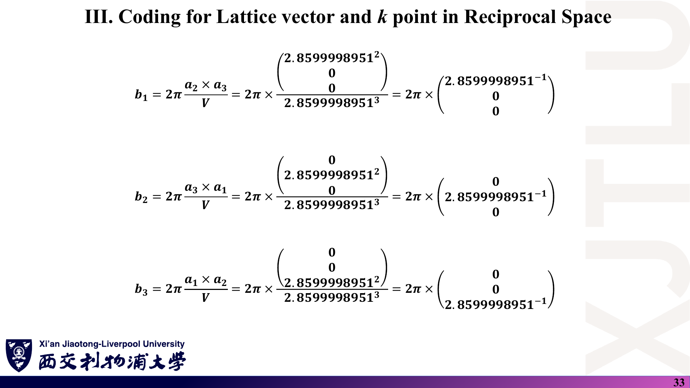

# 06 · 图文复习题与参考答案

[返回目录](README.md)

> 15 题均为根据讲义自编的练习，**不是课件原题或官方作业**。每题依次列出“课件截图 → 中文解释（题目）→ 原理深入（解析）→ Ref”。建议先遮住解析独立作答。截图保留原稿，正确公式以下方解析为准。

## 1. 格子、基元与晶体结构

### 课件截图

### 中文解释

**题目**：(a) 用一句话区分“Bravais 格子”和“晶体结构”。(b) BCC 铁若用立方惯用胞描述，晶格矢量和基元分别是什么？若用原胞描述呢？(c) 为什么说两种描述是同一晶体？

### 原理深入

(a) Bravais 格子是只由平移生成的点集 $\{\mathbf R\}$；晶体结构 = 格子 + 每个格点上的基元 $\{\boldsymbol\tau_s\}$。

(b) 惯用胞：$\mathbf a_i=a\hat{\mathbf e}_i$（简单立方格子），基元为 2 个 Fe：$(0,0,0)$ 与 $\tfrac a2(1,1,1)$。原胞：$\mathbf a_1=\tfrac a2(-1,1,1)$ 等（BCC 格子），基元 1 个 Fe。

(c) 两种描述生成的原子位置集合完全相同：惯用胞 SC 格点 $+\{0,\tfrac a2(1,1,1)\}$ 正好等于 BCC 格点集合。区别只在“哪些平移被当作格子”，因此倒格子、布里渊区的大小随之不同（前者布里渊区体积是后者的一半）。

### Ref

- **原课件**：[Lecture Five，PDF 第 3–5 页](../Lecture_Five.pdf#page=3)。
- **配套解释**：[01 第 1–2 节](01_晶体几何与空间群.md)；延伸 [SS1](README.md#ref-ss1)。

## 2. 格点计数与原胞体积

### 课件截图

### 中文解释

**题目**：(a) 数出 SC、BCC、FCC 惯用胞中的格点数。(b) 计算 FCC 原胞 $\tfrac a2(0,1,1)$、$\tfrac a2(1,0,1)$、$\tfrac a2(1,1,0)$ 的体积，并与 (a) 对照。

### 原理深入

(a) SC：$8\times\tfrac18=1$；BCC：$8\times\tfrac18+1=2$；FCC：$8\times\tfrac18+6\times\tfrac12=4$。

(b)

$$
V_{\rm p}=\left(\frac a2\right)^3\left|\det\begin{pmatrix}0&1&1\\1&0&1\\1&1&0\end{pmatrix}\right|=\frac{a^3}{8}\times2=\frac{a^3}{4}.
$$

惯用胞体积 $a^3$ 含 4 个格点，每个格点占 $a^3/4$，与原胞体积一致。这是检查原胞矢量是否取对的快捷方法。

### Ref

- **原课件**：[Lecture Five，PDF 第 5 页](../Lecture_Five.pdf#page=5)。
- **配套解释**：[01 第 2 节](01_晶体几何与空间群.md)。

## 3. 由 Wyckoff 位置生成原子

### 课件截图

### 中文解释

**题目**：Materials Project 只给出 Fe 的一行 “2a, Fe, 0 0 0”，为什么 `Fe.vasp` 里却有 2 个原子？“2a”中的“2”和“a”各代表什么？

### 原理深入

空间群 $Im\bar3m$ 含体心平移 $(\tfrac12,\tfrac12,\tfrac12)$。对代表点 $(0,0,0)$ 施加全部操作：点群操作保持原点不动，体心平移得到 $(\tfrac12,\tfrac12,\tfrac12)$。共 2 个不同点，所以惯用胞中有 2 个 Fe。

“2”是重数（惯用胞中等价点数），“a”是该空间群中 Wyckoff 位置的字母序号（a 通常是位置对称性最高的一类）。在 Materials Studio 中只需输入这一个代表坐标，软件会自动补全。

### Ref

- **原课件**：[Lecture Five，PDF 第 11 页](../Lecture_Five.pdf#page=11)；[Lecture Eight，PDF 第 7、10 页](../Lecture_Eight.pdf#page=7)。
- **配套解释**：[01 第 4 节](01_晶体几何与空间群.md)；延伸 [ITA](README.md#ref-ita)。

## 4. Wigner–Seitz 胞

### 课件截图

### 中文解释

**题目**：(a) 写出 WS 胞边界的方程，并解释为什么它就是“连线的中垂线”。(b) 二维六角格子（格距 $a$）的 WS 胞是什么形状？面积多大？与 $|\mathbf a_1\times\mathbf a_2|$ 比较。

### 原理深入

(a) $|\mathbf r|=|\mathbf r-\mathbf R|\iff\mathbf r\cdot\hat{\mathbf R}=\tfrac12|\mathbf R|$，这是过 $\mathbf R/2$ 且垂直于 $\mathbf R$ 的平面（二维为直线）。

(b) 正六边形，中心到边距离 $a/2$（6 个最近邻的中垂线），边长 $a/\sqrt3$。面积

$$
6\times\frac{\sqrt3}{4}\left(\frac a{\sqrt3}\right)^2=\frac{\sqrt3}{2}a^2=|\mathbf a_1\times\mathbf a_2|,
$$

与平行四边形原胞相同——WS 胞也恰含一个格点。

### Ref

- **原课件**：[Lecture Five，PDF 第 16–17 页](../Lecture_Five.pdf#page=16)。
- **配套解释**：[01 第 6 节](01_晶体几何与空间群.md)。

## 5. BCC 的倒格子

### 课件截图

### 中文解释

**题目**：由 BCC 原胞 $\mathbf a_1=\tfrac a2(-1,1,1)$、$\mathbf a_2=\tfrac a2(1,-1,1)$、$\mathbf a_3=\tfrac a2(1,1,-1)$ 求 $\mathbf b_1,\mathbf b_2,\mathbf b_3$，验证 $\mathbf a_1\cdot\mathbf b_1=2\pi$、$\mathbf a_2\cdot\mathbf b_1=0$，并说明它是什么格子。

### 原理深入

$V=a^3/2$，$\mathbf a_2\times\mathbf a_3=\tfrac{a^2}2(0,1,1)$，所以

$$
\mathbf b_1=\frac{2\pi}{a}(0,1,1),\quad\mathbf b_2=\frac{2\pi}{a}(1,0,1),\quad\mathbf b_3=\frac{2\pi}{a}(1,1,0).
$$

验算：$\mathbf a_1\cdot\mathbf b_1=\tfrac a2\cdot\tfrac{2\pi}a(0+1+1)=2\pi$；$\mathbf a_2\cdot\mathbf b_1=\tfrac a2\cdot\tfrac{2\pi}a(0-1+1)=0$。✓

这是惯用胞边长 $4\pi/a$ 的 FCC 格子的原胞矢量。因此 BCC 金属（如 Fe）的第一布里渊区是菱形十二面体，高对称点为 Γ、H、N、P。

### Ref

- **原课件**：[Lecture Six，PDF 第 4–6 页](../Lecture_Six.pdf#page=6)。
- **配套解释**：[02 第 2–3 节](02_倒空间与布里渊区.md)。

## 6. 核对 SeeK-path 的输出

### 课件截图

### 中文解释

**题目**：SeeK-path 对 Fe 给出原胞矢量 $\mathbf v_1=(-1.43152,1.43152,1.43152)$ Å 等，倒格矢 $\mathbf b_1=(0,2.19459,2.19459)$ Å⁻¹ 等。(a) 反推晶格常数 $a$。(b) 用分数坐标 $(0.25,0.25,0.25)$ 求 P 点的笛卡尔坐标。(c) 这里的倒格矢与第 8 讲 `kspace.dat` 的 2.19692 为何接近却不完全相同？两者的格子类型相同吗？

### 原理深入

(a) $a/2=1.43152$ → $a=2.86304$ Å；检验 $2\pi/a=2.19459$ ✓。

(b) $\mathbf k_P=0.25(\mathbf b_1+\mathbf b_2+\mathbf b_3)=0.25\times c\,(2,2,2)=\tfrac c2(1,1,1)=(1.0973,1.0973,1.0973)$ Å⁻¹，$c=2.19459$，与截图一致。

(c) 数值差异来自晶格常数：SeeK-path 用的是 Materials Project 结构（$a\approx2.863$ Å），`Fe.vasp` 用 2.86 Å。更重要的是**格子类型不同**：SeeK-path 用 BCC 原胞，倒格矢 $\tfrac{2\pi}a(0,1,1)$ 构成 FCC 倒格子；`Fe.vasp` 是立方惯用胞，倒格矢 $\tfrac{2\pi}a\hat{\mathbf e}_i$ 构成简单立方倒格子。只是 $2\pi/a$ 这个因子恰好相同。

### Ref

- **原课件**：[Lecture Six，PDF 第 20 页](../Lecture_Six.pdf#page=20)；[Lecture Eight，PDF 第 33 页](../Lecture_Eight.pdf#page=33)。
- **配套解释**：[02 第 8 节](02_倒空间与布里渊区.md)；延伸 [HPKOT](README.md#ref-hpkot)。

## 7. 石墨烯的倒格矢与高对称点

### 课件截图

### 中文解释

**题目**：取 $\mathbf a_1=a(1,0,0)$，$\mathbf a_2=a(\tfrac12,\tfrac{\sqrt3}2,0)$，$\hat{\mathbf n}=(0,0,1)$，$a=2.46$ Å。(a) 按讲义第 7 页原样计算 $\mathbf b_2$，会发现什么问题？(b) 写出正确的 $\mathbf b_1,\mathbf b_2$。(c) 求 $|\Gamma\mathbf K|$ 与 $|\Gamma\mathbf M|$ 的数值。

### 原理深入

(a) 原式 $\mathbf b_2=2\pi\,\mathbf a_2\times\hat{\mathbf n}/A$ 与 $\mathbf b_1$ 完全相同，两条倒格矢共线，不能张成倒格子；且 $\mathbf a_2\cdot\mathbf b_2=0\ne2\pi$。

(b) $\mathbf b_2=2\pi\,\hat{\mathbf n}\times\mathbf a_1/A$，$A=\tfrac{\sqrt3}2a^2$：

$$
\mathbf b_1=\frac{2\pi}{a}\Big(1,-\frac1{\sqrt3}\Big),\qquad\mathbf b_2=\frac{2\pi}{a}\Big(0,\frac2{\sqrt3}\Big).
$$

(c) $|\Gamma\mathbf K|=\dfrac{4\pi}{3a}=\dfrac{4\pi}{7.38}\approx1.703$ Å⁻¹；$|\Gamma\mathbf M|=\dfrac{2\pi}{\sqrt3a}\approx\dfrac{6.2832}{4.2608}\approx1.475$ Å⁻¹。比值 $\sqrt3/2\approx0.866$。

### Ref

- **原课件**：[Lecture Six，PDF 第 7、21 页](../Lecture_Six.pdf#page=7)。
- **配套解释**：[02 第 4、9 节](02_倒空间与布里渊区.md)；[07 第 2 节](07_讲义勘误与易错点.md)。

## 8. 为什么区外的 k 是冗余的？

### 课件截图

### 中文解释

**题目**：一维链格距 $a=3$ Å。(a) 第一布里渊区的范围？(b) $k=1.5\pi/a$ 的波在格点上与区内哪个 $k$ 等价？(c) 为什么说区边界是“Nyquist 频率”？

### 原理深入

(a) $[-\pi/a,\pi/a]\approx[-1.047,1.047]$ Å⁻¹。

(b) 减去 $G=2\pi/a$：$k'=1.5\pi/a-2\pi/a=-0.5\pi/a$。因为 $e^{ikna}=e^{ik'na}e^{i2\pi n}=e^{ik'na}$，两列波在所有格点 $x_n=na$ 上取值相同。

(c) 区边界 $k=\pi/a$，波长 $2a$，相邻格点相位差 $\pi$（正负交替）——这是离散采样能表示的最高空间频率；更大的 $k$ 会混叠回区内，与信号处理中的 Nyquist 采样定理完全类比。

### Ref

- **原课件**：[Lecture Six，PDF 第 11 页](../Lecture_Six.pdf#page=11)。
- **配套解释**：[02 第 6 节](02_倒空间与布里渊区.md)。

## 9. 晶体学限制定理

### 课件截图

### 中文解释

**题目**：(a) 写出绕 $z$ 轴转 $\theta$ 的矩阵并求其迹。(b) 证明周期晶体中不可能有五次旋转轴。(c) 讲义第 4–6 页把矩阵画在 $|\cdot|$ 中，这种记号有什么问题？

### 原理深入

(a) $R_z(\theta)$ 如 [03 第 1 节](03_晶体对称性与能带.md)，$\operatorname{Tr}R_z=1+2\cos\theta$。

(b) 在晶格基下对称旋转把格矢映为格矢，矩阵元全为整数，迹为整数；迹在相似变换下不变，所以 $1+2\cos\theta\in\mathbb Z$。$\theta=72°$ 时 $1+2\cos72°\approx1.618$，不是整数，故五次轴不允许。允许的只有 $2\cos\theta\in\{-2,-1,0,1,2\}$，即 $n=1,2,3,4,6$。

(c) 单竖线 $|M|$ 是行列式记号，其值是一个数（旋转为 1，镜面与反演为 −1），不是操作矩阵本身；应写成圆括号或方括号。

### Ref

- **原课件**：[Lecture Seven，PDF 第 4–6 页](../Lecture_Seven.pdf#page=4)。
- **配套解释**：[03 第 1 节](03_晶体对称性与能带.md)；[07 第 7 节](07_讲义勘误与易错点.md)。

## 10. 时间反演、反演与自旋简并

### 课件截图

### 中文解释

**题目**：判断下列体系中，任意 k 点上自旋上、下能带是否重合，并说明依据：(a) 无磁、有反演中心、计入 SOC 的硅；(b) 无磁、无反演中心、计入 SOC 的 Janus 单层；(c) 铁磁 BCC Fe。

### 原理深入

(a) **重合**（二重简并）。T：$E(\mathbf k,\uparrow)=E(-\mathbf k,\downarrow)$；P：$E(-\mathbf k,\downarrow)=E(\mathbf k,\downarrow)$ ⇒ $E(\mathbf k,\uparrow)=E(\mathbf k,\downarrow)$。有 SOC 时 ↑/↓ 应理解为 Kramers 对。

(b) **一般 k 点不重合**。只剩 T，只保证 $\mathbf k$ 与 $-\mathbf k$ 的配对；SOC 可在一般 k 点产生自旋劈裂（Rashba 型等）。在时间反演不变动量（如 Γ）上仍有 Kramers 简并。

(c) **不重合**。铁磁序破坏 T，自旋上、下能带有交换劈裂（讲义第 9 页所说“沿能量轴移开”）；mp-13 的总磁矩 2.64 μB/f.u. 就是两自旋通道占据不同的结果。

### Ref

- **原课件**：[Lecture Seven，PDF 第 9–10 页](../Lecture_Seven.pdf#page=9)；[Lecture Five，PDF 第 15 页](../Lecture_Five.pdf#page=15)（mp-13 磁矩）。
- **配套解释**：[03 第 4 节](03_晶体对称性与能带.md)；延伸 [GT](README.md#ref-gt)。

## 11. 由能带曲率求有效质量

### 课件截图

### 中文解释

**题目**（已知 $\hbar^2/2m_e\approx3.81$ eV·Å²）：(a) 导带底附近 $E(k)=E_c+7.62\,k^2$（eV，$k$ 以 Å⁻¹ 计），求 $m^*/m_e$。(b) 一维紧束缚带 $E=-2t\cos ka$，$t=1$ eV、$a=2$ Å，求带底 $k=0$ 处的 $m^*/m_e$。(c) 带顶 $k=\pi/a$ 处的有效质量符号如何？意味着什么？

### 原理深入

(a) $\partial^2E/\partial k^2=2\times7.62$ eV·Å²，$m^*=\hbar^2/(2\times7.62)$，故 $m^*/m_e=3.81/7.62=0.5$。

(b) $\partial^2E/\partial k^2|_{k=0}=2ta^2$，$m^*=\hbar^2/(2ta^2)$，$m^*/m_e=3.81/(1\times4)\approx0.95$。

(c) $\partial^2E/\partial k^2|_{\pi/a}=-2ta^2<0$，电子有效质量为负；该处的缺电子态作为**空穴**处理，其有效质量为正 $\hbar^2/(2ta^2)$。带宽越窄（$t$ 越小），有效质量越大——极限是讲义中的平带。

### Ref

- **原课件**：[Lecture Seven，PDF 第 17 页](../Lecture_Seven.pdf#page=17)。
- **配套解释**：[03 第 5、7 节](03_晶体对称性与能带.md)；延伸 [SS1](README.md#ref-ss1)。

## 12. 由基组数出能带数

### 课件截图

### 中文解释

**题目**：(a) 按 `Ga7.0-s2p2d2`、`O6.0-s2p2d1` 重新计算 Ga、O 每原子的轨道数和 Ga₆₄O₉₆ 胞的总能带数，并与讲义比较。(b) 若打开 SOC（非共线自旋），能带数变为多少？(c) 如果改用石墨烯 C 的 `s1p1` 基组（假设记号含义相同），2 原子原胞有几条能带？

### 原理深入

(a) Ga：$2\times1+2\times3+2\times5=18$（讲义误写 19）；O：13。总数 $18\times64+13\times96=1152+1248=2400$（讲义写 2426；按其自身数值 $1216+1248$ 也应为 2464）。

(b) 自旋两分量使哈密顿量维数加倍：4800。

(c) 每个 C：$1+3=4$，共 8 条能带——其中 2 条来自 $p_z$（π、π*），6 条来自 s、$p_x$、$p_y$（σ 带）。只保留 $p_z$ 的最小紧束缚模型才是 $2\times2$。

### Ref

- **原课件**：[Lecture Seven，PDF 第 19 页](../Lecture_Seven.pdf#page=19)。
- **配套解释**：[03 第 9 节](03_晶体对称性与能带.md)；[07 第 4 节](07_讲义勘误与易错点.md)；延伸 [OMX](README.md#ref-omx)。

## 13. 3N 规则

### 课件截图

### 中文解释

**题目**：(a) 证明 $N\times N$ 石墨烯超胞中，原 K 点折叠到超胞布里渊区 $\Gamma$ 的条件是 $3\mid N$。(b) 4×4 与 6×6 超胞中，Dirac 点分别出现在哪里？(c) 讲义第 21 页左侧句子缺了哪个符号？

### 原理深入

(a) $\mathbf K=\tfrac23\mathbf b_1+\tfrac13\mathbf b_2=\tfrac{2N}3\mathbf B_1+\tfrac N3\mathbf B_2$，其中 $\mathbf B_i=\mathbf b_i/N$。系数全为整数 ⇔ $3\mid N$，此时 $\mathbf K$ 是超胞倒格点，等价于 $\Gamma$。

(b) 4×4：$\mathbf K=\tfrac83\mathbf B_1+\tfrac43\mathbf B_2\equiv\tfrac23\mathbf B_1+\tfrac13\mathbf B_2$，即超胞布里渊区的 K 点；6×6：$\mathbf K=4\mathbf B_1+2\mathbf B_2\equiv\Gamma$。与第 21 页图中 3×3、6×6、9×9 在 Γ 出现交叉一致。

(c) 应为 “folded onto **Γ** point”；原 PDF 中该字母缺失（文本层与两种渲染器均无此字符）。

### Ref

- **原课件**：[Lecture Seven，PDF 第 20–21 页](../Lecture_Seven.pdf#page=20)。
- **配套解释**：[03 第 10 节](03_晶体对称性与能带.md)；延伸 [3N](README.md#ref-3n)。

## 14. 程序会算错吗？

### 课件截图

### 中文解释

**题目**：`LATTICECONVERSION.f90` 读取 `Fe.vasp` 时跳过前两行。(a) 若把 `Fe.vasp` 第 2 行改为 `2.0` 而晶格矢量不变，真实的倒格矢是多少？程序输出多少？(b) 若改用 BCC 原胞：缩放因子 1.0，三行为 $(-1.43,1.43,1.43)$、$(1.43,-1.43,1.43)$、$(1.43,1.43,-1.43)$，程序输出的第一行是什么？

### 原理深入

(a) 真实晶格常数 $2\times2.86=5.72$ Å，倒格矢应为 $2\pi/5.72\approx1.0985$ Å⁻¹；但程序跳过缩放因子，仍输出 2.1969180202——**错误放大 2 倍**。修正方法：读入缩放因子 $s$，若 $s>0$ 则晶格矢量乘 $s$（$s<0$ 时按 $|s|$ 为体积重新缩放）。

(b) $a=2.86$ 的 BCC 原胞，$\mathbf b_1=\tfrac{2\pi}{a}(0,1,1)$，程序第一行输出 `0.0000000000  2.1969179396  2.1969179396`（每行是一条 $\mathbf b_i$，三列为 $x,y,z$ 分量）〔核验：本笔记作者用此输入实际运行原程序所得〕。这里 $a/2=1.43$ 恰好对应 $a=2.86$，所以是 $2\pi/2.86=2.1969179396$，与 `kspace.dat` 的 2.1969180202 只相差约 $8\times10^{-8}$ Å⁻¹（后者来自 2.8599998951）。

### Ref

- **原课件**：[Lecture Eight，PDF 第 32–33、36 页](../Lecture_Eight.pdf#page=33)。
- **配套解释**：[08 第 2、6 节](08_代码导读.md)；延伸 [POSCAR](README.md#ref-poscar)。

## 15. 带隙分类与 n/p 型

### 课件截图

### 中文解释

**题目**：(a) 按讲义的阈值给石墨烯、金红石 TiO₂（图中 Y 掺杂体系标注 1.75 eV）、SiO₂（5.4 eV）分类。(b) 第 14 页 p 型一句应怎样改？(c) 为什么不能直接拿这些 DFT 带隙和实验值比较？

### 原理深入

(a) 石墨烯：$E_g=0$，讲义归为导体（更准确叫半金属/零带隙半导体）；TiO₂ 体系：半导体；SiO₂：绝缘体。

(b) “p 型：空穴为多数载流子，$E_F$ 靠近**价带顶（VBM，maximum of the valence band）**”。原文 “minimum of Valence Band” 与 n 型一句的 “minimum of Conduction Band” 不对称，属笔误。

(c) LDA/GGA 等半局域泛函系统性低估带隙（SiO₂ 的实验光学带隙约 9 eV 量级，远大于 5.4 eV）；掺杂超胞中的 $E_F$ 还受浓度、补偿与超胞大小影响。比较时需说明泛函，必要时用杂化泛函或 GW 校正。

### Ref

- **原课件**：[Lecture Seven，PDF 第 13–16 页](../Lecture_Seven.pdf#page=13)。
- **配套解释**：[03 第 6 节](03_晶体对称性与能带.md)；[07 第 3 节](07_讲义勘误与易错点.md)；延伸 [SS2](README.md#ref-ss2)。
